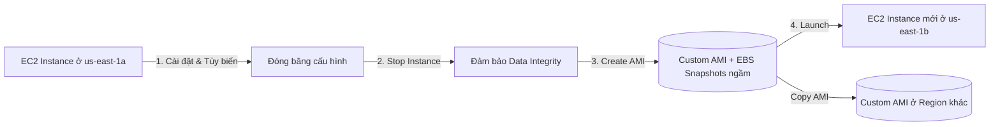

# Amazon Machine Image (AMI)

## 1. Tổng quan & Khái niệm cốt lõi
* **Định nghĩa**: AMI (Amazon Machine Image) là bản mẫu đóng gói (template) chứa toàn bộ cấu hình cần thiết để khởi chạy một EC2 instance.
* **Thành phần của một AMI**:
  * Hệ điều hành (Operating System: Linux, Windows...).
  * Các phần mềm, môi trường thực thi (runtime), công cụ giám sát (monitoring agents), bản vá bảo mật đã được cài đặt sẵn.
  * **Block Device Mapping**: Cấu hình xác định các volume nào (EBS volumes hoặc Instance Store volumes) sẽ được gắn vào instance khi khởi chạy.
* **Lợi ích chính**:
  * **Rút ngắn thời gian khởi động (Boot time)**: Thay vì dùng User Data script để tải và cài đặt phần mềm mỗi khi khởi chạy instance, mọi thứ đã được "đóng băng" (pre-packaged/pre-baked) trong AMI.
  * **Chuẩn hóa môi trường**: Đảm bảo tất cả các máy chủ trong cụm Auto Scaling Group đồng nhất 100% về cấu hình phần mềm và bảo mật.

---

## 2. Phạm vi hoạt động & Phân loại AMI

### Phạm vi (Scope): Region-scoped
* AMI bị ràng buộc chặt chẽ theo từng **AWS Region**.
* Một AMI được tạo tại `us-east-1` **không thể** dùng trực tiếp để launch instance ở `ap-southeast-1`.
* **Giải pháp đa vùng (Multi-Region)**: Sử dụng tính năng **Copy AMI** để sao chép AMI từ Region nguồn sang Region đích, tận dụng hạ tầng toàn cầu của AWS.

### Phân loại AMI
1. **AWS Public AMIs**:
   * Do chính AWS cung cấp và duy trì cập nhật định kỳ.
   * Ví dụ: Amazon Linux 2, Amazon Linux 2023, Ubuntu Server, Red Hat Enterprise Linux, Windows Server.
2. **Custom AMIs (Private)**:
   * Do người dùng tự tạo từ instance của mình và lưu trữ riêng trong tài khoản AWS.
   * Người dùng tự chịu trách nhiệm bảo trì, cập nhật phiên bản và vá lỗi bảo mật.
   * Có thể chia sẻ quyền khởi chạy (Launch Permission) sang các AWS Account khác.
3. **AWS Marketplace AMIs**:
   * Các mẫu AMI được các nhà cung cấp phần mềm (ISVs/Vendors) đóng gói sẵn giải pháp thương mại và bán hoặc chia sẻ thông qua AWS Marketplace (ví dụ: SAP, WordPress, Cisco Firewall...).

---

## 3. Quy trình tạo Custom AMI từ EC2 Instance

Mermaid diagram mô tả luồng tạo và nhân bản instance qua AMI:

1. **Khởi chạy & Tùy biến**: Khởi chạy một instance gốc (ví dụ trong `us-east-1a`), cài đặt phần mềm và cấu hình.
2. **Dừng Instance (Stop Instance)**: Khuyến nghị dừng instance để dữ liệu trong bộ nhớ đệm (RAM/cache) được ghi hoàn toàn xuống ổ đĩa, đảm bảo tính toàn vẹn dữ liệu (Data Integrity).
3. **Tạo AMI (Create Image)**: Hệ thống sẽ tự động tạo các **EBS Snapshots** cho các volume gắn kèm dưới nền tảng.
4. **Khởi chạy từ AMI**: Sử dụng AMI vừa tạo để nhân bản các instance mới sang các Availability Zone khác (ví dụ `us-east-1b`) hoặc sang Region khác sau khi copy.

---

## 4. Điểm cần lưu ý & Mẹo thi (Exam Tips)
* **Reboot khi tạo AMI**: Theo mặc định của AWS Management Console, instance sẽ tự động reboot khi tạo AMI để đảm bảo snapshot nhất quán. Nếu chọn tùy chọn *No reboot*, bạn có thể tạo AMI khi instance đang chạy, nhưng rủi ro file system có thể không nhất quán.
* **Snapshot ngầm**: Khi xóa (deregister) một Custom AMI, các **EBS Snapshots** liên kết với AMI đó **không tự động bị xóa**. Bạn phải tự xóa các Snapshot này thủ công nếu muốn tránh phát sinh chi phí lưu trữ S3.
* **Quyền sở hữu**: Không thể chỉnh sửa trực tiếp một AMI có sẵn. Nếu muốn cập nhật, bạn phải khởi chạy 1 instance từ AMI cũ, sửa đổi cấu hình, rồi tạo ra một AMI mới.

---

## 5. Bổ sung kỹ thuật chuẩn AWS
* **EC2 Image Builder**: Dịch vụ chính thức của AWS dùng để tự động hóa toàn bộ vòng đời tạo, kiểm thử, quét lỗ hổng bảo mật và phân phối AMI (Golden AMI Pipeline) mà không cần can thiệp thủ công.
* **Mã hóa AMI**: Khi Copy AMI, bạn có thể đồng thời mã hóa (encrypt) hoặc đổi khóa AWS KMS key cho các snapshot đính kèm trong AMI đích.
* **Chia sẻ AMI an toàn**:
  * AMI có thể để chế độ **Private** (mặc định), **Public** (cho toàn thế giới), hoặc **Explicit** (chỉ định Account ID cụ thể).
  * Đối với AMI được mã hóa bằng KMS, muốn chia sẻ với Account khác bắt buộc phải dùng **Customer Managed Key (CMK)**, không thể dùng Default AWS-managed key (`aws/ebs`).