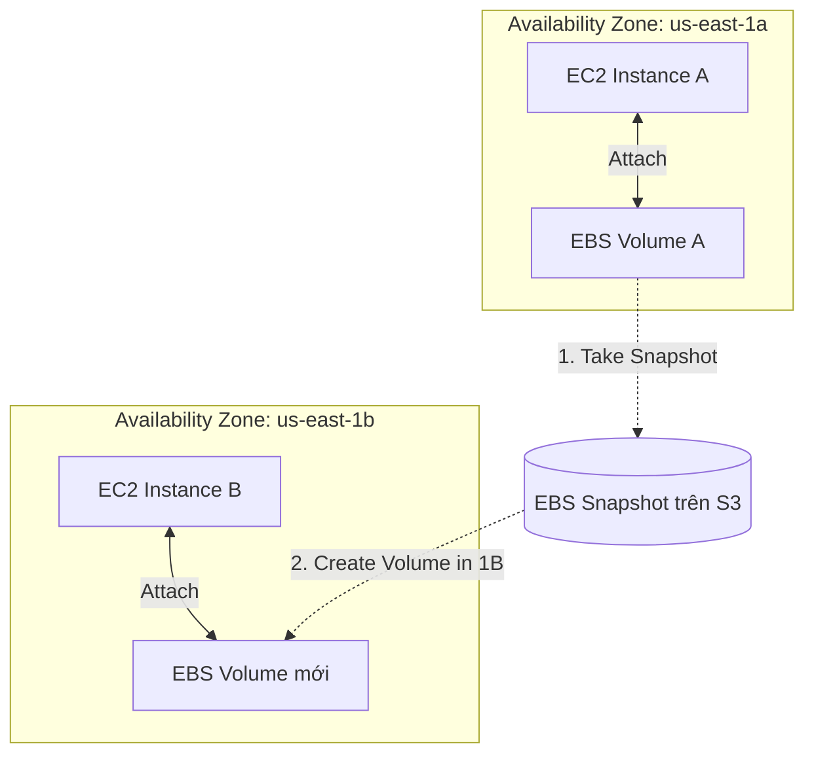

# Amazon EBS (Elastic Block Store) - Tổng quan

## 1. Tổng quan & Bản chất dịch vụ
* **Định nghĩa**: Amazon EBS là dịch vụ lưu trữ khối cấp độ mạng (**Network Block Storage**) hiệu năng cao, được thiết kế để gắn kèm vào các EC2 instance.
* **Mô hình "Network USB Drive"**: Hãy hình dung EBS volume như một chiếc USB gắn qua mạng nội bộ:
  * Ổ đĩa **không nằm vật lý bên trong máy chủ EC2** mà nằm trên một hệ thống lưu trữ phân tán độc lập của AWS.
  * Giao tiếp giữa EC2 và EBS thông qua kết nối mạng nội bộ tốc độ cao của AWS, do đó có độ trễ nhỏ (vài mili-giây) so với ổ cứng gắn trực tiếp trên phần cứng máy chủ.
  * Có thể **tháo gỡ (Detach)** khỏi instance này và **gắn lại (Attach)** vào một instance khác rất nhanh chóng, cực kỳ hữu ích cho các kịch bản dự phòng lỗi (failover) và phục hồi thảm họa.

---

## 2. Đặc tính kỹ thuật cốt lõi

### 2.1. Ràng buộc theo Availability Zone (AZ-Locked)
* Mỗi EBS Volume được khởi tạo sẽ **bị khóa cố định trong một Availability Zone (AZ)** cụ thể (ví dụ: `us-east-1a`).
* Một EBS volume ở `us-east-1a` **chỉ có thể gắn vào EC2 instance nằm trong cùng AZ `us-east-1a`**. Không thể gắn trực tiếp sang instance ở `us-east-1b`.
* **Cách chuyển Volume sang AZ khác**:
  1. Tạo **EBS Snapshot** từ volume nguồn.
  2. Dùng snapshot đó để khôi phục (Restore/Create Volume) thành một volume mới tại AZ đích.

### 2.2. Cơ chế cấp phát & Tính phí (Provisioned Capacity)
* Bạn phải xác định trước dung lượng (**Size tính bằng GiB/TiB**) và hiệu năng (**IOPS, Throughput**) khi tạo volume.
* **Cách tính phí**: Chi phí được tính dựa trên **dung lượng và thông số bạn đã cấp phát (Provisioned)**, bất kể bạn có lưu dữ liệu đầy ổ đĩa hay chưa.
* **Volume độc lập (Unattached Volume)**: EBS volume có thể tồn tại ở trạng thái tách rời (Available / Unattached). Cần lưu ý: **Volume unattached vẫn tiếp tục bị tính phí lưu trữ** cho đến khi bạn chủ động xóa (Delete).

### 2.3. Mối quan hệ gắn kết (Attachment Topology)
* **Một EC2 Instance**: Có thể gắn **nhiều EBS Volumes** cùng lúc (ví dụ: 1 ổ Root cho OS, nhiều ổ phụ cho Data, Logs).
* **Một EBS Volume**: Mặc định **chỉ được gắn vào DUY NHẤT một EC2 instance** tại một thời điểm (trừ tính năng đặc thù *EBS Multi-Attach* chỉ áp dụng cho dòng io1/io2 trong cùng AZ).

---

## 3. Thuộc tính "Delete on Termination"
Thuộc tính `Delete on Termination` điều khiển hành vi của EBS Volume khi EC2 Instance bị chấm dứt (Terminate):

| Loại Volume | Giá trị mặc định (Default) | Hành vi khi Instance bị Terminate |
| :--- | :--- | :--- |
| **Root Volume** (chứa hệ điều hành) | **Enabled (`true`)** | Volume sẽ **bị xóa cùng** với Instance. |
| **Attached Volume** (các ổ gắn thêm) | **Disabled (`false`)** | Volume được **giữ lại nguyên vẹn** (trở về trạng thái `Available`). |

* **Kịch bản thực tế**: Nếu bạn muốn lưu giữ lại Root volume của một máy chủ để trích xuất log, điều tra sự cố hoặc khôi phục dữ liệu sau khi terminate instance, hãy tắt thuộc tính này (`Delete on Termination = false`). Có thể cấu hình thuộc tính này lúc khởi chạy instance hoặc chỉnh sửa thông qua AWS CLI/Console sau khi instance đã chạy.

---

## 4. Điểm cần lưu ý & Mẹo thi (Exam Tips)
* **Khác biệt với Instance Store**: EBS volume có tính bền vững (**Persistent**), dữ liệu vẫn tồn tại khi instance bị Stop và Start lại.
* **EBS Volume không thể thu nhỏ dung lượng**: Bạn chỉ có thể tăng dung lượng (Increase size), không thể giảm dung lượng trực tiếp. Nếu muốn giảm kích thước, bạn phải tạo một volume mới nhỏ hơn và copy dữ liệu ở mức hệ điều hành.
* **Dọn dẹp tài nguyên**: Luôn kiểm tra các unattached EBS volume không còn sử dụng để tránh lãng phí ngân sách.

---

## 5. Bổ sung kỹ thuật chuẩn AWS
* **EBS Elastic Volumes**: Tính năng cho phép bạn tăng kích thước dung lượng, thay đổi số lượng IOPS/Throughput hoặc chuyển đổi giữa các loại volume (ví dụ từ `gp2` sang `gp3`) khi volume **đang trực tuyến (In-Use) mà không cần ngắt kết nối (Zero Downtime)**.
* **Độ bền nội tại (Durability)**: Mọi EBS volume đều được AWS tự động nhân bản (replicate) ngầm qua nhiều máy chủ trong cùng 1 Availability Zone để ngăn ngừa mất dữ liệu do sự cố hỏng hóc một linh kiện phần cứng đơn lẻ (độ sẵn sàng thiết kế 99.9% availability, độ bền 99.8% - 99.9% durability).
