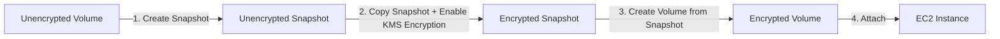

# Mã hóa EBS (EBS Encryption)

## 1. Tổng quan & Phạm vi bảo vệ
Mã hóa Amazon EBS là giải pháp bảo mật dữ liệu toàn diện, được tích hợp liền mạch với **AWS Key Management Service (AWS KMS)** bằng thuật toán chuẩn công nghiệp **AES-256**.

Khi bạn kích hoạt mã hóa trên một EBS Volume, toàn bộ các thành phần sau sẽ được bảo vệ tự động:
* **Dữ liệu tĩnh (Data at rest)**: Tất cả dữ liệu lưu trữ bên trong volume được mã hóa.
* **Dữ liệu trên đường truyền (Data in flight)**: Toàn bộ lưu lượng truyền tải qua mạng giữa máy chủ EC2 instance và ổ đĩa EBS volume đều được mã hóa tự động.
* **Tất cả các Snapshots**: Mọi snapshot được tạo ra từ volume mã hóa sẽ mặc định được mã hóa.
* **Tất cả các Volumes mới**: Mọi volume được khôi phục hoặc tạo ra từ snapshot đã mã hóa sẽ tự động được mã hóa.

> **Tác động hiệu năng**: Quá trình mã hóa và giải mã được xử lý trực tiếp bởi phần cứng ảo hóa Nitro của AWS, diễn ra hoàn toàn trong suốt (Transparent) và có **tác động tối thiểu (hầu như không đáng kể) tới độ trễ I/O**.

---

## 2. Quy trình mã hóa một Unencrypted EBS Volume
Bạn **không thể trực tiếp bật mã hóa** cho một EBS Volume đang ở trạng thái không mã hóa (Unencrypted). Để mã hóa volume này, bạn phải thực hiện theo quy trình chuẩn sau:

### Các bước thực hiện chi tiết:
1. **Bước 1**: Tạo một Snapshot từ EBS Volume không mã hóa ban đầu (kết quả là một *Unencrypted Snapshot*).
2. **Bước 2**: Sử dụng thao tác **Copy Snapshot**, tick chọn **Enable Encryption** và chỉ định **KMS Key** mong muốn (kết quả là một *Encrypted Snapshot*).
3. **Bước 3**: Từ *Encrypted Snapshot* vừa tạo, chọn **Create Volume from Snapshot** (volume mới tạo ra sẽ tự động được mã hóa).
4. **Bước 4**: Tháo (Detach) volume cũ và gắn (Attach) volume mã hóa mới vào EC2 instance.

> **Đường tắt (Shortcut trên Console/CLI)**: Bạn có thể chọn trực tiếp *Create Volume from Snapshot* từ một Unencrypted Snapshot, và ngay tại giao diện tạo Volume, hãy tích chọn **Encrypt this volume** cùng khóa KMS. AWS sẽ tự động mã hóa volume mới tạo ra mà không cần qua bước copy snapshot thủ công.

---

## 3. Quy tắc mã hóa Snapshot & Chia sẻ khóa KMS

| Tình huống Snapshot | Trạng thái mã hóa | Thao tác Copy Snapshot |
| :--- | :--- | :--- |
| Snapshot tạo từ **Unencrypted Volume** | **Unencrypted** | Cho phép bật mã hóa khi Copy |
| Snapshot tạo từ **Encrypted Volume** | **Encrypted** (Bắt buộc) | Luôn mã hóa (có thể đổi sang KMS Key khác khi Copy) |

### Lưu ý quan trọng khi chia sẻ Snapshot giữa các AWS Account:
* **Không thể chia sẻ** một encrypted snapshot nếu snapshot đó được mã hóa bằng **Default AWS-managed KMS Key** (`aws/ebs`).
* **Giải pháp**:
  1. Sử dụng **Customer Managed Key (CMK)** để mã hóa snapshot.
  2. Cập nhật **Key Policy** của CMK đó để cấp quyền sử dụng cho AWS Account đích.
  3. Chia sẻ snapshot sang Account đích.
  4. Ở Account đích, thực hiện Copy Snapshot về tài khoản của mình bằng một KMS Key thuộc quyền sở hữu của tài khoản đích để sử dụng.

---

## 4. Điểm cần lưu ý & Mẹo thi (Exam Tips)
* **Không thể gỡ bỏ mã hóa**: Một khi volume hoặc snapshot đã được mã hóa, bạn **không thể** copy nó thành một bản unencrypted (Không hỗ trợ giải mã ngược lại thành volume không mã hóa).
* **Quyền IAM & KMS**: Để launch một EC2 instance có gắn encrypted EBS volume, IAM Role hoặc người dùng phải có quyền truy cập vào dịch vụ KMS (`kms:CreateGrant`, `kms:Decrypt`, `kms:DescribeKey`).

---

## 5. Bổ sung kỹ thuật chuẩn AWS: EBS Encryption by Default
* **Khái niệm**: Là thiết lập bảo mật cấp độ tài khoản trên từng Region (**Account & Region-specific setting**).
* **Lợi ích**: Khi tính năng này được kích hoạt, **tất cả các EBS Volume và Snapshot mới được tạo trong Region đó sẽ tự động được mã hóa 100%** bằng khóa KMS mặc định hoặc khóa KMS do bạn chọn, ngăn chặn triệt để tình trạng người dùng vô tình tạo ổ đĩa không mã hóa, đáp ứng các tiêu chuẩn bảo mật nghiêm ngặt (HIPAA, PCI-DSS).