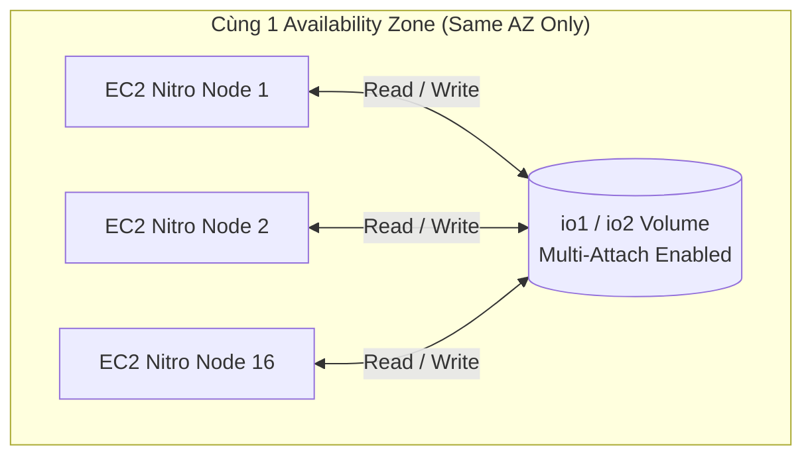

# EBS Multi-Attach

## 1. Khái niệm cốt lõi
* **Định nghĩa**: **EBS Multi-Attach** là tính năng cao cấp cho phép gắn cùng một EBS Volume vào **nhiều EC2 instances đồng thời** với đầy đủ quyền đọc và ghi (**Full Read & Write permissions**).
* **Mô hình hoạt động**:
  * Cho phép nhiều máy chủ truy cập trực tiếp vào cùng một khối lưu trữ dùng chung ở tầng block (shared block storage).
  * Giúp đạt tính sẵn sàng cao (High Availability) cho các ứng dụng dạng cụm (clustered applications) khi cần cơ chế dự phòng failover nhanh hoặc chia sẻ dữ liệu tức thời.

---

## 2. Các giới hạn & Ràng buộc kỹ thuật nghiêm ngặt

| Tiêu chí | Quy định của AWS |
| :--- | :--- |
| **Loại Volume hỗ trợ** | **CHỈ hỗ trợ họ Provisioned IOPS SSD: `io1` và `io2` Block Express**. Không hỗ trợ `gp2`, `gp3`, `st1`, `sc1`. |
| **Phạm vi vùng khả dụng** | **Chỉ trong CÙNG một Availability Zone (Same AZ)**. Tuyệt đối không thể gắn xuyên các AZ khác nhau. |
| **Số lượng Instance tối đa** | Tối đa **16 EC2 Instances** được gắn vào cùng 1 volume tại một thời điểm. |
| **Loại Instance hỗ trợ** | Bắt buộc phải là các dòng máy chủ **EC2 Nitro System**. |
| **Hỗ trợ Boot Volume** | **KHÔNG**. Không thể dùng Multi-Attach cho Boot/Root volume (chỉ dùng cho Data volumes). |

---

## 3. Yêu cầu bắt buộc về File System (Cluster-Aware File System)
Đây là kiến thức quan trọng nhất cần ghi nhớ về Multi-Attach:
* **Vấn đề**: Các hệ thống tệp thông thường (Standard File Systems như **ext4, XFS, NTFS**) được thiết kế với giả định chỉ có **duy nhất một hệ điều hành** điều khiển việc đọc/ghi và cache dữ liệu của ổ đĩa. Nếu nhiều instance cùng ghi vào một volume dùng file system thông thường, dữ liệu sẽ bị ghi đè lẫn nhau dẫn đến lỗi hỏng dữ liệu nghiêm trọng (**Data Corruption**).
* **Giải pháp bắt buộc**: Để sử dụng Multi-Attach an toàn cho việc ghi dữ liệu đồng thời, ứng dụng phải sử dụng một hệ thống tệp nhận biết cụm (**Cluster-Aware File System**):
  * Ví dụ: **GFS2 (Global File System 2)**, **OCFS2 (Oracle Clustered File System 2)**.
  * Hoặc ứng dụng cấp cao phải có lớp điều phối ghi đồng thời chuyên dụng (Distributed Lock Manager - DLM).

---

## 4. Điểm cần lưu ý & Mẹo thi (Exam Tips)
1. **Phân biệt rõ ràng giữa EBS Multi-Attach và Amazon EFS**:
   * **EBS Multi-Attach**: Cung cấp lưu trữ mức khối (**Block-level**), giới hạn tối đa **16 instances**, bắt buộc **cùng 1 AZ**, yêu cầu cluster-aware file system.
   * **Amazon EFS**: Cung cấp lưu trữ mức tệp (**File-level / POSIX NFS**), hỗ trợ **hàng nghìn instances**, hoạt động **xuyên nhiều AZ (Multi-AZ)**, sẵn sàng dùng ngay không cần cài đặt cluster file system phức tạp.
2. **Nhớ con số 16**: Trong bài thi AWS Certified Solutions Architect, số lượng kết nối tối đa cho Multi-Attach là **16 Nitro instances**.

---

## 5. Tình huống sử dụng thực tế (Use Cases)
* **Clustered Database / Data Warehouse**: Cụm cơ sở dữ liệu phân tán như Teradata yêu cầu lưu trữ block tốc độ cao với khả năng truy cập đồng thời từ nhiều node tính toán.
* **Active-Passive Failover tốc độ cao**: Hai máy chủ EC2 cùng gắn sẵn vào 1 volume chung (node Active đọc/ghi, node Standby ở trạng thái chờ). Khi node Active gặp sự cố, node Standby có thể lập tức tiếp quản việc xử lý mà không cần mất thời gian Detach/Attach lại volume qua mạng.