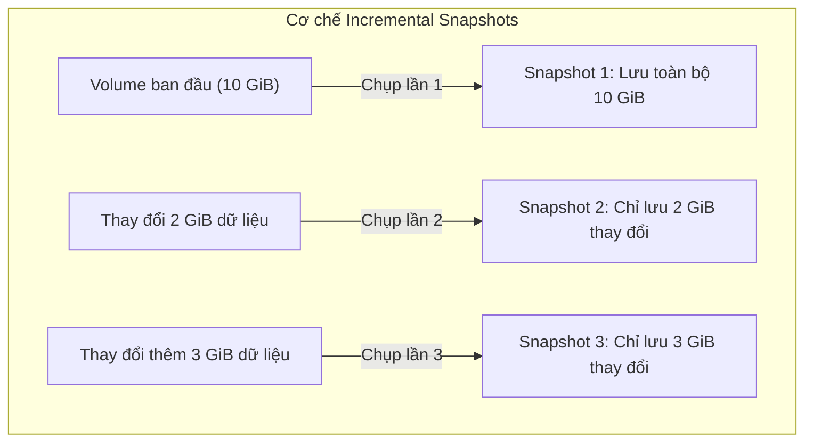

# EBS Snapshots & Tính năng nâng cao

## 1. Tổng quan & Cơ chế hoạt động
* **Định nghĩa**: EBS Snapshot là bản sao lưu tại một thời điểm nhất định (**Point-in-time backup**) của một EBS volume, được lưu trữ an toàn dưới nền tảng **Amazon S3** (mặc dù người dùng không nhìn thấy trực tiếp trong S3 bucket).
* **Cơ chế sao lưu gia tăng (Incremental Backup)**:
  * **Snapshot đầu tiên (Full)**: Sao chép toàn bộ các block dữ liệu đang có trên volume.
  * **Các Snapshot tiếp theo (Incremental)**: Chỉ sao lưu các block dữ liệu bị thay đổi (changed blocks) kể từ lần snapshot gần nhất.
  * **Tối ưu chi phí & dung lượng**: Cơ chế này giúp giảm thiểu dung lượng lưu trữ trên S3 và rút ngắn thời gian chụp snapshot.

---

## 2. Di chuyển Volume xuyên AZ và xuyên Region
EBS volume bị khóa theo từng Availability Zone, do đó **Snapshot là phương thức duy nhất để di chuyển một volume**:
1. **Chuyển volume sang AZ khác (trong cùng Region)**:
   * Chụp Snapshot từ Volume gốc ở `us-east-1a`.
   * Sử dụng snapshot đó để tạo Volume mới (Create Volume from Snapshot) tại AZ đích `us-east-1b`.
2. **Chuyển volume sang Region khác**:
   * Chụp Snapshot tại Region nguồn (ví dụ: `us-east-1`).
   * Sử dụng tính năng **Copy Snapshot** để chuyển snapshot sang Region đích (ví dụ: `ap-southeast-1`).
   * Tạo Volume mới từ snapshot tại Region đích.

---

## 3. Các tính năng nâng cao quan trọng

### 3.1. EBS Snapshot Archive
* **Mục đích**: Chuyển các snapshot dùng cho mục đích tuân thủ quy định (compliance) hoặc lưu trữ dài hạn ít khi dùng vào một tầng lưu trữ riêng biệt (Archive Tier).
* **Ưu điểm**: Chi phí lưu trữ rẻ hơn tới **75%** so với tầng snapshot tiêu chuẩn.
* **Đặc tính**: Thời gian khôi phục (Restore) dữ liệu từ tầng Archive trở lại tầng Standard mất từ **24 đến 72 giờ**.

### 3.2. Recycle Bin for EBS Snapshots
* **Mục đích**: Thiết lập một "Thùng rác" bảo vệ chống lại các rủi ro do vô tình xóa nhầm snapshot (Accidental deletion) của quản trị viên hoặc script tự động.
* **Cơ chế**: Khi một snapshot bị xóa, nó sẽ không biến mất vĩnh viễn ngay lập tức mà được giữ lại trong Recycle Bin theo quy tắc lưu giữ (**Retention Rule**).
* **Thời gian giữ lại**: Cấu hình linh hoạt từ **1 ngày đến 1 năm (365 ngày)**. Trong khoảng thời gian này, bạn có thể khôi phục lại snapshot chỉ với một thao tác.

### 3.3. Fast Snapshot Restore (FSR)
* **Vấn đề cần giải quyết**: Khi tạo EBS volume từ snapshot, các block dữ liệu thực chất vẫn nằm trên S3 và được tải xuống volume theo cơ chế lười (Lazy-loading) khi có yêu cầu truy xuất lần đầu (gây ra độ trễ truy xuất ban đầu - initial I/O latency penalty).
* **Cơ chế FSR**: Bắt buộc hệ thống khởi tạo sẵn toàn bộ các block dữ liệu ngay lập tức (**Pre-warming blocks**), giúp volume mới đạt hiệu năng tối đa ngay từ giây đầu tiên mà không có bất kỳ độ trễ nào.
* **Chi phí**: Tính phí theo đơn vị DSU (Data Services Unit) trên từng AZ kích hoạt theo từng giờ (**chi phí tương đối cao**, chỉ nên bật khi cần scale hệ thống hoặc khôi phục thảm họa khẩn cấp).

---

## 4. Điểm cần lưu ý & Mẹo thi (Exam Tips)
1. **Tính toàn vẹn khi chụp Snapshot**: Không bắt buộc phải detach volume khỏi EC2 instance khi chụp snapshot, **nhưng rất khuyến nghị** unmount file system, tạm dừng ghi (freeze I/O) hoặc stop instance để đảm bảo dữ liệu nhất quán hoàn toàn (**Consistent Snapshot**).
2. **Quy tắc xóa snapshot**: Nếu bạn xóa một snapshot ở giữa chuỗi incremental (ví dụ xóa Snapshot 2 trong chuỗi Snap 1 -> 2 -> 3), **dữ liệu của bạn không bị mất**. AWS sẽ tự động gộp (consolidate) các block cần thiết sang Snapshot 3 để các bản sao lưu còn lại vẫn toàn vẹn.
3. **Snapshot ảnh hưởng I/O**: Quá trình chụp snapshot có tiêu tốn I/O của volume, do đó không nên thực hiện chụp snapshot thủ công vào những khung giờ cao điểm có lưu lượng truy cập lớn của ứng dụng.

---

## 5. Bổ sung kỹ thuật chuẩn AWS
* **Amazon Data Lifecycle Manager (DLM)**: Dịch vụ miễn phí của AWS cho phép thiết lập chính sách tự động hóa việc chụp snapshot định kỳ (hàng ngày, hàng tuần), tự động chuyển sang Archive tier và tự động dọn dẹp theo thẻ tag.
* **AWS Backup**: Giải pháp quản lý sao lưu tập trung cấp doanh nghiệp, hỗ trợ quản lý snapshot của EBS cùng nhiều dịch vụ khác (RDS, DynamoDB, EFS...) trên quy mô nhiều AWS Account và Region.
* **Multi-Volume Crash-Consistent Snapshots**: AWS hỗ trợ chụp snapshot đồng loạt trên tất cả các EBS volume gắn vào 1 EC2 instance tại cùng một tích tắc (Single API call), đảm bảo tính toàn vẹn dữ liệu cho các cấu hình RAID 0 hoặc RAID 1.
