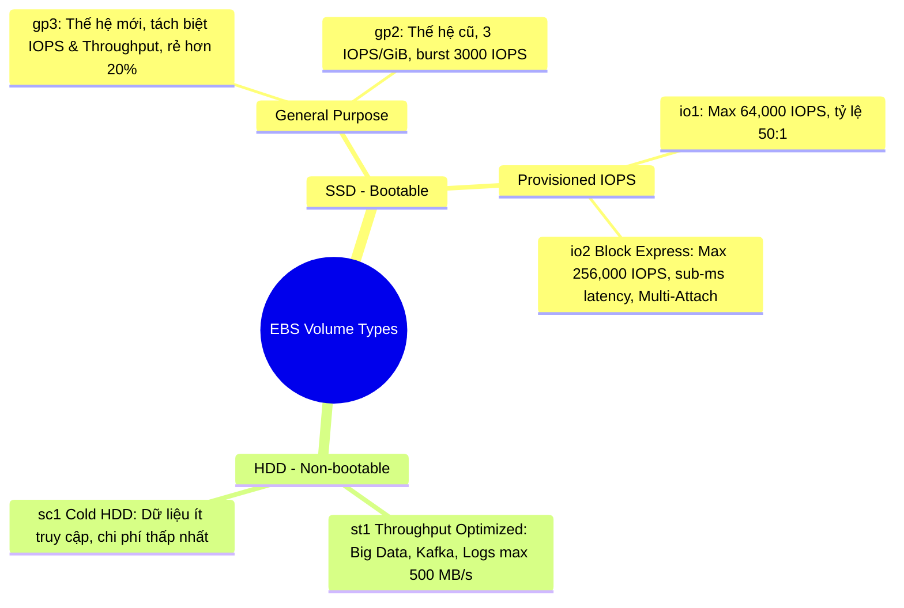

# Các loại EBS Volume (EBS Volume Types)

## 1. Tổng quan phân loại
Amazon EBS cung cấp **6 loại volume** được chia thành 2 nhóm chính dựa trên công nghệ phần cứng lưu trữ:
* **SSD (Solid State Drive)**: Tối ưu cho các tác vụ đọc/ghi ngẫu nhiên (random I/O), đòi hỏi IOPS cao và độ trễ thấp. **Chỉ có nhóm SSD mới có thể dùng làm Root/Boot Volume** cho hệ điều hành.
* **HDD (Hard Disk Drive)**: Tối ưu cho các luồng đọc/ghi tuần tự lớn (sequential I/O), thông lượng (throughput) cao, chi phí rẻ. **KHÔNG THỂ dùng làm Root/Boot Volume**.

---

## 2. Chi tiết nhóm ổ đĩa SSD

### 2.1. General Purpose SSD: gp3 (Khuyến nghị mặc định)
* **Khái niệm**: Là thế hệ ổ đĩa phổ thông mới nhất, cân bằng tối ưu giữa chi phí và hiệu năng.
* **Đặc tính kỹ thuật**:
  * **Hiệu năng cơ bản (Baseline included)**: Cung cấp sẵn **3,000 IOPS** và **125 MB/s** throughput miễn phí kèm theo với mọi kích thước ổ đĩa.
  * **Tách biệt cấu hình (Decoupled)**: Cho phép nâng cấp thêm IOPS (lên tới **16,000 IOPS**) và Throughput (lên tới **1,000 MB/s**) một cách độc lập mà **không cần phải tăng kích thước dung lượng lưu trữ**.
  * **Chi phí**: Tiết kiệm hơn tới **20% chi phí trên mỗi GB** so với thế hệ gp2 cũ.
* **Use Cases**: Boot volumes, môi trường dev/test, virtual desktops, cơ sở dữ liệu quy mô vừa (MySQL, PostgreSQL...).

### 2.2. General Purpose SSD: gp2 (Thế hệ cũ)
* **Khái niệm**: Thế hệ ổ đĩa SSD phổ thông đời trước.
* **Đặc tính kỹ thuật**:
  * Hiệu năng gắn chặt với kích thước: Tỉ lệ cố định **3 IOPS / 1 GiB**.
  * Kích thước nhỏ (< 1,000 GiB) có thể tăng tốc đột biến (**Burst**) lên **3,000 IOPS** nhờ I/O credit.
  * Giới hạn tối đa: **16,000 IOPS** (đạt được khi ổ đĩa đạt kích thước ~5,334 GiB).
  * Không thể điều chỉnh riêng lẻ IOPS hay throughput.

### 2.3. Provisioned IOPS SSD: io1 & io2 Block Express
* **Khái niệm**: Dành cho các ứng dụng nhiệm vụ tối quan trọng (Mission-critical) đòi hỏi hiệu năng IOPS duy trì ổn định và độ trễ cực thấp.
* **io1**:
  * Cung cấp tối đa **64,000 IOPS** (trên Nitro Instances) hoặc 32,000 IOPS (trên non-Nitro).
  * Tỉ lệ cấp phát: Tối đa 50 IOPS : 1 GiB.
* **io2 Block Express**:
  * Thế hệ ổ đĩa SSD mạnh nhất của AWS, mang lại độ trễ dưới 1 mili-giây (**Sub-millisecond latency**).
  * Hiệu năng tối đa: **256,000 IOPS** và Throughput đạt **4,000 MB/s**.
  * Tỉ lệ cấp phát: Tối đa **1,000 IOPS : 1 GiB**.
  * Độ bền dữ liệu (Durability): Đạt mức **99.999%** (gấp 100 lần so với chuẩn thông thường).
  * Hỗ trợ tính năng **EBS Multi-Attach**.
* **Use Cases**: Hệ thống cơ sở dữ liệu doanh nghiệp lớn (Oracle, SAP HANA, Microsoft SQL Server), giao dịch tài chính với I/O lớn.

---

## 3. Chi tiết nhóm ổ đĩa HDD (Không thể làm Boot Volume)

### 3.1. Throughput Optimized HDD: st1
* **Khái niệm**: Ổ đĩa từ tính chi phí thấp, tối ưu cho các luồng xử lý dữ liệu lớn, thông lượng cao, truy cập thường xuyên.
* **Thông số kỹ thuật**:
  * Throughput tối đa: **500 MB/s**.
  * IOPS tối đa: **500 IOPS**.
  * Kích thước: Từ 125 GiB đến 16 TiB.
* **Use Cases**: Xử lý dữ liệu lớn (Big Data), Data Warehousing, cụm Apache Kafka, Apache Spark, Hadoop EMR, xử lý file logs tập trung.

### 3.2. Cold HDD: sc1
* **Khái niệm**: Loại ổ đĩa có chi phí lưu trữ thấp nhất trong các dòng EBS volume, dành cho dữ liệu ít khi truy cập (cold data).
* **Thông số kỹ thuật**:
  * Throughput tối đa: **250 MB/s**.
  * IOPS tối đa: **250 IOPS**.
  * Kích thước: Từ 125 GiB đến 16 TiB.
* **Use Cases**: Lưu trữ file dự phòng, logs lưu trữ lâu năm hiếm khi đọc, các ứng dụng ưu tiên tiêu chí chi phí tối thiểu trên hết.

---

## 4. Bảng tổng hợp so sánh các loại Volume

| Loại Volume | Công nghệ | Dung lượng | Max IOPS | Max Throughput | Làm Boot Volume? | Use Case điển hình |
| :--- | :--- | :--- | :--- | :--- | :---: | :--- |
| **gp3** | SSD | 1 GiB - 16 TiB | 16,000 | 1,000 MB/s | **Có** | Mặc định cho hầu hết workload, Web, App, Dev/Test |
| **gp2** | SSD | 1 GiB - 16 TiB | 16,000 | 250 MB/s | **Có** | Thế hệ cũ, workload cơ bản |
| **io1** | SSD | 4 GiB - 16 TiB | 64,000 | 1,000 MB/s | **Có** | Database hiệu năng cao |
| **io2 Block Express** | SSD | 4 GiB - 64 TiB | **256,000** | **4,000 MB/s** | **Có** | Mission-critical DB, sub-ms latency, Multi-Attach |
| **st1** | HDD | 125 GiB - 16 TiB | 500 | 500 MB/s | **Không** | Big Data, Hadoop, Kafka, Log Processing |
| **sc1** | HDD | 125 GiB - 16 TiB | 250 | 250 MB/s | **Không** | Cold data, lưu trữ ít truy cập, chi phí rẻ nhất |

---

## 5. Điểm cần lưu ý & Mẹo thi (Exam Tips)
1. **Quy tắc Boot Volume**: Câu hỏi thi hỏi về ổ đĩa chứa hệ điều hành -> **Chỉ chọn gp2, gp3, io1, hoặc io2**. Tuyệt đối loại bỏ `st1` và `sc1`.
2. **gp2 vs gp3**: Luôn chọn `gp3` vì tiết kiệm 20% chi phí và cho phép tăng IOPS/throughput mà không bị ép buộc phải mua thêm dung lượng đĩa.
3. **Vượt mốc 32,000 IOPS**: Để đạt mức trên 32,000 IOPS (với io1) hoặc lên tới 256,000 IOPS (với io2), bắt buộc phải sử dụng **EC2 Nitro Instance** kết hợp với kiến trúc **EBS-Optimized**.
4. **Tối ưu chi phí cho Log / Data Warehouse**:
   * Dữ liệu phân tích truy cập thường xuyên -> Chọn **st1**.
   * Dữ liệu lưu trữ ít truy cập, chi phí thấp nhất -> Chọn **sc1**.