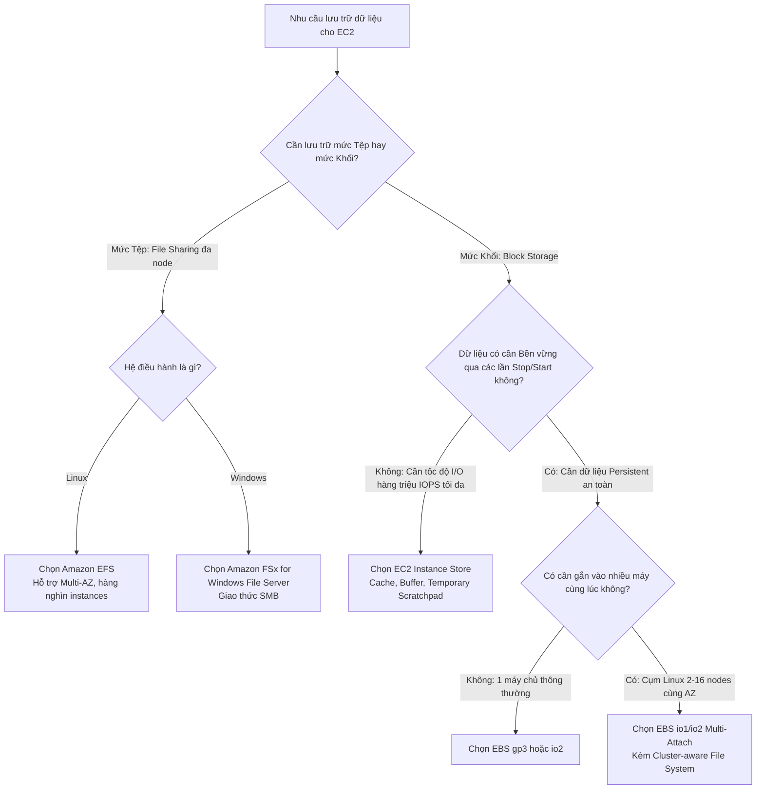

# So sánh các giải pháp lưu trữ EC2: EBS vs EFS vs Instance Store

## 1. Bảng đối chiếu kỹ thuật toàn diện

| Tiêu chí so sánh | Amazon EBS | Amazon EFS | EC2 Instance Store |
| :--- | :--- | :--- | :--- |
| **Cấp độ lưu trữ (Level)** | **Block Storage** (Lưu trữ khối) | **File Storage** (Lưu trữ tệp) | **Block Storage** (Lưu trữ khối) |
| **Giao thức kết nối** | Mạng nội bộ riêng của AWS | **NFSv4** qua TCP | Bus phần cứng vật lý (**PCIe / NVMe**) |
| **Phạm vi vùng (Scope)** | Giới hạn trong **1 Availability Zone** (AZ-locked) | Phân tán trên **nhiều Availability Zones** (Multi-AZ) | Giới hạn trên **Host máy chủ vật lý** của EC2 |
| **Khả năng chia sẻ** | **1 Instance** duy nhất (*Trừ io1/io2 Multi-Attach: tối đa 16 instances cùng AZ*) | **Hàng nghìn Instances** đồng thời xuyên các AZ | **1 Instance** duy nhất |
| **Tính bền vững (Durability)** | Bền vững độc lập với vòng đời của instance | Bền vững rất cao (chuẩn thiết kế 11 số 9: 99.999999999%) | **Tạm thời (Ephemeral)**: Mất dữ liệu khi Stop/Terminate/Lỗi phần cứng |
| **Hệ điều hành hỗ trợ** | Windows, Linux, Unix... | **Chỉ hỗ trợ Linux** (POSIX compliant) | Windows, Linux, Unix... |
| **Dung lượng & Cấp phát** | Phải cấu hình trước dung lượng và IOPS (Provisioned) | Tự động co giãn theo dung lượng dùng thực tế (Elastic) | Cố định theo loại EC2 Instance Type lựa chọn |
| **Làm Root/Boot Volume?** | **Có** (Chỉ với nhóm SSD: gp2, gp3, io1, io2) | **Không** | **Có** (đối với dòng instance-store backed cũ, hiếm dùng) |
| **Cơ chế sao lưu (Backup)** | EBS Snapshots (lưu trữ gia tăng trên S3) | AWS Backup hoặc tích hợp sao lưu tự động | Người dùng phải tự viết script copy dữ liệu thủ công |
| **Mức giá tương đối** | Trung bình (Rẻ hơn EFS ~3 lần ở tầng tiêu chuẩn) | Cao hơn ở tầng Standard, tiết kiệm tới 90% khi dùng EFS-IA | Đã tính gộp vào chi phí thuê EC2 instance |

---

## 2. Ma trận quyết định kiến trúc (Decision Matrix)

Sơ đồ cây quyết định lựa chọn giải pháp lưu trữ:

---

## 3. Các kịch bản bài thi & Ứng dụng thực tế

### Kịch bản 1: Ổ đĩa cài đặt hệ điều hành (Root Volume)
* **Giải pháp**: **Amazon EBS (gp3)**.
* **Lý do**: EFS và các dòng đĩa từ tính HDD (st1, sc1) không thể làm boot volume. gp3 là lựa chọn mặc định kinh tế và tối ưu nhất cho hệ điều hành.

### Kịch bản 2: Cụm máy chủ Web (WordPress, E-commerce, CMS)
* **Yêu cầu**: Cụm 10 máy chủ EC2 tự động co giãn (Auto Scaling) nằm trên 3 Availability Zones khác nhau cần truy cập chung vào một thư mục hình ảnh và mã nguồn website.
* **Giải pháp**: **Amazon EFS**.
* **Lý do**: EFS hỗ trợ mount đồng thời xuyên nhiều Availability Zones, hệ điều hành Linux tương thích hoàn hảo với giao thức NFS.

### Kịch bản 3: Cơ sở dữ liệu quan hệ (RDBMS: MySQL, PostgreSQL, Oracle)
* **Yêu cầu**: Cơ sở dữ liệu tự quản lý trên EC2, yêu cầu độ trễ cực thấp, tốc độ đọc/ghi ổn định và dữ liệu tuyệt đối không được mất khi khởi động lại máy chủ.
* **Giải pháp**: **Amazon EBS (gp3 hoặc io2 Block Express)**.
* **Lý do**: Cơ sở dữ liệu yêu cầu lưu trữ cấp độ khối (Block-level), tính bền vững cao và khả năng sao lưu nhanh chóng qua snapshot.

### Kịch bản 4: Bộ nhớ đệm phân tích (In-Memory / Scratch / Batch Processing)
* **Yêu cầu**: Ứng dụng xử lý luồng video hoặc mô hình Machine Learning cần đọc/ghi hàng gigabyte file tạm thời với tốc độ hàng triệu IOPS, nếu mất dữ liệu máy chủ có thể tự tải lại từ S3.
* **Giải pháp**: **EC2 Instance Store**.
* **Lý do**: Đem lại tốc độ truy xuất phần cứng vật lý cao nhất với chi phí đã được bao hàm trong chi phí instance.

### Kịch bản 5: Hệ thống phân tích Big Data tuần tự dung lượng lớn (Hadoop, Log aggregation)
* **Yêu cầu**: Cần lưu trữ hàng chục Terabyte log sự kiện của hệ thống để phân tích định kỳ, truy cập tuần tự, chi phí lưu trữ phải tối ưu nhất có thể.
* **Giải pháp**: **EBS st1 (Throughput Optimized HDD)**.
* **Lý do**: Tối ưu cho luồng xử lý tuần tự lớn với chi phí rẻ hơn nhiều so với nhóm ổ cứng SSD.
