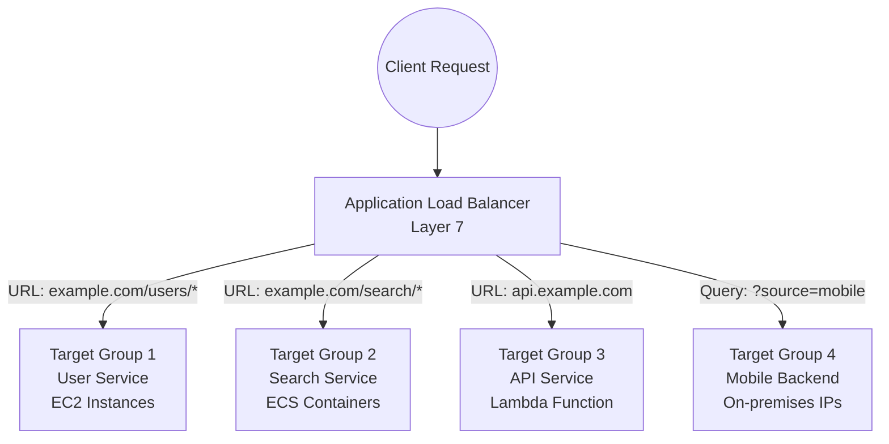
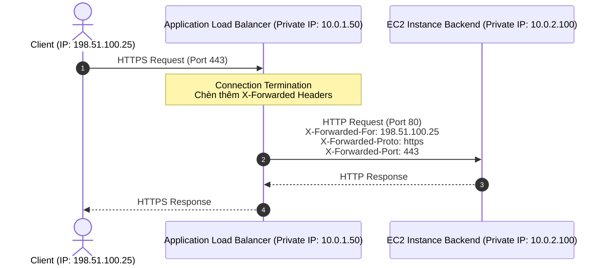

# Application Load Balancer (ALB)

## 1. Khái niệm cốt lõi

* **Định nghĩa**: **Application Load Balancer (ALB)** là bộ cân bằng tải hoạt động chuyên biệt ở **Tầng ứng dụng (Layer 7 của mô hình OSI)**.
* **Giao thức hỗ trợ**: **HTTP**, **HTTPS**, **HTTP/2**, **WebSocket** và **gRPC**.
* **Đặc tính nổi bật**: Khả năng phân tích sâu nội dung của HTTP request (gói tin Layer 7) để thực hiện các quy tắc định tuyến thông minh (Advanced Content-Based Routing) đến các nhóm đích khác nhau (**Target Groups**).
* **Kiến trúc phù hợp nhất**: Hệ thống kiến trúc Microservices, ứng dụng đóng gói Container (Amazon ECS, EKS) và ứng dụng Serverless.

---

## 2. Các quy tắc định tuyến thông minh (Routing Rules)

ALB cho phép định tuyến request dựa trên các thành phần chi tiết của HTTP request:

| Tiêu chí định tuyến | Mô tả cơ chế | Ví dụ minh họa |
| :--- | :--- | :--- |
| **Path-based Routing** | Định tuyến dựa theo đường dẫn URL (Path). | `/users` ➔ Target Group A `/orders` ➔ Target Group B |
| **Host-based Routing** | Định tuyến dựa theo tên miền / máy chủ (Host header). | `api.mycorp.com` ➔ Target Group API `admin.mycorp.com` ➔ Target Group Admin |
| **Query String & Params** | Định tuyến dựa theo tham số chuỗi truy vấn trong URL. | `?platform=mobile` ➔ Mobile Target Group `?version=v2` ➔ V2 Target Group |
| **HTTP Headers** | Định tuyến dựa vào giá trị của bất kỳ HTTP Header nào. | `User-Agent: Mozilla/...` `X-Custom-Header: Premium` |
| **HTTP Request Method** | Định tuyến dựa theo phương thức HTTP của request. | `GET` ➔ Read-only Target Group `POST / DELETE` ➔ Write Target Group |
| **Source IP CIDR** | Định tuyến hoặc lọc dựa trên địa chỉ IP nguồn của client. | `192.168.1.0/24` ➔ Internal Office Target Group |

* **Hỗ trợ chuyển hướng & Phản hồi cố định (Redirect & Fixed Response)**:
  * **HTTP to HTTPS Redirect**: Tự động chuyển hướng toàn bộ traffic không bảo mật trên cổng 80 sang cổng 443 (HTTPS) ngay tại tầng ALB mà không cần cấu hình trên server backend.
  * **Fixed Response**: Trả về trực tiếp mã lỗi (như HTTP 403, 503) hoặc trang bảo trì HTML tĩnh trực tiếp từ ALB mà không cần gọi vào backend server.

---

## 3. Các loại đối tượng trong Target Group

Target Group là tập hợp các tài nguyên đích mà ALB sẽ chuyển tiếp request đến. Health Check được cấu hình độc lập ở **cấp độ từng Target Group**.

ALB hỗ trợ 4 loại Target:
1. **EC2 Instances**: Đăng ký thông qua Instance ID (được quản lý thủ công hoặc tự động qua Auto Scaling Group).
2. **Private IP Addresses**: Đăng ký bằng địa chỉ IP riêng.
   * Có thể là IP trong VPC nội bộ.
   * Có thể là IP của máy chủ vật lý **On-Premises Data Center** (kết nối qua AWS Direct Connect hoặc Site-to-Site VPN).
   * *Lưu ý*: Phải là **Private IP**, không hỗ trợ Public IP.
3. **AWS Lambda Functions**: Xử lý request HTTP trực tiếp dưới dạng các hàm Serverless không máy chủ (Serverless Web App).
4. **ECS Tasks / Containers**: Tận dụng tính năng **Dynamic Port Mapping** (Ánh xạ cổng động).

---

## 4. Ưu thế vượt trội cho Microservices và Containers

* **Với Classic Load Balancer (CLB cũ)**: Mỗi ứng dụng hoặc mỗi microservice yêu cầu phải có một Load Balancer riêng biệt với một DNS riêng, rất tốn kém chi phí và khó quản trị.
* **Với Application Load Balancer (ALB)**:
  * **Một ALB duy nhất** có thể đứng trước hàng chục microservices khác nhau thông qua các rule định tuyến đường dẫn/tên miền.
  * **Dynamic Port Mapping**: Khi chạy nhiều container (Docker tasks) trên cùng một máy chủ EC2 thông qua Amazon ECS, các container sẽ lắng nghe trên các cổng ngẫu nhiên. ALB có thể tự động nhận biết cổng động này để định tuyến chính xác vào từng container trên cùng 1 EC2 instance.

---

## 5. Cơ chế Termination & Các HTTP Headers theo dõi Client IP

Khi client gửi request tới ALB, ALB thực hiện cơ chế **Connection Termination**:
1. Client thiết lập kết nối TCP tới ALB.
2. ALB giải mã và thiết lập một kết nối TCP riêng biệt mới tới EC2 backend.
3. Do đó, **EC2 backend chỉ nhìn thấy địa chỉ Private IP của ALB** trong gói tin TCP, không thấy được Public IP ban đầu của người dùng cuối.

Để giải quyết vấn đề này, ALB tự động chèn thêm các **HTTP Headers chuẩn** vào gói tin trước khi gửi vào backend:

| Header Name | Dữ liệu cung cấp | Ý nghĩa thực tiễn |
| :--- | :--- | :--- |
| **`X-Forwarded-For`** | **Địa chỉ IP gốc của Client** | Dùng để ghi log, phân tích vị trí địa lý, chống gian lận hoặc chặn IP xấu. |
| **`X-Forwarded-Port`** | Cổng kết nối ban đầu của Client (ví dụ: `80` hoặc `443`) | Giúp backend biết client kết nối vào cổng nào của ALB. |
| **`X-Forwarded-Proto`** | Giao thức ban đầu của Client (`http` hoặc `https`) | Giúp backend nhận biết request gốc có được mã hóa an toàn hay không. |

---

## 6. Điểm cần lưu ý & Mẹo thi (Exam Tips)

1. **ALB sở hữu DNS Name cố định**: Tuyệt đối không gắn Elastic IP trực tiếp vào ALB (IP của ALB thay đổi tự động theo quy mô co giãn của AWS).
2. **Từ khóa định tuyến tầng 7**: Bất kỳ đề thi nào nhắc đến: *định tuyến theo URL path*, *định tuyến theo hostname*, *chuyển hướng HTTP sang HTTPS*, *gọi trực tiếp hàm Lambda từ Web*, hoặc *Dynamic Port Mapping cho ECS Docker* ➔ **Lựa chọn luôn luôn là Application Load Balancer (ALB)**.
3. **Phân tích Client IP**: Nếu đề thi hỏi "Máy chủ backend chỉ thấy IP nội bộ của Load Balancer trong log file, làm sao để lấy được IP thật của người dùng?", đáp án chính là đọc giá trị từ header **`X-Forwarded-For`**.