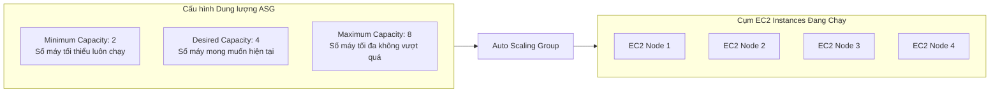
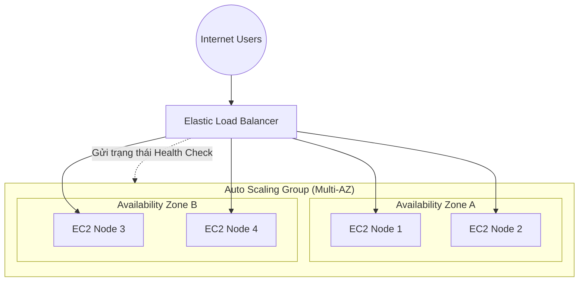

# Amazon EC2 Auto Scaling Groups (ASG)

## 1. Khái niệm cốt lõi

* **Định nghĩa**: **Amazon EC2 Auto Scaling Group (ASG)** là dịch vụ cho phép tự động điều chỉnh số lượng máy chủ EC2 đang hoạt động nhằm đáp ứng nhu cầu tải thực tế của ứng dụng, đồng thời đảm bảo tính sẵn sàng cao và tối ưu hóa chi phí.
* **Các mục tiêu cốt lõi của ASG**:
  1. **Scale Out (Mở rộng quy mô)**: Tự động khởi tạo thêm các máy chủ EC2 mới khi tải hệ thống tăng cao (ví dụ giờ cao điểm mua sắm).
  2. **Scale In (Thu hẹp quy mô)**: Tự động chấm dứt các máy chủ EC2 dư thừa khi tải giảm xuống để tiết kiệm tối đa chi phí hạ tầng.
  3. **Tự phục hồi (Self-Healing / High Availability)**: Tự động phát hiện và chấm dứt các máy chủ bị lỗi (Unhealthy instances), sau đó khởi tạo máy chủ mới thay thế để duy trì số lượng máy mong muốn.
* **Chi phí**: Dịch vụ Auto Scaling bản thân nó là **hoàn toàn miễn phí**. Bạn chỉ trả tiền cho các tài nguyên AWS thực tế được tạo ra bởi ASG (như EC2 instances, EBS volumes, CloudWatch alarms).

---

## 2. Các thông số cấu hình dung lượng (Capacity Attributes)

ASG quản lý số lượng máy chủ dựa trên 3 thông số dung lượng cơ bản:

| Thông số dung lượng | Ý nghĩa kỹ thuật | Quy tắc vận hành |
| :--- | :--- | :--- |
| **Minimum Capacity (Tối thiểu)** | Số lượng instance tối thiểu luôn luôn phải duy trì hoạt động trong ASG. | ASG sẽ không bao giờ giảm số lượng máy chủ xuống thấp hơn ngưỡng này, kể cả khi tải bằng 0. |
| **Desired Capacity (Mong muốn)** | Số lượng instance mục tiêu mà ASG đang duy trì chạy ở thời điểm hiện tại. | Khi có sự kiện Scale Out hoặc Scale In, Desired Capacity sẽ tăng hoặc giảm trong phạm vi giữa Min và Max. |
| **Maximum Capacity (Tối đa)** | Giới hạn trần số lượng instance tối đa mà ASG được phép tạo ra. | Đảm bảo hệ thống không scale ngoài tầm kiểm soát gây cạn kiệt ngân sách chi phí. |

---

## 3. Bản thiết kế khởi tạo: Launch Template vs Launch Configuration

Để ASG biết cách tạo một máy chủ EC2 mới, bạn phải cung cấp cho nó một bản thiết kế (blueprint):

### 3.1. Launch Template (Bắt buộc theo chuẩn hiện đại)
* Là thành phần bắt buộc hiện nay của AWS, chứa toàn bộ cấu hình để khởi chạy máy chủ:
  * **AMI ID** (Amazon Machine Image).
  * **Instance Type** (ví dụ `t3.micro`, `m5.large`).
  * **EC2 User Data** (Script tự động cài đặt phần mềm khi boot máy).
  * **Security Groups**, **Key Pair** (khóa SSH).
  * **IAM Instance Profile** (Role cấp quyền cho EC2 truy cập S3, DynamoDB...).
  * **EBS Storage Volumes** (kích thước, loại ổ đĩa).
  * Cấu hình nâng cao: Spot Instance integration, Multi-instance types, T2/T3 Unlimited...
* **Tính năng vượt trội**: Hỗ trợ **Versioning** (quản lý nhiều phiên bản cấu hình v1, v2, v3), cho phép kế thừa cấu hình và rollback dễ dàng.

> [!WARNING]
> **Launch Configuration** là tính năng thế hệ cũ và **đã bị AWS Deprecated**. AWS không cho phép tạo mới Launch Configuration trên các tài khoản mới. Luôn luôn sử dụng **Launch Template** cho mọi bài thi và dự án thực tế.

---

## 4. Tích hợp sâu rộng giữa ASG và Elastic Load Balancer (ELB)

Sự kết hợp giữa ELB và ASG tạo nên mô hình kiến trúc High Availability & Scalability kinh điển trên AWS:

### Các lợi ích kiến trúc khi tích hợp ELB + ASG:
1. **Tự động đăng ký & Hủy đăng ký**:
   * Khi ASG khởi tạo thêm máy chủ mới (Scale Out), máy chủ này sẽ **tự động được đăng ký vào Target Group của ELB** và bắt đầu nhận tải ngay khi vượt qua Health Check.
   * Khi ASG thu hồi máy chủ (Scale In), ELB sẽ tự động kích hoạt **Deregistration Delay** để tháo máy an toàn mà không làm rớt kết nối của người dùng.
2. **Cơ chế thay thế máy chủ dựa trên ELB Health Checks (Cực kỳ quan trọng)**:
   * **Mặc định (EC2 Health Check)**: ASG chỉ đánh giá instance lỗi khi có sự cố phần cứng, crash hypervisor (Status check fails). Nếu ứng dụng web bị lỗi 500 hoặc treo tiến trình, EC2 Health Check vẫn báo là "Healthy".
   * **Bật ELB Health Check trên ASG**: ASG sẽ sử dụng kết quả kiểm tra sức khỏe từ ELB. Nếu ứng dụng web trả về lỗi và ELB đánh giá là **Unhealthy**, ASG sẽ **chủ động terminate máy chủ hỏng đó và khởi tạo ngay một máy chủ mới thay thế**.

---

## 5. Điểm cần lưu ý & Mẹo thi (Exam Tips)

1. **Thay thế máy chủ ứng dụng bị treo**: Nếu đề thi mô tả "Máy chủ web bị treo hoặc trả về lỗi HTTP 500 cho người dùng nhưng ASG không tự động thay thế máy chủ mới", nguyên nhân là do ASG đang dùng mặc định kiểu kiểm tra `EC2`. Cách xử lý là: **Chuyển kiểu Health Check của ASG sang `ELB`**.
2. **Tự động cân bằng giữa các AZ (AZ Balancing)**: ASG luôn cố gắng duy trì số lượng máy chủ cân bằng đồng đều giữa các Availability Zones đã chọn. Khi cần scale-in, nếu một AZ có nhiều máy hơn, ASG sẽ ưu tiên chấm dứt máy ở AZ đó trước.
3. **Launch Template vs Launch Configuration**: Nếu có câu hỏi yêu cầu chọn cơ chế cấu hình khởi chạy hỗ trợ tạo phiên bản (versioning) hoặc hỗ trợ cả On-Demand lẫn Spot Instances trong cùng một nhóm ➔ Đáp án luôn là **Launch Template**.