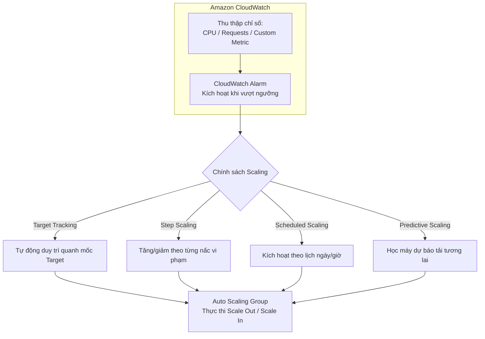
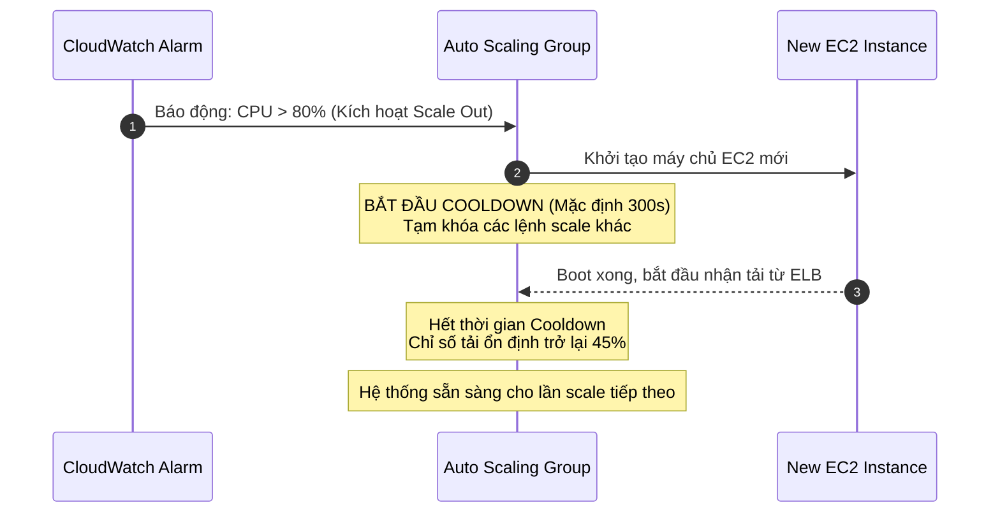

# ASG Scaling Policies và Các Chỉ Số Điều Khiển

## 1. Khái niệm cốt lõi

* **Định nghĩa**: **Scaling Policies (Chính sách điều chỉnh quy mô)** là tập hợp các quy tắc định nghĩa khi nào, bằng cách nào và với số lượng bao nhiêu máy chủ EC2 sẽ được thêm vào (Scale Out) hoặc bớt đi (Scale In) trong Auto Scaling Group.
* **Nguyên lý phối hợp**: ASG liên tục thu thập dữ liệu giám sát từ **Amazon CloudWatch** (như % CPU, số lượng request, băng thông mạng). Khi các chỉ số này vượt qua ngưỡng định trước hoặc có lịch trình cụ thể, chính sách scaling sẽ được kích hoạt tự động.

---

## 2. 4 Loại chính sách Scaling chính trên AWS

| Loại Scaling Policy | Cơ chế hoạt động | Ưu điểm & Tình huống phù hợp |
| :--- | :--- | :--- |
| **Target Tracking Scaling** | Người dùng chỉ định một chỉ số mục tiêu cố định (ví dụ: Giữ mức CPU trung bình ở **40%**). ASG tự động tính toán để scale out hoặc in nhằm duy trì chỉ số sát mốc này. | **Đơn giản nhất, khuyến nghị mặc định**. Phù hợp với hầu hết các ứng dụng web thông thường có lưu lượng biến thiên tự nhiên. |
| **Simple / Step Scaling** | Dựa trên CloudWatch Alarms để tăng/giảm số lượng instance theo các bước (Steps): • Nếu CPU > 70% ➔ Thêm 1 máy. • Nếu CPU > 85% ➔ Thêm 3 máy. • Nếu CPU < 30% ➔ Giảm 1 máy. | **Linh hoạt và phản ứng nhanh**. Step Scaling phản ứng tốt hơn Simple Scaling vì không bị block bởi cooldown toàn cục và xử lý tốt các đợt tăng tải đột ngột. |
| **Scheduled Scaling** | Lên lịch tăng giảm dung lượng theo ngày giờ cụ thể đã biết trước quy luật (ví dụ: 9:00 sáng thứ Hai tăng lên 10 máy; 18:00 chiều thứ Sáu hạ xuống 2 máy). | Phù hợp khi **biết trước 100% thời điểm tải tăng** (sự kiện Black Friday, giờ làm việc hành chính của doanh nghiệp). |
| **Predictive Scaling** | Sử dụng thuật toán Học máy (Machine Learning) phân tích dữ liệu lịch sử sử dụng ít nhất 24 giờ của quá khứ để dự đoán đường cong tải trong 48 giờ tới, chủ động khởi tạo máy chủ **trước khi tải thực sự ập đến**. | Tối ưu cho các hệ thống có chu kỳ lặp lại đều đặn hàng ngày/hàng tuần và ứng dụng mất nhiều thời gian để khởi động (warm-up time). |

---

## 3. Các chỉ số CloudWatch phổ biến dùng để Scale (Good Metrics)

Không phải chỉ số nào cũng phù hợp để làm căn cứ scale. Dưới đây là các chỉ số chuẩn AWS khuyến nghị:

1. **`ASGAverageCPUUtilization` (Mức sử dụng CPU trung bình)**:
   * Đo lường tỷ lệ phần trăm CPU trung bình trên toàn bộ các instances trong ASG.
   * Phổ biến nhất vì hầu hết các tác vụ xử lý web/backend đều tiêu tốn chu kỳ CPU.
2. **`ALBRequestCountPerTarget` (Số lượng Request trung bình trên mỗi Target)**:
   * Đo lường trực tiếp từ Application Load Balancer.
   * Xác định số lượng request tối ưu mà một máy chủ có thể phục vụ tốt (ví dụ: mỗi instance chịu tải tốt nhất ở mốc 1,000 requests/phút).
3. **`ASGAverageNetworkIn` / `ASGAverageNetworkOut` (Băng thông mạng vào/ra)**:
   * Phù hợp cho các ứng dụng bị nghẽn ở băng thông mạng (Network-bound applications) như truyền tải dữ liệu, streaming nội dung hoặc upload/download file.
4. **Custom Metric (Chỉ số tùy chỉnh đẩy lên CloudWatch)**:
   * Ví dụ kinh điển: Đo lường số lượng tin nhắn chờ trong hàng đợi **Amazon SQS** trên mỗi máy chủ EC2 (`ApproximateNumberOfMessagesVisible / ASG Desired Capacity`). Giúp hệ thống tự động thêm worker khi hàng đợi công việc bị ứ đọng.

> [!CAUTION]
> **Bộ nhớ RAM (Memory Utilization)**: AWS CloudWatch mặc định **KHÔNG thu thập chỉ số RAM** của EC2 (do RAM thuộc quyền riêng tư của hệ điều hành bên trong máy khách). Để scale theo dung lượng RAM, bạn bắt buộc phải cài đặt **CloudWatch Unified Agent** trên EC2 để đẩy dữ liệu Custom Metric lên CloudWatch.

---

## 4. Cơ chế thời gian hạ nhiệt (Scaling Cooldown)

* **Định nghĩa**: **Scaling Cooldown** là khoảng thời gian chờ bắt buộc sau khi một hành động scaling (thêm hoặc bớt instance) vừa diễn ra.
* **Giá trị mặc định**: **300 giây (5 phút)**.
* **Mục đích**:
  * Khi máy chủ EC2 mới được khởi động, nó cần thời gian để boot hệ điều hành, chạy script cấu hình và bắt đầu nhận tải.
  * Trong khoảng thời gian này, chỉ số tải (như CPU) của các máy cũ vẫn có thể còn ở mức cao.
  * Nếu không có Cooldown, ASG sẽ liên tục bị kích hoạt báo động và tạo thêm máy chủ vô tội vạ (**Hiện tượng Flapping / Over-provisioning**).
  * Cooldown đóng vai trò tạm dừng các hành động scaling bổ sung để các chỉ số CloudWatch có thời gian ổn định trở lại.

---

## 5. Chiến lược tối ưu hóa thời gian mở rộng (Scaling Optimization)

1. **Sử dụng Golden AMI**:
   * Đóng gói sẵn toàn bộ mã nguồn, thư viện, dependencies cần thiết vào một Custom AMI (Golden AMI).
   * Tránh việc viết script cài đặt phức tạp dài hàng chục dòng trong EC2 User Data khiến máy mất 5 - 10 phút mới sẵn sàng nhận tải.
   * Khởi động bằng Golden AMI giúp máy sẵn sàng phục vụ chỉ trong vòng 30 - 60 giây ➔ Cho phép **giảm thời gian Scaling Cooldown xuống thấp hơn** để hệ thống co giãn linh hoạt hơn.
2. **Bật CloudWatch Detailed Monitoring**:
   * Chế độ giám sát mặc định của EC2 trả về dữ liệu mỗi **5 phút (Basic Monitoring)**.
   * Bật **Detailed Monitoring (có tính phí)** để nhận dữ liệu mỗi **1 phút**, giúp CloudWatch phát hiện các đợt tăng tải đột biến và kích hoạt báo động nhanh hơn gấp 5 lần.

---

## 6. Điểm cần lưu ý & Mẹo thi (Exam Tips)

1. **Chính sách co giãn đơn giản và hiệu quả nhất**: Bất cứ khi nào đề bài yêu cầu "Tự động giữ mức sử dụng CPU ở khoảng 50%" mà không muốn cấu hình phức tạp nhiều ngưỡng báo động ➔ Chọn **Target Tracking Scaling Policy**.
2. **Scale theo hàng đợi công việc**: Nếu ứng dụng xử lý tác vụ bất đồng bộ từ hàng đợi SQS, chỉ số phù hợp nhất để scale là **số lượng message trong queue chia cho số lượng instance hiện có (Backlog per instance)** thông qua Custom Metric.
3. **Hiện tượng tạo máy quá đà liên tiếp**: Nếu câu hỏi trắc nghiệm mô tả hệ thống tạo thêm máy chủ liên tục ngoài mong muốn ngay sau khi vừa scale out ➔ Kiểm tra và điều chỉnh tăng thời gian **Scaling Cooldown**.