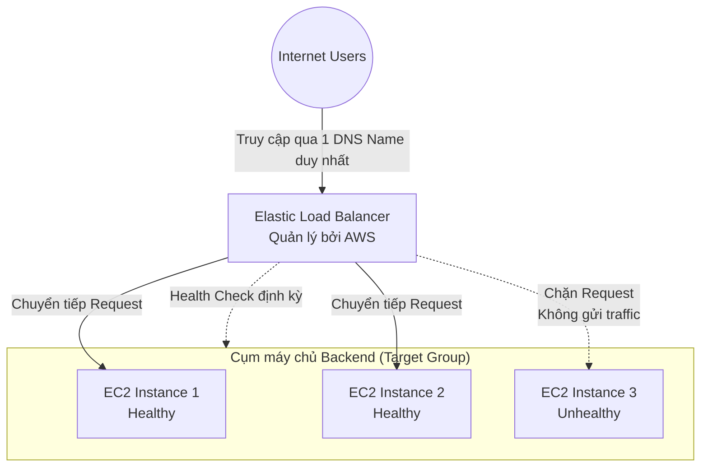
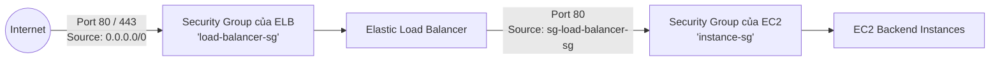

# Elastic Load Balancing (ELB) - Tổng quan

## 1. Khái niệm cốt lõi

* **Định nghĩa**: **Elastic Load Balancing (ELB)** là dịch vụ phân phối tải được quản lý hoàn toàn bởi AWS (Fully Managed Service), có chức năng tự động phân phối lưu lượng truy cập của ứng dụng đến nhiều đích (targets) như EC2 instances, containers, địa chỉ IP và Lambda functions.
* **Mô hình hoạt động**:
  * Đóng vai trò là điểm liên lạc duy nhất (**Single Point of Contact / DNS Name**) cho toàn bộ người dùng bên ngoài.
  * Phân tán lưu lượng đồng đều đến các máy chủ downstream/backend, giúp các máy chủ không bị quá tải cục bộ.
  * Người dùng không cần và không thể biết địa chỉ IP cụ thể của các máy chủ backend phía sau.

---

## 2. Lợi ích khi sử dụng AWS Managed Load Balancer

1. **Ủy quyền vận hành cho AWS**: AWS chịu trách nhiệm bảo trì, nâng cấp phần mềm, vá lỗi bảo mật và đảm bảo tính sẵn sàng cao (High Availability).
2. **Khả năng tự động co giãn (Seamless Scaling)**: ELB tự động tăng giảm năng lực xử lý theo khối lượng tải mạng mà không cần người dùng can thiệp thủ công.
3. **Cơ chế Health Checks**: Giám sát sức khỏe liên tục, tự động cô lập các node gặp sự cố để tránh trả về lỗi cho người dùng cuối.
4. **Tích hợp sâu rộng vào hệ sinh thái AWS**:
   * **Compute**: Amazon EC2, EC2 Auto Scaling (ASG), Amazon ECS, AWS Lambda.
   * **Security & Network**: AWS Certificate Manager (ACM - SSL/TLS), AWS WAF (Web Application Firewall), Amazon VPC.
   * **DNS & Monitoring**: Amazon Route 53, Amazon CloudWatch, AWS Global Accelerator.
5. **Tối ưu chi phí & Quản trị**: Chi phí rẻ hơn và vận hành ổn định hơn rất nhiều so với việc tự dựng các cụm Nginx/HAProxy trên EC2 tự quản lý.

---

## 3. Cơ chế kiểm tra sức khỏe (Health Checks)

* **Mục đích**: Giúp ELB xác định máy chủ đích nào đang hoạt động tốt (Healthy) để chuyển tiếp traffic và máy chủ nào đang lỗi (Unhealthy) để ngừng gửi traffic.
* **Cách thức hoạt động**: ELB gửi định kỳ các yêu cầu (probe request) tới một cổng (port) và đường dẫn (endpoint path) xác định trên máy chủ đích:
  * **Protocol & Port**: Ví dụ `HTTP` trên port `80` hoặc `4567`.
  * **Health Check Path**: Thường là một endpoint chuyên dụng như `/health` hoặc `/healthz`.
  * **Mã phản hồi hợp lệ (Success Codes)**: Mặc định là HTTP `200` (có thể cấu hình dải mã như `200-399`).
* **Trạng thái**:
  * Nếu máy chủ phản hồi đúng mã: Đánh dấu là **Healthy**.
  * Nếu timeout hoặc trả về mã lỗi liên tiếp vượt ngưỡng cấu hình (**Unhealthy Threshold**): Đánh dấu là **Unhealthy** -> ELB lập tức ngừng chuyển traffic mới đến instance này cho đến khi nó pass lại kiểm tra.

---

## 4. 4 Loại Load Balancer trên AWS

| Tên Load Balancer | Tầng mạng (OSI) | Giao thức hỗ trợ | Đặc điểm kiến trúc chính |
| :--- | :--- | :--- | :--- |
| **Application Load Balancer (ALB)** | **Layer 7** (Application) | HTTP, HTTPS, WebSocket, gRPC | Định tuyến thông minh theo URL Path, Hostname, Headers, Query string. Tối ưu cho Microservices & Containers. |
| **Network Load Balancer (NLB)** | **Layer 4** (Transport) | TCP, UDP, TLS | Hiệu năng siêu cao, hàng triệu RPS, độ trễ cực thấp. Hỗ trợ **IP tĩnh (Elastic IP)** cho mỗi AZ. |
| **Gateway Load Balancer (GWLB)** | **Layer 3** (Network) | IP (GENEVE port 6081) | Dùng để phân phối lưu lượng qua cụm tường lửa (Firewall) hoặc thiết bị kiểm tra gói tin bên thứ ba (IDS/IPS). |
| **Classic Load Balancer (CLB)** | **Layer 4 & 7** | HTTP, HTTPS, TCP, SSL | Thế hệ cũ (v1 từ 2009). **Đã bị deprecated**, AWS khuyến nghị tuyệt đối không dùng cho dự án mới. |

* **Phạm vi triển khai**:
  * **Internet-facing Load Balancer**: Có Public IP / Public DNS, nhận lưu lượng trực tiếp từ Internet.
  * **Internal Load Balancer**: Chỉ có Private IP, nhận lưu lượng nội bộ bên trong VPC (ví dụ giữa tầng Web và tầng Backend/Database).

---

## 5. Mô hình bảo mật Security Group chuẩn cho ELB & EC2

Đây là một trong những mô hình kiến trúc quan trọng nhất trong AWS về bảo mật mạng:

### Cấu hình chi tiết Security Groups:
1. **Security Group của Load Balancer (`load-balancer-sg`)**:
   * **Inbound Rule**: Cho phép `HTTP (80)` và `HTTPS (443)` từ nguồn `0.0.0.0/0` (Anywhere).
   * **Outbound Rule**: Cho phép chuyển tiếp tới các cổng của EC2 backend.
2. **Security Group của EC2 Instance (`instance-sg`)**:
   * **Inbound Rule**: Cho phép traffic trên cổng ứng dụng (ví dụ HTTP port 80).
   * **Source**: **CHỈ trỏ tới ID của Security Group Load Balancer (`sg-xxxxxx`)**, tuyệt đối **KHÔNG** mở dải IP `0.0.0.0/0`.
   * **Tác dụng**: Ngăn chặn hoàn toàn việc người dùng bên ngoài bypass qua ELB để truy cập thẳng vào EC2, đảm bảo toàn bộ traffic bắt buộc phải đi qua lớp kiểm soát của Load Balancer.

---

## 6. Điểm cần lưu ý & Mẹo thi (Exam Tips)

1. **ELB cung cấp DNS Name, không cung cấp IP tĩnh cố định (ngoại lệ là NLB)**: ALB và CLB tự động thay đổi địa chỉ IP của các node cân bằng tải theo nhu cầu scale. Không bao giờ hardcode địa chỉ IP của ALB; luôn trỏ CNAME hoặc Route 53 Alias record tới DNS Name của ELB.
2. **Health Check không can thiệp khởi động lại máy chủ**: Bản thân ELB **chỉ dừng gửi traffic** tới instance bị Unhealthy. Nó **không tự động terminate hay reboot** EC2. Để tự động thay thế instance bị hỏng, ELB phải kết hợp cùng **Auto Scaling Group (ASG)**.
3. **Quy tắc gán Security Group**: NLB hoạt động ở Layer 4 và truyền thẳng địa chỉ IP của client (không hỗ trợ gán Security Group trực tiếp ở các phiên bản trước đây, tuy nhiên từ tháng 8/2023 AWS đã bổ sung hỗ trợ Security Group cho NLB). ALB luôn yêu cầu phải có Security Group.