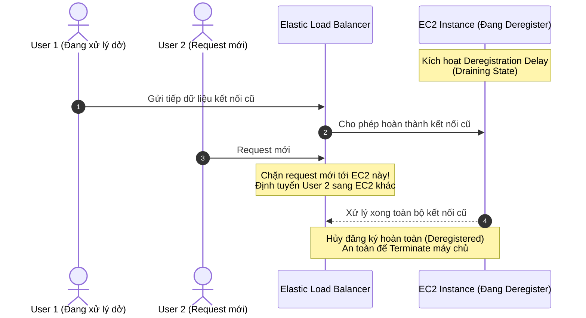

# ELB Connection Draining (Deregistration Delay)

## 1. Khái niệm cốt lõi

* **Định nghĩa**: **Connection Draining** (trên Classic Load Balancer) hay **Deregistration Delay** (trên ALB và NLB) là tính năng cho phép các yêu cầu đang xử lý dở dang (**In-flight Requests / Active Connections**) có đủ thời gian để hoàn tất trước khi máy chủ backend bị gỡ bỏ (deregistered) hoặc chấm dứt hoạt động (terminated).
* **Vấn đề giải quyết**:
  * Khi máy chủ EC2 bị đánh dấu là không khỏe mạnh (**Unhealthy**) qua Health Check.
  * Hoặc khi Auto Scaling Group thực hiện co cụm (**Scale In**) để giảm bớt số lượng máy chủ.
  * Hoặc khi quản trị viên thực hiện cập nhật phiên bản, đưa máy chủ vào trạng thái bảo trì.
  * ➔ Nếu ngắt kết nối đột ngột, người dùng đang gửi dữ liệu hoặc thanh toán dở dang sẽ nhận ngay thông báo lỗi (ví dụ HTTP 502/504 Bad Gateway).

---

## 2. Cơ chế vận hành chi tiết

1. **Chuyển trạng thái sang Draining**: Khi một instance bắt đầu bị gỡ khỏi Target Group, ELB chuyển trạng thái của instance đó sang **Draining**.
2. **Ngừng tiếp nhận kết nối mới**: ELB lập tức **ngừng gửi toàn bộ các request mới** đến instance này. Mọi request mới đến sẽ được định tuyến sang các instance lành mạnh khác.
3. **Chờ hoàn tất kết nối cũ**: Các kết nối và request đã được thiết lập trước đó vẫn được giữ nguyên để instance tiếp tục xử lý đến khi hoàn thành hoặc đến khi hết thời gian chờ đã cấu hình.
4. **Hủy đăng ký hoàn toàn**:
   * Nếu tất cả kết nối cũ hoàn tất trước khi hết giờ: Instance được chuyển ngay sang trạng thái Deregistered (hoặc Terminated) mà không cần đợi hết thời gian timeout.
   * Nếu hết thời gian timeout mà vẫn còn kết nối dở dang: ELB sẽ cưỡng chế đóng kết nối còn lại.

---

## 3. Các thông số cấu hình & Giá trị giới hạn

| Tiêu chí | Cấu hình kỹ thuật AWS |
| :--- | :--- |
| **Tên tính năng trên CLB** | **Connection Draining** |
| **Tên tính năng trên ALB / NLB** | **Deregistration Delay** (cấu hình ở cấp Target Group Attributes) |
| **Phạm vi giá trị cho phép** | Từ **1 giây đến 3,600 giây** (tối đa 1 giờ) |
| **Giá trị mặc định (Default)** | **300 giây (5 phút)** |
| **Vô hiệu hóa tính năng** | Đặt giá trị bằng **0 giây** (ngay lập tức đóng mọi kết nối hiện tại) |

---

## 4. Chiến lược tối ưu hóa theo loại ứng dụng (Best Practices)

* **Đối với ứng dụng có request ngắn (Short-lived requests)**:
  * Ví dụ: Dịch vụ REST API đơn giản, trang web tin tức, hệ thống cache microservices (thời gian xử lý request < 1 giây).
  * **Khuyến nghị**: Nên hạ giá trị Deregistration Delay xuống khoảng **30 - 60 giây**.
  * **Lợi ích**: Giúp Auto Scaling thu hồi máy chủ nhanh hơn, giảm thời gian chờ đợi khi triển khai cập nhật mã nguồn (Deployment), tiết kiệm chi phí vận hành.
* **Đối với ứng dụng có kết nối kéo dài (Long-lived requests)**:
  * Ví dụ: Ứng dụng upload/download tệp dung lượng lớn, hệ thống streaming video, xử lý báo cáo phân tích nặng.
  * **Khuyến nghị**: Cần tăng thời gian Deregistration Delay lên cao hơn (ví dụ **900 - 1800 giây** hoặc tối đa 3600 giây).
  * **Lưu ý**: Cần chấp nhận sự đánh đổi là các máy chủ EC2 sẽ tồn tại lâu hơn sau khi có lệnh scale-in.

---

## 5. Điểm cần lưu ý & Mẹo thi (Exam Tips)

1. **Phân biệt hai thuật ngữ**: Trong đề thi AWS:
   * **Connection Draining** là thuật ngữ dùng cho **Classic Load Balancer (CLB)**.
   * **Deregistration Delay** là thuật ngữ dùng cho **Application Load Balancer (ALB)** và **Network Load Balancer (NLB)**. Cả hai đều có cùng chung bản chất và chức năng kỹ thuật.
2. **Khắc phục lỗi HTTP 504 khi Scale In**: Nếu đề thi mô tả: "Khi hệ thống giảm bớt máy chủ do tải giảm (Scale In activity), người dùng thỉnh thoảng gặp lỗi gián đoạn kết nối hoặc lỗi 504 Gateway Timeout", giải pháp là: **Kích hoạt hoặc tăng thời gian Connection Draining / Deregistration Delay**.
3. **Giá trị 0 giây**: Đặt giá trị bằng 0 nghĩa là tắt tính năng này, khiến các request dở dang bị đứt gãy ngay lập tức.
