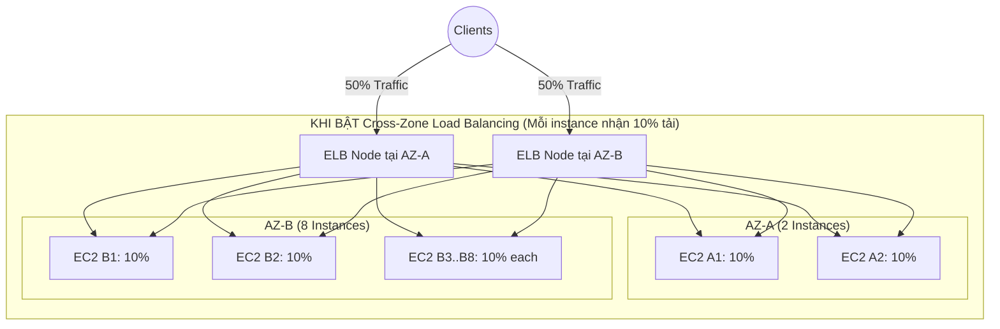

# ELB Cross-Zone Load Balancing

## 1. Khái niệm cốt lõi

* **Định nghĩa**: **Cross-Zone Load Balancing (Cân bằng tải xuyên vùng)** là tính năng cho phép mỗi node của bộ cân bằng tải phân phối lưu lượng truy cập đồng đều đến **tất cả các máy chủ backend đã đăng ký trên toàn bộ các Availability Zones (AZs)** được kích hoạt.
* **Mô hình hoạt động**:
  * Khi client truy cập, DNS của ELB sẽ phân giải ngẫu nhiên đến một node của Load Balancer tại một AZ cụ thể.
  * Node ELB này không chỉ gửi traffic cho các EC2 nằm cùng AZ với nó, mà còn có khả năng chuyển tiếp lưu lượng qua mạng nội bộ AWS sang các EC2 nằm ở các AZ khác.

---

## 2. So sánh kịch bản: Có và Không có Cross-Zone Load Balancing

Giả sử hệ thống triển khai trên 2 Availability Zones:
* **AZ-A**: Có **2 EC2 instances**.
* **AZ-B**: Có **8 EC2 instances** (Tổng cộng 10 instances).
* Lượng traffic của người dùng từ Internet được DNS phân bổ đều **50% cho Node ELB tại AZ-A** và **50% cho Node ELB tại AZ-B**.

### Kịch bản 1: KHÔNG BẬT Cross-Zone Load Balancing
* Node ELB tại AZ-A chỉ gửi traffic cho 2 máy ở AZ-A ➔ Mỗi máy gánh: $\frac{50\%}{2} = \mathbf{25\%}$ tổng tải hệ thống.
* Node ELB tại AZ-B chỉ gửi traffic cho 8 máy ở AZ-B ➔ Mỗi máy gánh: $\frac{50\%}{8} = \mathbf{6.25\%}$ tổng tải hệ thống.
* **Hậu quả**: Hai máy chủ ở AZ-A bị **quá tải nghiêm trọng (gấp 4 lần)** so với các máy chủ ở AZ-B, dễ dẫn đến hiện tượng nghẽn mạng và sập ứng dụng.

### Kịch bản 2: CÓ BẬT Cross-Zone Load Balancing
* Node ELB tại AZ-A chia đều 50% traffic cho toàn bộ 10 máy trên cả 2 AZ ➔ Mỗi máy nhận 5% từ Node A.
* Node ELB tại AZ-B chia đều 50% traffic cho toàn bộ 10 máy trên cả 2 AZ ➔ Mỗi máy nhận 5% từ Node B.
* **Kết quả**: Mỗi máy chủ EC2 đều nhận đúng $\mathbf{10\%}$ tải của toàn hệ thống, tải được phân bổ hoàn toàn cân bằng và công bằng.

---

## 3. Trạng thái mặc định và Chi phí theo từng loại Load Balancer

Đây là bảng quy tắc quan trọng nhất cần ghi nhớ cho các kỳ thi chứng chỉ AWS:

| Loại Load Balancer | Trạng thái mặc định | Chi phí truyền dữ liệu liên vùng (Inter-AZ Data Transfer) |
| :--- | :--- | :--- |
| **Application Load Balancer (ALB)** | **BẬT mặc định (Enabled)** | **MIỄN PHÍ (No Charges)**. Không tính phí truyền dữ liệu giữa các AZ qua ALB. |
| **Network Load Balancer (NLB)** | **TẮT mặc định (Disabled)** | **CÓ TÍNH PHÍ (Charged)**. Nếu bật, người dùng phải trả cước truyền dữ liệu liên vùng (Inter-AZ data fee). |
| **Gateway Load Balancer (GWLB)** | **TẮT mặc định (Disabled)** | **CÓ TÍNH PHÍ (Charged)**. Nếu bật, người dùng phải trả cước truyền dữ liệu liên vùng. |
| **Classic Load Balancer (CLB)** | TẮT mặc định (Disabled) | **MIỄN PHÍ** nếu người dùng chủ động bật. |

---

## 4. Cấu hình thực tế trên AWS Console

* **Với Application Load Balancer (ALB)**:
  * Thuộc tính Cross-zone được bật sẵn ở cấp Load Balancer.
  * Tuy nhiên, bạn có thể **tắt hoặc ghi đè (override) ở cấp độ từng Target Group** nếu muốn hạn chế lưu lượng mạng chỉ nằm trong phạm vi nội bộ từng AZ.
* **Với Network Load Balancer (NLB)**:
  * Mặc định là `Disabled` để tối ưu chi phí và độ trễ.
  * Được cấu hình bật/tắt trong phần **Load Balancer Attributes** hoặc **Target Group Attributes**.
  * Khi bật lên, AWS sẽ hiển thị cảnh báo về việc có thể phát sinh thêm chi phí truyền dữ liệu liên vùng.

---

## 5. Điểm cần lưu ý & Mẹo thi (Exam Tips)

1. **ALB luôn miễn phí cước Cross-Zone**: Với Application Load Balancer, tính năng Cross-Zone Load Balancing đã được bật sẵn và **hoàn toàn miễn phí cước dữ liệu liên vùng**. Bạn không cần lo lắng về chi phí phát sinh khi dùng tính năng này trên ALB.
2. **NLB và chi phí Inter-AZ Data Transfer**: Nếu đề thi hỏi về việc "Làm thế nào để giảm thiểu chi phí truyền dữ liệu mạng (Reduce data transfer costs) khi sử dụng Network Load Balancer trên nhiều AZ?", một trong những đáp án chuẩn là: **Tắt Cross-Zone Load Balancing** trên NLB để các node NLB chỉ giao tiếp với EC2 trong cùng 1 AZ.
3. **Hiện tượng lệch tải (Uneven Load Distribution)**: Nếu gặp câu hỏi mô tả hiện tượng các máy chủ EC2 ở AZ này bị tải rất cao trong khi các máy ở AZ khác lại rảnh rỗi, nguyên nhân hàng đầu là do **chưa bật Cross-Zone Load Balancing** (đặc biệt đối với NLB hoặc CLB).
