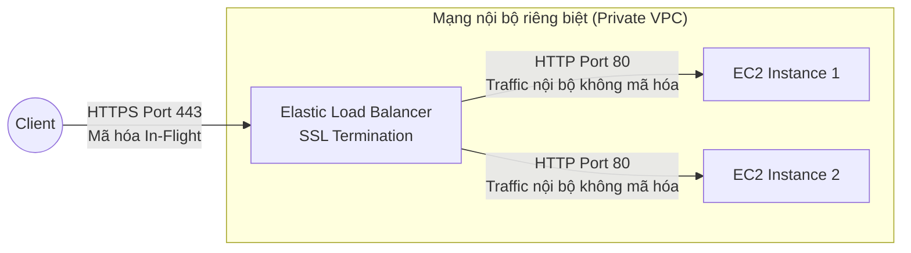
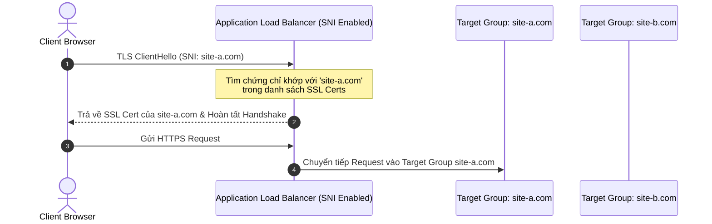

# ELB SSL/TLS Certificates và SNI

## 1. Khái niệm cốt lõi

* **SSL / TLS Certificate**:
  * **SSL (Secure Sockets Layer)**: Giao thức mã hóa đời cũ, hiện đã lỗi thời và không còn an toàn.
  * **TLS (Transport Layer Security)**: Phiên bản nâng cấp hiện đại và an toàn thay thế cho SSL (thường dùng TLS 1.2, TLS 1.3). Trong thực tế và tài liệu AWS, thuật ngữ "SSL Certificate" vẫn thường được dùng quen miệng để chỉ chung các chứng chỉ TLS.
* **Mã hóa khi truyền tải (In-flight Encryption / Encryption in Transit)**: Đảm bảo toàn bộ dữ liệu trao đổi giữa trình duyệt của client và máy chủ được mã hóa an toàn qua Internet, ngăn chặn việc bị nghe lén (Sniffing) hoặc tấn công Man-in-the-Middle (MitM).
* **Quản lý chứng chỉ**: Chứng chỉ số X.509 được cấp phát bởi các Certificate Authority (CA) công cộng hoặc quản lý tập trung và tự động gia hạn miễn phí thông qua **AWS Certificate Manager (ACM)**.

---

## 2. Cơ chế giải mã tại cổng vào (SSL Termination / SSL Offloading)

* **Quy trình hoạt động**:
  1. Người dùng kết nối qua giao thức **HTTPS (Cổng 443)** tới Elastic Load Balancer qua mạng Internet công cộng.
  2. Load Balancer chứa chứng chỉ số SSL/TLS và thực hiện **SSL Termination**: Giải mã toàn bộ gói tin HTTPS tại Load Balancer.
  3. Load Balancer chuyển tiếp dữ liệu đã giải mã tới các máy chủ EC2 backend qua giao thức **HTTP thông thường (Cổng 80)** trên mạng nội bộ VPC an toàn.
* **Lợi ích kiến trúc của SSL Termination**:
  * **Giải phóng tài nguyên CPU (CPU Offloading)**: Quá trình mã hóa và giải mã dữ liệu tốn rất nhiều chu kỳ CPU. Việc dồn tác vụ này cho Load Balancer giúp các máy chủ EC2 backend tập trung 100% năng lực xử lý nghiệp vụ ứng dụng.
  * **Quản trị tập trung (Centralized Management)**: Chỉ cần cài đặt và gia hạn chứng chỉ SSL tại một điểm duy nhất là Load Balancer, không cần cài đặt chứng chỉ trên từng máy chủ EC2.

---

## 3. Server Name Indication (SNI) - Giải pháp phục vụ đa tên miền

### 3.1. Vấn đề thực tế
* Khi bạn muốn lưu trữ nhiều trang web khác nhau (ví dụ `app.example.com` và `shop.example.com`) trên **cùng một Load Balancer duy nhất**.
* Mỗi website lại sở hữu một tên miền riêng và yêu cầu một chứng chỉ SSL/TLS riêng biệt.
* Trong giao thức TLS truyền thống, quá trình bắt tay mã hóa (SSL Handshake) diễn ra **trước khi** HTTP request (chứa header Host) được gửi đi. Do đó máy chủ không biết client muốn vào domain nào để nạp chứng chỉ tương ứng.

### 3.2. Cơ chế giải quyết của SNI
* **SNI (Server Name Indication)**: Là một phần mở rộng của giao thức TLS.
* Cơ chế: Client gửi trực tiếp **Hostname của trang web mục tiêu** ngay trong gói tin bắt tay đầu tiên (**ClientHello**).
* Bộ cân bằng tải đọc được Hostname này, lập tức chọn đúng chứng chỉ SSL tương ứng nạp vào để hoàn tất bắt tay mã hóa an toàn.

---

## 4. Bảng đối chiếu hỗ trợ SSL và SNI giữa các loại Load Balancer

| Dòng Load Balancer | Hỗ trợ nhiều SSL Certs qua SNI? | Số lượng chứng chỉ tối đa | Đánh giá kiến trúc |
| :--- | :--- | :--- | :--- |
| **Application Load Balancer (ALB)** | **CÓ** | Hỗ trợ **Default Certificate** + hàng chục chứng chỉ bổ sung (SNI). | Lựa chọn số 1 cho các ứng dụng web đa tên miền, SaaS platform. |
| **Network Load Balancer (NLB)** | **CÓ** | Hỗ trợ **Default Certificate** + nhiều chứng chỉ bổ sung qua TLS Listener. | Tối ưu cho các kết nối mã hóa hiệu năng cực cao, IP tĩnh. |
| **Classic Load Balancer (CLB)** | **KHÔNG** | **Chỉ 1 chứng chỉ duy nhất** cho mỗi CLB. | Bắt buộc phải tạo nhiều CLB riêng biệt nếu có nhiều domain ➔ Tốn kém, cồng kềnh. |

* **Dịch vụ CDN khác hỗ trợ SNI**: **Amazon CloudFront** cũng hỗ trợ đầy đủ SNI để phân phối nhiều chứng chỉ SSL trên toàn cầu.

---

## 5. Chính sách bảo mật (Security Policies / TLS Negotiation)

* Khi cấu hình HTTPS Listener trên ALB hoặc TLS Listener trên NLB, bạn phải chọn một **Security Policy**.
* **Nội dung cấu hình**:
  * Các phiên bản giao thức TLS được chấp nhận (ví dụ chỉ chấp nhận TLS 1.2 và TLS 1.3; vô hiệu hóa TLS 1.0, 1.1 và SSLv3).
  * Các bộ thuật toán mã hóa được phép sử dụng (**Cipher Suites**).
* **Ý nghĩa**: Giúp hệ thống tuân thủ các tiêu chuẩn bảo mật khắt khe của doanh nghiệp (PCI-DSS, HIPAA) và bảo vệ khỏi các lỗ hổng mã hóa nổi tiếng như Heartbleed hay POODLE.

---

## 6. Điểm cần lưu ý & Mẹo thi (Exam Tips)

1. **Từ khóa nhận diện SNI**: Bất cứ khi nào đề thi nhắc đến:
   * *Nhiều tên miền (Multiple domains/hostnames) sử dụng chung một bộ cân bằng tải*.
   * *Mỗi tên miền yêu cầu một chứng chỉ SSL/TLS riêng biệt (Multiple SSL certificates)*.
   * *Cần tối ưu chi phí kiến trúc, không muốn tạo nhiều load balancer riêng*.
   ➔ **Đáp án chắc chắn là: Sử dụng Application Load Balancer (ALB) hoặc Network Load Balancer (NLB) kết hợp tính năng SNI**.
2. **CLB không hỗ trợ SNI**: Nếu câu hỏi trắc nghiệm đưa ra lựa chọn CLB với nhiều chứng chỉ SSL qua SNI, đó là đáp án sai.
3. **Quản lý chứng chỉ tự động**: Chứng chỉ SSL công cộng tạo từ **AWS Certificate Manager (ACM)** là hoàn toàn miễn phí và được AWS tự động gia hạn trước ngày hết hạn.
