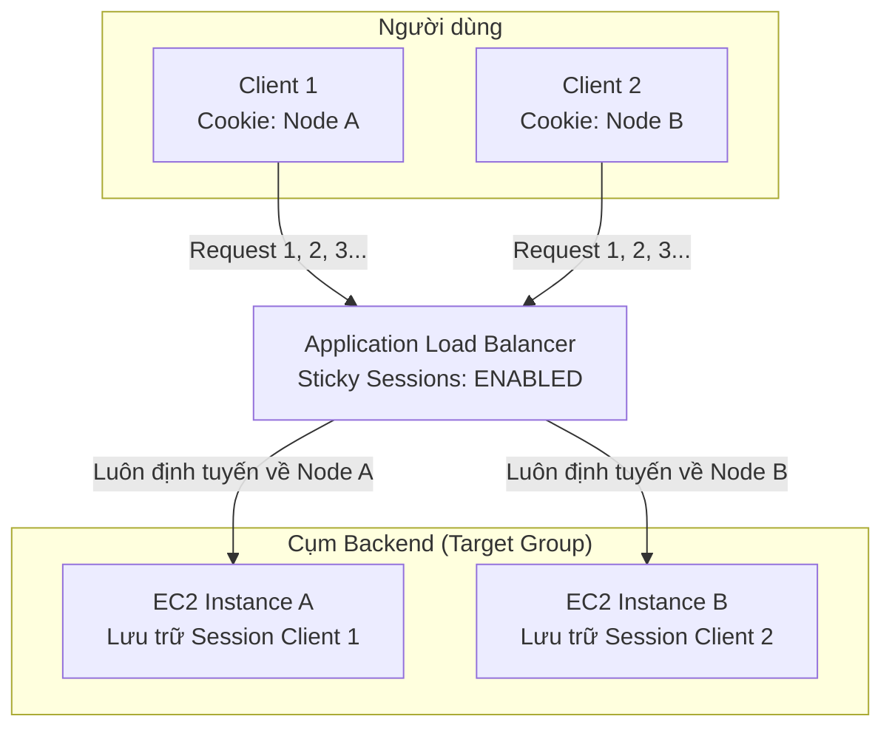
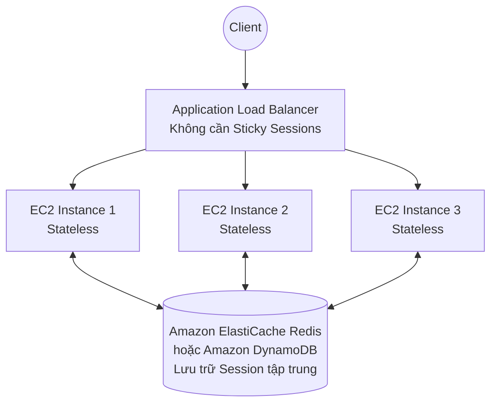

# ELB Sticky Sessions (Session Affinity)

## 1. Khái niệm cốt lõi

* **Định nghĩa**: **Sticky Sessions** (hay còn gọi là **Session Affinity**) là tính năng cho phép bộ cân bằng tải ràng buộc phiên làm việc của một người dùng (client) với một **máy chủ backend (EC2 instance) cụ thể**.
* **Nguyên lý hoạt động**:
  * Khi tính năng này được kích hoạt, tất cả các request tiếp theo của cùng một client trong suốt phiên làm việc sẽ luôn được định tuyến đến **cùng một máy chủ backend** đã phục vụ request đầu tiên.
  * Việc nhận diện client được thực hiện thông qua **HTTP Cookie** trao đổi giữa trình duyệt của client và Load Balancer.

---

## 2. Mục đích sử dụng & Mặt hạn chế (Trade-offs)

### 2.1. Mục đích sử dụng (Use Cases)
* Phù hợp cho các ứng dụng cũ (Legacy applications) hoặc ứng dụng chưa được thiết kế chuẩn Stateless.
* Khi ứng dụng lưu trữ dữ liệu phiên làm việc của người dùng (User Session Data, trạng thái đăng nhập, giỏ hàng tạm thời) **trực tiếp trong bộ nhớ RAM cục bộ (Local In-Memory)** của máy chủ EC2.
* Nếu không bật Sticky Sessions, mỗi request của người dùng có thể bị chuyển đến một EC2 khác không có sẵn dữ liệu phiên, khiến người dùng bị văng phiên đăng nhập hoặc mất giỏ hàng.

### 2.2. Mặt hạn chế kỹ thuật (Trade-offs)
* **Gây mất cân bằng tải (Load Imbalance)**: Một số máy chủ có thể bị quá tải nghiêm trọng nếu tình cờ phục vụ các "Super Users" (những người dùng hoạt động liên tục với lưu lượng rất lớn), trong khi các máy chủ khác lại rảnh rỗi.
* **Mất session khi instance gặp sự cố**: Nếu EC2 instance đang giữ session bị lỗi (Unhealthy) hoặc bị Auto Scaling thu hồi (Scale In), toàn bộ session của các client gắn với instance đó sẽ bị mất hoàn toàn.

---

## 3. Phân loại cơ chế Cookie trên Application Load Balancer (ALB)

ALB cung cấp 2 cơ chế Cookie cho Sticky Sessions:

| Loại Cookie | Nguồn gốc sinh Cookie | Tên Cookie (Cookie Name) | Đặc điểm cấu hình |
| :--- | :--- | :--- | :--- |
| **Application-based Cookie** | Do **Ứng dụng backend** hoặc ALB sinh dựa theo ứng dụng | • **Custom Cookie**: Do ứng dụng tự đặt tên. • **Application Cookie**: Mặc định tên là `AWSALBAPP` | Cho phép ứng dụng kiểm soát thời gian sống của phiên. Cần chỉ định tên cookie trong Target Group. |
| **Duration-based Cookie** | Do chính **Load Balancer (ALB)** tự động sinh | • ALB: `AWSALB` • CLB: `AWSELB` | ALB tự tạo cookie và gán thời hạn hết hạn (Expiration duration). Đơn giản, không cần sửa mã nguồn ứng dụng. |

### Các quy tắc quan trọng về tên Cookie:
* Khi sử dụng **Custom Application Cookie**, bạn có thể đặt bất kỳ tên nào tùy ý, **NGOẠI TRỪ** các tên đã được AWS đặt trước (Reserved names):
  * ❌ `AWSALB`
  * ❌ `AWSALBAPP`
  * ❌ `AWSALBTG`
* **Thời gian hết hạn (Duration)**: Có thể cấu hình linh hoạt từ **1 giây đến 7 ngày** (Giá trị mặc định là **1 ngày / 86400 giây**). Khi cookie hết hạn, request kế tiếp có thể được chuyển sang instance mới.

---

## 4. Vị trí cấu hình trong AWS Management Console

* **Cấp độ cấu hình**: Sticky Sessions được bật/tắt và quản lý ở **cấp độ Target Group** (không phải ở cấp độ Load Balancer).
* **Đường dẫn**:
  1. Mở dịch vụ EC2 ➔ **Target Groups**.
  2. Chọn Target Group mong muốn ➔ Chọn tab **Attributes** ➔ Bấm **Edit**.
  3. Tìm đến mục **Stickiness** ➔ Tích chọn **Enable**.
  4. Chọn loại Stickiness:
     * *Load balancer generated cookie*: Thiết lập thời gian (1s - 7 days).
     * *Application-based cookie*: Nhập tên App cookie đã cấu hình trong backend.

---

## 5. Giải pháp kiến trúc thay thế tối ưu (Modern Best Practice)

Trong các bài thi chứng chỉ và kiến trúc điện toán đám mây hiện đại, AWS khuyến nghị **hạn chế phụ thuộc vào Sticky Sessions** bằng cách chuyển dịch sang kiến trúc **Stateless**:

* **Cơ chế**: Lưu trữ toàn bộ Session của người dùng vào một kho dữ liệu dùng chung bên ngoài như **Amazon ElastiCache (Redis/Memcached)** hoặc cơ sở dữ liệu NoSQL tốc độ cao **Amazon DynamoDB**.
* **Ưu điểm**:
  * Các máy chủ EC2 trở thành **Stateless (Không lưu trạng thái)**: Bất kỳ máy chủ nào cũng có thể xử lý request của bất kỳ người dùng nào.
  * Tải được phân bổ đều 100% giữa các instances.
  * Auto Scaling có thể tự do tắt/bật EC2 mà không làm gián đoạn phiên của người dùng.

---

## 6. Điểm cần lưu ý & Mẹo thi (Exam Tips)

1. **Khắc phục lỗi mất phiên đăng nhập nhanh nhất**: Nếu đề bài nêu ứng dụng chạy trên nhiều EC2 sau ALB gặp hiện tượng "người dùng bị mất thông tin giỏ hàng hoặc bị văng đăng nhập khi refresh trang web", giải pháp tạm thời nhanh nhất mà **không cần sửa code ứng dụng** là: **Bật Sticky Sessions (Duration-based)** trên Target Group.
2. **Giải pháp kiến trúc dài hạn**: Nếu đề bài hỏi "Giải pháp tốt nhất để lưu trữ session người dùng mà vẫn đảm bảo tính co giãn và không gây mất cân bằng tải", câu trả lời chuẩn là **sử dụng ElastiCache hoặc DynamoDB để lưu session bên ngoài**.
3. **Các tên cookie cấm đặt**: Nhớ các tiền tố `AWSALB*` là của hệ thống AWS, người dùng không được đặt trùng cho custom cookie.