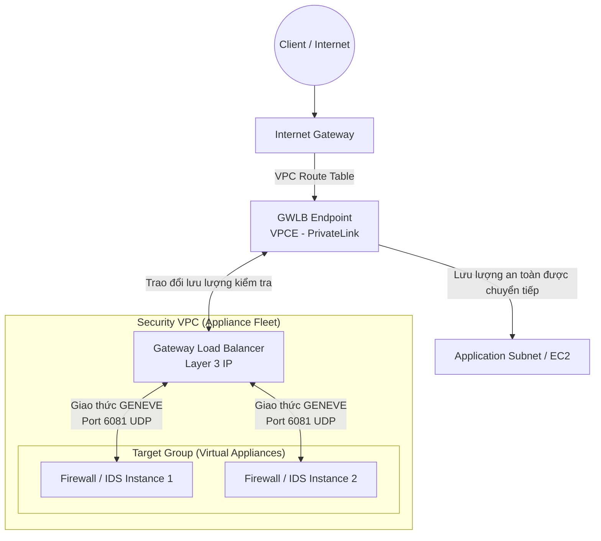

# Gateway Load Balancer (GWLB / GLB)

## 1. Khái niệm cốt lõi

* **Định nghĩa**: **Gateway Load Balancer (GWLB)** là bộ cân bằng tải chuyên dụng hoạt động ở **Tầng mạng (Layer 3 của mô hình OSI - IP Packets)**.
* **Mục đích ra đời**: Dùng để triển khai, tự động co giãn và quản lý một cụm các thiết bị mạng ảo của bên thứ ba (**3rd-party Virtual Network Appliances**) như:
  * Tường lửa thế hệ mới (Next-Generation Firewalls - NGFW).
  * Hệ thống phát hiện và ngăn chặn xâm nhập (IDS / IPS).
  * Hệ thống kiểm tra gói tin sâu (Deep Packet Inspection - DPI).
  * Hệ thống phân tích, lọc URL hoặc chỉnh sửa payload mạng.
* **Đặc tính "Trong suốt" (Transparent)**: Đối với người dùng gửi request và máy chủ ứng dụng nhận request, sự hiện diện của GWLB và các thiết bị tường lửa kiểm tra là **hoàn toàn vô hình (transparent)**. Địa chỉ IP nguồn và đích của gói tin IP ban đầu không hề bị thay đổi.

---

## 2. Hai vai trò tích hợp trong GWLB

Gateway Load Balancer kết hợp đồng thời 2 chức năng lớn trong cùng một dịch vụ duy nhất:

1. **Transparent Network Gateway (Cổng mạng trong suốt)**:
   * Đóng vai trò là điểm vào (Single Entry) và điểm ra (Single Exit) duy nhất cho toàn bộ lưu lượng mạng trong VPC cần được kiểm tra bảo mật.
   * Tất cả traffic đi qua đây mà không làm thay đổi header IP gốc của gói tin.
2. **Load Balancer (Bộ cân bằng tải)**:
   * Tự động phân phối đồng đều các luồng lưu lượng (traffic flows) qua cụm thiết bị mạng ảo trong Target Group.
   * Tự động co giãn (scale-out/scale-in) số lượng appliance dựa trên khối lượng lưu lượng mạng.
   * Tự động theo dõi Health Check của các thiết bị ảo, cô lập thiết bị hỏng và chuyển traffic sang thiết bị lành mạnh.

---

## 3. Giao thức GENEVE (Generic Network Virtualization Encapsulation)

* **Giao thức bắt buộc**: Toàn bộ giao tiếp giữa GWLB và các thiết bị ảo trong Target Group sử dụng giao thức **GENEVE**.
* **Cổng mạng (Port)**: **UDP Port 6081**.
* **Cơ chế đóng gói (Encapsulation)**:
  * GWLB nhận gói tin IP gốc của người dùng.
  * GWLB bọc (encapsulate) gói tin IP gốc này bên trong một gói tin GENEVE mới (kèm metadata định danh kết nối) và gửi tới thiết bị tường lửa qua UDP port 6081.
  * Thiết bị tường lửa mở gói GENEVE, kiểm tra gói tin IP gốc:
    * **Nếu vi phạm**: Thiết bị tường lửa chủ động hủy (drop) gói tin.
    * **Nếu hợp lệ (an toàn)**: Thiết bị bọc lại gói tin và gửi trả về GWLB qua GENEVE.
  * GWLB tháo bỏ lớp vỏ bọc GENEVE và chuyển tiếp gói tin IP gốc nguyên vẹn đến máy chủ ứng dụng đích.

---

## 4. Mô hình định tuyến với GWLB Endpoint (GWLBE)

* **GWLB Endpoint (GWLBE)**: Là một loại VPC Endpoint đặc biệt (được hỗ trợ bởi công nghệ **AWS PrivateLink**).
* **Định tuyến (VPC Route Tables)**:
  * Người quản trị mạng cấu hình bảng định tuyến (Route Table) của Subnet đầu vào (ví dụ Subnet của Internet Gateway) để chuyển hướng toàn bộ traffic tới `gwlb-endpoint-id`.
  * Traffic từ GWLBE được ngầm chuyển qua Security VPC chứa GWLB và cụm firewall để kiểm tra, sau đó quay lại GWLBE và tiếp tục hành trình đến máy chủ ứng dụng.
* **Target Group của GWLB**:
  * **EC2 Instances**: Các máy chủ cài đặt phần mềm tường lửa của bên thứ ba (chọn qua AMI từ AWS Marketplace).
  * **Private IP Addresses**: Địa chỉ IP nội bộ trong VPC hoặc thiết bị phần cứng tại On-premises Data Center.

---

## 5. Bảng so sánh 3 dòng Load Balancer hiện đại của AWS

| Tiêu chí | ALB | NLB | GWLB |
| :--- | :--- | :--- | :--- |
| **Tầng OSI** | **Layer 7** (Application) | **Layer 4** (Transport) | **Layer 3** (Network) |
| **Gói tin xử lý** | HTTP / HTTPS / gRPC | TCP / UDP / TLS | **Toàn bộ IP Packets (Thô)** |
| **Giao thức giao tiếp đích** | HTTP, HTTPS | TCP, UDP | **GENEVE (UDP 6081)** |
| **Mục đích chính** | Định tuyến ứng dụng Web & Microservices | Ứng dụng hiệu năng cao, IP tĩnh | **Kiểm tra an ninh mạng, Firewall, IDS/IPS** |
| **Sự trong suốt của IP** | Thay đổi IP nguồn (dùng X-Forwarded-For) | Giữ nguyên IP nguồn (với Target Instance) | **Hoàn toàn trong suốt 100% hai chiều** |

---

## 6. Điểm cần lưu ý & Mẹo thi (Exam Tips)

1. **Từ khóa vàng nhận diện Gateway Load Balancer**:
   * *Third-party virtual network appliances* (Thiết bị mạng ảo bên thứ 3 từ AWS Marketplace).
   * *Firewall, IDS/IPS, Deep Packet Inspection (DPI)*.
   * *Giao thức **GENEVE** trên **UDP port 6081***.
   * *Transparent network gateway & bump-in-the-wire network inspection*.
2. **Không cấu hình quy tắc URL trên GWLB**: GWLB chỉ nhìn thấy gói tin ở Layer 3 (IP level), nó hoàn toàn không hiểu khái niệm HTTP URL Path hay Hostname header.
3. **GWLB Endpoint**: Mọi câu hỏi kiến trúc liên quan đến việc định tuyến traffic đi qua cụm firewall tập trung trong một Central Inspection VPC mà không cần can thiệp vào máy chủ đích ➔ Giải pháp là **Gateway Load Balancer kết hợp GWLB Endpoints**.
