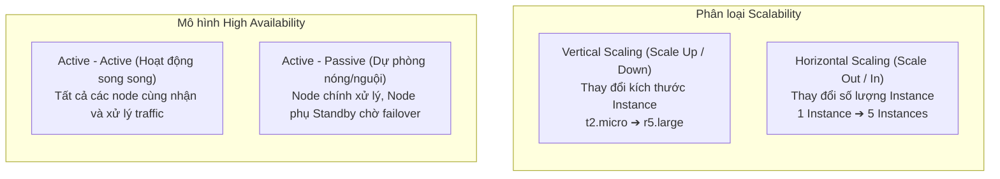

# High Availability và Scalability trong AWS

## 1. Khái niệm cốt lõi

* **Scalability (Khả năng mở rộng)**: Khả năng hệ thống thích ứng và xử lý khối lượng tải gia tăng bằng cách điều chỉnh năng lực tài nguyên điện toán.
* **Elasticity (Tính co giãn)**: Khả năng hệ thống tự động mở rộng khi tải tăng và thu hẹp khi tải giảm theo thời gian thực (gắn liền với Horizontal Scaling trên môi trường Cloud).
* **High Availability - HA (Tính sẵn sàng cao)**: Khả năng hệ thống tiếp tục vận hành liên tục không gián đoạn, sống sót qua các sự cố hỏng hóc phần cứng hoặc sự cố trung tâm dữ liệu (Data Center / Availability Zone loss) bằng cách phân tán tài nguyên trên ít nhất **2 Availability Zones (Multi-AZ)**.

---

## 2. So sánh Vertical Scaling vs Horizontal Scaling

| Tiêu chí | Vertical Scalability (Scale Up / Down) | Horizontal Scalability (Scale Out / In) |
| :--- | :--- | :--- |
| **Bản chất hành động** | Nâng cấp hoặc hạ cấp cấu hình phần cứng của **1 instance duy nhất** (vCPU, RAM, Network, Storage). | Thêm hoặc bớt **số lượng các instances/servers** tham gia vào hệ thống. |
| **Thuật ngữ AWS** | **Scale Up** (nâng cấu hình), **Scale Down** (hạ cấu hình). | **Scale Out** (tăng số máy), **Scale In** (giảm số máy). |
| **Kiến trúc phù hợp** | Hệ thống **không phân tán (Non-distributed systems)**: Cơ sở dữ liệu (Database như Amazon RDS, Amazon ElastiCache). | Hệ thống **phân tán (Distributed systems)**: Web Applications, API Microservices, stateless workloads. |
| **Giới hạn kỹ thuật** | Bị giới hạn bởi **năng lực phần cứng tối đa của 1 máy chủ vật lý** (Hardware limit). | **Hầu như không giới hạn**; có thể mở rộng lên hàng trăm, hàng nghìn instances theo nhu cầu. |
| **Downtime / Gián đoạn** | Thường yêu cầu Stop instance để đổi Instance Type (trừ một số dịch vụ quản lý hỗ trợ online scale). | **Không gián đoạn**; các instance mới được tạo thêm và gắn vào Load Balancer liền mạch. |
| **Dịch vụ hỗ trợ chính** | EC2 Instance Types (từ `t2.nano` đến các siêu máy chủ `u-12tb1.metal` với hàng trăm vCPU và TB RAM). | **Amazon EC2 Auto Scaling Groups (ASG)**, **Elastic Load Balancing (ELB)**. |

---

## 3. Kiến trúc High Availability (HA) trên AWS

* **Điều kiện tiên quyết của HA**: Hệ thống phải được triển khai trên **ít nhất 2 Availability Zones (Multi-AZ)** trong cùng một AWS Region.
* **Mục tiêu**: Đảm bảo khả năng phục hồi sau thảm họa (Disaster Recovery), khi một tòa nhà/trung tâm dữ liệu của AZ bị mất điện, lũ lụt hoặc mất kết nối mạng cáp quang, hệ thống vẫn phục vụ người dùng bình thường qua các AZ còn lại.
* **Hai mô hình HA**:
  1. **Active - Active (HA chủ động)**:
     * Cụm nhiều instances chạy đồng thời trên nhiều AZ, cùng được cấp phát tải qua Elastic Load Balancer (ELB).
     * Tận dụng tối đa tài nguyên và tăng thông lượng hệ thống.
  2. **Active - Passive (HA thụ động / Standby Failover)**:
     * Node chính (Primary) nhận lưu lượng đọc/ghi; node phụ (Standby) ở AZ khác được đồng bộ dữ liệu liên tục nhưng không nhận traffic.
     * Khi node chính gặp sự cố, hệ thống tự động đổi DNS/IP chuyển hướng (Failover) sang node Standby (Ví dụ: **Amazon RDS Multi-AZ Deployment**).

---

## 4. Mối quan hệ giữa Scalability và High Availability

* **Scalability ≠ High Availability**:
  * Một hệ thống có thể **Scalable nhưng không High Available**: Ví dụ chạy 100 EC2 instances tự động scale, nhưng toàn bộ 100 instances này chỉ nằm trong **duy nhất 1 Availability Zone** (Nếu AZ đó sập, toàn bộ ứng dụng chết).
  * Một hệ thống có thể **High Available nhưng không Scalable**: Ví dụ chạy 2 instances cố định trên 2 AZ khác nhau với cấu hình cố định không có Auto Scaling (Sống sót khi 1 AZ sập, nhưng sẽ bị quá tải nếu lượng người dùng tăng đột biến gấp 10 lần).
* **Kiến trúc chuẩn Enterprise trên AWS**: Kết hợp cả hai: **Auto Scaling Group triển khai Multi-AZ** đứng sau **Elastic Load Balancer Multi-AZ**.

---

## 5. Điểm cần lưu ý & Mẹo thi (Exam Tips)

1. **Phân biệt từ khóa hành vi**:
   * Tăng kích thước máy (RAM/CPU): **Scale Up (Vertical)**.
   * Tăng số lượng máy: **Scale Out (Horizontal)**.
   * Giảm số lượng máy: **Scale In (Horizontal)**.
2. **Khi nào chọn Vertical Scaling**: Đề bài nhắc đến cơ sở dữ liệu quan hệ (RDBMS) phức tạp khó chia tách, hoặc ứng dụng cũ dạng Monolithic không hỗ trợ kiến trúc phân tán.
3. **Khi nào chọn Horizontal Scaling**: Ứng dụng web không trạng thái (Stateless Web Applications), các dịch vụ Microservices hiện đại.
4. **HA luôn gắn liền với Multi-AZ**: Bất kỳ câu hỏi nào yêu cầu "High Availability" hoặc "Fault Tolerant against data center failure", đáp án bắt buộc phải chứa giải pháp triển khai trên **nhiều Availability Zones (Multi-AZ)**.
