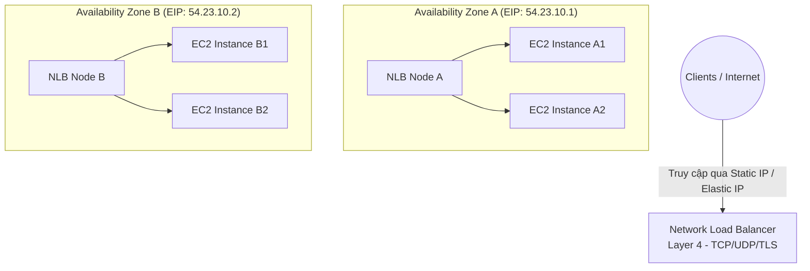
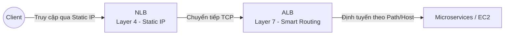

# Network Load Balancer (NLB)

## 1. Khái niệm cốt lõi

* **Định nghĩa**: **Network Load Balancer (NLB)** là bộ cân bằng tải chuyên dụng hoạt động ở **Tầng giao vận (Layer 4 của mô hình OSI)**.
* **Giao thức hỗ trợ**: **TCP**, **UDP**, **TCP_UDP** và **TLS**.
* **Đặc tính nổi bật**:
  * **Hiệu năng cực cao (Extreme Performance)**: Có khả năng xử lý hàng triệu yêu cầu mỗi giây (millions of requests per second) với độ trễ cực thấp (Ultra-low latency, khoảng vài mili-giây đến micro-giây).
  * **Địa chỉ IP tĩnh (Static IP)**: Cung cấp **duy nhất một địa chỉ IP tĩnh cho mỗi Availability Zone (AZ)** mà nó được kích hoạt. Có thể gán trực tiếp địa chỉ **Elastic IP (EIP)** cho từng AZ.
* **Kiến trúc phù hợp nhất**: Ứng dụng game thời gian thực, truyền phát trực tiếp (live streaming), IoT, giao thức độc quyền non-HTTP, hoặc hệ thống yêu cầu bảo mật nghiêm ngặt về danh sách trắng IP (IP Whitelisting).

---

## 2. Đặc tính kỹ thuật quan trọng của NLB

### 2.1. Cung cấp IP tĩnh cố định (Static IP & Elastic IP)
* Khác với ALB có địa chỉ IP thay đổi động liên tục, NLB cấp **1 IP tĩnh duy nhất trên mỗi AZ**.
* Người dùng có thể chỉ định gán sẵn **Elastic IP (EIP)** vào từng AZ khi khởi tạo NLB.
* **Tình huống sử dụng thực tế**: Các đối tác, khách hàng doanh nghiệp hoặc hệ thống mạng bên ngoài có chính sách tường lửa nghiêm ngặt, chỉ cho phép mở cổng tới một số lượng cố định các địa chỉ IP tĩnh xác định (Firewall Whitelisting).

### 2.2. Khả năng chịu tải và độ trễ
* NLB hoạt động ở tầng 4 nên không mất thời gian phân tích, giải mã nội dung gói tin HTTP như ALB.
* Định tuyến gói tin trực tiếp ở mức kết nối TCP/UDP, mang lại thông lượng mạng tối đa và độ trễ thấp nhất trong tất cả các dòng ELB của AWS.

---

## 3. Các loại đối tượng trong Target Group của NLB

NLB hỗ trợ chuyển tiếp lưu lượng tới các nhóm đích sau:

1. **EC2 Instances**: Đăng ký qua Instance ID (giao thức TCP hoặc UDP).
2. **Private IP Addresses**:
   * Địa chỉ IP trong VPC nội bộ.
   * Địa chỉ IP máy chủ nội bộ thuộc **On-Premises Data Center** (kết nối qua Direct Connect hoặc VPN).
   * *Ràng buộc*: Phải là địa chỉ IP riêng (Private IP).
3. **Application Load Balancer (ALB as a Target)**:
   * Cho phép đặt một **NLB đứng trước một ALB**.
   * **Lợi ích**: Tận dụng được cả 2 ưu điểm:
     * Sở hữu địa chỉ **IP tĩnh cố định** từ NLB cho người dùng bên ngoài whitelist.
     * Sở hữu khả năng **định tuyến tầng 7 thông minh** (Path/Host routing, SSL termination) từ ALB phía sau.

---

## 4. Cơ chế kiểm tra sức khỏe (Health Checks) của NLB

Dù hoạt động ở Layer 4 (TCP/UDP), Target Group của NLB hỗ trợ **3 loại giao thức Health Check**:
1. **TCP Health Check**: Gửi gói tin bắt tay TCP 3 bước (TCP Handshake) tới port của instance. Nếu bắt tay thành công ➔ Đánh dấu Healthy.
2. **HTTP Health Check**: Gửi HTTP GET request tới đường dẫn cụ thể (ví dụ `/health`) và mong đợi mã phản hồi HTTP 200 OK.
3. **HTTPS Health Check**: Kiểm tra tương tự HTTP nhưng qua kết nối TLS bảo mật.

> [!NOTE]
> Ngay cả khi backend của bạn phục vụ lưu lượng TCP, nếu máy chủ có cài đặt một web server nhỏ phục vụ kiểm tra trạng thái ứng dụng, bạn hoàn toàn có thể dùng HTTP/HTTPS Health Check trên NLB để đánh giá chính xác tính sẵn sàng của tầng ứng dụng.

---

## 5. Bảng so sánh nhanh ALB vs NLB

| Đặc tính | Application Load Balancer (ALB) | Network Load Balancer (NLB) |
| :--- | :--- | :--- |
| **Tầng mạng (OSI)** | **Layer 7** (Application) | **Layer 4** (Transport) |
| **Giao thức** | HTTP, HTTPS, WebSocket, gRPC | TCP, UDP, TLS |
| **Địa chỉ IP** | **IP động** (Chỉ cung cấp DNS Name cố định) | **IP tĩnh (Static IP / Elastic IP per AZ)** |
| **Hiệu năng & Độ trễ** | Rất cao (Độ trễ mili-giây) | **Cực cao / Hàng triệu RPS (Độ trễ micro-giây)** |
| **Quy tắc định tuyến** | Rất thông minh (URL Path, Host, Headers, Query) | Chỉ định tuyến theo Port và IP |
| **Serverless Target** | Hỗ trợ AWS Lambda | Không hỗ trợ trực tiếp Lambda |
| **Client IP Preservation** | Ghi đè IP (Dùng header `X-Forwarded-For`) | **Giữ nguyên Client IP gốc** trực tiếp trong TCP packet (khi dùng Target Type = Instance) |

---

## 6. Điểm cần lưu ý & Mẹo thi (Exam Tips)

1. **Từ khóa vàng nhận diện NLB trong đề thi**:
   * *Giao thức TCP / UDP*.
   * *Extreme performance, ultra-low latency, millions of requests per second*.
   * *Static IP, Elastic IP per Availability Zone*.
   * *Firewall whitelisting specific IP addresses*.
2. **Mô hình NLB đứng trước ALB**: Nếu đề bài yêu cầu "Hệ thống cần cung cấp IP tĩnh cho khách hàng whitelist tường lửa, đồng thời cần định tuyến lưu lượng thông minh theo đường dẫn URL path hoặc bảo vệ bằng AWS WAF", giải pháp chính là **triển khai NLB phía trước ALB**.
3. **Giữ nguyên Client IP (Source IP Preservation)**: Với NLB khi cấu hình Target Type là **Instance ID**, địa chỉ IP nguồn của client được giữ nguyên vẹn trong gói tin gửi đến EC2 backend mà không bị thay thế bằng IP của Load Balancer.