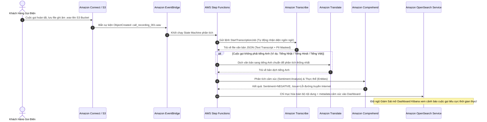
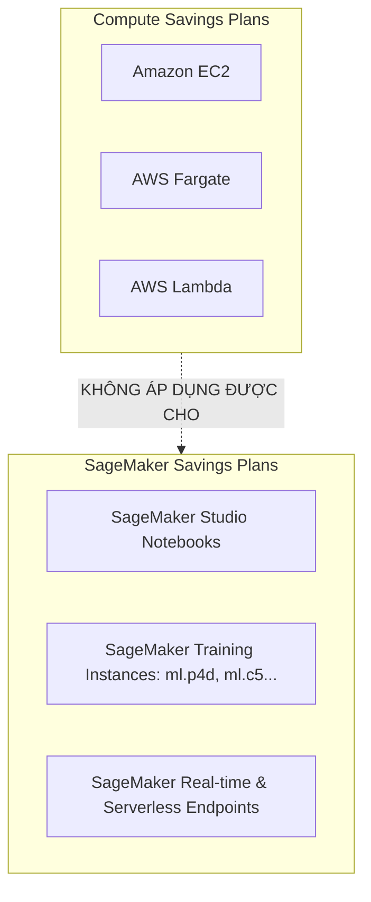

# Tài Liệu Học Tập Chuyên Sâu: Các Dịch Vụ Trí Tuệ Nhân Tạo & Học Máy Trên AWS (AI & Machine Learning Services)

> **Tài liệu chuẩn hóa kiến trúc đám mây**: Hướng dẫn toàn diện theo tiêu chuẩn Principal AI/ML Solutions Architect (Cập nhật phiên bản kiến trúc mới nhất 2026).  
> **Ngôn ngữ**: Tiếng Việt chuyên ngành (Bảo lưu 100% thuật ngữ chuyên ngành tiếng Anh chuẩn AWS).  
> **Mục tiêu**: Phục vụ thi chứng chỉ cấp độ Professional/Specialty (**SAA-C03, SAP-C02, Machine Learning Specialty**) và thiết kế giải pháp AI ứng dụng cấp độ doanh nghiệp (**Enterprise-grade AI Solutions**).  
> **Các bài giảng liên quan**: Chương 22 (Machine Learning on AWS: SageMaker, Rekognition, Comprehend, Transcribe, Translate, Textract, Polly, Lex, Kendra).

---

## 1. Tổng Quan Hệ Sinh Thái AI/ML Trên AWS (Service Overview)

### 1. Kim Tự Tháp 3 Tầng Dịch Vụ AI/ML của AWS

AWS phân chia các dịch vụ Trí tuệ Nhân tạo và Học máy thành 3 tầng rõ rệt:

```mermaid
flowchart TD
    subgraph L3[Tầng 3: Dịch Vụ AI Ứng Dụng Sẵn Sàng - Ready-to-use AI Services]
        direction LR
        Vision[Thị Giác Máy Tính:\nAmazon Rekognition]
        TextDoc[Văn Bản & Tài Liệu:\nAmazon Textract\nAmazon Comprehend\nAmazon Comprehend Medical]
        Voice[Âm Thanh & Hội Thoại:\nAmazon Transcribe\nAmazon Polly\nAmazon Lex]
        SearchGenAI[Tìm Kiếm & GenAI:\nAmazon Kendra\nAmazon Bedrock]
    end

    subgraph L2[Tầng 2: Nền Tảng Học Máy Toàn Diện - Machine Learning Platforms]
        direction LR
        SageMaker[Amazon SageMaker Studio\nBuild, Train, Tune, Deploy & Monitor ML Models\n(Data Wrangler, Feature Store, Autopilot, Endpoints)]
        RedshiftML[Amazon Redshift ML\nTrain & Run Inference using SQL]
    end

    subgraph L1[Tầng 1: Hạ Tầng Tính Toán Hiệu Năng Cao - ML Frameworks & Infrastructure]
        direction LR
        Infra[EC2 Accelerated Computing: P4d/P5 (NVIDIA H100)\nAWS Trainium & AWS Inferentia (Trn1/Inf2)\nPyTorch, TensorFlow, Deep Learning AMIs]
    end

    L3 -->|Gọi trực tiếp qua API không cần kiến thức ML chuyên sâu| L2
    L2 -->|Chạy trên nền tảng hạ tầng tối ưu hóa phần cứng| L1
```

1. **Tầng 3 (Top Layer - Dịch Vụ AI Gọi Qua API)**: Dành cho lập trình viên phần mềm và kiến trúc sư giải pháp. **Không cần bất kỳ kỹ năng huấn luyện mô hình ML nào**. Chỉ cần gọi API HTTPS hoặc AWS SDK để nhận kết quả nhận dạng hình ảnh, trích xuất văn bản tài liệu, dịch thuật, chuyển giọng nói thành văn bản, phân tích cảm xúc, hoặc trích xuất thực thể y tế.
2. **Tầng 2 (Middle Layer - Nền Tảng Máy Học Tích Hợp)**:
   - **Amazon SageMaker Platform**: Dành cho Data Scientists và ML Engineers. Quản lý toàn bộ vòng đời Học máy (Data preparation, Feature engineering, Model training, Hyperparameter optimization, Model Registry, Inference deployment, Model monitoring).
   - **Amazon Redshift ML**: Dành cho Data Analysts và Data Engineers muốn huấn luyện và suy luận mô hình học máy trực tiếp bằng câu lệnh SQL quen thuộc thông qua tích hợp ngầm với SageMaker.
3. **Tầng 1 (Bottom Layer - ML Frameworks & Custom Hardware)**: Dành cho các chuyên gia nghiên cứu sâu (ML Researchers) tự xây dựng mô hình nền tảng từ đầu trên các cụm máy chủ GPU NVIDIA hoặc chip chuyên dụng tự phát triển của AWS (**AWS Trainium** cho training, **AWS Inferentia** cho inference).

---

### 2. Bảng Phân Vai Cốt Lõi Của Các Dịch Vụ AI Tầng 3

| Dịch vụ AWS AI | Khả năng cốt lõi (Core Capabilities) | Tình huống kinh doanh điển hình | Tham chiếu đề thi |
| :--- | :--- | :--- | :--- |
| **Amazon Rekognition** | Nhận diện đối tượng, khuôn mặt, văn bản trong ảnh/video, **kiểm duyệt nội dung nhạy cảm (Content Moderation)**. Hỗ trợ kết nối qua Interface VPC Endpoint. | Tự động phát hiện và gỡ ảnh vi phạm chính sách; nhận diện kẻ xâm nhập camera an ninh. | `TD-Set2 Q30`, `TD-Set2 Q49`, `CM-PT4 Q29` |
| **Amazon Textract** | Trích xuất văn bản in, chữ viết tay, **biểu mẫu dạng Khóa-Giá trị (Key-Value Forms)** và **bảng biểu (Tables)** từ file scan/PDF qua API `AnalyzeDocument`. | Tự động đọc dữ liệu từ hóa đơn tài chính (Invoices), hợp đồng bảo hiểm, báo cáo y tế PDF. | `TD-Set4 Q46`, `TD-Set4 Q50`, `CM-PT4 Q08` |
| **Amazon Comprehend** | Xử lý ngôn ngữ tự nhiên (**NLP**), phân tích cảm xúc (Sentiment), trích xuất thực thể (Entities), từ khóa (Key Phrases). Hỗ trợ **Custom Entity Recognition**. | Phân tích hàng nghìn đánh giá sản phẩm để đo lường cảm xúc; trích xuất tên hoạt chất đặc thù. | `TD-Set3 Q46`, `TD-Set6 Q56`, `U-PT1 Q35`, `U-PT4 Q59` |
| **Amazon Comprehend Medical** | NLP chuyên ngành y tế: trích xuất thông tin định danh y tế (**PHI**), tên thuốc, liều lượng, triệu chứng bệnh từ bệnh án văn bản. | Xử lý hồ sơ bệnh án điện tử EHR, gỡ bỏ PHI tự động theo chuẩn HIPAA. | `TD-Set4 Q46` |
| **Amazon Transcribe** | Chuyển đổi giọng nói thành văn bản (**Speech-to-Text - ASR**), nhận diện người nói (Speaker diarization), gỡ bỏ thông tin định danh (**PII Redaction**). | Chuyển file ghi âm cuộc gọi của tổng đài thành văn bản JSON phục vụ phân tích chất lượng. | `TD-Set3 Q19`, `TD-Set6 Q56`, `U-PT4 Q61`, `CM-PT6 Q45` |
| **Amazon Translate** | Dịch thuật ngôn ngữ thần kinh (**Neural Machine Translation**) tốc độ cao với độ chính xác theo ngữ cảnh tự nhiên. | Bản địa hóa website thương mại điện tử sang nhiều ngôn ngữ theo thời gian thực; dịch hội thoại tổng đài. | `TD-Set3 Q19`, `TD-Set5 Q12`, `CM-PT6 Q45` |
| **Amazon Polly** | Chuyển văn bản thành giọng nói tự nhiên (**Text-to-Speech - TTS**) với nhiều ngôn ngữ và ngữ điệu (Neural TTS), hỗ trợ thẻ định dạng SSML. | Tạo giọng đọc sách nói (Audiobook), phát thông báo tự động trên hệ thống loa nhà ga/sân bay. | `TD-Set4 Q18` |
| **Amazon Lex** | Xây dựng giao diện trò chuyện đàm thoại tự động (**Chatbot / Voicebot**) sử dụng công nghệ nhận diện giọng nói và ngữ nghĩa của Alexa, tích hợp AWS Lambda. | Xây dựng trợ lý ảo hỗ trợ khách hàng tự động đặt vé, tra cứu số dư tài khoản ngân hàng. | `TD-Set5 Q35` |
| **Amazon Kendra** | Công cụ tìm kiếm tài liệu thông minh chuẩn doanh nghiệp (**Enterprise Semantic Search**) hỗ trợ ngôn ngữ tự nhiên và kết nối đa nguồn dữ liệu. | Nhân viên đặt câu hỏi tự nhiên để tìm chính xác quy trình trong hàng triệu tài liệu nội bộ PDF, Word, Confluence. | Chuẩn AWS |
| **Amazon Bedrock** | Nền tảng Serverless truy cập các Foundation Models (FM) hàng đầu (Claude, Llama, Titan) qua API duy nhất cho Generative AI. | Xây dựng ứng dụng RAG (Retrieval Augmented Generation), tóm tắt văn bản thông minh, sinh mã nguồn. | Chuẩn AWS GenAI |

---

## 2. Các Kịch Bản Kiến Trúc & Bẫy Thi Thường Gặp (Architecture Scenarios & Exam Traps)

### 🏛️ I. Các Kịch Bản Kiến Trúc Chuẩn (Best Practice Scenarios)

#### 1. Kiểm Soát Nội Dung Nhạy Cảm Trong Ảnh Tải Lên & PrivateLink: Amazon Rekognition Moderation — (TD-Set2 Q49, CM-PT4 Q29)
- **Tình huống thi**: Một mạng xã hội/trang chia sẻ hình ảnh cho phép người dùng đăng ảnh đại diện và bài viết lên S3. Hệ thống bắt buộc phải tự động phát hiện, gắn nhãn kiểm duyệt và gỡ bỏ ngay lập tức những hình ảnh chứa nội dung nhạy cảm, bạo lực, hoặc phản cảm (inappropriate / explicit content) với chi phí vận hành thấp nhất và không cần tự huấn luyện mô hình máy học. Đồng thời, mọi luồng giao tiếp mạng từ VPC tới dịch vụ nhận diện ảnh **không được phép đi qua Internet công cộng** (`TD-Set2 Q49`).
- **Giải pháp tối ưu chuẩn AWS**:
  - Người dùng tải ảnh lên **Amazon S3 Bucket**.
  - Thiết lập **S3 Event Notification** kích hoạt hàm **AWS Lambda** (chạy bên trong VPC private).
  - Khởi tạo một **Interface VPC Endpoint (AWS PrivateLink)** dành cho Amazon Rekognition trong VPC để lưu lượng gọi API nội bộ hoàn toàn qua mạng riêng của AWS (`TD-Set2 Q49`).
  - Hàm Lambda gọi API `DetectModerationLabels` của **Amazon Rekognition** qua endpoint này.
  - Nếu kết quả trả về nhãn vi phạm (như `Explicit Nudity`, `Violence`) với độ tin cậy cao (Confidence score > 80%), Lambda tự động chuyển file ảnh sang vùng cách ly (Quarantine S3 Bucket) hoặc xóa bỏ và gửi cảnh báo tới quản trị viên.

#### 2. Xây Dựng Hệ Thống Phân Tích Ý Kiến Khách Hàng Và Giấu PII: Transcribe + Comprehend — (TD-Set6 Q56, CM-PT4 Q08)
- **Tình huống thi**: Trung tâm chăm sóc khách hàng (Call Center) lưu trữ hàng ngàn file ghi âm cuộc gọi trên Amazon S3. Doanh nghiệp cần giải pháp tự động chuyển đổi file ghi âm thành văn bản, phân tích cảm xúc của khách hàng (Sentiment Analysis), trích xuất các từ khóa/chủ đề chính, và tự động ẩn đi các thông tin định danh cá nhân nhạy cảm (**PII - Personally Identifiable Information**) (`TD-Set6 Q56`).
- **Giải pháp tối ưu**:
  - Đối với file âm thanh cuộc gọi: Sử dụng **Amazon Transcribe** với tính năng **PII Redaction** để chuyển giọng nói thành văn bản JSON và tự động thay thế số thẻ ngân hàng, số điện thoại bằng nhãn `[PII]` (`TD-Set6 Q56`).
  - Đối với văn bản đã gỡ PII: Đẩy vào **Amazon Comprehend** để thực hiện:
    - `DetectSentiment`: Phân loại cảm xúc khách hàng thành `POSITIVE`, `NEGATIVE`, `NEUTRAL`, hoặc `MIXED` (`TD-Set6 Q56`, `TD-Set3 Q46`).
    - `DetectEntities` / `DetectKeyPhrases`: Trích xuất tên sản phẩm, lỗi phàn nàn và địa điểm để lưu trữ vào cơ sở dữ liệu phân tích BI (`TD-Set6 Q56`).

#### 3. Chuẩn Hóa Dữ Liệu Khổng Lồ Cho Huấn Luyện Machine Learning Bằng AWS Glue — (CM-PT1 Q59)
- **Tình huống thi**: Nhóm khoa học dữ liệu (Data Science) cần huấn luyện mô hình dự báo nhu cầu hàng hóa trên tập dữ liệu thô hàng chục Terabytes nằm rải rác trên S3 ở định dạng CSV và JSON. Quá trình tiền xử lý dữ liệu và trích xuất đặc trưng (Feature extraction) đòi hỏi năng lực tính toán phân tán mạnh mẽ trước khi nạp vào Amazon SageMaker.
- **Giải pháp tối ưu**:
  - Sử dụng **AWS Glue ETL Job (Apache Spark phân tán)** để tự động thu thập dữ liệu, làm sạch, loại bỏ giá trị rác và chuyển đổi sang định dạng tối ưu nạp vào máy học (**Apache Parquet**).
  - Xuất dữ liệu đã chuẩn hóa vào S3 Bucket trung gian.
  - Khởi chạy **Amazon SageMaker Training Job** trỏ vào đường dẫn S3 này để tiến hành huấn luyện mô hình. Giải pháp phân tách rõ ràng tầng xử lý dữ liệu lớn (Glue) và tầng học máy (SageMaker), mang lại hiệu năng cao và chi phí tối ưu nhất.

#### 4. Pipeline Phân Tích Hồ Sơ Bệnh Án Y Tế Tự Động: Textract + Comprehend Medical — (TD-Set4 Q46)
- **Tình huống thi**: Một tổ chức y tế nhận hàng nghìn báo cáo bệnh án ở dạng file PDF scan từ các bệnh viện đối tác lưu trên Amazon S3. Hệ thống cần tự động trích xuất các thông tin sức khỏe được bảo vệ (**PHI - Protected Health Information**), tên thuốc kê đơn và triệu chứng lâm sàng mà không cần tự phát triển mô hình NLP chuyên ngành y (`TD-Set4 Q46`).
- **Giải pháp tối ưu**:
  - S3 Event Notification kích hoạt hàm **AWS Lambda**.
  - Hàm Lambda gọi **Amazon Textract** (API `AnalyzeDocument`) để trích xuất toàn bộ văn bản và cấu trúc bảng từ các file PDF scan.
  - Văn bản trích xuất được gửi tiếp tới **Amazon Comprehend Medical** để tự động nhận dạng các thực thể y tế (Medical Entities) như tên thuốc, liều lượng (Dosage), tình trạng bệnh lý và phát hiện thông tin định danh cá nhân nhạy cảm y tế (PHI) theo chuẩn HIPAA (`TD-Set4 Q46`).

#### 5. Trích Xuất Thực Thể Chuyên Ngành Tùy Biến Không Cần Code ML: Comprehend Custom Entity Recognition — (U-PT1 Q35)
- **Tình huống thi**: Một nền tảng thương mại điện tử chuyên về thực phẩm cần tự động trích xuất danh sách các thành phần dinh dưỡng và nguyên liệu (ingredients) độc thù từ các file mô tả sản phẩm mới được tải lên Amazon S3, sau đó tính toán điểm số dinh dưỡng và lưu vào DynamoDB. Doanh nghiệp yêu cầu **không cần kiến thức máy học chuyên sâu (No ML expertise)** và triển khai nhanh nhất (`U-PT1 Q35`).
- **Giải pháp tối ưu**:
  - Sử dụng tính năng **Amazon Comprehend Custom Entity Recognition** (`U-PT1 Q35`).
  - Doanh nghiệp chỉ cần cung cấp một tập văn bản mẫu và danh sách nhãn nguyên liệu (Entity List CSV); Comprehend sẽ tự động huấn luyện mô hình nhận dạng thực thể riêng (Auto-train custom entity model) mà lập trình viên không phải viết bất kỳ dòng mã TensorFlow/PyTorch nào.
  - S3 Event kích hoạt AWS Lambda gọi API Comprehend trích xuất thành phần nguyên liệu và cập nhật trực tiếp vào DynamoDB (`U-PT1 Q35`).

#### 6. Pipeline Tổng Đài Cuộc Gọi Đa Ngôn Ngữ Thời Gian Thực: Transcribe + Translate + Comprehend — (TD-Set3 Q19, CM-PT6 Q45, U-PT4 Q61)
- **Tình huống thi**: Doanh nghiệp đa quốc gia ghi âm các cuộc gọi hỗ trợ khách hàng bằng nhiều thứ tiếng khác nhau (như tiếng Hindi, tiếng Tây Ban Nha, tiếng Nhật) lưu trên S3. Doanh nghiệp cần xây dựng pipeline tự động để chuyển giọng nói thành văn bản, dịch sang tiếng Anh chuẩn và phân tích cảm xúc (Sentiment Analysis) mà **không phải duy trì bất kỳ mô hình ML tự huấn luyện nào** (`TD-Set3 Q19`).
- **Giải pháp tối ưu**:
  - Bước 1: Khởi tạo tác vụ **Amazon Transcribe** để chuyển đổi file âm thanh cuộc gọi thành văn bản (`TD-Set3 Q19`).
  - Bước 2: Với các cuộc gọi không phải tiếng Anh, kích hoạt **Amazon Translate** để tự động dịch văn bản nguồn sang tiếng Anh chuẩn (`TD-Set3 Q19`).
  - Bước 3: Đưa văn bản tiếng Anh vào **Amazon Comprehend** để chấm điểm cảm xúc (`POSITIVE`, `NEGATIVE`, `NEUTRAL`, `MIXED`) và trích xuất vấn đề khiếu nại chính (`TD-Set3 Q19`).
  - Toàn bộ pipeline được điều phối qua **AWS Step Functions** hoặc **AWS Lambda** hoàn toàn Serverless.

#### 7. Huấn Luyện & Suy Luận Máy Học Trực Tiếp Bằng SQL: Amazon Redshift ML — (U-PT1 Q11, TD-Set8 Q21)
- **Tình huống thi**: Đội ngũ chuyên viên phân tích dữ liệu (Data Analysts) sử dụng kho dữ liệu Amazon Redshift muốn xây dựng mô hình dự báo rời mạng của khách hàng (Customer Churn Prediction) và tính toán điểm tín dụng ngay trên tập dữ liệu kho hàng chục Terabytes. Nhóm phân tích rất thành thạo SQL nhưng **không có kỹ năng lập trình Python hay kiến thức sâu về SageMaker SDK** (`U-PT1 Q11`).
- **Giải pháp tối ưu**:
  - Kích hoạt **Amazon Redshift ML** (`U-PT1 Q11`).
  - Chuyên viên phân tích chỉ cần viết lệnh SQL chuẩn: `CREATE MODEL customer_churn_model FROM (SELECT ... FROM customer_data) TARGET churn_label FUNCTION predict_churn ...`.
  - Redshift ML tự động xuất dữ liệu sang S3, gọi **Amazon SageMaker Autopilot** ngầm bên dưới để tìm thuật toán tối ưu, huấn luyện và biên dịch mô hình thành hàm SQL do người dùng định nghĩa (**SQL UDF**).
  - Nhà phân tích có thể gọi trực tiếp hàm suy luận ngay trong các câu truy vấn SQL hàng ngày: `SELECT customer_id, predict_churn(usage, tenure) FROM active_customers;` mà không cần di chuyển dữ liệu ra khỏi kho (`U-PT1 Q11`).

---

### 🪤 II. Các Bẫy Thi Tinh Vi & Phân Tích Phương Án Sai (Exam Traps & Distractors)

#### 🪤 Bẫy 1: Tối Ưu Chi Phí Giữa Compute Savings Plans và SageMaker Savings Plans — (CM-PT3 Q05, U-PT6 Q06)
- **Tình huống đề thi**: *"Doanh nghiệp đang vận hành hệ thống kết hợp gồm các hàm AWS Lambda, các container trên AWS Fargate, một số máy chủ EC2 và nhiều cụm huấn luyện máy học Amazon SageMaker. Ban giám đốc muốn mua Savings Plans để giảm thiểu chi phí tối đa cho toàn bộ hạ tầng tính toán này."*
- **Các phương án bẫy**:
  - ❌ *Chỉ mua một gói Compute Savings Plans bao quát cho toàn bộ EC2, Fargate, Lambda và SageMaker*: Sai lầm nghiêm trọng! Compute Savings Plans KHÔNG ÁP DỤNG cho các máy chủ của SageMaker (`ml.*`) (`CM-PT3 Q05`).
  - ❌ *Chỉ mua SageMaker Savings Plans*: Sai vì gói này chỉ áp dụng cho máy chủ `ml.*`, không bao quát EC2 hay Lambda.
- **Giải pháp ĐÚNG**: Mua kết hợp cả 2 gói:
  - 1 gói **Compute Savings Plans** cho EC2, Fargate và Lambda (`CM-PT3 Q05`, `U-PT6 Q06`).
  - 1 gói **SageMaker Savings Plans** chuyên biệt cho các máy chủ của Amazon SageMaker (`ml.m5`, `ml.c5`, `ml.p4d`...)!

#### 🪤 Bẫy 2: Đọc Dữ Liệu Hóa Đơn & Bảng Biểu: Amazon Rekognition vs Amazon Textract — (TD-Set4 Q50, CM-PT4 Q08)
- **Tình huống đề thi**: *"Hệ thống kế toán cần quét hàng nghìn file PDF hóa đơn thanh toán và báo cáo thuế dạng bảng để trích xuất số tiền, tên nhà cung cấp và danh sách các mặt hàng trong bảng thanh toán thành dữ liệu có cấu trúc."*
- **Phương án bẫy**:
  - ❌ *Dùng Amazon Rekognition Text Detection*: Rekognition nhận diện chữ thô trong ảnh (ví dụ: biển báo giao thông, chữ trên áo phông), không có khả năng hiểu cấu trúc ngữ nghĩa bảng biểu hay cặp Key-Value của hóa đơn (`TD-Set4 Q50`).
- **Giải pháp ĐÚNG**: Sử dụng **Amazon Textract** với tính năng `AnalyzeExpense` hoặc gọi API **`AnalyzeDocument` với `FeatureTypes: ['TABLES', 'FORMS']`** (`TD-Set4 Q50`).
  - Textract được huấn luyện chuyên sâu để nhận dạng chính xác bảng dữ liệu phức tạp, cột hàng và form biểu mẫu tài chính.

#### 🪤 Bẫy 3: Tự Viết Model AI Hay Dùng Dịch Vụ Có Sẵn? (Zero Operational Overhead) — (TD-Set5 Q12, TD-Set6 Q56, CM-PT4 Q29)
- **Tình huống đề thi**: *"Doanh nghiệp muốn tích hợp tính năng dịch thuật nội dung bài viết đa ngôn ngữ trong thời gian thực và chuyển giọng nói thành văn bản vào ứng dụng web với yêu cầu nỗ lực triển khai và vận hành thấp nhất (LEAST operational overhead / MINIMUM development effort)."*
- **Phương án bẫy**:
  - ❌ *Thuê Data Scientist tự xây dựng và huấn luyện mô hình Deep Learning trên SageMaker*: Tốn hàng tháng trời thu thập dữ liệu, tốn chi phí GPU đắt đỏ và công sức bảo trì mô hình.
- **Giải pháp ĐÚNG**: Tận dụng ngay các **Dịch vụ AI Tầng 3 (Amazon Transcribe & Amazon Translate)** thông qua việc gọi API trực tiếp (`TD-Set5 Q12`, `TD-Set6 Q56`). Tiết kiệm 95% thời gian phát triển và không phải quản lý bất kỳ máy chủ hay mô hình nào.

#### 🪤 Bẫy 4: Chuyển Đổi Văn Bản Bài Báo Thành Giọng Nói Tự Nhiên: Amazon Polly — (TD-Set4 Q18)
- **Tình huống đề thi**: *"Một trang tin tức điện tử muốn cung cấp tính năng phát âm thanh bài báo cho độc giả khiếm thị hoặc người dùng lái xe. Ứng dụng cần chuyển đổi văn bản bài viết thành giọng đọc âm thanh sống động, tự nhiên với nhiều tùy chọn ngôn ngữ và giọng đọc khác nhau."*
- **Các phương án bẫy**:
  - ❌ *Dùng Amazon Transcribe*: Transcribe là Speech-to-Text (chuyển âm thanh thành chữ), ngược hoàn toàn với yêu cầu Text-to-Speech (`TD-Set4 Q18`)!
  - ❌ *Dùng Amazon Comprehend*: Comprehend chỉ phân tích ngôn ngữ tự nhiên (NLP) chứ không phát ra âm thanh.
- **Giải pháp ĐÚNG**: Sử dụng **Amazon Polly** (`TD-Set4 Q18`).
  - Dịch vụ Text-to-Speech (TTS) chuyển đổi văn bản thành giọng nói chuẩn phòng thu bằng công nghệ Neural TTS (NTTS), hỗ trợ SSML (Speech Synthesis Markup Language) và tạo file MP3 lưu trên S3.

#### 🪤 Bẫy 5: Giám Sát Camera An Ninh & Phát Hiện Xâm Nhập Bằng Amazon Rekognition Video — (TD-Set2 Q30)
- **Tình huống đề thi**: *"Doanh nghiệp lắp đặt hệ thống camera an ninh giám sát bên trong trung tâm dữ liệu. Ban quản lý yêu cầu ứng dụng Trí tuệ nhân tạo (AI) để phân tích luồng video thời gian thực và tự động phát hiện nhân viên lạ hoặc kẻ xâm nhập vào khu vực cấm để phát cảnh báo tức thì."*
- **Giải pháp ĐÚNG**: Sử dụng **Amazon Rekognition Video** kết hợp **Kinesis Video Streams** (`TD-Set2 Q30`).
  - Rekognition hỗ trợ nhận diện khuôn mặt (Facial Search) và so sánh với kho dữ liệu khuôn mặt nhân viên đã đăng ký hợp lệ (Face Collection). Khi phát hiện người lạ, hệ thống lập tức kích hoạt cảnh báo an ninh qua EventBridge/SNS (`TD-Set2 Q30`).

#### 🪤 Bẫy 6: Xây Dựng Chatbot Hội Thoại Tự Động Với Khách Hàng: Amazon Lex — (TD-Set5 Q35)
- **Tình huống đề thi**: *"Một ngân hàng cần xây dựng trợ lý ảo (Chatbot) trên ứng dụng di động để hỗ trợ khách hàng tra cứu số dư tài khoản và khóa thẻ khẩn cấp qua cả giọng nói và tin nhắn văn bản, tự động kết nối với dịch vụ backend."*
- **Giải pháp ĐÚNG**: Sử dụng **Amazon Lex** kết hợp **AWS Lambda** (`TD-Set5 Q35`).
  - Amazon Lex cung cấp công nghệ nhận dạng giọng nói (ASR) và hiểu ngôn ngữ tự nhiên (NLU) - cùng công nghệ với trợ lý ảo Alexa.
  - Khi người dùng cung cấp đủ thông tin (Slots), Lex kích hoạt hàm AWS Lambda để gọi API xử lý nghiệp vụ ngân hàng an toàn (`TD-Set5 Q35`).

#### 🪤 Bẫy 7: Chuỗi Xử Lý Phản Hồi Bất Đồng Bộ Serverless: API GW + SQS + Lambda + Comprehend — (U-PT4 Q59)
- **Tình huống đề thi**: *"Hệ thống tiếp nhận hàng ngàn ý kiến phản hồi (customer feedback) của khách hàng mỗi phút qua ứng dụng di động. Doanh nghiệp cần xây dựng kiến trúc Serverless có khả năng hấp thụ tải bùng nổ, tự động phân tích cảm xúc (Sentiment Analysis) của phản hồi và lưu trữ kết quả phân loại với chi phí tối ưu và ít công sức quản trị nhất."*
- **Các phương án bẫy**:
  - ❌ *API Gateway gọi đồng bộ hàm Lambda và Comprehend*: Dễ bị timeout (giới hạn 29 giây của API Gateway) khi lượng đánh giá dồn về cùng lúc và làm tăng nguy cơ bị lỗi Throttling từ Comprehend API.
  - ❌ *Tự huấn luyện mô hình NLP trên Amazon SageMaker*: Tốn kém chi phí máy chủ GPU `ml.*` và mất nhiều tuần huấn luyện mô hình trong khi bài toán phân loại cảm xúc văn bản đã được giải quyết hoàn hảo bởi dịch vụ có sẵn.
- **Giải pháp ĐÚNG**: Kiến trúc Serverless bất đồng bộ qua 5 bước:
  1. **Amazon API Gateway** tiếp nhận request phản hồi từ client.
  2. API Gateway tích hợp trực tiếp đẩy tin nhắn vào **Amazon SQS** để làm phẳng đỉnh tải (**Load Leveling**).
  3. Hàng đợi SQS kích hoạt hàm **AWS Lambda** theo cơ chế Event Source Mapping (xử lý theo lô).
  4. Lambda gọi **Amazon Comprehend API (`DetectSentiment`)** để phân loại cảm xúc người dùng (`POSITIVE`, `NEGATIVE`, `NEUTRAL`, `MIXED`).
  5. Kết quả phân tích được Lambda ghi nhận vào **Amazon DynamoDB** để phục vụ báo cáo (`U-PT4 Q59`).

#### 🪤 Bẫy 8: Tự Động Hóa Chuyển Giọng Nói Thành Chữ Và Phân Tích Bằng Transcribe + Athena — (U-PT4 Q61)
- **Tình huống đề thi**: *"Trung tâm chăm sóc khách hàng lưu trữ các file ghi âm cuộc gọi trên Amazon S3. Doanh nghiệp cần giải pháp tự động chuyển đổi các file âm thanh này thành văn bản và cho phép đội ngũ phân tích chạy các câu truy vấn SQL ad-hoc để tìm kiếm từ khóa và đánh giá khiếu nại với chi phí thấp nhất."*
- **Các phương án bẫy**:
  - ❌ *Sử dụng Amazon Polly*: Amazon Polly là Text-to-Speech (chuyển văn bản thành giọng đọc), hoàn toàn ngược chiều so với yêu cầu bài toán!
  - ❌ *Nạp kết quả vào Amazon Redshift*: Khởi tạo cụm Redshift tốn kém chi phí node máy chủ chạy 24/7 không cần thiết cho nhu cầu truy vấn ad-hoc thỉnh thoảng của nhà phân tích.
- **Giải pháp ĐÚNG**: Kết hợp **Amazon Transcribe** và **Amazon Athena**:
  - Thiết lập tác vụ **Amazon Transcribe** chuyển đổi âm thanh cuộc gọi từ S3 thành các file văn bản JSON lưu trở lại S3.
  - Sử dụng **Amazon Athena** để chạy trực tiếp các câu lệnh truy vấn chuẩn SQL trên các file văn bản trong S3 mà không cần phải cấp phát hay quản lý bất kỳ cụm cơ sở dữ liệu nào (`U-PT4 Q61`).

#### 🪤 Bẫy 9: Trích Xuất Dữ Liệu Bệnh Án PDF Y Tế: Comprehend Medical vs Comprehend Thường — (TD-Set4 Q46)
- **Tình huống đề thi**: *"Hệ thống cần phân tích các tài liệu PDF tóm tắt quá trình khám chữa bệnh của bệnh nhân để tự động nhận dạng các chỉ số xét nghiệm, đơn thuốc kê, tình trạng bệnh lý và che giấu các thông tin định danh cá nhân y tế (PHI) theo đúng đạo luật HIPAA."*
- **Phương án bẫy**:
  - ❌ *Chỉ dùng Amazon Comprehend thông thường*: Comprehend chuẩn chỉ nhận diện thực thể thông dụng (Person, Location, Organization), không được huấn luyện trên từ vựng chuyên ngành y tế (ICD-10, RxNorm, SNOMED CT) và không được tinh chỉnh chuẩn HIPAA.
- **Giải pháp ĐÚNG**: Dùng **Amazon Textract** để chuyển PDF thành văn bản $\rightarrow$ nạp tiếp vào **Amazon Comprehend Medical** (`TD-Set4 Q46`).
  - Comprehend Medical hiểu sâu thuật ngữ giải phẫu, tên thuốc biệt dược, định lượng và tự động trích xuất các trường PHI với độ chính xác cao nhất.

#### 🪤 Bẫy 10: Nhận Diện Thành Phần Ngành Hàng Độc Thù: Comprehend Custom Entity Recognition vs Tự Code ML — (U-PT1 Q35)
- **Tình huống đề thi**: *"Ứng dụng cần trích xuất các thành phần nguyên liệu độc thù ngành hóa mỹ phẩm từ file văn bản tải lên S3. Doanh nghiệp không có đội ngũ Data Scientist và muốn triển khai nhanh nhất."*
- **Phương án bẫy**:
  - ❌ *Tự code mô hình Named Entity Recognition (NER) bằng PyTorch/Spacy trên Amazon EC2 hoặc SageMaker*: Tốn nhiều tháng phát triển, bảo trì container và hạ tầng máy tính.
- **Giải pháp ĐÚNG**: Sử dụng **Amazon Comprehend Custom Entity Recognition** (`U-PT1 Q35`).
  - Chỉ cần tải danh sách nhãn mẫu lên S3, Comprehend tự động fine-tune mô hình NLP chuyên biệt mà không đòi hỏi lập trình viên phải biết toán học hay cấu trúc Deep Learning.

#### 🪤 Bẫy 11: Bảo Mật Giao Tiếp AI Service Không Ra Public Internet: Interface VPC Endpoint — (TD-Set2 Q49)
- **Tình huống đề thi**: *"Ứng dụng xử lý ảnh nhạy cảm trên máy chủ EC2 private trong VPC cần kiểm duyệt nội dung qua Amazon Rekognition. Chính sách bảo mật nghiêm ngặt nghiêm cấm mọi lưu lượng truy cập ra ngoài Internet công cộng, không được cấp NAT Gateway hay Internet Gateway."*
- **Phương án bẫy**:
  - ❌ *Tạo NAT Gateway cho Private Subnet*: Vi phạm chính sách vì dữ liệu vẫn đi ra ngoài Internet công cộng tới public endpoint của Rekognition.
- **Giải pháp ĐÚNG**: Tạo **Interface VPC Endpoint (AWS PrivateLink)** cho Amazon Rekognition (`TD-Set2 Q49`).
  - Lưu lượng từ EC2/Lambda trong VPC đi thẳng tới API Rekognition qua Elastic Network Interface (ENI) nội bộ với IP private, hoàn toàn cô lập khỏi Internet.

#### 🪤 Bẫy 12: Phân Tích Dự Báo Bằng SQL Cho Data Analysts: Amazon Redshift ML vs SageMaker — (U-PT1 Q11)
- **Tình huống đề thi**: *"Doanh nghiệp có kho dữ liệu Amazon Redshift khổng lồ. Đội ngũ phân tích kinh doanh (Data Analysts) muốn dự báo xu hướng khách hàng mua hàng bằng cách sử dụng các mô hình học máy, nhưng họ chỉ biết viết SQL và không có kinh nghiệm viết mã Python."*
- **Phương án bẫy**:
  - ❌ *Yêu cầu xuất dữ liệu ra S3 và thuê kỹ sư ML viết Jupyter Notebook trên SageMaker*: Rất tốn kém, tạo độ trễ dữ liệu lớn và không tận dụng được năng lực của đội ngũ phân tích hiện tại.
- **Giải pháp ĐÚNG**: Sử dụng **Amazon Redshift ML** (`U-PT1 Q11`).
  - Cho phép người dùng sử dụng câu lệnh `CREATE MODEL` trực tiếp trong SQL; Redshift ML tự động phối hợp với SageMaker huấn luyện mô hình và cung cấp hàm SQL UDF để dự báo kết quả tức thì.

---

### 📊 III. Ma Trận Quyết Định Dịch Vụ AI/ML Nhanh (Exam Decision Matrix)

| Tình huống / Yêu cầu trong đề thi | Dịch vụ chuẩn AWS | Dịch vụ bị loại & Lý do | Tham chiếu đề thi |
|:---|:---|:---|:---|
| **Chuỗi xử lý phản hồi & phân tích cảm xúc Serverless** | **API GW + SQS + Lambda + Comprehend + DynamoDB** | Gọi đồng bộ Comprehend từ API GW (dễ timeout, lỗi throttling) | `U-PT4 Q59` |
| **Chuyển ghi âm cuộc gọi thành chữ và truy vấn bằng SQL** | **Amazon Transcribe (Speech-to-Text) + Athena** | Polly (ngược chiều: Text-to-Speech) / Redshift (quá đắt) | `U-PT4 Q61` |
| **Kiểm duyệt ảnh nhạy cảm qua mạng riêng cô lập VPC** | **Amazon Rekognition + Interface VPC Endpoint (PrivateLink)** | Gửi ảnh qua NAT Gateway ra Public Internet (vi phạm bảo mật) | `TD-Set2 Q49`, `CM-PT4 Q29` |
| **Phát hiện kẻ xâm nhập qua camera giám sát video thời gian thực** | **Amazon Rekognition Video + Kinesis Video Streams** | Amazon SageMaker (phải tự code và train model thị giác từ đầu) | `TD-Set2 Q30` |
| **Chuyển đổi file ghi âm cuộc gọi thành văn bản và ẩn PII** | **Amazon Transcribe (PII Redaction)** | Amazon Polly (chuyển văn bản thành tiếng nói, ngược chiều) | `TD-Set6 Q56` |
| **Đo lường cảm xúc khách hàng (Positive / Negative) từ văn bản** | **Amazon Comprehend (`DetectSentiment`)** | Amazon Translate (chỉ dịch thuật ngôn ngữ) | `TD-Set3 Q46`, `TD-Set6 Q56` |
| **Trích xuất thông tin bệnh án y tế, tên thuốc, PHI từ PDF scan** | **Amazon Textract + Amazon Comprehend Medical** | Comprehend thường (không hiểu thuật ngữ y khoa chuyên ngành) | `TD-Set4 Q46` |
| **Trích xuất thực thể riêng (nguyên liệu, mã phụ tùng) không cần code ML** | **Amazon Comprehend Custom Entity Recognition** | SageMaker Custom Deep Learning (tốn nhiều tháng tự train model) | `U-PT1 Q35` |
| **Đọc dữ liệu bảng biểu, hóa đơn, CCCD từ file scan/PDF** | **Amazon Textract (`AnalyzeDocument TABLES & FORMS`)** | Rekognition (chỉ OCR thô, không hiểu Table & Form) | `TD-Set4 Q50`, `CM-PT4 Q08` |
| **Chuyển văn bản bài viết thành giọng đọc audio sống động** | **Amazon Polly (Neural Text-to-Speech)** | Amazon Transcribe (Transcribe là Speech-to-Text) | `TD-Set4 Q18` |
| **Xây dựng Chatbot tự động hội thoại giọng nói & văn bản** | **Amazon Lex (tích hợp AWS Lambda fulfillment)** | Amazon Comprehend (chỉ phân tích văn bản tĩnh, không hội thoại) | `TD-Set5 Q35` |
| **Dịch thuật đa ngôn ngữ cuộc gọi tổng đài thời gian thực** | **Amazon Transcribe + Amazon Translate + Comprehend** | Polly (Text-to-Speech) / Fraud Detector (phát hiện gian lận) | `TD-Set3 Q19`, `CM-PT6 Q45` |
| **Data Analysts huấn luyện và chạy dự đoán ML bằng SQL** | **Amazon Redshift ML (tích hợp ngầm SageMaker Autopilot)** | Bắt buộc chuyển sang viết Python Jupyter Notebook trên SageMaker | `U-PT1 Q11`, `TD-Set8 Q21` |
| **Tiền xử lý tập dữ liệu lớn hàng chục TB trước khi nạp vào ML** | **AWS Glue ETL (Spark phân tán) $\rightarrow$ Parquet S3** | Tự viết script chạy trên 1 máy chủ EC2 (nghẽn RAM/CPU) | `CM-PT1 Q59` |
| **Tiết kiệm chi phí máy chủ Amazon SageMaker ml.*** | **SageMaker Savings Plans (lên tới 64%)** | Compute Savings Plans (không hỗ trợ cho họ máy chủ `ml.*`) | `CM-PT3 Q05`, `U-PT6 Q06` |
| **Huấn luyện mô hình SageMaker tiết kiệm tới 90% chi phí** | **Managed Spot Training + Checkpointing lên S3** | Chạy On-Demand Instance liên tục (tốn kém chi phí) | Chuẩn AWS |
| **Deploy mô hình ML với lưu lượng ngắt quãng, scale về 0** | **SageMaker Serverless Inference** | Real-time Inference (phải trả tiền máy chủ chạy 24/7) | Chuẩn AWS |

---

## 3. Kiến Trúc Sâu & Luồng Hoạt Động (Deep-Dive Architecture & Workflow)

### 3.1. Vòng Đời Huấn Luyện & Suy Luận Trên SageMaker

```mermaid
flowchart LR
    S3Data[(Amazon S3\nTraining Dataset)] -->|1. Ingest Data| Prep[SageMaker Data Wrangler\n& Feature Store]
    Prep -->|2. Train Job| TrainCluster[SageMaker Training Job\nCụm EC2 ml.c5 / ml.p4d tạm thời\n(Tự động tắt sau khi train)]
    TrainCluster -->|3. Lưu Model Artifacts .tar.gz| S3Model[(Amazon S3\nTrained Model)]
    S3Model -->|4. Deploy Inference| Hosting[SageMaker Inference Options\nReal-time / Serverless / Async / Batch]
```

### 3.2. Bốn Tùy Chọn Triển Khai Suy Luận (SageMaker Inference Options)

Việc chọn đúng loại Endpoint suy luận là một trong những câu hỏi quyết định điểm số cao trong các bài thi kiến trúc AWS:

| Tùy chọn Inference | Cơ chế vận hành | Độ trễ (Latency) | Kích thước Payload & Timeout | Trường hợp sử dụng tối ưu |
| :--- | :--- | :--- | :--- | :--- |
| **Real-time Inference** | Cụm máy chủ EC2 quản lý chạy liên tục 24/7 sau một endpoint HTTPS. Hỗ trợ Auto Scaling. | **Mili-giây (Milli-seconds)** | Payload tối đa 6 MB.<br>Timeout 60 giây. | Ứng dụng thực tế yêu cầu phản hồi tức thì: Chấm điểm gian lận thẻ tín dụng, gợi ý sản phẩm khi xem web. |
| **Serverless Inference** | Hoàn toàn phi máy chủ, tự động co giãn về 0 khi không có lưu lượng. Tính tiền theo thời gian chạy mili-giây. | Mili-giây (Có thể gặp Cold Start) | Payload tối đa 4 MB.<br>Timeout 60 giây. | Ứng dụng có lưu lượng truy cập ngắt quãng, không dự đoán được, tải nền thấp trong ngày. |
| **Asynchronous Inference** | Hàng đợi tích hợp sẵn; nhận yêu cầu, lưu vào S3 và xử lý lần lượt ở chế độ nền. Hỗ trợ scale về 0. | Vài giây đến vài phút | **Payload lên tới 1 GB**.<br>**Timeout lên tới 1 giờ (15 min default)**. | Xử lý các mô hình ML nặng: Phân tích file ảnh y tế độ phân giải cao, xử lý video lớn, nhận diện giọng nói dài. |
| **Batch Transform** | Khởi chạy cụm tính toán để dự đoán trên toàn bộ tập dữ liệu lớn đã có sẵn trên S3, sau đó tự tắt cụm. | Không yêu cầu thời gian thực | Xử lý hàng Terabytes dữ liệu theo đợt. | Dự đoán hành vi rời mạng của khách hàng (Churn prediction) chạy định kỳ mỗi đêm cuối tuần. |

### 3.3. Kịch Bản: Pipeline Tự Động Phân Tích & Kiểm Soát Nội Dung Tổng Đài Đa Ngôn Ngữ (Call Center Intelligence Pipeline)



---

## 4. Bảng Tích Hợp với Các Dịch Vụ AWS Khác (Integration Table)

| Dịch vụ AI/ML | Dịch vụ tích hợp | Mục đích kỹ thuật & Kịch bản thực tế | Tham chiếu đề thi |
| :--- | :--- | :--- | :--- |
| **Amazon Rekognition** | **Amazon S3 + AWS Lambda** | Kiến trúc Serverless: Ảnh upload lên S3 kích hoạt Lambda gọi `DetectModerationLabels` để xóa ngay ảnh vi phạm chính sách. | `TD-Set2 Q49`, `CM-PT4 Q29` |
| **Amazon Rekognition** | **AWS PrivateLink (VPC Endpoint)** | Gọi API nhận diện ảnh nội bộ từ EC2/Lambda trong private subnet mà không cần Internet Gateway hay NAT Gateway. | `TD-Set2 Q49` |
| **Amazon SageMaker** | **AWS Glue** | Sử dụng AWS Glue để làm sạch, biến đổi và chuẩn hóa tập dữ liệu huấn luyện khổng lồ trên S3 trước khi nạp vào SageMaker Training Job. | `CM-PT1 Q59` |
| **Amazon SageMaker** | **Amazon FSx for Lustre** | Tăng tốc độ đọc dữ liệu huấn luyện hàng chục lần bằng cách liên kết trực tiếp S3 bucket với cụm lưu trữ hiệu năng cao FSx for Lustre. | Chuẩn AWS |
| **Amazon Textract** | **Amazon A2I (Augmented AI)** | Tích hợp con người vào quy trình đánh giá (**Human-in-the-loop**): Nếu độ tự tin của Textract < 80%, tự động gửi tài liệu đến nhân viên duyệt thủ công. | Chuẩn AWS |
| **Amazon Textract** | **Amazon Comprehend Medical** | Đọc báo cáo bệnh án PDF scan, sau đó trích xuất thông tin định danh y tế (PHI) và đơn thuốc theo chuẩn HIPAA. | `TD-Set4 Q46` |
| **Amazon Lex** | **AWS Lambda** | Đóng vai trò là Fulfillment Code: Khi người dùng cung cấp đủ thông tin (Slots) cho Chatbot, Lex kích hoạt Lambda để truy vấn DB backend. | `TD-Set5 Q35` |
| **Amazon Comprehend** | **Amazon EventBridge + SNS** | Tự động phát hiện các phản hồi có mức độ "VERY_NEGATIVE" từ khách hàng để gửi cảnh báo khẩn cấp qua SNS tới đội CSKH VIP. | `U-PT4 Q59` |
| **Amazon Redshift ML** | **Amazon SageMaker Autopilot** | Cho phép Data Analysts chạy lệnh SQL để huấn luyện và suy luận mô hình học máy trực tiếp trên cụm Redshift. | `U-PT1 Q11`, `TD-Set8 Q21` |

---

## 5. Bảng So Sánh Trong Hệ Sinh Thái AWS (Ecosystem Comparison)

Dưới đây là ma trận phân biệt toàn diện giữa các dịch vụ AI và Machine Learning trọng yếu trên AWS:

| Tiêu chí | Amazon Rekognition | Amazon Textract | Amazon Comprehend | Amazon Transcribe | Amazon Polly | Amazon Lex | Amazon SageMaker | Amazon Redshift ML |
| :--- | :--- | :--- | :--- | :--- | :--- | :--- | :--- | :--- |
| **Dữ liệu đầu vào** | Ảnh (JPEG/PNG), Video (MP4) | Tài liệu scan, PDF, ảnh chụp | Văn bản không cấu trúc (Text) | File âm thanh (WAV, MP3, FLAC) | Văn bản thô, mã SSML | Tin nhắn chat, giọng nói | Bảng tabular, ảnh, văn bản, chuỗi thời gian | Dữ liệu dạng bảng trong bảng Redshift / S3 |
| **Dữ liệu đầu ra** | Tọa độ vật thể, nhãn kiểm duyệt, Face ID | Chữ thô, bảng (Tables), cặp Form Key-Value | Cảm xúc, thực thể, ngôn ngữ, PII | Văn bản (JSON transcript), dấu thời gian từ | Luồng âm thanh (MP3, OGG, PCM) | Intent đã xác định, các slot dữ liệu | Model artifact, dự đoán xác suất, embedding | Cột dự đoán trong câu truy vấn SQL |
| **Kỹ năng ML yêu cầu** | **0% (API-only)** | **0% (API-only)** | **0% (API-only)** | **0% (API-only)** | **0% (API-only)** | **0% (API-only)** | **Cao** (Python, Data Science, Hyperparameter) | **0%** (Chỉ cần kỹ năng viết SQL) |
| **Tùy biến mô hình** | Custom Labels | Không (Mô hình OCR cố định) | Custom Classification, Custom Entity | Custom Vocabulary, Custom Language Model | Lexicons tùy chỉnh phát âm | Custom Intents, Slots, Prompts | Tự do tùy biến 100% thuật toán | Tự động chọn mô hình qua SageMaker Autopilot |
| **Khả năng giấu thông tin** | N/A | N/A | PII Redaction, Medical PHI | PII Redaction tự động | N/A | N/A | Tự cài đặt trong pipeline xử lý | Tự cài đặt qua SQL masking |
| **Hỗ trợ mạng riêng VPC** | Interface VPC Endpoint | Interface VPC Endpoint | Interface VPC Endpoint | Interface VPC Endpoint | Interface VPC Endpoint | Interface VPC Endpoint | VPC Interface Endpoint & Subnet ENI | Chạy trực tiếp trong Redshift VPC |

---

## 6. FinOps & Chiến Lược Tối Ưu Chi Phí (Cost Optimization)

### 1. Phân Biệt Sắc Bén: SageMaker Savings Plans vs Compute Savings Plans — (CM-PT3 Q05, U-PT6 Q06)

Đây là bẫy thi cực kỳ phổ biến trong các đề thi chứng chỉ AWS:



* **Compute Savings Plans**: Cung cấp mức giảm giá lên tới 66% cho việc sử dụng **Amazon EC2, AWS Fargate và AWS Lambda**.  
  👉 **TUYỆT ĐỐI KHÔNG ÁP DỤNG ĐƯỢC cho các máy chủ Amazon SageMaker (`ml.*` instances)!** (`CM-PT3 Q05`)
* **SageMaker Savings Plans**: Kế hoạch cam kết chi tiêu linh hoạt (ví dụ: cam kết \$10/giờ trong 1 năm hoặc 3 năm) giúp giảm chi phí lên tới **64%** cho **các loại máy chủ SageMaker compute (`ml.m5`, `ml.c5`, `ml.p4d`, `ml.g5`)** (`CM-PT3 Q05`, `U-PT6 Q06`).
* **Tối ưu chi phí huấn luyện với Managed Spot Training**:
  - Tận dụng năng lực tính toán dư thừa **Amazon EC2 Spot Instances** để huấn luyện mô hình SageMaker.
  - **Tiết kiệm lên tới 90% chi phí huấn luyện**.
  - Kết hợp sử dụng **SageMaker Checkpointing** để lưu trạng thái huấn luyện lên S3, giúp tiếp tục quá trình học mà không bị mất tiến độ khi máy chủ Spot bị thu hồi!
* **SageMaker Serverless Inference**:
  - Tự động co giãn số lượng worker về 0 khi không có request.
  - Chỉ tính tiền theo thời gian xử lý thực tế tính bằng mili-giây, tối ưu chi phí cho các mô hình có lưu lượng truy cập ngắt quãng.

---

## 7. Khắc Phục Sự Cố Thực Tế (Troubleshooting Guide)

| Tình huống sự cố | Nguyên nhân khả dĩ | Phương pháp kiểm tra | Giải pháp xử lý |
| :--- | :--- | :--- | :--- |
| **SageMaker Training Job bị lỗi Out of Memory (OOM)** | Kích thước batch size hoặc mô hình quá lớn so với dung lượng RAM/VRAM của máy chủ huấn luyện. | Xem metric CloudWatch `MemoryUtilization` và `GPUUtilization` của Training Job. | 1. Tăng kích cỡ instance (ví dụ: từ `ml.p3.2xlarge` lên `ml.p3.8xlarge`).<br>2. Kích hoạt kỹ thuật **SageMaker Model Parallelism** hoặc giảm batch size trong script huấn luyện. |
| **SageMaker Endpoint trả về lỗi HTTP 424 (Failed Dependency) hoặc 500** | Code trong file `inference.py` bị exception (lỗi cú pháp, thiếu thư viện python, định dạng dữ liệu đầu vào không khớp). | Mở CloudWatch Logs nhóm `/aws/sagemaker/Endpoints/<EndpointName>` để đọc stack trace chi tiết. | 1. Sửa lỗi logic xử lý đầu vào trong hàm `input_fn` hoặc `predict_fn`.<br>2. Kiểm tra file `requirements.txt` của custom container. |
| **Amazon Textract không đọc được dữ liệu bảng biểu phức tạp** | Sử dụng API `DetectDocumentText` thông thường thay vì API phân tích chuyên sâu. | Kiểm tra mã API đang gọi trong ứng dụng. | API `DetectDocumentText` chỉ đọc các dòng chữ thô (Raw OCR). Phải chuyển sang gọi API **`AnalyzeDocument` với FeatureTypes là `['TABLES', 'FORMS']`** để trích xuất cấu trúc bảng và key-value! (`TD-Set4 Q50`) |
| **Amazon Rekognition báo lỗi AccessDenied khi đọc ảnh từ S3** | IAM Role của Rekognition hoặc Lambda không có quyền `s3:GetObject` trên bucket, hoặc bucket mã hóa bằng KMS CMK nhưng role không có quyền `kms:Decrypt`. | Kiểm tra CloudTrail Event `GetObject` và xem mã lỗi `AccessDenied`. | 1. Cấp quyền `s3:GetObject` trên S3 Bucket ARN.<br>2. Bổ sung quyền `kms:Decrypt` trên Key Policy của AWS KMS nếu bucket bật SSE-KMS. |
| **Máy chủ EC2 trong Private Subnet không gọi được Rekognition API** | Private Subnet không có Internet Gateway và chưa cấu hình VPC Endpoint cho dịch vụ Rekognition. | Kiểm tra bảng định tuyến Route Table và VPC Endpoints hiện có. | Khởi tạo **Interface VPC Endpoint (AWS PrivateLink)** cho dịch vụ `com.amazonaws.<region>.rekognition` và gán Security Group cho phép port 443 từ VPC CIDR (`TD-Set2 Q49`). |

---

## 8. Tóm Tắt & Danh Mục Tự Kiểm Tra (Summary & Learning Checklist)

### 7 Nguyên Tắc Kiến Trúc "Sống Còn" Của AI/ML Trên AWS

1. **Ưu tiên Tầng 3 khi không có yêu cầu tùy biến mô hình**: Đề bài có từ khóa *"LEAST operational overhead"*, *"No ML expertise"* $\rightarrow$ Luôn chọn các dịch vụ có sẵn: Rekognition, Comprehend, Transcribe, Translate, Textract.
2. **Textract cho tài liệu, Rekognition cho hình ảnh đời sống**: Khi cần đọc Form/Table/Invoice $\rightarrow$ Textract (`TD-Set4 Q50`). Khi cần nhận diện khuôn mặt, cảnh quan, kiểm duyệt ảnh bạo lực $\rightarrow$ Rekognition (`TD-Set2 Q49`).
3. **Comprehend là chuyên gia ngôn ngữ**: Khi cần đo cảm xúc (Sentiment), tìm chủ đề (Topic modeling) hoặc phát hiện thông tin định danh (PII) $\rightarrow$ Comprehend. Đối với bệnh án y tế $\rightarrow$ Comprehend Medical (`TD-Set4 Q46`).
4. **Quy tắc phân loại Savings Plans**: Compute Savings Plans cho EC2, Fargate, Lambda. SageMaker Savings Plans cho SageMaker `ml.*` instances. Tuyệt đối không thể hoán đổi cho nhau! (`CM-PT3 Q05`, `U-PT6 Q06`).
5. **SageMaker Serverless cho Spiky Traffic**: Khi triển khai mô hình ML mà lưu lượng truy cập thất thường và muốn tiết kiệm chi phí $\rightarrow$ Chọn SageMaker Serverless Inference (tự scale về 0).
6. **Managed Spot Training + Checkpointing**: Giảm tới 90% chi phí huấn luyện mô hình bằng cách dùng Spot instances kết hợp lưu checkpoint lên S3.
7. **Bảo vệ PII ngay từ đầu nguồn & Cô lập mạng**: Khi xử lý dữ liệu khách hàng, luôn kích hoạt tính năng tự động làm mờ PII trên Transcribe và Comprehend; sử dụng Interface VPC Endpoint để đảm bảo lưu lượng AI không rời khỏi mạng riêng AWS (`TD-Set2 Q49`).

---

### Danh Mục Kiểm Tra Kiến Thức Trọng Tâm (Learning Checklist)

- [ ] Phân biệt rõ ràng 3 tầng dịch vụ AI/ML của AWS và nguyên tắc chọn dịch vụ Tầng 3 khi đề bài yêu cầu "Least operational effort".
- [ ] Nắm vững sự khác biệt giữa `Amazon Rekognition` (nhận diện hình ảnh/video, kiểm duyệt nội dung) và `Amazon Textract` (trích xuất văn bản có cấu trúc Tables & Forms từ tài liệu scan).
- [ ] Hiểu rõ chức năng của `Amazon Transcribe` (Speech-to-Text với PII Redaction) và phân biệt với `Amazon Polly` (Text-to-Speech với Neural TTS và SSML).
- [ ] Thành thạo kiến trúc pipeline Call Center: S3 $\rightarrow$ Transcribe $\rightarrow$ Translate $\rightarrow$ Comprehend $\rightarrow$ Athena / OpenSearch (`TD-Set3 Q19`, `U-PT4 Q61`).
- [ ] Phân biệt được `Amazon Comprehend` (NLP thông thường) và `Amazon Comprehend Medical` (trích xuất PHI, tên thuốc, chuẩn y tế HIPAA từ PDF scan của Textract) (`TD-Set4 Q46`).
- [ ] Nắm vững tính năng `Comprehend Custom Entity Recognition` để trích xuất nhãn dữ liệu đặc thù ngành hàng mà không cần viết code ML (`U-PT1 Q35`).
- [ ] Hiểu rõ ứng dụng của `Amazon Redshift ML` giúp Data Analysts chạy mô hình học máy bằng câu lệnh SQL thông qua tích hợp ngầm với SageMaker Autopilot (`U-PT1 Q11`).
- [ ] Phân biệt 4 tùy chọn triển khai SageMaker Inference: Real-time, Serverless, Asynchronous (hỗ trợ payload 1 GB, timeout 1 giờ), và Batch Transform.
- [ ] Ghi nhớ quy tắc FinOps: Compute Savings Plans KHÔNG áp dụng cho máy chủ SageMaker `ml.*`; phải mua SageMaker Savings Plans (`CM-PT3 Q05`, `U-PT6 Q06`).
- [ ] Hiểu cách bảo mật dịch vụ AI bằng cách tạo Interface VPC Endpoint (AWS PrivateLink) cho Rekognition/Textract/Comprehend trong VPC (`TD-Set2 Q49`).

---

### Liên Kết Nội Bộ và Tài Liệu Tham Khảo (Internal Links)

- 📖 [Ghi Chú Bài Học Chương 22: Machine Learning on AWS](../Lesson_Notes/23_Machine_Learning.md)
- 📖 [Tài Liệu Chuyên Sâu: Phân Tích Dữ Liệu Lớn (Big Data & Glue)](./Analytics_Big_Data_Services.md)
- 📖 [Tài Liệu Chuyên Sâu: Bảo Mật & Mã Hóa Dữ Liệu (KMS & Security)](./KMS_Security_Encryption.md)
- 📖 [Cẩm Nang Từ Vựng Giải Mã Đề Thi](../EXAM_VOCABULARY.md)
- 📖 [Bảng Thuật Ngữ Kỹ Thuật Đám Mây](../GLOSSARY.md)
