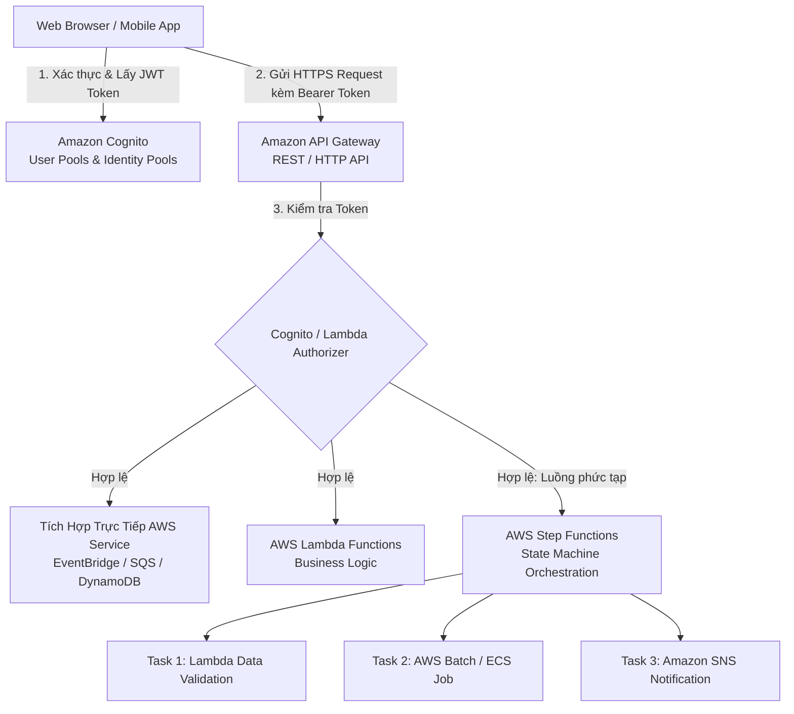
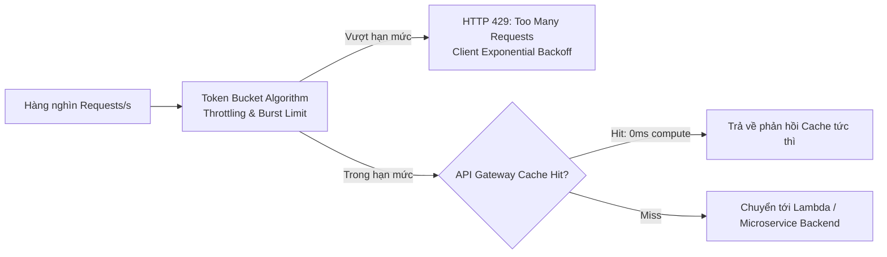
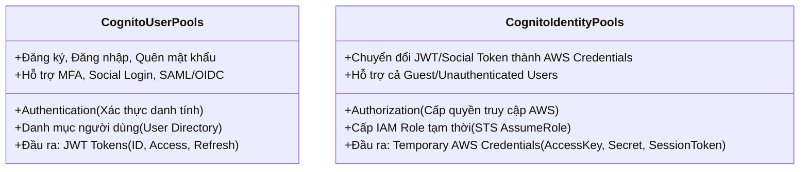
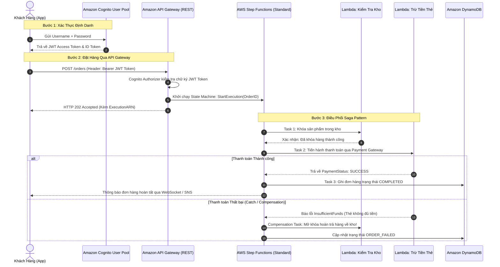

# Tài Liệu Học Tập Chuyên Sâu: Amazon API Gateway, Amazon Cognito & AWS Step Functions (Serverless Integration & Orchestration)

> **Tài liệu chuẩn hóa kiến trúc đám mây**: Hướng dẫn toàn diện theo tiêu chuẩn Principal Serverless Solutions Architect (Cập nhật phiên bản kiến trúc mới nhất 2026).  
> **Ngôn ngữ**: Tiếng Việt chuyên ngành (Bảo lưu 100% thuật ngữ chuyên ngành tiếng Anh chuẩn AWS).  
> **Mục tiêu**: Phục vụ thi chứng chỉ cấp độ Professional/Specialty (**SAA-C03, SAP-C02, Developer Associate**) và thiết kế kiến trúc Serverless Microservices cấp độ doanh nghiệp (**Enterprise-grade**).  
> **Các bài giảng liên quan**: Chương 19 & 20 (Serverless Deep-Dive: Lambda, API Gateway, Cognito, Step Functions, AppSync).

---

## 1. Tổng Quan Bộ Ba Tích Hợp Serverless (Service Overview)

### 1. Phân vai kiến trúc trong hệ sinh thái Serverless

Khi xây dựng các ứng dụng hiện đại không máy chủ (**Serverless**), bộ ba dịch vụ sau đây đóng vai trò là "xương sống" kết nối:
1. **Amazon API Gateway**: "Cánh cổng đón khách" (Front Door) — Tiếp nhận, định tuyến, bảo vệ, giới hạn tốc độ (**Throttling**), và quản lý vòng đời của các API REST, HTTP và WebSocket ở quy mô hàng triệu requests/giây.
2. **Amazon Cognito**: "Hộ chiếu định danh" (Identity & Access) — Quản lý xác thực người dùng (**Authentication**), cấp quyền (**Authorization**), hỗ trợ đăng nhập mạng xã hội (Google, Facebook, Apple) và doanh nghiệp (SAML 2.0, OIDC).
3. **AWS Step Functions**: "Nhạc trưởng điều phối" (Orchestration Engine) — Điều phối luồng xử lý nghiệp vụ phức tạp (**Workflows / State Machines**), quản lý các tác vụ phân tán, xử lý lỗi tự động và loại bỏ nhu cầu viết mã glue-code lộn xộn trong Lambda.

---

### 2. Bài toán cốt lõi mà các dịch vụ giải quyết

1. **Loại bỏ Server trung gian (Zero EC2 Instances for Ingress & Routing)**: Không cần cài đặt Nginx, HAProxy hay Kong Gateway; API Gateway tự động co giãn theo tải thực tế mà không cần quản trị máy chủ.
2. **Bảo mật và kiểm soát truy cập phân tầng (Defense in Depth)**: Tích hợp sẵn với **AWS WAF** (chống SQLi, XSS), bảo vệ DDoS với **AWS Shield**, và xác thực chuẩn OAuth 2.0 / JWT thông qua **Cognito User Pools**.
3. **Điều phối giao dịch phân tán (Distributed Transactions / Saga Pattern)**: Step Functions giúp theo dõi trạng thái của từng bước giao dịch dài hạn (lên tới 1 năm), tự động thử lại khi lỗi (**Retry**) và thực hiện thao tác hoàn tiền/hủy đơn (**Compensation Logic**) nếu một khâu thất bại.

---

### 3. Khi nào KHÔNG nên dùng (Anti-patterns & Giải pháp thay thế)

* ❌ **Truyền phát dữ liệu thô dung lượng lớn (Video streaming, File upload > 10 MB)**: API Gateway có giới hạn tải trọng cứng (**Payload Limit = 10 MB**).  
  👉 *Giải pháp thay thế*: Sử dụng **Amazon S3 Presigned URLs** để client upload trực tiếp lên S3.
* ❌ **Xử lý tác vụ tính toán thời gian dài > 29 giây**: API Gateway có thời gian chờ tối đa (**Integration Timeout = 29 giây** không thể tăng thêm).  
  👉 *Giải pháp thay thế*: Trả về `HTTP 202 Accepted` ngay lập tức, đẩy message vào **SQS** hoặc khởi chạy **Step Functions Asynchronous Workflow**.
* ❌ **Yêu cầu giao thức không phải HTTP/WebSocket (TCP/UDP, MQTT)**: API Gateway chỉ hỗ trợ HTTP/HTTPS và WebSocket.  
  👉 *Giải pháp thay thế*: Sử dụng **Network Load Balancer (NLB)** hoặc **AWS IoT Core**.

---

## 2. Các Khái Niệm, Kiến Trúc & Vận Hành Cốt Lõi (Core Concepts & Operations)

### 2.1. Amazon API Gateway: Các Loại API & Endpoint Types

#### 1. Bảng So Sánh Chi Tiết: REST API vs HTTP API vs WebSocket API

| Đặc điểm kỹ thuật | HTTP API (Thế hệ mới v2) | REST API (Thế hệ truyền thống v1) | WebSocket API |
| :--- | :--- | :--- | :--- |
| **Giao thức** | HTTP/1.1, HTTP/2 | HTTP/1.1 | WebSocket (Hai chiều - Duplex) |
| **Độ trễ (Latency)** | **Cực thấp (Siêu nhẹ)** | Trung bình | Thời gian thực (Persistent connection) |
| **Chi phí** | **Rẻ hơn 71%** (\$1.00 / 1 triệu reqs) | Đắt hơn (\$3.50 / 1 triệu reqs) | Tính theo phút kết nối + tin nhắn |
| **Xác thực (Auth)** | OIDC, OAuth 2.0, Lambda Authorizer | Cognito User Pools, Lambda, IAM, API Keys | IAM, Cognito, Lambda Authorizer |
| **Tích hợp AWS WAF** | **Hỗ trợ đầy đủ** (Cập nhật mới) | **Hỗ trợ đầy đủ** | Chưa hỗ trợ trực tiếp |
| **API Caching tích hợp** | ❌ Không hỗ trợ tích hợp |  **Có hỗ trợ** (Cụm Cache riêng) | ❌ Không |
| **Usage Plans & API Keys** | ❌ Không hỗ trợ |  **Hỗ trợ đầy đủ** (Bán gói API) | ❌ Không |
| **Request Transformation (VTL)** | ❌ Không hỗ trợ |  **Hỗ trợ Apache Velocity (VTL)** | ❌ Không |
| **Trường hợp tối ưu** | Microservices cần độ trễ thấp, chi phí rẻ, xác thực JWT đơn giản. | API bán cho đối tác thứ 3 (SaaS), cần rate limiting theo khách hàng, caching, transform dữ liệu. | Ứng dụng chat real-time, bảng giá chứng khoán, thông báo trực tiếp. |

#### 2. Ba Loại Endpoint Network (API Gateway Endpoint Types)
1. **Edge-Optimized Endpoint (Mặc định cho REST API)**:
   - Tự động định tuyến lưu lượng qua mạng lưới toàn cầu **Amazon CloudFront Edge Locations**.
   - Tối ưu cho khách hàng truy cập từ khắp nơi trên toàn cầu để giảm độ trễ mạng internet.
2. **Regional Endpoint**:
   - Triển khai trong cùng Region với ứng dụng.
   - Thích hợp khi đại đa số client ở cùng khu vực địa lý, hoặc khi bạn muốn tự quản lý phân phối CloudFront riêng đặt phía trước API Gateway (tận dụng chung bộ nhớ cache).
3. **Private Endpoint**:
   - Chỉ có thể truy cập được từ bên trong mạng riêng **Amazon VPC** thông qua **Interface VPC Endpoint (AWS PrivateLink - `com.amazonaws.<region>.execute-api`)**.
   - Lưu lượng hoàn toàn không bao giờ đi qua Internet công cộng; bảo vệ an toàn cho các API nội bộ doanh nghiệp.

---

### 2.2. Cơ Chế Throttling, Quản Trị Tải & Caching Trong API Gateway

* **Thuật toán Token Bucket**:
  - **Steady-state Rate Limit**: Mặc định 10,000 requests/giây (RPS) trên mỗi tài khoản/vùng.
  - **Burst Limit**: Mặc định 5,000 requests (sức chứa của xô token để hấp thụ các xung tải đột biến).
  - Khi xô hết token $\rightarrow$ API Gateway tự động trả về mã lỗi **`HTTP 429 Too Many Requests`**.
* **Usage Plans & API Keys**:
  - Cho phép phân nhóm khách hàng (ví dụ: Gói Basic = 100 req/ngày, Gói Pro = 100,000 req/ngày).
  - Khách hàng gửi kèm header `x-api-key`. API Gateway tự động theo dõi hạn mức (Quota) và từ chối nếu vượt quá.

---

### 2.3. Amazon Cognito: User Pools vs Identity Pools (Phân Biệt Cốt Lõi)

Đây là chủ đề xuất hiện với tần suất cực lớn trong các kỳ thi AWS (SAA-C03 & SAP-C02):

| Tiêu chí so sánh | Cognito User Pools (CUP) | Cognito Identity Pools (Federated Identities) |
| :--- | :--- | :--- |
| **Mục đích chính** | **Xác thực (Authentication)** — "Bạn là ai?" | **Phân quyền (Authorization)** — "Bạn được làm gì trên AWS?" |
| **Đối tượng quản lý** | Thư mục người dùng (Username, Password, Email, Số điện thoại). | Cầu nối cấp quyền truy cập tài nguyên AWS. |
| **Kết quả trả về** | **Bộ 3 mã thông báo JWT**: • `IdToken`: Chứa thông tin user (email, name). • `AccessToken`: Chứa scopes/groups để gọi API Gateway. • `RefreshToken`: Dùng để lấy AccessToken mới. | **AWS Temporary Credentials** từ AWS STS: • `AccessKeyId` • `SecretAccessKey` • `SessionToken` |
| **Cách dùng điển hình** | Xác thực người dùng đăng nhập vào ứng dụng web/mobile và gửi Bearer Token vào API Gateway. | Cho phép ứng dụng di động upload ảnh trực tiếp lên **Amazon S3** hoặc đọc bảng **DynamoDB** mà không cần qua server trung gian! |
| **Hỗ trợ người dùng ẩn danh**| ❌ Không hỗ trợ (Bắt buộc phải có tài khoản). |  **Hỗ trợ Guest / Unauthenticated users** (Cấp quyền đọc hạn chế). |

---

### 2.4. AWS Step Functions: Điều Phối Luồng Phân Tán (Orchestration)

#### 1. Standard Workflows vs Express Workflows

| Tiêu chí | Standard Workflows | Express Workflows |
| :--- | :--- | :--- |
| **Thời gian chạy tối đa** | **Lên tới 1 năm** (Thích hợp cho quy trình dài hạn, có bước duyệt thủ công) | **Tối đa 5 phút** (Thích hợp xử lý dữ liệu streaming, IoT) |
| **Tốc độ thực thi** | Tối đa ~2,000 executions/giây | **Hơn 100,000 executions/giây** (High throughput) |
| **Cam kết thực thi** | **Exactly-once** (Chính xác một lần - Không bị chạy trùng lặp) | **At-least-once** (Bất đồng bộ) hoặc **At-most-once** (Đồng bộ) |
| **Mô hình tính giá** | Tính trên **từng bước chuyển trạng thái (State Transition)** (\$0.025 / 1,000 transitions) | Tính trên **số lượng thực thi + thời gian chạy (GB-giây)** giống Lambda |
| **Lịch sử thực thi** | Lưu trữ toàn bộ lịch sử trạng thái trong **90 ngày** trên Console | Xuất logs trực tiếp sang **CloudWatch Logs** (không lưu console) |
| **Trường hợp áp dụng** | Xử lý đơn hàng thương mại điện tử, luồng phê duyệt nghỉ phép của nhân sự, ETL batch. | Xử lý luồng clickstream, ingest dữ liệu IoT từ Kinesis, biến đổi dữ liệu API tốc độ cao. |

#### 2. Các Trạng Thái Quan Trọng (States):
- **Task State**: Đại diện cho một đơn vị công việc (gọi hàm Lambda, chạy ECS Task, gửi message SQS, gọi HTTP endpoint của bên thứ 3).
- **Choice State**: Rẽ nhánh điều kiện logic (`if-else` dựa trên payload đầu vào).
- **Parallel State**: Thực thi song song các nhánh độc lập cùng lúc.
- **Map State**: Lặp qua một mảng dữ liệu (Array iteration) và thực thi logic trên từng phần tử.
- **Wait State**: Tạm dừng luồng trong một khoảng thời gian cố định hoặc đến một mốc thời gian cụ thể.
- **Fail / Succeed State**: Kết thúc luồng với trạng thái thất bại hoặc thành công.

---

### 2.5. AWS AppSync: Managed Serverless GraphQL & Real-Time Pub/Sub — (TD-Set3 Q16, TD-Set5 Q05, TD-Set5 Q08)
- **Bản chất dịch vụ**: AWS AppSync là dịch vụ GraphQL phi máy chủ được quản lý hoàn toàn, cho phép gom nhiều nguồn dữ liệu (DynamoDB, Lambda, Aurora, Elasticsearch, HTTP Endpoints) vào một API GraphQL duy nhất.
- **Ứng dụng di động thời gian thực hàng triệu người dùng (`TD-Set3 Q16`)**:
  - Hỗ trợ kết nối hai chiều qua WebSocket cho tính năng **GraphQL Subscriptions (Real-time Pub/Sub)**.
  - Tự động cập nhật bảng xếp hạng bình chọn (leaderboard/voting) hoặc dữ liệu chat cho hàng triệu thiết bị di động mà không cần tự dựng cụm WebSocket servers.
  - Tích hợp bộ nhớ cache ngoại tuyến (Offline Data Synchronization & Conflict Resolution) trên máy khách qua AWS Amplify SDK.
- **Tên miền tùy chỉnh và chứng chỉ SSL (`TD-Set5 Q05`)**:
  - Hỗ trợ cấu hình **Custom Domain Name** gắn với chứng chỉ SSL/TLS từ **AWS Certificate Manager (ACM)** trực tiếp trên AppSync.
  - Cho phép người dùng kết nối tới tên miền doanh nghiệp như `graphql.example.com` với mã hóa HTTPS/WSS chuẩn.
- **AppSync Pipeline Resolvers (`TD-Set5 Q08`)**:
  - Cho phép thực thi một chuỗi các thao tác tuần tự (Functions) trên nhiều nguồn dữ liệu khác nhau trong một truy vấn GraphQL duy nhất.
  - Ví dụ: Thao tác 1 đọc thông tin từ bảng `Users` DynamoDB $\rightarrow$ Thao tác 2 lấy danh sách bài viết từ bảng `Posts` DynamoDB $\rightarrow$ Thao tác 3 gọi Lambda tính điểm danh tiếng $\rightarrow$ Trả về kết quả tổng hợp trong 1 request duy nhất!

---

### 🏛️ I. Các Kịch Bản Kiến Trúc Chuẩn (Best Practice Scenarios)

#### 1. Xây Dựng Hệ Thống API Tài Chính Lưu Lượng Cao, Độ Trễ Cực Thấp — (CM-PT1 Q10, CM-PT5 Q60)
- **Tình huống thi**: Ngân hàng xây dựng hệ thống API phục vụ ứng dụng Mobile Banking. Yêu cầu xử lý hàng chục nghìn giao dịch mỗi giây, xác thực token JWT chuẩn OAuth 2.0, bảo mật cao nhất và tối ưu chi phí vận hành.
- **Giải pháp tối ưu chuẩn AWS**:
  - Sử dụng **Amazon API Gateway HTTP API** (tiết kiệm hơn 70% chi phí, độ trễ cực thấp).
  - Sử dụng **JWT Authorizer** tích hợp trực tiếp với **Amazon Cognito User Pools** để xác thực token ngay tại tầng API Gateway mà không tốn chi phí thực thi Lambda.
  - Triển khai **Regional Endpoint** nếu người dùng tập trung tại một quốc gia cụ thể để tránh chi phí CloudFront không cần thiết.

#### 2. Điều Phối Luồng Xử Lý Hàng Loạt Dữ Liệu Lớn Dài Hạn Bằng Step Functions — (CM-PT1 Q06, CM-PT1 Q38)
- **Tình huống thi**: Doanh nghiệp cần xây dựng quy trình ETL xử lý video và dữ liệu hình ảnh. Quá trình này gồm nhiều bước: giải nén file, gọi job trích xuất AI, kiểm tra chất lượng và sao lưu kết quả. Tổng thời gian xử lý có thể kéo dài vài giờ đồng hồ.
- **Giải pháp tối ưu**:
  - Sử dụng **AWS Step Functions Standard Workflows** để làm Orchestrator.
  - Step Functions tự động theo dõi trạng thái, gọi **AWS Batch** hoặc **AWS Glue Job**, sử dụng cơ chế **Task Token (`.waitForTaskToken`)** để tạm dừng quy trình đợi job hoàn tất mới chạy bước kế tiếp.
  - Bật tính năng tự động thử lại (**Retry**) với chính sách số mũ (**Exponential Backoff**) khi gặp lỗi tạm thời.

#### 3. Bỏ Qua Lambda Để Gửi Dữ Liệu Trực Tiếp Vào EventBridge — (CM-PT5 Q20)
- **Tình huống thi**: Ứng dụng Serverless nhận hàng nghìn webhook từ các hệ thống đối tác gửi đến API Gateway REST API. Doanh nghiệp muốn đẩy toàn bộ sự kiện này vào **Amazon EventBridge** để các microservices khác tự do đăng ký nhận tin với chi phí rẻ nhất và không phải viết code bảo trì trung gian.
- **Giải pháp tối ưu**:
  - Cấu hình **Direct AWS Service Integration** trong API Gateway trỏ trực tiếp đến `EventBridge:PutEvents`.
  - Gán IAM Role cho API Gateway cho phép quyền `events:PutEvents`.
  - **Hoàn toàn không cần tạo Lambda function trung gian**, giúp giảm chi phí, tăng tính tin cậy và đạt tốc độ phản hồi tối đa.

#### 4. Xác Thực Hai Lớp Thích Ứng Cho Hàng Triệu Khách Hàng Bằng Cognito — (CM-PT4 Q22)
- **Tình huống thi**: Doanh nghiệp cần giải pháp xác thực người dùng cho ứng dụng bán lẻ có khả năng phục vụ hàng triệu khách hàng toàn cầu. Hệ thống phải tự động yêu cầu xác thực 2 yếu tố (2FA/MFA) nếu phát hiện khách hàng đăng nhập từ vị trí địa lý bất thường hoặc thiết bị lạ.
- **Giải pháp tối ưu**:
  - Triển khai **Amazon Cognito User Pools**.
  - Kích hoạt tính năng **Advanced Security Features: Adaptive Authentication (Xác thực thích ứng dựa trên rủi ro)**.
  - Cognito tự động phân tích IP, vị trí địa lý, dấu vân tay thiết bị để tính toán điểm rủi ro và tự động kích hoạt thử thách SMS MFA hoặc TOTP khi phát hiện dấu hiệu bất thường.

#### 5. Quản Trị Đột Biến Lưu Lượng Bằng Throttling & Burst Limits Trên API Gateway — (TD-Set1 Q14)
- **Tình huống thi**: Một cổng thông tin trực tuyến sử dụng kết hợp Amazon API Gateway và AWS Lambda phục vụ hàng trăm nghìn lượt truy cập mỗi ngày. Công ty chuẩn bị công bố một sản phẩm đột phá mới, dự kiến lưu lượng truy cập vào REST API sẽ tăng vọt gấp hàng chục lần chỉ trong vài giây. Cần thiết kế giải pháp bảo vệ hệ thống backend không bị quá tải sập nguồn mà vẫn duy trì khả năng phục vụ tối đa (`TD-Set1 Q14`).
- **Giải pháp chuẩn AWS**:
  - Cấu hình **Throttling Limits (Steady-state Rate Limit)** và **Burst Limits** trên API Gateway Stage / Usage Plan tương ứng với tải chịu đựng của hệ thống backend.
  - Thuật toán **Token Bucket**: Cho phép các đợt lưu lượng bùng nổ tức thời (Burst) được xử lý trong giới hạn token có sẵn trong xô. Khi xô token cạn kiệt, API Gateway tự động trả về mã lỗi **`HTTP 429 Too Many Requests`** để làm chậm tốc độ gửi của client.
  - Kết hợp thiết lập **Reserved Concurrency trên AWS Lambda** để ngăn chặn việc Lambda chiếm dụng toàn bộ quota concurrency của tài khoản làm ảnh hưởng các ứng dụng khác.

#### 6. Kiểm Thử Phiên Bản API Mới An Toàn Bằng API Gateway Canary Release — (TD-Set1 Q19)
- **Tình huống thi**: Doanh nghiệp thương mại điện tử triển khai REST API trên API Gateway với custom domain name. Để cải tiến liên tục mà không gây gián đoạn cho khách hàng, nhóm phát triển muốn triển khai phiên bản API mới vào môi trường production và chỉ chuyển hướng một tỷ lệ phần trăm nhỏ lưu lượng người dùng thực tế vào phiên bản mới để theo dõi lỗi trước khi chuyển toàn bộ (`TD-Set1 Q19`).
- **Giải pháp chuẩn AWS**:
  - Kích hoạt tính năng **Canary Release** trên Deployment Stage của API Gateway.
  - Thiết lập tỷ lệ phần trăm lưu lượng gửi tới Canary (ví dụ: `10%` lưu lượng trỏ vào bản build mới, `90%` vẫn chạy trên bản production cũ ổn định).
  - Giám sát các chỉ số CloudWatch Metrics riêng biệt của Canary (`CanaryErrors`, `CanaryLatency`). Sau khi kiểm thử đạt yêu cầu, nhấn **Promote Canary** để nâng cấp phiên bản mới thành bản chính thức với zero-downtime.

#### 7. Thiết Lập Custom Domain Name Cho Regional API Gateway Với Route 53 & ACM — (TD-Set4 Q12, TD-Set1 Q19)
- **Tình huống thi**: Doanh nghiệp vận hành một Regional API Gateway tại Region `us-east-2` làm proxy cho backend microservices. Khách hàng đang kết nối qua Invoke URL mặc định (`https://<api-id>.execute-api.us-east-2.amazonaws.com/prod`). Doanh nghiệp muốn người dùng truy cập qua tên miền thân thiện của công ty (`api.mycompany.com`) với chứng chỉ SSL/TLS an toàn (`TD-Set4 Q12`).
- **Quy trình chuẩn AWS**:
  1. Yêu cầu hoặc nhập chứng chỉ SSL/TLS công khai trong **AWS Certificate Manager (ACM) TẠI CÙNG REGION `us-east-2`**.
  2. Tạo một **Custom Domain Name** kiểu **Regional** trong Amazon API Gateway, gán chứng chỉ ACM vừa tạo.
  3. Tạo **API Mapping** liên kết custom domain name với API và Stage tương ứng.
  4. Trong **Amazon Route 53 Hosted Zone**, tạo bản ghi **Alias Record (loại A)** trỏ tên miền `api.mycompany.com` vào địa chỉ **Regional API Gateway Target Domain Name**.

#### 8. Cấp Quyền Tạm Thời Cho Mobile App Truy Cập Trực Tiếp Tài Nguyên Bằng Cognito Identity Pools — (TD-Set8 Q01, U-PT6 Q39)
- **Tình huống thi**: Ứng dụng di động bình chọn giọng hát hoặc phân tích web với hàng triệu người dùng toàn cầu. Ứng dụng cần gửi trực tiếp dữ liệu bình chọn hoặc log phân tích vào Amazon Kinesis Data Streams / DynamoDB mà không muốn xây dựng một cụm web server trung gian tốn kém (`TD-Set8 Q01`, `U-PT6 Q39`).
- **Giải pháp chuẩn AWS**:
  - Người dùng đăng nhập qua **Cognito User Pools** (hoặc Google/Facebook/Apple/Guest unauthenticated).
  - Ứng dụng gửi JWT ID Token nhận được tới **Amazon Cognito Identity Pools (Federated Identities)**.
  - Identity Pools kiểm tra tính hợp lệ, gọi **AWS STS** để cấp phát bộ **Temporary AWS Credentials** (Access Key, Secret Key, Session Token) gắn với một IAM Role có quyền tối thiểu (`kinesis:PutRecord` hoặc `dynamodb:PutItem`).
  - Mobile App dùng AWS SDK sử dụng credentials tạm thời này để ghi trực tiếp vào Kinesis / DynamoDB, đạt khả năng co giãn không giới hạn với chi phí thấp nhất.

#### 9. Tách Rời Quy Trình Xử Lý Đa Bước Phân Tán: Phân Biệt Step Functions vs Amazon SWF — (TD-Set2 Q13, CM-PT1 Q38, CM-PT3 Q07, CM-PT4 Q59, U-PT6 Q11)
- **Tình huống thi**: Hệ thống xử lý đơn hàng hoặc quy trình nghiệp vụ kết hợp nhiều bước chạy trên các worker phân tán giữa Cloud (EC2/Lambda) và trung tâm dữ liệu On-Premises. Quy trình có thể kéo dài nhiều tuần và yêu cầu đảm bảo tác vụ chỉ được thực hiện một lần duy nhất. Cần chọn dịch vụ điều phối nào?
- **Quy tắc phân biệt sống còn**:
  - **AWS Step Functions**: Giải pháp thế hệ mới (Serverless State Machine), định nghĩa bằng JSON (ASL), trực quan hóa quy trình bằng đồ họa, tự động xử lý timeout và retry. Đây là **lựa chọn mặc định số 1** cho mọi kiến trúc microservices và serverless hiện đại (`CM-PT1 Q38`, `CM-PT4 Q59`, `U-PT6 Q11`).
  - **Amazon Simple Workflow Service (Amazon SWF)**: Dịch vụ thế hệ cũ (`TD-Set2 Q13`). Chỉ chọn SWF khi đề bài thi đề cập cụ thể:
    1. Yêu cầu phối hợp các **External Deciders / Activity Workers** phân tán giữa On-Premises và AWS thông qua việc tự viết code decider quản lý luồng điều phối.
    2. Cùng xuất hiện song song với Amazon SQS trong câu hỏi chọn 2 dịch vụ decoupling cho môi trường Hybrid (`TD-Set2 Q13`).

---

### 🪤 II. Các Bẫy Thi Tinh Vi & Phân Tích Phương Án Sai (Exam Traps & Distractors)

#### 🪤 Bẫy 1: Bảo Vệ API Gateway Khỏi SQLi và XSS: AWS Shield vs AWS WAF — (CM-PT3 Q12)
- **Tình huống đề thi**: *"Doanh nghiệp công khai các REST API trên API Gateway cho bên thứ 3 truy cập. Yêu cầu bảo vệ API khỏi các mối đe dọa SQL Injection và Cross-Site Scripting (XSS) với chi phí vận hành thấp nhất."*
- **Các phương án bẫy**:
  - ❌ *Bật AWS Shield Advanced*: Shield tập trung chống tấn công từ chối dịch vụ DDoS tầng Layer 3/Layer 4; Shield không có các bộ quy tắc (Rules) phân tích payload để chặn SQL Injection và XSS.
  - ❌ *Viết code trong AWS Lambda để lọc chuỗi SQL Injection*: Tốn công sức lập trình, tiêu tốn thời gian chạy của Lambda và dễ bỏ sót các biến thể injection phức tạp.
- **Giải pháp ĐÚNG**: Gắn **AWS WAF (Web Application Firewall)** trực tiếp vào API Gateway Stage, áp dụng bộ quy tắc quản lý sẵn (**AWS Managed Rules: Core Rule Set & SQL Database Set**).

#### 🪤 Bẫy 2: Phân Biệt Giữa Cognito User Pool và Identity Pool — (CM-PT3 Q19, CM-PT4 Q33)
- **Tình huống đề thi**: *"Ứng dụng di động cần cho phép người dùng tự đăng ký tài khoản bằng email/mật khẩu hoặc đăng nhập qua Google. Sau khi đăng nhập thành công, ứng dụng cần được xác thực danh tính để gọi API Gateway."*
- **Phương án bẫy thường gặp**:
  - ❌ *Sử dụng Cognito Identity Pools để lưu username/password*: Sai hoàn toàn vì Identity Pools không có cơ sở dữ liệu lưu thông tin tài khoản người dùng!
- **Giải pháp ĐÚNG**: Sử dụng **Amazon Cognito User Pools (CUP)**.
  - CUP đóng vai trò là Identity Provider (IdP) quản lý toàn bộ danh bạ người dùng, xử lý reset mật khẩu, MFA và trả về JWT Token.

#### 🪤 Bẫy 3: Xử Lý API Timeout Khi Thời Gian Xử Lý Vượt Quá 29 Giây — (CM-PT1 Q38)
- **Tình huống đề thi**: *"Khách hàng gửi yêu cầu xuất báo cáo phân tích dữ liệu qua REST API. Việc sinh báo cáo mất khoảng 45 giây đến 2 phút. Kiến trúc sư nên thiết kế như thế nào để tránh lỗi timeout?"*
- **Phương án bẫy**:
  - ❌ *Tăng Integration Timeout của API Gateway lên 60 giây*: Sai! 29 giây là giới hạn cứng (**Hard Quota**) của API Gateway và không thể tăng thêm bằng Service Quotas hay yêu cầu AWS Support.
- **Giải pháp ĐÚNG**:
  - Thiết kế kiến trúc **Bất đồng bộ (Asynchronous Request-Reply Pattern)**:
  - API Gateway tiếp nhận yêu cầu, kích hoạt **AWS Step Functions** hoặc đẩy vào **SQS**, sau đó trả ngay về client mã phản hồi `HTTP 202 Accepted` kèm theo một `JobID`.
  - Client định kỳ polling kiểm tra trạng thái của `JobID` hoặc nhận kết quả qua WebSocket API / Webhook.

#### 🪤 Bẫy 4: Thuật Toán Throttling Token Bucket Trả Về Lỗi HTTP 429 — (TD-Set1 Q14)
- **Tình huống đề thi**: *"Khi một trang web gặp lượng truy cập tăng vọt đột biến, người dùng nhận thông báo lỗi từ API Gateway. Mã lỗi nào được trả về và cách xử lý?"*
- **Quy tắc bất biến**:
  - Khi lưu lượng vượt quá giới hạn Rate Limit hoặc Burst Limit, API Gateway trả về mã trạng thái **`HTTP 429 Too Many Requests`**.
  - Xử lý: Phía máy khách (Client) phải áp dụng cơ chế **Exponential Backoff with Jitter**. Phía máy chủ: Tăng Throttling Limits hoặc áp dụng API Caching.

#### 🪤 Bẫy 5: Vị Trí Của Chứng Chỉ ACM: Regional API Gateway vs Edge-Optimized — (TD-Set4 Q12)
- **Bẫy đề thi về Region của chứng chỉ SSL**:
  - Với **Edge-Optimized API Gateway**: Do lưu lượng được phân phối qua CloudFront toàn cầu, chứng chỉ ACM **BẮT BUỘC PHẢI TẠO TẠI REGION `us-east-1` (N. Virginia)**.
  - Với **Regional API Gateway**: Do endpoint chạy cục bộ trong Region, chứng chỉ ACM **BẮT BUỘC PHẢI TẠO TẠI CÙNG REGION VỚI API GATEWAY** (ví dụ: API ở `us-east-2` thì cert phải ở `us-east-2`). Nếu tạo ở `us-east-1` thì Regional API Gateway sẽ không nhìn thấy chứng chỉ!

#### 🪤 Bẫy 6: Xác Thực Tập Trung Cho ALB Bằng Action `authenticate-cognito` — (U-PT2 Q14)
- **Tình huống đề thi**: *"Doanh nghiệp có cụm microservices chạy sau Application Load Balancer (ALB). Để bảo vệ các API này, công ty muốn người dùng phải đăng nhập bằng tài khoản doanh nghiệp hoặc mạng xã hội trước khi gửi request. Đội ngũ phát triển đề xuất viết thêm module xác thực JWT trong mã nguồn của từng service backend."*
- **Các phương án bẫy**:
  - ❌ *Tự viết logic kiểm tra và giải mã JWT trong từng container/EC2 backend*: Tốn công sức lập trình, trùng lặp mã nguồn và tạo ra nguy cơ bảo mật nếu một service cấu hình sai.
- **Giải pháp ĐÚNG**: Cấu hình **`authenticate-cognito` Action trên ALB Listener Rules** tích hợp trực tiếp với **Amazon Cognito User Pools** (`U-PT2 Q14`).
  - ALB tự động chuyển hướng người dùng chưa đăng nhập tới Hosted UI của Cognito để đăng nhập.
  - Sau khi xác thực thành công, ALB nhận JWT token, xác minh chữ ký mã hóa và chuyển tiếp request an toàn tới target group kèm theo các HTTP headers định danh (`x-amzn-oidc-identity`, `x-amzn-oidc-data`).
  - Giảm tải 100% công sức lập trình và bảo mật xác thực ở tầng ứng dụng backend.

#### 🪤 Bẫy 7: Mô Hình Tính Phí Pay-Per-Call & API Gateway RESTful vs WebSocket — (TD-Set2 Q02, U-PT1 Q17)
- **Mô hình tính phí Pay-per-call (`TD-Set2 Q02`)**: API Gateway không tính phí duy trì máy chủ hay phí theo giờ. Bạn chỉ trả phí cho đúng số lượng request thực tế gửi tới hệ thống (\$1.00/1M calls cho HTTP API hoặc \$3.50/1M calls cho REST API).
- **Phân biệt RESTful (Stateless) vs WebSocket (Stateful) (`U-PT1 Q17`)**:
  - Dùng **REST / HTTP API**: Khi client gửi request và nhận response độc lập (Stateless).
  - Dùng **WebSocket API**: Khi backend cần chủ động đẩy dữ liệu thời gian thực (Push notification, real-time trading) về client mà không cần client polling liên tục.

---

#### 🪤 Bẫy 8: Chặn / Cho Phép Dải Địa Chỉ IP Truy Cập API Gateway Bằng Resource Policy — (U-PT2 Q24)
- **Tình huống đề thi**: *"Doanh nghiệp xây dựng REST API trên Amazon API Gateway để các chi nhánh văn phòng truy cập. Để tăng cường bảo mật, Giám đốc CNTT yêu cầu chỉ cho phép các máy tính có địa chỉ IP công cộng thuộc dải CIDR của các văn phòng công ty (203.0.113.0/24) được phép gọi API, mọi truy cập từ địa chỉ IP khác phải bị chặn ngay lập tức. Giải pháp nào đơn giản và tối ưu nhất?"*
- **Các phương án bẫy**:
  - ❌ *Tạo AWS WAF gắn vào API Gateway*: Hoạt động được nhưng phát sinh thêm chi phí duy trì WebACL và rule evaluation.
  - ❌ *Viết code trong Lambda Authorizer để kiểm tra event.requestContext.identity.sourceIp*: Tốn chi phí thực thi Lambda cho mỗi request bị từ chối và tăng độ trễ.
- **Giải pháp ĐÚNG**: Cấu hình **API Gateway Resource Policy** (`U-PT2 Q24`).
  - Sử dụng điều kiện `aws:SourceIp` với `IpAddress` (Allowlist) hoặc `NotIpAddress` (Denylist) trực tiếp trong Resource Policy của REST API.
  - API Gateway tự động đánh giá và từ chối các request không hợp lệ ngay tại cổng biên mà không tốn chi phí thực thi backend.

#### 🪤 Bẫy 9: Tải Tệp Lên S3 Từ Ứng Dụng Di Động: Cognito Identity Pools vs S3 Presigned URL — (U-PT6 Q39)
- **Tình huống đề thi**: *"Ứng dụng di động chia sẻ ảnh có hàng triệu người dùng cần tải ảnh trực tiếp lên Amazon S3. Ứng dụng yêu cầu người dùng phải được phân quyền chi tiết (mỗi người chỉ được ghi vào thư mục riêng của mình s3://bucket/users//*). Giải pháp nào đáp ứng chuẩn bảo mật của AWS?"*
- **Giải pháp ĐÚNG**: Sử dụng **Amazon Cognito Identity Pools (Federated Identities)** (`U-PT6 Q39`).
  - Sau khi người dùng đăng nhập qua User Pool hoặc mạng xã hội, ứng dụng gửi ID Token tới Identity Pool để nhận **AWS Temporary Security Credentials (IAM STS)**.
  - IAM Role gán cho authenticated users sử dụng biến thay thế biến ngữ cảnh `${cognito-identity.amazonaws.com:sub}` trong Resource ARN.
  - Ứng dụng di động dùng credentials này để gọi trực tiếp AWS SDK tải file lên S3, hoàn toàn không cần server trung gian.

#### 🪤 Bẫy 10: Khi Nào KHÔNG Nên Sử Dụng Amazon Cognito? — (TD-Set1 Q24, TD-Set4 Q02, CM-PT4 Q64)
- **Các kịch bản đề thi đánh lừa**:
  - ❌ *Giao tiếp Machine-to-Machine nội bộ hoặc giữa các microservices*: Không dùng Cognito User Pools; giải pháp chuẩn là **Mutual TLS (mTLS)** hoặc **AWS IAM Authentication (SigV4)**.
  - ❌ *Nhân viên nội bộ công ty đã có hệ thống Microsoft Active Directory / Okta*: Không nên tạo mới tài khoản trong Cognito User Pool; giải pháp chuẩn là sử dụng **AWS IAM Identity Center (AWS SSO)** tích hợp qua SAML 2.0 / OIDC (`TD-Set1 Q24`).
  - ❌ *Thư mục người dùng On-Premises không hỗ trợ SAML/OIDC*: Sử dụng **Custom Identity Broker + AWS STS (`AssumeRole` hoặc `GetFederationToken`)** để cấp credentials tạm thời (`TD-Set4 Q02`, `CM-PT4 Q64`).
  - ❌ *Ứng dụng chỉ cần bảo vệ API bằng danh sách IP hoặc khóa API đơn giản*: Dùng **API Gateway Resource Policy** hoặc **API Keys / Usage Plans**, không cần dựng cụm Cognito phức tạp.

#### 🪤 Bẫy 11: Giảm Tải Backend Bằng API Gateway Result Caching, Usage Plans & API Keys — (TD-Set1 Q39, TD-Set3 Q04, U-PT3 Q08, U-PT3 Q09)
- **API Gateway Result Caching (`TD-Set1 Q39`, `TD-Set3 Q04`)**:
  - Lưu bộ nhớ đệm (Cache) phản hồi của backend theo từng endpoint và phương thức HTTP với TTL tùy chỉnh (mặc định 300s).
  - Giảm thiểu số lượng cuộc gọi tới Lambda hoặc cơ sở dữ liệu hạ nguồn, tăng tốc độ phản hồi và bảo vệ backend trước các đợt bùng nổ truy cập.
- **Usage Plans & API Keys (`U-PT3 Q08`)**:
  - Cho phép phân loại khách hàng B2B theo các gói dịch vụ (Basic, Pro, Enterprise).
  - Cấu hình hạn mức điều tiết (Throttling: Rate & Burst) và hạn ngạch (Quota: ví dụ 10,000 requests/tháng) gắn riêng cho từng API Key.
- **HTTP API + Native OIDC/JWT Authorizer (`U-PT3 Q09`)**:
  - HTTP API xác thực token JWT trực tiếp từ Identity Provider (Auth0, Okta, Cognito) ở cấp độ gateway mà không cần viết Lambda Authorizer tùy chỉnh, tiết kiệm tối đa chi phí và giảm độ trễ.

---

### 📊 III. Ma Trận Quyết Định Công Nghệ Nhanh (Exam Decision Matrix)

| Tình huống / Yêu cầu trong đề thi | Giải pháp chuẩn AWS | Giải pháp bị loại & Lý do | Tham chiếu đề thi |
|:---|:---|:---|:---|
| **Xây dựng REST API giá rẻ nhất, chỉ cần xác thực JWT đơn giản** | **API Gateway HTTP API** | REST API (đắt hơn gấp 3 lần, tính năng thừa) | Chuẩn AWS |
| **Cần bán gói API cho đối tác thứ 3 với giới hạn quota theo khách hàng** | **API Gateway REST API + Usage Plans & API Keys** | HTTP API (không hỗ trợ Usage Plans và API Keys) | Chuẩn AWS |
| **Bảo vệ REST API khỏi tấn công SQL Injection và XSS** | **AWS WAF gắn vào API Gateway** | AWS Shield (chỉ chống DDoS L3/L4, không chống SQLi/XSS) | TD-Set1 Q16 |
| **Giới hạn quyền gọi API Gateway theo dải IP công cộng cụ thể** | **API Gateway Resource Policy (aws:SourceIp)** | Dùng AWS WAF (tốn phí) hoặc Lambda Authorizer (tốn compute) | U-PT2 Q24 |
| **Đăng ký, đăng nhập người dùng, hỗ trợ Adaptive Risk-based MFA** | **Amazon Cognito User Pools** | Cognito Identity Pools (chỉ phân quyền, không lưu user) | TD-Set8 Q01 |
| **Xác thực người dùng Web/App tại ALB không cần viết code backend** | **ALB Listener Rule Authenticate với Cognito User Pool** | Viết middleware trong backend microservice | U-PT2 Q14 |
| **Cho phép Mobile App upload file trực tiếp lên S3 không qua server** | **Cognito Identity Pools (Cấp quyền IAM tạm thời)** | Tạo tài khoản IAM cứng trong code app (Lỗ hổng bảo mật nghiêm trọng) | TD-Set8 Q01, TD-Set3 Q16, U-PT6 Q39 |
| **Ứng dụng Mobile cần GraphQL, Subscriptions thời gian thực & Offline Sync** | **AWS AppSync + Amplify DataStore** | Tự dựng Apollo GraphQL trên EC2/ECS | TD-Set3 Q16, TD-Set5 Q05, TD-Set5 Q08 |
| **Quy trình nghiệp vụ xử lý dài ngày (lên tới 1 năm), có bước duyệt thủ công** | **AWS Step Functions Standard Workflows** | Express Workflows (chỉ chạy tối đa 5 phút) | TD-Set2 Q09, TD-Set2 Q13 |
| **Xử lý luồng sự kiện IoT / Streaming tốc độ > 50,000 req/s, chạy dưới 5 phút** | **AWS Step Functions Express Workflows** | Standard Workflows (bị giới hạn tốc độ và tốn chi phí transition) | TD-Set5 Q13, CM-PT4 Q49 |
| **Đẩy dữ liệu từ API Gateway vào EventBridge với chi phí và độ trễ thấp nhất** | **Direct Service Integration (Không dùng Lambda)** | Viết Lambda trung gian (tốn tiền chạy compute, tăng latency) | TD-Set2 Q09, CM-PT5 Q20 |
| **Truy cập API nội bộ từ EC2 trong VPC an toàn không qua Internet** | **Private API Gateway + Interface VPC Endpoint** | NAT Gateway (tốn phí truyền dữ liệu, lưu lượng đi ra ngoài) | TD-Set1 Q33 |
| **Bảo vệ backend khỏi spike tải đột biến khi ra mắt sản phẩm** | **API Gateway Throttling & Burst Limits** | Mở rộng unconstrained (làm sập backend database) | TD-Set1 Q14, TD-Set1 Q39 |
| **Kiểm thử phiên bản API mới với tỷ lệ % lưu lượng thực tế** | **API Gateway Canary Release Deployment** | Deploy thẳng lên Prod (rủi ro downtime toàn bộ) | TD-Set1 Q19 |
| **Custom domain name cho Regional API Gateway** | **ACM Certificate tại cùng Region + Route 53 Alias** | ACM Certificate tại us-east-1 (chỉ dùng cho Edge-Optimized) | TD-Set4 Q12 |

---

## 3. Kiến Trúc Thực Tế và Luồng Vận Hành (Production Architecture & Workflow)

### Kịch Bản: Quy Trình Đăng Nhập, Gọi API Đơn Hàng & Điều Phối Bằng Step Functions

---

## 4. Bảng Tích Hợp với Các Dịch Vụ AWS Khác (Integration Table)

| Dịch vụ liên kết | Phương thức tích hợp | Mục đích kỹ thuật & Kịch bản thực tế |
| :--- | :--- | :--- |
| **AWS WAF** | Gắn Web ACL trực tiếp vào API Gateway Stage | Chống các cuộc tấn công tầng ứng dụng (SQL Injection, Cross-Site Scripting XSS, Rate-limiting theo IP). |
| **Amazon CloudFront** | Đặt CloudFront Distribution phía trước Regional API Gateway | Tùy chỉnh tên miền riêng với chứng chỉ SSL đa vùng, áp dụng chính sách Edge caching chuyên sâu và giảm chi phí truyền dữ liệu. |
| **Amazon EventBridge** | **API Gateway Service Integration Trực Tiếp** | Bỏ qua hàm Lambda trung gian: Đẩy trực tiếp request JSON từ API Gateway vào EventBridge Event Bus để xử lý bất đồng bộ. |
| **AWS Lambda** | Lambda Proxy Integration | Phương thức phổ biến nhất: Toàn bộ thông tin request (headers, query params, body) được gói nguyên vẹn thành JSON gửi tới Lambda. |
| **AWS X-Ray** | X-Ray Active Tracing | Phân tích độ trễ xuyên suốt từ API Gateway qua các microservices và hàm Lambda để tìm nút thắt cổ chai (**Bottleneck**). |
| **Amazon SQS / SNS** | API Gateway Service Direct Integration | Đưa các yêu cầu ghi dữ liệu tải cao vào hàng đợi SQS để san phẳng đỉnh tải (**Load Leveling**) với độ trễ thấp nhất. |

---

## 5. Bảng So Sánh Toàn Diện Các Giải Pháp Trong Hệ Sinh Thái AWS (Ecosystem Comparison)

### 5.1. So Sánh Các Công Nghệ Xây Dựng API Trên AWS
| Tiêu chí | API Gateway HTTP API | API Gateway REST API | WebSocket API | AWS AppSync (GraphQL) |
|:---|:---|:---|:---|:---|
| **Kiến trúc dữ liệu** | RESTful / HTTP | RESTful / HTTP | Hai chiều liên tục (Duplex) | **GraphQL** (Single Endpoint) |
| **Độ trễ** | Rất thấp (~10ms) | Trung bình (~30ms) | Cực thấp (Persistent TCP) | Thấp |
| **Chi phí** | **Rẻ nhất** (~\$1.00/1M) | Cao hơn (~\$3.50/1M) | ~\$1.00/1M + phí kết nối | ~\$4.00/1M query/mutate |
| **Tính năng cao cấp** | JWT Authorizer, OIDC | WAF, Cache, Usage Plans, mTLS | Real-time push, Frame routing | **Offline Sync, Subscriptions** |
| **Data Fetching** | Fixed Payload | Fixed Payload | Custom Frame | **Declarative (Chính xác trường cần)** |
| **Nguồn dữ liệu hỗ trợ** | Lambda, HTTP, ALB, NLB | Lambda, HTTP, AWS Services | Lambda, HTTP, AWS Services | **DynamoDB, Aurora, OpenSearch, Lambda** |
| **Đề thi thực chứng** | CM-PT1 Q10, TD-Set1 Q19 | TD-Set1 Q16, TD-Set4 Q12 | TD-Set2 Q51 | TD-Set3 Q16, TD-Set5 Q05 |

### 5.2. So Sánh AWS Step Functions: Standard vs Express Workflows
| Tiêu chí | Standard Workflows | Express Workflows |
|:---|:---|:---|
| **Thời gian chạy tối đa** | **Lên tới 1 năm (365 ngày)** | **Tối đa 5 phút (300 giây)** |
| **Mô hình thực thi** | **Exactly-once** (Chính xác duy nhất 1 lần) | **At-least-once** (hoặc At-most-once) |
| **Tốc độ thực thi** | Hơn 2,000 executions/giây | **Hơn 100,000 executions/giây** |
| **Mô hình tính phí** | **Số lượt chuyển trạng thái (State Transitions)** | **Thời gian chạy (Duration) & Bộ nhớ (Memory)** |
| **Lịch sử thực thi** | Chi tiết từng bước trên Console/API (lưu 90 ngày) | Ghi log vào **Amazon CloudWatch Logs** |
| **Tạm dừng đợi con người** | Hỗ trợ Task Token (.waitForTaskToken), Approval | ❌ Không hỗ trợ |
| **Use Case điển hình** | Xử lý đơn hàng, thanh toán, ETL dài hạn, duyệt đơn | Xử lý sự kiện IoT, Streaming, chuyển đổi dữ liệu tốc độ cao |
| **Đề thi thực chứng** | TD-Set2 Q09, CM-PT1 Q06 | TD-Set5 Q13, CM-PT4 Q49 |

---

## 6. FinOps & Chiến Lược Tối Ưu Chi Phí (Cost Optimization)

### 1. Phép tính so sánh: HTTP API vs REST API
* **Tình huống thực tế**:
  Một ứng dụng Fintech nhận 50 triệu yêu cầu API mỗi tháng. Yêu cầu chỉ cần xác thực bằng JWT Token và gọi các hàm Lambda xử lý nghiệp vụ, không cần tính năng API Caching hay WTL transformation.
* **Phương án 1: Sử dụng REST API**:
  - Đơn giá: \$3.50 cho mỗi 1 triệu requests đầu tiên.
  - Chi phí = \$50 \times 3.50\$ = \mathbf{175.00\$/\text{tháng}}$.
* **Phương án 2: Chuyển đổi sang HTTP API**:
  - Đơn giá: \$1.00 cho mỗi 1 triệu requests (cho 300 triệu đầu tiên).
  - Chi phí = \$50 \times 1.00\$ = \mathbf{50.00\$/\text{tháng}}$.
  - 👉 **Tiết kiệm ngay \$125/tháng (giảm 71.4% chi phí API Gateway)**!

### 2. Tối Ưu Hóa Chi Phí Xử Lý: Direct Service Integration Bỏ Qua Lambda
* Thay vì luồng truyền thống: `API Gateway -> Lambda -> EventBridge / SQS`  
  (Bạn phải trả tiền: Phí gọi API Gateway + Phí thời gian chạy Lambda GB-giây + Phí EventBridge).
* Thiết lập **Direct AWS Service Integration**: `API Gateway -> EventBridge`  
  (Loại bỏ hoàn toàn chi phí chạy của Lambda, giảm thiểu độ trễ từ 50ms xuống còn dưới 10ms, loại bỏ rủi ro dính lỗi Cold Start của Lambda!).

---

## 7. Khắc Phục Sự Cố Thực Tế (Troubleshooting Guide)

| Mã lỗi / Hiện tượng | Nguyên nhân cốt lõi | Các bước điều tra | Giải pháp xử lý triệt để |
| :--- | :--- | :--- | :--- |
| **`HTTP 429 Too Many Requests`** | Lưu lượng vượt quá Steady-state Rate Limit hoặc Burst Limit đã thiết lập trên Stage hoặc Usage Plan. | Kiểm tra metric CloudWatch `4XXError` và `ExecutionError`. Xem log CloudWatch của API Gateway. | 1. Yêu cầu AWS tăng Soft Limit tài khoản nếu tải hợp lệ. 2. Cấu hình Client áp dụng thuật toán **Exponential Backoff with Jitter**. 3. Bật API Gateway Cache để giảm tải cho backend. |
| **`HTTP 504 Gateway Timeout`** | Backend (Lambda function hoặc máy chủ HTTP) mất hơn **29 giây** để phản hồi. | Kiểm tra CloudWatch Logs của Lambda; xem execution duration của hàm backend. | 1. **29 giây là Hard Limit không thể tăng của API Gateway**. 2. Chuyển kiến trúc sang bất đồng bộ: API Gateway trả về `HTTP 202 Accepted` ngay lập tức và đẩy task vào SQS hoặc Step Functions. |
| **Lỗi `CORS (Cross-Origin Resource Sharing)` trên trình duyệt** | Trình duyệt gửi request `OPTIONS` (Preflight request) nhưng API Gateway không cấu hình trả về các Headers CORS cần thiết. | Mở DevTools trên trình duyệt, tab Console kiểm tra thông báo: *"No 'Access-Control-Allow-Origin' header is present on the requested resource"*. | 1. Bật tính năng **Enable CORS** trên tài nguyên API Gateway. 2. Nếu dùng Lambda Proxy Integration, code Lambda **BẮT BUỘC** phải tự chèn header `Access-Control-Allow-Origin: '*'` vào đối tượng JSON phản hồi. |
| **`HTTP 403 Forbidden: Missing Authentication Token`** | 1. Gọi sai URL endpoint hoặc sai phương thức HTTP (ví dụ: route chỉ có POST nhưng client gọi GET). 2. API yêu cầu API Key nhưng client không truyền header `x-api-key`. | So sánh chính xác Path và HTTP Method trong URL client gọi với định nghĩa trong API Gateway Console. | 1. Kiểm tra lại routing và URL path. 2. Nếu endpoint yêu cầu bảo vệ bằng IAM, client phải ký request bằng SigV4. |

---

## 8. Tóm Tắt và Danh Mục Kiểm Tra Kiến Thức (Summary & Learning Checklist)

### 7 Nguyên Tắc Kiến Trúc "Sống Còn" Của Serverless Integration
1. **HTTP API cho Microservices, REST API cho Enterprise SaaS**: Khi cần API siêu nhanh, giá rẻ, chuẩn OIDC $\rightarrow$ Chọn HTTP API. Khi cần WAF, Caching, Usage Plans, Request Transformation $\rightarrow$ Chọn REST API.
2. **29 giây là trần thời gian của API Gateway**: Tuyệt đối không để API Gateway chờ tác vụ đồng bộ quá 29 giây; luôn chuyển sang mô hình bất đồng bộ (`HTTP 202 Accepted` + SQS / Step Functions).
3. **CUP để xác thực, CIP để phân quyền AWS**: Nhớ quy tắc: User Pool = Danh bạ người dùng & JWT Token. Identity Pool = Đổi token lấy IAM Role truy cập trực tiếp tài nguyên AWS.
4. **Tránh "Lambda làm bưu tá" (Direct Integration)**: Nếu mục đích của bạn chỉ là nhận JSON từ API Gateway để đẩy vào SQS, DynamoDB hoặc EventBridge $\rightarrow$ Dùng tích hợp trực tiếp, bỏ qua Lambda!
5. **Standard cho nghiệp vụ chính xác, Express cho tốc độ cao**: Standard Workflows đảm bảo thực thi Exactly-once cho đơn hàng, tài chính. Express Workflows tối ưu cho ingest dữ liệu lớn với chi phí siêu rẻ.
6. **Bật CORS đúng 2 tầng**: Nếu dùng Lambda Proxy Integration, không chỉ bật CORS trên console API Gateway mà **code trong Lambda cũng phải return header `Access-Control-Allow-Origin`**.
7. **Adaptive MFA bảo vệ tài khoản người dùng**: Luôn đề xuất tính năng Advanced Security Features của Cognito khi đề bài yêu cầu bảo vệ người dùng trước đăng nhập bất thường.

---

### Danh Mục Kiểm Tra Nhanh Kiến Thức SAA-C03 (Exam Readiness Checklist)
- [ ] Phân biệt rõ HTTP APIs (rẻ hơn 71%, siêu trễ thấp, OIDC native) vs REST APIs (API Caching, WAF, Usage Plans, API Keys) vs WebSocket APIs (Stateful 2-way real-time).
- [ ] Hiểu rõ mô hình tính phí pay-per-call của API Gateway và hard limit 29 giây timeout (`CM-PT1 Q38`).
- [ ] Nắm vững cách phân quyền truy cập: API Gateway Resource Policy (chặn/mở theo dải IP `aws:SourceIp` - `U-PT2 Q24`) vs Usage Plans + API Keys (`U-PT3 Q08`).
- [ ] Phân biệt bản chất: Cognito User Pools (quản lý danh bạ, xác thực, cấp phát JWT) vs Cognito Identity Pools (đổi token lấy AWS Temporary Credentials qua STS để truy cập trực tiếp S3/DynamoDB - `U-PT6 Q39`).
- [ ] Nắm vững tích hợp ALB + Cognito User Pools qua rule action `authenticate-cognito` (`U-PT2 Q14`).
- [ ] Biết khi nào KHÔNG dùng Cognito: SAML 2.0 / IAM Identity Center cho doanh nghiệp dùng Active Directory (`TD-Set1 Q24`), hoặc Custom Identity Broker + AWS STS khi IdP tại chỗ không hỗ trợ SAML (`TD-Set4 Q02`, `CM-PT4 Q64`).
- [ ] Hiểu vai trò của AWS AppSync cho ứng dụng di động GraphQL thời gian thực (Subscriptions) kết hợp DynamoDB (`TD-Set3 Q16`, `TD-Set5 Q05`, `TD-Set5 Q08`).
- [ ] Phân biệt AWS Step Functions (Serverless State Machines, Standard vs Express) vs Amazon SWF (dịch vụ legacy phối hợp worker hybrid - `TD-Set2 Q13`).

---

### Liên Kết Nội Bộ và Tài Liệu Tham Khảo (Internal Links)
- 📖 [Ghi Chú Bài Học Chương 19 & 20: Serverless Architecture](../Lesson_Notes/19_20_Serverless_Lambda_APIGW_DynamoDB.md)
- 📖 [Tài Liệu Chuyên Sâu: AWS Lambda Serverless](./Lambda_Serverless_Architecture.md)
- 📖 [Tài Liệu Chuyên Sâu: Amazon DynamoDB NoSQL](./DynamoDB_NoSQL_Databases.md)
- 📖 [Cẩm Nang Từ Vựng Giải Mã Đề Thi](../EXAM_VOCABULARY.md)
- 📖 [Bảng Thuật Ngữ Kỹ Thuật Đám Mây](../GLOSSARY.md)

