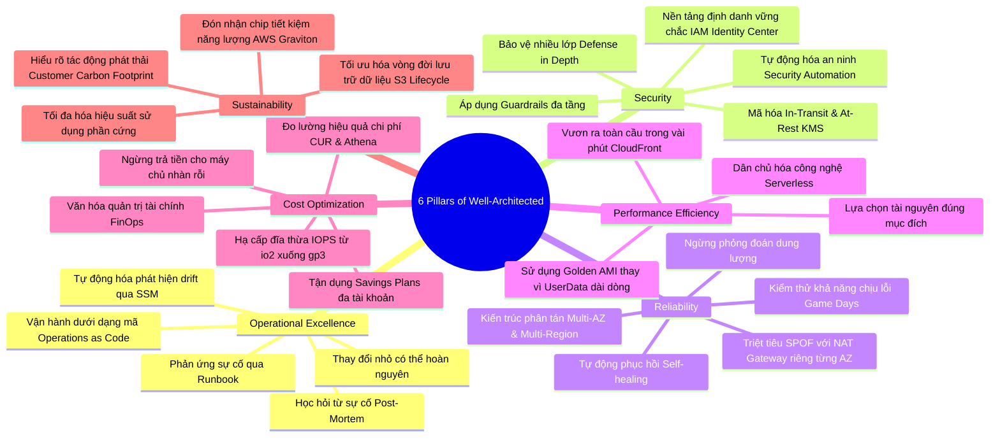
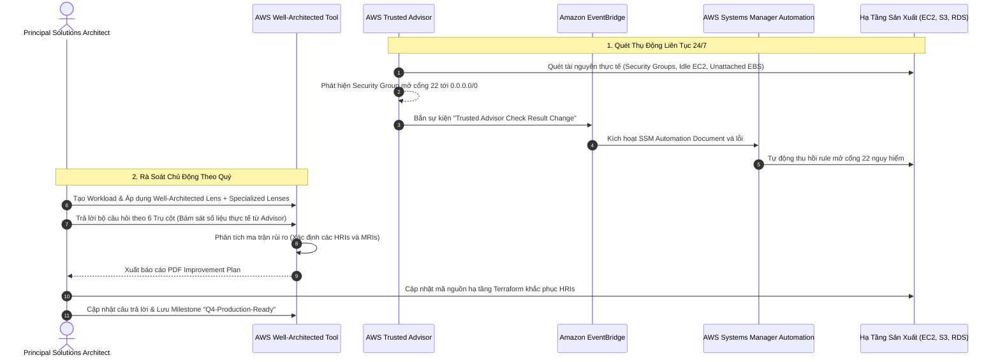
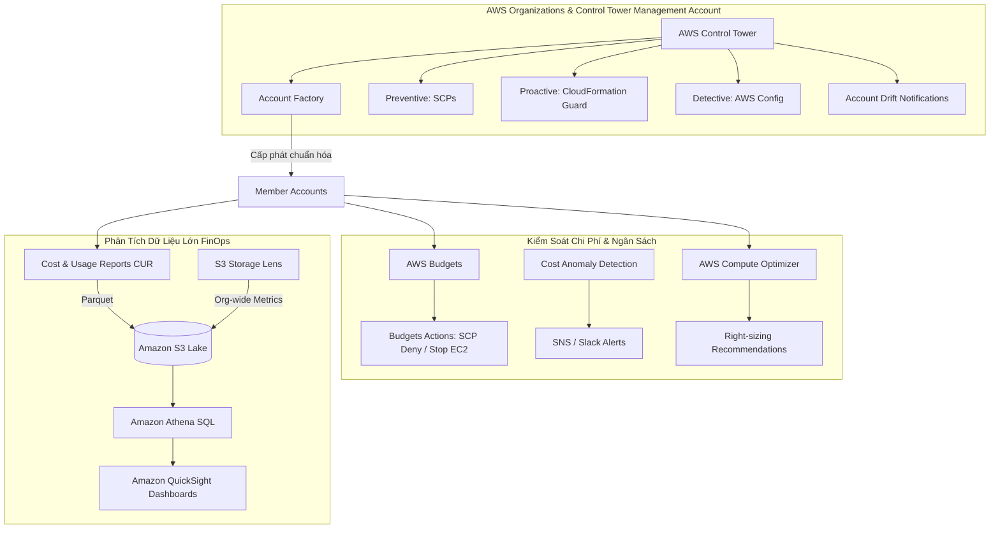

# Tài Liệu Học Tập Chuyên Sâu: AWS Well-Architected Framework, Governance & FinOps Ecosystem

> **Tài liệu chuẩn hóa kiến trúc đám mây**: Hướng dẫn toàn diện theo tiêu chuẩn Senior AWS Solutions Architect & Cloud DevOps Engineer (cập nhật mới nhất 2026).  
> **Ngôn ngữ**: Tiếng Việt (Bảo lưu toàn bộ thuật ngữ chuyên ngành tiếng Anh chuẩn AWS).  
> **Các dịch vụ liên quan**: AWS Well-Architected Tool, AWS Trusted Advisor, AWS Compute Optimizer, AWS Control Tower, AWS Budgets, AWS Cost Explorer, AWS Cost and Usage Reports (CUR), AWS Cost Anomaly Detection, S3 Storage Lens.

---

## 1. Tổng Quan Dịch Vụ (Service Overview)

### Dịch vụ gì?
- **AWS Well-Architected Framework**: Bộ khung lý thuyết và tập hợp các nguyên tắc thiết kế tối ưu (Best Practices) được đúc kết từ hàng triệu hệ thống của AWS, gồm **6 Trụ Cột** cốt lõi: Operational Excellence, Security, Reliability, Performance Efficiency, Cost Optimization, và Sustainability.
- **AWS Well-Architected Tool**: Dịch vụ tự đánh giá (Self-assessment tool) trên AWS Management Console, cho phép rà soát kiến trúc ứng dụng (Workloads), nhận diện các rủi ro mức độ cao (**High Risk Issues - HRI**) và trung bình (**Medium Risk Issues - MRI**) kèm lộ trình khắc phục (Improvement Plan).
- **AWS Trusted Advisor**: Dịch vụ "cố vấn ảo" tự động liên tục quét tài nguyên thực tế bên trong tài khoản AWS, đưa ra khuyến nghị tức thời trên 5 danh mục: Cost Optimization, Security, Fault Tolerance, Performance, và Service Limits. Hỗ trợ **Trusted Advisor Organization View** (`CM-PT5 Q05`) để tổng hợp báo cáo toàn tổ chức.
- **AWS Control Tower**: Dịch vụ thiết lập và quản trị Landing Zone đa tài khoản theo chuẩn Well-Architected, tự động hóa cấp phát tài khoản qua **Account Factory** (`TD-Set2 Q16`), áp dụng kiểm soát đa tầng (Preventive, Detective, Proactive Guardrails) và phát hiện lệch chuẩn (**Account Drift Notifications**) (`TD-Set8 Q22`, `CM-PT6 Q25`).
- **Bộ Công Cụ FinOps & Cost Management**:
  - **AWS Compute Optimizer**: Sử dụng Machine Learning phân tích CloudWatch metrics để đưa ra khuyến nghị điều chỉnh đúng kích cỡ (**Right-sizing**) cho EC2, EBS, Lambda, ECS on Fargate.
  - **AWS Budgets & Budgets Actions**: Thiết lập ngưỡng ngân sách chi phí, lượng sử dụng, độ bao phủ Savings Plans / RI; tự động thực thi hành động ngăn chặn (SCP DenyAll / Stop EC2) khi chạm ngưỡng (`U-PT6 Q62`).
  - **AWS Cost Explorer**: Trực quan hóa chi phí lịch sử và dự báo chi phí tương lai, hỗ trợ độ chi tiết cấp giờ và cấp tài nguyên (**Hourly & Resource-Level Granularity**) (`TD-Set6 Q39`, `CM-PT1 Q56`, `CM-PT6 Q32`, `U-PT4 Q08`).
  - **AWS Cost and Usage Reports (CUR)**: Xuất bản ghi chi tiết nhất về chi phí đám mây sang Amazon S3 dạng Apache Parquet, phục vụ phân tích dữ liệu lớn qua **Amazon Athena** và hiển thị trực quan qua **Amazon QuickSight** (`TD-Set6 Q60`, `CM-PT3 Q10`, `CM-PT3 Q62`, `CM-PT5 Q42`).
  - **S3 Storage Lens**: Cung cấp bức tranh trực quan hóa và phân tích số liệu lưu trữ S3 trên toàn bộ tổ chức AWS Organizations (`TD-Set3 Q09`, `CM-PT4 Q15`).

### 6 Trụ Cột của AWS Well-Architected Framework (The 6 Pillars)

#### Chi Tiết 6 Trụ Cột Chuẩn AWS:
1. **Vận hành xuất sắc (Operational Excellence)**:
   - Tập trung vào vận hành và giám sát hệ thống để mang lại giá trị kinh doanh, liên tục cải tiến quy trình.
   - *Nguyên tắc cốt lõi*: Thực hiện vận hành dưới dạng mã (**Operations as Code** qua Terraform/CloudFormation), chuẩn hóa quy trình tạo tài khoản tổ chức qua **AWS Control Tower Account Factory** (`TD-Set2 Q16`), tự động hóa phát hiện và khắc phục sai lệch cấu hình drift qua **SSM State Manager / Automation** (`TD-Set5 Q04`), thực hiện các thay đổi nhỏ thường xuyên có thể hoàn nguyên, dự đoán trước các thất bại, tổ chức diễn tập sự cố thực chiến (**Game Days**).
2. **Bảo mật (Security)**:
   - Bảo vệ thông tin, dữ liệu và tài sản kỹ thuật số thông qua đánh giá rủi ro và các chiến lược giảm thiểu.
   - *Nguyên tắc cốt lõi*: Xây dựng nền tảng định danh vững chắc với **AWS IAM Identity Center** và AWS Organizations (`TD-Set8 Q08`), duy trì khả năng truy vết và kiểm toán mức đối tượng qua **CloudTrail S3 Data Events** (`TD-Set8 Q12`), bảo vệ nhiều lớp (Defense-in-Depth), mã hóa dữ liệu ở mọi trạng thái bằng **AWS KMS** hoặc mã hóa phía client **CSE-C** khi quy định cấm gửi key lên đám mây (`TD-Set1 Q06`), áp dụng kiểm soát chủ động qua **Control Tower Guardrails / SCPs**.
3. **Độ tin cậy (Reliability)**:
   - Khả năng hệ thống tự phục hồi sau các gián đoạn hạ tầng, tự động cấp phát tài nguyên để đáp ứng nhu cầu và giảm thiểu sự cố.
   - *Nguyên tắc cốt lõi*: Triệt tiêu hoàn toàn các điểm lỗi đơn lẻ (**Single Point of Failure - SPOF**) như triển khai **NAT Gateway riêng biệt cho từng Availability Zone** (`TD-Set1 Q05`), thiết kế kiến trúc phân tán đa vùng sẵn sàng (**Multi-AZ ECS kết hợp Multi-AZ RDS**) (`TD-Set1 Q25`), tự động phục hồi sau lỗi (Self-healing qua Auto Scaling & Health Checks), ngăn chặn hiện tượng dao động co giãn liên tục (Flapping / Thrashing) bằng cách điều chỉnh **Cooldown Period** hoặc **Target Tracking** (`TD-Set5 Q48`), sẵn sàng kịch bản khôi phục thảm họa Disaster Recovery (Pilot Light / Warm Standby) (`TD-Set6 Q11`).
4. **Hiệu quả hiệu năng (Performance Efficiency)**:
   - Khả năng sử dụng tài nguyên điện toán hiệu quả để đáp ứng các yêu cầu và duy trì hiệu quả đó khi nhu cầu thay đổi.
   - *Nguyên tắc cốt lõi*: Dân chủ hóa công nghệ tiên tiến (ưu tiên Serverless và Managed Services), đưa nội dung ra sát người dùng toàn cầu qua **Amazon CloudFront** với chính sách bộ nhớ đệm TTL tối ưu (`TD-Set2 Q21`, `TD-Set8 Q13`), mở rộng khả năng đọc cơ sở dữ liệu qua **Aurora Auto Scaling Read Replicas** (`TD-Set1 Q47`), tăng tốc độ khởi động máy ảo Auto Scaling bằng **Golden AMI tạo sẵn** thay vì chạy script UserData phức tạp (`TD-Set4 Q35`).
5. **Tối ưu chi phí (Cost Optimization)**:
   - Khả năng vận hành hệ thống mang lại giá trị kinh doanh cao nhất với chi phí thấp nhất.
   - *Nguyên tắc cốt lõi*: Xây dựng văn hóa FinOps, đo lường hiệu quả tổng thể, điều chỉnh đúng kích cỡ tài nguyên (**Right-sizing**) và hạ cấp các ổ đĩa thừa IOPS từ **`io2 Block Express` xuống `gp3`** (`TD-Set8 Q03`), tự động hóa chính sách vòng đời tệp tin **EFS Lifecycle Management** sang EFS Infrequent Access/Archive (`TD-Set4 Q39`), chọn đúng lớp lưu trữ S3 Standard cho dữ liệu vòng đời dưới 30 ngày để tránh bị phạt thời gian lưu tối thiểu (`CM-PT1 Q55`), thiết lập cảnh báo và hành động ngân sách tự động qua **AWS Budgets Actions** (`TD-Set8 Q17`, `U-PT6 Q62`).
6. **Tính bền vững (Sustainability)**:
   - Giảm thiểu các tác động môi trường của việc vận hành các khối lượng công việc trên đám mây.
   - *Nguyên tắc cốt lõi*: Đo lường lượng phát thải carbon qua **AWS Customer Carbon Footprint Tool**, tối đa hóa tỷ lệ sử dụng máy chủ (Utilization), chuyển đổi sang các dòng chip tiết kiệm điện năng **AWS Graviton (Arm64: c7g, m7g, r7g)** giúp tăng hiệu năng trên mỗi watt điện tới 60%, xóa bỏ dữ liệu rác không cần thiết, ưu tiên kiến trúc Serverless (Lambda, Fargate) co giãn về 0 khi không có tải.

---

## 2. Các Kịch Bản Kiến Trúc & Bẫy Thi Thường Gặp (Architecture Scenarios & Exam Traps)

### 🏛️ I. Các Kịch Bản Kiến Trúc Chuẩn (Best Practice Scenarios)

#### 1. Quản Trị Chi Phí Đa Dự Án Bằng Cost Allocation Tags & AWS Cost Explorer
- **Tình huống thi**: Doanh nghiệp triển khai hàng ngàn tài nguyên trên AWS phục vụ nhiều dự án (Projects) và phòng ban (Cost Centers) khác nhau. Giám đốc Tài chính (CFO) yêu cầu xuất báo cáo phân bổ chi tiết chi phí hàng tháng cho từng dự án cụ thể.
- **Giải pháp tối ưu chuẩn AWS**:
  - Thiết lập chiến lược gắn thẻ tài nguyên chuẩn mực: Bắt buộc gắn các thẻ như `Project=Alpha`, `CostCenter=HR101`, `Environment=Production`.
  - Truy cập mục **Billing & Cost Management** tại Management Account và kích hoạt các thẻ này thành **User-Defined Cost Allocation Tags** (`CM-PT4 Q44`).
  - Sử dụng công cụ **AWS Cost Explorer**: Lọc và nhóm chi phí theo các thẻ đã kích hoạt để theo dõi xu hướng, phân tích ROI, và tạo các báo cáo chi phí trực quan xuất ra file CSV.

#### 2. Giám Sát Chi Phí Bất Thường Thời Gian Thực Bằng AWS Cost Anomaly Detection
- **Tình huống thi**: Đội ngũ phát triển vô tình khởi tạo nhầm các cụm máy chủ GPU đắt tiền hoặc bị tấn công làm phát sinh hóa đơn đám mây tăng vọt ngoài dự kiến. Cần giải pháp tự động phát hiện và cảnh báo ngay lập tức.
- **Giải pháp chuẩn**:
  - Kích hoạt dịch vụ **AWS Cost Anomaly Detection** (dịch vụ miễn phí tích hợp Machine Learning của AWS).
  - Dịch vụ liên tục phân tích thói quen chi tiêu lịch sử của tài khoản và tự động nhận diện các đợt tăng vọt chi phí bất thường (Cost Anomalies).
  - Cấu hình gửi thông báo cảnh báo tức thời qua **Amazon SNS** hoặc tích hợp vào kênh Slack của đội FinOps/DevOps kèm theo phân tích nguyên nhân gốc rễ (Root Cause Analysis - chỉ rõ service và account nào gây ra).

#### 3. Tối Ưu Cấu Hình Máy Chủ Chuẩn Xác Bằng AWS Compute Optimizer
- **Tình huống thi**: Doanh nghiệp nghi ngờ nhiều máy chủ EC2, Auto Scaling Groups, EBS volumes và hàm Lambda đang bị cấp phát thừa tài nguyên (Over-provisioned - gây lãng phí tiền) hoặc thiếu tài nguyên (Under-provisioned - gây nghẽn hiệu năng).
- **Giải pháp chuẩn**:
  - Kích hoạt **AWS Compute Optimizer** trên toàn bộ tổ chức AWS Organizations.
  - Dịch vụ sử dụng Machine Learning phân tích các chỉ số CloudWatch trong 14 ngày (hoặc 90 ngày với gói nâng cao) và đưa ra khuyến nghị cụ thể:
    - Đổi sang dòng instance thế hệ mới hơn (ví dụ: từ `t3.large` sang `t4g.medium` Graviton để tiết kiệm 40% chi phí).
    - Giảm cấu hình RAM cho hàm Lambda chạy không hết tài nguyên.
    - Điều chỉnh IOPS và Throughput cho ổ đĩa EBS gp3.

#### 4. Phân Tích Chi Phí Mức Chi Tiết Cấp Giờ & Cấp Tài Nguyên (Hourly Granularity & CUR Data Lake)
- **Tình huống thi**: Ban điều hành yêu cầu phân tích đột biến chi phí trong từng giờ cụ thể trong ngày cao điểm Flash Sale, và truy vết chính xác Resource ID của từng container/máy ảo gây tốn kém trong toàn bộ 50 tài khoản con.
- **Giải pháp chuẩn**:
  - Kích hoạt **Hourly and Resource-Level Granularity** trong AWS Cost Explorer (`TD-Set6 Q39`, `CM-PT1 Q56`, `CM-PT6 Q32`, `U-PT4 Q08`) để xem biểu đồ chi phí theo từng giờ trong tối đa 14 ngày.
  - Cấu hình **AWS Cost and Usage Reports (CUR)** xuất dữ liệu định dạng Apache Parquet vào Amazon S3 (`TD-Set6 Q60`, `CM-PT3 Q10`, `CM-PT5 Q42`).
  - Dùng **Amazon Athena** truy vấn SQL trực tiếp trên S3 để bóc tách chi phí tới từng resource ID cụ thể, và kết nối **Amazon QuickSight** dựng bảng điều khiển dashboard thời gian thực cho ban quản trị.

#### 5. Thiết Lập Quản Trị Đa Tài Khoản Landing Zone Bằng AWS Control Tower
- **Tình huống thi**: Doanh nghiệp mở rộng quy mô cần tạo tự động hàng chục tài khoản AWS mới cho các nhóm sản phẩm với cấu hình bảo mật, VPC, IAM Identity Center đồng nhất và tuân thủ các quy tắc an toàn đã duyệt trước.
- **Giải pháp chuẩn**:
  - Triển khai **AWS Control Tower** để thiết lập Landing Zone tự động.
  - Sử dụng **Account Factory** (`TD-Set2 Q16`) để tự động cấp phát tài khoản mới chuẩn hóa.
  - Cấu hình **Control Tower Guardrails**: Áp dụng SCPs (Preventive), AWS Config Managed Rules (Detective), và CloudFormation Guard (Proactive) (`CM-PT4 Q36`).
  - Bật **Account Drift Notifications** (`TD-Set8 Q22`, `CM-PT6 Q25`) để cảnh báo khi cấu hình trong tài khoản con bị sai lệch so với baseline chuẩn.

---

### 🪤 II. Các Bẫy Thi Tinh Vi & Phân Tích Phương Án Sai (Exam Traps & Distractors)

#### 🪤 Bẫy 1: Tự Động Hóa Chặn Chi Phí Vượt Ngưỡng Bằng AWS Budgets Actions — (U-PT6 Q62, TD-Set8 Q17)
- **Tình huống đề thi**: *"Doanh nghiệp cấp một tài khoản AWS Sandbox cho các lập trình viên thử nghiệm với hạn mức ngân sách \$100/tháng. Khi chi phí thực tế chạm mốc \$100, hệ thống phải TỰ ĐỘNG ngăn chặn người dùng khởi tạo thêm tài nguyên mới với ÍT CÔNG VẬN HÀNH NHẤT."*
- **Các phương án bẫy**:
  - ❌ *Cấu hình AWS Budgets gửi email cảnh báo để quản trị viên vào xóa tài nguyên thủ công*: Quá muộn, chi phí vẫn tiếp tục tăng trong khi chờ xử lý.
  - ❌ *Viết script Lambda tùy chỉnh kích hoạt bởi SNS để revoke IAM permissions*: Hoạt động được nhưng tốn công viết code, kiểm thử và bảo trì.
- **Giải pháp ĐÚNG**: Sử dụng tính năng **AWS Budgets Actions** (`U-PT6 Q62`).
  - AWS Budgets tích hợp sẵn khả năng thực thi hành động tự động: Gán một **IAM Policy** (chặn quyền `ec2:RunInstances`, v.v.) hoặc gán một **Service Control Policy (SCP)** có nội dung `DenyAll` áp dụng trực tiếp lên tài khoản Sandbox ngay khi vượt ngưỡng ngân sách, hoặc tự động dừng máy ảo EC2 đang chạy.

#### 🪤 Bẫy 2: Ràng Buộc Thời Gian Lưu Trữ Tối Thiểu (Minimum Storage Duration Trap) — (CM-PT1 Q55)
- **Tình huống đề thi**: *"Ứng dụng xử lý ảnh sinh ra hàng triệu tệp tin tạm thời có kích thước nhỏ. Các tệp này chỉ cần được lưu trữ trong vòng 10 đến 15 ngày rồi sẽ bị ứng dụng xóa bỏ vĩnh viễn. Lớp lưu trữ S3 nào tối ưu chi phí nhất?"*
- **Các phương án bẫy**:
  - ❌ *Chọn S3 Standard-IA*: Giá lưu trữ \$0.0125/GB rẻ hơn S3 Standard (\$0.023/GB). Tuy nhiên, Standard-IA có quy định **thời gian lưu trữ tối thiểu là 30 ngày** (Minimum Storage Duration = 30 days). Dù bạn xóa file sau 10 ngày, AWS vẫn tính tiền lưu trữ đủ 30 ngày!
  - ❌ *Chọn S3 Glacier Instant Retrieval*: Tương tự, Glacier Instant có quy định thời gian tối thiểu lên tới **90 ngày**!
- **Giải pháp ĐÚNG**: Sử dụng **Amazon S3 Standard** (`CM-PT1 Q55`).
  - S3 Standard **hoàn toàn không có ràng buộc thời gian lưu trữ tối thiểu** (xóa lúc nào dừng tính tiền lúc đó). Đối với dữ liệu tạm có vòng đời dưới 30 ngày, S3 Standard luôn mang lại tổng chi phí thấp nhất!

#### 🪤 Bẫy 3: Tiết Kiệm Chi Phí CDN Bằng CloudFront Price Classes — (CM-PT1 Q39, TD-Set8 Q13)
- **Tình huống đề thi**: *"Doanh nghiệp kinh doanh bán lẻ chỉ phục vụ khách hàng tại thị trường Hoa Kỳ và Châu Âu. Họ sử dụng Amazon CloudFront để phân phối trang web và muốn cắt giảm hóa đơn truyền dữ liệu CDN mà không ảnh hưởng tới trải nghiệm người dùng mục tiêu."*
- **Phân loại Price Classes chuẩn**:
  - **Price Class All (Mặc định)**: Sử dụng toàn bộ các Edge Locations của CloudFront trên toàn thế giới (bao gồm cả các khu vực có chi phí đắt đỏ như Úc, Nam Mỹ, Châu Phi).
  - **Price Class 200**: Sử dụng hầu hết các địa điểm biên (Bắc Mỹ, Châu Âu, Châu Á, Trung Đông, Châu Phi), loại bỏ các điểm đắt nhất.
  - **Price Class 100**: **Chỉ sử dụng các Edge Locations tại Bắc Mỹ, Châu Âu và Israel**. Đây là lựa chọn có chi phí thấp nhất!
- **Giải pháp ĐÚNG**: Chuyển đổi cấu hình CloudFront Distribution sang **Price Class 100** (`CM-PT1 Q39`).

#### 🪤 Bẫy 4: 3 Loại Savings Plans & Chia Sẻ Chiết Khấu Trong AWS Organizations — (CM-PT2 Q55, CM-PT3 Q05, CM-PT5 Q36, U-PT6 Q06, U-PT6 Q49)
- **Tình huống đề thi**: *"Doanh nghiệp triển khai kiến trúc đa tài khoản với AWS Organizations. Một số tài khoản thành viên chạy EC2, Lambda, Fargate và các cụm Machine Learning trên SageMaker. Cần chiến lược mua Savings Plans và chia sẻ chiết khấu tối ưu nhất."*
- **Phân biệt 3 loại Savings Plans cốt lõi**:
  1. **Compute Savings Plans**: Linh hoạt nhất, giảm tới **66%**. Áp dụng tự động cho **EC2 (bất kể family, OS, Region), AWS Fargate, và AWS Lambda**. Thay đổi instance family, chuyển vùng Region, chuyển từ EC2 sang Fargate/Lambda vẫn được áp dụng chiết khấu!
  2. **EC2 Instance Savings Plans**: Giảm sâu hơn (tới **72%**). Cam kết sử dụng cho một **Instance Family cụ thể trong một Region cụ thể** (ví dụ: dòng `c6g` tại `us-east-1`). Cho phép đổi instance size (từ `c6g.xlarge` sang `c6g.2xlarge`) hoặc OS, nhưng **KHÔNG áp dụng cho Fargate hay Lambda** và không đổi Region được!
  3. **SageMaker Savings Plans**: Giảm tới **64%**. Cam kết chi tiêu theo giờ áp dụng cho các instance ML của Amazon SageMaker (`ml.*`), bao gồm SageMaker Studio Notebooks, Processing, Training, Real-Time Inference (`CM-PT3 Q05`, `U-PT6 Q06`).
- **Nguyên tắc chia sẻ chiết khấu (Discount Sharing)**:
  - Bật **Discount Sharing từ Management Account** trong AWS Billing Console (`CM-PT2 Q55`).
  - Chiết khấu sẽ ưu tiên áp dụng cho tài khoản trực tiếp mua gói Savings Plans trước, sau đó phần cam kết dư thừa sẽ tự động được chia sẻ sang các Member Accounts khác có tài nguyên hợp lệ.
  - Thiết lập **Daily Savings Plans Coverage Budget** trong AWS Budgets (`CM-PT5 Q36`, `U-PT6 Q49`) để theo dõi tỷ lệ bao phủ cam kết hàng ngày và nhận cảnh báo khi độ bao phủ giảm xuống dưới ngưỡng mong muốn (ví dụ: < 80%).

#### 🪤 Bẫy 5: AWS Control Tower Guardrails: Preventive vs Detective vs Proactive — (TD-Set2 Q16, TD-Set8 Q22, CM-PT1 Q04, CM-PT1 Q51, CM-PT4 Q36, CM-PT6 Q25, U-PT1 Q16)
- **Tình huống đề thi**: *"Doanh nghiệp cần NGĂN CHẶN hoàn toàn (PREVENT) việc lập trình viên khởi chạy các EC2 instance có gắn địa chỉ Public IP trong toàn bộ tổ chức, đồng thời chuẩn hóa việc tạo tài khoản mới với các cấu hình bảo mật được phê duyệt sẵn qua Account Factory."*
- **Nguyên tắc phân biệt Guardrails / Controls trong Control Tower**:
  - **Preventive Controls (Ngăn chặn lúc gọi API)**: Thực thi thông qua **Service Control Policies (SCPs)** của AWS Organizations. Chặn các API call nguy hiểm ở cấp tài khoản (ví dụ: chặn `ec2:RunInstances` nếu không thỏa mãn điều kiện).
  - **Proactive Controls (Chủ động chặn trước khi deploy - Pre-deployment)**: Sử dụng **CloudFormation Guard / Hooks** để quét mẫu template IaC và chặn deployment ngay tại thời điểm tạo resource nếu vi phạm quy định (ví dụ: cấm `AssociatePublicIpAddress: true`) (`CM-PT4 Q36`).
  - **Detective Controls (Phát hiện sau khi tạo - Post-deployment)**: Thực thi thông qua **AWS Config Managed Rules**, phát hiện tài nguyên vi phạm và ghi nhận sự kiện drift hoặc kích hoạt tự động sửa chữa.
  - **Account Drift Notifications**: Control Tower gửi cảnh báo qua SNS/EventBridge khi phát hiện cấu hình tài khoản bị sai lệch (drift) so với baseline đã đăng ký (`TD-Set8 Q22`, `CM-PT6 Q25`).
- **Giải pháp ĐÚNG**: Triển khai **AWS Control Tower Account Factory** kết hợp **Proactive Controls** trong Landing Zone (`TD-Set2 Q16`, `CM-PT4 Q36`).

#### 🪤 Bẫy 6: Khuyến Nghị Mua Reserved Instances & Trusted Advisor Organization View — (CM-PT3 Q31, CM-PT5 Q05, CM-PT6 Q54)
- **Tình huống đề thi**: *"Doanh nghiệp vận hành nhiều cơ sở dữ liệu Amazon RDS for Oracle theo mô hình On-Demand với mức độ tải CPU/Memory liên tục vượt 85% trong nhiều tháng trên 30 tài khoản AWS. Ban giám đốc yêu cầu đưa ra phương án cắt giảm chi phí ngay lập tức với công cụ tích hợp sẵn của AWS từ tài khoản quản trị trung tâm."*
- **Giải pháp ĐÚNG**: 
  - Kích hoạt **Trusted Advisor Organization View** tại Management Account (`CM-PT5 Q05`) để tổng hợp báo cáo kiểm tra từ tất cả 30 tài khoản con trong AWS Organizations vào một trang điều khiển duy nhất.
  - Kiểm tra báo cáo tối ưu hóa tại mục **Amazon RDS Reserved Instance Optimization checks** (`CM-PT3 Q31`, `CM-PT6 Q54`).
  - Trusted Advisor tự động phân tích lịch sử sử dụng thực tế trong 30 ngày và đề xuất chính xác số lượng, loại DB instance cần chuyển đổi sang **Reserved Instances (RI 1 năm hoặc 3 năm)** để tiết kiệm tới 60% chi phí.

#### 🪤 Bẫy 7: Triệt Tiêu Điểm Lỗi Đơn Lẻ (SPOF) Tầng Mạng: NAT Gateway Riêng Biệt Từng AZ — (TD-Set1 Q05)
- **Tình huống đề thi**: *"Ứng dụng phân tán chạy trên các EC2 instances trong Private Subnets trải dài trên 3 Availability Zones. Toàn bộ các máy chủ dùng chung một NAT Gateway duy nhất tại AZ-a để tải bản vá từ Internet. Đội ngũ an ninh yêu cầu loại bỏ hoàn toàn điểm lỗi đơn lẻ (SPOF) cho luồng truy cập này để đảm bảo độ tin cậy (Reliability)."*
- **Các phương án bẫy**:
  - ❌ *Tạo thêm 1 máy chủ NAT Instance chạy song song trong cùng AZ-a*: Vẫn chết nếu toàn bộ AZ-a gặp sự cố mất điện/mạng!
  - ❌ *Mở cổng Internet trực tiếp cho các Private Subnets*: Vi phạm an ninh mạng nghiêm trọng.
- **Giải pháp ĐÚNG**: Triển khai **1 NAT Gateway riêng biệt trong Public Subnet của TỪNG Availability Zone** (`TD-Set1 Q05`).
  - Cập nhật Route Table của Private Subnet tại mỗi AZ trỏ traffic `0.0.0.0/0` vào chính NAT Gateway nằm trong cùng AZ đó.
  - Đảm bảo khi một AZ bị sự cố, các AZ còn lại vẫn kết nối Internet hoàn toàn bình thường, loại bỏ 100% Single Point of Failure.

#### 🪤 Bẫy 8: Ngăn Chặn Hiện Tượng Dao Động Co Giãn Liên Tục (ASG Flapping / Thrashing) — (TD-Set5 Q48)
- **Tình huống đề thi**: *"Khi rà soát nhật ký Auto Scaling, kiến trúc sư nhận thấy một ứng dụng web liên tục scale-up thêm máy chủ rồi lại scale-down tắt máy chủ nhiều lần trong cùng một giờ. Hiện tượng này làm tăng chi phí và gây gián đoạn tải. Cần thay đổi kiến trúc nào để ổn định hệ thống?"*
- **Nguyên nhân cốt lõi**:
  - Do thời gian chờ làm nguội (**Cooldown Period**) quá ngắn, hoặc ngưỡng kích hoạt scale-out và scale-in quá sát nhau, khiến số liệu CPU dao động đột biến làm ASG phản ứng liên tục (Flapping / Thrashing).
- **Giải pháp ĐÚNG**: 
  - Tăng giá trị **Default Cooldown Period** (ví dụ: từ 60s lên 300s) cho Auto Scaling Group để đảm bảo máy chủ mới có đủ thời gian khởi động và chia sẻ tải ổn định trước khi đưa ra quyết định co giãn tiếp theo (`TD-Set5 Q48`).
  - Hoặc chuyển đổi sang **Target Tracking Scaling Policy** (để AWS tự động tính toán biên độ an toàn) thay vì dùng Simple Scaling với khoảng cách ngưỡng quá hẹp.

#### 🪤 Bẫy 9: Tối Ưu Tốc Độ Scale-Out Cụm Máy Chủ: Golden AMI vs UserData Script — (TD-Set4 Q35)
- **Tình huống đề thi**: *"Hệ thống web cũ chạy trên Auto Scaling Group mất từ 15 đến 20 phút mỗi khi scale out thêm máy ảo EC2 mới do kịch bản UserData phải tải và biên dịch hàng loạt gói phần mềm phức tạp khi khởi động, dẫn đến không kịp phục vụ khách và mất yêu cầu (Lost requests). Cần giải pháp gì để tối ưu hiệu quả hiệu năng (Performance Efficiency)?"*
- **Giải pháp ĐÚNG**: Xây dựng **Custom Golden AMI** tích hợp sẵn toàn bộ ứng dụng và các gói thư viện phụ thuộc bằng **EC2 Image Builder** (`TD-Set4 Q35`).
  - Khi Auto Scaling kích hoạt, máy ảo EC2 mới khởi chạy từ Golden AMI chỉ mất 1-2 phút là sẵn sàng nhận traffic từ Load Balancer mà không phải tốn thời gian tải hoặc cài đặt phần mềm khi boot.

#### 🪤 Bẫy 10: Tối Ưu Hóa Chi Phí EBS Khi Thừa IOPS: Hạ Cấp Từ io2 Xuống gp3 — (TD-Set8 Q03)
- **Tình huống đề thi**: *"Báo cáo AWS Cost and Usage Report (CUR) cho thấy nhiều ổ đĩa EBS `io2 Block Express` trong môi trường sản xuất có mức sử dụng IOPS thực tế dưới 10,000 IOPS và thông lượng dưới 300 MB/s. Yêu cầu tối ưu chi phí theo trụ cột Cost Optimization mà không gây thời gian chết."*
- **Giải pháp ĐÚNG**: Sử dụng **EBS Elastic Volumes** để chuyển đổi trực tiếp loại ổ đĩa từ **`io2` sang `gp3`** (`TD-Set8 Q03`).
  - Ổ đĩa `gp3` cung cấp tới 16,000 IOPS và 1,000 MB/s thông lượng với chi phí rẻ hơn 75-80% mà không cần detach ổ đĩa hay tắt máy chủ.

#### 🪤 Bẫy 11: AWS Budgets Filtering: Service-Level Filters vs Cost Allocation Tags — (CM-PT1 Q42, CM-PT4 Q44)
- **Tình huống đề thi**: *"Doanh nghiệp muốn thiết lập ngân sách cảnh báo riêng cho dịch vụ Amazon EC2 của dự án Mobile App mà không bị ảnh hưởng bởi chi phí lưu trữ S3 hay database RDS của các dự án khác."*
- **Giải pháp ĐÚNG**: 
  - Tạo AWS Cost Budget và kết hợp 2 bộ lọc:
    1. **Service-level filter**: Chọn `EC2-Instances` (`CM-PT1 Q42`).
    2. **Tag-level filter**: Chọn thẻ phân bổ chi phí `Project=MobileApp` (`CM-PT4 Q44`).
  - Điều này cô lập chính xác ngân sách cho dịch vụ và dự án mục tiêu mà không gây cảnh báo sai lệch.

#### 🪤 Bẫy 12: Quản Trị Tổ Chức S3 Lưu Trữ Tập Trung Bằng S3 Storage Lens — (TD-Set3 Q09, CM-PT4 Q15)
- **Tình huống đề thi**: *"Tập đoàn sở hữu hơn 100 tài khoản AWS với hàng ngàn S3 buckets. Đội ngũ Cloud Governance cần cái nhìn tổng thể về dung lượng lưu trữ, tỷ lệ mã hóa, các bucket chưa bật Versioning hoặc chưa có Lifecycle Rules trên toàn bộ tổ chức AWS Organizations mà không phải viết script rà soát từng bucket."*
- **Giải pháp ĐÚNG**: Kích hoạt **S3 Storage Lens Organization-level Dashboard** (`TD-Set3 Q09`, `CM-PT4 Q15`).
  - Tích hợp trực tiếp với AWS Organizations để tự động tổng hợp số liệu lưu trữ và hoạt động của tất cả các bucket trong toàn bộ tổ chức vào một dashboard tập trung duy nhất, cung cấp khuyến nghị tối ưu chi phí và bảo mật tự động.

---

### 📊 III. Ma Trận Quyết Định Tối Ưu Chi Phí & Trụ Cột Nhanh (Exam Decision Matrix)

| Tình huống / Yêu cầu trong đề thi | Giải pháp chuẩn AWS | Giải pháp bị loại & Lý do | Tham chiếu đề thi |
|:---|:---|:---|:---|
| **Loại bỏ Single Point of Failure tầng mạng cho Private Subnet** | **Mỗi AZ triển khai 1 NAT Gateway riêng biệt trong Public Subnet** | Dùng chung 1 NAT Gateway duy nhất (mất kết nối nếu AZ đó chết) | `TD-Set1 Q05` |
| **ASG scale up/down liên tục nhiều lần trong giờ (Flapping)** | **Tăng Cooldown Period (300s) / Chuyển sang Target Tracking** | Giảm Cooldown Period (càng làm ASG dao động dữ dội hơn) | `TD-Set5 Q48` |
| **Máy ảo ASG mất 15-20 phút mới boot xong do chạy UserData** | **Tạo Golden AMI đóng gói sẵn bằng EC2 Image Builder** | Tăng vCPU máy ảo (không giải quyết được tốc độ tải mạng UserData) | `TD-Set4 Q35` |
| **Workload thừa IOPS trên io2 cần cắt giảm chi phí không downtime** | **EBS Elastic Volumes chuyển từ `io2` sang `gp3`** | Tạo đĩa mới rồi tắt máy copy file (gây downtime lâu) | `TD-Set8 Q03` |
| **Chuẩn hóa tạo tài khoản mới có sẵn cấu hình bảo mật duyệt trước** | **AWS Control Tower Account Factory** | Tạo tài khoản thủ công qua Console (dễ quên cấu hình bảo mật) | `TD-Set2 Q16` |
| **Tự động phát hiện tài khoản con sai lệch baseline chuẩn** | **Control Tower Account Drift Notifications** | Quét CloudWatch thủ công (không có cơ chế so sánh baseline tự động) | `TD-Set8 Q22`, `CM-PT6 Q25` |
| **Tự động áp dụng policy chặn tạo máy khi quá ngân sách** | **AWS Budgets Actions (áp dụng SCP / IAM Deny / Stop EC2)** | Viết code Lambda tùy chỉnh (tốn công duy trì) | `U-PT6 Q62`, `TD-Set8 Q17` |
| **Linh hoạt nhất: EC2, Fargate, Lambda giảm tới 66%** | **Compute Savings Plans (Discount Sharing từ Management Acct)** | EC2 Instance Savings Plans (bị khóa loại máy, không giảm Lambda) | `CM-PT2 Q55` |
| **Giảm giá tới 64% cho tài nguyên Machine Learning SageMaker** | **SageMaker Savings Plans (áp dụng cho các instance `ml.*`)** | Compute Savings Plans (không giảm sâu bằng cho SageMaker) | `CM-PT3 Q05`, `U-PT6 Q06` |
| **Dữ liệu tạm thời vòng đời ngắn dưới 30 ngày** | **Amazon S3 Standard** | S3 Standard-IA (bị phạt tính tiền lưu trữ tối thiểu 30 ngày) | `CM-PT1 Q55` |
| **Tự động chuyển tệp EFS ít truy cập sang tầng rẻ sau 30 ngày** | **EFS Lifecycle Management $\rightarrow$ EFS IA / Archive** | Di chuyển thủ công sang S3 (phải sửa đổi code ứng dụng) | `TD-Set4 Q39` |
| **Giảm chi phí CloudFront cho khách hàng tại Mỹ & Châu Âu** | **CloudFront Price Class 100** | Price Class All (phải trả phí cho các Edge Locations đắt đỏ) | `CM-PT1 Q39`, `TD-Set8 Q13` |
| **Đề xuất mua Reserved Instances cho DB chạy tải cao 24/7** | **AWS Trusted Advisor RDS RI Optimization Checks** | Giữ On-Demand chạy 24/7 (lãng phí tới 60% chi phí) | `CM-PT3 Q31` |
| **Tổng hợp kiểm tra Trusted Advisor toàn bộ các tài khoản con** | **Trusted Advisor Organization View** | Đăng nhập vào từng tài khoản con xem riêng lẻ (tốn công vận hành) | `CM-PT5 Q05` |
| **Chặn triển khai máy ảo có Public IP trước khi tạo (Pre-deployment)** | **Control Tower Proactive Controls (CloudFormation Guard)** | Detective Controls (chỉ phát hiện sau khi máy đã chạy) | `CM-PT4 Q36`, `U-PT1 Q16` |
| **Phân tích đột biến chi phí từng giờ trong ngày cao điểm** | **Cost Explorer Hourly Granularity** | Cost Explorer Daily mặc định (không thấy được đỉnh nhọn theo giờ) | `TD-Set6 Q39`, `CM-PT1 Q56` |
| **Phân tích chi phí cấp Resource ID trên Data Lake tập đoàn** | **AWS Cost and Usage Reports (CUR) + Athena + QuickSight** | Cost Explorer API (bị giới hạn rate limit và tốn phí \$0.01/call) | `TD-Set6 Q60`, `CM-PT3 Q10` |
| **Bức tranh tổng thể lưu trữ S3 toàn bộ tài khoản tổ chức** | **S3 Storage Lens Organization Dashboard** | CloudWatch Metrics từng bucket (rời rạc, thiếu đề xuất chi phí) | `TD-Set3 Q09`, `CM-PT4 Q15` |
| **Phát hiện chi phí tăng vọt bất thường theo thời gian thực** | **AWS Cost Anomaly Detection (Machine Learning)** | CloudWatch Billing Alarm (chỉ báo khi vượt tổng tiền tĩnh) | Chuẩn AWS |

---

## 3. Kiến Trúc Sâu & Luồng Hoạt Động (Deep-Dive Architecture & Workflow)

### 1. Quy Trình Rà Soát Kiến Trúc Well-Architected Tool & Tự Động Hóa Vá Lỗi

### 2. Kiến Trúc Luồng Dữ Liệu Quản Trị FinOps & Governance Tập Trung

---

## 4. Bảng Tích Hợp với Các Dịch Vụ AWS Khác (Integration Table)

| Related AWS Service | Purpose (Mục đích tích hợp) | Integration Method (Phương thức tích hợp) | Practical Example (Ví dụ thực tiễn) |
| :--- | :--- | :--- | :--- |
| **AWS Organizations** | Quản lý đánh giá kiến trúc và chia sẻ chiết khấu tập trung | AWS RAM & Consolidated Billing | Quản trị viên chia sẻ Well-Architected Custom Lens và bật Discount Sharing cho toàn bộ 50 tài khoản thành viên (`CM-PT2 Q55`). |
| **AWS Control Tower** | Tự động hóa thiết lập Landing Zone chuẩn Well-Architected | Account Factory & Guardrails | Tự động áp dụng Proactive Controls bằng CloudFormation Guard ngăn chặn tạo Public IP (`TD-Set2 Q16`, `CM-PT4 Q36`). |
| **Amazon EventBridge** | Tự động hóa phản ứng khi Trusted Advisor phát hiện rủi ro mới | Event Pattern bắt sự kiện từ Trusted Advisor | Khi Trusted Advisor phát hiện S3 Bucket bị mở Public, EventBridge kích hoạt hàm Lambda để tự động bật S3 Block Public Access. |
| **AWS Compute Optimizer** | Cung cấp số liệu Right-sizing cho trụ cột Cost Optimization | Dữ liệu học máy phân tích CloudWatch | Xuất báo cáo 40 máy chủ EC2 bị dư thừa vCPU/RAM để đưa vào kế hoạch khắc phục HRI trong Well-Architected Tool. |
| **Amazon Athena & QuickSight** | Phân tích sâu hóa đơn chi phí mức độ chi tiết cao | SQL queries trên file Parquet của CUR | Xây dựng dashboard FinOps phân tích chi tiêu theo từng Resource ID và giờ cao điểm (`TD-Set6 Q60`, `CM-PT3 Q10`). |
| **S3 Storage Lens** | Phân tích và quản trị lưu trữ toàn bộ tổ chức | Organizations aggregation dashboard | Phát hiện các bucket chưa có Lifecycle Rule hoặc thiếu server-side encryption trên toàn bộ 80 tài khoản con (`TD-Set3 Q09`, `CM-PT4 Q15`). |
| **AWS Support API** | Truy vấn lập trình kết quả kiểm tra của Trusted Advisor | Boto3 / AWS CLI Support client | Viết script Python chạy định kỳ trong Jenkins xuất báo cáo tài nguyên lãng phí từ Trusted Advisor gửi qua Slack. |

---

## 5. Bảng So Sánh Trong Hệ Sinh Thái AWS (Ecosystem Comparison)

### So sánh các công cụ đánh giá, tối ưu hóa và quản trị kiến trúc

| Tiêu chuẩn so sánh | AWS Well-Architected Tool | AWS Trusted Advisor | AWS Compute Optimizer | AWS Budgets | AWS Cost Explorer | AWS Cost & Usage Reports (CUR) |
| :--- | :--- | :--- | :--- | :--- | :--- | :--- |
| **Bản chất công cụ** | Đánh giá kiến trúc chủ động dựa trên bộ câu hỏi (Questionnaire). | Cố vấn tự động dựa trên quét tài nguyên đám mây (Rules-based). | Động cơ đề xuất hạ/nâng cấu hình dựa trên học máy (ML-driven). | Công cụ theo dõi hạn mức ngân sách và tự động hóa phản ứng. | Trực quan hóa, phân tích xu hướng và dự báo chi phí (UI-driven). | Kho dữ liệu chi phí và sử dụng thô chi tiết nhất (Data Lake). |
| **Phương thức thu thập** | Con người trả lời và nhập liệu bằng tay. | Quét tự động ngầm tài nguyên thực tế. | Phân tích metrics CloudWatch trong 14 - 90 ngày. | Dữ liệu tính cước từ AWS Billing Engine. | Tổng hợp dữ liệu cước tổng quát (Daily/Monthly/Hourly). | Xuất định kỳ file Parquet/CSV chi tiết tới từng resource vào S3. |
| **Phạm vi đánh giá** | **Bao quát toàn diện 6 trụ cột** (Kỹ thuật + Quy trình + Tổ chức). | 5 danh mục tối ưu hóa tài nguyên (Thiên về hạ tầng vật lý). | Chuyên sâu về **vCPU, RAM, Storage IOPS** của EC2, EBS, Lambda. | Ngân sách chi phí, lượng sử dụng, độ bao phủ RI/Savings Plans. | Báo cáo chi phí lọc theo Service, Tag, Cost Category. | Toàn bộ metadata, chi phí, mức sử dụng của từng resource ID. |
| **Khả năng tự động hóa** | Xuất báo cáo PDF Improvement Plan. | Kích hoạt EventBridge khi check thay đổi trạng thái. | Xuất file khuyến nghị CSV/CLI để tự động chạy script. | **Budgets Actions**: Tự động áp SCP Deny, IAM policy, Stop EC2. | Xem biểu đồ, dự báo 3 tháng, gọi API (\$0.01/call). | Chạy truy vấn SQL qua Amazon Athena, trực quan qua QuickSight. |
| **Chi phí dịch vụ** | **100% Miễn phí**. | Miễn phí Core Checks; Trả phí qua gói Business/Enterprise Support. | **100% Miễn phí** (chỉ có tùy chọn enhanced metrics có phụ phí nhỏ). | **2 budgets đầu miễn phí**; Từ budget thứ 3: \$0.02/ngày (~)\$0.60/tháng). | Miễn phí trên Console; API tốn \$0.01/call. | **Miễn phí tạo báo cáo**; Chỉ trả phí lưu trữ S3 và quét SQL Athena. |
| **Thời điểm sử dụng tối ưu** | Nghiệm thu kiến trúc trước Golive, rà soát định kỳ hàng quý. | Kiểm tra nhanh hàng tuần để dọn dẹp tài nguyên nhàn rỗi. | Tối ưu hóa chi phí định kỳ hàng tháng cho máy ảo và đĩa cứng. | Thiết lập ngay từ ngày đầu để chống bill shock cho tài khoản. | Phân tích dòng tiền hàng tháng và dự báo ngân sách quý. | Phân tích dữ liệu lớn cấp tập đoàn và xây dựng Data Lake FinOps. |

---

## 6. Chiến Lược Tối Ưu Chi Phí & FinOps (Cost Optimization & FinOps)

### 6.1. Bảng Cấu Trúc Định Giá Chi Tiết Bộ Công Cụ FinOps

| Công Cụ Quản Lý Chi Phí | Đơn giá AWS niêm yết | Cơ chế đo lường | Ghi chú tối ưu hóa chi phí FinOps |
| :--- | :--- | :--- | :--- |
| **AWS Well-Architected Tool** | **\$0.00** | Miễn phí 100% không giới hạn Workloads | Sử dụng thường xuyên để phát hiện các lỗ hổng kiến trúc gây lãng phí chi phí. |
| **AWS Cost Explorer (Console)** | **\$0.00** | Miễn phí trên giao diện Web | Cung cấp biểu đồ trực quan hóa dòng tiền và dự báo chi phí 3 tháng tới. |
| **AWS Cost Explorer API** | **\$0.01 / request** (`GetCostAndUsage`) | Tính trên mỗi API call | Tránh gọi API liên tục trong vòng lặp; lưu cache kết quả hoặc dùng CUR. |
| **AWS Budgets** | **2 budgets đầu miễn phí** Từ budget thứ 3: **\$0.02 / ngày** (~)\$0.60/tháng) | Tính theo số lượng budget duy trì | Tạo các budget tổng thể cấp tài khoản hoặc phòng ban thay vì tạo hàng trăm budget vụn vặt. |
| **AWS Cost Anomaly Detection** | **\$0.00** | Miễn phí 100% cho mọi tài khoản | Luôn bật để phát hiện sớm các đợt tăng vọt chi phí bất thường (Cost Spikes). |
| **AWS Compute Optimizer** | **\$0.00** | Miễn phí 100% cho mọi tài khoản | Bắt buộc bật để tự động nhận khuyến nghị hạ cấu hình (Right-sizing) tiết kiệm 30-50% chi phí. |
| **AWS Trusted Advisor** | Miễn phí Core Checks Full Checks kèm Business Support (từ \$100/tháng) | Theo gói hỗ trợ của tài khoản | Sử dụng Compute Optimizer và Cost Explorer miễn phí để tối ưu chi phí trước khi mua Support. |
| **AWS Cost and Usage Reports** | **\$0.00** tạo báo cáo (chỉ trả phí S3 & Athena) | Dung lượng Parquet trong S3 | Định dạng nén Parquet giúp giảm 80% dung lượng lưu trữ S3 và tăng 3x-5x tốc độ truy vấn Athena. |

---

### 6.2. 5 Kịch Bản Tối Ưu Hóa Chi Phí Thực Tế (FinOps Scenarios)

#### Kịch bản 1: Tự động hóa kiểm soát ngân sách bằng AWS Budgets Actions (Auto-Stop EC2 Sandbox)
- **Bối cảnh**: Doanh nghiệp cấp tài khoản Sandbox cho đội ngũ R&D với hạn mức ngân sách tối đa **\$600/tháng**. Kỹ sư thường quên tắt các máy ảo GPU `g5.12xlarge` (\$5.672/giờ) sau giờ làm việc, khiến hóa đơn tháng tăng vọt lên **\$3{,}500/tháng**.
- **Giải pháp tối ưu**:
  - Tạo một **AWS Cost Budget** với hạn mức cố định \$600/tháng.
  - Cấu hình **AWS Budget Action** tại mốc **100% ngân sách thực tế**:
    - Tự động gắn SCP hoặc IAM Policy từ chối `ec2:RunInstances`.
    - Tự động gọi API **Stop toàn bộ máy ảo EC2 đang chạy** trong tài khoản Sandbox (`U-PT6 Q62`).
- **Hiệu quả kinh tế**:
  $$\text{Tiết kiệm} = \$3{,}500 - \$600 = \$2{,}900/\text{tháng} \quad (\$34{,}800/\text{năm}) \implies \text{Triệt tiêu } 100\% \text{ nguy cơ bill shock}$$

#### Kịch bản 2: Bật AWS Cost Anomaly Detection kết hợp EventBridge & Slack Alerts
- **Bối cảnh**: Một lỗi kịch bản Terraform tạo ra vòng lặp vô tận (Infinite Loop) trong hàm AWS Lambda ghi dữ liệu vào Amazon DynamoDB, khiến số lượng ghi tăng vọt lên hàng chục triệu request mỗi giờ. Nếu chỉ chờ hóa đơn cuối tháng, doanh nghiệp sẽ phải trả hơn **\$15{,}000**.
- **Giải pháp tối ưu**:
  - Kích hoạt **AWS Cost Anomaly Detection** (hoàn toàn **MIỄN PHÍ \$0.00**).
  - Tạo Anomaly Subscription: Ngưỡng cảnh báo khi chi phí bất thường vượt quá **\$40** hoặc vượt quá **30% mức chi tiêu bình thường**.
  - Tích hợp với **Amazon SNS Topic** gửi thông báo kèm phân tích nguyên nhân gốc rễ (Root Cause) về kênh Slack trong vòng **15 phút**.
- **Hiệu quả kinh tế**:
  $$\text{Phát hiện và chặn đứng sự cố rò rỉ chi phí sau 30 phút, bảo vệ an toàn } \$15{,}000 \text{ ngân sách}$$

#### Kịch bản 3: Áp dụng khuyến nghị Right-sizing của AWS Compute Optimizer cho EC2
- **Bối cảnh**: Doanh nghiệp vận hành 70 máy chủ EC2 On-Demand loại `m5.2xlarge` (\$0.384/giờ).
- **Tính toán chi phí hiện tại**:
  $$\text{Cost}_{\text{Current}} = 70 \times \$0.384 \times 730 \text{ giờ} = \$19{,}622.40/\text{tháng}$$
- **Giải pháp tối ưu**:
  - Kích hoạt **AWS Compute Optimizer** (hoàn toàn **MIỄN PHÍ \$0.00**):
    - Báo cáo phân tích metrics 14 ngày qua chỉ ra: 55 máy chủ có mức sử dụng CPU tối đa P99 chưa bao giờ vượt quá 10% và RAM dưới 20% (**Over-provisioned**).
    - Đề xuất: Hạ kích thước 55 máy chủ này xuống `m5.large` (\$0.096/giờ); 15 máy chủ còn lại giữ nguyên `m5.2xlarge`.
  $$\text{Cost}_{\text{Optimized}} = (55 \times \$0.096 \times 730) + (15 \times \$0.384 \times 730) = \$3{,}854.40 + \$4{,}204.80 = \$8{,}059.20/\text{tháng}$$
- **Hiệu quả kinh tế**:
  $$\text{Tiết kiệm} = \$19{,}622.40 - \$8{,}059.20 = \$11{,}563.20/\text{tháng} \quad (\$138{,}758/\text{năm}) \implies \text{Cắt giảm } 58.9\% \text{ chi phí máy chủ}$$

#### Kịch bản 4: Phân bổ và quản trị chi phí minh bạch bằng Cost Allocation Tags
- **Bối cảnh**: Doanh nghiệp có 1 tài khoản AWS dùng chung cho 4 khối kinh doanh (FinTech, Retail, Logistics, Marketing). Hàng tháng nhận hóa đơn tổng \$40{,}000 nhưng không thể phân định phòng ban nào tiêu tốn bao nhiêu.
- **Giải pháp tối ưu**:
  - Ban hành chính sách gắn thẻ bắt buộc qua AWS Organizations: `Department`, `Environment`, `CostCenter`.
  - Kích hoạt các thẻ này trong **Cost Allocation Tags** trên Billing Console.
  - Sử dụng **AWS Cost Categories** để gom nhóm chi phí các dịch vụ dùng chung (Transit Gateway, Shared ALB).
- **Hiệu quả kinh tế**:
  $$\text{Minh bạch hóa } 100\% \text{ dòng tiền đám mây (Showback/Chargeback), loại bỏ hoàn toàn các tài nguyên mồ côi}$$

#### Kịch bản 5: Xây dựng Data Lake phân tích chi phí bằng AWS CUR, Athena & QuickSight
- **Bối cảnh**: Tập đoàn lớn sở hữu hơn 60 tài khoản AWS. Giao diện Cost Explorer web chỉ lưu 14 tháng lịch sử và không thể phân tích độ trễ/chi phí ở cấp độ từng resource ID.
- **Giải pháp tối ưu**:
  - Cấu hình **AWS Cost & Usage Report (CUR)** xuất dữ liệu nén Apache Parquet sang Amazon S3 mỗi vài giờ (**hoàn toàn MIỄN PHÍ**).
  - Sử dụng **Amazon Athena** chạy truy vấn SQL phân tích chuyên sâu (chỉ trả \$5/TB dữ liệu quét):
  - Kết nối dữ liệu sang **Amazon QuickSight** xây dựng dashboard FinOps tương tác cho ban điều hành (`TD-Set6 Q60`, `CM-PT3 Q10`).
- **Hiệu quả kinh tế**:
  $$\text{Cung cấp khả năng phân tích chi phí chi tiết từng resource với chi phí hạ tầng chỉ vài USD/tháng}$$

---

## 7. Khắc Phục Sự Cố Thực Tế (Troubleshooting Guide)

| Tình huống sự cố (Problem) | Nguyên nhân cốt lõi (Root Cause) | Các bước điều tra & Chỉ số giám sát (Metrics & Logs) | Giải pháp khắc phục (Remediation) | Biện pháp phòng ngừa (Prevention) |
| :--- | :--- | :--- | :--- | :--- |
| **Lỗi `SubscriptionRequiredException` khi gọi AWS Support API** | Tài khoản đang ở gói Basic hoặc Developer Support (AWS Support API yêu cầu gói Business hoặc Enterprise). | - Kiểm tra gói hỗ trợ trên mục Support Plans của AWS Console. - Xem mã lỗi trả về từ AWS CLI. | Nâng cấp gói hỗ trợ lên Business Support hoặc xem kết quả Core Checks trực tiếp trên Console. | Sử dụng AWS Cost Explorer và Compute Optimizer miễn phí để thay thế nếu chưa có kinh phí nâng cấp Support. |
| **Trusted Advisor báo đỏ mục "S3 Bucket Permissions"** | Có ít nhất 1 S3 Bucket đang mở quyền đọc/ghi công khai (Public Read/Write) cho toàn thế giới. | - Xem danh sách `FlaggedResources` trong kết quả kiểm tra của Trusted Advisor. - Kiểm tra Bucket Policy và ACLs của bucket. | Bật tính năng **S3 Block Public Access** ở cấp độ bucket hoặc cấp độ tài khoản, và gỡ các policy cấp quyền `Principal: "*"`. | Áp dụng SCP cấm tắt S3 Block Public Access trên toàn bộ tài khoản con. |
| **Không thể chia sẻ Workload sang tài khoản AWS khác** | Tài khoản nhận chưa chấp nhận lời mời chia sẻ trong **AWS RAM** (Resource Access Manager) hoặc khác Organization. | - Kiểm tra trang AWS RAM trong tài khoản đích xem có lời mời ở trạng thái `Pending` không. | Vào AWS RAM ở tài khoản đích và nhấp **Accept Resource Share**. | Bật tính năng chia sẻ trong nội bộ Organization để tự động chấp thuận mà không cần duyệt thủ công. |
| **Well-Architected Tool báo quá nhiều High Risk Issues (HRI) không đúng** | Người đánh giá chọn nhầm các tùy chọn chưa áp dụng hoặc chưa hiểu rõ câu hỏi của Framework. | - Xem lại chi tiết từng câu trả lời trong Improvement Plan của Workload. | Tổ chức buổi rà soát chung giữa Solutions Architect và Tech Lead của dự án để đánh giá lại trung thực. | Định kỳ tổ chức workshop đào tạo nội bộ về 6 trụ cột Well-Architected. |
| **AWS Budget Action không tự động dừng máy ảo khi vượt ngưỡng** | IAM Role gán cho AWS Budget Action thiếu quyền `ec2:StopInstances` hoặc chưa cấu hình SCP cho phép. | - Xem lịch sử thực thi trong tab **Budget History** trên AWS Billing Console. | Cấp quyền IAM policy chuẩn cho service role của AWS Budgets (`budgets.amazonaws.com`). | Kiểm tra quyền qua IAM Policy Simulator trước khi kích hoạt Budget Action. |
| **Control Tower báo trạng thái Account Drift (`TD-Set8 Q22`)** | Quản trị viên sửa đổi thủ công tài nguyên baseline (VPC, IAM Role, Config Rule) trực tiếp trong tài khoản con. | - Kiểm tra tab **Drift details** trên AWS Control Tower Console. - Đối chiếu với CloudTrail Event history để xem ai đã sửa. | Nhấp **Re-register OU** hoặc **Update account** trên Control Tower để đồng bộ lại baseline chuẩn. | Áp dụng SCPs khóa quyền sửa đổi tài nguyên do Control Tower quản lý trong các tài khoản con. |
| **Truy vấn Athena trên CUR báo lỗi `HIVE_PARTITION_SCHEMA_MISMATCH`** | Báo cáo CUR được cấu hình thêm hoặc xóa cột mới khiến cấu trúc bảng Athena không khớp. | - Kiểm tra thông báo lỗi Athena. - Xem cấu trúc thư mục phân vùng trên S3. | Chạy lệnh `MSCK REPAIR TABLE` hoặc cấu hình AWS Glue Crawler tự động cập nhật schema cho bảng CUR định kỳ. | Sử dụng CloudFormation template do AWS CUR cung cấp sẵn để tích hợp với Athena. |

---

## 8. Tóm Tắt & Danh Mục Tự Kiểm Tra (Summary & Learning Checklist)

### 7 Nguyên Tắc Vàng Kiến Trúc AWS Well-Architected (Golden Rules)
1. **Bám sát 6 Trụ Cột**: Luôn đối chiếu mọi thiết kế kiến trúc với 6 trụ cột (Vận hành, Bảo mật, Tin cậy, Hiệu năng, Chi phí, Bền vững).
2. **Hiệp đồng thay vì đánh đổi**: Nâng cao tự động hóa vận hành sẽ tự nhiên giúp tăng độ tin cậy và giảm chi phí lãng phí.
3. **Ngừng phỏng đoán dung lượng**: Tận dụng tối đa Auto Scaling và Serverless để hệ thống tự động co giãn theo tải thực tế.
4. **Bật AWS Compute Optimizer**: Luôn áp dụng các khuyến nghị hạ cấu hình (Right-sizing) để tiết kiệm 30-60% chi phí điện toán.
5. **Kích hoạt Cost Anomaly Detection**: Bảo vệ tài khoản khỏi bill shock bằng cách nhận cảnh báo đột biến chi phí qua Slack/Email trong 15 phút.
6. **Khóa chặt ngân sách bằng Budget Actions**: Tự động dừng máy ảo thử nghiệm hoặc áp SCP DenyAll khi vượt quá 100% ngân sách để kiểm soát tài chính chủ động (`U-PT6 Q62`).
7. **Định kỳ diễn tập Game Days**: Thường xuyên kiểm thử khả năng chịu lỗi và cập nhật Runbook để sẵn sàng ứng phó với mọi sự cố thực tế.

---

### Danh Mục Kiểm Tra Năng Lực (Learning Checklist)
- [ ] Tôi có thể kể tên và giải thích bản chất của cả 6 trụ cột Well-Architected Framework.
- [ ] Tôi hiểu rõ vai trò của AWS Well-Architected Tool, Lenses, và cách ghi nhận Milestones.
- [ ] Tôi phân biệt được sự khác nhau giữa Well-Architected Tool, Trusted Advisor, Compute Optimizer, Budgets, Cost Explorer và CUR.
- [ ] Tôi nắm vững các hạn chế của Trusted Advisor khi tài khoản ở gói Basic Support so với Business Support.
- [ ] Tôi hiểu cách dùng Trusted Advisor Organization View để tổng hợp rà soát toàn bộ tổ chức (`CM-PT5 Q05`).
- [ ] Tôi biết cách cấu hình AWS Budgets kèm Budget Actions để tự động dừng máy ảo hoặc áp SCP khi vượt ngân sách (`U-PT6 Q62`, `TD-Set8 Q17`).
- [ ] Tôi phân biệt được 3 loại Savings Plans (Compute, EC2 Instance, SageMaker) và cơ chế Discount Sharing trong AWS Organizations (`CM-PT2 Q55`, `CM-PT3 Q05`, `U-PT6 Q06`).
- [ ] Tôi phân biệt được 3 loại Guardrails trong Control Tower: Preventive (SCPs), Detective (Config), Proactive (CloudFormation Guard) (`CM-PT4 Q36`, `U-PT1 Q16`).
- [ ] Tôi hiểu cơ chế phát hiện và xử lý Account Drift trong AWS Control Tower (`TD-Set8 Q22`, `CM-PT6 Q25`).
- [ ] Tôi hiểu nguyên lý hoạt động của AWS Cost Anomaly Detection để phòng chống bill shock.
- [ ] Tôi nắm vững quy định Minimum Storage Duration của S3 Standard-IA (30 ngày) và Glacier Instant (90 ngày) so với S3 Standard (`CM-PT1 Q55`).
- [ ] Tôi biết cách dùng Cost Explorer Hourly Granularity và CUR + Athena + QuickSight để phân tích chi phí chuyên sâu (`TD-Set6 Q39`, `TD-Set6 Q60`, `CM-PT3 Q10`).
- [ ] Tôi hiểu cách dùng S3 Storage Lens Organization Dashboard để quản trị lưu trữ tập trung (`TD-Set3 Q09`, `CM-PT4 Q15`).
- [ ] Tôi có thể thiết kế một quy trình diễn tập sự cố (Game Day) cho hệ thống phân tán đa vùng.

---

### Liên kết và Tài liệu Liên quan
- 📖 [Ghi Chú Bài Học Chương 31: WhitePapers & Kiến Trúc Thực Tế](../Lesson_Notes/31_WhitePapers_and_Architectures.md)
- 📖 [Bảng Thuật Ngữ Kỹ Thuật (GLOSSARY.md)](../GLOSSARY.md)
- ⏭️ Hoàn tất toàn bộ 21 chuyên đề dịch vụ AWS chuẩn hóa kiến trúc đám mây.
