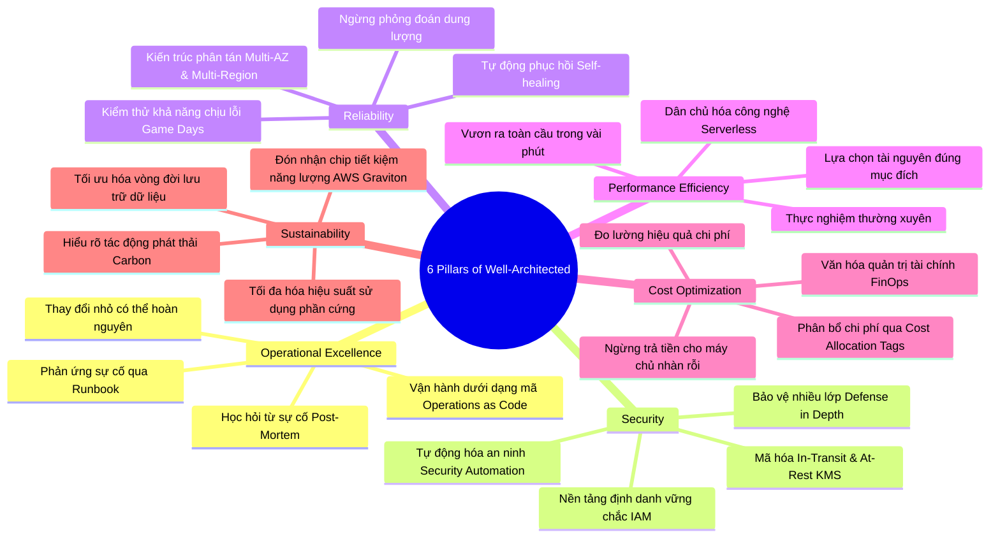
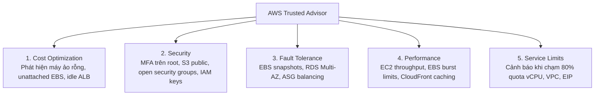
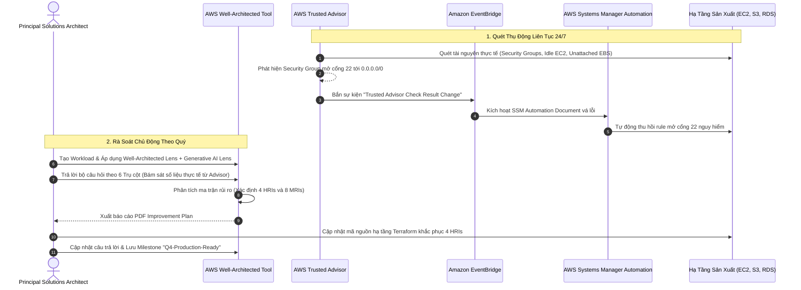

# Tài Liệu Học Tập Chuyên Sâu: AWS Well-Architected Framework, Well-Architected Tool & AWS Trusted Advisor

> **Tài liệu chuẩn hóa kiến trúc đám mây**: Hướng dẫn toàn diện theo tiêu chuẩn Senior AWS Solutions Architect & Cloud DevOps Engineer (cập nhật mới nhất 2026).  
> **Ngôn ngữ**: Tiếng Việt (Bảo lưu toàn bộ thuật ngữ chuyên ngành tiếng Anh chuẩn AWS).  
> **Các dịch vụ liên quan**: AWS Well-Architected Tool, AWS Trusted Advisor, AWS Compute Optimizer, AWS Cost Anomaly Detection, AWS Architecture Center.

---

## 6.1. Tổng Quan Dịch Vụ (Service Overview)

### Dịch vụ gì?
- **AWS Well-Architected Framework**: Bộ khung lý thuyết và tập hợp các nguyên tắc thiết kế tối ưu (Best Practices) được đúc kết từ kinh nghiệm thiết kế hàng triệu hệ thống của các chuyên gia AWS qua nhiều thập kỷ, gồm **6 Trụ Cột** cốt lõi.
- **AWS Well-Architected Tool**: Dịch vụ tự đánh giá (Self-assessment tool) trên AWS Management Console, cho phép các kiến trúc sư trả lời các câu hỏi chuẩn hóa để rà soát kiến trúc ứng dụng (Workloads), nhận diện các rủi ro mức độ cao (**High Risk Issues - HRI**) và rủi ro mức độ trung bình (**Medium Risk Issues - MRI**).
- **AWS Trusted Advisor**: Dịch vụ "cố vấn ảo" tự động liên tục quét tài nguyên thực tế bên trong tài khoản AWS, so sánh với các quy chuẩn vận hành tốt nhất của AWS để đưa ra các khuyến nghị tối ưu tức thời trên 5 khía cạnh: Tối ưu chi phí, Bảo mật, Độ tin cậy, Hiệu năng, và Hạn mức dịch vụ.

### Các vấn đề giải quyết
1. **Loại bỏ sự phỏng đoán trong thiết kế**: Thay vì thiết kế theo thói quen cũ từ hạ tầng On-Premises, kỹ sư có một bộ quy chuẩn rõ ràng để bám sát ("Stop guessing your capacity needs").
2. **Phát hiện sớm các lỗ hổng kiến trúc nghiêm trọng**: Phát hiện các điểm lỗi đơn lẻ (Single Points of Failure - SPOF), rủi ro bảo mật (Public S3 Buckets, Open Security Group ports) và các tài nguyên gây lãng phí chi phí (Idle EC2 instances, unattached EBS volumes).
3. **Cung cấp lộ trình khắc phục từng bước (Actionable Improvement Plan)**: Không chỉ báo lỗi, hệ thống cung cấp tài liệu kỹ thuật, video và hướng dẫn chi tiết cách sửa đổi từng vấn đề.

---

## 6.2. Các Khái Niệm, Kiến Trúc & Vận Hành Cốt Lõi (Core Concepts, Security & Day-2 Operations)

### 1. Sáu Trụ Cột của AWS Well-Architected Framework (The 6 Pillars)

#### Chi Tiết 6 Trụ Cột:
1. **Vận hành xuất sắc (Operational Excellence)**:
   - Tập trung vào việc vận hành và giám sát hệ thống để mang lại giá trị kinh doanh, đồng thời liên tục cải tiến quy trình.
   - *Nguyên tắc thiết kế*: Thực hiện vận hành dưới dạng mã nguồn (**Operations as Code** qua Terraform/CloudFormation), thực hiện các thay đổi nhỏ thường xuyên có thể hoàn nguyên, dự đoán trước các thất bại, tổ chức diễn tập sự cố thực chiến (**Game Days**).
2. **Bảo mật (Security)**:
   - Bảo vệ thông tin, dữ liệu và tài sản kỹ thuật số thông qua đánh giá rủi ro và các chiến lược giảm thiểu.
   - *Nguyên tắc thiết kế*: Xây dựng nền tảng định danh vững chắc (IAM Least Privilege & Identity Center), duy trì khả năng truy vết (CloudTrail), bảo vệ nhiều lớp (Defense-in-Depth), mã hóa dữ liệu ở mọi trạng thái (KMS Encryption at Rest & TLS in Transit).
3. **Độ tin cậy (Reliability)**:
   - Khả năng hệ thống tự phục hồi sau các gián đoạn hạ tầng, tự động cấp phát tài nguyên để đáp ứng nhu cầu và giảm thiểu sự cố.
   - *Nguyên tắc thiết kế*: Tự động phục hồi sau lỗi (Self-healing qua Auto Scaling & Health Checks), kiểm tra quy trình phục hồi (Chaos Engineering), mở rộng theo chiều ngang để tăng tính sẵn sàng, ngừng phỏng đoán nhu cầu dung lượng.
4. **Hiệu quả hiệu năng (Performance Efficiency)**:
   - Khả năng sử dụng tài nguyên điện toán hiệu quả để đáp ứng các yêu cầu và duy trì hiệu quả đó khi nhu cầu thay đổi.
   - *Nguyên tắc thiết kế*: Dân chủ hóa công nghệ tiên tiến (ưu tiên các dịch vụ Serverless và Managed Services), vươn ra toàn cầu trong vài phút (CloudFront / Global Accelerator), đo lường và theo dõi định kỳ qua CloudWatch.
5. **Tối ưu chi phí (Cost Optimization)**:
   - Khả năng vận hành hệ thống mang lại giá trị kinh doanh cao nhất với chi phí thấp nhất.
   - *Nguyên tắc thiết kế*: Xây dựng văn hóa FinOps, đo lường hiệu quả tổng thể, ngừng trả tiền cho dung lượng nhàn rỗi (Right-sizing qua Compute Optimizer), gắn thẻ phân bổ chi phí (**Cost Allocation Tags**).
6. **Tính bền vững (Sustainability)**:
   - Giảm thiểu các tác động môi trường của việc vận hành các khối lượng công việc trên đám mây.
   - *Nguyên tắc thiết kế*: Đo lường lượng phát thải carbon qua **AWS Customer Carbon Footprint Tool**, tối đa hóa tỷ lệ sử dụng máy chủ (Utilization), chuyển đổi sang các dòng chip tiết kiệm điện năng **AWS Graviton (Arm64)** và xóa bỏ dữ liệu rác không cần thiết.

---

### 2. Các Thành Phần của AWS Well-Architected Tool

- **Workload**: Đại diện cho một ứng dụng hoặc tập hợp các dịch vụ phục vụ một mục tiêu nghiệp vụ cụ thể.
- **Lenses (Thấu kính)**:
  - *Well-Architected Framework Lens*: Bộ câu hỏi tiêu chuẩn bao quát 6 trụ cột.
  - *Specialized Lenses (Cập nhật 2026)*: **Generative AI Lens**, **Serverless Lens**, **SaaS Lens**, **Machine Learning Lens**, **Data Analytics Lens**, **Financial Services Lens**.
- **Milestone (Mốc kiểm soát)**: Ảnh chụp nhanh (Snapshot) ghi nhận trạng thái rủi ro tại một thời điểm, giúp chứng minh sự cải thiện kiến trúc trước và sau khi tối ưu hóa.
- **HRI (High Risk Issues) & MRI (Medium Risk Issues)**: Phân loại mức độ nghiêm trọng của các thiếu sót kiến trúc được phát hiện.

---

### 3. AWS Trusted Advisor: 5 Danh Mục Khuyến Nghị & Phân Hạng Gói Support

- **Phân hạng gói hỗ trợ (Support Tiers)**:
  - **Basic / Developer Support**: Chỉ xem được **Core Security Checks** (S3 bucket công khai, port 22/3389 mở, MFA root) và **Service Limits Checks**. Toàn bộ các bài kiểm tra chuyên sâu về Chi phí, Độ tin cậy và Hiệu năng đều bị khóa.
  - **Business / Enterprise Support**: Mở khóa toàn bộ **100+ bài kiểm tra chuyên sâu**, hỗ trợ truy vấn lập trình qua **AWS Support API**, và tích hợp thông báo tự động qua **Amazon EventBridge**.

---

### 🏛️ I. Các Kịch Bản Kiến Trúc Chuẩn (Best Practice Scenarios)

#### 1. Quản Trị Chi Phí Đa Dự Án Bằng Cost Allocation Tags & AWS Cost Explorer
- **Tình huống thi**: Doanh nghiệp triển khai hàng ngàn tài nguyên trên AWS phục vụ nhiều dự án (Projects) và phòng ban (Cost Centers) khác nhau. Giám đốc Tài chính (CFO) yêu cầu xuất báo cáo phân bổ chi tiết chi phí hàng tháng cho từng dự án cụ thể.
- **Giải pháp tối ưu chuẩn AWS**:
  - Thiết lập chiến lược gắn thẻ tài nguyên chuẩn mực: Bắt buộc gắn các thẻ như `Project=Alpha`, `CostCenter=HR101`, `Environment=Production`.
  - Truy cập mục **Billing & Cost Management** tại Management Account và kích hoạt các thẻ này thành **User-Defined Cost Allocation Tags**.
  - Sử dụng công cụ **AWS Cost Explorer**: Lọc và nhóm chi phí theo các thẻ đã kích hoạt để theo dõi xu hướng, phân tích ROI, và tạo các báo cáo chi phí trực quan xuất ra file CSV.

#### 2. Giám Sát Chi Phí Bất Thường Thời Gian Thực Bằng AWS Cost Anomaly Detection
- **Tình huống thi**: Đội ngũ phát triển vô tình khởi tạo nhầm các cụm máy chủ GPU đắt tiền hoặc bị tấn công làm phát sinh hóa đơn đám mây tăng vọt ngoài dự kiến. Cần giải pháp tự động phát hiện và cảnh báo ngay lập tức.
- **Giải pháp chuẩn**:
  - Kích hoạt dịch vụ **AWS Cost Anomaly Detection** (dịch vụ miễn phí tích hợp Machine Learning của AWS).
  - Dịch vụ liên tục phân tích thói quen chi tiêu lịch sử của tài khoản và tự động nhận diện các đợt tăng vọt chi phí bất thường (Cost Anomalies).
  - Cấu hình gửi thông báo cảnh báo tức thời qua **Amazon SNS** hoặc tích hợp vào kênh Slack của đội FinOps/DevOps kèm theo phân tích nguyên nhân gốc rễ (Root Cause Analysis - chỉ rõ service và account nào gây ra).

#### 3. Tối Ưu Cấu Hình Máy Chủ Chuẩn Xác Bằng AWS Compute Optimizer
- **Tình huống thi**: Doanh nghiệp nghi ngờ nhiều máy chủ EC2, Auto Scaling Groups, EBS volumes và hàm Lambda đang bị cấp phát thừa tài nguyên (Over-provisioned - gây lãng phí tiền) hoặc thiếu tài nguyên (Under-provisioned - gây nghẽn hiệu năng).
- **Giải pháp chuẩn**:
  - Kích hoạt **AWS Compute Optimizer** trên toàn bộ tổ chức AWS Organizations.
  - Dịch vụ sử dụng Machine Learning phân tích các chỉ số CloudWatch trong 14 ngày (hoặc 90 ngày với gói nâng cao) và đưa ra khuyến nghị cụ thể:
    - Đổi sang dòng instance thế hệ mới hơn (ví dụ: từ `t3.large` sang `t4g.medium` Graviton để tiết kiệm 40% chi phí).
    - Giảm cấu hình RAM cho hàm Lambda chạy không hết tài nguyên.
    - Điều chỉnh IOPS và Throughput cho ổ đĩa EBS gp3.

---

### 🪤 II. Các Bẫy Thi Tinh Vi & Phân Tích Phương Án Sai (Exam Traps & Distractors)

#### 🪤 Bẫy 1: Tự Động Hóa Chặn Chi Phí Vượt Ngưỡng Bằng AWS Budgets Actions — (U-PT6 Q62)
- **Tình huống đề thi**: *"Doanh nghiệp cấp một tài khoản AWS Sandbox cho các lập trình viên thử nghiệm với hạn mức ngân sách $100/tháng. Khi chi phí thực tế chạm mốc $100, hệ thống phải TỰ ĐỘNG ngăn chặn người dùng khởi tạo thêm tài nguyên mới với ÍT CÔNG VẬN HÀNH NHẤT."*
- **Các phương án bẫy**:
  - ❌ *Cấu hình AWS Budgets gửi email cảnh báo để quản trị viên vào xóa tài nguyên thủ công*: Quá muộn, chi phí vẫn tiếp tục tăng trong khi chờ xử lý.
  - ❌ *Viết script Lambda tùy chỉnh kích hoạt bởi SNS để revoke IAM permissions*: Hoạt động được nhưng tốn công viết code, kiểm thử và bảo trì.
- **Giải pháp ĐÚNG**: Sử dụng tính năng **AWS Budgets Actions**.
  - AWS Budgets tích hợp sẵn khả năng thực thi hành động tự động: Gán một **IAM Policy** (chặn quyền `ec2:RunInstances`, v.v.) hoặc gán một **Service Control Policy (SCP)** có nội dung `DenyAll` áp dụng trực tiếp lên tài khoản Sandbox ngay khi vượt ngưỡng ngân sách.

#### 🪤 Bẫy 2: Ràng Buộc Thời Gian Lưu Trữ Tối Thiểu (Minimum Storage Duration Trap) — (CM-PT1 Q55)
- **Tình huống đề thi**: *"Ứng dụng xử lý ảnh sinh ra hàng triệu tệp tin tạm thời có kích thước nhỏ. Các tệp này chỉ cần được lưu trữ trong vòng 10 đến 15 ngày rồi sẽ bị ứng dụng xóa bỏ vĩnh viễn. Lớp lưu trữ S3 nào tối ưu chi phí nhất?"*
- **Các phương án bẫy**:
  - ❌ *Chọn S3 Standard-IA*: Giá lưu trữ $0.0125/GB rẻ hơn S3 Standard ($0.023/GB). Tuy nhiên, Standard-IA có quy định **thời gian lưu trữ tối thiểu là 30 ngày** (Minimum Storage Duration = 30 days). Dù bạn xóa file sau 10 ngày, AWS vẫn tính tiền lưu trữ đủ 30 ngày!
  - ❌ *Chọn S3 Glacier Instant Retrieval*: Tương tự, Glacier Instant có quy định thời gian tối thiểu lên tới **90 ngày**!
- **Giải pháp ĐÚNG**: Sử dụng **Amazon S3 Standard**.
  - S3 Standard **hoàn toàn không có ràng buộc thời gian lưu trữ tối thiểu** (xóa lúc nào dừng tính tiền lúc đó). Đối với dữ liệu tạm có vòng đời dưới 30 ngày, S3 Standard luôn mang lại tổng chi phí thấp nhất!

#### 🪤 Bẫy 3: Tiết Kiệm Chi Phí CDN Bằng CloudFront Price Classes — (CM-PT1 Q39)
- **Tình huống đề thi**: *"Doanh nghiệp kinh doanh bán lẻ chỉ phục vụ khách hàng tại thị trường Hoa Kỳ và Châu Âu. Họ sử dụng Amazon CloudFront để phân phối trang web và muốn cắt giảm hóa đơn truyền dữ liệu CDN mà không ảnh hưởng tới trải nghiệm người dùng mục tiêu."*
- **Phân loại Price Classes chuẩn**:
  - **Price Class All (Mặc định)**: Sử dụng toàn bộ các Edge Locations của CloudFront trên toàn thế giới (bao gồm cả các khu vực có chi phí đắt đỏ như Úc, Nam Mỹ, Châu Phi).
  - **Price Class 200**: Sử dụng hầu hết các địa điểm biên (Bắc Mỹ, Châu Âu, Châu Á, Trung Đông, Châu Phi), loại bỏ các điểm đắt nhất.
  - **Price Class 100**: **Chỉ sử dụng các Edge Locations tại Bắc Mỹ, Châu Âu và Israel**. Đây là lựa chọn có chi phí thấp nhất!
- **Giải pháp ĐÚNG**: Chuyển đổi cấu hình CloudFront Distribution sang **Price Class 100**.

---

### 📊 III. Ma Trận Quyết Định Tối Ưu Chi Phí & Trụ Cột Nhanh (Exam Decision Matrix)

| Tình huống / Yêu cầu trong đề thi | Giải pháp chuẩn AWS | Giải pháp bị loại & Lý do |
|:---|:---|:---|
| **Linh hoạt nhất: EC2, Fargate, Lambda giảm 66%** | **Compute Savings Plans** | EC2 Instance Savings Plans (bị khóa loại instance) |
| **Tiết kiệm tối đa 72% cho 1 dòng máy cố định** | **EC2 Instance Savings Plans** | On-Demand / Spot (không phù hợp ứng dụng 24/7) |
| **Tự động áp dụng policy chặn tạo máy khi quá ngân sách** | **AWS Budgets Actions** | Viết code Lambda tùy chỉnh (overhead cao) |
| **Phát hiện chi phí tăng vọt thời gian thực bằng ML** | **AWS Cost Anomaly Detection** | CloudWatch Billing Alarm (chỉ báo khi vượt tổng tiền) |
| **Gợi ý đổi dòng máy EC2 tiết kiệm 40% bằng AI** | **AWS Compute Optimizer** | Tự rà soát thủ công (dễ phán đoán sai) |
| **Dữ liệu tạm thời vòng đời < 30 ngày** | **Amazon S3 Standard** | S3 Standard-IA (bị phạt tính tiền tối thiểu 30 ngày) |
| **Giảm chi phí CloudFront cho khách Mỹ & Châu Âu** | **CloudFront Price Class 100** | Price Class All (phải trả phí cho Edge Location đắt đỏ) |
| **Phân bổ chi phí theo phòng ban/dự án** | **Cost Allocation Tags + Cost Explorer** | Xem hóa đơn tổng (không lọc theo dự án được) |

---

---

---

## 6.3. Kiến Trúc Thực Tế và Luồng Vận Hành (Production Architecture & Workflow)

### Quy Trình Rà Soát Kiến Trúc Định Kỳ & Tự Động Hóa Vá Lỗi

---

## 6.4. Bảng Tích Hợp với Các Dịch Vụ AWS Khác (Integration Table)

| Related AWS Service | Purpose (Mục đích tích hợp) | Integration Method (Phương thức tích hợp) | Practical Example (Ví dụ thực tiễn) |
| :--- | :--- | :--- | :--- |
| **AWS Organizations** | Quản lý đánh giá kiến trúc tập trung cho toàn bộ tổ chức | Chia sẻ Workload qua AWS RAM | Đội ngũ Cloud Governance trung tâm tạo Custom Lens và chia sẻ xuống toàn bộ 80 tài khoản con của các dự án. |
| **Amazon EventBridge** | Tự động hóa phản ứng khi Trusted Advisor phát hiện rủi ro mới | Event Pattern bắt sự kiện từ Trusted Advisor | Khi Trusted Advisor phát hiện S3 Bucket bị mở Public, EventBridge kích hoạt hàm Lambda để tự động bật S3 Block Public Access. |
| **AWS Compute Optimizer** | Cung cấp số liệu Right-sizing cho trụ cột Cost Optimization | Dữ liệu học máy phân tích CloudWatch | Xuất báo cáo 40 máy chủ EC2 bị dư thừa vCPU/RAM để đưa vào kế hoạch khắc phục HRI trong Well-Architected Tool. |
| **AWS CloudFormation / Terraform** | Khai báo Workload và khắc phục kiến trúc tự động bằng mã | AWS Provider `aws_wellarchitected_workload` | Tự động tạo Workload review trong pipeline CI/CD ngay khi hoàn tất triển khai môi trường Staging. |
| **AWS Support API** | Truy vấn lập trình kết quả kiểm tra của Trusted Advisor | Boto3 / AWS CLI Support client | Viết script Python chạy định kỳ trong Jenkins xuất file Excel báo cáo chi phí lãng phí từ Trusted Advisor gửi qua Slack. |

---

## 6.5. Bảng So Sánh Trong Hệ Sinh Thái AWS (Ecosystem Comparison)

### So sánh các công cụ đánh giá, tối ưu hóa và quản trị kiến trúc

| Tiêu chuẩn so sánh | AWS Well-Architected Tool | AWS Trusted Advisor | AWS Compute Optimizer | AWS Security Hub | AWS Config |
| :--- | :--- | :--- | :--- | :--- | :--- |
| **Bản chất công cụ** | Đánh giá kiến trúc chủ động dựa trên bộ câu hỏi (Questionnaire-driven). | Cố vấn tự động dựa trên quét tài nguyên đám mây (Rules-based check). | Động cơ đề xuất hạ/nâng cấu hình dựa trên học máy (ML-driven). | Quản lý tư thế an ninh và tuân thủ chuẩn an toàn (CSPM). | Theo dõi lịch sử thay đổi cấu hình tài nguyên và kiểm tra tuân thủ luật. |
| **Phương thức thu thập** | Con người trả lời và nhập liệu bằng tay. | Quét tự động ngầm tài nguyên thực tế. | Phân tích metrics CloudWatch trong 14 - 90 ngày. | Tổng hợp cảnh báo từ GuardDuty, Inspector, Macie, WAF. | Đọc các sự kiện thay đổi cấu hình từ AWS CloudTrail. |
| **Phạm vi đánh giá** | **Bao quát toàn diện 6 trụ cột** (Kỹ thuật + Quy trình + Tổ chức). | 5 danh mục tối ưu hóa tài nguyên (Thiên về hạ tầng vật lý). | Chuyên sâu về **vCPU, RAM, Storage IOPS** của EC2, EBS, Lambda. | Chuyên sâu 100% về **An ninh thông tin & Tuân thủ** (CIS, PCI-DSS). | Đánh giá từng tài nguyên riêng lẻ theo các rule cấu hình cụ thể. |
| **Chi phí dịch vụ** | **100% Miễn phí**. | Miễn phí Core Checks; Trả phí qua gói Business/Enterprise Support. | **100% Miễn phí** (tùy chọn enhanced metrics có phụ phí nhỏ). | Tính phí theo số lượng bài kiểm tra an ninh ($0.0010/check). | Tính phí theo số lượng bản ghi cấu hình ($0.003/CI). |
| **Thời điểm sử dụng tối ưu** | Nghiệm thu kiến trúc trước Golive, rà soát định kỳ hàng quý. | Kiểm tra nhanh hàng tuần để dọn dẹp tài nguyên nhàn rỗi. | Tối ưu hóa chi phí định kỳ hàng tháng cho máy ảo và đĩa cứng. | Giám sát an ninh tập trung 24/7 cho toàn bộ tổ chức. | Kiểm toán tuân thủ tự động và ngăn chặn cấu hình sai lệch (Drift). |

---

## 6.6. Mô Hình Tính Phí & Chiến Lược Tối Ưu Chi Phí (FinOps & Cost Optimization)

### 6.6.1. Bảng Cấu Trúc Định Giá Chi Tiết Bộ Công Cụ FinOps

| Công Cụ Quản Lý Chi Phí | Đơn giá AWS niêm yết | Cơ chế đo lường | Ghi chú tối ưu hóa chi phí FinOps |
| :--- | :--- | :--- | :--- |
| **AWS Well-Architected Tool** | **$0.00** | Miễn phí 100% không giới hạn Workloads | Sử dụng thường xuyên để phát hiện các lỗ hổng kiến trúc gây lãng phí chi phí. |
| **AWS Cost Explorer (Console)** | **$0.00** | Miễn phí trên giao diện Web | Cung cấp biểu đồ trực quan hóa dòng tiền và dự báo chi phí 3 tháng tới. |
| **AWS Cost Explorer API** | **$0.01 / request** (`GetCostAndUsage`) | Tính trên mỗi API call | Tránh gọi API liên tục trong vòng lặp; lưu cache kết quả hoặc dùng CUR. |
| **AWS Budgets** | **2 budgets đầu miễn phí** Từ budget thứ 3: **$0.02 / ngày** (~$0.60/tháng) | Tính theo số lượng budget duy trì | Tạo các budget tổng thể cấp tài khoản hoặc phòng ban thay vì tạo hàng trăm budget vụn vặt. |
| **AWS Cost Anomaly Detection** | **$0.00** | Miễn phí 100% cho mọi tài khoản | Luôn bật để phát hiện sớm các đợt tăng vọt chi phí bất thường (Cost Spikes). |
| **AWS Compute Optimizer** | **$0.00** | Miễn phí 100% cho mọi tài khoản | Bắt buộc bật để tự động nhận khuyến nghị hạ cấu hình (Right-sizing) tiết kiệm 30-50% chi phí. |
| **AWS Trusted Advisor** | Miễn phí Core Checks Full Checks kèm Business Support (từ $100/tháng) | Theo gói hỗ trợ của tài khoản | Sử dụng Compute Optimizer và Cost Explorer miễn phí để tối ưu chi phí trước khi mua Support. |

---

### 6.6.2. 5 Kịch Bản Tối Ưu Hóa Chi Phí Thực Tế (FinOps Scenarios)

#### Kịch bản 1: Tự động hóa kiểm soát ngân sách bằng AWS Budgets Actions (Auto-Stop EC2 Sandbox)
- **Bối cảnh**: Doanh nghiệp cấp tài khoản Sandbox cho đội ngũ R&D với hạn mức ngân sách tối đa **$600/tháng**. Kỹ sư thường quên tắt các máy ảo GPU `g5.12xlarge` ($5.672/giờ) sau giờ làm việc, khiến hóa đơn tháng tăng vọt lên **$3,500/tháng**.
- **Giải pháp tối ưu**:
  - Tạo một **AWS Cost Budget** với hạn mức cố định $600/tháng.
  - Cấu hình **AWS Budget Action** tại mốc **100% ngân sách thực tế**:
    - Tự động gắn SCP hoặc IAM Policy từ chối `ec2:RunInstances`.
    - Tự động gọi API **Stop toàn bộ máy ảo EC2 đang chạy** trong tài khoản Sandbox.
- **Hiệu quả kinh tế**:
  $$\text{Tiết kiệm} = \$3{,}500 - \$600 = \$2{,}900/\text{tháng} \quad (\$34{,}800/\text{năm}) \implies \text{Triệt tiêu } 100\% \text{ nguy cơ bill shock}$$

#### Kịch bản 2: Bật AWS Cost Anomaly Detection kết hợp EventBridge & Slack Alerts
- **Bối cảnh**: Một lỗi kịch bản Terraform tạo ra vòng lặp vô tận (Infinite Loop) trong hàm AWS Lambda ghi dữ liệu vào Amazon DynamoDB, khiến số lượng ghi tăng vọt lên hàng chục triệu request mỗi giờ. Nếu chỉ chờ hóa đơn cuối tháng, doanh nghiệp sẽ phải trả hơn **$15,000**.
- **Giải pháp tối ưu**:
  - Kích hoạt **AWS Cost Anomaly Detection** (hoàn toàn **MIỄN PHÍ $0.00**).
  - Tạo Anomaly Subscription: Ngưỡng cảnh báo khi chi phí bất thường vượt quá **$40** hoặc vượt quá **30% mức chi tiêu bình thường**.
  - Tích hợp với **Amazon SNS Topic** gửi thông báo kèm phân tích nguyên nhân gốc rễ (Root Cause) về kênh Slack trong vòng **15 phút**.
- **Hiệu quả kinh tế**:
  $$\text{Phát hiện và chặn đứng sự cố rò rỉ chi phí sau 30 phút, bảo vệ an toàn } \$15{,}000 \text{ ngân sách}$$

#### Kịch bản 3: Áp dụng khuyến nghị Right-sizing của AWS Compute Optimizer cho EC2
- **Bối cảnh**: Doanh nghiệp vận hành 70 máy chủ EC2 On-Demand loại `m5.2xlarge` ($0.384/giờ).
- **Tính toán chi phí hiện tại**:
  $$\text{Cost}_{\text{Current}} = 70 \times \$0.384 \times 730 \text{ giờ} = \$19{,}622.40/\text{tháng}$$
- **Giải pháp tối ưu**:
  - Kích hoạt **AWS Compute Optimizer** (hoàn toàn **MIỄN PHÍ $0.00**):
    - Báo cáo phân tích metrics 14 ngày qua chỉ ra: 55 máy chủ có mức sử dụng CPU tối đa P99 chưa bao giờ vượt quá 10% và RAM dưới 20% (**Over-provisioned**).
    - Đề xuất: Hạ kích thước 55 máy chủ này xuống `m5.large` ($0.096/giờ); 15 máy chủ còn lại giữ nguyên `m5.2xlarge`.
  $$\text{Cost}_{\text{Optimized}} = (55 \times \$0.096 \times 730) + (15 \times \$0.384 \times 730) = \$3{,}854.40 + \$4{,}204.80 = \$8{,}059.20/\text{tháng}$$
- **Hiệu quả kinh tế**:
  $$\text{Tiết kiệm} = \$19{,}622.40 - \$8{,}059.20 = \$11{,}563.20/\text{tháng} \quad (\$138{,}758/\text{năm}) \implies \text{Cắt giảm } 58.9\% \text{ chi phí máy chủ}$$

#### Kịch bản 4: Phân bổ và quản trị chi phí minh bạch bằng Cost Allocation Tags
- **Bối cảnh**: Doanh nghiệp có 1 tài khoản AWS dùng chung cho 4 khối kinh doanh (FinTech, Retail, Logistics, Marketing). Hàng tháng nhận hóa đơn tổng $40,000 nhưng không thể phân định phòng ban nào tiêu tốn bao nhiêu.
- **Giải pháp tối ưu**:
  - Ban hành chính sách gắn thẻ bắt buộc qua AWS Organizations: `Department`, `Environment`, `CostCenter`.
  - Kích hoạt các thẻ này trong **Cost Allocation Tags** trên Billing Console.
  - Sử dụng **AWS Cost Categories** để gom nhóm chi phí các dịch vụ dùng chung (Transit Gateway, Shared ALB).
- **Hiệu quả kinh tế**:
  $$\text{Minh bạch hóa } 100\% \text{ dòng tiền đám mây (Showback/Chargeback), loại bỏ hoàn toàn các tài nguyên mồ côi}$$

#### Kịch bản 5: Xây dựng Data Lake phân tích chi phí bằng AWS CUR, Athena & QuickSight
- **Bối cảnh**: Tập đoàn lớn sở hữu hơn 60 tài khoản AWS. Giao diện Cost Explorer web chỉ lưu 14 tháng lịch sử và không thể phân tích độ trễ/chi phí ở cấp độ từng resource ID.
- **Giải pháp tối ưu**:
  - Cấu hình **AWS Cost & Usage Report (CUR)** xuất dữ liệu nén Apache Parquet sang Amazon S3 mỗi vài giờ (**hoàn toàn MIỄN PHÍ**).
  - Sử dụng **Amazon Athena** chạy truy vấn SQL phân tích chuyên sâu (chỉ trả $5/TB dữ liệu quét):
  - Kết nối dữ liệu sang **Amazon QuickSight** xây dựng dashboard FinOps tương tác cho ban điều hành.
- **Hiệu quả kinh tế**:
  $$\text{Cung cấp khả năng phân tích chi phí chi tiết từng resource với chi phí hạ tầng chỉ vài USD/tháng}$$

---

## 6.7. Khắc Phục Sự Cố Thực Tế (Troubleshooting Guide)

| Tình huống sự cố (Problem) | Nguyên nhân cốt lõi (Root Cause) | Các bước điều tra & Chỉ số giám sát (Metrics & Logs) | Giải pháp khắc phục (Remediation) | Biện pháp phòng ngừa (Prevention) |
| :--- | :--- | :--- | :--- | :--- |
| **Lỗi `SubscriptionRequiredException` khi gọi AWS Support API** | Tài khoản đang ở gói Basic hoặc Developer Support (AWS Support API yêu cầu gói Business hoặc Enterprise). | - Kiểm tra gói hỗ trợ trên mục Support Plans của AWS Console. - Xem mã lỗi trả về từ AWS CLI. | Nâng cấp gói hỗ trợ lên Business Support hoặc xem kết quả Core Checks trực tiếp trên Console. | Sử dụng AWS Cost Explorer và Compute Optimizer miễn phí để thay thế nếu chưa có kinh phí nâng cấp Support. |
| **Trusted Advisor báo đỏ mục "S3 Bucket Permissions"** | Có ít nhất 1 S3 Bucket đang mở quyền đọc/ghi công khai (Public Read/Write) cho toàn thế giới. | - Xem danh sách `FlaggedResources` trong kết quả kiểm tra của Trusted Advisor. - Kiểm tra Bucket Policy và ACLs của bucket. | Bật tính năng **S3 Block Public Access** ở cấp độ bucket hoặc cấp độ tài khoản, và gỡ các policy cấp quyền `Principal: "*"`. | Áp dụng SCP cấm tắt S3 Block Public Access trên toàn bộ tài khoản con. |
| **Không thể chia sẻ Workload sang tài khoản AWS khác** | Tài khoản nhận chưa chấp nhận lời mời chia sẻ trong **AWS RAM** (Resource Access Manager) hoặc khác Organization. | - Kiểm tra trang AWS RAM trong tài khoản đích xem có lời mời ở trạng thái `Pending` không. | Vào AWS RAM ở tài khoản đích và nhấp **Accept Resource Share**. | Bật tính năng chia sẻ trong nội bộ Organization để tự động chấp thuận mà không cần duyệt thủ công. |
| **Well-Architected Tool báo quá nhiều High Risk Issues (HRI) không đúng** | Người đánh giá chọn nhầm các tùy chọn chưa áp dụng hoặc chưa hiểu rõ câu hỏi của Framework. | - Xem lại chi tiết từng câu trả lời trong Improvement Plan của Workload. | Tổ chức buổi rà soát chung giữa Solutions Architect và Tech Lead của dự án để đánh giá lại trung thực. | Định kỳ tổ chức workshop đào tạo nội bộ về 6 trụ cột Well-Architected. |
| **AWS Budget Action không tự động dừng máy ảo khi vượt ngưỡng** | IAM Role gán cho AWS Budget Action thiếu quyền `ec2:StopInstances` hoặc chưa bật SCP cho phép. | - Xem lịch sử thực thi trong tab **Budget History** trên AWS Billing Console. | Cấp quyền IAM policy chuẩn cho service role của AWS Budgets (`budgets.amazonaws.com`). | Kiểm tra quyền qua IAM Policy Simulator trước khi kích hoạt Budget Action. |

---

---

## 6.8. Tóm Tắt và Danh Mục Kiểm Tra Kiến Thức (Summary & Learning Checklist)

### 7 Nguyên Tắc Vàng Kiến Trúc AWS Well-Architected (Golden Rules)
1. **Bám sát 6 Trụ Cột**: Luôn đối chiếu mọi thiết kế kiến trúc với 6 trụ cột (Vận hành, Bảo mật, Tin cậy, Hiệu năng, Chi phí, Bền vững).
2. **Hiệp đồng thay vì đánh đổi**: Nâng cao tự động hóa vận hành sẽ tự nhiên giúp tăng độ tin cậy và giảm chi phí lãng phí.
3. **Ngừng phỏng đoán dung lượng**: Tận dụng tối đa Auto Scaling và Serverless để hệ thống tự động co giãn theo tải thực tế.
4. **Bật AWS Compute Optimizer**: Luôn áp dụng các khuyến nghị hạ cấu hình (Right-sizing) để tiết kiệm 30-60% chi phí điện toán.
5. **Kích hoạt Cost Anomaly Detection**: Bảo vệ tài khoản khỏi bill shock bằng cách nhận cảnh báo đột biến chi phí qua Slack/Email trong 15 phút.
6. **Khóa chặt ngân sách bằng Budget Actions**: Tự động dừng máy ảo thử nghiệm khi vượt quá 100% ngân sách để kiểm soát tài chính chủ động.
7. **Định kỳ diễn tập Game Days**: Thường xuyên kiểm thử khả năng chịu lỗi và cập nhật Runbook để sẵn sàng ứng phó với mọi sự cố thực tế.

---

### Danh Mục Kiểm Tra Năng Lực (Learning Checklist)
- [ ] Tôi có thể kể tên và giải thích bản chất của cả 6 trụ cột Well-Architected Framework.
- [ ] Tôi hiểu rõ vai trò của AWS Well-Architected Tool, Lenses, và cách ghi nhận Milestones.
- [ ] Tôi phân biệt được sự khác nhau giữa Well-Architected Tool, Trusted Advisor, Compute Optimizer và Security Hub.
- [ ] Tôi nắm vững các hạn chế của Trusted Advisor khi tài khoản ở gói Basic Support so với Business Support.
- [ ] Tôi biết cách cấu hình AWS Budgets kèm Budget Actions để tự động dừng máy ảo khi vượt ngân sách.
- [ ] Tôi hiểu nguyên lý hoạt động của AWS Cost Anomaly Detection để phòng chống bill shock.
- [ ] Tôi có thể thiết kế một quy trình diễn tập sự cố (Game Day) cho hệ thống phân tán đa vùng.

---

### Liên kết và Tài liệu Liên quan
- 📖 [Ghi Chú Bài Học Chương 31: WhitePapers & Kiến Trúc Thực Tế](../Lesson_Notes/31_WhitePapers_and_Architectures.md)
- 📖 [Bảng Thuật Ngữ Kỹ Thuật (GLOSSARY.md)](../GLOSSARY.md)
- ⏭️ Hoàn tất toàn bộ 15 chuyên đề dịch vụ AWS chuẩn hóa kiến trúc đám mây.
