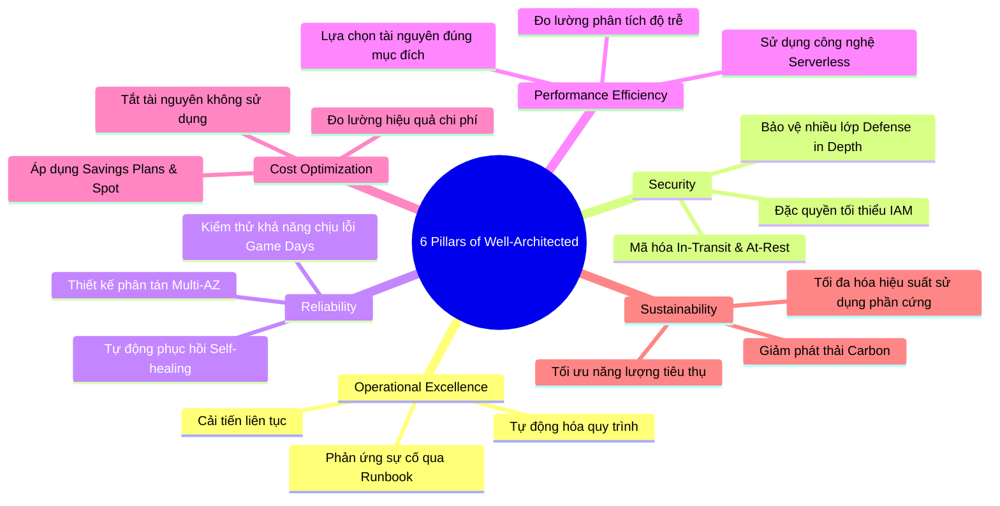
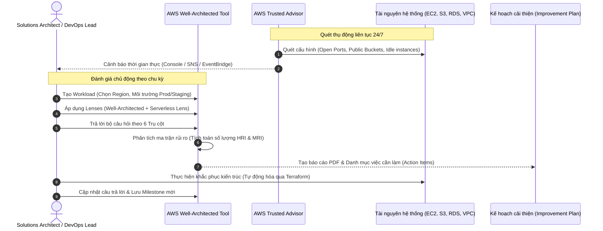

# Tài Liệu Học Tập Chuyên Sâu: AWS Well-Architected Framework, Well-Architected Tool & AWS Trusted Advisor

> **Tài liệu chuẩn hóa kiến trúc đám mây**: Hướng dẫn toàn diện theo tiêu chuẩn Senior AWS Solutions Architect & Cloud DevOps Engineer.  
> **Ngôn ngữ**: Tiếng Việt (Bảo lưu toàn bộ thuật ngữ chuyên ngành tiếng Anh chuẩn AWS).  
> **Các dịch vụ liên quan**: AWS Well-Architected Tool, AWS Trusted Advisor, AWS Architecture Center, AWS Solutions Library.

---

## 6.1. Tổng Quan Dịch Vụ (Service Overview)

### Dịch vụ gì?
- **AWS Well-Architected Framework**: Là bộ khung lý thuyết và tập hợp các nguyên tắc thiết kế tốt nhất (Best Practices) do các chuyên gia hàng đầu của AWS đúc kết qua hàng chục năm kinh nghiệm vận hành hàng triệu hệ thống đám mây trên toàn cầu.
- **AWS Well-Architected Tool**: Là một dịch vụ đám mây có sẵn trên AWS Management Console, đóng vai trò như một cơ chế tự đánh giá (Self-assessment tool) cho phép các kỹ sư trả lời bộ câu hỏi chuẩn hóa để rà soát kiến trúc ứng dụng (Workloads) dựa trên các trụ cột của Framework.
- **AWS Trusted Advisor**: Là một dịch vụ "cố vấn ảo" tự động liên tục theo dõi, quét tài nguyên thực tế bên trong tài khoản AWS của bạn, so sánh với các chuẩn mực vận hành tốt nhất của AWS để đưa ra các khuyến nghị tối ưu tức thời.

### Các vấn đề giải quyết
1. **Loại bỏ sự phỏng đoán trong thiết kế**: Thay vì thiết kế theo thói quen cũ từ hạ tầng On-Premises, kỹ sư có một bộ quy chuẩn rõ ràng để bám sát.
2. **Phát hiện sớm các lỗ hổng kiến trúc nghiêm trọng**: Phát hiện các điểm lỗi đơn lẻ (Single Points of Failure - SPOF), rủi ro bảo mật (Public S3 Buckets, Open Security Group ports) và các tài nguyên gây lãng phí chi phí (Idle EC2 instances, unattached EBS volumes).
3. **Cung cấp lộ trình khắc phục từng bước (Actionable Improvement Plan)**: Không chỉ báo lỗi, hệ thống cung cấp tài liệu kỹ thuật, video và hướng dẫn chi tiết cách sửa đổi từng vấn đề.

### Khi nào nên dùng và khi nào không nên dùng?
- **Khi nào nên dùng**:
  - Khi bắt đầu thiết kế bất kỳ ứng dụng mới nào trên AWS.
  - Định kỳ trước các sự kiện lớn (Flash sale, Black Friday, ra mắt sản phẩm) hoặc trước khi đưa hệ thống lên Production.
  - Khi cần chuẩn hóa kiến trúc đa tài khoản trong doanh nghiệp lớn (Enterprise Landing Zone).
  - Sử dụng Trusted Advisor hàng tuần/hàng tháng để kiểm soát chi phí và bảo mật tài khoản.
- **Khi nào không nên dùng**:
  - Không thể dùng Well-Architected Tool để thay thế các công cụ giám sát thời gian thực (Real-time monitoring như CloudWatch hay Datadog).
  - Không nên phụ thuộc vào Trusted Advisor nếu bạn chỉ dùng gói Basic Support vì hầu hết các kiểm tra chuyên sâu bị khóa.

---

## 6.2. Các Khái Niệm và Thành Phần Cốt Lõi (Core Concepts and Components)

### 1. Sáu Trụ Cột của AWS Well-Architected Framework (The 6 Pillars)



1. **Vận hành xuất sắc (Operational Excellence)**:
   - Tập trung vào việc vận hành và giám sát hệ thống để mang lại giá trị kinh doanh, đồng thời liên tục cải tiến quy trình và thủ tục hỗ trợ.
   - *Nguyên tắc cốt lõi*: Thực hiện các hoạt động dưới dạng mã (Operations as Code), tạo các thay đổi nhỏ có thể đảo ngược thường xuyên, dự đoán trước các thất bại, học hỏi từ mọi sự cố vận hành.
2. **Bảo mật (Security)**:
   - Tập trung vào việc bảo vệ thông tin, dữ liệu và tài sản kỹ thuật số trong khi vẫn mang lại giá trị kinh doanh thông qua các đánh giá rủi ro và chiến lược giảm thiểu.
   - *Nguyên tắc cốt lõi*: Triển khai nền tảng định danh vững chắc, duy trì khả năng truy vết (Traceability), áp dụng bảo mật ở mọi tầng (Layered Security), tự động hóa các biện pháp thực hành bảo mật tốt nhất.
3. **Độ tin cậy (Reliability)**:
   - Năng lực của hệ thống phục hồi sau các gián đoạn hạ tầng hoặc dịch vụ, tự động cấp phát tài nguyên tính toán để đáp ứng nhu cầu và giảm thiểu các sự cố gián đoạn như cấu hình sai hoặc sự cố mạng tạm thời.
   - *Nguyên tắc cốt lõi*: Tự động phục hồi sau lỗi, kiểm tra quy trình phục hồi, mở rộng theo chiều ngang để tăng tính sẵn sàng của toàn hệ thống, ngừng phỏng đoán dung lượng.
4. **Hiệu quả hiệu năng (Performance Efficiency)**:
   - Khả năng sử dụng tài nguyên điện toán hiệu quả để đáp ứng các yêu cầu của hệ thống và duy trì hiệu quả đó khi nhu cầu thay đổi cũng như công nghệ tiến hóa.
   - *Nguyên tắc cốt lõi*: Dân chủ hóa các công nghệ tiên tiến (tận dụng dịch vụ được quản lý thay vì tự cài đặt), vươn ra toàn cầu trong vài phút, sử dụng kiến trúc phi máy chủ (Serverless).
5. **Tối ưu chi phí (Cost Optimization)**:
   - Khả năng chạy các hệ thống để mang lại giá trị kinh doanh với mức giá thấp nhất có thể.
   - *Nguyên tắc cốt lõi*: Áp dụng văn hóa quản lý tài chính đám mây (FinOps), đo lường hiệu quả tổng thể, ngừng trả tiền cho dung lượng máy chủ nhàn rỗi, phân tích và quy trách nhiệm chi tiêu (Tagging).
6. **Tính bền vững (Sustainability)**:
   - Tập trung vào việc giảm thiểu các tác động môi trường của việc vận hành các khối lượng công việc trên đám mây.
   - *Nguyên tắc cốt lõi*: Hiểu rõ tác động của bạn, thiết lập các mục tiêu phát thải, tối đa hóa tỷ lệ sử dụng tài nguyên (Utilization), liên tục đón nhận các nền tảng phần cứng và phần mềm tiết kiệm năng lượng mới (như chip AWS Graviton).

### 2. Các thành phần trong AWS Well-Architected Tool
- **Workload**: Khối lượng công việc đại diện cho một ứng dụng hoặc tập hợp các dịch vụ cùng phục vụ một mục tiêu nghiệp vụ cụ thể.
- **Lens (Thấu kính)**: Tập hợp các câu hỏi và hướng dẫn chuyên biệt. Lens mặc định bao quát 6 trụ cột; các lens bổ sung tập trung sâu vào từng bài toán kỹ thuật: *Serverless Lens*, *SaaS Lens*, *Machine Learning Lens*, *Data Analytics Lens*.
- **Milestone (Mốc kiểm soát)**: Ảnh chụp nhanh (Snapshot) ghi nhận trạng thái đánh giá kiến trúc tại một thời điểm xác định, giúp theo dõi sự tiến bộ trước và sau khi thực hiện cải tiến.
- **High Risk Issues (HRI) & Medium Risk Issues (MRI)**: Các mức độ rủi ro được phát hiện khi câu trả lời không đáp ứng được các thực hành chuẩn mực của AWS.

---

## 6.3. Kiến Trúc và Luồng Vận Hành (Architecture and Workflow)

### Sơ đồ quy trình đánh giá kiến trúc với Well-Architected Tool & Trusted Advisor



### Giải thích luồng vận hành chi tiết:
1. **Bước 1 (Định nghĩa Workload)**: Đội ngũ kỹ sư khai báo hệ thống trên Well-Architected Tool, chỉ định rõ tài khoản sở hữu, các Region đang hoạt động và người chịu trách nhiệm kỹ thuật (Review Owner).
2. **Bước 2 (Đánh giá theo Lens)**: Đội ngũ trả lời các câu hỏi trắc nghiệm kèm theo ghi chú kiến trúc. Các câu hỏi phân bổ trên 6 trụ cột.
3. **Bước 3 (Xác định rủi ro)**: Hệ thống tổng hợp các câu trả lời chưa đạt và phân loại thành **High Risk Issues** (rủi ro nghiêm trọng đe dọa bảo mật hoặc tính khả dụng) và **Medium Risk Issues**.
4. **Bước 4 (Kết hợp dữ liệu Trusted Advisor)**: Trong quá trình đánh giá, kiến trúc sư đối chiếu với các cảnh báo thực tế từ Trusted Advisor để đảm bảo các câu trả lời phản ánh đúng thực tế hạ tầng.
5. **Bước 5 (Kế hoạch hành động)**: Xuất báo cáo PDF gửi lãnh đạo và tạo backlog công việc cho đội DevOps triển khai bằng mã nguồn (IaC).

---

## 6.4. Bảng Tích Hợp với Các Dịch Vụ AWS Khác (Integration Table)

| Related AWS Service | Purpose (Mục đích tích hợp) | Integration Method (Phương thức tích hợp) | Practical Example (Ví dụ thực tiễn) |
| :--- | :--- | :--- | :--- |
| **AWS Organizations** | Quản lý đánh giá tập trung cho toàn bộ các tài khoản trong doanh nghiệp | Chia sẻ Workload qua RAM (Resource Access Manager) | Đội ngũ Cloud Security trung tâm tạo bộ Custom Lens và chia sẻ xuống toàn bộ 50 tài khoản con của các dự án. |
| **Amazon EventBridge** | Tự động hóa phản ứng khi Trusted Advisor phát hiện rủi ro mới | Event Pattern bắt sự kiện từ Trusted Advisor | Khi Trusted Advisor phát hiện S3 Bucket bị mở Public, EventBridge kích hoạt hàm Lambda để tự động bật S3 Block Public Access. |
| **AWS CloudWatch** | Giám sát các chỉ số HRI/MRI và thông báo định kỳ | CloudWatch Alarms & Dashboards | Vẽ biểu đồ số lượng High Risk Issues theo thời gian trên CloudWatch Dashboard của ban giám đốc công nghệ (CTO). |
| **AWS CloudFormation / Terraform** | Khai báo Workload và khắc phục kiến trúc tự động bằng mã | AWS Provider / CloudFormation Resource | Sử dụng resource `aws_wellarchitected_workload` để tự động khởi tạo Workload review ngay khi pipeline dựng xong môi trường. |
| **AWS Support API** | Truy vấn lập trình kết quả kiểm tra của Trusted Advisor | Boto3 / AWS CLI Support client | Viết script Python chạy định kỳ trong Jenkins xuất file Excel báo cáo chi phí lãng phí từ Trusted Advisor gửi qua Slack. |

---

## 6.5. Ví Dụ Cấu Hình và Triển Khai (Configuration & Implementation)

### 1. Truy vấn các bài kiểm tra rủi ro cao từ Trusted Advisor bằng AWS CLI
*(Yêu cầu: Gói hỗ trợ Business hoặc Enterprise Support)*

```bash
# Lấy danh sách toàn bộ các bài kiểm tra thuộc danh mục Bảo mật (Security)
aws support describe-trusted-advisor-checks \
    --language en \
    --query "checks[?category=='security'].{ID:id, Name:name}" \
    --output table

# Kiểm tra trạng thái của bài kiểm tra "Security Groups - Specific Ports Unrestricted"
# Check ID: 03 exclusion check hoặc tương đương
aws support describe-trusted-advisor-check-result \
    --check-id "H7M05luVSS" \
    --language en \
    --query "result.{Status:status, FlaggedResources:flaggedResources[].metadata}"
```

### 2. Tự động đóng cổng Security Group bị cảnh báo bởi Trusted Advisor qua Lambda (Minh họa Bổ sung)

```python
import boto3
import json

ec2 = boto3.client('ec2')

def lambda_handler(event, context):
    """
    Hàm Lambda tự động kích hoạt bởi EventBridge khi Trusted Advisor
    phát hiện Security Group mở cổng 22 (SSH) ra 0.0.0.0/0
    """
    detail = event.get('detail', {})
    check_name = detail.get('check-name', '')
    
    print(f"Nhận cảnh báo từ Trusted Advisor: {check_name}")
    # Đọc thông tin resource bị gắn cờ và thu hồi rule vi phạm
    # (Áp dụng nguyên tắc Security Automation của Well-Architected)
    return {
        'statusCode': 200,
        'body': json.dumps('Da tiep nhan va xu ly canh bao bao mat!')
    }
```

---

## 6.6. Bảo Mật (Security)

- **Xác thực và phân quyền (Authentication & Authorization)**:
  - Quyền truy cập vào Well-Architected Tool được kiểm soát chặt chẽ thông qua IAM action: `wellarchitected:*`.
  - Phân quyền theo nguyên tắc đặc quyền tối thiểu: Kỹ sư thông thường chỉ có quyền `wellarchitected:GetWorkload` và `wellarchitected:AnswerQuestion`, trong khi Quản trị viên mới có quyền `wellarchitected:CreateWorkload` hoặc `DeleteWorkload`.
- **Bảo mật dữ liệu đánh giá**:
  - Toàn bộ câu trả lời, ghi chú kiến trúc và tài liệu đính kèm bên trong Well-Architected Tool được mã hóa tự động ở trạng thái lưu trữ (Encryption at Rest) bằng khóa AWS KMS (hỗ trợ cả AWS Managed Key và Customer Managed Key - CMK).
- **Kiểm toán hoạt động**:
  - Mọi thao tác tạo workload, cập nhật câu trả lời, chia sẻ lens đều được ghi lại đầy đủ trong AWS CloudTrail phục vụ kiểm tra tuân thủ.

---

## 6.7. Độ Tin Cậy và Vận Hành (Reliability and Operations)

- **Tính khả dụng cao của dịch vụ**:
  - Well-Architected Tool và Trusted Advisor là các dịch vụ được AWS quản lý toàn diện (Fully Managed Services) trên hạ tầng phân tán đa AZ, đảm bảo độ sẵn sàng 99.9% mà không cần người dùng can thiệp cấu hình.
- **Khả năng chia sẻ tài nguyên xuyên tài khoản (Cross-account Workload Sharing)**:
  - Cho phép chia sẻ Workload giữa các tài khoản AWS khác nhau mà không cần chia sẻ thông tin đăng nhập IAM, sử dụng **AWS Resource Access Manager (AWS RAM)**. Điều này giúp đội ngũ tư vấn kiến trúc có thể rà soát hệ thống của khách hàng một cách độc lập và an toàn.

---

## 6.8. Khả Năng Quan Sát (Observability)

- **Theo dõi tiến độ hoàn thiện kiến trúc**:
  - Well-Architected Tool cung cấp tính năng **Milestones**. Khi đội ngũ kỹ sư hoàn thành một đợt tái cấu trúc (Sprint), họ tạo một Milestone để lưu lại ảnh chụp nhanh. Biểu đồ trong Tool sẽ hiển thị rõ số lượng High Risk Issues giảm dần theo từng mốc thời gian.
- **Tích hợp thông báo cảnh báo**:
  - Trusted Advisor tích hợp trực tiếp với **Amazon EventBridge**. Bất kỳ khi nào một bài kiểm tra chuyển trạng thái từ `Green (OK)` sang `Yellow (Warning)` hoặc `Red (Error)`, một sự kiện sẽ được bắn ra để kích hoạt gửi thông báo qua Slack/Email hoặc kích hoạt quy trình khắc phục tự động.

---

## 6.9. Mô Hình Quản Trị Chi Phí & Bộ Công Cụ Tối Ưu Hóa Ngân Sách AWS (AWS Cost Management Tools & Optimization Strategies)

Trụ cột Tối ưu hóa Chi phí (Cost Optimization Pillar) trong AWS Well-Architected Framework khẳng định: *"Doanh nghiệp không nên trả tiền cho tài nguyên nhàn rỗi hoặc cấu hình dư thừa"*. Để đạt được mục tiêu này, AWS cung cấp một hệ sinh thái các công cụ giám sát, phân bổ, dự báo và tự động hóa kiểm soát tài chính. Nắm vững cơ chế tính phí của chính các công cụ quản lý chi phí này giúp doanh nghiệp triển khai quản trị tài chính đám mây (FinOps) hiệu quả và hoàn toàn chủ động.

### 6.9.1. Bảng Cấu Trúc Định Giá Của Bộ Công Cụ Quản Lý Chi Phí AWS (Cost Management Suite Pricing)

| Công Cụ Quản Lý Chi Phí | Có tính phí hay Miễn phí? | Cơ chế tính phí chi tiết (Pricing Dimensions) | Mức phí tham chiếu điển hình | Lưu ý rủi ro chi phí (Cost Pitfalls) |
| :--- | :--- | :--- | :--- | :--- |
| **AWS Well-Architected Tool** | **MIỄN PHÍ 100%** | Tạo không giới hạn Workloads, áp dụng mọi Custom/Official Lenses, ghi nhận Milestones. | **$0.00** | Không có rủi ro chi phí dịch vụ. |
| **AWS Cost Explorer** | Miễn phí trên Console | 1. **Giao diện Console & Báo cáo đồ họa**: **MIỄN PHÍ 100%**.<br>2. **Cost Explorer API**: Tính theo số lượt gọi API truy vấn dữ liệu chi phí theo chương trình. | - Web Console: **$0.00**.<br>- **Cost Explorer API**: **$0.01 / request** (`GetCostAndUsage`). | Viết script chạy vòng lặp liên tục gọi Cost Explorer API hàng ngàn lần mỗi ngày thay vì lưu cache dữ liệu hoặc chuyển sang dùng Cost and Usage Report (CUR). |
| **AWS Budgets** | Miễn phí 2 budgets đầu | 1. **Hạn mức miễn phí (Free Tier)**: 2 budgets đầu tiên của tài khoản được **MIỄN PHÍ vĩnh viễn**.<br>2. **Budgets tiếp theo**: Tính theo ngày duy trì ngân sách.<br>3. **AWS Budget Actions**: Miễn phí cấu hình hành động tự động. | - 2 Budgets đầu: **$0.00**.<br>- Từ budget thứ 3 trở đi: **$0.02 / budget / ngày** (~$0.60/tháng/budget). | Tạo hàng trăm Budgets chi tiết cho từng loại tag hoặc service nhỏ lẻ mà không theo dõi, làm phát sinh hóa đơn hàng chục USD tiền duy trì Budgets. |
| **AWS Cost Anomaly Detection** | **MIỄN PHÍ 100%** | Dịch vụ ứng dụng học máy (Machine Learning) để liên tục phân tích mẫu hình chi tiêu và tự động cảnh báo các đợt tăng vọt chi phí bất thường (Cost Spikes). | **$0.00** (Hoàn toàn miễn phí cho mọi tài khoản). | Không kích hoạt tính năng này dẫn đến việc máy chủ bị tấn công hoặc cấu hình sai gây bill shock hàng chục ngàn USD mà nhiều ngày sau mới phát hiện. |
| **AWS Compute Optimizer** | **MIỄN PHÍ 100%** | Phân tích metric CloudWatch của EC2, EBS, Lambda, Auto Scaling Groups để đưa ra đề xuất nâng/hạ cấu hình tối ưu (Right-sizing). | **$0.00** (Bản quyền nâng cao Enhanced Metrics có phụ phí nhỏ nếu bật). | Bỏ qua các khuyến nghị của Compute Optimizer khiến hệ thống duy trì các máy chủ quá cỡ (Over-provisioned) lãng phí 40-60% ngân sách điện toán. |
| **AWS Trusted Advisor** | Chia theo gói Support | 1. **Basic / Developer Support**: Miễn phí Core Checks (Bảo mật cơ bản và hạn mức Service Limits).<br>2. **Business / Enterprise Support**: Mở khóa toàn bộ 100+ bài kiểm tra chuyên sâu về Cost Optimization, Fault Tolerance, Performance. | - Basic: **$0.00**.<br>- Business Support: Tối thiểu **$100/tháng** hoặc theo % hóa đơn AWS hàng tháng. | Nâng cấp lên Business Support chỉ để xem Trusted Advisor trong khi có thể dùng Compute Optimizer và Cost Explorer miễn phí để tối ưu chi phí. |
| **AWS Cost & Usage Report (CUR)** | Miễn phí báo cáo | Bản thân việc tạo và cập nhật file dữ liệu báo cáo CUR chi tiết vào S3 là **MIỄN PHÍ**. Khách hàng chỉ trả tiền lưu trữ file trên S3 và tiền truy vấn Athena. | - CUR Generation: **$0.00**.<br>- S3 & Athena Query: Theo giá tiêu chuẩn ($5/TB quét). | Lưu CUR dưới định dạng CSV không nén và không phân vùng khiến việc truy vấn tốn thời gian và dung lượng quét Athena lớn. |

---

### 6.9.2. 5 Kịch Bản Tối Ưu Hóa Chi Phí Kiến Trúc Thực Tế (Architectural Cost Optimization Use Cases)

#### Use Case 1: Tự động hóa kiểm soát ngân sách bằng AWS Budgets Actions (Auto-Stop EC2 khi chạm 100% ngân sách)
- **Bối cảnh**: Doanh nghiệp cấp tài khoản Sandbox cho đội ngũ Nghiên cứu & Phát triển (R&D) với hạn mức ngân sách tối đa là **$500/tháng**. Trước đây, các kỹ sư thường quên tắt các cụm GPU (`p3.8xlarge`) hoặc cụm Redshift sau giờ làm việc, dẫn đến hóa đơn vượt ngưỡng lên tới **$2,500 - $4,000/tháng**.
- **Giải pháp tối ưu**:
  - Tạo một **AWS Cost Budget** với hạn mức cố định $500/tháng.
  - Cấu hình 3 mốc cảnh báo (Alerts):
    - Mốc 1 (80% ngân sách dự báo - Forecasted): Gửi email cảnh báo cho Tech Lead.
    - Mốc 2 (90% ngân sách thực tế - Actual): Bắn thông báo khẩn cấp vào kênh Slack `#finops-alerts` qua Amazon SNS.
    - Mốc 3 (**100% ngân sách thực tế - Actual**): Kích hoạt **AWS Budget Action**:
      - Tự động thực thi hành động: Gắn một IAM Policy với câu lệnh `Explicit Deny` đối với hành động `ec2:RunInstances`, và tự động gọi API **dừng toàn bộ các máy ảo EC2 đang chạy (Stop EC2 Instances)** trong tài khoản Sandbox!
- **Hiệu quả kinh tế**:
  - Triệt tiêu 100% nguy cơ vượt ngân sách ngoài ý muốn (Bill Shock). Ngân sách được khóa chặt dưới ngưỡng $500/tháng mà không cần con người can thiệp thủ công.

#### Use Case 2: Kích hoạt AWS Cost Anomaly Detection kết hợp SNS gửi cảnh báo tức thì về Slack/Teams
- **Bối cảnh**: Một lỗi trong kịch bản triển khai Terraform vô tình tạo ra vòng lặp vô tận (Infinite Loop) trong hàm AWS Lambda ghi dữ liệu vào Amazon DynamoDB, khiến số lượng yêu cầu ghi tăng vọt lên hàng chục triệu request mỗi giờ. Nếu chỉ dựa vào hóa đơn cuối tháng, doanh nghiệp sẽ phải gánh chịu thiệt hại tài chính khổng lồ.
- **Giải pháp tối ưu**:
  - Kích hoạt **AWS Cost Anomaly Detection** (hoàn toàn **MIỄN PHÍ $0.00**).
  - Tạo một **Cost Monitor** theo dõi toàn bộ tài khoản (`AWS Services`), kết hợp một **Anomaly Subscription**:
    - Ngưỡng phát hiện: Bất kỳ khoản chi phí phát sinh bất thường vượt quá **$50** hoặc vượt quá **40% mức chi tiêu dự kiến**.
    - Kênh nhận cảnh báo: Tích hợp với **Amazon SNS Topic**, kết nối tới AWS Chatbot để bắn trực tiếp cảnh báo kèm phân tích nguyên nhân gốc rễ (Root Cause Analysis: Service gây đột biến, Region, Account ID) vào kênh Slack nội bộ trong vòng chưa đầy **15 phút**.
- **Hiệu quả kinh tế**:
  - Giúp đội ngũ kỹ thuật phát hiện và tiêu diệt lỗi rò rỉ chi phí chỉ sau 30 phút, bảo vệ doanh nghiệp khỏi các sự cố tài chính đột biến trị giá hàng chục ngàn USD.

#### Use Case 3: Áp dụng toàn diện đề xuất của AWS Compute Optimizer cho EC2, EBS và Lambda
- **Bối cảnh**: Doanh nghiệp vận hành 80 máy chủ EC2 On-Demand loại `m5.2xlarge` (8 vCPU, 32 GB RAM) cho các dịch vụ web nội bộ. Hầu hết các máy chủ này được cấu hình theo thói quen "thừa hơn thiếu".
- **Phân tích hiện trạng**:
  - Chi phí hiện tại: 80 máy * $0.384/giờ * 730 giờ = **$22,425/tháng**.
- **Giải pháp tối ưu**:
  - Kích hoạt **AWS Compute Optimizer** (hoàn toàn **MIỄN PHÍ $0.00**).
  - Compute Optimizer ứng dụng công nghệ học máy phân tích dữ liệu hiệu năng CloudWatch (CPU, Memory qua CloudWatch Agent, Disk I/O, Network) trong suốt 14 ngày qua:
    - Báo cáo chỉ ra: 65 máy chủ đang ở trạng thái **Over-provisioned** (Mức sử dụng CPU tối đa P99 chưa bao giờ vượt quá 12% và RAM dưới 25%).
    - Đề xuất: Hạ kích thước từ `m5.2xlarge` xuống `m5.large` (2 vCPU, 8 GB RAM) hoặc chuyển sang thế hệ Graviton `m7g.large` với hiệu năng trên giá thành vượt trội.
  - Tương tự, Compute Optimizer rà soát các ổ đĩa EBS và đề xuất chuyển các ổ đĩa `io2` dư thừa IOPS sang `gp3` với chi phí rẻ hơn 50%.
- **Hiệu quả kinh tế**:
  - Chi phí 65 máy chủ sau khi hạ kích thước: 65 * $0.096/giờ * 730 = $4,555/tháng.
  - Chi phí 15 máy chủ còn lại giữ nguyên: 15 * $0.384/giờ * 730 = $4,204/tháng.
  - Tổng chi phí điện toán mới: **$8,759/tháng**.
  - **Tiết kiệm ngay $13,666/tháng ($163,992/năm, giảm 61% chi phí máy chủ)** mà hiệu năng ứng dụng hoàn toàn không bị ảnh hưởng.

#### Use Case 4: Phân bổ và quản trị chi phí đa phòng ban bằng Cost Allocation Tags & Cost Categories
- **Bối cảnh**: Doanh nghiệp có 1 tài khoản AWS dùng chung cho 5 trung tâm kinh doanh (E-Commerce, FinTech, Logistics, HR, Marketing). Hàng tháng, phòng Tài chính nhận một hóa đơn tổng $50,000 nhưng hoàn toàn bất lực trong việc xác định phòng ban nào đã tiêu tốn bao nhiêu tiền, dẫn đến hiện tượng đùn đẩy trách nhiệm ngân sách.
- **Giải pháp tối ưu**:
  - Ban hành chính sách gắn thẻ bắt buộc (**Tagging Governance via AWS Organizations Tag Policies**):
    - Mọi tài nguyên tạo ra bắt buộc phải có các thẻ chuẩn: `Environment` (Prod/Staging/Dev), `Department` (Finance/Logistics...), `CostCenter` (CC101, CC102...), `OwnerEmail`.
  - Kích hoạt các thẻ này trong mục **Cost Allocation Tags** trên AWS Billing Console (cả User-Defined Tags và AWS-Generated Tags).
  - Sử dụng **AWS Cost Categories** để gom nhóm các quy tắc phân bổ chi phí phức tạp (ví dụ: chi phí các dịch vụ dùng chung như Transit Gateway, Shared ALB được chia theo tỷ lệ phần trăm người dùng cho từng phòng ban).
- **Hiệu quả kinh tế**:
  - Minh bạch hóa 100% dòng tiền đám mây (Showback / Chargeback). Từng giám đốc phòng ban nhận báo cáo chi tiêu chính xác đến từng cent, từ đó chủ động cắt giảm các tài nguyên thử nghiệm lãng phí của đội ngũ mình.

#### Use Case 5: Xây dựng Data Lake phân tích chi phí chuyên sâu bằng AWS CUR + Athena + Amazon QuickSight
- **Bối cảnh**: Với các tập đoàn quy mô lớn có hàng triệu tài nguyên và hàng trăm tài khoản AWS, giao diện web của Cost Explorer bị giới hạn: chỉ hiển thị tối đa 14 tháng lịch sử, không cho phép truy vấn độ phân giải theo từng giây hoặc phân tích sâu đến cấp độ từng resource ID / request ID cụ thể.
- **Giải pháp tối ưu**:
  - Thiết lập **AWS Cost and Usage Report (CUR)**:
    - Bật tùy chọn xuất báo cáo chi tiết nhất (Resource IDs, Split Cost Allocation Data cho ECS/EKS).
    - Chọn định dạng lưu trữ nén **Apache Parquet** và tích hợp sẵn với Amazon Athena.
    - AWS tự động cập nhật file CUR vào một S3 Bucket mỗi vài giờ **hoàn toàn MIỄN PHÍ**.
  - Sử dụng **Amazon Athena** để chạy các truy vấn SQL phân tích chuyên sâu:
    ```sql
    -- Tìm 10 tài nguyên EC2 tốn kém nhất trong tháng hiện tại
    SELECT line_item_resource_id, sum(line_item_unblended_cost) AS total_cost
    FROM cur_database.cur_table
    WHERE line_item_product_code = 'AmazonEC2' AND year = '2026' AND month = '10'
    GROUP BY line_item_resource_id
    ORDER BY total_cost DESC
    LIMIT 10;
    ```
  - Kết nối dữ liệu từ Athena sang **Amazon QuickSight** để xây dựng bảng điều khiển FinOps tương tác trực quan cho Hội đồng Quản trị và các Giám đốc Kỹ thuật (CTO/CFO).
- **Hiệu quả kinh tế**:
  - Cung cấp khả năng phân tích chi phí ở cấp độ hạt nhân (Granular Cost Analytics) với chi phí hạ tầng cực thấp (chỉ vài USD cho S3 và Athena), giúp tối ưu hóa chi tiêu liên tục ở quy mô hàng triệu USD.

---

## 6.10. Khắc Phục Sự Cố Thực Tế (Troubleshooting Guide)

| Vấn đề (Problem) | Nguyên nhân khả dĩ (Possible Causes) | Các bước điều tra (Investigation Steps) | Giải pháp (Solution) | Biện pháp phòng ngừa (Prevention) |
| :--- | :--- | :--- | :--- | :--- |
| **Không thấy các bài kiểm tra Cost & Performance trong Trusted Advisor** | Tài khoản đang ở gói Basic hoặc Developer Support. | Kiểm tra mục Support Plan trong AWS Console. | Nâng cấp lên gói Business Support hoặc Enterprise Support nếu doanh nghiệp cần kiểm tra toàn diện. | Sử dụng AWS Cost Explorer hoặc AWS Compute Optimizer để bù đắp nếu chưa thể nâng cấp Support Plan. |
| **Lỗi `AccessDeniedException` khi gọi AWS Support API qua CLI** | Thiếu quyền IAM hoặc tài khoản không có gói Business/Enterprise Support. | 1. Kiểm tra IAM Policy của caller có `support:*` chưa.<br>2. Kiểm tra gói hỗ trợ của tài khoản. | Gán quyền IAM phù hợp và đảm bảo tài khoản đáp ứng điều kiện gói hỗ trợ. | Kiểm tra quyền qua IAM Policy Simulator trước khi viết script tự động hóa. |
| **Không thể chia sẻ Workload cho tài khoản AWS khác** | Tài khoản nhận chưa chấp nhận lời mời chia sẻ trong AWS RAM hoặc khác Organization. | Kiểm tra trang Resource Access Manager (RAM) trong tài khoản đích xem có lời mời đang chờ (Pending) không. | Vào AWS RAM ở tài khoản đích và nhấp "Accept Resource Share". | Bật tính năng chia sẻ trong nội bộ Organization để tự động chấp thuận. |
| **Well-Architected Tool báo quá nhiều High Risk Issues không chính xác** | Người đánh giá chọn nhầm các tùy chọn chưa áp dụng hoặc chưa hiểu rõ câu hỏi. | Xem lại chi tiết từng câu trả lời trong Improvement Plan. | Tổ chức buổi rà soát chung giữa Solutions Architect và Tech Lead của dự án để đánh giá lại trung thực. | Định kỳ tổ chức workshop đào tạo nội bộ về 6 trụ cột Well-Architected. |

---

## 6.11. Các Kịch Bản Sử Dụng Trong Thực Tế (Real-World Use Cases)

### Kịch bản 1: Người mới bắt đầu (Beginner / Start-up)
- **Bối cảnh**: Một công ty khởi nghiệp chuẩn bị ra mắt ứng dụng web thương mại điện tử đầu tiên trên AWS.
- **Giải pháp**: 
  - Đội ngũ mở **AWS Trusted Advisor** để kiểm tra ngay các cảnh báo miễn phí: phát hiện 1 S3 Bucket chứa tài liệu nội bộ đang bị mở public và 1 Security Group mở cổng 22 cho cả thế giới.
  - Sửa ngay lập tức hai lỗ hổng này trước ngày mở bán.

### Kịch bản 2: Đội ngũ Cloud DevOps (DevOps Pipeline Integration)
- **Bối cảnh**: Doanh nghiệp có 20 nhóm phát triển phần mềm độc lập liên tục triển khai microservices lên AWS.
- **Giải pháp**:
  - Đội DevOps thiết lập một pipeline kiểm tra tuân thủ tự động.
  - Sử dụng **AWS EventBridge** để lắng nghe các phát hiện mới từ **AWS Trusted Advisor**.
  - Khi có phát hiện vi phạm bảo mật (ví dụ: EBS volume không được mã hóa), EventBridge tự động chuyển tiếp thông báo vào kênh `#devops-security-alerts` trên Slack kèm theo đường link tài nguyên vi phạm.

### Kịch bản 3: Kiến trúc Doanh nghiệp Lớn (Enterprise Production Review)
- **Bối cảnh**: Ngân hàng số chuẩn bị chuyển đổi hệ thống Core Banking lên nền tảng đám mây AWS.
- **Giải pháp**:
  - Đội ngũ Solutions Architect sử dụng **AWS Well-Architected Tool** kết hợp cả hai thấu kính: *Well-Architected Framework Lens* và *Financial Services Lens*.
  - Thực hiện đánh giá chuyên sâu qua 6 trụ cột, phát hiện 12 High Risk Issues về tính chịu lỗi (Reliability) và bảo mật dữ liệu (Security).
  - Xuất báo cáo PDF Improvement Plan để trình Hội đồng Kiến trúc và ban hành kế hoạch khắc phục 3 tháng trước ngày Golive.
  - Tham khảo **AWS Architecture Center** để áp dụng kiến trúc chuẩn về Database Disaster Recovery cho cơ sở dữ liệu quan hệ.

---

## 6.12. So Sánh và Đưa Ra Quyết Định Kỹ Thuật (Comparisons & Trade-offs)

### Bảng so sánh các công cụ rà soát và đánh giá kiến trúc

| Tiêu chí so sánh | AWS Well-Architected Tool | AWS Trusted Advisor | AWS Security Hub | AWS Config |
| :--- | :--- | :--- | :--- | :--- |
| **Bản chất công cụ** | Đánh giá kiến trúc chủ động dựa trên bộ câu hỏi (Questionnaire-driven) | Cố vấn tự động dựa trên quét tài nguyên đám mây (Rules-based check) | Quản lý tư thế an ninh và tuân thủ chuẩn an toàn (Security Posture Management) | Theo dõi lịch sử thay đổi cấu hình tài nguyên và kiểm tra tuân thủ luật (Config Rules) |
| **Cách thức thu thập dữ liệu** | Con người trả lời và nhập liệu | Quét tự động ngầm tài nguyên thực tế | Tổng hợp dữ liệu từ GuardDuty, Inspector, Macie, Firewall | Đọc các sự kiện thay đổi cấu hình từ AWS CloudTrail |
| **Phạm vi đánh giá** | Bao quát toàn diện 6 trụ cột (Kỹ thuật + Quy trình + Tổ chức) | 6 danh mục tối ưu hóa tài nguyên (Thiên về hạ tầng vật lý) | Chuyên sâu 100% về An ninh thông tin & Tuân thủ (CIS, PCI-DSS) | Đánh giá từng tài nguyên riêng lẻ theo các rule cấu hình cụ thể |
| **Chi phí** | 100% Miễn phí | Miễn phí Core Checks; Trả phí qua gói Business/Enterprise Support | Trả phí theo số lượng kiểm tra bảo mật (Security Checks) | Trả phí theo số lượng bản ghi cấu hình (Configuration Items) |
| **Thời điểm sử dụng tốt nhất** | Thiết kế ban đầu, nghiệm thu dự án, rà soát định kỳ hàng quý | Kiểm tra nhanh hàng tuần để dọn dẹp tài nguyên lãng phí và lỗ hổng | Giám sát an ninh tập trung 24/7 cho toàn bộ tổ chức | Kiểm toán tuân thủ tự động và ngăn chặn cấu hình sai lệch (Drift) |

---

## 6.13. Bộ Câu Hỏi Ôn Tập và Kiểm Tra Kiến Thức (Knowledge Review)

### A. 10 Câu hỏi về Khái niệm Cốt lõi (Core Concepts)
1. Hãy liệt kê tên đầy đủ của 6 Trụ cột trong AWS Well-Architected Framework?
2. Trụ cột nào nhấn mạnh nguyên tắc "Tạo các thay đổi nhỏ có thể hoàn nguyên thường xuyên" (Make frequent, small, reversible changes)?
3. Trụ cột Tính bền vững (Sustainability) khuyến khích các kiến trúc sư thực hiện điều gì liên quan đến phần cứng máy chủ?
4. Định nghĩa khái niệm "Workload" trong AWS Well-Architected Tool?
5. "Lens" trong Well-Architected Tool đóng vai trò gì?
6. Người dùng gói hỗ trợ AWS Basic Support có thể xem được những hạng mục nào trong AWS Trusted Advisor?
7. Sự khác nhau giữa rủi ro mức độ cao (HRI) và rủi ro mức độ trung bình (MRI) trong Well-Architected Tool là gì?
8. Khái niệm "Milestone" trong Well-Architected Tool dùng để làm gì?
9. Dịch vụ nào cho phép bạn tải về các template CloudFormation hoàn chỉnh đã được kiểm định để triển khai ngay các kiến trúc phức tạp?
10. Tại sao nói 6 trụ cột của Well-Architected mang tính chất "Hiệp đồng" (Synergy) thay vì "Đánh đổi" (Trade-off)?

### B. 5 Câu hỏi về Xử lý Sự cố (Troubleshooting)
11. Một kỹ sư DevOps cố gắng gọi lệnh `aws support describe-trusted-advisor-checks` nhưng nhận được lỗi `SubscriptionRequiredException`. Nguyên nhân là gì và cách giải quyết?
12. Trusted Advisor hiển thị cảnh báo đỏ ở mục "Amazon S3 Bucket Permissions". Điều này cảnh báo về rủi ro cụ thể nào và bạn cần kiểm tra điều gì trong S3?
13. Bạn muốn tự động hóa việc nhận thông báo khi có một bài kiểm tra trong Trusted Advisor chuyển sang trạng thái cảnh báo vàng hoặc đỏ. Bạn sẽ thiết kế giải pháp như thế nào?
14. Trong Well-Architected Tool, sau khi đã hoàn thành việc rà soát và khắc phục các điểm High Risk, làm thế nào để lưu lại bằng chứng đã đạt chuẩn tại thời điểm đó?
15. Một nhóm phát triển phàn nàn rằng họ không thể thấy Workload mà Trưởng nhóm kiến trúc đã tạo trên tài khoản trung tâm. Cần kiểm tra cấu hình dịch vụ nào?

### C. 3 Câu hỏi Tình huống Kiến trúc (Scenario-based)
16. **Tình huống 1**: Một doanh nghiệp tài chính đang chuẩn bị kiểm toán an ninh để lấy chứng chỉ tuân thủ. Giám đốc CNTT muốn biết nhanh chóng xem tài khoản AWS của họ có đang để lộ các cổng cơ sở dữ liệu (cổng 3306, 5432) hay các cổng quản trị (cổng 22, 3389) ra ngoài Internet hay không mà không cần phải bấm vào kiểm tra từng Security Group. Bạn sẽ tư vấn cho họ sử dụng công cụ nào và mục nào?
17. **Tình huống 2**: Một công ty phần mềm SaaS đang chuyển đổi toàn bộ kiến trúc từ monolithic EC2 sang Serverless (Lambda, API Gateway, DynamoDB). Họ muốn đánh giá xem kiến trúc mới có đáp ứng các tiêu chuẩn bảo mật, co giãn và xử lý lỗi chuyên biệt cho Serverless hay không. Bạn hướng dẫn họ sử dụng công cụ nào và áp dụng tính năng gì?
18. **Tình huống 3**: Đội ngũ FinOps muốn cắt giảm 20% chi phí đám mây ngay trong tháng tới. Trong tài khoản AWS có hàng trăm tài nguyên đang chạy. Công cụ nào cung cấp danh sách cụ thể các tài nguyên nhàn rỗi (idle resources) kèm số tiền tiết kiệm ước tính mà không cần cài đặt thêm agent?

### D. 5 Câu hỏi Phỏng vấn AWS Solutions Architect (Interview Questions)
19. *"Bạn hiểu thế nào về nguyên tắc 'Stop guessing your capacity needs' trong Well-Architected Framework, và bạn áp dụng nó như thế nào vào thực tế triển khai trên AWS?"*
20. *"Hãy phân biệt vai trò của AWS Well-Architected Tool và AWS Trusted Advisor trong một quy trình vận hành đám mây chuẩn mực?"*
21. *"Trong trụ cột Vận hành xuất sắc (Operational Excellence), khái niệm 'Game Day' là gì và tại sao doanh nghiệp nên tổ chức Game Days định kỳ?"*
22. *"Làm thế nào bạn có thể tích hợp việc đánh giá kiến trúc Well-Architected vào quy trình CI/CD tự động của doanh nghiệp?"*
23. *"Nếu ban lãnh đạo hỏi bạn: 'Làm thế nào để đo lường và giảm thiểu lượng khí thải carbon của hệ thống ứng dụng chạy trên AWS?', bạn sẽ tư vấn dựa trên trụ cột nào và công cụ nào của AWS?"*

---

### Đáp án Bộ Câu Hỏi Ôn Tập (Answer Key)

<details>
<summary>👉 Nhấp vào đây để xem toàn bộ đáp án chi tiết</summary>

#### Đáp án A. 10 Câu hỏi Cốt lõi:
1. Operational Excellence (Vận hành xuất sắc), Security (Bảo mật), Reliability (Độ tin cậy), Performance Efficiency (Hiệu quả hiệu năng), Cost Optimization (Tối ưu chi phí), Sustainability (Tính bền vững).
2. Trụ cột **Vận hành xuất sắc (Operational Excellence)**.
3. Khuyến khích tối đa hóa hiệu suất sử dụng của phần cứng (Hardware utilization), tắt tài nguyên nhàn rỗi, và chuyển dịch sang các kiến trúc vi xử lý tiết kiệm điện năng như chip ARM AWS Graviton.
4. **Workload** là tập hợp các thành phần mã nguồn, tài nguyên AWS và quy trình cùng kết hợp để giải quyết một bài toán kinh doanh cụ thể.
5. **Lens** cung cấp bộ câu hỏi, ngữ cảnh và tiêu chuẩn thực hành tốt nhất được "may đo" riêng cho từng kiểu hình công nghệ hoặc ngành nghề đặc thù (ví dụ: Serverless Lens, SaaS Lens).
6. Chỉ xem được **Core Security Checks** và **Service Limits Checks**. Toàn bộ các kiểm tra về Chi phí, Hiệu năng, Khả năng chịu lỗi và Vận hành đều bị khóa.
7. **HRI (High Risk Issues)** là những thiếu sót kiến trúc nghiêm trọng có thể trực tiếp dẫn đến mất mát dữ liệu, vi phạm an ninh nghiêm trọng hoặc downtime hệ thống. **MRI (Medium Risk Issues)** là những điểm chưa tối ưu nhưng ít gây nguy hiểm tức thì.
8. **Milestone** là ảnh chụp nhanh (snapshot) lưu lại trạng thái điểm số và các rủi ro của Workload tại một thời điểm, giúp chứng minh sự cải thiện kiến trúc qua các chu kỳ kiểm toán.
9. **AWS Solutions Library**.
10. Vì khi cải thiện một trụ cột (ví dụ: Vận hành xuất sắc thông qua tự động hóa), bạn đồng thời giảm sai sót con người (tăng Reliability), loại bỏ máy chủ nhàn rỗi (tối ưu Cost), và giảm tài nguyên dư thừa (tăng Sustainability).

#### Đáp án B. 5 Câu hỏi Xử lý Sự cố:
11. **Nguyên nhân**: AWS Support API yêu cầu tài khoản phải đăng ký gói Business Support hoặc Enterprise Support. **Giải pháp**: Nâng cấp gói hỗ trợ của tài khoản AWS hoặc chỉ xem kết quả Core Checks qua giao diện Console.
12. **Cảnh báo**: Có ít nhất một S3 Bucket đang cấu hình cho phép quyền đọc/ghi công khai (Public Read/Write) cho toàn thế giới. **Cần kiểm tra**: Bucket Policy, Bucket ACLs và tính năng S3 Block Public Access.
13. **Giải pháp**: Cấu hình **Amazon EventBridge Rule** để bắt các sự kiện từ dịch vụ Trusted Advisor (`source: aws.trustedadvisor`). Khi event pattern khớp với trạng thái `status: WARN` hoặc `ERROR`, kích hoạt Target là **Amazon SNS Topic** để gửi email/SMS hoặc kích hoạt Webhook gửi tin nhắn vào Slack.
14. Sử dụng tính năng **Save Milestone** trên giao diện Well-Architected Tool, đặt tên mốc (ví dụ: `Post-Remediation-Q4-2026`), sau đó xuất bản báo cáo chính thức dưới dạng **PDF Report**.
15. Kiểm tra dịch vụ **AWS Resource Access Manager (AWS RAM)**. Tài khoản đích cần vào RAM để "Accept" lời mời chia sẻ Workload từ tài khoản nguồn, hoặc phải bật tính năng chia sẻ tự động trong AWS Organizations.

#### Đáp án C. 3 Câu hỏi Tình huống:
16. Sử dụng **AWS Trusted Advisor**, vào danh mục **Security**, xem bài kiểm tra **"Security Groups - Specific Ports Unrestricted"**. Hệ thống sẽ liệt kê chính xác các Security Group ID nào đang mở các cổng nhạy cảm (22, 3389, 3306, 5432...) tới `0.0.0.0/0`.
17. Sử dụng **AWS Well-Architected Tool**, tạo mới hoặc cập nhật Workload hiện tại và áp dụng thêm **Serverless Lens**. Lens này sẽ cung cấp bộ câu hỏi chuyên sâu về kiến trúc không máy chủ (xử lý Cold Start, giới hạn Concurrency của Lambda, thiết kế DynamoDB partition key, API Gateway caching).
18. Sử dụng **AWS Trusted Advisor**, vào danh mục **Cost Optimization**. Trusted Advisor sẽ quét và hiển thị chi tiết các mục: *Low Utilization Amazon EC2 Instances*, *Idle Load Balancers*, *Unassociated Elastic IP Addresses*, *Underutilized Amazon EBS Volumes*, kèm con số ước tính tiết kiệm bằng USD cụ thể mỗi tháng.

#### Đáp án D. 5 Câu hỏi Phỏng vấn:
19. *"Ngừng phỏng đoán nhu cầu dung lượng nghĩa là không áp đặt tư duy mua sắm máy chủ vật lý cố định cho tương lai 3 năm. Thay vào đó, trên AWS, chúng ta thiết kế hệ thống có khả năng co giãn tự động (Elasticity) bằng cách kết hợp Auto Scaling Groups, bộ cân bằng tải ALB, hoặc kiến trúc Serverless (Lambda, DynamoDB On-Demand). Khi lượng truy cập tăng vọt, hệ thống tự động tăng tài nguyên; khi lưu lượng giảm, hệ thống tự động giải phóng, giúp doanh nghiệp chỉ trả tiền cho những gì thực sự sử dụng và không bao giờ bị nghẽn tải."*
20. *"AWS Well-Architected Tool mang tính chất định hướng chiến lược và quy trình dài hạn (chủ động, dựa trên con người rà soát theo 6 trụ cột thiết kế). Trong khi đó, AWS Trusted Advisor là công cụ kỹ thuật tự động kiểm tra tài nguyên theo thời gian thực (thụ động quét cấu hình thực tế). Hai công cụ này bổ trợ cho nhau: Trusted Advisor cung cấp số liệu thực tế về lỗi cấu hình để làm bằng chứng trả lời và xác minh các tiêu chí trong Well-Architected Tool."*
21. *"Game Day là ngày diễn tập thực chiến có kế hoạch, trong đó đội ngũ kỹ thuật chủ động tạo ra các tình huống sự cố giả lập trong môi trường Production hoặc Staging quy mô lớn (ví dụ: tắt đột ngột một Availability Zone, ngắt kết nối database, giả lập lượng truy cập gấp 10 lần ngày thường). Mục tiêu của Game Day là kiểm tra xem quy trình phục hồi tự động, tài liệu hướng dẫn vận hành (Runbook) và phản ứng của con người có hoạt động đúng như thiết kế hay không trước khi sự cố thật xảy ra."*
22. *"Chúng ta có thể tích hợp qua AWS CLI hoặc Terraform/CDK: Trong pipeline CI/CD, sau khi triển khai xong môi trường hạ tầng, pipeline gọi script tự động cập nhật câu trả lời hoặc kiểm tra các chỉ số rủi ro của Workload thông qua Well-Architected Tool API. Nếu số lượng High Risk Issues vượt quá ngưỡng cho phép (ví dụ: HRI > 0), pipeline có thể tự động chặn việc triển khai mã nguồn lên môi trường Production."*
23. *"Tôi sẽ tư vấn dựa trên trụ cột **Tính bền vững (Sustainability)** và sử dụng công cụ **AWS Customer Carbon Footprint Tool** trên AWS Billing Console. Về mặt kiến trúc, giải pháp bao gồm: (1) Chuyển đổi các EC2 instance sang sử dụng chip **AWS Graviton** (tiết kiệm năng lượng hơn tới 60% so với kiến trúc x86 tương đương); (2) Tối ưu hóa chu kỳ lưu trữ dữ liệu bằng S3 Lifecycle Rules; (3) Chuyển dịch sang kiến trúc Serverless để triệt tiêu năng lượng tiêu thụ khi hệ thống không có người dùng."*
</details>

---

## 6.14. Tóm Tắt và Danh Mục Kiểm Tra Kiến Thức (Summary & Learning Checklist)

### Tóm tắt cốt lõi
AWS Well-Architected Framework không chỉ là một tài liệu lý thuyết, mà là la bàn định hướng cho mọi quyết định kỹ thuật của một Kiến trúc sư giải pháp trên nền tảng AWS. Bằng cách kết hợp giữa việc tự đánh giá định kỳ qua **Well-Architected Tool** (chiến lược dài hạn) và kiểm tra tự động qua **Trusted Advisor** (vận hành thực tế), doanh nghiệp đảm bảo hệ thống luôn an toàn, bền bỉ, hiệu năng cao và tiết kiệm chi phí tối đa.

### 5 Khái niệm quan trọng nhất phải nhớ:
1. **6 Trụ cột**: Operational Excellence, Security, Reliability, Performance Efficiency, Cost Optimization, Sustainability.
2. **Hiệp đồng giữa các trụ cột**: Cải thiện vận hành và tự động hóa sẽ tự nhiên mang lại độ tin cậy cao hơn và chi phí thấp hơn.
3. **Well-Architected Tool**: Đánh giá Workload dựa trên Lenses và xuất Improvement Plan với các rủi ro HRI/MRI.
4. **Trusted Advisor Support Tiering**: Chỉ gói Business và Enterprise mới có đầy đủ kiểm tra và quyền gọi API; gói Basic chỉ có Core Security và Service Limits.
5. **Kho tài nguyên thực tế**: Luôn tham khảo *AWS Architecture Center* và *AWS Solutions Library* trước khi tự thiết kế lại một giải pháp từ đầu.

### Bảng kiểm tra năng lực (Learning Checklist):
- [ ] Tôi có thể kể tên và giải thích bản chất của cả 6 trụ cột Well-Architected.
- [ ] Tôi có thể giải thích sự khác biệt giữa Well-Architected Tool và Trusted Advisor cho đồng nghiệp.
- [ ] Tôi hiểu rõ hạn chế của Trusted Advisor khi tài khoản ở gói Basic Support.
- [ ] Tôi biết cách tìm kiếm giải pháp mẫu có sẵn mã nguồn CloudFormation trên AWS Solutions Library.
- [ ] Tôi có thể phân tích một kịch bản kiến trúc thực tế và xác định các điểm High Risk Issues cần khắc phục.

### Liên kết và Chủ đề tiếp theo:
- 📖 [Ghi Chú Bài Học Chương 31: WhitePapers & Kiến Trúc Thực Tế](file:///n:/AWS_XBrain_Note/Lesson_Notes/31_WhitePapers_and_Architectures.md)
- 📖 [Bảng Thuật Ngữ Kỹ Thuật (GLOSSARY.md)](file:///n:/AWS_XBrain_Note/GLOSSARY.md)
- ⏭️ Tiếp tục chuyển sang các dịch vụ cốt lõi: **IAM & Security**, **EC2 & Compute**, **VPC & Networking**, **S3 & Storage**, **RDS & Databases**.
