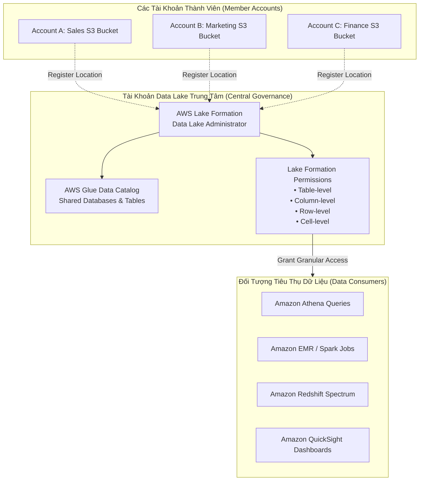
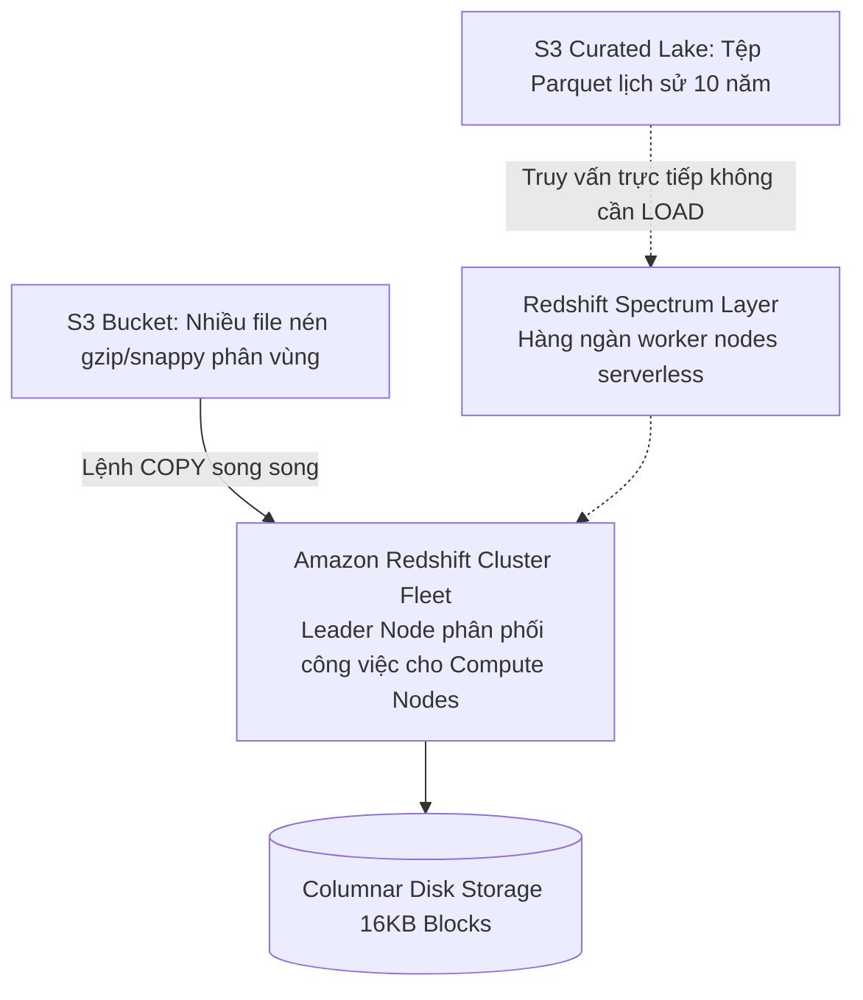
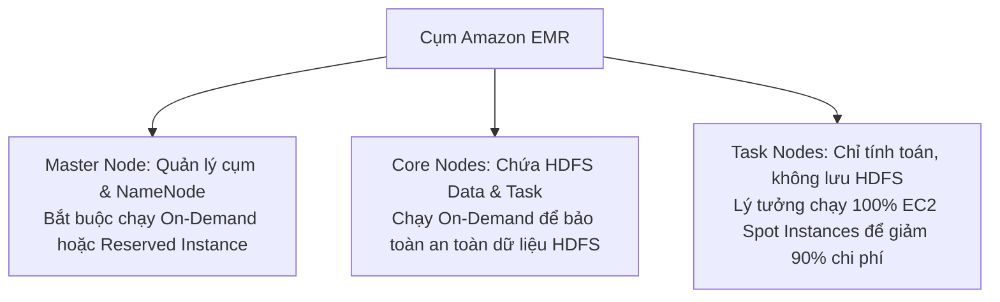
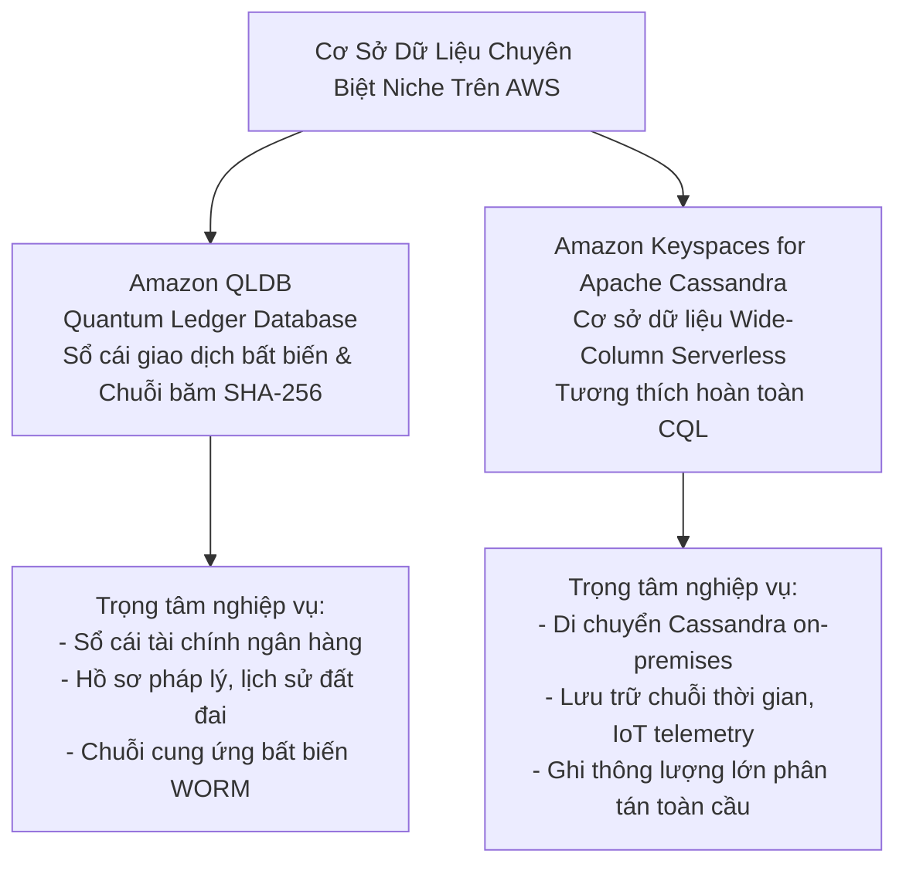
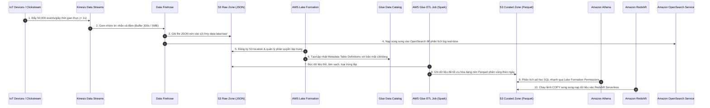

# Tài Liệu Học Tập Chuyên Sâu: AWS Analytics & Big Data Services (Athena, Glue, Lake Formation, EMR, Kinesis, Redshift, OpenSearch, QuickSight, Timestream)

> **Tài liệu chuẩn hóa kiến trúc đám mây**: Hướng dẫn toàn diện theo tiêu chuẩn Principal AWS Solutions Architect & Senior Big Data Engineer (Cập nhật phiên bản kiến trúc mới nhất 2026).  
> **Ngôn ngữ**: Tiếng Việt chuyên ngành (Bảo lưu toàn bộ thuật ngữ chuyên ngành tiếng Anh chuẩn AWS).  
> **Mục tiêu**: Phục vụ thi chứng chỉ cấp độ Professional/Specialty (**SAA-C03, SAP-C02, Data Engineer Associate DEA-C01**) và thiết kế Data Lake / Data Warehouse cấp độ doanh nghiệp (**Production-grade**).  
> **Nguồn trích xuất thực chứng**: Tổng hợp từ hệ thống đề thi thực chiến **Cloud Mentor (PT1 - PT6)**, **Udemy (Stephane Maarek)**, và **Tutorials Dojo (Set 1 - Set 6, Set 8)**.  
> **Các bài giảng liên quan**: Chương 17 (Decoupling & Kinesis), Chương 22 (Data & Analytics) & Chương 32 (Preparing for the Exam).

---

## 1. Tổng Quan Dịch Vụ (Service Overview)

### 1. Định nghĩa chuẩn xác và Phân nhóm dịch vụ
Hệ sinh thái **AWS Analytics & Big Data** cung cấp đầy đủ các khối xây dựng (Building Blocks) từ thu nhận dữ liệu thời gian thực (Ingestion), quản trị Data Lake tập trung đa tài khoản, trích xuất và biến đổi (ETL), lưu trữ kho dữ liệu (Data Warehousing), tìm kiếm phân tích (Search & Observability), đến trực quan hóa thông minh (Business Intelligence).

```mermaid
flowchart LR
    subgraph Ingestion["1. Thu Nhận Dữ Liệu (Ingestion)"]
        KDS[Amazon Kinesis Data Streams\nThời gian thực < 1s, Shards, Replay]
        KDF[Amazon Data Firehose\nNear real-time 60s, Ghi trực tiếp S3/Redshift/OpenSearch]
        MSK[Amazon MSK\nApache Kafka Managed cluster]
    end

    subgraph StorageLake["2. Data Lake & Governance"]
        S3[(Amazon S3 Data Lake\nLưu trữ đối tượng trung tâm)]
        LakeForm[AWS Lake Formation\nQuản trị tập trung đa tài khoản & Row/Column Security]
        GlueCat[AWS Glue Data Catalog\nMetadata Schema Registry]
    end

    subgraph ProcessingETL["3. Xử Lý & Chuyển Đổi (ETL)"]
        GlueJob[AWS Glue ETL Jobs\nServerless Spark / Python]
        EMR[Amazon EMR\nHadoop, Spark, Trino, Instance Fleets]
    end

    subgraph WarehouseAnalytics["4. Phân Tích & Kho Dữ Liệu"]
        Athena[Amazon Athena\nServerless SQL truy vấn trực tiếp trên S3]
        Redshift[(Amazon Redshift Serverless\nColumnar Data Warehouse PB-scale)]
        OpenSearch[Amazon OpenSearch Service\nTìm kiếm toàn văn & Log Analytics]
    end

    subgraph BI["5. Trực Quan Hóa (BI)"]
        QS[Amazon QuickSight\nServerless BI Dashboard & SPICE]
    end

    Ingestion --> StorageLake
    StorageLake --> ProcessingETL
    ProcessingETL --> StorageLake
    StorageLake --> WarehouseAnalytics
    WarehouseAnalytics --> BI
```



---

### 2. Bài toán cốt lõi mà từng dịch vụ Analytics giải quyết

1. **AWS Lake Formation**: Dịch vụ quản trị và thiết lập **Data Lake tập trung** hàng đầu của AWS. Giúp doanh nghiệp gom và quản lý dữ liệu S3 từ **hàng chục tài khoản AWS khác nhau**, cấp quyền truy cập bảo mật chi tiết tới từng **cột (column-level)** và từng **dòng (row-level)** thông qua AWS Glue Data Catalog mà **hoàn toàn không cần sao chép dữ liệu** giữa các tài khoản (*TD-Set1 Q02, TD-Set6 Q63*).
2. **Amazon Athena**: Truy vấn phân tích ad-hoc phi máy chủ (Serverless SQL) trực tiếp trên hàng Petabytes dữ liệu lưu trữ tại Amazon S3 bằng ngôn ngữ Presto/Trino chuẩn ANSI SQL mà hoàn toàn không cần nạp dữ liệu hay khởi tạo máy chủ.
3. **AWS Glue**: Dịch vụ ETL (Extract, Transform, Load) hoàn toàn Serverless. Sử dụng **Glue Crawlers** để tự động quét schema và đăng ký vào **Glue Data Catalog**, kết hợp **Glue ETL Jobs** chạy Apache Spark tự động co giãn theo DPUs (Data Processing Units).
4. **Amazon EMR (Elastic MapReduce)**: Cung cấp môi trường cụm tính toán Big Data phân tán tiêu chuẩn công nghiệp (Apache Spark, Hive, Presto, Flink, HBase) với khả năng co giãn hàng ngàn máy ảo EC2 On-Demand/Spot tối ưu chi phí tới 90%.
5. **Amazon Kinesis Data Streams (KDS)**: Tiếp nhận và xử lý luồng dữ liệu streaming thời gian thực (Real-time Latency < 1s) với cơ chế phân đoạn (Shards), lưu giữ tin nhắn (Retention 24h - 365 ngày), hỗ trợ nhiều consumer độc lập qua **Enhanced Fan-Out** (*TD-Set1 Q08*).
6. **Amazon Data Firehose (formerly Kinesis Firehose)**: Đường ống nạp dữ liệu Near Real-time (đệm tối thiểu 60s hoặc 1MB) hoàn toàn Serverless; tự động chuyển đổi định dạng (JSON sang Parquet/ORC) và đẩy thẳng vào **S3, Redshift, OpenSearch Service, Splunk, hoặc HTTP Endpoints** (*TD-Set3 Q46*).
7. **Amazon Redshift & Redshift Spectrum**: Kho dữ liệu đám mây (Data Warehouse) lưu trữ theo cột (Columnar Storage), tối ưu cho các truy vấn phân tích phức tạp (OLAP). Nạp dữ liệu song song cực nhanh từ S3 qua lệnh `COPY`, và hỗ trợ **Redshift Spectrum** để join trực tiếp dữ liệu trong kho với các tệp tin trên S3 Data Lake mà không cần nạp vào ổ đĩa (*TD-Set1 Q28, TD-Set1 Q36*).
8. **Amazon OpenSearch Service (formerly Elasticsearch)**: Dịch vụ tìm kiếm phân tích và hiển thị log thời gian thực (Logstash/Fluentbit/Firehose $\rightarrow$ OpenSearch $\rightarrow$ OpenSearch Dashboards), hỗ trợ tìm kiếm toàn văn bản (full-text search) và phát hiện bất thường (*TD-Set3 Q46, TD-Set6 Q56*).
9. **Amazon QuickSight**: Dịch vụ Business Intelligence (BI) hoàn toàn Serverless, tự động co giãn phục vụ từ hàng chục đến hàng trăm ngàn người dùng xem dashboard phân tích. Tích hợp động cơ tính toán trong bộ nhớ **SPICE (Super-fast, Parallel, In-memory Calculation Engine)** giúp phản hồi biểu đồ chỉ trong mili-giây, hỗ trợ phân quyền chi tiết tới từng dòng (**Row-Level Security - RLS**) và từng cột (**Column-Level Security - CLS**), nhúng trực tiếp dashboard vào ứng dụng doanh nghiệp (Embedded Analytics) và tích hợp các tính năng AI/ML Insights (*TD-Set3 Q18, U-PT3 Q28, U-PT4 Q56*).

---

### 3. Khi nào KHÔNG nên dùng (Anti-patterns & Giải pháp thay thế)

* ❌ **Xử lý streaming thời gian thực dưới 1 giây mà dùng Data Firehose hoặc Glue ETL**: Firehose có buffer interval tối thiểu 60 giây; Glue ETL khởi chạy theo batch mất vài phút.  
  👉 *Giải pháp thay thế*: Sử dụng **Amazon Kinesis Data Streams** hoặc **Amazon MSK**.
* ❌ **Gom dữ liệu S3 đa tài khoản về Data Lake bằng cách thiết lập nhiều pipeline Data Firehose hoặc Lambda cron sao chép dữ liệu**: Gây tốn kém chi phí lưu trữ S3 nhân đôi và cực kỳ nặng gánh bảo trì phân quyền.  
  👉 *Giải pháp thay thế*: Sử dụng **AWS Lake Formation** để chia sẻ dữ liệu cross-account và phân quyền tập trung.
* ❌ **Giao dịch thanh toán trực tuyến (OLTP) có hàng ngàn câu lệnh INSERT/UPDATE nhỏ lẻ chạy trên Amazon Redshift**: Redshift được tối ưu cho đọc theo cột (Columnar OLAP), thao tác ghi đơn lẻ sẽ làm nghẽn vacuum và phân mảnh disk.  
  👉 *Giải pháp thay thế*: Sử dụng **Amazon Aurora** hoặc **Amazon DynamoDB**.
* ❌ **Truy vấn lặp đi lặp lại hàng triệu lần mỗi ngày trên S3 bằng Athena**: Athena tính phí \$5.00 cho mỗi Terabyte dữ liệu quét qua đĩa (Scanned data).  
  👉 *Giải pháp thay thế*: Nạp dữ liệu vào **Amazon Redshift** hoặc **Amazon DynamoDB** / **ElastiCache**.
* ❌ **Xây dựng Dashboard QuickSight kết nối trực tiếp (Direct Query) vào kho dữ liệu Redshift hoặc RDS production phục vụ hàng ngàn người dùng xem đồng thời**: Gây quá tải I/O và nghẽn CPU cho database backend, dẫn tới sập hệ thống giao dịch hoặc chậm trễ báo cáo.  
  👉 *Giải pháp thay thế*: Nạp dữ liệu vào **động cơ SPICE của QuickSight** (lên lịch làm mới dữ liệu định kỳ) để phục vụ hàng ngàn người xem song song từ RAM mà hoàn toàn không chạm tới database backend (*U-PT3 Q28*).

---

## 2. Các Khái Niệm, Kiến Trúc & Vận Hành Cốt Lõi (Core Concepts & Operations)

### 1. AWS Lake Formation: Kiến Trúc Quản Trị Data Lake Tập Trung Đa Tài Khoản



* **Cơ chế Cross-Account Sharing**:
  - Không cần di chuyển hay sao chép dữ liệu vật lý (No data duplication).
  - Sử dụng giao thức **Resource Links** hoặc chia sẻ qua **AWS RAM (Resource Access Manager)** tích hợp trong Lake Formation.
* **Phân quyền bảo mật chi tiết (Fine-grained Access Control - FGAC)**:
  - Cho phép cấp quyền truy cập dữ liệu tinh chỉnh theo mô hình giống RDBMS (`GRANT` / `REVOKE`) xuống tới cấp độ **Database, Table, Column (Cột), Row (Hàng), và Cell-level (Ô dữ liệu)** thông qua Tag-Based Access Control (LF-TBAC).
  - Áp dụng đồng nhất một chính sách phân quyền duy nhất cho nhiều dịch vụ truy vấn cùng lúc gồm **Amazon Athena, Amazon Redshift Spectrum, Amazon EMR, và AWS Glue** mà không cần cấu hình hàng trăm S3 Bucket Policies phức tạp.
  - **Column-level security**: Cho phép bộ phận Marketing xem cột `customer_name`, `email` nhưng ẩn cột `credit_card_number`.
  - **Row-level security**: Cho phép quản lý chi nhánh chỉ xem các dòng có `region = 'Asia-Pacific'`.
  - **Data Filters**: Kết hợp lọc dòng và lọc cột trong một chính sách duy nhất.
- **Bẫy thi SAA-C03:** Khi đề bài yêu cầu *"Ẩn các cột chứa thông tin nhạy cảm (PII) trong S3 Data Lake đối với nhóm Data Analyst khi họ truy vấn bằng Athena hoặc Redshift Spectrum với chi phí vận hành thấp nhất"* -> Chọn **AWS Lake Formation** (Fine-grained column/row-level security).

---

### 2. Kinesis Data Streams vs Data Firehose vs SQS

| Tiêu chí | Amazon Kinesis Data Streams (KDS) | Amazon Data Firehose | Amazon SQS (Standard/FIFO) |
| :--- | :--- | :--- | :--- |
| **Bản chất** | Streaming Ingestion (Luồng dữ liệu liên tục) | Delivery Stream (Nạp dữ liệu vào Storage) | Message Queue (Hàng đợi thông điệp) |
| **Độ trễ (Latency)** | **Thời gian thực (< 200 - 1,000 ms)** | **Gần thời gian thực (60 - 900 giây)** | Thời gian thực (mili-giây) |
| **Quản trị năng lực** | Provisioned (Shards) hoặc On-Demand | **Serverless hoàn toàn (Tự co giãn)** | **Serverless hoàn toàn (Tự co giãn)** |
| **Lưu trữ & Replay** | Lưu từ 24 giờ đến 365 ngày; **cho phép Replay** | **Không lưu trữ** (chỉ chuyển tiếp dữ liệu) | Lưu tối đa 14 ngày; **xóa sau khi đọc** |
| **Đích đến (Targets)** | Kinesis Client App (KCL), Lambda, Flink | **Amazon S3, Redshift, OpenSearch, HTTP, Splunk** | EC2, Lambda, ECS Workers |
| **Nhiều Consumers** | Hỗ trợ nhiều Consumer đọc song song độc lập | Chỉ đẩy vào 1 đích đến cấu hình | 1 tin nhắn chỉ tiêu thụ bởi 1 worker |

---

### 3. Tối Ưu Hóa Chi Phí & Hiệu Năng Amazon Athena

Athena tính phí dựa trên **dung lượng dữ liệu quét qua đĩa S3 (\$5/TB scanned)**:
1. **Chuyển đổi sang định dạng cột (Columnar Format - Parquet hoặc ORC)**:
   - File CSV thô kích thước 1 TB $\rightarrow$ Chuyển sang Apache Parquet chỉ còn ~130 GB (nén gzip/snappy).
   - Khi chạy câu lệnh `SELECT customer_id, total_amount FROM orders`, Athena **chỉ đọc 2 cột cần thiết** thay vì đọc toàn bộ các dòng $\rightarrow$ Quét chỉ 5 GB $\rightarrow$ **Tiết kiệm 99% chi phí và tốc độ nhanh gấp 10 lần**!
2. **Phân vùng dữ liệu (Partitioning)**:
   - Đặt đường dẫn theo cấu trúc Hive: `s3://my-bucket/logs/year=2026/month=11/day=04/`.
   - Khi truy vấn `WHERE year=2026 AND month=11`, Athena sẽ bỏ qua toàn bộ dữ liệu của các tháng khác.
3. **Kích thước file tối ưu**:
   - Tránh tình trạng hàng triệu file nhỏ vài Kilobytes (gây nghẽn metadata); gộp file thành kích thước chuẩn **128 MB đến 512 MB**.

---

### 4. Amazon Redshift: Nạp Dữ Liệu Song Song với Lệnh COPY & Redshift Spectrum



* **Lệnh `COPY`**: Luôn là phương pháp nạp dữ liệu hàng loạt (Bulk Load) nhanh nhất và hiệu quả nhất vào Redshift. Tận dụng kiến trúc MPP (Massively Parallel Processing), chia nhỏ file thành nhiều phần bằng bội số của số Compute Slices để tải dữ liệu song song trực tiếp từ S3.
* **Redshift Spectrum**: Cho phép chạy các câu lệnh SQL truy vấn trực tiếp dữ liệu ngoại vi (External Tables) trên Amazon S3 mà không cần cấp phát thêm dung lượng đĩa Redshift. Hỗ trợ câu lệnh SQL kết hợp (`JOIN`) giữa bảng nội bộ trong Redshift với bảng ngoại vi trên S3 Data Lake.

---

### 5. Cụm Amazon EMR: Instance Groups vs Instance Fleets



* **EMR Instance Groups**: Cấu hình truyền thống; mỗi nhóm node (Master, Core, Task) bị khóa vào **1 Availability Zone duy nhất** và 1 loại EC2 instance type cố định. Khi AZ hết dung lượng Spot, cụm EMR sẽ thất bại.
* **EMR Instance Fleets**: Cấu hình hiện đại; cho phép khai báo **danh sách nhiều Subnets đa AZ** và **lựa chọn lên tới 30 instance types thay thế**. EMR tự động chọn AZ có sẵn tài nguyên Spot để khởi chạy, triệt tiêu lỗi thiếu dung lượng (*TD-Set4 Q44*).

---

### 6. AWS Glue DataBrew: Chuẩn Bị & Làm Sạch Dữ Liệu Thị Giác Không Cần Code (Visual No-Code Data Preparation)

```mermaid
flowchart LR
    Sources[Nguồn Dữ Liệu Thô\nS3, Redshift, RDS, Lake Formation] --> Datasets[DataBrew Datasets\nKết nối & nạp schema tự động]
    Datasets --> Project[DataBrew Interactive Project\nGiao diện trực quan với 250+ phép biến đổi]
    Project --> Recipe[DataBrew Recipe\nTập hợp các bước làm sạch & chuẩn hóa dữ liệu]
    Recipe --> Jobs[DataBrew Recipe Jobs / Profile Jobs\nThực thi song song quy mô lớn không cần quản trị server]
    Jobs --> Destinations[Đích Đến Đã Làm Sạch\nS3 Clean Zone (Parquet) -> Athena / Redshift / SageMaker]
```

* **Định nghĩa**: **AWS Glue DataBrew** là công cụ chuẩn bị dữ liệu thị giác (**Visual Data Preparation Tool**) hoàn toàn không cần viết mã (No-Code/Low-Code), cung cấp hơn **250 phép biến đổi dựng sẵn** (pre-built transformations) giúp các nhà phân tích dữ liệu (Data Analysts) và kỹ sư học máy (ML Engineers) làm sạch, chuẩn hóa và làm giàu dữ liệu nhanh hơn 80% so với việc viết code thủ công (*U-PT1 Q24, CM-PT1 Q44*).
* **4 Khái niệm cốt lõi của DataBrew**:
  1. **Datasets**: Định nghĩa kết nối tới dữ liệu nguồn lưu tại Amazon S3, Amazon Redshift, AWS Lake Formation, Amazon RDS hoặc các kho dữ liệu SaaS bên thứ ba.
  2. **Recipes**: Danh sách các bước biến đổi dữ liệu được lưu lại thành một "công thức" (ví dụ: lọc bỏ giá trị null, chuẩn hóa định dạng ngày tháng `YYYY-MM-DD`, che giấu thông tin cá nhân PII, mã hóa One-Hot cho mô hình ML). Recipes có thể tái sử dụng cho nhiều datasets khác nhau.
  3. **Projects**: Môi trường làm việc tương tác thị giác hiển thị bảng dữ liệu mẫu (sample data grid) kèm thanh thống kê hồ sơ dữ liệu (**Data Profile summary**) giúp trực quan hóa phân bổ dữ liệu và phát hiện bất thường ngay trên giao diện.
  4. **Jobs**:
     - *Recipe Jobs*: Chạy công thức biến đổi trên toàn bộ tập dữ liệu lớn và xuất kết quả ra Amazon S3 dưới định dạng tối ưu (Parquet, CSV, ORC, JSON, Avro).
     - *Profile Jobs*: Tự động quét và tạo báo cáo chất lượng dữ liệu với hơn **40 chỉ số thống kê** (tỉ lệ missing values, số lượng duplicate rows, phân bổ min/max/median, outliers).

#### Bảng Phân Biệt: AWS Glue DataBrew vs AWS Glue ETL Jobs vs AWS DMS

| Tiêu chuẩn so sánh | AWS Glue DataBrew | AWS Glue ETL Jobs (Spark/Python) | AWS Database Migration Service (DMS) |
|:---|:---|:---|:---|
| **Đối tượng người dùng** | Data Analysts, Business Analysts, Citizen Data Scientists | Data Engineers, Big Data Developers | Database Administrators, Cloud Migration Engineers |
| **Yêu cầu kỹ năng** | **Không cần viết code (No-Code GUI)** | Thành thạo PySpark, Scala, Python | Hiểu biết về Database Engines & Replication |
| **Mục đích chính** | Làm sạch, chuẩn hóa, đánh giá chất lượng dữ liệu thị giác | Pipeline ETL phức tạp, xử lý batch quy mô hàng chục PB | Di chuyển cơ sở dữ liệu và đồng bộ CDC thời gian thực |
| **Mô hình tính toán** | Serverless tương tác theo Node-hours | Serverless tính theo Data Processing Units (DPUs) | Máy chủ replication instance (hoặc DMS Serverless) |
| **Đích đến tối ưu** | Amazon S3 Data Lake (Parquet/CSV), SageMaker Feature Store | S3 Data Lake, Redshift, OpenSearch, Iceberg | Amazon RDS, Aurora, S3, DynamoDB, OpenSearch |

---

### 7. Các Cơ Sở Dữ Liệu Chuyên Biệt Niche Cho Big Data: Amazon QLDB & Amazon Keyspaces



#### 7.1. Amazon Quantum Ledger Database (Amazon QLDB)
* **Bản chất**: Cơ sở dữ liệu sổ cái hoàn toàn được quản lý (**Fully managed ledger database**), cung cấp một nhật ký giao dịch minh bạch, bất biến (**Immutable**) và có thể xác minh bằng mật mã (**Cryptographically verifiable**).
* **Cơ chế mã hóa bất biến**:
  - Mọi thay đổi dữ liệu đều được ghi tuần tự vào một **Journal (Nhật ký chỉ ghi - Append-only)**. Dữ liệu trong Journal không bao giờ bị sửa đổi hay xóa bỏ.
  - Sử dụng hàm băm mật mã mật độ cao **SHA-256** liên kết các khối dữ liệu theo cấu trúc cây Merkle (**Merkle Tree**). Bất kỳ hành vi can thiệp trái phép nào vào dữ liệu lịch sử đều làm sai lệch hash root và bị phát hiện ngay lập tức.
* **⚠️ BẪY THI KINH ĐIỂN (QLDB vs Blockchain — TD-Set6 Q40)**:
  - **Amazon QLDB là cơ sở dữ liệu TẬP TRUNG (Centralized Ledger)** do một thực thể quản trị duy nhất sở hữu và điều hành (ví dụ: một ngân hàng, một cơ quan thuế, một bệnh viện).
  - QLDB **KHÔNG PHẢI là mạng lưới phi tập trung (Decentralized)** và **KHÔNG CÓ cơ chế đồng thuận phân tán (Consensus mechanism như Proof-of-Work hay Proof-of-Stake)**. Nhanh hơn gấp 2–3 lần so với các nền tảng Blockchain truyền thống.
  - *Nếu đề bài yêu cầu mạng lưới nhiều bên tham gia độc lập không tin tưởng nhau (Multi-party decentralized)*: Bắt buộc chọn **Amazon Managed Blockchain**.
  - *Nếu đề bài yêu cầu một tổ chức duy nhất cần lưu trữ lịch sử giao dịch bất biến có thể kiểm toán mật mã*: Bắt buộc chọn **Amazon QLDB**.

#### 7.2. Amazon Keyspaces (for Apache Cassandra)
* **Bản chất**: Dịch vụ cơ sở dữ liệu dạng cột mở rộng (**Wide-column store**) tương thích hoàn toàn với mã nguồn mở **Apache Cassandra**, được cung cấp dưới dạng hoàn toàn phi máy chủ (**Serverless**).
* **Khả năng tương thích**: Hỗ trợ toàn bộ câu lệnh truy vấn **Cassandra Query Language (CQL)** và các SDK drivers Cassandra hiện có mà không cần sửa đổi mã nguồn ứng dụng.
* **Đặc tính vận hành**:
  - Tự động co giãn theo dung lượng đọc/ghi (chế độ On-Demand hoặc Provisioned Capacity).
  - Tự động sao chép dữ liệu trên 3 Availability Zones để đảm bảo tính sẵn sàng cao 99.999%.
  - Quản trị viên không bao giờ phải lo lắng về việc cấu hình cụm, vá lỗi OS, phân vùng lại hạt nhân hay bảo trì node Cassandra như khi tự cài trên EC2 (*TD-Set5 Q15*).

#### 7.3. Amazon Timestream (Cơ Sở Dữ Liệu Chuỗi Thời Gian - Time-Series Database)
- **Bản chất:** Cơ sở dữ liệu chuyên dụng cho dữ liệu chuỗi thời gian (Time-Series Data) như cảm biến IoT, telemetry công nghiệp, metrics hạ tầng DevOps và phân tích hành vi ứng dụng theo thời gian thực (hỗ trợ cả kiến trúc Serverless và Timestream for InfluxDB).
- **Cơ chế phân tầng lưu trữ tự động (Automated Storage Tiering):**
  - Dữ liệu mới (Recent data) được ghi vào tầng **In-Memory Store** để truy vấn thời gian thực tốc độ cực cao.
  - Dữ liệu lịch sử (Historical data) tự động được chuyển xuống tầng **Magnetic Store** chi phí thấp theo chính sách vòng đời (Lifecycle policy) do người dùng cấu hình mà không cần viết script ETL.
- **Bẫy thi SAA-C03:** Khi đề bài xuất hiện từ khóa `millions of IoT sensor events per second`, `time-series data`, `analyze data over time intervals`, `automatic tiering from memory to cost-optimized storage` -> Chọn **Amazon Timestream** (nhanh hơn và rẻ hơn nhiều so với việc dùng RDS hay DynamoDB cho dữ liệu chuỗi thời gian).

---

### 8. Amazon QuickSight: Kiến Trúc Serverless Business Intelligence, Động Cơ SPICE & Bảo Mật Dữ Liệu (RLS/CLS)
- **Tổng quan kiến trúc**: Amazon QuickSight là dịch vụ BI đám mây đầu tiên áp dụng mô hình Serverless hoàn toàn, co giãn tự động từ 10 đến 100,000+ người dùng mà không cần cung cấp hay quản trị máy chủ.
- **Động cơ SPICE (Super-fast, Parallel, In-memory Calculation Engine)**:
  - Lưu trữ dữ liệu dạng cột (columnar) hoàn toàn trên bộ nhớ RAM phân tán của AWS.
  - Cho phép hàng ngàn người dùng tương tác, lọc (slicing & dicing), drill-down báo cáo đồng thời với độ trễ phản hồi tức thì dưới 1 giây.
  - Cách ly hoàn toàn tầng trực quan hóa khỏi các hệ thống cơ sở dữ liệu nguồn, ngăn chặn nguy cơ làm sập cơ sở dữ liệu Production (*U-PT3 Q28*).
  - Hỗ trợ lịch làm mới dữ liệu tự động (Scheduled Refresh) hàng giờ, hàng ngày hoặc kích hoạt qua API.
- **Bảo mật và phân quyền chi tiết**:
  - **Row-Level Security (RLS)**: Sử dụng tập dữ liệu phân quyền (Permissions Dataset) chứa ánh xạ giữa User/Group ARN và giá trị trường (ví dụ: `UserName` $\rightarrow$ `RegionCode`) để tự động lọc dữ liệu. Giám đốc từng khu vực chỉ nhìn thấy số liệu của khu vực mình trên cùng một dashboard dùng chung duy nhất (*TD-Set3 Q18*).
  - **Column-Level Security (CLS)**: Phân quyền ẩn/hiện các cột dữ liệu nhạy cảm (như PII, thông tin thẻ, tỷ suất lợi nhuận) dựa trên nhóm người dùng.
  - **VPC Interface Connection**: Tạo Elastic Network Interface (ENI) trong VPC Private Subnet, cho phép QuickSight truy xuất an toàn vào Amazon Redshift, Amazon RDS, Aurora hoặc cơ sở dữ liệu tự quản mà không cần mở cổng kết nối ra Internet (*CM-PT4 Q44*).
- **Embedded Analytics & Generative BI**:
  - Nhúng trực tiếp Dashboard hoặc Visuals vào ứng dụng web nội bộ hoặc cổng thông tin khách hàng thông qua AWS SDK / JavaScript SDK mà không cần người dùng cuối phải có tài khoản AWS riêng.
  - Tích hợp tính năng AI/ML: Tự động phát hiện điểm dị biệt (Anomaly Detection), dự báo xu hướng (Forecasting), và tóm tắt số liệu bằng ngôn ngữ tự nhiên (Auto-narratives).

---

### 🏛️ I. Các Kịch Bản Kiến Trúc Chuẩn (Best Practice Scenarios)

#### 1. Quản Lý Data Lake Tập Trung Đa Tài Khoản Với AWS Lake Formation — (TD-Set1 Q02, TD-Set6 Q63)
- **Tình huống thi**: Doanh nghiệp có hàng chục tài khoản AWS, mỗi tài khoản sở hữu một S3 bucket chứa dữ liệu riêng biệt. Ban quản trị muốn truy vấn dữ liệu từ một Data Lake trung tâm, đồng thời phân quyền truy cập theo vai trò người dùng (User Roles) chi tiết tới từng bảng và cột với **ít công vận hành và chi phí thấp nhất**.
- **Giải pháp tối ưu chuẩn AWS**:
  - Triển khai **AWS Lake Formation** tại tài khoản trung tâm.
  - Đăng ký các S3 bucket từ các tài khoản thành viên vào Lake Formation.
  - Sử dụng AWS Glue Data Catalog làm danh mục dữ liệu dùng chung và định nghĩa phân quyền (Grant/Revoke) chi tiết tới cấp Table/Column/Row cho các IAM roles mà **không cần copy dữ liệu qua lại giữa các account**.

#### 2. Nạp Dữ Liệu Hàng Loạt Vào Redshift Bằng Lệnh COPY Song Song — (TD-Set8 Q21)
- **Tình huống thi**: Một ứng dụng thương mại điện tử cần nạp hàng trăm Gigabytes dữ liệu giao dịch hàng ngày từ Amazon S3 vào Amazon Redshift để phục vụ báo cáo buổi sáng. Việc chạy các câu lệnh `INSERT` truyền thống diễn ra quá chậm và làm treo hệ thống.
- **Giải pháp chuẩn**:
  - Sử dụng lệnh **`COPY` của Amazon Redshift**.
  - Chia nhỏ dữ liệu thành nhiều file nén (gzip/snappy) tương ứng với số slices của cụm Redshift.
  - Lệnh `COPY` đọc trực tiếp từ S3 song song trên tất cả các compute nodes, đạt tốc độ nạp hàng triệu bản ghi trong vài phút.

#### 3. Truy Vấn Dữ Liệu Trực Tiếp Trên S3 Không Cần Nạp Vào Redshift Bằng Redshift Spectrum — (TD-Set1 Q36, U-PT1 Q24)
- **Tình huống thi**: Kho dữ liệu Redshift có dung lượng đĩa hạn chế. Doanh nghiệp có 10 TB dữ liệu lịch sử lưu trên Amazon S3 và thỉnh thoảng cần join bảng dữ liệu lịch sử này với bảng dữ liệu hiện tại trong Redshift. Ban quản lý cấm nâng cấp mở rộng cụm Redshift vì lý do chi phí.
- **Giải pháp chuẩn**:
  - Sử dụng **Amazon Redshift Spectrum**.
  - Đăng ký metadata dữ liệu S3 vào AWS Glue Data Catalog.
  - Tạo External Schema trong Redshift trỏ tới Glue Catalog.
  - Viết câu lệnh SQL truy vấn trực tiếp bảng ngoài S3 và join với bảng nội bộ Redshift mà không tốn 1 byte dung lượng đĩa cụm Redshift.

#### 4. Nạp Dữ Liệu Streaming Đồng Thời Vào S3, OpenSearch Service Và Splunk — (TD-Set3 Q46)
- **Tình huống thi**: Một hệ thống cửa hàng thông minh sử dụng cảm biến IoT gửi luồng dữ liệu mua sắm thời gian thực. Cần nạp dữ liệu bền vững vào Amazon S3 để lưu trữ lâu dài, đồng thời nạp vào **Amazon OpenSearch Service** và Splunk để hiển thị dashboard và tìm kiếm tức thì.
- **Giải pháp chuẩn**:
  - Triển khai **Amazon Data Firehose**.
  - Firehose tự động chuyển đổi, định dạng dữ liệu và nạp trực tiếp vào S3, OpenSearch Service và Splunk một cách hoàn toàn Serverless.

---

### 🪤 II. Các Bẫy Thi Tinh Vi & Phân Tích Phương Án Sai (Exam Traps & Distractors)

#### 🪤 Bẫy 1: Real-Time Streaming (< 1s) vs Near Real-Time Delivery (60s) — (CM-PT3 Q02, TD-Set1 Q08)
- **Tình huống đề thi**: *"Hệ thống yêu cầu phát hiện gian lận và kích hoạt cảnh báo trong vòng chưa đầy 1 giây kể từ khi sự kiện xảy ra từ các thiết bị IoT."*
- **Các phương án bẫy**:
  - ❌ *Dùng Amazon Data Firehose*: Firehose có cơ chế đệm bắt buộc (Buffer interval tối thiểu 60 giây), không thể đáp ứng yêu cầu dưới 1 giây!
  - ❌ *Dùng AWS Glue ETL*: Là giải pháp batch theo lô, mất vài phút khởi động.
- **Giải pháp ĐÚNG**: **Amazon Kinesis Data Streams** kết hợp **AWS Lambda** hoặc Amazon Managed Service for Apache Flink.

#### 🪤 Bẫy 2: Data Lake Đa Tài Khoản: Data Firehose/Lambda vs Lake Formation — (TD-Set1 Q02)
- **Tình huống đề thi**: *"Cần hợp nhất dữ liệu từ nhiều tài khoản AWS vào một Data Lake trung tâm với phân quyền theo vai trò người dùng và ít công sức quản trị nhất."*
- **Các phương án bẫy**:
  - ❌ *Dùng Amazon Data Firehose ở từng tài khoản để đẩy dữ liệu*: Tốn kém chi phí, vận hành phức tạp, dữ liệu bị trùng lặp.
  - ❌ *Dùng Lambda định kỳ bằng EventBridge để copy file S3*: Quá tốn công viết code, bảo trì lỗi thời.
- **Giải pháp ĐÚNG**: **AWS Lake Formation** (quản trị tập trung, không cần copy dữ liệu, phân quyền native).

#### 🪤 Bẫy 3: Phân Tích Dữ Liệu Lớn Trên EMR: Instance Groups vs Instance Fleets & Managed Scaling — (CM-PT2 Q26, CM-PT2 Q36, TD-Set4 Q44)
- **Tình huống đề thi**: *"Khởi chạy cụm Amazon EMR trên các máy ảo EC2 Spot trải dài trên nhiều Subnets để tiết kiệm chi phí, nhưng thường xuyên gặp lỗi thiếu Spot capacity tại một số AZ."*
- **Giải pháp ĐÚNG**: Sử dụng **EMR Instance Fleets configuration** (thay vì Instance Groups).
  - Instance Fleets cho phép định nghĩa nhiều subnets đa AZ và tới 30 instance types thay thế, EMR tự động chọn AZ có capacity Spot dồi dào để launch.
  - Bật tính năng **EMR Managed Scaling** (`CM-PT2 Q36`): Tự động điều chỉnh số lượng Task nodes dựa trên khối lượng công việc của cụm Spark/YARN.

#### 🪤 Bẫy 4: Lọc Và Làm Sạch Dữ Liệu Nhạy Cảm (PII Masking) Thời Gian Thực Bằng Kinesis Data Streams Và Lambda — (U-PT4 Q30)
- **Tình huống đề thi**: *"Ứng dụng tài chính nhận luồng dữ liệu giao dịch thời gian thực chứa thông tin cá nhân nhạy cảm (PII - số thẻ tín dụng, CCCD). Hệ thống cần cho phép các ứng dụng nội bộ phân tích dữ liệu gốc nguyên bản, đồng thời cung cấp một luồng dữ liệu đã được làm sạch/che giấu PII (Masked Data) cho đối tác bên thứ ba lưu trữ vào DynamoDB với độ trễ thấp nhất."*
- **Các phương án bẫy**:
  - ❌ *Ghi toàn bộ dữ liệu thô vào S3 rồi dùng AWS Glue ETL xử lý định kỳ*: Độ trễ cao (mất nhiều phút), không đáp ứng yêu cầu xử lý và đẩy dữ liệu thời gian thực cho đối tác.
  - ❌ *Bắt ứng dụng đối tác tự lọc PII sau khi đọc dữ liệu*: Vi phạm nghiêm trọng tiêu chuẩn bảo mật dữ liệu vì đã truyền dữ liệu PII ra bên ngoài!
- **Giải pháp ĐÚNG**: Đẩy luồng dữ liệu vào **Amazon Kinesis Data Streams**.
  - Các ứng dụng nội bộ đọc trực tiếp luồng stream gốc.
  - Tích hợp một hàm **AWS Lambda** làm consumer thứ hai: Lambda đọc dữ liệu thời gian thực, thực thi logic che giấu thông tin PII (masking/anonymization) và ghi bản ghi đã làm sạch vào **Amazon DynamoDB** cho bên thứ ba truy cập.

#### 🪤 Bẫy 5: Tách Biệt Băng Thông Cho Nhiều Consumer Kinesis Bằng Enhanced Fan-Out (EFO) — (U-PT4 Q33, CM-PT1 Q43)
- **Tình huống đề thi**: *"Một luồng Amazon Kinesis Data Streams phục vụ đồng thời 5 ứng dụng phân tích khác nhau. Khi lưu lượng bùng nổ, các ứng dụng gặp hiện tượng trễ đọc (Read Throttling / tăng `GetRecords.IteratorAgeMilliseconds`) do cạnh tranh băng thông đọc 2 MB/giây của Shard."*
- **Các phương án bẫy**:
  - ❌ *Yêu cầu các consumer tự gọi API `GetRecords` với khoảng thời gian ngắn hơn*: Làm trầm trọng thêm lỗi HTTP 429 Throttling do chạm hạn mức 5 transactions/giây/shard của Standard Consumer.
  - ❌ *Tăng gấp đôi số lượng Shard thủ công*: Làm tăng chi phí Shard-hour cho toàn bộ hệ thống mà không giải quyết được gốc rễ vấn đề chia sẻ băng thông giữa các consumer.
- **Giải pháp ĐÚNG**: Đăng ký các ứng dụng làm **Kinesis Enhanced Fan-Out (EFO) Consumers**.
  - Mỗi consumer EFO nhận được một đường ống băng thông đọc riêng biệt lên tới **2 MB/s trên mỗi Shard** độc lập hoàn toàn với các consumer khác.
  - Dữ liệu được đẩy chủ động từ Kinesis tới consumer qua giao thức **HTTP/2 Push** (`SubscribeToShard`), giảm độ trễ đọc xuống chỉ còn khoảng **70 mili-giây** (so với 200ms của Standard Consumer polling).

#### 🪤 Bẫy 6: Pipeline Phân Tích Nhật Ký Và Trực Quan Hóa Thời Gian Thực: Kinesis + OpenSearch + QuickSight — (U-PT4 Q56)
- **Tình huống đề thi**: *"Doanh nghiệp cần xây dựng hệ thống thu thập, phân tích và trực quan hóa hàng triệu bản ghi nhật ký hoạt động của website theo thời gian thực để phát hiện xu hướng và hiển thị báo cáo kinh doanh cho ban giám đốc."*
- **Các phương án bẫy**:
  - ❌ *Đẩy log vào S3 và dùng Athena kết hợp QuickSight*: Athena tối ưu cho truy vấn ad-hoc theo đợt, không đáp ứng hiển thị dashboard phân tích log thời gian thực tức thì.
  - ❌ *Lưu log vào Amazon RDS*: Cơ sở dữ liệu quan hệ RDS sẽ nhanh chóng bị quá tải I/O và cạn kiệt dung lượng khi nạp hàng triệu bản ghi log mỗi phút.
- **Giải pháp ĐÚNG**: Kiến trúc chuỗi phân tích chuẩn: **Amazon Kinesis Data Streams / Data Firehose $\rightarrow$ Amazon OpenSearch Service $\rightarrow$ Amazon QuickSight**.
  - Kinesis thu thập luồng log thời gian thực với dung lượng lớn.
  - Nạp trực tiếp vào **Amazon OpenSearch Service** để lập chỉ mục tìm kiếm toàn văn bản và phân tích nhanh trong mili-giây.
  - Kết nối **Amazon QuickSight** tới OpenSearch Service để xây dựng các biểu đồ KPI và bảng điều khiển trực quan hóa thời gian thực phục vụ báo cáo.

#### 🪤 Bẫy 7: Truy Vấn SQL Ad-hoc Trên Kho Dữ Liệu S3 Không Cần Server Bằng Amazon Athena — (U-PT4 Q11, U-PT4 Q61)
- **Tình huống đề thi**: *"Doanh nghiệp lưu trữ hàng triệu tệp dữ liệu giao dịch hoặc bản ghi cuộc gọi (sau khi đã chuyển đổi âm thanh sang văn bản JSON/CSV) trên Amazon S3. Đội ngũ phân tích cần thỉnh thoảng chạy các câu lệnh truy vấn chuẩn SQL để thống kê dữ liệu mà không muốn chi trả chi phí cố định cho máy chủ hay cụm database nhàn rỗi."*
- **Các phương án bẫy**:
  - ❌ *Khởi tạo cụm Amazon Redshift hoặc Amazon EMR*: Phải chi trả chi phí hàng giờ cho node máy chủ chạy 24/7 kể cả khi không có ai truy vấn, quá đắt đỏ và tốn công vận hành cho nhu cầu ad-hoc thỉnh thoảng.
  - ❌ *Nạp dữ liệu vào DynamoDB*: DynamoDB chỉ hỗ trợ truy vấn NoSQL theo Partition Key/Sort Key đơn giản, không hỗ trợ câu lệnh phân tích SQL phức tạp (GROUP BY, JOIN).
- **Giải pháp ĐÚNG**: Sử dụng **Amazon Athena**.
  - Athena là công cụ truy vấn SQL Serverless tương thích Presto/Trino, đọc trực tiếp dữ liệu từ Amazon S3.
  - **Zero Infrastructure Management**: Không cần cấu hình hay quản lý máy chủ.
  - Chi phí cực kỳ tiết kiệm: Chỉ tính phí dựa trên dung lượng dữ liệu được quét (\$5/TB quét).

#### 🪤 Bẫy 8: Chuẩn Bị & Làm Sạch Dữ Liệu Thị Giác Không Dùng Code Bằng AWS Glue DataBrew & Data Lineage — (TD-Set8 Q21, U-PT1 Q24, CM-PT1 Q44)
- **Tình huống đề thi**: *"Đội ngũ chuyên viên phân tích kinh doanh (Business Analysts) và nhà khoa học dữ liệu cần làm sạch, chuẩn hóa các trường dữ liệu và đánh giá chất lượng của tập dữ liệu khách hàng lưu trên Amazon S3 trước khi huấn luyện mô hình Machine Learning. Nhóm không có kỹ năng lập trình Spark/Python và yêu cầu một giao diện trực quan không cần viết mã (visual, no-code tool) có sẵn các phép biến đổi dữ liệu. Dịch vụ nào đáp ứng tối ưu?"*
- **Các phương án bẫy**:
  - ❌ *Sử dụng AWS Glue ETL Jobs*: Đòi hỏi kỹ sư phải tự viết code PySpark hoặc Scala, không phù hợp cho các nhà phân tích không chuyên về lập trình.
  - ❌ *Sử dụng Amazon EMR Studio*: Cần cấu hình cụm máy tính toán EMR phức tạp và viết Jupyter Notebooks.
  - ❌ *Sử dụng AWS DMS*: DMS chỉ dùng để di chuyển và đồng bộ dữ liệu giữa các databases, không phải công cụ phân tích và làm sạch dữ liệu thị giác.
- **Giải pháp ĐÚNG**: Sử dụng **AWS Glue DataBrew**.
  - Cung cấp giao diện thị giác kéo thả tương tác trực tiếp với hơn 250 phép biến đổi dữ liệu dựng sẵn.
  - Tự động tạo hồ sơ dữ liệu (**Data Profiling**) thống kê kiểu dữ liệu, tỷ lệ null/outliers (`U-PT1 Q24`).
  - Lưu quy trình làm sạch thành **DataBrew Recipe** và theo dõi lịch sử nguồn gốc dữ liệu (**Data Lineage**) (`TD-Set8 Q21`).

#### 🪤 Bẫy 9: Cơ Sở Dữ Liệu Sổ Cái Bất Biến Có Thể Kiểm Toán Mật Mã: Amazon QLDB vs Blockchain — (TD-Set6 Q40)
- **Tình huống đề thi**: *"Một ngân hàng thương mại cần thiết lập một hệ thống sổ cái lưu trữ lịch sử toàn bộ các giao dịch chuyển tiền của khách hàng. Yêu cầu hệ thống phải đảm bảo tính bất biến tuyệt đối (immutable append-only journal), cho phép kiểm toán độc lập xác minh tính toàn vẹn bằng hàm băm mật mã (cryptographically verifiable), và toàn quyền quản trị tập trung thuộc về ngân hàng. Giải pháp nào đáp ứng?"*
- **Các phương án bẫy**:
  - ❌ *Sử dụng Amazon Managed Blockchain*: Blockchain dùng cho mạng lưới phi tập trung (Decentralized) gồm nhiều tổ chức độc lập cùng tham gia và cần cơ chế đồng thuận (Consensus). Ở đây chỉ có DUY NHẤT một ngân hàng quản lý, dùng Blockchain sẽ gây lãng phí chi phí và phức tạp không cần thiết.
  - ❌ *Sử dụng Amazon DynamoDB hoặc Amazon Aurora*: Dữ liệu trong bảng thông thường có thể bị cập nhật đè (`UPDATE`) hoặc xóa (`DELETE`), không có cơ chế chuỗi băm Merkle Tree mật mã bảo vệ lịch sử bất biến.
- **Giải pháp ĐÚNG**: Sử dụng **Amazon QLDB (Quantum Ledger Database)**.
  - Cung cấp sổ cái tập trung hoàn toàn do một tổ chức quản lý với nhật ký chỉ ghi (Append-only Journal).
  - Sử dụng hàm băm SHA-256 để tạo chuỗi chứng thực mật mã không thể làm sai lệch hay xóa sửa.

#### 🪤 Bẫy 10: Di Chuyển Ứng Dụng Apache Cassandra Lên Đám Mây Bằng Amazon Keyspaces — (TD-Set5 Q15)
- **Tình huống đề thi**: *"Doanh nghiệp viễn thông vận hành một hệ thống lưu trữ lịch sử cuộc gọi lớn chạy trên cụm Apache Cassandra on-premises. Chi phí bảo trì phần cứng, vá lỗi node và sao lưu cụm quá tốn kém. Doanh nghiệp muốn di chuyển lên AWS với mục tiêu serverless hoàn toàn, giữ nguyên ngôn ngữ truy vấn CQL và không phải quản lý bất kỳ máy chủ nào. Dịch vụ nào tối ưu?"*
- **Các phương án bẫy**:
  - ❌ *Tự cài Apache Cassandra trên các cụm máy ảo Amazon EC2*: Vẫn phải chịu gánh nặng quản trị OS, cấu hình cụm, sao lưu và vá lỗi phần mềm.
  - ❌ *Chuyển đổi sang Amazon DynamoDB*: Cần phải thiết kế lại toàn bộ lược đồ dữ liệu và viết lại toàn bộ mã nguồn ứng dụng vì DynamoDB không tương thích với Cassandra CQL.
- **Giải pháp ĐÚNG**: Triển khai **Amazon Keyspaces (for Apache Cassandra)**.
  - Tương thích 100% với Cassandra Query Language (CQL) và các drivers ứng dụng hiện có.
  - Kiến trúc Serverless tự động co giãn dung lượng đọc/ghi và sao chép 3 Availability Zones mà không cần quản lý máy chủ.

#### 🪤 Bẫy 11: Amazon AppFlow Tích Hợp AWS PrivateLink Cho Dữ Liệu SaaS — (CM-PT4 Q04)
- **Tình huống đề thi**: Doanh nghiệp sử dụng ứng dụng SaaS bên thứ ba (**Salesforce**, ServiceNow, SAP) để quản lý quan hệ khách hàng. Đội ngũ an ninh yêu cầu đồng bộ dữ liệu giao dịch hàng đêm từ Salesforce vào Amazon S3 và Amazon Redshift một cách hoàn toàn tự động, nhưng TUYỆT ĐỐI KHÔNG ĐƯỢC để dữ liệu đi qua mạng Internet công cộng.
- **Giải pháp ĐÚNG**: Sử dụng **Amazon AppFlow** kết hợp **AWS PrivateLink**.
  - AppFlow là dịch vụ tích hợp dữ liệu SaaS Serverless, hỗ trợ chuyển đổi trường dữ liệu và ánh xạ lược đồ trực quan.
  - Khi bật PrivateLink, toàn bộ luồng truyền tải giữa Salesforce và AWS VPC/S3/Redshift được định tuyến an toàn qua mạng trục nội bộ AWS, không bao giờ lộ ra Internet công cộng.

#### 🪤 Bẫy 12: Amazon Managed Grafana Kết Nối VPC Riêng Tư (Outbound VPC Connectivity) — (TD-Set8 Q06, CM-PT4 Q14)
- **Tình huống đề thi**: Kỹ sư vận hành sử dụng dịch vụ đám mây **Amazon Managed Grafana** để xây dựng dashboard giám sát hiệu năng hệ thống. Cơ sở dữ liệu nguồn **Amazon RDS PostgreSQL** nằm sâu trong Private Subnet không có Internet Gateway. Làm thế nào để Grafana truy vấn trực tiếp dữ liệu từ RDS mà không cấp Public IP cho database?
- **Giải pháp ĐÚNG**: Cấu hình **Outbound VPC Connectivity (VPC Connection)** trên không gian làm việc (workspace) của Amazon Managed Grafana.
  - Grafana sẽ khởi tạo các card mạng ảo ENI nằm trực tiếp trong Private Subnet của VPC bạn chỉ định.
  - Mở Security Group của RDS cho phép Inbound cổng 5432 từ Security Group của Grafana ENIs; Grafana truy vấn CSDL qua IP nội bộ an toàn 100%!

#### 🪤 Bẫy 13: Amazon Security Lake Chuẩn OCSF Parquet Gom Nhật Ký Bảo Mật Đa Nguồn — (U-PT2 Q34)
- **Tình huống đề thi**: Một tổ chức cần gom toàn bộ nhật ký an ninh (VPC Flow Logs, CloudTrail, Route 53 Resolver Logs, EKS Audit Logs) từ hàng trăm tài khoản AWS và các giải pháp an ninh của bên thứ ba (Cisco, CrowdStrike) vào một Data Lake trung tâm để phục vụ điều tra mối đe dọa với chi phí lưu trữ tối ưu nhất.
- **Giải pháp ĐÚNG**: Sử dụng **Amazon Security Lake**.
  - Security Lake tự động chuẩn hóa toàn bộ log về chuẩn định dạng an ninh mở **OCSF (Open Cybersecurity Schema Framework)** và lưu trữ dưới dạng file nén **Apache Parquet**.
  - Giúp các công cụ SIEM và phân tích như Amazon Athena, Amazon OpenSearch, Splunk có thể truy vấn đồng nhất mà không cần viết bộ chuyển đổi dữ liệu thủ công.

#### 🪤 Bẫy 14: Amazon Managed Service For Apache Flink Xử Lý Cửa Sổ Trượt & Phát Hiện Bất Thường — (CM-PT2 Q62, CM-PT6 Q23, U-PT1 Q55, U-PT3 Q53)
- **Tình huống đề thi**: Luồng dữ liệu Kinesis nhận hàng ngàn giao dịch mỗi giây. Cần tính toán giá trị trung bình di động trong cửa sổ trượt 5 phút (Tumbling / Sliding Window) và phát hiện các đột biến giao dịch bất thường (Anomaly Detection) theo thời gian thực mà không lưu vào database trước.
- **Giải pháp ĐÚNG**: Sử dụng **Amazon Managed Service for Apache Flink** (trước đây là Kinesis Data Analytics).
  - Sử dụng SQL hoặc Apache Flink Java/Python API để chạy trực tiếp trên luồng dữ liệu Kinesis.
  - Tích hợp sẵn thuật toán học máy **`RANDOM_CUT_FOREST`** để gán điểm bất thường (anomaly score) cho từng bản ghi tức thì.

#### 🪤 Bẫy 15: Amazon MSK Bật Public Access + Mutual TLS (mTLS) Cho Client Ngoài Đẩy Dữ Liệu — (CM-PT5 Q35)
- **Tình huống đề thi**: Doanh nghiệp chạy cụm Apache Kafka được quản lý bằng **Amazon MSK** trên 3 Availability Zones. Các ứng dụng đối tác bên ngoài Internet cần đẩy luồng dữ liệu lớn vào các Kafka Topics qua mạng công cộng nhưng bắt buộc phải xác thực danh tính hai chiều nghiêm ngặt.
- **Giải pháp ĐÚNG**: Bật tính năng **Public Access** trên cụm Amazon MSK kết hợp cấu hình xác thực **Mutual TLS (mTLS)** thông qua AWS Private CA (ACM Private CA).
  - Client bên ngoài kết nối an toàn qua cổng công cộng có mã hóa TLS và xác thực bằng chứng chỉ client.

#### 🪤 Bẫy 16: Bẫy Mất Dữ Liệu Do Thời Gian Lưu Trữ Mặc Định 24 Giờ Của Kinesis Data Streams — (TD-Set3 Q15, TD-Set6 Q40)
- **Tình huống đề thi**: Ứng dụng đọc dữ liệu từ Kinesis Data Streams chỉ chạy mỗi **48 giờ một lần** (`TD-Set3 Q15`) hoặc **72 giờ một lần** (`TD-Set6 Q40`). Sau ngày cuối tuần, đội ngũ phát hiện toàn bộ dữ liệu của ngày thứ Sáu và thứ Bảy đã biến mất hoàn toàn!
- **Nguyên nhân cốt lõi**: Amazon Kinesis Data Streams có thời gian lưu trữ dữ liệu mặc định (**Retention Period**) chỉ đúng **24 giờ (1 ngày)**!
- **Giải pháp ĐÚNG**: Gọi API `IncreaseStreamRetentionPeriod` hoặc cấu hình tăng **Data Retention Period lên 7 ngày (168 giờ)** hoặc tối đa **365 ngày** để đảm bảo dữ liệu không bị xóa trước khi consumer đọc.

#### 🪤 Bẫy 17: Xử Lý Lỗi ProvisionedThroughputExceededException Trên Kinesis & Kinesis + ECS Fargate — (U-PT4 Q23, TD-Set6 Q12, CM-PT3 Q02, U-PT6 Q02, U-PT6 Q58)
- **Xử lý tắc nghẽn thông lượng ghi**:
  - Gộp các bản ghi nhỏ thành lô bằng API **`PutRecords`** (`U-PT4 Q23`).
  - Gọi API **`UpdateShardCount`** để tăng số lượng shard tự động theo lịch cao điểm (`TD-Set6 Q12`).
  - Chuyển sang **Kinesis On-Demand Mode** (`CM-PT3 Q02`, `U-PT6 Q58`) để Kinesis tự động mở rộng theo lưu lượng thực tế.
- **Consumer xử lý tác vụ dài 30 phút** (`U-PT6 Q02`): Nếu tác vụ xử lý streaming mất tới 30 phút cho mỗi batch dữ liệu (vượt quá giới hạn 15 phút của Lambda function), bắt buộc phải sử dụng **Amazon ECS Fargate Tasks** làm consumer đọc Kinesis thay cho Lambda.

#### 🪤 Bẫy 18: AWS Glue Job Bookmarks (Chống Chạy Lại Dữ Liệu Cũ), Glue KMS Encryption & Lake Formation GetDataAccess — (TD-Set3 Q55, CM-PT1 Q44, TD-Set6 Q63)
- **Glue Job Bookmarks** (`TD-Set3 Q55`): Khi chạy Glue ETL job hàng ngày trên thư mục S3 liên tục có file mới, bật cờ **`--job-bookmark-option job-bookmark-enable`** để Glue tự động theo dõi trạng thái các file đã xử lý và CHỈ đọc các file mới thêm vào, không bao giờ chạy lại dữ liệu cũ.
- **Glue Security Configuration** (`CM-PT1 Q44`): Sử dụng AWS KMS CMK mã hóa toàn diện dữ liệu đầu vào S3, dữ liệu xáo trộn trên đĩa (shuffle storage) và CloudWatch Logs của Glue Job.
- **Quyền truy cập Data Lake** (`TD-Set6 Q63`): Khi phân quyền cho IAM Role đọc bảng dữ liệu qua Lake Formation, bắt buộc tài khoản phải có quyền IAM **`lakeformation:GetDataAccess`** bên cạnh quyền cấp phát trên Data Catalog.

#### 🪤 Bẫy 19: Amazon Redshift Cross-Region Snapshot Copy, Chuyển Dữ Liệu Lạnh > 30 Ngày Sang S3 + Athena & Redshift ML — (TD-Set4 Q62, U-PT1 Q11, U-PT6 Q36)
- **Sao lưu thảm họa Redshift xuyên Region** (`TD-Set4 Q62`): Bật tính năng **Cross-Region Snapshot Copy** trong cấu hình sao lưu tự động của Redshift cluster để bản sao lưu được nhân bản sang Region khác sẵn sàng khôi phục khi có thảm họa.
- **Tối ưu chi phí lưu trữ kho dữ liệu** (`U-PT6 Q36`): Xuất (UNLOAD) các bảng lịch sử cũ hơn 30 ngày sang Amazon S3 định dạng Parquet với S3 Lifecycle chuyển sang Standard-IA, và dùng **Amazon Athena** truy vấn khi cần để giải phóng đĩa Redshift đắt đỏ.
- **Huấn luyện mô hình ML trực tiếp trong Data Warehouse** (`U-PT1 Q11`): Sử dụng tính năng **Amazon Redshift ML** để viết câu lệnh SQL `CREATE MODEL` tự động gọi Amazon SageMaker huấn luyện và dự đoán trực tiếp mà không cần xuất dữ liệu ra ngoài.

#### 🪤 Bẫy 20: Amazon OpenSearch Service UltraWarm & S3 Cold Storage Tiering — (U-PT3 Q60)
- **Tình huống đề thi**: Doanh nghiệp duy trì 50 TB log truy cập trên cụm Amazon OpenSearch Service. Chi phí ổ cứng SSD EBS tăng vọt hàng tháng. Đội ngũ an ninh yêu cầu lưu giữ log 1 năm nhưng các log cũ hơn 30 ngày rất hiếm khi được truy vấn.
- **Giải pháp ĐÚNG**: Kích hoạt phân tầng lưu trữ **UltraWarm** và **Cold Storage** trên Amazon OpenSearch Service.
  - Dữ liệu nóng (< 30 ngày): Lưu trên node Hot với ổ SSD NVMe/EBS để tìm kiếm tức thì.
  - Dữ liệu ấm (30–90 ngày): Tự động chuyển sang node **UltraWarm** lưu trữ trên S3 với bộ đệm bộ nhớ cục bộ, giảm tới **90% chi phí lưu trữ**.
  - Dữ liệu lạnh (> 90 ngày): Chuyển vào **Cold Storage** (lưu trên S3 detached) và chỉ gắn lại khi cần điều tra pháp y an ninh.

#### 🪤 Bẫy 21: Bảo Vệ Kho Dữ Liệu Khi Hàng Ngàn Người Dùng Truy Cập Dashboard BI: QuickSight SPICE — (U-PT3 Q28)
- **Tình huống đề thi**: *"Doanh nghiệp bán lẻ có hơn 5,000 nhân viên quản lý cửa hàng trên toàn quốc cùng truy cập vào một bảng điều khiển Business Intelligence vào 8 giờ sáng mỗi ngày để xem báo cáo doanh số ngày hôm trước. Hệ thống hiện tại dùng Direct Query từ công cụ BI vào cụm Amazon Redshift, dẫn đến việc cụm Redshift bị nghẽn CPU 100%, hàng loạt truy vấn bị timeout và hệ thống báo cáo bị sập. Giải pháp nào giải quyết triệt để vấn đề mà không cần nâng cấp gấp 5 lần cấu hình cụm Redshift?"*
- **Các phương án bẫy**:
  - ❌ *Tăng gấp đôi số node của cụm Amazon Redshift*: Rất tốn kém chi phí duy trì 24/7 chỉ để phục vụ đợt cao điểm ngắn vào đầu giờ sáng.
  - ❌ *Cấu hình Redshift Concurrency Scaling*: Giúp giải quyết hàng đợi truy vấn nhưng chi phí phát sinh rất lớn khi có hàng ngàn user bấm refresh liên tục.
- **Giải pháp ĐÚNG**: Sử dụng **Amazon QuickSight kết hợp động cơ SPICE (Super-fast, Parallel, In-memory Calculation Engine)** (`U-PT3 Q28`).
  - Lên lịch nạp dữ liệu từ Amazon Redshift vào **SPICE** vào lúc 6:00 sáng (trước giờ làm việc).
  - Toàn bộ 5,000 nhân viên cửa hàng truy cập dashboard sẽ đọc dữ liệu trực tiếp từ bộ nhớ RAM phân tán của SPICE.
  - Cụm Amazon Redshift hoàn toàn không phải chịu bất kỳ truy vấn đọc nào trong suốt thời gian nhân viên xem báo cáo, triệt tiêu 100% nguy cơ quá tải và tiết kiệm tối đa chi phí.

#### 🪤 Bẫy 22: Phân Quyền Báo Cáo Doanh Nghiệp Trên Cùng Một Dashboard Bằng Row-Level Security (RLS) — (TD-Set3 Q18)
- **Tình huống đề thi**: *"Doanh nghiệp bảo hiểm triển khai báo cáo doanh thu trên Amazon QuickSight cho 100 giám đốc chi nhánh tỉnh/thành. Giám đốc chi nhánh Hà Nội chỉ được phép xem số liệu hợp đồng của Hà Nội, Giám đốc chi nhánh TP.HCM chỉ được phép xem số liệu của TP.HCM. Doanh nghiệp muốn quản trị tập trung, không muốn phải nhân bản tạo ra 100 dashboard riêng biệt cho từng người. Giải pháp kiến trúc nào tối ưu nhất?"*
- **Các phương án bẫy**:
  - ❌ *Tạo 100 Dashboard QuickSight độc lập cho 100 chi nhánh*: Tốn công sức quản trị, khi cần sửa đổi giao diện báo cáo phải cập nhật thủ công 100 lần.
  - ❌ *Tạo 100 Database Views riêng biệt trong Redshift/RDS*: Gây rác schema cơ sở dữ liệu và khó bảo trì phân quyền.
- **Giải pháp ĐÚNG**: Áp dụng **Row-Level Security (RLS)** trong Amazon QuickSight (`TD-Set3 Q18`).
  - Tạo một tập dữ liệu phân quyền (Data-based RLS Dataset) chứa các cột: `UserName` (hoặc `GroupName`) và `BranchID`.
  - Gắn tập dữ liệu phân quyền này vào Dataset chính của QuickSight.
  - Khi bất kỳ giám đốc chi nhánh nào đăng nhập vào xem Dashboard chung, QuickSight sẽ tự động áp bộ lọc dữ liệu theo ngữ cảnh đăng nhập của họ, đảm bảo người dùng chỉ xem được các dòng dữ liệu thuộc phạm vi phụ trách của mình.

#### 🪤 Bẫy 23: Kết Nối QuickSight Tới Cơ Sở Dữ Liệu Trong Private Subnet An Toàn — (CM-PT4 Q44)
- **Tình huống đề thi**: *"Doanh nghiệp vận hành cụm kho dữ liệu Amazon Redshift hoặc cơ sở dữ liệu Amazon RDS PostgreSQL đặt hoàn toàn trong Private Subnet không có Internet Gateway. Quản trị viên cần kết nối Amazon QuickSight để xây dựng báo cáo phân tích nhưng không được phép mở cổng database ra Internet công cộng vì quy định an ninh."*
- **Giải pháp ĐÚNG**: Cấu hình **Amazon QuickSight VPC Connection** (`CM-PT4 Q44`).
  - Tạo một VPC Connection trong bảng điều khiển quản trị của QuickSight, chỉ định VPC, Private Subnets và Security Group tương ứng.
  - QuickSight tự động tạo các Elastic Network Interfaces (ENIs) gắn trực tiếp vào Private Subnet của doanh nghiệp.
  - Lưu lượng truy vấn giữa QuickSight và cơ sở dữ liệu hoàn toàn lưu chuyển qua mạng nội bộ AWS, không bao giờ lộ ra Internet công cộng.

---

### 📊 III. Ma Trận Quyết Định Công Nghệ Phân Tích Nhanh (Exam Decision Matrix)

| Tình huống / Yêu cầu trong đề thi | Giải pháp chuẩn AWS | Giải pháp bị loại & Lý do | Đề thi thực chứng |
|:---|:---|:---|:---:|
| **Báo cáo BI phục vụ hàng ngàn người dùng không làm sập Redshift** | **Amazon QuickSight với SPICE Engine** | Direct Query vào Redshift (làm sập database backend) | `U-PT3 Q28` |
| **Phân quyền xem dữ liệu động trên cùng một Dashboard BI** | **QuickSight Row-Level Security (RLS)** | Tạo nhiều dashboard riêng biệt (quá tải quản trị) | `TD-Set3 Q18` |
| **Kết nối QuickSight tới Redshift trong Private Subnet an toàn** | **QuickSight VPC Interface Connection** | Mở Public IP cho Redshift (vi phạm an ninh mạng) | `CM-PT4 Q44` |
| **Trực quan hóa dữ liệu BI hoàn toàn Serverless, tính phí theo phiên** | **Amazon QuickSight** | Tự dựng Tableau/PowerBI trên máy ảo EC2 | `TD-Set3 Q18` |
| **Làm sạch, biến đổi dữ liệu thị giác No-Code cho Analyst/ML** | **AWS Glue DataBrew (Datasets + Recipes + Lineage)** | AWS Glue ETL Job (đòi hỏi kỹ năng code PySpark/Scala) | `TD-Set8 Q21`, `U-PT1 Q24` |
| **Sổ cái tài chính bất biến tập trung, xác minh mật mã** | **Amazon QLDB (Append-only Journal + SHA-256)** | Managed Blockchain (dùng cho mạng lưới đa bên phi tập trung) | `TD-Set6 Q40` |
| **Di chuyển Apache Cassandra giữ nguyên CQL, Serverless** | **Amazon Keyspaces (for Apache Cassandra)** | Tự cài Cassandra trên EC2 / DynamoDB (phải viết lại code) | `TD-Set5 Q15` |
| **Truy vấn SQL ad-hoc trực tiếp trên S3, không quản lý server** | **Amazon Athena** | Amazon Redshift (quá tốn kém cho truy vấn ad-hoc thỉnh thoảng) | `CM-PT1 Q34`, `U-PT4 Q11` |
| **Làm sạch PII thời gian thực cho đối tác từ luồng stream** | **Kinesis Data Streams + Lambda (masking) + DynamoDB** | AWS Glue (độ trễ theo batch hàng phút, không real-time) | `U-PT4 Q30` |
| **Nhiều ứng dụng đọc độc lập cùng luồng Kinesis không chậm** | **Kinesis Enhanced Fan-Out (EFO - 2MB/s/shard/consumer)** | Standard Consumer (chia sẻ băng thông 2MB/s/shard bị nghẽn) | `CM-PT1 Q43`, `U-PT4 Q33` |
| **Pipeline log real-time kết hợp dashboard báo cáo BI** | **Kinesis $\rightarrow$ Amazon OpenSearch $\rightarrow$ Amazon QuickSight** | Lưu log vào RDS (RDS bị quá tải I/O khi nạp log lớn) | `U-PT4 Q56` |
| **Quản trị Data Lake đa tài khoản, phân quyền cột/dòng** | **AWS Lake Formation** | Thiết lập nhiều Data Firehose hoặc viết Lambda copy (tốn công) | `TD-Set1 Q02`, `TD-Set6 Q63` |
| **Kho dữ liệu phân tích phức tạp OLAP, PB-scale** | **Amazon Redshift (Serverless)** | Amazon RDS (chỉ tối ưu cho OLTP, nghẽn khi chạy OLAP lớn) | `CM-PT1 Q45` |
| **Nạp dữ liệu hàng loạt cực nhanh từ S3 vào Redshift** | **Lệnh `COPY` của Redshift** | Chạy nhiều câu lệnh `INSERT` đơn lẻ (gây nghẽn đĩa và cực chậm) | `TD-Set8 Q21` |
| **Truy vấn dữ liệu ngoài S3 từ Redshift không tốn đĩa** | **Amazon Redshift Spectrum** | Mở rộng đĩa Redshift rồi nạp toàn bộ file vào (rất đắt đỏ) | `TD-Set1 Q36`, `U-PT1 Q24` |
| **Xử lý luồng thời gian thực < 1s, replay dữ liệu** | **Amazon Kinesis Data Streams** | Amazon Data Firehose (độ trễ đệm tối thiểu 60s) | `TD-Set1 Q08` |
| **Nạp dữ liệu liên tục thẳng vào S3, OpenSearch, Splunk** | **Amazon Data Firehose** | Tự viết code worker đọc Kinesis đẩy OpenSearch (tốn công) | `TD-Set3 Q46` |
| **Tìm kiếm toàn văn bản (Full-text) và hiển thị log real-time** | **Amazon OpenSearch Service** | Amazon Athena (Athena không tối ưu cho full-text search) | `TD-Set6 Q56` |
| **Cụm Hadoop/Spark tính toán lớn với Spot đa AZ** | **Amazon EMR Instance Fleets + Managed Scaling** | EMR Instance Groups (bị khóa trong 1 AZ duy nhất) | `CM-PT2 Q36`, `TD-Set4 Q44` |
| **Đồng bộ SaaS (Salesforce) an toàn không qua Internet** | **Amazon AppFlow + AWS PrivateLink** | Tự dựng script export qua Internet công cộng | `CM-PT4 Q04` |
| **Grafana kết nối RDS Private Subnet an toàn** | **Amazon Managed Grafana Outbound VPC Connectivity** | Cấp Public IP cho RDS (vi phạm nghiêm trọng bảo mật) | `TD-Set8 Q06`, `CM-PT4 Q14` |
| **Chuẩn hóa log an ninh mở đa tài khoản về Parquet** | **Amazon Security Lake (OCSF format)** | Viết custom scripts gom log về S3 thủ công | `U-PT2 Q34` |
| **Cửa sổ trượt & Anomaly Detection trên luồng dữ liệu** | **Managed Service for Apache Flink (Kinesis Analytics)** | Lambda function (khó xử lý sliding window phức tạp) | `CM-PT2 Q62`, `U-PT1 Q55` |
| **Kafka cluster cho client ngoài truy cập an toàn** | **Amazon MSK Public Access + mTLS** | Tự cài Kafka trên EC2 Public Subnet không mTLS | `CM-PT5 Q35` |
| **Consumer Kinesis chạy tác vụ dài 30 phút** | **Amazon ECS Fargate Tasks** | AWS Lambda (bị giới hạn tối đa 15 phút timeout) | `U-PT6 Q02` |
| **Tối ưu chi phí lưu trữ log OpenSearch dài hạn** | **OpenSearch UltraWarm & Cold Storage (lưu trên S3)** | Mở rộng liên tục ổ SSD EBS Hot nodes (quá đắt đỏ) | `U-PT3 Q60` |
| **Tự động bỏ qua file cũ đã xử lý trong Glue ETL** | **Bật Glue Job Bookmarks** | Tự viết DB DynamoDB lưu state file đã đọc | `TD-Set3 Q55` |

---

## 3. Kiến Trúc Thực Tế và Luồng Vận Hành (Production Architecture & Workflow)

### Sơ Đồ Quy Trình Data Lake & Serverless Analytics Toàn Diện



---

## 4. Bảng Tích Hợp với Các Dịch Vụ AWS Khác (Integration Table)

| Dịch vụ liên kết | Phương thức tích hợp | Mục đích kỹ thuật & Kịch bản áp dụng |
| :--- | :--- | :--- |
| **Amazon S3** | S3 Event Notifications / Direct Storage | Đóng vai trò Data Lake trung tâm; nạp dữ liệu từ Firehose, Glue, EMR, Athena. |
| **AWS Lake Formation** | Central Governance / RAM | Cung cấp phân quyền cột/dòng và chia sẻ S3 Data Lake xuyên hàng chục tài khoản (*TD-Set1 Q02*). |
| **AWS KMS** | Customer Managed Key (CMK) | Mã hóa dữ liệu At-Rest trên S3, Glue Data Catalog, Kinesis Streams, Redshift. |
| **AWS Step Functions** | Service Integration (`arn:aws:states:::glue:startJobRun`) | Điều phối quy trình Data Pipeline nhiều bước (Crawler $\rightarrow$ ETL Job $\rightarrow$ Athena Query). |
| **Amazon EventBridge** | Event Patterns | Bắt sự kiện khi Glue Job chạy thành công (`SUCCEEDED`) hoặc thất bại (`FAILED`) để kích hoạt thông báo SNS. |
| **Amazon CloudWatch** | Metrics & Logs | Giám sát `GetRecords.IteratorAgeMilliseconds` trên Kinesis để phát hiện consumer bị chậm. |
| **AWS IAM** | Service Role / FGAC | Cấp quyền cho Glue truy cập S3 bucket, cấp quyền cho Redshift truy cập S3 qua Spectrum. |

---

## 5. Bảng So Sánh Các Dịch Vụ Phân Tích Dữ Liệu (Ecosystem Comparison)

| Dịch vụ | Loại kiến trúc | Khối lượng dữ liệu tối ưu | Tốc độ phản hồi truy vấn | Chi phí & Quản trị |
| :--- | :--- | :--- | :--- | :--- |
| **AWS Lake Formation** | Data Lake Governance Layer | TB đến EB trên S3 đa tài khoản | Phụ thuộc Query Engine (Athena, Redshift) | Miễn phí dịch vụ; chỉ trả tiền S3, Glue, Athena tương ứng |
| **Amazon Athena** | Serverless SQL Query Engine | TB đến PB trên S3 | Vài giây đến vài phút | \$5/TB dữ liệu quét; Zero infrastructure management |
| **Amazon Redshift** | Massively Parallel (MPP) Data Warehouse | Hàng chục TB đến hàng chục PB | **Mili-giây đến vài giây** (rất nhanh cho OLAP) | Tính theo RPU (Serverless) hoặc Node giờ; tối ưu cho truy vấn phức tạp lặp lại |
| **Amazon EMR** | Distributed Computing Cluster (Hadoop/Spark) | Hàng chục PB đến EB | Tùy tác vụ xử lý hàng giờ | Tính theo EC2 instance + EMR license/giờ; kiểm soát 100% cấu hình Spark/YARN |
| **Amazon OpenSearch Service** | Distributed Search Engine (Lucene) | GB đến hàng chục TB | **Mili-giây** | Tìm kiếm văn bản đầy đủ (Full-text), lọc log, OpenSearch Dashboards |

---

## 6. FinOps & Chiến Lược Tối Ưu Chi Phí (Cost Optimization)

### Phép tính so sánh: Truy vấn Athena trên CSV thô vs Parquet
* **Bối cảnh**: Doanh nghiệp lưu trữ 100 TB dữ liệu log truy cập web thô dạng CSV trên S3. Mỗi ngày đội BI chạy 10 câu lệnh SQL truy vấn tổng hợp 3 cột (`request_time`, `user_id`, `status_code` chiếm khoảng 8% dung lượng file).
  $$\text{Chi phí nếu để file CSV} = 10 \text{ queries} \times 100 \text{ TB} \times 5\$ = \mathbf{5,000\$/\text{ngày}} \quad (\approx \mathbf{150,000\$/\text{tháng}})$$
* **Chiến lược tối ưu hóa**:
  1. Sử dụng AWS Glue ETL Job chuyển đổi toàn bộ dữ liệu CSV sang **Apache Parquet (nén Snappy)**. Kích thước nén giảm từ 100 TB xuống còn 20 TB.
  2. Phân vùng (Partitioning) theo `year/month/day`.
  3. Khi Athena truy vấn Parquet, dịch vụ **chỉ quét 3 cột tương ứng = 1.6 TB dữ liệu** thay vì toàn bộ 100 TB:
  $$\text{Chi phí sau tối ưu} = 10 \text{ queries} \times 1.6 \text{ TB} \times 5\$ = \mathbf{80.00\$/\text{ngày}} \quad (\approx \mathbf{2,400\$/\text{tháng}})$$
* **Khoản tiền tiết kiệm**: Tiết kiệm hơn **\$147,600/tháng (giảm 98.4% chi phí)**!

---

## 7. Khắc Phục Sự Cố Thực Tế (Troubleshooting Guide)

| Vấn đề (Problem) | Nguyên nhân khả dĩ (Possible Causes) | Các bước điều tra (Investigation Steps) | Giải pháp xử lý (Solution) | Biện pháp phòng ngừa (Prevention) |
| :--- | :--- | :--- | :--- | :--- |
| **Kinesis: Consumer bị chậm, dữ liệu bị dồn ứ** | Metric `GetRecords.IteratorAgeMilliseconds` tăng vọt liên tục do consumer xử lý không kịp tốc độ đẩy dữ liệu vào Shard. | Kiểm tra CloudWatch metric `IteratorAgeMilliseconds` và CPU của worker instance. | 1. Tăng số lượng Shards (Resharding/Split Shard).<br>2. Bật tính năng **Enhanced Fan-Out** với HTTP/2 Push chuyên dụng cho consumer. | Cấu hình Auto Scaling cho Kinesis Data Streams. |
| **Kinesis: Lỗi `ProvisionedThroughputExceededException`** | Producer đẩy dữ liệu vượt quá giới hạn 1 MB/s hoặc 1,000 records/s trên một Shard cụ thể (Hot Shard do chọn Partition Key kém). | Xem metric `PutRecords.ThrottledRecords` trên CloudWatch. | 1. Thay đổi thuật toán chọn Partition Key có độ ngẫu nhiên cao (phân bổ đều).<br>2. Chuyển Kinesis sang **On-Demand Capacity Mode**. | Áp dụng Exponential Backoff with Jitter trong mã nguồn Producer. |
| **Athena: Truy vấn bị Timeout hoặc lỗi `Query exhausted resources`** | Câu truy vấn `JOIN` quá nhiều bảng lớn chưa được phân vùng hoặc bảng chứa hàng triệu file rác kích thước nhỏ. | Xem Execution Plan trong Athena Query History và dung lượng quét. | 1. Thêm điều kiện `WHERE` trên các cột phân vùng (`partition keys`).<br>2. Chạy Glue Job gộp các file nhỏ thành các file lớn 128MB. | Định kỳ chạy tác vụ compact file trên Data Lake. |
| **EMR: Node Spot bị thu hồi làm hỏng cả Job tính toán** | Đặt Core Nodes trên EC2 Spot Instances. Khi AWS thu hồi Spot, dữ liệu block HDFS bị mất gây sập cụm Hadoop. | Xem log YARN ResourceManager trên Master Node. | **QUY TẮC SỐNG CÒN**: Core Nodes bắt buộc phải chạy **EC2 On-Demand**; chỉ đặt Task Nodes trên Spot Instances! | Sử dụng EMR Instance Fleets với đa dạng Spot pools. |
| **Lake Formation: User không thể truy vấn bảng dù IAM Role đã cấp quyền** | Thiếu quyền cấp phát trong bảng phân quyền **Lake Formation Permissions** (Lake Formation là lớp quyền thứ hai bổ sung độc lập trên IAM). | Kiểm tra Lake Formation Console $\rightarrow$ Data Permissions cho IAM Principal. | Cấp quyền `SELECT` trên Table/Columns cụ thể trong Lake Formation Console. | Luôn phân định rõ: IAM cấp quyền truy cập dịch vụ, Lake Formation cấp quyền chi tiết trên dữ liệu. |

---

## 8. Tóm Tắt và Danh Mục Kiểm Tra Kiến Thức (Summary & Learning Checklist)

### 7 Nguyên Tắc Kiến Trúc "Sống Còn" Của AWS Analytics
1. **AWS Lake Formation cho Data Lake đa tài khoản**: Quản trị tập trung metadata và phân quyền chi tiết (table, column, row) qua Glue Catalog mà không cần duplicate file trên S3.
2. **Nguyên tắc định dạng Data Lake**: Luôn chuyển đổi file thô sang định dạng cột nén **Apache Parquet** và phân vùng theo ngày tháng để giảm 90% chi phí Athena.
3. **Quy tắc phân biệt Kinesis**: Cần $< 1\text{s}$ hoặc replay $\rightarrow$ Kinesis Data Streams. Cần nạp thẳng S3/Redshift/OpenSearch không quản lý shard $\rightarrow$ Data Firehose.
4. **Quy tắc nạp dữ liệu Redshift**: Luôn dùng lệnh **`COPY`** song song; không bao giờ dùng `INSERT` cho dữ liệu lớn.
5. **Redshift Spectrum**: Cho phép query trực tiếp file trên S3 mà không cần nạp vào ổ đĩa Redshift, kết hợp bảng trong kho dữ liệu với bảng ngoài Data Lake.
6. **Quy tắc Core Nodes trên EMR**: Master & Core Nodes luôn chạy **On-Demand**; chỉ Task Nodes chạy **EC2 Spot**.
7. **Redshift Serverless cho tải gián đoạn**: Workload phân tích theo chu kỳ tuần/tháng nên chọn Serverless để co về 0 RPU khi nhàn rỗi.

---

### ✅ Danh Mục Kiểm Tra Kiến Thức Thực Chiến (Learning Checklist)
- [ ] Phân biệt cơ chế và độ trễ giữa Amazon Kinesis Data Streams (< 1s, streaming, replay, shards) vs Amazon Data Firehose (>= 60s, near-real-time, serverless, nạp trực tiếp S3/Redshift/OpenSearch).
- [ ] Nắm vững tính năng Enhanced Fan-Out (EFO) trên Kinesis: cung cấp 2 MB/s/shard riêng biệt cho từng consumer qua HTTP/2 Server Push.
- [ ] Tối ưu chi phí truy vấn Amazon Athena bằng định dạng Apache Parquet/ORC và phân vùng dữ liệu Partitioning (giảm 90-99% dung lượng quét).
- [ ] Quản lý truy cập Data Lake tập trung đa tài khoản với AWS Lake Formation và quyền `lakeformation:GetDataAccess`.
- [ ] Nắm rõ kỹ thuật nạp dữ liệu nhanh nhất vào Amazon Redshift bằng lệnh `COPY` song song từ nhiều file S3 và truy vấn S3 bằng Redshift Spectrum.
- [ ] Triển khai Amazon EMR với Instance Fleets (đa AZ, tới 30 instance types) và Managed Scaling (tự động co giãn Task Nodes).
- [ ] Sử dụng AWS Glue DataBrew để làm sạch, chuẩn hóa dữ liệu No-Code (Datasets, Recipes, Data Lineage) và Data Profiling.
- [ ] Phân biệt Amazon QLDB (sổ cái tập trung, bất biến, append-only journal, mật mã SHA-256) vs Amazon Managed Blockchain (phi tập trung, đa bên tham gia).
- [ ] Di chuyển Cassandra lên Amazon Keyspaces giữ nguyên cú pháp CQL và driver mà không cần quản lý cụm.
- [ ] Nắm vững phân tầng lưu trữ UltraWarm và Cold Storage trên Amazon OpenSearch Service để tối ưu 90% chi phí lưu trữ log dài hạn.
- [ ] Hiểu rõ bài toán dùng **QuickSight SPICE** để phục vụ hàng ngàn người xem báo cáo cùng lúc mà không làm quá tải hoặc sập cơ sở dữ liệu Redshift/RDS backend (`U-PT3 Q28`).
- [ ] Biết cách áp dụng **QuickSight Row-Level Security (RLS)** để phân quyền dữ liệu theo chi nhánh/người dùng trên cùng một Dashboard dùng chung (`TD-Set3 Q18`).
- [ ] Nắm vững cách kết nối an toàn từ QuickSight tới Redshift/RDS trong Private Subnet qua **VPC Connection** (`CM-PT4 Q44`).

---

### Liên Kết Nội Bộ và Tài Liệu Tham Khảo (Internal Links)
- 📝 [Bộ đề thi thực hành Tutorials Dojo (Set 1 - Set 6, Set 8)](../Practices_Test/Dojo/)
- 📖 [Ghi Chú Bài Học Chương 17: Decoupling & Kinesis](../Lesson_Notes/17_Decoupling_SQS_SNS_Kinesis.md)
- 📖 [Ghi Chú Bài Học Chương 22: Data & Analytics](../Lesson_Notes/22_Data_and_Analytics.md)
- 📖 [Tài Liệu Chuyên Sâu: Amazon S3 & CloudFront](./S3_and_CloudFront_Storage.md)
- 📖 [Cẩm Nang Từ Vựng Giải Mã Đề Thi](../EXAM_VOCABULARY.md)
- 📖 [Bảng Thuật Ngữ Kỹ Thuật Đám Mây](../GLOSSARY.md)
