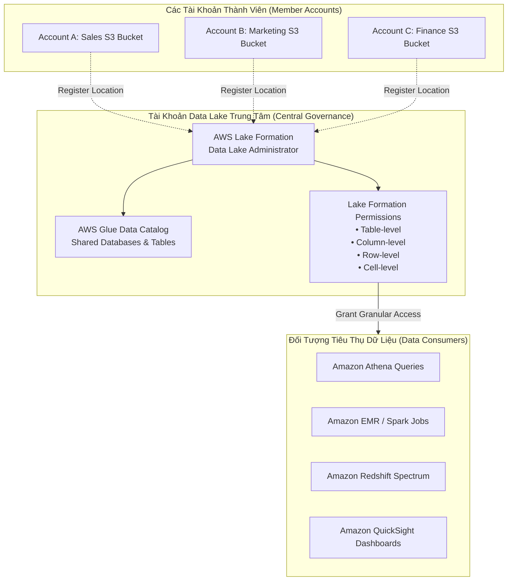
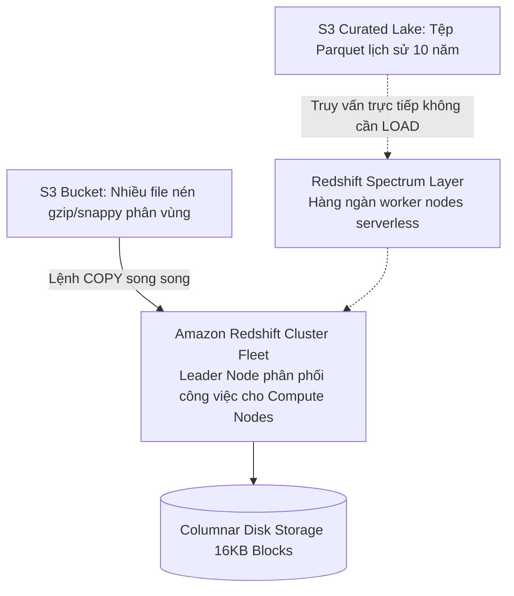
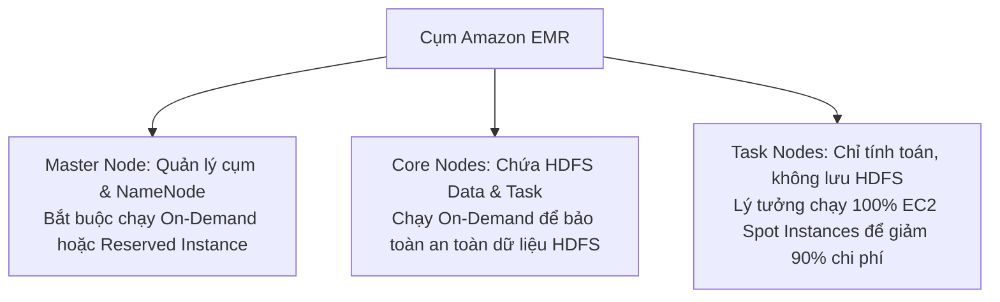
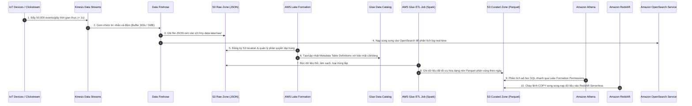

# Tài Liệu Học Tập Chuyên Sâu: AWS Analytics & Big Data Services (Athena, Glue, Lake Formation, EMR, Kinesis, Redshift, OpenSearch, QuickSight)

> **Tài liệu chuẩn hóa kiến trúc đám mây**: Hướng dẫn toàn diện theo tiêu chuẩn Principal AWS Solutions Architect & Senior Big Data Engineer (Cập nhật phiên bản kiến trúc mới nhất 2026).  
> **Ngôn ngữ**: Tiếng Việt chuyên ngành (Bảo lưu toàn bộ thuật ngữ chuyên ngành tiếng Anh chuẩn AWS).  
> **Mục tiêu**: Phục vụ thi chứng chỉ cấp độ Professional/Specialty (**SAA-C03, SAP-C02, Data Engineer Associate DEA-C01**) và thiết kế Data Lake / Data Warehouse cấp độ doanh nghiệp (**Production-grade**).  
> **Nguồn trích xuất thực chứng**: Tổng hợp từ hệ thống đề thi thực chiến **Cloud Mentor (PT1 - PT6)**, **Udemy (Stephane Maarek)**, và **Tutorials Dojo (Set 1 - Set 6, Set 8)**.  
> **Các bài giảng liên quan**: Chương 17 (Decoupling & Kinesis), Chương 22 (Data & Analytics) & Chương 32 (Preparing for the Exam).

---

## 6.1. Tổng Quan Dịch Vụ (Service Overview)

### 1. Định nghĩa chuẩn xác và Phân nhóm dịch vụ
Hệ sinh thái **AWS Analytics & Big Data** cung cấp đầy đủ các khối xây dựng (Building Blocks) từ thu nhận dữ liệu thời gian thực (Ingestion), quản trị Data Lake tập trung đa tài khoản, trích xuất và biến đổi (ETL), lưu trữ kho dữ liệu (Data Warehousing), tìm kiếm phân tích (Search & Observability), đến trực quan hóa thông minh (Business Intelligence).

```mermaid
flowchart LR
    subgraph Ingestion["1. Thu Nhận Dữ Liệu (Ingestion)"]
        KDS[Amazon Kinesis Data Streams\nThời gian thực < 1s, Shards, Replay]
        KDF[Amazon Data Firehose\nNear real-time 60s, Ghi trực tiếp S3/Redshift/OpenSearch]
        MSK[Amazon MSK\nApache Kafka Managed cluster]
    end

    subgraph StorageLake["2. Data Lake & Governance"]
        S3[(Amazon S3 Data Lake\nLưu trữ đối tượng trung tâm)]
        LakeForm[AWS Lake Formation\nQuản trị tập trung đa tài khoản & Row/Column Security]
        GlueCat[AWS Glue Data Catalog\nMetadata Schema Registry]
    end

    subgraph ProcessingETL["3. Xử Lý & Chuyển Đổi (ETL)"]
        GlueJob[AWS Glue ETL Jobs\nServerless Spark / Python]
        EMR[Amazon EMR\nHadoop, Spark, Trino, Instance Fleets]
    end

    subgraph WarehouseAnalytics["4. Phân Tích & Kho Dữ Liệu"]
        Athena[Amazon Athena\nServerless SQL truy vấn trực tiếp trên S3]
        Redshift[(Amazon Redshift Serverless\nColumnar Data Warehouse PB-scale)]
        OpenSearch[Amazon OpenSearch Service\nTìm kiếm toàn văn & Log Analytics]
    end

    subgraph BI["5. Trực Quan Hóa (BI)"]
        QS[Amazon QuickSight\nServerless BI Dashboard & SPICE]
    end

    Ingestion --> StorageLake
    StorageLake --> ProcessingETL
    ProcessingETL --> StorageLake
    StorageLake --> WarehouseAnalytics
    WarehouseAnalytics --> BI
```

---

### 2. Bài toán cốt lõi mà từng dịch vụ Analytics giải quyết

1. **AWS Lake Formation**: Dịch vụ quản trị và thiết lập **Data Lake tập trung** hàng đầu của AWS. Giúp doanh nghiệp gom và quản lý dữ liệu S3 từ **hàng chục tài khoản AWS khác nhau**, cấp quyền truy cập bảo mật chi tiết tới từng **cột (column-level)** và từng **dòng (row-level)** thông qua AWS Glue Data Catalog mà **hoàn toàn không cần sao chép dữ liệu** giữa các tài khoản (*TD-Set1 Q02, TD-Set6 Q63*).
2. **Amazon Athena**: Truy vấn phân tích ad-hoc phi máy chủ (Serverless SQL) trực tiếp trên hàng Petabytes dữ liệu lưu trữ tại Amazon S3 bằng ngôn ngữ Presto/Trino chuẩn ANSI SQL mà hoàn toàn không cần nạp dữ liệu hay khởi tạo máy chủ.
3. **AWS Glue**: Dịch vụ ETL (Extract, Transform, Load) hoàn toàn Serverless. Sử dụng **Glue Crawlers** để tự động quét schema và đăng ký vào **Glue Data Catalog**, kết hợp **Glue ETL Jobs** chạy Apache Spark tự động co giãn theo DPUs (Data Processing Units).
4. **Amazon EMR (Elastic MapReduce)**: Cung cấp môi trường cụm tính toán Big Data phân tán tiêu chuẩn công nghiệp (Apache Spark, Hive, Presto, Flink, HBase) với khả năng co giãn hàng ngàn máy ảo EC2 On-Demand/Spot tối ưu chi phí tới 90%.
5. **Amazon Kinesis Data Streams (KDS)**: Tiếp nhận và xử lý luồng dữ liệu streaming thời gian thực (Real-time Latency < 1s) với cơ chế phân đoạn (Shards), lưu giữ tin nhắn (Retention 24h - 365 ngày), hỗ trợ nhiều consumer độc lập qua **Enhanced Fan-Out** (*TD-Set1 Q08*).
6. **Amazon Data Firehose (formerly Kinesis Firehose)**: Đường ống nạp dữ liệu Near Real-time (đệm tối thiểu 60s hoặc 1MB) hoàn toàn Serverless; tự động chuyển đổi định dạng (JSON sang Parquet/ORC) và đẩy thẳng vào **S3, Redshift, OpenSearch Service, Splunk, hoặc HTTP Endpoints** (*TD-Set3 Q46*).
7. **Amazon Redshift & Redshift Spectrum**: Kho dữ liệu đám mây (Data Warehouse) lưu trữ theo cột (Columnar Storage), tối ưu cho các truy vấn phân tích phức tạp (OLAP). Nạp dữ liệu song song cực nhanh từ S3 qua lệnh `COPY`, và hỗ trợ **Redshift Spectrum** để join trực tiếp dữ liệu trong kho với các tệp tin trên S3 Data Lake mà không cần nạp vào ổ đĩa (*TD-Set1 Q28, TD-Set1 Q36*).
8. **Amazon OpenSearch Service (formerly Elasticsearch)**: Dịch vụ tìm kiếm phân tích và hiển thị log thời gian thực (Logstash/Fluentbit/Firehose $\rightarrow$ OpenSearch $\rightarrow$ OpenSearch Dashboards), hỗ trợ tìm kiếm toàn văn bản (full-text search) và phát hiện bất thường (*TD-Set3 Q46, TD-Set6 Q56*).

---

### 3. Khi nào KHÔNG nên dùng (Anti-patterns & Giải pháp thay thế)

* ❌ **Xử lý streaming thời gian thực dưới 1 giây mà dùng Data Firehose hoặc Glue ETL**: Firehose có buffer interval tối thiểu 60 giây; Glue ETL khởi chạy theo batch mất vài phút.  
  👉 *Giải pháp thay thế*: Sử dụng **Amazon Kinesis Data Streams** hoặc **Amazon MSK**.
* ❌ **Gom dữ liệu S3 đa tài khoản về Data Lake bằng cách thiết lập nhiều pipeline Data Firehose hoặc Lambda cron sao chép dữ liệu**: Gây tốn kém chi phí lưu trữ S3 nhân đôi và cực kỳ nặng gánh bảo trì phân quyền.  
  👉 *Giải pháp thay thế*: Sử dụng **AWS Lake Formation** để chia sẻ dữ liệu cross-account và phân quyền tập trung.
* ❌ **Giao dịch thanh toán trực tuyến (OLTP) có hàng ngàn câu lệnh INSERT/UPDATE nhỏ lẻ chạy trên Amazon Redshift**: Redshift được tối ưu cho đọc theo cột (Columnar OLAP), thao tác ghi đơn lẻ sẽ làm nghẽn vacuum và phân mảnh disk.  
  👉 *Giải pháp thay thế*: Sử dụng **Amazon Aurora** hoặc **Amazon DynamoDB**.
* ❌ **Truy vấn lặp đi lặp lại hàng triệu lần mỗi ngày trên S3 bằng Athena**: Athena tính phí $5.00 cho mỗi Terabyte dữ liệu quét qua đĩa (Scanned data).  
  👉 *Giải pháp thay thế*: Nạp dữ liệu vào **Amazon Redshift** hoặc **Amazon DynamoDB** / **ElastiCache**.

---

## 6.2. Các Khái Niệm, Kiến Trúc & Vận Hành Cốt Lõi (Core Concepts & Operations)

### 1. AWS Lake Formation: Kiến Trúc Quản Trị Data Lake Tập Trung Đa Tài Khoản

* **Cơ chế Cross-Account Sharing**:
  - Không cần di chuyển hay sao chép dữ liệu vật lý (No data duplication).
  - Sử dụng giao thức **Resource Links** hoặc chia sẻ qua **AWS RAM (Resource Access Manager)** tích hợp trong Lake Formation.
* **Phân quyền bảo mật chi tiết (Fine-grained Access Control - FGAC)**:
  - **Column-level security**: Cho phép bộ phận Marketing xem cột `customer_name`, `email` nhưng ẩn cột `credit_card_number`.
  - **Row-level security**: Cho phép quản lý chi nhánh chỉ xem các dòng có `region = 'Asia-Pacific'`.
  - **Data Filters**: Kết hợp lọc dòng và lọc cột trong một chính sách duy nhất.

---

### 2. Kinesis Data Streams vs Data Firehose vs SQS

| Tiêu chí | Amazon Kinesis Data Streams (KDS) | Amazon Data Firehose | Amazon SQS (Standard/FIFO) |
| :--- | :--- | :--- | :--- |
| **Bản chất** | Streaming Ingestion (Luồng dữ liệu liên tục) | Delivery Stream (Nạp dữ liệu vào Storage) | Message Queue (Hàng đợi thông điệp) |
| **Độ trễ (Latency)** | **Thời gian thực (< 200 - 1,000 ms)** | **Gần thời gian thực (60 - 900 giây)** | Thời gian thực (mili-giây) |
| **Quản trị năng lực** | Provisioned (Shards) hoặc On-Demand | **Serverless hoàn toàn (Tự co giãn)** | **Serverless hoàn toàn (Tự co giãn)** |
| **Lưu trữ & Replay** | Lưu từ 24 giờ đến 365 ngày; **cho phép Replay** | **Không lưu trữ** (chỉ chuyển tiếp dữ liệu) | Lưu tối đa 14 ngày; **xóa sau khi đọc** |
| **Đích đến (Targets)** | Kinesis Client App (KCL), Lambda, Flink | **Amazon S3, Redshift, OpenSearch, HTTP, Splunk** | EC2, Lambda, ECS Workers |
| **Nhiều Consumers** | Hỗ trợ nhiều Consumer đọc song song độc lập | Chỉ đẩy vào 1 đích đến cấu hình | 1 tin nhắn chỉ tiêu thụ bởi 1 worker |

---

### 3. Tối Ưu Hóa Chi Phí & Hiệu Năng Amazon Athena

Athena tính phí dựa trên **dung lượng dữ liệu quét qua đĩa S3 ($5/TB scanned)**:
1. **Chuyển đổi sang định dạng cột (Columnar Format - Parquet hoặc ORC)**:
   - File CSV thô kích thước 1 TB $\rightarrow$ Chuyển sang Apache Parquet chỉ còn ~130 GB (nén gzip/snappy).
   - Khi chạy câu lệnh `SELECT customer_id, total_amount FROM orders`, Athena **chỉ đọc 2 cột cần thiết** thay vì đọc toàn bộ các dòng $\rightarrow$ Quét chỉ 5 GB $\rightarrow$ **Tiết kiệm 99% chi phí và tốc độ nhanh gấp 10 lần**!
2. **Phân vùng dữ liệu (Partitioning)**:
   - Đặt đường dẫn theo cấu trúc Hive: `s3://my-bucket/logs/year=2026/month=11/day=04/`.
   - Khi truy vấn `WHERE year=2026 AND month=11`, Athena sẽ bỏ qua toàn bộ dữ liệu của các tháng khác.
3. **Kích thước file tối ưu**:
   - Tránh tình trạng hàng triệu file nhỏ vài Kilobytes (gây nghẽn metadata); gộp file thành kích thước chuẩn **128 MB đến 512 MB**.

---

### 4. Amazon Redshift: Nạp Dữ Liệu Song Song với Lệnh COPY & Redshift Spectrum

* **Lệnh `COPY`**: Luôn là phương pháp nạp dữ liệu hàng loạt (Bulk Load) nhanh nhất và hiệu quả nhất vào Redshift. Tận dụng kiến trúc MPP (Massively Parallel Processing), chia nhỏ file thành nhiều phần bằng bội số của số Compute Slices để tải dữ liệu song song trực tiếp từ S3.
* **Redshift Spectrum**: Cho phép chạy các câu lệnh SQL truy vấn trực tiếp dữ liệu ngoại vi (External Tables) trên Amazon S3 mà không cần cấp phát thêm dung lượng đĩa Redshift. Hỗ trợ câu lệnh SQL kết hợp (`JOIN`) giữa bảng nội bộ trong Redshift với bảng ngoại vi trên S3 Data Lake.

---

### 5. Cụm Amazon EMR: Instance Groups vs Instance Fleets

* **EMR Instance Groups**: Cấu hình truyền thống; mỗi nhóm node (Master, Core, Task) bị khóa vào **1 Availability Zone duy nhất** và 1 loại EC2 instance type cố định. Khi AZ hết dung lượng Spot, cụm EMR sẽ thất bại.
* **EMR Instance Fleets**: Cấu hình hiện đại; cho phép khai báo **danh sách nhiều Subnets đa AZ** và **lựa chọn lên tới 30 instance types thay thế**. EMR tự động chọn AZ có sẵn tài nguyên Spot để khởi chạy, triệt tiêu lỗi thiếu dung lượng (*TD-Set4 Q44*).

---

## 6.3. Kiến Trúc Thực Tế và Luồng Vận Hành (Production Architecture & Workflow)

### Sơ Đồ Quy Trình Data Lake & Serverless Analytics Toàn Diện

---

## 6.4. Bảng Tích Hợp với Các Dịch Vụ AWS Khác (Integration Table)

| Dịch vụ liên kết | Phương thức tích hợp | Mục đích kỹ thuật & Kịch bản áp dụng |
| :--- | :--- | :--- |
| **Amazon S3** | S3 Event Notifications / Direct Storage | Đóng vai trò Data Lake trung tâm; nạp dữ liệu từ Firehose, Glue, EMR, Athena. |
| **AWS Lake Formation** | Central Governance / RAM | Cung cấp phân quyền cột/dòng và chia sẻ S3 Data Lake xuyên hàng chục tài khoản (*TD-Set1 Q02*). |
| **AWS KMS** | Customer Managed Key (CMK) | Mã hóa dữ liệu At-Rest trên S3, Glue Data Catalog, Kinesis Streams, Redshift. |
| **AWS Step Functions** | Service Integration (`arn:aws:states:::glue:startJobRun`) | Điều phối quy trình Data Pipeline nhiều bước (Crawler $\rightarrow$ ETL Job $\rightarrow$ Athena Query). |
| **Amazon EventBridge** | Event Patterns | Bắt sự kiện khi Glue Job chạy thành công (`SUCCEEDED`) hoặc thất bại (`FAILED`) để kích hoạt thông báo SNS. |
| **Amazon CloudWatch** | Metrics & Logs | Giám sát `GetRecords.IteratorAgeMilliseconds` trên Kinesis để phát hiện consumer bị chậm. |
| **AWS IAM** | Service Role / FGAC | Cấp quyền cho Glue truy cập S3 bucket, cấp quyền cho Redshift truy cập S3 qua Spectrum. |

---

## 6.5. Bảng So Sánh Các Dịch Vụ Phân Tích Dữ Liệu (Ecosystem Comparison)

| Dịch vụ | Loại kiến trúc | Khối lượng dữ liệu tối ưu | Tốc độ phản hồi truy vấn | Chi phí & Quản trị |
| :--- | :--- | :--- | :--- | :--- |
| **AWS Lake Formation** | Data Lake Governance Layer | TB đến EB trên S3 đa tài khoản | Phụ thuộc Query Engine (Athena, Redshift) | Miễn phí dịch vụ; chỉ trả tiền S3, Glue, Athena tương ứng |
| **Amazon Athena** | Serverless SQL Query Engine | TB đến PB trên S3 | Vài giây đến vài phút | $5/TB dữ liệu quét; Zero infrastructure management |
| **Amazon Redshift** | Massively Parallel (MPP) Data Warehouse | Hàng chục TB đến hàng chục PB | **Mili-giây đến vài giây** (rất nhanh cho OLAP) | Tính theo RPU (Serverless) hoặc Node giờ; tối ưu cho truy vấn phức tạp lặp lại |
| **Amazon EMR** | Distributed Computing Cluster (Hadoop/Spark) | Hàng chục PB đến EB | Tùy tác vụ xử lý hàng giờ | Tính theo EC2 instance + EMR license/giờ; kiểm soát 100% cấu hình Spark/YARN |
| **Amazon OpenSearch Service** | Distributed Search Engine (Lucene) | GB đến hàng chục TB | **Mili-giây** | Tìm kiếm văn bản đầy đủ (Full-text), lọc log, OpenSearch Dashboards |

---

## 6.6. FinOps & Chiến Lược Tối Ưu Chi Phí (Cost Optimization)

### Phép tính so sánh: Truy vấn Athena trên CSV thô vs Parquet
* **Bối cảnh**: Doanh nghiệp lưu trữ 100 TB dữ liệu log truy cập web thô dạng CSV trên S3. Mỗi ngày đội BI chạy 10 câu lệnh SQL truy vấn tổng hợp 3 cột (`request_time`, `user_id`, `status_code` chiếm khoảng 8% dung lượng file).
  $$\text{Chi phí nếu để file CSV} = 10 \text{ queries} \times 100 \text{ TB} \times 5\$ = \mathbf{5,000\$/\text{ngày}} \quad (\approx \mathbf{150,000\$/\text{tháng}})$$
* **Chiến lược tối ưu hóa**:
  1. Sử dụng AWS Glue ETL Job chuyển đổi toàn bộ dữ liệu CSV sang **Apache Parquet (nén Snappy)**. Kích thước nén giảm từ 100 TB xuống còn 20 TB.
  2. Phân vùng (Partitioning) theo `year/month/day`.
  3. Khi Athena truy vấn Parquet, dịch vụ **chỉ quét 3 cột tương ứng = 1.6 TB dữ liệu** thay vì toàn bộ 100 TB:
  $$\text{Chi phí sau tối ưu} = 10 \text{ queries} \times 1.6 \text{ TB} \times 5\$ = \mathbf{80.00\$/\text{ngày}} \quad (\approx \mathbf{2,400\$/\text{tháng}})$$
* **Khoản tiền tiết kiệm**: Tiết kiệm hơn **$147,600/tháng (giảm 98.4% chi phí)**!

---

## 6.7. Khắc Phục Sự Cố Thực Tế (Troubleshooting Guide)

| Vấn đề (Problem) | Nguyên nhân khả dĩ (Possible Causes) | Các bước điều tra (Investigation Steps) | Giải pháp xử lý (Solution) | Biện pháp phòng ngừa (Prevention) |
| :--- | :--- | :--- | :--- | :--- |
| **Kinesis: Consumer bị chậm, dữ liệu bị dồn ứ** | Metric `GetRecords.IteratorAgeMilliseconds` tăng vọt liên tục do consumer xử lý không kịp tốc độ đẩy dữ liệu vào Shard. | Kiểm tra CloudWatch metric `IteratorAgeMilliseconds` và CPU của worker instance. | 1. Tăng số lượng Shards (Resharding/Split Shard). 2. Bật tính năng **Enhanced Fan-Out** với HTTP/2 Push chuyên dụng cho consumer. | Cấu hình Auto Scaling cho Kinesis Data Streams. |
| **Kinesis: Lỗi `ProvisionedThroughputExceededException`** | Producer đẩy dữ liệu vượt quá giới hạn 1 MB/s hoặc 1,000 records/s trên một Shard cụ thể (Hot Shard do chọn Partition Key kém). | Xem metric `PutRecords.ThrottledRecords` trên CloudWatch. | 1. Thay đổi thuật toán chọn Partition Key có độ ngẫu nhiên cao (phân bổ đều). 2. Chuyển Kinesis sang **On-Demand Capacity Mode**. | Áp dụng Exponential Backoff with Jitter trong mã nguồn Producer. |
| **Athena: Truy vấn bị Timeout hoặc lỗi `Query exhausted resources`** | Câu truy vấn `JOIN` quá nhiều bảng lớn chưa được phân vùng hoặc bảng chứa hàng triệu file rác kích thước nhỏ. | Xem Execution Plan trong Athena Query History và dung lượng quét. | 1. Thêm điều kiện `WHERE` trên các cột phân vùng (`partition keys`). 2. Chạy Glue Job gộp các file nhỏ thành các file lớn 128MB. | Định kỳ chạy tác vụ compact file trên Data Lake. |
| **EMR: Node Spot bị thu hồi làm hỏng cả Job tính toán** | Đặt Core Nodes trên EC2 Spot Instances. Khi AWS thu hồi Spot, dữ liệu block HDFS bị mất gây sập cụm Hadoop. | Xem log YARN ResourceManager trên Master Node. | **QUY TẮC SỐNG CÒN**: Core Nodes bắt buộc phải chạy **EC2 On-Demand**; chỉ đặt Task Nodes trên Spot Instances! | Sử dụng EMR Instance Fleets với đa dạng Spot pools. |
| **Lake Formation: User không thể truy vấn bảng dù IAM Role đã cấp quyền** | Thiếu quyền cấp phát trong bảng phân quyền **Lake Formation Permissions** (Lake Formation là lớp quyền thứ hai bổ sung độc lập trên IAM). | Kiểm tra Lake Formation Console $\rightarrow$ Data Permissions cho IAM Principal. | Cấp quyền `SELECT` trên Table/Columns cụ thể trong Lake Formation Console. | Luôn phân định rõ: IAM cấp quyền truy cập dịch vụ, Lake Formation cấp quyền chi tiết trên dữ liệu. |

---

## 🏛️ I. Các Kịch Bản Kiến Trúc Chuẩn (Best Practice Scenarios)

#### 1. Quản Lý Data Lake Tập Trung Đa Tài Khoản Với AWS Lake Formation — (TD-Set1 Q02, TD-Set6 Q63)
- **Tình huống thi**: Doanh nghiệp có hàng chục tài khoản AWS, mỗi tài khoản sở hữu một S3 bucket chứa dữ liệu riêng biệt. Ban quản trị muốn truy vấn dữ liệu từ một Data Lake trung tâm, đồng thời phân quyền truy cập theo vai trò người dùng (User Roles) chi tiết tới từng bảng và cột với **ít công vận hành và chi phí thấp nhất**.
- **Giải pháp tối ưu chuẩn AWS**:
  - Triển khai **AWS Lake Formation** tại tài khoản trung tâm.
  - Đăng ký các S3 bucket từ các tài khoản thành viên vào Lake Formation.
  - Sử dụng AWS Glue Data Catalog làm danh mục dữ liệu dùng chung và định nghĩa phân quyền (Grant/Revoke) chi tiết tới cấp Table/Column/Row cho các IAM roles mà **không cần copy dữ liệu qua lại giữa các account**.

#### 2. Nạp Dữ Liệu Hàng Loạt Vào Redshift Bằng Lệnh COPY Song Song — (TD-Set1 Q28)
- **Tình huống thi**: Một ứng dụng thương mại điện tử cần nạp hàng trăm Gigabytes dữ liệu giao dịch hàng ngày từ Amazon S3 vào Amazon Redshift để phục vụ báo cáo buổi sáng. Việc chạy các câu lệnh `INSERT` truyền thống diễn ra quá chậm và làm treo hệ thống.
- **Giải pháp chuẩn**:
  - Sử dụng lệnh **`COPY` của Amazon Redshift**.
  - Chia nhỏ dữ liệu thành nhiều file nén (gzip/snappy) tương ứng với số slices của cụm Redshift.
  - Lệnh `COPY` đọc trực tiếp từ S3 song song trên tất cả các compute nodes, đạt tốc độ nạp hàng triệu bản ghi trong vài phút.

#### 3. Truy Vấn Dữ Liệu Trực Tiếp Trên S3 Không Cần Nạp Vào Redshift Bằng Redshift Spectrum — (TD-Set1 Q36)
- **Tình huống thi**: Kho dữ liệu Redshift có dung lượng đĩa hạn chế. Doanh nghiệp có 10 TB dữ liệu lịch sử lưu trên Amazon S3 và thỉnh thoảng cần join bảng dữ liệu lịch sử này với bảng dữ liệu hiện tại trong Redshift. Ban quản lý cấm nâng cấp mở rộng cụm Redshift vì lý do chi phí.
- **Giải pháp chuẩn**:
  - Sử dụng **Amazon Redshift Spectrum**.
  - Đăng ký metadata dữ liệu S3 vào AWS Glue Data Catalog.
  - Tạo External Schema trong Redshift trỏ tới Glue Catalog.
  - Viết câu lệnh SQL truy vấn trực tiếp bảng ngoài S3 và join với bảng nội bộ Redshift mà không tốn 1 byte dung lượng đĩa cụm Redshift.

#### 4. Nạp Dữ Liệu Streaming Đồng Thời Vào S3, OpenSearch Service Và Splunk — (TD-Set3 Q46)
- **Tình huống thi**: Một hệ thống cửa hàng thông minh sử dụng cảm biến IoT gửi luồng dữ liệu mua sắm thời gian thực. Cần nạp dữ liệu bền vững vào Amazon S3 để lưu trữ lâu dài, đồng thời nạp vào **Amazon OpenSearch Service** và Splunk để hiển thị dashboard và tìm kiếm tức thì.
- **Giải pháp chuẩn**:
  - Triển khai **Amazon Data Firehose**.
  - Firehose tự động chuyển đổi, định dạng dữ liệu và nạp trực tiếp vào S3, OpenSearch Service và Splunk một cách hoàn toàn Serverless.

---

## 🪤 II. Các Bẫy Thi Tinh Vi & Phân Tích Phương Án Sai (Exam Traps & Distractors)

#### 🪤 Bẫy 1: Real-Time Streaming (< 1s) vs Near Real-Time Delivery (60s) — (CM-PT3 Q02, TD-Set1 Q08)
- **Tình huống đề thi**: *"Hệ thống yêu cầu phát hiện gian lận và kích hoạt cảnh báo trong vòng chưa đầy 1 giây kể từ khi sự kiện xảy ra từ các thiết bị IoT."*
- **Các phương án bẫy**:
  - ❌ *Dùng Amazon Data Firehose*: Firehose có cơ chế đệm bắt buộc (Buffer interval tối thiểu 60 giây), không thể đáp ứng yêu cầu dưới 1 giây!
  - ❌ *Dùng AWS Glue ETL*: Là giải pháp batch theo lô, mất vài phút khởi động.
- **Giải pháp ĐÚNG**: **Amazon Kinesis Data Streams** kết hợp **AWS Lambda** hoặc Amazon Managed Service for Apache Flink.

#### 🪤 Bẫy 2: Data Lake Đa Tài Khoản: Data Firehose/Lambda vs Lake Formation — (TD-Set1 Q02)
- **Tình huống đề thi**: *"Cần hợp nhất dữ liệu từ nhiều tài khoản AWS vào một Data Lake trung tâm với phân quyền theo vai trò người dùng và ít công sức quản trị nhất."*
- **Các phương án bẫy**:
  - ❌ *Dùng Amazon Data Firehose ở từng tài khoản để đẩy dữ liệu*: Tốn kém chi phí, vận hành phức tạp, dữ liệu bị trùng lặp.
  - ❌ *Dùng Lambda định kỳ bằng EventBridge để copy file S3*: Quá tốn công viết code, bảo trì lỗi thời.
- **Giải pháp ĐÚNG**: **AWS Lake Formation** (quản trị tập trung, không cần copy dữ liệu, phân quyền native).

#### 🪤 Bẫy 3: Phân Tích Dữ Liệu Lớn Trên EMR: Instance Groups vs Instance Fleets — (CM-PT2 Q26, TD-Set4 Q44)
- **Tình huống đề thi**: *"Khởi chạy cụm Amazon EMR trên các máy ảo EC2 Spot trải dài trên nhiều Subnets để tiết kiệm chi phí, nhưng thường xuyên gặp lỗi thiếu Spot capacity tại một số AZ."*
- **Giải pháp ĐÚNG**: Sử dụng **EMR Instance Fleets configuration** (thay vì Instance Groups).
  - Instance Fleets cho phép định nghĩa nhiều subnets đa AZ và tới 30 instance types thay thế, EMR tự động chọn AZ có capacity Spot dồi dào để launch.

---

## 📊 III. Ma Trận Quyết Định Công Nghệ Phân Tích Nhanh (Exam Decision Matrix)

| Tình huống / Yêu cầu trong đề thi | Giải pháp chuẩn AWS | Giải pháp bị loại & Lý do | Đề thi thực chứng |
|:---|:---|:---|:---:|
| **Quản trị Data Lake đa tài khoản, phân quyền cột/dòng** | **AWS Lake Formation** | Thiết lập nhiều Data Firehose hoặc viết Lambda copy (tốn công) | TD-Set1 Q02, TD-Set6 Q63 |
| **Truy vấn SQL ad-hoc trực tiếp trên S3, không quản lý server** | **Amazon Athena** | Amazon Redshift (quá tốn kém cho truy vấn ad-hoc thỉnh thoảng) | CM-PT1 Q34 |
| **Kho dữ liệu phân tích phức tạp OLAP, PB-scale** | **Amazon Redshift (Serverless)** | Amazon RDS (chỉ tối ưu cho OLTP, nghẽn khi chạy OLAP lớn) | CM-PT1 Q45 |
| **Nạp dữ liệu hàng loạt cực nhanh từ S3 vào Redshift** | **Lệnh `COPY` của Redshift** | Chạy nhiều câu lệnh `INSERT` đơn lẻ (gây nghẽn đĩa và cực chậm) | TD-Set1 Q28 |
| **Truy vấn dữ liệu ngoài S3 từ Redshift không tốn đĩa** | **Amazon Redshift Spectrum** | Mở rộng đĩa Redshift rồi nạp toàn bộ file vào (rất đắt đỏ) | TD-Set1 Q36 |
| **Xử lý luồng thời gian thực < 1s, replay dữ liệu** | **Amazon Kinesis Data Streams** | Amazon Data Firehose (độ trễ đệm tối thiểu 60s) | TD-Set1 Q08 |
| **Nạp dữ liệu liên tục thẳng vào S3, OpenSearch, Splunk** | **Amazon Data Firehose** | Tự viết code worker đọc Kinesis đẩy OpenSearch (tốn công) | TD-Set3 Q46 |
| **Tìm kiếm toàn văn bản (Full-text) và hiển thị log real-time** | **Amazon OpenSearch Service** | Amazon Athena (Athena không tối ưu cho full-text search) | TD-Set6 Q56 |
| **Nhiều ứng dụng đọc độc lập cùng luồng Kinesis không chậm** | **Kinesis Enhanced Fan-Out (EFO)** | Standard Consumer (bị giới hạn chia sẻ 2MB/s/shard) | CM-PT1 Q43 |
| **Cụm Hadoop/Spark tính toán lớn với Spot đa AZ** | **Amazon EMR Instance Fleets** | EMR Instance Groups (bị khóa trong 1 AZ duy nhất) | TD-Set4 Q44 |

---

## 6.8. Tóm Tắt và Danh Mục Kiểm Tra Kiến Thức (Summary & Learning Checklist)

### 7 Nguyên Tắc Kiến Trúc "Sống Còn" Của AWS Analytics
1. **AWS Lake Formation cho Data Lake đa tài khoản**: Quản trị tập trung metadata và phân quyền chi tiết (table, column, row) qua Glue Catalog mà không cần duplicate file trên S3.
2. **Nguyên tắc định dạng Data Lake**: Luôn chuyển đổi file thô sang định dạng cột nén **Apache Parquet** và phân vùng theo ngày tháng để giảm 90% chi phí Athena.
3. **Quy tắc phân biệt Kinesis**: Cần $< 1\text{s}$ hoặc replay $\rightarrow$ Kinesis Data Streams. Cần nạp thẳng S3/Redshift/OpenSearch không quản lý shard $\rightarrow$ Data Firehose.
4. **Quy tắc nạp dữ liệu Redshift**: Luôn dùng lệnh **`COPY`** song song; không bao giờ dùng `INSERT` cho dữ liệu lớn.
5. **Redshift Spectrum**: Cho phép query trực tiếp file trên S3 mà không cần nạp vào ổ đĩa Redshift, kết hợp bảng trong kho dữ liệu với bảng ngoài Data Lake.
6. **Quy tắc Core Nodes trên EMR**: Master & Core Nodes luôn chạy **On-Demand**; chỉ Task Nodes chạy **EC2 Spot**.
7. **Redshift Serverless cho tải gián đoạn**: Workload phân tích theo chu kỳ tuần/tháng nên chọn Serverless để co về 0 RPU khi nhàn rỗi.

---

### Liên Kết Nội Bộ và Tài Liệu Tham Khảo (Internal Links)
- 📝 [Bộ đề thi thực hành Tutorials Dojo (Set 1 - Set 6, Set 8)](../Practices_Test/Dojo/)
- 📖 [Ghi Chú Bài Học Chương 17: Decoupling & Kinesis](../Lesson_Notes/17_Decoupling_SQS_SNS_Kinesis.md)
- 📖 [Ghi Chú Bài Học Chương 22: Data & Analytics](../Lesson_Notes/22_Data_and_Analytics.md)
- 📖 [Tài Liệu Chuyên Sâu: Amazon S3 & CloudFront](./S3_and_CloudFront_Storage.md)
- 📖 [Cẩm Nang Từ Vựng Giải Mã Đề Thi](../EXAM_VOCABULARY.md)
- 📖 [Bảng Thuật Ngữ Kỹ Thuật Đám Mây](../GLOSSARY.md)
