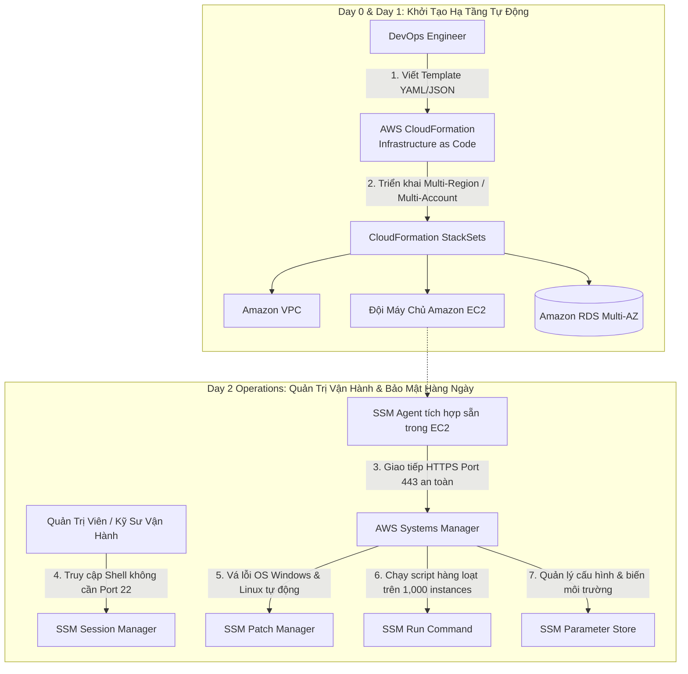

# Tài Liệu Học Tập Chuyên Sâu: AWS CloudFormation & AWS Systems Manager (Infrastructure as Code & Fleet Automation)

> **Tài liệu chuẩn hóa kiến trúc đám mây**: Hướng dẫn toàn diện theo tiêu chuẩn Principal DevOps & Automation Solutions Architect (Cập nhật phiên bản kiến trúc mới nhất 2026).  
> **Ngôn ngữ**: Tiếng Việt chuyên ngành (Bảo lưu 100% thuật ngữ chuyên ngành tiếng Anh chuẩn AWS).  
> **Mục tiêu**: Phục vụ thi chứng chỉ cấp độ Professional/Specialty (**SAA-C03, SAP-C02, SysOps & DevOps Professional**) và thiết kế quy trình tự động hóa hạ tầng cấp độ doanh nghiệp (**Enterprise-scale Automation**).  
> **Các bài giảng liên quan**: Chương 17 (CloudFormation Deep-Dive) & Chương 23 (Other Services: Systems Manager, OpsWorks, Elastic Beanstalk).

---

## 1. Tổng Quan Bộ Đôi Hạ Tầng & Vận Hành Tự Động (Service Overview)

### 1. Phân vai kiến trúc giữa CloudFormation và Systems Manager

Trong quản trị đám mây hiện đại, AWS chia tự động hóa thành 2 giai đoạn vòng đời rõ rệt:
1. **AWS CloudFormation (Giai đoạn Khởi Tạo Hạ Tầng - Day 0 & Day 1)**: Cung cấp hạ tầng dưới dạng mã (**Infrastructure as Code - IaC**). Định nghĩa toàn bộ tài nguyên (VPC, Subnets, EC2, RDS, IAM Policies, S3) dưới dạng tệp văn bản JSON hoặc YAML có cấu trúc. Đảm bảo môi trường được khởi tạo đồng nhất, có thể lặp lại và kiểm soát phiên bản bằng Git.
2. **AWS Systems Manager - SSM (Giai đoạn Quản Trị Vận Hành Hàng Ngày - Day 2 Operations)**: Quản lý và vận hành toàn diện đội ngũ máy chủ (**Fleet Management**) trên quy mô hàng nghìn máy ảo EC2 và máy chủ vật lý On-Premises. Cung cấp khả năng truy cập shell bảo mật không cần mở port SSH (**Session Manager**), vá lỗi hệ điều hành tự động (**Patch Manager**), quản trị cấu hình (**Parameter Store & State Manager**), cấu hình mặc định toàn tài khoản (**Default Host Management Configuration - DHMC**), và thực thi lệnh từ xa (**Run Command**).



---

### 2. Bài toán cốt lõi mà các dịch vụ giải quyết

1. **Loại bỏ hoàn toàn cấu hình thủ công (Zero ClickOps & Configuration Drift)**: Thay vì nhấp chuột thủ công trên AWS Console dễ gây nhầm lẫn giữa môi trường Dev, Staging và Production, CloudFormation cho phép sao chép 100% kiến trúc chỉ trong vài phút.
2. **Loại bỏ máy chủ Bastion Host và mở Port SSH 22 nguy hiểm (Zero-Bastion Architecture)**: Systems Manager Session Manager cho phép kỹ sư mở terminal truy cập máy chủ nằm sâu trong Private Subnet hoàn toàn qua giao diện trình duyệt hoặc AWS CLI, mã hóa TLS 1.2 qua port 443, không cần cấp Public IP và không cần quản lý SSH Key pairs!
3. **Tuân thủ và kiểm soát vòng đời máy chủ quy mô lớn**: Patch Manager tự động quét các lỗ hổng bảo mật (CVEs) và cài đặt bản vá trên toàn bộ dàn máy chủ Windows và Linux theo lịch định kỳ mà không gây gián đoạn dịch vụ.

---

## 2. Các Kịch Bản Kiến Trúc & Bẫy Thi Thường Gặp (Architecture Scenarios & Exam Traps)

### 🏛️ I. Các Kịch Bản Kiến Trúc Chuẩn (Best Practice Scenarios)

#### 1. Quản Trị EC2 Trong Private Subnet An Toàn Không Mở Cổng 22 — (CM-PT1 Q19, CM-PT4 Q59)
- **Tình huống thi**: Doanh nghiệp có chính sách an ninh mạng nghiêm ngặt: Toàn bộ máy chủ ứng dụng EC2 phải đặt trong Private Subnet, không được cấp Public IP và nghiêm cấm mở cổng SSH (Port 22) hoặc RDP (Port 3389). Kỹ sư vận hành vẫn cần quyền truy cập shell dòng lệnh để khắc phục sự cố khi cần thiết.
- **Giải pháp tối ưu chuẩn AWS**:
  - Gắn IAM Role chứa policy **`AmazonSSMManagedInstanceCore`** vào các máy chủ EC2.
  - Tạo 3 **Interface VPC Endpoints (AWS PrivateLink)** trong VPC trỏ tới các dịch vụ:
    1. `com.amazonaws.<region>.ssm`
    2. `com.amazonaws.<region>.ssmmessages`
    3. `com.amazonaws.<region>.ec2messages`
  - Kỹ sư sử dụng **AWS Systems Manager Session Manager** để mở phiên dòng lệnh trực tiếp trên trình duyệt mà không cần Bastion host, không cần mở bất kỳ cổng Inbound nào trên Security Group.

#### 2. Tự Động Quét Và Cài Bản Vá OS Cho Đội Máy Chủ Lớn — (CM-PT3 Q17)
- **Tình huống thi**: Doanh nghiệp di chuyển hàng trăm máy ảo từ On-Premises lên EC2, chạy nhiều phiên bản hệ điều hành khác nhau gồm Windows Server, Amazon Linux và Ubuntu. Đội ngũ an ninh yêu cầu tự động hóa việc kiểm kê phần mềm, tự động cài đặt các bản vá lỗi hàng tháng và xuất báo cáo lỗ hổng bảo mật định kỳ với nỗ lực vận hành thấp nhất.
- **Giải pháp tối ưu**:
  - Cài đặt và kích hoạt **SSM Agent** trên toàn bộ đội máy chủ.
  - Sử dụng **AWS Systems Manager Patch Manager**.
  - Thiết lập **Default Patch Baselines** cho từng hệ điều hành tương ứng.
  - Cấu hình **Maintenance Windows** để tự động chạy tác vụ vá lỗi vào cuối tuần.
  - Sử dụng tính năng **Compliance Dashboard** của Systems Manager để theo dõi mức độ tuân thủ và xuất báo cáo lỗ hổng cho ban quản trị.

#### 3. Quản Trị Hạ Tầng Bằng Mã Kết Hợp Theo Dõi Tuân Thủ Liên Tục — (CM-PT6 Q30)
- **Tình huống thi**: Một tập đoàn đa quốc gia muốn tự động hóa hoàn toàn quy trình thiết lập hệ thống mạng và hạ tầng đám mây. Đội ngũ bảo mật bắt buộc phải có khả năng theo dõi, kiểm toán và nhận cảnh báo về mọi thay đổi cấu hình tài nguyên phát sinh theo thời gian.
- **Giải pháp tối ưu**:
  - Sử dụng **AWS CloudFormation** để đóng gói toàn bộ kiến trúc hạ tầng thành các mẫu template được quản lý phiên bản trên Git (IaC).
  - Kích hoạt **AWS Config Recorder** trên toàn bộ tài nguyên để tự động ghi lại lịch sử cấu hình chi tiết theo thời gian thực.
  - Bật các quy tắc kiểm tra tuân thủ (**AWS Config Managed Rules**); khi có bất kỳ thay đổi nào làm tài nguyên vi phạm tiêu chuẩn an ninh, AWS Config tự động gửi cảnh báo qua Amazon SNS.

#### 4. Cài Đặt Phần Mềm Doanh Nghiệp Phức Tạp Bằng CloudFormation `cfn-init` & `CreationPolicy` — (TD-Set3 Q27)
- **Tình huống thi**: Doanh nghiệp triển khai môi trường Microsoft SharePoint Server trên AWS bằng CloudFormation. Kiến trúc gồm Active Directory Domain Controllers, cụm Microsoft SQL Server AlwaysOn và các SharePoint web front-end servers. Quá trình tạo máy ảo EC2 phải tạm dừng và chờ đợi cho đến khi các script cài đặt phần mềm và cấu hình AD hoàn tất thành công thì CloudFormation mới đánh dấu Stack tạo thành công (`TD-Set3 Q27`).
- **Giải pháp chuẩn AWS**:
  - Khai báo metadata **`AWS::CloudFormation::Init`** chứa các chỉ thị cài đặt packages, file cấu hình và commands.
  - Trong `UserData` của EC2 instance, gọi helper script **`cfn-init`** để thực thi cài đặt và sau đó gọi **`cfn-signal`** gửi mã trạng thái thoát về CloudFormation.
  - Cấu hình thuộc tính **`CreationPolicy`** trên tài nguyên EC2 với `Count: 1` và `Timeout: PT30M`. CloudFormation sẽ chờ tín hiệu từ `cfn-signal` trước khi chuyển trạng thái instance sang `CREATE_COMPLETE`.

#### 5. Quản Trị Và Cấu Hình Hàng Loạt Máy Chủ Game Không Cần Mở Port Bằng SSM Run Command — (TD-Set5 Q33, TD-Set4 Q38)
- **Tình huống thi**: Một công ty khởi nghiệp vận hành đội máy ảo EC2 On-Demand trong Auto Scaling Group để phục vụ tựa game nhập vai nhiều người chơi (MMORPG). Đội ngũ vận hành cần định kỳ cấu hình, cập nhật file patch game và cài đặt CloudWatch Agent trên hàng trăm máy ảo cùng lúc mà **tuyệt đối không cần mở bất kỳ kết nối trực tiếp nào (No SSH/RDP, No Bastion Host)** (`TD-Set5 Q33`, `TD-Set4 Q38`).
- **Giải pháp chuẩn AWS**:
  - Cấu hình máy ảo EC2 với IAM Role chứa policy **`AmazonSSMManagedInstanceCore`**.
  - Sử dụng **AWS Systems Manager Run Command** để thực thi lệnh hoặc SSM Document (`AWS-RunShellScript` / `AWS-RunPowerShellScript`) trên các máy ảo được chọn theo Tag (ví dụ: `Environment=Production`).
  - Lệnh được gửi qua kết nối HTTPS outbound tới Systems Manager service, thực thi an toàn trong nền và ghi toàn bộ output về CloudWatch Logs hoặc S3 bucket.

#### 6. Duy Trì Trạng Thái Cấu Hình Nhất Quán Cho Máy Chủ Y Tế Bằng SSM State Manager — (TD-Set5 Q04)
- **Tình huống thi**: Tổ chức y tế sử dụng các máy ảo Dedicated EC2 để chạy ứng dụng hồ sơ bệnh án. Để đảm bảo tính tuân thủ pháp lý và sự nhất quán an ninh, tổ chức cần một giải pháp tự động định kỳ kiểm tra và ép cấu hình hệ điều hành (antivirus, firewall rules, logging agent) luôn ở trạng thái mong muốn, tự động sửa đổi nếu có sai lệch phát sinh (`TD-Set5 Q04`).
- **Giải pháp chuẩn AWS**:
  - Tạo một **State Manager Association** trong AWS Systems Manager.
  - Chọn tài liệu SSM Document tương ứng và gán target là các máy ảo EC2 theo Tag.
  - Thiết lập lịch chạy định kỳ (ví dụ: mỗi 30 phút hoặc hàng ngày). State Manager tự động quét và áp dụng cấu hình mong muốn, ngăn chặn triệt để hiện tượng trôi cấu hình (Configuration Drift).

#### 7. Cung Cấp Danh Mục Tài Nguyên CNTT Đã Duyệt Qua AWS Service Catalog Với Launch Role — (CM-PT3 Q39, CM-PT4 Q03)
- **Tình huống thi**: Doanh nghiệp muốn cho phép các kỹ sư phần mềm tự do khởi tạo các cụm máy chủ thử nghiệm, kho S3 hoặc database RDS đã được chuẩn hóa bảo mật mà **KHÔNG CẦN cấp quyền IAM trực tiếp** cho kỹ sư tạo các tài nguyên đó (`CM-PT3 Q39`, `CM-PT4 Q03`).
- **Giải pháp chuẩn AWS**:
  - Quản trị viên đóng gói CloudFormation templates thành các **Sản phẩm (Products)** và gom vào **Danh mục (Portfolios)** trong **AWS Service Catalog**.
  - Cấu hình một **Launch Role** (IAM Role với quyền tạo hạ tầng cần thiết) gắn vào Portfolio.
  - Lập trình viên chỉ cần quyền truy cập Service Catalog để tự chọn sản phẩm và bấm "Launch"; Service Catalog tự động đảm nhận Launch Role để khởi tạo hạ tầng mà lập trình viên không có bất kỳ quyền quản trị IAM nào đối với EC2 hay RDS!

#### 8. Quản Lý & Chặn Vi Phạm Bản Quyền Phần Mềm Bằng AWS License Manager — (TD-Set1 Q03, TD-Set4 Q57)
- **Tình huống thi**: Doanh nghiệp sử dụng phần mềm có bản quyền thương mại (ví dụ Microsoft SQL Server, Oracle) chạy trên EC2 theo số lượng vCPU giới hạn (100 vCPU). Yêu cầu đảm bảo không bao giờ khởi chạy máy chủ vượt quá số lượng bản quyền đã mua để tránh bị phạt pháp lý (`TD-Set1 Q03`, `TD-Set4 Q57`).
- **Giải pháp chuẩn AWS**:
  - Tạo một quy tắc cấp phép (**License Configuration**) trong **AWS License Manager** với loại liên kết theo vCPU hoặc Core.
  - Tích hợp License Manager với **Amazon EC2 Launch Template** và AWS Organizations qua AWS RAM (`TD-Set1 Q03`).
  - Tích chọn tùy chọn **"Enforce license limit"** (`TD-Set4 Q57`). Khi tổng số vCPU đạt tới 100, License Manager sẽ lập tức **chặn đứng lệnh gọi API `RunInstances`** tiếp theo, ngăn chặn hoàn toàn việc vi phạm bản quyền!

#### 9. Tự Động Quản Lý Vòng Đời Bật/Tắt Máy Chủ Tiết Kiệm Chi Phí Bằng AWS Instance Scheduler — (TD-Set8 Q24, CM-PT1 Q16, CM-PT5 Q57)
- **Tình huống thi**: Doanh nghiệp vận hành hàng trăm máy chủ EC2 và cơ sở dữ liệu Amazon RDS phục vụ môi trường Development và Testing. Các môi trường này chỉ làm việc trong giờ hành chính từ thứ Hai đến thứ Sáu (8:00 AM - 6:00 PM) và hoàn toàn không có người dùng vào ban đêm hay cuối tuần. Cần giải pháp tự động tắt bật máy chủ để tiết kiệm chi phí (`TD-Set8 Q24`, `CM-PT1 Q16`, `CM-PT5 Q57`).
- **Giải pháp chuẩn AWS**:
  - Triển khai giải pháp chuẩn **AWS Instance Scheduler** (sử dụng CloudFormation, DynamoDB và AWS Lambda).
  - Gắn tag định danh (ví dụ `Schedule = office-hours`) vào các máy chủ EC2 và RDS instances cần quản lý.
  - Instance Scheduler tự động tắt máy vào 6:00 PM và bật lại vào 8:00 AM các ngày làm việc, giúp **tiết kiệm tới 70% chi phí tính toán** cho các môi trường non-production!

---

### 🪤 II. Các Bẫy Thi Tinh Vi & Phân Tích Phương Án Sai (Exam Traps & Distractors)

#### 🪤 Bẫy 1: Tự Động Xoay Vòng Mật Khẩu Database: Parameter Store vs Secrets Manager — (CM-PT3 Q43)
- **Tình huống đề thi**: *"Ứng dụng sử dụng cơ sở dữ liệu Amazon RDS PostgreSQL. Doanh nghiệp bắt buộc phải áp dụng chính sách tự động xoay vòng mật khẩu định kỳ 30 ngày một lần với nỗ lực vận hành thấp nhất (LEAST operational overhead)."*
- **Các phương án bẫy**:
  - ❌ *Lưu mật khẩu vào AWS Systems Manager Parameter Store SecureString*: Parameter Store lưu trữ an toàn nhưng **KHÔNG CÓ TÍNH NĂNG TỰ ĐỘNG XOAY VÒNG MẬT KHẨU CÓ SẴN**. Bạn sẽ phải tự viết code Lambda phức tạp và tự cấu hình EventBridge để kích hoạt xoay vòng.
- **Giải pháp ĐÚNG**: Sử dụng **AWS Secrets Manager** (`CM-PT3 Q43`).
  - Secrets Manager có sẵn tính năng tích hợp trực tiếp với RDS để tự động tạo hàm Lambda luân chuyển mật khẩu, kiểm tra kết nối và cập nhật mật khẩu mới mà không cần can thiệp thủ công.

#### 🪤 Bẫy 2: Ngăn Chặn Xóa Nhầm Dữ Liệu Khi Xóa CloudFormation Stack: `DeletionPolicy: Retain` — (TD-Set1 Q53, CM-PT4 Q64, CM-PT1 Q12, CM-PT4 Q36)
- **Tình huống đề thi**: *"Kỹ sư vô tình xóa một CloudFormation Stack phục vụ môi trường Production. Hậu quả là toàn bộ cơ sở dữ liệu RDS và dữ liệu trong S3 Bucket bị xóa sạch. Cần thiết lập thuộc tính gì trong template để ngăn chặn thảm họa này trong tương lai?"* (`TD-Set1 Q53`, `CM-PT4 Q64`)
- **Các phương án bẫy**:
  - ❌ *Gán IAM Policy cấm xóa stack*: Người có quyền Admin vẫn có thể gỡ policy để xóa stack.
  - ❌ *Sử dụng DependsOn*: Thuộc tính này chỉ điều chỉnh thứ tự tạo tài nguyên, không ngăn việc xóa.
- **Giải pháp ĐÚNG**: Thêm thuộc tính **`DeletionPolicy: Retain`** (hoặc `Snapshot` đối với RDS DB Instance/EBS Volume) vào định nghĩa của tài nguyên trong template CloudFormation (`TD-Set1 Q53`, `CM-PT4 Q64`).
  - Khi có thuộc tính `Retain`, kể cả khi Stack bị xóa bỏ hoàn toàn, CloudFormation vẫn để lại tài nguyên vật lý nguyên vẹn trên tài khoản AWS!

#### 🪤 Bẫy 3: Cấp Quyền Cho EC2 Sử Dụng Systems Manager: `AmazonSSMManagedInstanceCore` — (CM-PT4 Q59)
- **Tình huống đề thi**: *"Sau khi khởi chạy một máy chủ EC2 mới trong Private Subnet, quản trị viên không thể kết nối tới máy chủ qua Session Manager. Cần cấu hình quyền IAM nào cho máy chủ?"*
- **Phương án bẫy thường gặp**:
  - ❌ *Gán policy `AdministratorAccess` cho máy chủ*: Quá nhiều quyền thừa thãi và vi phạm nguyên tắc đặc quyền tối thiểu.
  - ❌ *Sử dụng policy cũ `AmazonEC2RoleforSSM`*: Policy này đã bị AWS đánh dấu deprecated (lỗi thời) từ lâu.
- **Giải pháp ĐÚNG**: Gán AWS Managed Policy chuẩn hiện nay là **`AmazonSSMManagedInstanceCore`** vào IAM Role của máy chủ EC2 (`CM-PT4 Q59`).

#### 🪤 Bẫy 4: Khối Duy Nhất Bắt Buộc Trong CloudFormation Template: Resources — (TD-Set6 Q32)
- **Tình huống đề thi**: *"Một kỹ sư DevOps tạo template CloudFormation và tạo Pull Request. Template bao gồm Parameters, Mappings, Conditions, Outputs nhưng không có khối Resources. Template có chạy được không?"*
- **Quy tắc bất biến**:
  - Template chắc chắn bị lỗi và không thể triển khai!
  - Trong CloudFormation, **chỉ có duy nhất khối `Resources` là bắt buộc (Mandatory)** (`TD-Set6 Q32`); mọi thành phần khác (`Parameters`, `Mappings`, `Outputs`, `Conditions`, `Metadata`) đều là tùy chọn.

#### 🪤 Bẫy 5: `cfn-signal` Bị Timeout Rollback Nếu Không Nhận Đủ Số Tín Hiệu — (TD-Set3 Q27)
- **Tình huống đề thi**: *"Khởi tạo EC2 bằng CloudFormation với CreationPolicy nhưng sau 30 phút stack bị lỗi `CREATE_FAILED` và rollback."*
- **Nguyên nhân**:
  - Script cài đặt phần mềm trong EC2 bị lỗi khiến lệnh `cfn-signal -e 1` gửi mã lỗi, hoặc script bị treo không gọi tới `cfn-signal`.
  - CloudFormation chờ hết khoảng thời gian `Timeout` quy định trong `CreationPolicy` mà không nhận đủ tín hiệu thành công (`-e 0`) $\rightarrow$ Tự động hủy stack và rollback để tránh tốn chi phí cho tài nguyên lỗi (`TD-Set3 Q27`).

#### 🪤 Bẫy 6: Vá Lỗi An Toàn Cho Máy Chủ Phía Sau ALB Bằng SSM Automation `AWSEC2-PatchLoadBalancerInstance` — (U-PT4 Q02)
- **Tình huống đề thi**: *"Doanh nghiệp vận hành một đội máy chủ EC2 nằm sau Application Load Balancer (ALB). Đội ngũ vận hành cần định kỳ vá lỗi hệ điều hành vào cuối tuần thông qua lịch trình tự động (Maintenance Windows), với yêu cầu bắt buộc: TUYỆT ĐỐI KHÔNG làm rớt kết nối hoặc gây lỗi HTTP 5xx cho người dùng đang truy cập website."*
- **Các phương án bẫy**:
  - ❌ *Dùng SSM Patch Manager trực tiếp không qua Automation*: Patch Manager sẽ kích hoạt cài bản vá và reboot máy chủ ngay lập tức. ALB chưa kịp ngắt kết nối sẽ tiếp tục chuyển tiếp traffic người dùng tới máy chủ đang reboot, gây ra hàng loạt lỗi gián đoạn HTTP 502/504!
- **Giải pháp ĐÚNG**: Sử dụng **AWS Systems Manager Maintenance Windows** thực thi tác vụ **Systems Manager Automation** với tài liệu chuẩn AWS: **`AWSEC2-PatchLoadBalancerInstance`** (`U-PT4 Q02`).
  - Quy trình tự động hóa an toàn chuẩn mực:
    1. Tự động hủy đăng ký (**Deregister**) instance khỏi Target Group của ALB.
    2. Chờ hết thời gian ngắt kết nối (**Deregistration Delay / Connection Draining**) để các HTTP requests dở dang hoàn tất.
    3. Cài đặt các bản vá lỗi và reboot hệ điều hành an toàn.
    4. Tự động đăng ký lại (**Re-register**) instance và kiểm tra Target Health đạt `Healthy` mới chuyển sang máy chủ tiếp theo (`U-PT4 Q02`).

#### 🪤 Bẫy 7: Bắt Buộc Khai Báo `AWS::IAM::InstanceProfile` Trong CloudFormation Template — (CM-PT2 Q46)
- **Tình huống đề thi**: *"Kỹ sư viết CloudFormation template để tạo một máy chủ EC2. Kỹ sư định nghĩa một `AWS::IAM::Role` rồi gắn trực tiếp tên Role đó vào thuộc tính `IamInstanceProfile` của `AWS::EC2::Instance`. Stack triển khai bị báo lỗi thất bại."*
- **Nguyên nhân cốt lõi**:
  - Trên AWS Console, khi bạn gán IAM Role cho EC2, Console tự động tạo ngầm một Instance Profile cùng tên.
  - Nhưng trong **CloudFormation**, EC2 instance **KHÔNG THỂ nhận trực tiếp một IAM Role**!
- **Giải pháp ĐÚNG**: Bắt buộc phải khai báo một tài nguyên trung gian là **`AWS::IAM::InstanceProfile`** (`CM-PT2 Q46`):
  ```yaml
  MyInstanceProfile:
    Type: AWS::IAM::InstanceProfile
    Properties:
      Roles:
        - !Ref MyIAMRole

  MyEC2Instance:
    Type: AWS::EC2::Instance
    Properties:
      IamInstanceProfile: !Ref MyInstanceProfile
  ```

#### 🪤 Bẫy 8: Tự Động Hóa Quản Lý Máy Chủ EC2 Không Cần Tạo Role Cục Bộ: SSM Quick Setup DHMC — (U-PT3 Q47)
- **Tình huống đề thi**: *"Doanh nghiệp có hàng trăm máy chủ EC2 được khởi chạy bởi nhiều nhóm phát triển khác nhau. Rất nhiều máy chủ không thể quản trị được qua Systems Manager vì lập trình viên quên gán IAM Instance Profile chứa `AmazonSSMManagedInstanceCore`. Làm thế nào để tự động quản trị toàn bộ máy chủ EC2 trong toàn bộ Region mà không cần sửa đổi từng instance?"*
- **Các phương án bẫy**:
  - ❌ *Viết script Lambda gắn Instance Profile thủ công*: Dễ bị sót máy ảo mới khởi chạy sau đó.
- **Giải pháp ĐÚNG**: Kích hoạt **Systems Manager Default Host Management Configuration (DHMC)** qua **SSM Quick Setup** (`U-PT3 Q47`).
  - DHMC cung cấp một cấu hình cấp độ tài khoản/Region. Khi kích hoạt, Systems Manager tự động quản trị toàn bộ máy chủ EC2 mà không đòi hỏi mỗi máy chủ phải có IAM Instance Profile riêng!

#### 🪤 Bẫy 9: Tự Động Mở Rộng Hạ Tầng Khi Thêm Account Vào OU: CloudFormation StackSets Automatic Deployment — (CM-PT2 Q34, U-PT4 Q34, U-PT6 Q04)
- **Tình huống đề thi**: *"Doanh nghiệp sử dụng AWS Organizations và quản trị hạ tầng cơ sở (Baseline IAM, VPC, CloudWatch) bằng CloudFormation StackSets. Quản trị viên muốn khi bất kỳ một AWS Account mới nào được tạo hoặc di chuyển vào một Organizational Unit (OU), toàn bộ hạ tầng baseline phải được tự động triển khai ngay lập tức."*
- **Giải pháp ĐÚNG**: Kích hoạt tùy chọn **Automatic Deployment (`AutoDeployment: Enabled: true`)** và chọn **Permission Model là `SERVICE_MANAGED`** trên CloudFormation StackSets (`CM-PT2 Q34`, `U-PT4 Q34`, `U-PT6 Q04`).
  - StackSets tự động lắng nghe sự kiện từ AWS Organizations và tự động deploy các stack instances vào tài khoản mới mà không cần quản trị viên can thiệp thủ công.

#### 🪤 Bẫy 10: Quản Lý Cờ Tính Năng (Feature Flags) Động Không Cần Khởi Động Lại Ứng Dụng: AWS AppConfig — (CM-PT5 Q17)
- **Tình huống đề thi**: *"Ứng dụng cần tính năng bật/tắt cờ tính năng (Feature Flags) và cập nhật cấu hình theo thời gian thực (ví dụ: điều chỉnh tỷ lệ chiết khấu flash sale) cho hàng triệu người dùng mà tuyệt đối không phải khởi động lại (restart) máy chủ hoặc container, đồng thời có cơ chế tự động rollback nếu cấu hình gây lỗi."*
- **Các phương án bẫy**:
  - ❌ *Cập nhật file cấu hình và nạp lại qua UserData hoặc redeploy container*: Gây gián đoạn dịch vụ và độ trễ cao.
  - ❌ *Lưu trong DynamoDB*: Không có cơ chế kiểm tra tính hợp lệ (Validators) và không có chiến lược triển khai chậm dần (Deployment Strategies).
- **Giải pháp ĐÚNG**: Sử dụng **AWS AppConfig** (một năng lực của AWS Systems Manager) (`CM-PT5 Q17`).
  - Hỗ trợ triển khai cấu hình động theo phần trăm lưu lượng (Linear hoặc Exponential deployment).
  - Tích hợp **Validators** (kiểm tra schema JSON) và tự động rollback nếu CloudWatch Alarms phát hiện lỗi trong quá trình rollout.

#### 🪤 Bẫy 11: Quản Trị Tập Trung Sự Cố Vận Hành Qua Systems Manager OpsCenter OpsItems — (TD-Set4 Q39)
- **Tình huống đề thi**: *"Đội ngũ kỹ sư hỗ trợ vận hành (Support Engineers) cần một không gian trung tâm duy nhất để xem, điều tra và khắc phục tất cả các sự cố vận hành (Operational Issues) phát sinh từ CloudWatch Alarms, EventBridge và AWS Config mà không phải chuyển đổi qua lại giữa hàng chục màn hình console."*
- **Giải pháp ĐÚNG**: Kích hoạt **AWS Systems Manager OpsCenter** và quản lý các sự cố dưới dạng **OpsItems** (`TD-Set4 Q39`).
  - OpsCenter tự động tổng hợp các sự kiện lỗi thành từng OpsItem, cung cấp ngữ cảnh điều tra chi tiết và gợi ý các tài liệu **Systems Manager Automation Runbooks** để kỹ sư khắc phục sự cố chỉ bằng 1 cú nhấp chuột.

---

### 📊 III. Ma Trận Quyết Định Công Nghệ Nhanh (Exam Decision Matrix)

| Tình huống / Yêu cầu trong đề thi | Giải pháp chuẩn AWS | Giải pháp bị loại & Lý do | Nguồn thực chứng |
|:---|:---|:---|:---|
| **Vá lỗi EC2 sau ALB an toàn không downtime** | **SSM Automation `AWSEC2-PatchLoadBalancerInstance` + Maintenance Windows** | Patch Manager trực tiếp (reboot làm rớt kết nối ALB HTTP 5xx) | `U-PT4 Q02` |
| **Truy cập shell EC2 trong Private Subnet không mở Port 22, không Bastion** | **SSM Session Manager + Interface VPC Endpoints** | Bastion Host (tốn chi phí, rủi ro an ninh mạng) | Chuẩn AWS |
| **Quyền IAM tối thiểu chuẩn xác cho EC2 giao tiếp với SSM** | **Policy `AmazonSSMManagedInstanceCore`** | Policy `AmazonEC2RoleforSSM` (đã deprecated) | `CM-PT4 Q59` |
| **Tự động quản lý EC2 toàn account không cần gắn role từng máy** | **SSM Default Host Management Configuration (DHMC)** | Viết script gán IAM role thủ công từng máy ảo | `U-PT3 Q47` |
| **Cung cấp danh mục IT đã duyệt cho Dev không cần quyền IAM** | **AWS Service Catalog + Launch Role** | Cấp quyền IAM trực tiếp cho Developer | `CM-PT3 Q39`, `CM-PT4 Q03` |
| **Chặn khởi chạy EC2 vượt quá số lượng bản quyền phần mềm** | **AWS License Manager ("Enforce license limit")** | Tự đếm số máy ảo thủ công | `TD-Set1 Q03`, `TD-Set4 Q57` |
| **Tự động tắt bật máy chủ Dev ngoài giờ tiết kiệm 70%** | **AWS Instance Scheduler (EC2 & RDS Tags)** | Bật máy chủ chạy 24/7 lãng phí ngân sách | `TD-Set8 Q24`, `CM-PT1 Q16` |
| **Cập nhật Feature Flags động không cần restart ứng dụng** | **AWS AppConfig (Deployments + Validators + Rollback)** | Sửa file cấu hình rồi redeploy container | `CM-PT5 Q17` |
| **Không gian trung tâm điều tra & xử lý sự cố vận hành** | **AWS Systems Manager OpsCenter (OpsItems)** | Chuyển đổi thủ công giữa hàng chục bảng điều khiển | `TD-Set4 Q39` |
| **Tự động deploy hạ tầng khi thêm Account mới vào OU** | **CloudFormation StackSets (`AutoDeployment: Enabled`)** | Tạo Stack thủ công trên từng tài khoản mới | `CM-PT2 Q34`, `U-PT4 Q34` |
| **Khai báo IAM Role cho EC2 trong CloudFormation Template** | **Bắt buộc qua `AWS::IAM::InstanceProfile` trung gian** | Gán trực tiếp Role vào `AWS::EC2::Instance` (bị lỗi cú pháp) | `CM-PT2 Q46` |
| **Lưu trữ cấu hình ứng dụng rẻ nhất, mã hóa KMS, không auto-rotate** | **SSM Parameter Store (SecureString)** | AWS Secrets Manager (tốn phí \$0.40/secret/tháng) | `TD-Set3 Q33` |
| **Lưu mật khẩu database yêu cầu tự động xoay vòng định kỳ** | **AWS Secrets Manager** | SSM Parameter Store (không hỗ trợ native auto-rotation) | `TD-Set2 Q10`, `CM-PT3 Q43` |
| **Vá lỗi hệ điều hành định kỳ cho dàn máy chủ Windows & Linux** | **SSM Patch Manager + Maintenance Windows** | Tự viết script SSH thủ công (khó kiểm soát, dễ lỗi) | `TD-Set5 Q45` |
| **Chạy script cấu hình trên hàng trăm máy chủ không cần kết nối trực tiếp** | **SSM Run Command** | Mở SSH từng máy để chạy lệnh (tốn công, không audit được) | `TD-Set5 Q33`, `TD-Set4 Q38` |
| **Duy trì cấu hình máy chủ nhất quán theo thời gian (Anti-Drift)** | **SSM State Manager Association** | Kiểm tra thủ công (dễ bị sót cấu hình) | `TD-Set5 Q04` |
| **Triển khai hạ tầng IaC đồng loạt trên nhiều AWS Accounts và Regions** | **AWS CloudFormation StackSets** | Viết script gọi CLI từng vùng (dễ sai lệch, khó quản lý) | `TD-Set4 Q29`, `TD-Set8 Q22` |
| **Cài đặt phần mềm phức tạp và chờ tín hiệu thành công trước khi hoàn tất** | **`cfn-init` + `cfn-signal` + `CreationPolicy`** | UserData thông thường (không đồng bộ hóa trạng thái hoàn tất) | `TD-Set3 Q27` |
| **Thành phần duy nhất bắt buộc trong CloudFormation Template** | **Khối `Resources`** | Khối Parameters / Outputs (chỉ là tùy chọn) | `TD-Set6 Q32` |
| **Bảo vệ cơ sở dữ liệu RDS không bị xóa khi CloudFormation Stack bị xóa** | **Thuộc tính `DeletionPolicy: Retain` (hoặc `Snapshot`)** | Để mặc định (mặc định CloudFormation sẽ xóa sạch) | `TD-Set1 Q53`, `CM-PT4 Q64` |
| **Phát hiện ai đó tự ý sửa đổi Security Group bên ngoài CloudFormation** | **CloudFormation Drift Detection** | Đọc CloudWatch Logs thủ công (không tự động so sánh diff) | Chuẩn AWS |

---

## 3. Kiến Trúc Sâu & Luồng Hoạt Động (Deep-Dive Architecture & Workflow)

### 3.1. Đi Sâu AWS CloudFormation (Infrastructure as Code)

#### 1. Cấu Trúc Giải Phẫu Của Template CloudFormation (Template Anatomy) — (TD-Set6 Q32)
Một tệp template CloudFormation (YAML) hoàn chỉnh bao gồm các thành phần sau:
* **`AWSTemplateFormatVersion`**: Phiên bản định dạng (hiện tại luôn là `"2010-09-09"`).
* **`Description`**: Mô tả mục đích của template.
* **`Parameters`**: Các tham số đầu vào do người dùng truyền vào khi tạo hoặc cập nhật Stack (ví dụ: Tên môi trường `prod`/`dev`, Instance Type `t3.micro`).
* **`Mappings`**: Bảng tra cứu giá trị cố định dạng Key-Value (ví dụ: Tra cứu AMI ID tương ứng cho từng Region).
* **`Conditions`**: Biểu thức logic (`Fn::Equals`, `Fn::If`) để quyết định tài nguyên nào có được tạo hay không (ví dụ: Chỉ tạo Read Replica nếu môi trường là `prod`).
* **`Resources` (PHẦN BẮT BUỘC DUY NHẤT — `TD-Set6 Q32`)**: Khai báo các tài nguyên AWS thực tế cần khởi tạo (ví dụ: `AWS::EC2::Instance`, `AWS::S3::Bucket`). Một template hợp lệ chỉ cần duy nhất khối `Resources`, tất cả các phần khác đều là tùy chọn (**Optional**).
* **`Outputs`**: Xuất ra các giá trị sau khi stack tạo thành công (ví dụ: URL của ALB, VPC ID). Có thể dùng `Export: Name` để chia sẻ sang các Stack khác!

#### 2. Các Hàm Nội Tại Quan Trọng Nhất Trong Đề Thi (Intrinsic Functions)
| Hàm Intrinsic | Cú pháp rút gọn | Mục đích & Ví dụ thực tế |
| :--- | :--- | :--- |
| **`Fn::Ref`** | **`!Ref`** | Tham chiếu đến giá trị của một **Parameter** hoặc lấy Physical ID của một **Resource** (ví dụ: `!Ref MyVPC` trả về `vpc-0123456789abcdef0`). |
| **`Fn::GetAtt`** | **`!GetAtt`** | Trích xuất thuộc tính chuyên sâu của tài nguyên (ví dụ: `!GetAtt MyALB.DNSName` lấy tên miền DNS của Load Balancer, `!GetAtt MyEC2.PrivateIp`). |
| **`Fn::Sub`** | **`!Sub`** | Thay thế biến vào chuỗi ký tự (String interpolation) (ví dụ: `!Sub "arn:aws:s3:::my-bucket-${AWS::Region}"`). |
| **`Fn::FindInMap`** | **`!FindInMap`** | Tra cứu bảng ánh xạ (ví dụ: `!FindInMap [RegionMap, !Ref "AWS::Region", AMI]`). |
| **`Fn::ImportValue`**| **`!ImportValue`** | Nhập giá trị được xuất (**Cross-Stack Reference**) từ một Stack khác đã chạy trước đó (ví dụ: `!ImportValue SharedVPC-ID`). |
| **`Fn::Join`** | **`!Join`** | Nối một mảng các chuỗi lại với nhau bằng ký tự phân tách (ví dụ: `!Join [ ":", [ "arn", "aws", "s3" ] ]`). |

#### 3. Các Tính Năng Quản Trị Cấp Cao: StackSets, Drift Detection & DeletionPolicy
- **CloudFormation StackSets**: Triển khai hạ tầng trên **nhiều AWS Accounts và nhiều Regions**. Bật `AutoDeployment: Enabled` để tự động deploy vào các tài khoản con mới tạo trong AWS Organizations (`CM-PT2 Q34`, `U-PT4 Q34`).
- **Drift Detection**: Phát hiện sai lệch cấu hình thực tế so với template gốc.
- **DeletionPolicy**: Bảo vệ tài nguyên chứa dữ liệu quan trọng (`Retain` để giữ lại, `Snapshot` để sao lưu trước khi xóa) (`TD-Set1 Q53`, `CM-PT4 Q64`).

---

### 3.2. Đi Sâu AWS Systems Manager (Fleet Management & Automation)

```mermaid
flowchart TD
    subgraph SSM_Core[Hệ Sinh Thái AWS Systems Manager]
        direction TB
        NodeMgmt[Node Management:\n- Fleet Manager\n- Session Manager\n- Patch Manager\n- Run Command\n- State Manager\n- Inventory]
        OpsMgmt[Operations Management:\n- OpsCenter (OpsItems)\n- Incident Manager\n- Explorer]
        AppMgmt[Application Management:\n- Parameter Store\n- AppConfig\n- Maintenance Windows]
    end
```

1. **Session Manager (Truy Cập Shell An Toàn)**:
   - Thay thế hoàn toàn Bastion Host và SSH Key pair.
   - Kết nối qua HTTPS Port 443 outbound tới 3 Interface VPC Endpoints: `ssm`, `ssmmessages`, `ec2messages`.
   - Ghi lại nhật ký phiên làm việc (Session Logs) và đẩy lên **Amazon S3** hoặc **CloudWatch Logs** để kiểm toán an ninh.
2. **Patch Manager (Vá Lỗi Tự Động)**:
   - Sử dụng **Patch Baselines** để định nghĩa quy tắc phê duyệt bản vá lỗi (ví dụ: tự động duyệt các bản vá bảo mật nghiêm trọng sau 7 ngày phát hành).
   - Kết hợp với **Maintenance Windows** để lên lịch vá lỗi không làm gián đoạn sản xuất.
3. **Run Command (Thực Thi Lệnh Hàng Loạt)**:
   - Thực thi SSM Documents trên hàng nghìn instances theo Tag mà không cần SSH/RDP.
4. **Parameter Store (Quản Lý Cấu Hình & Secret)**:
   - Lưu trữ tham số dạng Key-Value phân cấp (`/production/database/port`). Hỗ trợ kiểu `SecureString` mã hóa KMS.
5. **State Manager (Duy Trì Trạng Thái Cấu Hình)**:
   - Định kỳ ép cấu hình máy chủ về trạng thái mong muốn (Anti-Drift).
6. **Default Host Management Configuration (DHMC)**:
   - Tự động quản lý mọi máy ảo EC2 trong tài khoản/Region mà không cần gán instance profile thủ công (`U-PT3 Q47`).

---

## 4. Bảng Tích Hợp với Các Dịch Vụ AWS Khác (Integration Table)

| Dịch vụ AWS | Dịch vụ tích hợp | Mục đích kỹ thuật & Kịch bản thực tế | Tham chiếu đề thi |
| :--- | :--- | :--- | :--- |
| **AWS CloudFormation** | **AWS Organizations** | Triển khai StackSets đồng loạt sang hàng trăm tài khoản con; tự động triển khai hạ tầng an ninh khi có account mới vào OU. | `CM-PT2 Q34`, `U-PT4 Q34` |
| **AWS CloudFormation** | **AWS IAM** | Bắt buộc khai báo tài nguyên `AWS::IAM::InstanceProfile` để gán IAM Role cho EC2 instance trong template. | `CM-PT2 Q46` |
| **AWS Systems Manager** | **Amazon S3 & CloudWatch Logs** | Ghi nhận toàn bộ nhật ký phiên truy cập dòng lệnh của Session Manager và kết quả thực thi lệnh của Run Command. | Chuẩn AWS |
| **AWS Systems Manager** | **Application Load Balancer** | Tự động hóa vá lỗi an toàn không downtime qua SSM Automation `AWSEC2-PatchLoadBalancerInstance`. | `U-PT4 Q02` |
| **AWS Service Catalog** | **AWS CloudFormation** | Đóng gói template thành sản phẩm tự phục vụ và gán Launch Role cho lập trình viên khởi tạo an toàn. | `CM-PT3 Q39`, `CM-PT4 Q03` |
| **AWS License Manager** | **Amazon EC2 & AWS RAM** | Kiểm soát số lượng vCPU/Core bản quyền phần mềm và chặn khởi chạy máy ảo nếu vượt hạn mức. | `TD-Set1 Q03`, `TD-Set4 Q57` |
| **AWS Systems Manager** | **AWS AppConfig** | Triển khai cấu hình động và cờ tính năng Feature Flags theo thời gian thực có validator và tự động rollback. | `CM-PT5 Q17` |

---

## 5. Bảng So Sánh Trong Hệ Sinh Thái AWS (Ecosystem Comparison)

Dưới đây là bảng phân biệt toàn diện giữa các công cụ tự động hóa, quản trị cấu hình và triển khai hạ tầng trên AWS:

| Tiêu chí | AWS CloudFormation | AWS CDK | Terraform on AWS | AWS Systems Manager | AWS Elastic Beanstalk | AWS Service Catalog | AWS OpsWorks |
| :--- | :--- | :--- | :--- | :--- | :--- | :--- | :--- |
| **Bản chất dịch vụ** | Khởi tạo hạ tầng bằng mã (Declarative IaC) | Viết IaC bằng ngôn ngữ lập trình (Imperative) | IaC đa đám mây mã nguồn mở | Quản trị vận hành máy chủ (Fleet Operations) | Nền tảng PaaS triển khai ứng dụng web nhanh | Cổng danh mục sản phẩm CNTT tự phục vụ | Quản trị cấu hình tự động bằng Chef/Puppet |
| **Định dạng khai báo** | JSON / YAML template tĩnh | TypeScript, Python, Java, C# | HCL (HashiCorp Config Lang) | SSM Documents (JSON/YAML) | Zip source code / Dockerfile | CloudFormation templates | Chef Cookbooks / Puppet manifests |
| **Giai đoạn vòng đời** | **Day 0 & Day 1 (Provisioning)** | **Day 0 & Day 1 (Provisioning)** | **Day 0 & Day 1 (Provisioning)** | **Day 2 (Operations & Patching)** | Day 1 & Day 2 (App lifecycle) | Day 1 (Self-service provisioning) | Day 1 & Day 2 (Configuration) |
| **Phạm vi quản lý** | Toàn bộ tài nguyên đám mây AWS | Biên dịch ra CloudFormation template | Đa đám mây (AWS, Azure, GCP) | Hệ điều hành bên trong EC2/On-Prem | Cụm web app (ALB, ASG, EC2, RDS) | Các mẫu CloudFormation được phê duyệt | Cụm máy chủ chuyên dụng (Chef Stacks) |
| **Truy cập máy chủ** | Không (Chỉ tạo máy) | Không (Chỉ tạo máy) | Không (Chỉ tạo máy) | **Session Manager (Không cần Port 22)** | SSH truyền thống qua key pair | Dựa trên sản phẩm được tạo | SSH / Chef client |
| **Mô hình tính phí** | **Miễn phí $0.00** (Chỉ trả tiền tài nguyên tạo ra) | Miễn phí (Chỉ trả tiền tài nguyên tạo ra) | Miễn phí tool (trả phí Terraform Cloud) | Đa số tính năng cốt lõi **Miễn phí $0.00** | Miễn phí (Chỉ trả tiền tài nguyên tạo ra) | Miễn phí (Chỉ trả tiền tài nguyên tạo ra) | Không tính phí thêm cho OpsWorks Stacks |

---

## 6. Chiến Lược Tối Ưu Chi Phí & FinOps (Cost Optimization & FinOps)

### 1. Khai Tử Hoàn Toàn Máy Chủ Bastion Host Bằng SSM Session Manager
* **Mô hình truyền thống (Bastion Host / Jump Box)**:
  - Phải duy trì ít nhất 2 máy ảo EC2 chạy 24/7 trên 2 AZs để đảm bảo tính sẵn sàng cao.
  - Tốn chi phí máy chủ EC2, chi phí ổ đĩa EBS, và chi phí Elastic IP.
  - Phải liên tục vá lỗi OS, quản lý SSH key, và rủi ro bị tấn công Brute-force cổng 22.
* **Mô hình hiện đại (SSM Session Manager + VPC Endpoints)**:
  - **Chi phí máy chủ Bastion: \$0** (Loại bỏ hoàn toàn máy chủ Bastion!).
  - **Chi phí Session Manager: \$0** (Dịch vụ Session Manager hoàn toàn miễn phí).
  - Chỉ chi trả phí duy trì Interface VPC Endpoints nội bộ trong VPC.
  - 👉 **Tiết kiệm 100% công sức bảo trì hạ tầng Bastion và triệt tiêu bề mặt tấn công mạng!**

### 2. Tiết Kiệm Tới 70% Chi Phí Non-Production Bằng AWS Instance Scheduler
* Tự động tắt máy chủ EC2 và cơ sở dữ liệu RDS ngoài giờ làm việc và cuối tuần bằng **AWS Instance Scheduler** (`TD-Set8 Q24`, `CM-PT1 Q16`, `CM-PT5 Q57`).
* Giờ làm việc tiêu chuẩn: 50 giờ/tuần so với 168 giờ/tuần chạy liên tục 24/7 $\rightarrow$ Tiết kiệm:
  $$ \text{Tiết kiệm} = \frac{168 - 50}{168} \approx 70.2\% \text{ chi phí tính toán!} $$

### 3. Phân Tầng Bí Mật & Cấu Hình Giữa Parameter Store và Secrets Manager
* **SSM Parameter Store Standard**: Hoàn toàn **\$0.00 (Miễn phí)** cho tối đa 10,000 tham số/Region (`TD-Set3 Q33`). Thích hợp cho các tham số tĩnh, chuỗi kết nối và token không cần auto-rotate.
* **AWS Secrets Manager**: Chi phí **\$0.40/secret/tháng** (`CM-PT3 Q43`). Chỉ dùng cho thông tin đăng nhập database cần tính năng tự động xoay vòng định kỳ (Auto-rotation).

---

## 7. Khắc Phục Sự Cố Thực Tế (Troubleshooting Guide)

| Tình huống sự cố | Nguyên nhân khả dĩ | Phương pháp điều tra | Giải pháp xử lý |
| :--- | :--- | :--- | :--- |
| **EC2 Instance không hiển thị trong danh sách SSM Managed Instances** | 1. Chưa gắn IAM Role chứa quyền `AmazonSSMManagedInstanceCore`.<br>2. EC2 trong Private Subnet không có đường kết nối mạng tới endpoint SSM qua cổng 443.<br>3. SSM Agent chưa được cài hoặc bị crash. | 1. Kiểm tra IAM Role gắn trên instance.<br>2. Kiểm tra Security Group chiều Outbound có mở port 443 không.<br>3. Xem log file: `/var/log/amazon/ssm/amazon-ssm-agent.log`. | 1. Gắn IAM Instance Profile hợp lệ cho EC2 hoặc bật **DHMC** (`U-PT3 Q47`).<br>2. Tạo 3 **Interface VPC Endpoints** (`ssm`, `ssmmessages`, `ec2messages`) trong cùng VPC hoặc cấu hình route ra NAT Gateway.<br>3. Khởi động lại dịch vụ SSM Agent: `sudo systemctl restart amazon-ssm-agent`. |
| **CloudFormation bị lỗi `UPDATE_ROLLBACK_FAILED`** | Một tài nguyên trong stack bị thay đổi thủ công bên ngoài hoặc bị kẹt trạng thái không thể xóa/khôi phục khi rollback. | Kiểm tra tab **Events** trên CloudFormation Console để xem tài nguyên cụ thể nào gây ra lỗi. | Sử dụng nút **Continue Update Rollback**, chọn bỏ qua tài nguyên bị kẹt (**Skip Resource**) để đưa Stack trở về trạng thái ổn định, sau đó sửa template và cập nhật lại. |
| **Lỗi `Export cannot be updated or deleted because it is in use by another stack`** | Stack A xuất ra một giá trị (Export) đang được Stack B tham chiếu thông qua hàm `Fn::ImportValue`. | Tìm kiếm các Stack đang sử dụng giá trị xuất bằng lệnh `aws cloudformation list-imports`. | Bắt buộc phải cập nhật hoặc xóa Stack B trước để gỡ bỏ phụ thuộc tham chiếu, sau đó mới được phép cập nhật hoặc xóa Stack A! |
| **`cfn-signal` Bị Timeout và Stack Rollback** | Script UserData bị lỗi hoặc không gọi lệnh `cfn-signal -e 0` gửi tín hiệu về CloudFormation trong thời gian `Timeout`. | Đọc log cài đặt phần mềm tại `/var/log/cfn-init.log` và `/var/log/cloud-init-output.log` trên máy chủ EC2. | Sửa lỗi script cài đặt, kiểm tra máy ảo có kết nối Internet/NAT Gateway để tải packages không, và tăng thời gian `Timeout` trong `CreationPolicy` (`TD-Set3 Q27`). |
| **Lỗi Khai Báo IAM Role Trực Tiếp Cho EC2 Trong CloudFormation** | Gán trực tiếp ARN hoặc tên của `AWS::IAM::Role` vào thuộc tính `IamInstanceProfile` của máy ảo. | Kiểm tra thông báo lỗi validation trên tab Events của Stack. | Khai báo tài nguyên trung gian **`AWS::IAM::InstanceProfile`** và tham chiếu Profile này vào EC2 instance (`CM-PT2 Q46`). |

---

## 8. Tóm Tắt & Danh Mục Tự Kiểm Tra (Summary & Learning Checklist)

### 7 Nguyên Tắc Kiến Trúc "Sống Còn" Của CloudFormation & Systems Manager

1. **IaC là nguồn chân lý duy nhất (Single Source of Truth)**: Luôn quản trị tài nguyên qua CloudFormation template được version control bằng Git; sử dụng **Drift Detection** để bắt mọi hành vi cấu hình lén bên ngoài.
2. **Luôn đặt `DeletionPolicy: Retain` cho tài nguyên chứa dữ liệu**: Với S3, RDS, DynamoDB trong CloudFormation, luôn khai báo `DeletionPolicy: Retain` để tránh thảm họa mất dữ liệu khi xóa nhầm stack (`TD-Set1 Q53`, `CM-PT4 Q64`).
3. **Khai tử Bastion Host - Thay bằng Session Manager**: Không bao giờ mở cổng SSH 22 ra Internet; luôn truy cập máy chủ bằng Session Manager qua mạng riêng Interface VPC Endpoints.
4. **Nhớ chính xác tên policy: `AmazonSSMManagedInstanceCore`**: Bất kỳ máy chủ EC2 nào muốn kết nối với Systems Manager đều bắt buộc phải có IAM Role chứa policy này (`CM-PT4 Q59`), hoặc bật tính năng **DHMC** (`U-PT3 Q47`).
5. **Secrets Manager để xoay vòng, Parameter Store để lưu cấu hình**: Cần tự động đổi pass DB $\rightarrow$ Secrets Manager. Cần biến môi trường, config app $\rightarrow$ Parameter Store (tiết kiệm chi phí).
6. **Bộ ba VPC Endpoints cho Private EC2**: Khi EC2 ở private subnet muốn dùng Session Manager mà không có Internet $\rightarrow$ Tạo 3 endpoints: `ssm`, `ssmmessages`, và `ec2messages`.
7. **StackSets cho tổ chức đa tài khoản**: Khi doanh nghiệp dùng AWS Organizations và muốn triển khai đồng loạt hạ tầng bảo mật sang mọi tài khoản con $\rightarrow$ Chọn CloudFormation StackSets với `AutoDeployment: Enabled` (`CM-PT2 Q34`, `U-PT4 Q34`).

---

### Danh Mục Kiểm Tra Kiến Thức Trọng Tâm (Learning Checklist)

- [ ] Tôi hiểu rõ sự phân vai giữa CloudFormation (Day 0 & Day 1 IaC) và Systems Manager (Day 2 Fleet Operations).
- [ ] Tôi nắm vững giải phẫu template CloudFormation và ghi nhớ rằng chỉ duy nhất khối `Resources` là bắt buộc (`TD-Set6 Q32`).
- [ ] Tôi sử dụng thành thạo các hàm nội tại: `!Ref`, `!GetAtt`, `!Sub`, `!FindInMap`, `!ImportValue`, `!Join`.
- [ ] Tôi hiểu cách cấu hình `cfn-init`, `cfn-signal` kết hợp `CreationPolicy` để đồng bộ hóa việc cài đặt ứng dụng phức tạp (`TD-Set3 Q27`).
- [ ] Tôi biết cách dùng thuộc tính `DeletionPolicy: Retain` và `Snapshot` để chống mất dữ liệu khi xóa stack (`TD-Set1 Q53`, `CM-PT4 Q64`).
- [ ] Tôi nắm vững nguyên lý hoạt động của CloudFormation StackSets và tính năng `AutoDeployment` cho AWS Organizations (`CM-PT2 Q34`, `U-PT4 Q34`).
- [ ] Tôi hiểu cách khai báo tài nguyên trung gian `AWS::IAM::InstanceProfile` cho EC2 trong CloudFormation (`CM-PT2 Q46`).
- [ ] Tôi biết cách thiết lập SSM Session Manager với 3 Interface VPC Endpoints (`ssm`, `ssmmessages`, `ec2messages`) để thay thế Bastion Host.
- [ ] Tôi nắm vững quy trình vá lỗi an toàn không downtime cho máy sau ALB bằng SSM Automation `AWSEC2-PatchLoadBalancerInstance` (`U-PT4 Q02`).
- [ ] Tôi phân biệt được vai trò của SSM Patch Manager (vá lỗi OS), SSM Run Command (chạy lệnh từ xa), và SSM State Manager (chống trôi cấu hình).
- [ ] Tôi hiểu cách kích hoạt Systems Manager Default Host Management Configuration (DHMC) để tự động quản lý EC2 không cần tạo role thủ công (`U-PT3 Q47`).
- [ ] Tôi biết ứng dụng của AWS Service Catalog kết hợp Launch Role để cung cấp danh mục IT tự phục vụ cho Developer (`CM-PT3 Q39`, `CM-PT4 Q03`).
- [ ] Tôi hiểu cách dùng AWS License Manager với tính năng "Enforce license limit" để ngăn chặn khởi chạy EC2 vi phạm bản quyền (`TD-Set1 Q03`, `TD-Set4 Q57`).
- [ ] Tôi nắm vững giải pháp AWS Instance Scheduler để tự động bật/tắt EC2/RDS tiết kiệm 70% chi phí ngoài giờ (`TD-Set8 Q24`, `CM-PT1 Q16`).
- [ ] Tôi hiểu cách dùng AWS AppConfig để quản lý Feature Flags và cập nhật cấu hình động thời gian thực (`CM-PT5 Q17`).
- [ ] Tôi biết cách sử dụng SSM OpsCenter để quản lý và khắc phục sự cố vận hành tập trung qua OpsItems (`TD-Set4 Q39`).

---

### Liên Kết Nội Bộ và Tài Liệu Tham Khảo (Internal Links)

- 📖 [Ghi Chú Bài Học Chương 17: AWS CloudFormation](../Lesson_Notes/30_Other_Services_CloudFormation_SSM.md)
- 📖 [Tài Liệu Chuyên Sâu: Bảo Mật & Mã Hóa AWS KMS](./KMS_Security_Encryption.md)
- 📖 [Tài Liệu Chuyên Sâu: Phân Tích & Giám Sát CloudWatch & CloudTrail](./CloudWatch_CloudTrail_Observability.md)
- 📖 [Tài Liệu Chuyên Sâu: AWS Well-Architected Framework & Quản Lý Chi Phí](./AWS_Well_Architected_Framework.md)
- 📖 [Cẩm Nang Từ Vựng Giải Mã Đề Thi](../EXAM_VOCABULARY.md)
- 📖 [Bảng Thuật Ngữ Kỹ Thuật Đám Mây](../GLOSSARY.md)
