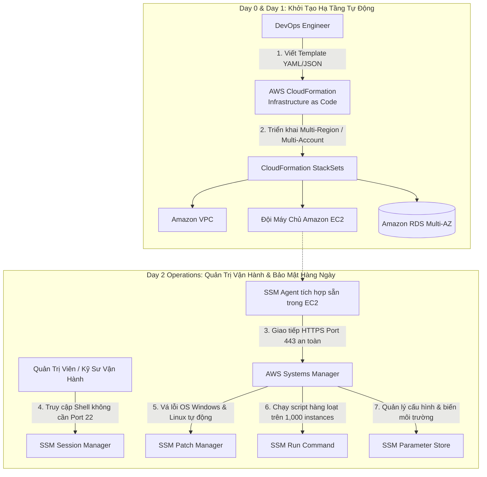
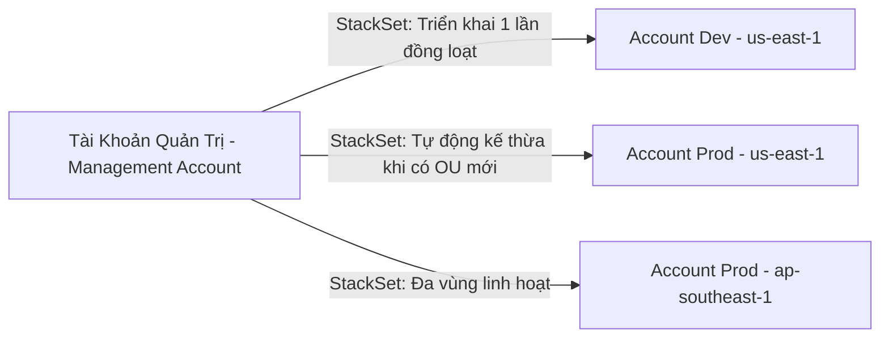
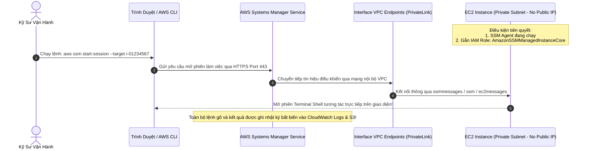

# Tài Liệu Học Tập Chuyên Sâu: AWS CloudFormation & AWS Systems Manager (Infrastructure as Code & Fleet Automation)

> **Tài liệu chuẩn hóa kiến trúc đám mây**: Hướng dẫn toàn diện theo tiêu chuẩn Principal DevOps & Automation Solutions Architect (Cập nhật phiên bản kiến trúc mới nhất 2026).  
> **Ngôn ngữ**: Tiếng Việt chuyên ngành (Bảo lưu 100% thuật ngữ chuyên ngành tiếng Anh chuẩn AWS).  
> **Mục tiêu**: Phục vụ thi chứng chỉ cấp độ Professional/Specialty (**SAA-C03, SAP-C02, SysOps & DevOps Professional**) và thiết kế quy trình tự động hóa hạ tầng cấp độ doanh nghiệp (**Enterprise-scale Automation**).  
> **Các bài giảng liên quan**: Chương 17 (CloudFormation Deep-Dive) & Chương 23 (Other Services: Systems Manager, OpsWorks, Elastic Beanstalk).

---

## 1. Tổng Quan Bộ Đôi Hạ Tầng & Vận Hành Tự Động (Service Overview)

### 1. Phân vai kiến trúc giữa CloudFormation và Systems Manager

Trong quản trị đám mây hiện đại, AWS chia tự động hóa thành 2 giai đoạn vòng đời rõ rệt:
1. **AWS CloudFormation (Giai đoạn Khởi Tạo Hạ Tầng - Day 0 & Day 1)**: Cung cấp hạ tầng dưới dạng mã (**Infrastructure as Code - IaC**). Định nghĩa toàn bộ tài nguyên (VPC, Subnets, EC2, RDS, IAM Policies, S3) dưới dạng tệp văn bản JSON hoặc YAML có cấu trúc. Đảm bảo môi trường được khởi tạo đồng nhất, có thể lặp lại và kiểm soát phiên bản bằng Git.
2. **AWS Systems Manager - SSM (Giai đoạn Quản Trị Vận Hành Hàng Ngày - Day 2 Operations)**: Quản lý và vận hành toàn diện đội ngũ máy chủ (**Fleet Management**) trên quy mô hàng nghìn máy ảo EC2 và máy chủ vật lý On-Premises. Cung cấp khả năng truy cập shell bảo mật không cần mở port SSH (**Session Manager**), vá lỗi hệ điều hành tự động (**Patch Manager**), quản trị cấu hình (**Parameter Store & State Manager**) và thực thi lệnh từ xa (**Run Command**).

---

### 2. Bài toán cốt lõi mà các dịch vụ giải quyết

1. **Loại bỏ hoàn toàn cấu hình thủ công (Zero ClickOps & Configuration Drift)**: Thay vì nhấp chuột thủ công trên AWS Console dễ gây nhầm lẫn giữa môi trường Dev, Staging và Production, CloudFormation cho phép sao chép 100% kiến trúc chỉ trong vài phút.
2. **Loại bỏ máy chủ Bastion Host và mở Port SSH 22 nguy hiểm (Zero-Bastion Architecture)**: Systems Manager Session Manager cho phép kỹ sư mở terminal truy cập máy chủ nằm sâu trong Private Subnet hoàn toàn qua giao diện trình duyệt hoặc AWS CLI, mã hóa TLS 1.2 qua port 443, không cần cấp Public IP và không cần quản lý SSH Key pairs!
3. **Tuân thủ và kiểm soát vòng đời máy chủ quy mô lớn**: Patch Manager tự động quét các lỗ hổng bảo mật (CVEs) và cài đặt bản vá trên toàn bộ dàn máy chủ Windows và Linux theo lịch định kỳ mà không gây gián đoạn dịch vụ.

---

## 2. Đi Sâu AWS CloudFormation (Infrastructure as Code)

### 2.1. Cấu Trúc Giải Phẫu Của Template CloudFormation (Template Anatomy) — (TD-Set6 Q32)

Một tệp template CloudFormation (YAML) hoàn chỉnh bao gồm các thành phần sau:
* **`AWSTemplateFormatVersion`**: Phiên bản định dạng (hiện tại luôn là `"2010-09-09"`).
* **`Description`**: Mô tả mục đích của template.
* **`Parameters`**: Các tham số đầu vào do người dùng truyền vào khi tạo hoặc cập nhật Stack (ví dụ: Tên môi trường `prod`/`dev`, Instance Type `t3.micro`).
* **`Mappings`**: Bảng tra cứu giá trị cố định dạng Key-Value (ví dụ: Tra cứu AMI ID tương ứng cho từng Region).
* **`Conditions`**: Biểu thức logic (`Fn::Equals`, `Fn::If`) để quyết định tài nguyên nào có được tạo hay không (ví dụ: Chỉ tạo Read Replica nếu môi trường là `prod`).
* **`Resources` (PHẦN BẮT BUỘC DUY NHẤT — `TD-Set6 Q32`)**: Khai báo các tài nguyên AWS thực tế cần khởi tạo (ví dụ: `AWS::EC2::Instance`, `AWS::S3::Bucket`). Một template hợp lệ chỉ cần duy nhất khối `Resources`, tất cả các phần khác đều là tùy chọn (**Optional**).
* **`Outputs`**: Xuất ra các giá trị sau khi stack tạo thành công (ví dụ: URL của ALB, VPC ID). Có thể dùng `Export: Name` để chia sẻ sang các Stack khác!

---

### 2.2. Các Hàm Nội Tại Quan Trọng Nhất Trong Đề Thi (Intrinsic Functions)

| Hàm Intrinsic | Cú pháp rút gọn | Mục đích & Ví dụ thực tế |
| :--- | :--- | :--- |
| **`Fn::Ref`** | **`!Ref`** | Tham chiếu đến giá trị của một **Parameter** hoặc lấy Physical ID của một **Resource** (ví dụ: `!Ref MyVPC` trả về `vpc-0123456789abcdef0`). |
| **`Fn::GetAtt`** | **`!GetAtt`** | Trích xuất thuộc tính chuyên sâu của tài nguyên (ví dụ: `!GetAtt MyALB.DNSName` lấy tên miền DNS của Load Balancer, `!GetAtt MyEC2.PrivateIp`). |
| **`Fn::Sub`** | **`!Sub`** | Thay thế biến vào chuỗi ký tự (String interpolation) (ví dụ: `!Sub "arn:aws:s3:::my-bucket-${AWS::Region}"`). |
| **`Fn::FindInMap`** | **`!FindInMap`** | Tra cứu bảng ánh xạ (ví dụ: `!FindInMap [RegionMap, !Ref "AWS::Region", AMI]`). |
| **`Fn::ImportValue`**| **`!ImportValue`** | Nhập giá trị được xuất (**Cross-Stack Reference**) từ một Stack khác đã chạy trước đó (ví dụ: `!ImportValue SharedVPC-ID`). |
| **`Fn::Join`** | **`!Join`** | Nối một mảng các chuỗi lại với nhau bằng ký tự phân tách (ví dụ: `!Join [ ":", [ "arn", "aws", "s3" ] ]`). |

---

### 2.3. Các Tính Năng Quản Trị Cấp Cao: StackSets, Drift Detection & DeletionPolicy

#### 1. CloudFormation StackSets (Đa Tài Khoản & Đa Vùng)
- Cho phép tạo, cập nhật hoặc xóa Stacks trên **nhiều AWS Accounts và nhiều AWS Regions** chỉ bằng một thao tác duy nhất.
- Tích hợp chặt chẽ với **AWS Organizations**: Tự động triển khai hạ tầng cơ sở (Baseline VPC, Guardrails, IAM Roles) ngay khi có một tài khoản con mới được thêm vào Organization Unit (OU).

#### 2. Phát Hiện Sai Lệch Cấu Hình (Drift Detection)
- Phát hiện các thay đổi tài nguyên được thực hiện **bên ngoài CloudFormation** (ví dụ: Ai đó dùng AWS Console hoặc CLI tự ý sửa Security Group mở port 22, hoặc xóa mất một subnet).
- Giúp kỹ sư xác định chính xác sự khác biệt giữa trạng thái thực tế và template gốc để tiến hành khắc phục (Remediation).

#### 3. Chính Sách Xóa & Thay Thế Tài Nguyên (DeletionPolicy & UpdateReplacePolicy)
- Theo mặc định, khi một Stack bị xóa, CloudFormation sẽ **xóa sạch toàn bộ tài nguyên** trong stack đó.
- Để bảo vệ dữ liệu sản xuất quan trọng (S3 Bucket, RDS Database, DynamoDB Table), cấu hình thuộc tính **`DeletionPolicy`**:
  - **`Retain`**: Giữ nguyên tài nguyên vật lý, không xóa khi stack bị xóa bỏ.
  - **`Snapshot`**: Tự động chụp một bản sao lưu (Snapshot) của EBS Volume, RDS DB Instance trước khi tài nguyên bị hủy.
  - **`Delete` (Mặc định)**: Xóa hoàn toàn tài nguyên.

#### 4. Các Script Hỗ Trợ Khởi Tạo EC2 (Helper Scripts) — (TD-Set3 Q27)
- **`cfn-init`**: Đọc cấu hình từ metadata `AWS::CloudFormation::Init` trên EC2 để tự động cài đặt packages, tạo files cấu hình, chạy lệnh shell và khởi động service phức tạp (ví dụ: SharePoint, Microsoft SQL Server, Active Directory).
- **`cfn-signal`**: Gửi tín hiệu mã thoát (Exit code 0 = Success) hoặc thất bại về CloudFormation `CreationPolicy` / `WaitCondition` để báo hiệu instance đã khởi động xong ứng dụng. Nếu CloudFormation không nhận đủ số tín hiệu thành công trong thời gian Timeout cấu hình, stack sẽ tự động rollback.
- **`cfn-hup`**: Một tiến trình chạy ngầm (Daemon) trên EC2 định kỳ kiểm tra xem metadata của template có thay đổi không để tự động cập nhật phần mềm trên máy chủ mà không cần tạo lại instance mới!

---

## 3. Đi Sâu AWS Systems Manager (Fleet Management & Automation)

### 3.1. Truy Cập Shell Riêng Tư Tuyệt Đối Với SSM Session Manager (Zero Bastion Host)

Đây là tính năng xuất hiện trong hầu hết các đề thi kiến trúc và là chuẩn mực bảo mật doanh nghiệp:

* **Yêu cầu bắt buộc để Session Manager hoạt động**:
  1. Máy chủ EC2 phải có phần mềm **SSM Agent** (đã được cài sẵn mặc định trên hầu hết Amazon Linux 2/2023, Ubuntu, Windows Server AMIs).
  2. Máy chủ phải được gán một **IAM Instance Profile** chứa AWS Managed Policy: **`AmazonSSMManagedInstanceCore`**.
  3. Máy chủ phải có đường truyền ra ngoài tới Systems Manager endpoints qua **HTTPS Port 443**:
     - Nếu ở Public Subnet: Đi qua Internet Gateway.
     - Nếu ở Private Subnet: Đi qua **Interface VPC Endpoints (AWS PrivateLink)** cho 3 dịch vụ: `ssm`, `ssmmessages`, và `ec2messages` (Hoàn toàn không cần NAT Gateway hay Internet!).

---

### 3.2. SSM Parameter Store: Quản Lý Biến Cấu Hình & Secrets

#### 1. So Sánh Hai Hạng Dịch Vụ: Standard Tier vs Advanced Tier

| Tiêu chí | Standard Tier (Hạng Tiêu Chuẩn) | Advanced Tier (Hạng Nâng Cao) |
| :--- | :--- | :--- |
| **Chi phí** | **HOÀN TOÀN MIỄN PHÍ ($0)** | Có tính phí ($0.05/parameter/tháng) |
| **Số lượng Parameter tối đa** | Tối đa **10,000 parameters** trên mỗi Region | Lên tới **100,000 parameters** trên mỗi Region |
| **Kích thước giá trị tối đa** | Tối đa **4 KB** | Tối đa **8 KB** |
| **Chính sách Parameter (Policies)**| ❌ Không hỗ trợ |  **Hỗ trợ Expiration (TTL) và Notification** |

#### 2. Phân Biệt Sắc Bén: SSM Parameter Store vs AWS Secrets Manager

| Tiêu chí kỹ thuật | SSM Parameter Store | AWS Secrets Manager |
| :--- | :--- | :--- |
| **Mục đích chính** | Lưu trữ cấu hình ứng dụng (URLs, license keys, AMI IDs, cờ tính năng). | Lưu trữ mật khẩu cơ sở dữ liệu, API tokens nhạy cảm. |
| **Tự động xoay vòng mật khẩu (Automatic Rotation)** | ❌ **Không có cơ chế tự động xoay vòng** (Phải tự viết Lambda thủ công). |  **Tích hợp sẵn tính năng tự xoay vòng (Native Rotation)** cho RDS, Aurora, Redshift, DocumentDB. |
| **Nhân bản đa vùng (Cross-Region Replication)** | ❌ Không hỗ trợ trực tiếp (phải sync bằng EventBridge/Lambda). |  **Hỗ trợ tự động nhân bản bí mật sang các Region khác**. |
| **Chi phí** | **Miễn phí** cho Standard Tier. | $0.40 / secret / tháng + $0.05 / 10,000 API calls. |

---

### 3.3. Tự Động Hóa Bản Vá Với SSM Patch Manager

- **Patch Baseline**: Định nghĩa quy tắc phê duyệt bản vá tự động (ví dụ: Tự động phê duyệt các bản vá có mức độ nghiêm trọng `Critical` hoặc `Important` sau 7 ngày kể từ khi nhà phát hành tung ra).
- **Maintenance Windows**: Lên lịch khung thời gian bảo trì (ví dụ: 02:00 sáng Chủ Nhật hàng tuần) để hệ thống tự động tải và cài đặt bản vá.
- **Hỗ trợ đa nền tảng**: Quản lý đồng nhất trên cả các bản phân phối Linux (Amazon Linux, RHEL, Ubuntu, SUSE) và Windows Server.

---

### 3.4. Quản Trị Hàng Loạt Với SSM Run Command & State Manager — (TD-Set5 Q33, TD-Set5 Q04)

- **SSM Run Command** (`TD-Set5 Q33`, `TD-Set4 Q38`):
  - Cho phép thực thi lệnh shell (bash/PowerShell) hoặc các SSM Documents an toàn từ xa trên hàng nghìn máy ảo EC2 hoặc on-premises servers đồng thời.
  - **Không yêu cầu mở bất kỳ cổng Inbound nào (Zero Inbound Ports: No SSH/RDP, No Bastion Host)**; giao tiếp hoàn toàn qua outbound HTTPS 443 của SSM Agent.
  - Tích hợp kiểm soát phân quyền IAM chi tiết, giới hạn tỷ lệ lỗi (**Error Threshold**) và tỷ lệ đồng thời (**Concurrency Rate**), tự động ghi log kết quả thực thi vào Amazon S3 hoặc CloudWatch Logs.
- **SSM State Manager** (`TD-Set5 Q04`):
  - Dịch vụ duy trì cấu hình máy chủ theo trạng thái mong muốn (Desired State Configuration).
  - Tự động kiểm tra và áp dụng cấu hình (ví dụ: đảm bảo phần mềm diệt virus luôn chạy, cổng firewall nội bộ đóng, CloudWatch Agent luôn active) theo lịch định kỳ, tự động chống hiện tượng trôi cấu hình (**Configuration Drift Prevention**).

---

## 4. Bảng Tích Hợp với Các Dịch Vụ AWS Khác (Integration Table)

| Dịch vụ liên kết | Phương thức tích hợp | Mục đích kỹ thuật & Kịch bản thực tế |
| :--- | :--- | :--- |
| **AWS CloudTrail** | Audit Logging | Ghi lại toàn bộ lịch sử các lệnh chạy trong Session Manager và Run Command để phục vụ thanh tra an ninh. |
| **Amazon CloudWatch Logs / S3** | Session Logging | Lưu trữ toàn bộ nội dung phiên làm việc dòng lệnh của kỹ sư vào S3 Bucket được mã hóa để làm bằng chứng tuân thủ. |
| **AWS Config** | Config Rules & Compliance Tracking | **(CM-PT6 Q30)**: Giám sát liên tục các thay đổi cấu hình tài nguyên do CloudFormation tạo ra; phát hiện sai lệch tuân thủ thời gian thực. |
| **AWS Secrets Manager** | Dynamic References trong CloudFormation | Sử dụng cú pháp `{{resolve:secretsmanager:...}}` trong template để chèn mật khẩu DB an toàn mà không bị lộ text thô trong code Git. |
| **AWS Control Tower** | Proactive Controls | **(CM-PT4 Q36)**: Chặn đứng các template CloudFormation cố tình tạo EC2 gắn Public IP hoặc IAM Policy có quyền `*` ngay trước khi triển khai. |

---

## 5. FinOps & Chiến Lược Tối Ưu Chi Phí (Cost Optimization)

### 1. Tiết Kiệm Chi Phí Vận Hành Với Zero-Bastion Architecture
* **Mô hình truyền thống (Bastion Host + NAT Gateway)**:
  - 2 máy chủ EC2 Bastion chạy ở 2 AZs (cỡ `t3.small`): $\sim 30\$/\text{tháng}$.
  - Elastic IPs và dữ liệu SSH truyền qua Internet.
  - Phải liên tục vá lỗi OS, quản lý SSH key, rủi ro bị brute-force cổng 22.
* **Mô hình hiện đại (SSM Session Manager + VPC Endpoints)**:
  - **Chi phí máy chủ Bastion: $0** (Loại bỏ hoàn toàn máy chủ Bastion!).
  - **Chi phí Session Manager: $0** (Dịch vụ Session Manager hoàn toàn miễn phí).
  - Chỉ chi trả phí duy trì Interface VPC Endpoints nội bộ trong VPC.
  - 👉 **Tiết kiệm 100% công sức bảo trì hạ tầng Bastion và triệt tiêu bề mặt tấn công mạng!**

---

## 6. Khắc Phục Sự Cố Thực Tế (Troubleshooting Guide)

| Tình huống sự cố | Nguyên nhân khả dĩ | Phương pháp điều tra | Giải pháp xử lý |
| :--- | :--- | :--- | :--- |
| **EC2 Instance không hiển thị trong danh sách SSM Managed Instances** | 1. Chưa gắn IAM Role chứa quyền `AmazonSSMManagedInstanceCore`. 2. EC2 trong Private Subnet không có đường kết nối mạng tới endpoint SSM qua cổng 443. 3. SSM Agent chưa được cài hoặc bị crash. | 1. Kiểm tra IAM Role gắn trên instance. 2. Kiểm tra Security Group chiều Outbound có mở port 443 không. 3. Xem log file: `/var/log/amazon/ssm/amazon-ssm-agent.log`. | 1. Gắn IAM Instance Profile hợp lệ cho EC2. 2. Tạo 3 **Interface VPC Endpoints** (`ssm`, `ssmmessages`, `ec2messages`) trong cùng VPC hoặc cấu hình route ra NAT Gateway. 3. Khởi động lại dịch vụ SSM Agent: `sudo systemctl restart amazon-ssm-agent`. |
| **CloudFormation bị lỗi `UPDATE_ROLLBACK_FAILED`** | Một tài nguyên trong stack bị thay đổi thủ công bên ngoài hoặc bị kẹt trạng thái không thể xóa/khôi phục khi rollback. | Kiểm tra tab **Events** trên CloudFormation Console để xem tài nguyên cụ thể nào gây ra lỗi. | Sử dụng nút **Continue Update Rollback**, chọn bỏ qua tài nguyên bị kẹt (**Skip Resource**) để đưa Stack trở về trạng thái ổn định, sau đó sửa template và cập nhật lại. |
| **Lỗi `Export cannot be updated or deleted because it is in use by another stack`** | Stack A xuất ra một giá trị (Export) đang được Stack B tham chiếu thông qua hàm `Fn::ImportValue`. | Tìm kiếm các Stack đang sử dụng giá trị xuất bằng lệnh `aws cloudformation list-imports`. | Bắt buộc phải cập nhật hoặc xóa Stack B trước để gỡ bỏ phụ thuộc tham chiếu, sau đó mới được phép cập nhật hoặc xóa Stack A! |

---

## 🏛️ I. Các Kịch Bản Kiến Trúc Chuẩn (Best Practice Scenarios)

#### 1. Quản Trị EC2 Trong Private Subnet An Toàn Không Mở Cổng 22 — (CM-PT1 Q19, CM-PT4 Q59)
- **Tình huống thi**: Doanh nghiệp có chính sách an ninh mạng nghiêm ngặt: Toàn bộ máy chủ ứng dụng EC2 phải đặt trong Private Subnet, không được cấp Public IP và nghiêm cấm mở cổng SSH (Port 22) hoặc RDP (Port 3389). Kỹ sư vận hành vẫn cần quyền truy cập shell dòng lệnh để khắc phục sự cố khi cần thiết.
- **Giải pháp tối ưu chuẩn AWS**:
  - Gắn IAM Role chứa policy **`AmazonSSMManagedInstanceCore`** vào các máy chủ EC2.
  - Tạo 3 **Interface VPC Endpoints (AWS PrivateLink)** trong VPC trỏ tới các dịch vụ:
    1. `com.amazonaws.<region>.ssm`
    2. `com.amazonaws.<region>.ssmmessages`
    3. `com.amazonaws.<region>.ec2messages`
  - Kỹ sư sử dụng **AWS Systems Manager Session Manager** để mở phiên dòng lệnh trực tiếp trên trình duyệt mà không cần Bastion host, không cần mở bất kỳ cổng Inbound nào trên Security Group.

#### 2. Tự Động Quét Và Cài Bản Vá OS Cho Đội Máy Chủ Lớn — (CM-PT3 Q17)
- **Tình huống thi**: Doanh nghiệp di chuyển hàng trăm máy ảo từ On-Premises lên EC2, chạy nhiều phiên bản hệ điều hành khác nhau gồm Windows Server, Amazon Linux và Ubuntu. Đội ngũ an ninh yêu cầu tự động hóa việc kiểm kê phần mềm, tự động cài đặt các bản vá lỗi hàng tháng và xuất báo cáo lỗ hổng bảo mật định kỳ với nỗ lực vận hành thấp nhất.
- **Giải pháp tối ưu**:
  - Cài đặt và kích hoạt **SSM Agent** trên toàn bộ đội máy chủ.
  - Sử dụng **AWS Systems Manager Patch Manager**.
  - Thiết lập **Default Patch Baselines** cho từng hệ điều hành tương ứng.
  - Cấu hình **Maintenance Windows** để tự động chạy tác vụ vá lỗi vào cuối tuần.
  - Sử dụng tính năng **Compliance Dashboard** của Systems Manager để theo dõi mức độ tuân thủ và xuất báo cáo lỗ hổng cho ban quản trị.

#### 3. Quản Trị Hạ Tầng Bằng Mã Kết Hợp Theo Dõi Tuân Thủ Liên Tục — (CM-PT6 Q30)
- **Tình huống thi**: Một tập đoàn đa quốc gia muốn tự động hóa hoàn toàn quy trình thiết lập hệ thống mạng và hạ tầng đám mây. Đội ngũ bảo mật bắt buộc phải có khả năng theo dõi, kiểm toán và nhận cảnh báo về mọi thay đổi cấu hình tài nguyên phát sinh theo thời gian.
- **Giải pháp tối ưu**:
  - Sử dụng **AWS CloudFormation** để đóng gói toàn bộ kiến trúc hạ tầng thành các mẫu template được quản lý phiên bản trên Git (IaC).
  - Kích hoạt **AWS Config Recorder** trên toàn bộ tài nguyên để tự động ghi lại lịch sử cấu hình chi tiết theo thời gian thực.
  - Bật các quy tắc kiểm tra tuân thủ (**AWS Config Managed Rules**); khi có bất kỳ thay đổi nào làm tài nguyên vi phạm tiêu chuẩn an ninh, AWS Config tự động gửi cảnh báo qua Amazon SNS.

#### 4. Cài Đặt Phần Mềm Doanh Nghiệp Phức Tạp Bằng CloudFormation `cfn-init` & `CreationPolicy` — (TD-Set3 Q27)
- **Tình huống thi**: Doanh nghiệp triển khai môi trường Microsoft SharePoint Server trên AWS bằng CloudFormation. Kiến trúc gồm Active Directory Domain Controllers, cụm Microsoft SQL Server AlwaysOn và các SharePoint web front-end servers. Quá trình tạo máy ảo EC2 phải tạm dừng và chờ đợi cho đến khi các script cài đặt phần mềm và cấu hình AD hoàn tất thành công thì CloudFormation mới đánh dấu Stack tạo thành công (`TD-Set3 Q27`).
- **Giải pháp chuẩn AWS**:
  - Khai báo metadata **`AWS::CloudFormation::Init`** chứa các chỉ thị cài đặt packages, file cấu hình và commands.
  - Trong `UserData` của EC2 instance, gọi helper script **`cfn-init`** để thực thi cài đặt và sau đó gọi **`cfn-signal`** gửi mã trạng thái thoát về CloudFormation.
  - Cấu hình thuộc tính **`CreationPolicy`** trên tài nguyên EC2 với `Count: 1` và `Timeout: PT30M`. CloudFormation sẽ chờ tín hiệu từ `cfn-signal` trước khi chuyển trạng thái instance sang `CREATE_COMPLETE`.

#### 5. Quản Trị Và Cấu Hình Hàng Loạt Máy Chủ Game Không Cần Mở Port Bằng SSM Run Command — (TD-Set5 Q33, TD-Set4 Q38)
- **Tình huống thi**: Một công ty khởi nghiệp vận hành đội máy ảo EC2 On-Demand trong Auto Scaling Group để phục vụ tựa game nhập vai nhiều người chơi (MMORPG). Đội ngũ vận hành cần định kỳ cấu hình, cập nhật file patch game và cài đặt CloudWatch Agent trên hàng trăm máy ảo cùng lúc mà **tuyệt đối không cần mở bất kỳ kết nối trực tiếp nào (No SSH/RDP, No Bastion Host)** (`TD-Set5 Q33`, `TD-Set4 Q38`).
- **Giải pháp chuẩn AWS**:
  - Cấu hình máy ảo EC2 với IAM Role chứa policy **`AmazonSSMManagedInstanceCore`**.
  - Sử dụng **AWS Systems Manager Run Command** để thực thi lệnh hoặc SSM Document (`AWS-RunShellScript` / `AWS-RunPowerShellScript`) trên các máy ảo được chọn theo Tag (ví dụ: `Environment=Production`).
  - Lệnh được gửi qua kết nối HTTPS outbound tới Systems Manager service, thực thi an toàn trong nền và ghi toàn bộ output về CloudWatch Logs hoặc S3 bucket.

#### 6. Duy Trì Trạng Thái Cấu Hình Nhất Quán Cho Máy Chủ Y Tế Bằng SSM State Manager — (TD-Set5 Q04)
- **Tình huống thi**: Tổ chức y tế sử dụng các máy ảo Dedicated EC2 để chạy ứng dụng hồ sơ bệnh án. Để đảm bảo tính tuân thủ pháp lý và sự nhất quán an ninh, tổ chức cần một giải pháp tự động định kỳ kiểm tra và ép cấu hình hệ điều hành (antivirus, firewall rules, logging agent) luôn ở trạng thái mong muốn, tự động sửa đổi nếu có sai lệch phát sinh (`TD-Set5 Q04`).
- **Giải pháp chuẩn AWS**:
  - Tạo một **State Manager Association** trong AWS Systems Manager.
  - Chọn tài liệu SSM Document tương ứng và gán target là các máy ảo EC2 theo Tag.
  - Thiết lập lịch chạy định kỳ (ví dụ: mỗi 30 phút hoặc hàng ngày). State Manager tự động quét và áp dụng cấu hình mong muốn, ngăn chặn triệt để hiện tượng trôi cấu hình (Configuration Drift).

---

## 🪤 II. Các Bẫy Thi Tinh Vi & Phân Tích Phương Án Sai (Exam Traps & Distractors)

#### 🪤 Bẫy 1: Tự Động Xoay Vòng Mật Khẩu Database: Parameter Store vs Secrets Manager — (CM-PT3 Q43)
- **Tình huống đề thi**: *"Ứng dụng sử dụng cơ sở dữ liệu Amazon RDS PostgreSQL. Doanh nghiệp bắt buộc phải áp dụng chính sách tự động xoay vòng mật khẩu định kỳ 30 ngày một lần với nỗ lực vận hành thấp nhất (LEAST operational overhead)."*
- **Các phương án bẫy**:
  - ❌ *Lưu mật khẩu vào AWS Systems Manager Parameter Store SecureString*: Parameter Store lưu trữ an toàn nhưng **KHÔNG CÓ TÍNH NĂNG TỰ ĐỘNG XOAY VÒNG MẬT KHẨU CÓ SẴN**. Bạn sẽ phải tự viết code Lambda phức tạp và tự cấu hình EventBridge để kích hoạt xoay vòng.
- **Giải pháp ĐÚNG**: Sử dụng **AWS Secrets Manager**.
  - Secrets Manager có sẵn tính năng tích hợp trực tiếp với RDS để tự động tạo hàm Lambda luân chuyển mật khẩu, kiểm tra kết nối và cập nhật mật khẩu mới mà không cần can thiệp thủ công.

#### 🪤 Bẫy 2: Ngăn Chặn Xóa Nhầm Dữ Liệu Khi Xóa CloudFormation Stack — (CM-PT1 Q12, CM-PT4 Q36)
- **Tình huống đề thi**: *"Kỹ sư vô tình xóa một CloudFormation Stack phục vụ môi trường Production. Hậu quả là toàn bộ cơ sở dữ liệu RDS và dữ liệu trong S3 Bucket bị xóa sạch. Cần thiết lập thuộc tính gì trong template để ngăn chặn thảm họa này trong tương lai?"*
- **Các phương án bẫy**:
  - ❌ *Gán IAM Policy cấm xóa stack*: Người có quyền Admin vẫn có thể gỡ policy để xóa.
  - ❌ *Sử dụng DependsOn*: Chỉ điều chỉnh thứ tự tạo tài nguyên, không ngăn việc xóa.
- **Giải pháp ĐÚNG**: Thêm thuộc tính **`DeletionPolicy: Retain`** (hoặc `Snapshot` đối với RDS DB Instance/EBS Volume) vào định nghĩa của tài nguyên trong template CloudFormation.
  - Khi có thuộc tính `Retain`, kể cả khi Stack bị xóa bỏ hoàn toàn, CloudFormation vẫn để lại tài nguyên vật lý nguyên vẹn trên tài khoản AWS!

#### 🪤 Bẫy 3: Cấp Quyền Cho EC2 Sử Dụng Systems Manager — (CM-PT4 Q59)
- **Tình huống đề thi**: *"Sau khi khởi chạy một máy chủ EC2 mới trong Private Subnet, quản trị viên không thể kết nối tới máy chủ qua Session Manager. Cần cấu hình quyền IAM nào cho máy chủ?"*
- **Phương án bẫy thường gặp**:
  - ❌ *Gán policy `AdministratorAccess` cho máy chủ*: Quá nhiều quyền thừa thãi và vi phạm nguyên tắc đặc quyền tối thiểu.
  - ❌ *Sử dụng policy cũ `AmazonEC2RoleforSSM`*: Policy này đã bị AWS đánh dấu deprecated (lỗi thời) từ lâu.
- **Giải pháp ĐÚNG**: Gán AWS Managed Policy chuẩn hiện nay là **`AmazonSSMManagedInstanceCore`** vào IAM Role của máy chủ EC2.

#### 🪤 Bẫy 4: Khối Duy Nhất Bắt Buộc Trong CloudFormation Template: Resources — (TD-Set6 Q32)
- **Tình huống đề thi**: *"Một kỹ sư DevOps tạo template CloudFormation và tạo Pull Request. Template bao gồm Parameters, Mappings, Conditions, Outputs nhưng không có khối Resources. Template có chạy được không?"*
- **Quy tắc bất biến**:
  - Template chắc chắn bị lỗi và không thể triển khai!
  - Trong CloudFormation, **chỉ có duy nhất khối `Resources` là bắt buộc (Mandatory)**; mọi thành phần khác (`Parameters`, `Mappings`, `Outputs`, `Conditions`, `Metadata`) đều là tùy chọn.

#### 🪤 Bẫy 5: cfn-signal Bị Timeout Rollback Nếu Không Nhận Đủ Số Tín Hiệu — (TD-Set3 Q27)
- **Tình huống đề thi**: *"Khởi tạo EC2 bằng CloudFormation với CreationPolicy nhưng sau 30 phút stack bị lỗi `CREATE_FAILED` và rollback."*
- **Nguyên nhân**:
  - Script cài đặt phần mềm trong EC2 bị lỗi khiến lệnh `cfn-signal -e 1` gửi mã lỗi, hoặc script bị treo không gọi tới `cfn-signal`.
  - CloudFormation chờ hết khoảng thời gian `Timeout` quy định trong `CreationPolicy` mà không nhận đủ tín hiệu thành công (`-e 0`) $\rightarrow$ Tự động hủy stack và rollback để tránh tốn chi phí cho tài nguyên lỗi.

---

## 📊 III. Ma Trận Quyết Định Công Nghệ Nhanh (Exam Decision Matrix)

| Tình huống / Yêu cầu trong đề thi | Giải pháp chuẩn AWS | Giải pháp bị loại & Lý do | Nguồn thực chứng |
|:---|:---|:---|:---|
| **Truy cập shell EC2 trong Private Subnet không mở Port 22, không Bastion** | **SSM Session Manager + Interface VPC Endpoints** | Bastion Host (tốn chi phí, rủi ro an ninh mạng) | Chuẩn AWS |
| **Quyền IAM tối thiểu chuẩn xác cho EC2 giao tiếp với SSM** | **Policy `AmazonSSMManagedInstanceCore`** | Policy `AmazonEC2RoleforSSM` (đã deprecated) | Chuẩn AWS |
| **Lưu trữ cấu hình ứng dụng rẻ nhất, mã hóa KMS, không auto-rotate** | **SSM Parameter Store (SecureString)** | AWS Secrets Manager (tốn phí $0.40/secret/tháng) | `TD-Set3 Q33` |
| **Lưu mật khẩu database yêu cầu tự động xoay vòng định kỳ** | **AWS Secrets Manager** | SSM Parameter Store (không hỗ trợ native auto-rotation) | `TD-Set2 Q10` |
| **Vá lỗi hệ điều hành định kỳ cho dàn máy chủ Windows & Linux** | **SSM Patch Manager + Maintenance Windows** | Tự viết script SSH thủ công (khó kiểm soát, dễ lỗi) | `TD-Set5 Q45` |
| **Chạy script cấu hình trên hàng trăm máy chủ không cần kết nối trực tiếp** | **SSM Run Command** | Mở SSH từng máy để chạy lệnh (tốn công, không audit được) | `TD-Set5 Q33`, `TD-Set4 Q38` |
| **Duy trì cấu hình máy chủ nhất quán theo thời gian (Anti-Drift)** | **SSM State Manager Association** | Kiểm tra thủ công (dễ bị sót cấu hình) | `TD-Set5 Q04` |
| **Triển khai hạ tầng IaC đồng loạt trên nhiều AWS Accounts và Regions** | **AWS CloudFormation StackSets** | Viết script gọi CLI từng vùng (dễ sai lệch, khó quản lý) | `TD-Set4 Q29`, `TD-Set8 Q22` |
| **Cài đặt phần mềm phức tạp và chờ tín hiệu thành công trước khi hoàn tất** | **`cfn-init` + `cfn-signal` + `CreationPolicy`** | UserData thông thường (không đồng bộ hóa trạng thái hoàn tất) | `TD-Set3 Q27` |
| **Thành phần duy nhất bắt buộc trong CloudFormation Template** | **Khối `Resources`** | Khối Parameters / Outputs (chỉ là tùy chọn) | `TD-Set6 Q32` |
| **Bảo vệ cơ sở dữ liệu RDS không bị xóa khi CloudFormation Stack bị xóa** | **Thuộc tính `DeletionPolicy: Retain` (hoặc `Snapshot`)** | Để mặc định (mặc định CloudFormation sẽ xóa sạch) | Chuẩn AWS |
| **Phát hiện ai đó tự ý sửa đổi Security Group bên ngoài CloudFormation** | **CloudFormation Drift Detection** | Đọc CloudWatch Logs thủ công (không tự động so sánh diff) | Chuẩn AWS |
| **Chặn CloudFormation deploy tài nguyên vi phạm quy chuẩn an toàn** | **AWS Control Tower Proactive Controls** | Reactive remediation (chỉ sửa sau khi đã deploy vi phạm) | Chuẩn AWS |

---

## 7. Tóm Tắt và Danh Mục Kiểm Tra Kiến Thức (Summary & Learning Checklist)

### 7 Nguyên Tắc Kiến Trúc "Sống Còn" Của CloudFormation & Systems Manager
1. **IaC là nguồn chân lý duy nhất (Single Source of Truth)**: Luôn quản trị tài nguyên qua CloudFormation template được version control bằng Git; sử dụng **Drift Detection** để bắt mọi hành vi cấu hình lén bên ngoài.
2. **Luôn đặt `DeletionPolicy: Retain` cho tài nguyên chứa dữ liệu**: Với S3, RDS, DynamoDB trong CloudFormation, luôn khai báo `DeletionPolicy: Retain` để tránh thảm họa mất dữ liệu khi xóa nhầm stack.
3. **Khai tử Bastion Host - Thay bằng Session Manager**: Không bao giờ mở cổng SSH 22 ra Internet; luôn truy cập máy chủ bằng Session Manager qua mạng riêng Interface VPC Endpoints.
4. **Nhớ chính xác tên policy: `AmazonSSMManagedInstanceCore`**: Bất kỳ máy chủ EC2 nào muốn kết nối với Systems Manager đều bắt buộc phải có IAM Role chứa policy này.
5. **Secrets Manager để xoay vòng, Parameter Store để lưu cấu hình**: Cần tự động đổi pass DB $\rightarrow$ Secrets Manager. Cần biến môi trường, config app $\rightarrow$ Parameter Store (tiết kiệm chi phí).
6. **Bộ ba VPC Endpoints cho Private EC2**: Khi EC2 ở private subnet muốn dùng Session Manager mà không có Internet $\rightarrow$ Tạo 3 endpoints: `ssm`, `ssmmessages`, và `ec2messages`.
7. **StackSets cho tổ chức đa tài khoản**: Khi doanh nghiệp dùng AWS Organizations và muốn triển khai đồng loạt hạ tầng bảo mật sang mọi tài khoản con $\rightarrow$ Chọn CloudFormation StackSets.

---

### Liên Kết Nội Bộ và Tài Liệu Tham Khảo (Internal Links)
- 📖 [Ghi Chú Bài Học Chương 17: AWS CloudFormation](../Lesson_Notes/17_CloudFormation_Deep_Dive.md)
- 📖 [Tài Liệu Chuyên Sâu: Bảo Mật & Mã Hóa AWS KMS](./KMS_Security_Encryption.md)
- 📖 [Tài Liệu Chuyên Sâu: Phân Tích & Giám Sát CloudWatch & CloudTrail](./CloudWatch_CloudTrail_Observability.md)
- 📖 [Cẩm Nang Từ Vựng Giải Mã Đề Thi](../EXAM_VOCABULARY.md)
- 📖 [Bảng Thuật Ngữ Kỹ Thuật Đám Mây](../GLOSSARY.md)

