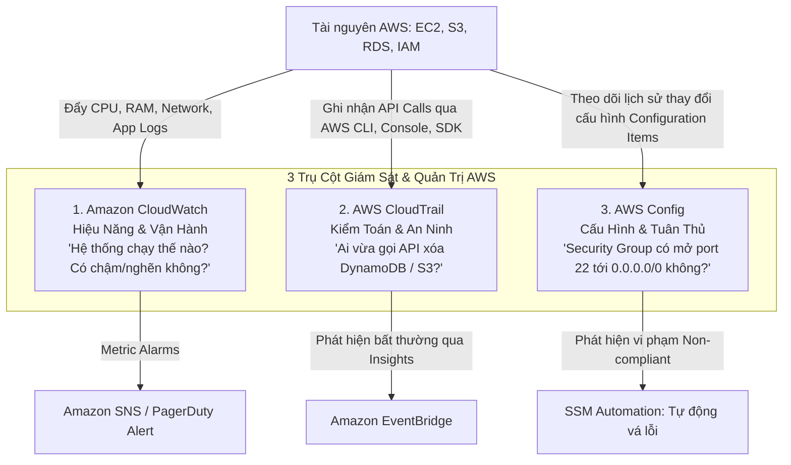
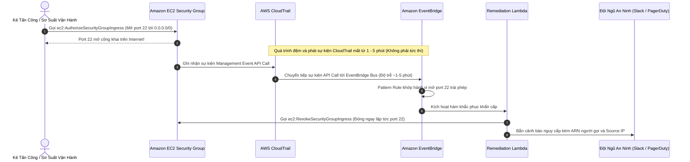

# Tài Liệu Học Tập Chuyên Sâu: Amazon CloudWatch, AWS CloudTrail & AWS Config (Hệ Thống Quan Sát, Kiểm Toán & Quản Trị Tuân Thủ)

> **Tài liệu chuẩn hóa kiến trúc đám mây**: Hướng dẫn toàn diện theo tiêu chuẩn Senior AWS Solutions Architect & Cloud DevOps Engineer (cập nhật mới nhất 2026).  
> **Ngôn ngữ**: Tiếng Việt (Bảo lưu toàn bộ thuật ngữ chuyên ngành tiếng Anh chuẩn AWS).  
> **Các dịch vụ liên quan**: Amazon CloudWatch, AWS CloudTrail, AWS Config, AWS X-Ray, Amazon OpenSearch Service.

---

## 6.1. Tổng Quan Dịch Vụ (Service Overview)

### Dịch vụ gì?
Bộ ba dịch vụ **Amazon CloudWatch**, **AWS CloudTrail**, và **AWS Config** tạo nên trụ cột vững chắc nhất cho khả năng quan sát toàn diện (**Full-stack Observability**), kiểm toán an ninh (**Security Audit**), và quản trị tuân thủ quy chuẩn (**Compliance Governance**) trên toàn bộ hệ thống AWS:
1. **Amazon CloudWatch**: Nền tảng giám sát hiệu năng và sức khỏe vận hành tập trung. Thu thập các chỉ số định lượng (**Metrics**), nhật ký văn bản (**Logs**), thiết lập cảnh báo thông minh (**Alarms & Anomaly Detection**), đo lường trải nghiệm người dùng thực tế (**Synthetics Canaries & RUM**), và phân tích truy vết phân tán (**ServiceLens / X-Ray**).
2. **AWS CloudTrail**: Dịch vụ ghi nhật ký kiểm toán bất biến toàn bộ các cuộc gọi API trên tài khoản AWS. Trả lời câu hỏi kinh điển của kiểm toán viên và an ninh mạng: **"Ai (Who) đã làm gì (What), vào thời điểm nào (When), từ địa chỉ IP nào (Where), và thông qua giao thức nào (How)?"**. Tích hợp sẵn **CloudTrail Lake** để truy vấn SQL phân tích sự cố dài hạn.
3. **AWS Config**: Dịch vụ liên tục ghi lại lịch sử thay đổi cấu hình tài nguyên theo thời gian và đánh giá tính tuân thủ của các tài nguyên đó dựa trên các quy tắc chuẩn mực (**Config Rules & Conformance Packs**), hỗ trợ cơ chế tự động sửa sai (**Automated Remediation**) qua Systems Manager Automation.

---

## 6.2. Các Khái Niệm, Kiến Trúc & Vận Hành Cốt Lõi (Core Concepts, Security & Day-2 Operations)

### 1. Phân Định Vai Trò: CloudWatch vs CloudTrail vs AWS Config



---

### 2. Thành Phần Chuyên Sâu của Amazon CloudWatch

- **CloudWatch Metrics**:
  - Dữ liệu chuỗi thời gian (Time-series) bao gồm: **Namespace** (ví dụ `AWS/EC2`), **Metric Name** (ví dụ `CPUUtilization`), các chiều phân loại **Dimensions** (ví dụ `InstanceId=i-0123456789`), và **Timestamp**.
  - *Basic Monitoring (Mặc định)*: Tần suất gửi số liệu mỗi **5 phút** (hoàn toàn miễn phí).
  - *Detailed Monitoring*: Tần suất gửi số liệu mỗi **1 phút** ($2.10/instance/tháng cho EC2).
  - **Lưu ý sống còn về RAM**: Hypervisor của AWS **KHÔNG THỂ tự động biết được mức sử dụng bộ nhớ RAM (Memory Utilization)** hoặc dung lượng trống của ổ đĩa bên trong hệ điều hành! Muốn thu thập RAM và Disk Space, bạn **bắt buộc phải cài đặt Unified CloudWatch Agent** bên trong máy ảo EC2.
- **CloudWatch Logs & Logs Insights**:
  - Cấu trúc: **Log Groups** (đại diện cho ứng dụng) chứa nhiều **Log Streams** (đại diện cho từng máy ảo/container).
  - **CloudWatch Logs Insights**: Công cụ truy vấn mạnh mẽ phân tích hàng triệu dòng log bằng cú pháp SQL-like trong vài giây:
    ```sql
    fields @timestamp, @message
    | filter @message like /Exception|ERROR/
    | stats count(*) as errorCount by bin(5m)
    | sort errorCount desc
    | limit 20
    ```
  - **Lớp lưu trữ Infrequent Access (IA) vs Standard Logs Class**:
    - Lớp **Standard**: Hỗ trợ đầy đủ tính năng giám sát thời gian thực, Metric Filters, Subscription Filters, Live Tail, và CloudWatch Alarms ($0.50/GB nạp vào).
    - Lớp **Infrequent Access (IA)**: Giúp giảm **50% chi phí nạp log** ($0.25/GB nạp vào), tối ưu cho log kiểm toán chỉ tra cứu sau sự cố bằng Logs Insights.
    - ⚠️ **LƯU Ý SỐNG CÒN TRONG VẬN HÀNH & THI CỬ**: Lớp IA **KHÔNG HỖ TRỢ** Metric Filters, Subscription Filters, Live Tail, và CloudWatch Alarms! Tuyệt đối không chuyển Log Groups của ứng dụng Production cần cảnh báo lỗi tự động sang lớp IA.

| Tính năng giám sát | CloudWatch Logs Standard | CloudWatch Logs Infrequent Access (IA) |
| :--- | :--- | :--- |
| **Đơn giá nạp log (Ingestion)** | $0.50 / GB | **$0.25 / GB (Rẻ hơn 50%)** |
| **Đơn giá lưu trữ (Storage)** | $0.03 / GB / tháng | $0.03 / GB / tháng |
| **Truy vấn CloudWatch Logs Insights** | Có ($0.005/GB quét) | Có ($0.005/GB quét) |
| **Live Tail (Xem log thời gian thực)** | Có | ❌ **Không hỗ trợ** |
| **Metric Filters & Cảnh báo Alarms** | Có | ❌ **Không hỗ trợ** |
| **Subscription Filters (Đẩy Lambda/Firehose)**| Có | ❌ **Không hỗ trợ** |
- **CloudWatch Alarms**:
  - 3 trạng thái: `OK`, `ALARM`, `INSUFFICIENT_DATA`.
  - **Composite Alarms**: Kết hợp nhiều cảnh báo độc lập bằng biểu thức logic (`ALARM("HighCPU") AND ALARM("HighLatency")`) nhằm triệt tiêu hiện tượng báo động giả (Alarm Fatigue).
  - **EC2 Recovery Action**: Cấu hình tự động khởi động lại máy ảo trên một host vật lý mới khi bị lỗi phần cứng (**StatusCheckFailed_System**), giữ nguyên địa chỉ Private IP, Public Elastic IP, và Instance ID!

---

### 3. Phân Tích Chuyên Sâu AWS CloudTrail

- **Event History**: Mặc định lưu giữ lịch sử các sự kiện quản trị (Management Events) trong vòng **90 ngày** hoàn toàn miễn phí trên Console.
- **CloudTrail Trails**: Tạo Trail xuất toàn bộ nhật ký nén dạng JSON về **Amazon S3 Bucket** lưu trữ vĩnh viễn, kết hợp tính năng **CloudTrail Log File Integrity Validation** (sử dụng chữ ký số SHA-256 HMAC) để chứng minh trước tòa án rằng file log không bị kẻ tấn công sửa đổi hay xóa dấu vết.
- **Phân loại sự kiện (Event Types)**:
  - *Management Events*: Các thao tác cấu hình tài nguyên mặt phẳng điều khiển (`RunInstances`, `CreateBucket`, `AttachRolePolicy`).
  - *Data Events*: Các thao tác trên dữ liệu (mặc định bị tắt do lưu lượng khổng lồ): `s3:GetObject`, `s3:PutObject`, `lambda:Invoke`.
  - *CloudTrail Insights*: Ứng dụng học máy phân tích tự động các đợt bùng nổ gọi API bất thường (ví dụ: bùng nổ lỗi `AccessDenied` hoặc đột ngột xuất hiện hàng ngàn lệnh xóa tài nguyên lúc nửa đêm).
  - *CloudTrail Lake*: Kho dữ liệu kiểm toán được quản lý hoàn toàn cho phép chạy truy vấn SQL trực tiếp trên lịch sử sự kiện nhiều năm mà không cần thiết lập hạ tầng Athena hay ETL.

---

### 4. AWS Config: Quản Trị Tuân Thủ Quy Chuẩn & Tự Động Vá Lỗi

- **Configuration Items (CIs)**: Bản chụp trạng thái của một tài nguyên (thuộc tính, mối quan hệ phụ thuộc, thẻ tags) mỗi khi có sự thay đổi.
- **Config Rules & Conformance Packs**:
  - Đánh giá liên tục các tài nguyên dựa trên bộ quy tắc tuân thủ (ví dụ: cấm mở cổng 22 SSH ra Internet, bắt buộc mã hóa EBS volume bằng KMS, cấm S3 bucket công khai).
  - **Conformance Packs**: Tập hợp hàng chục Config Rules đóng gói theo các chuẩn bảo mật quốc tế: **CIS AWS Foundations Benchmark, PCI-DSS, HIPAA, SOC2**.
- **Automated Remediation**: Khi phát hiện tài nguyên ở trạng thái `NON-COMPLIANT`, Config tự động kích hoạt một **Systems Manager Automation Runbook** để tự động vá lỗi (ví dụ: tự động thu hồi Security Group Rule mở cổng 22 vi phạm, tự động bật mã hóa S3).

---

### 🏛️ I. Các Kịch Bản Kiến Trúc Chuẩn (Best Practice Scenarios)

#### 1. Cảnh Báo An Ninh Chủ Động: CloudTrail + CloudWatch Metric Filters + Amazon SNS
- **Tình huống thi**: Đội ngũ bảo mật cần nhận thông báo khẩn cấp ngay lập tức qua email mỗi khi có người dùng hoặc service cố tình thực hiện các thao tác API trái phép trong tài khoản (ví dụ: bị từ chối với lỗi `AccessDenied` hoặc `UnauthorizedOperation`).
- **Giải pháp tối ưu chuẩn AWS**:
  - **AWS CloudTrail**: Cấu hình đẩy toàn bộ Management Events và Data Events vào một **CloudWatch Logs Log Group**.
  - **CloudWatch Metric Filter**: Thiết lập bộ lọc trích xuất pattern lỗi trong file log JSON:
    `{ ($.errorCode = "*UnauthorizedOperation") || ($.errorCode = "AccessDenied*") }`
  - Gắn một **CloudWatch Alarm** vào Metric vừa tạo: Nếu số lượng lỗi vượt ngưỡng $\ge 1$ trong vòng 1 phút -> Kích hoạt gửi thông báo tới một **Amazon SNS Topic** để gửi email cảnh báo tới đội SOC/SecOps.

#### 2. Kiểm Toán Toàn Diện Đa Tài Khoản Bằng CloudTrail Organizational Trail
- **Tình huống thi**: Doanh nghiệp quản lý hàng chục tài khoản AWS qua AWS Organizations. Cần thiết lập hệ thống ghi log kiểm toán tập trung cho mọi hành động của người dùng trên toàn bộ các tài khoản thành viên, đảm bảo các tài khoản con không thể tắt hoặc xóa log.
- **Giải pháp chuẩn**:
  - Tại **Management Account**, tạo một **AWS CloudTrail Organizational Trail**.
  - Trail này sẽ tự động nhân bản và thu thập log API từ **toàn bộ các member accounts hiện tại và các member accounts mới được tạo trong tương lai**.
  - Đích đến (Destination): Lưu trữ tập trung tại một **Amazon S3 Bucket** an toàn được bật tính năng S3 Object Lock / SSE-KMS, chỉ cấp quyền truy cập cho nhóm bảo mật.

#### 3. Giám Sát Chất Lượng Mạng Lai Với CloudWatch Network Monitor
- **Tình huống thi**: Doanh nghiệp kết nối văn phòng On-Premises với AWS VPC qua Direct Connect / VPN và cần liên tục giám sát chất lượng đường truyền (độ trễ mạng Round-Trip Time - RTT và tỷ lệ mất gói tin Packet Loss).
- **Giải pháp chuẩn**:
  - Kích hoạt dịch vụ **Amazon CloudWatch Network Monitor**.
  - Thiết lập giám sát giữa Subnet trong VPC và địa chỉ IP của router On-Premises. Dịch vụ tự động sinh ra các metrics `RTT` và `PacketLoss` vào CloudWatch để kích hoạt alarm khi chất lượng mạng suy giảm.

---

### 🪤 II. Các Bẫy Thi Tinh Vi & Phân Tích Phương Án Sai (Exam Traps & Distractors)

#### 🪤 Bẫy 1: Tự Động Kiểm Toán Hạn Chứng Chỉ SSL Bằng AWS Config Managed Rules — (U-PT2 Q35)
- **Tình huống đề thi**: *"Doanh nghiệp nhập khẩu nhiều chứng chỉ SSL/TLS của bên thứ ba vào AWS Certificate Manager (ACM). Yêu cầu tự động kiểm tra định kỳ và gửi thông báo cho đội vận hành trước khi chứng chỉ hết hạn 30 ngày với ÍT CÔNG SỨC QUẢN TRỊ NHẤT."*
- **Các phương án bẫy**:
  - ❌ *Trông cậy vào tính năng tự động gia hạn của ACM*: ACM **chỉ tự động gia hạn** cho các chứng chỉ do chính ACM phát hành (ACM-issued certificates); đối với chứng chỉ bên ngoài tự import vào (Imported Certificates), ACM **hoàn toàn không thể tự gia hạn**!
  - ❌ *Viết script Lambda chạy định kỳ qua EventBridge để quét API*: Hoạt động được nhưng tốn công viết mã, bảo trì và kiểm thử -> Vi phạm yêu cầu "Least Operational Overhead".
- **Giải pháp ĐÚNG**: Sử dụng quy tắc có sẵn của AWS Config: **`acm-certificate-expiration-check`**.
  - Quy tắc này tự động đánh giá ngày hết hạn của toàn bộ chứng chỉ trong ACM.
  - Khi còn dưới 30 ngày, AWS Config tự động đánh dấu trạng thái Non-Compliant và kích hoạt thông báo qua **Amazon SNS** tới đội vận hành.

#### 🪤 Bẫy 2: Truy Vết Phân Tán Serverless & Phát Hiện Điểm Nghẽn Độ Trễ (AWS X-Ray) — (CM-PT1 Q21)
- **Tình huống đề thi**: *"Ứng dụng Serverless bao gồm API Gateway, nhiều hàm Lambda và DynamoDB gặp hiện tượng phản hồi chậm gián đoạn. Cần giải pháp theo dõi luồng yêu cầu (end-to-end request tracing) và xác định chính xác dịch vụ nào đang gây ra nút thắt cổ chai độ trễ với chi phí vận hành thấp nhất."*
- **Các phương án bẫy**:
  - ❌ *Ghi log thời gian thực thi thủ công vào CloudWatch Logs rồi viết câu truy vấn CloudWatch Insights*: Tốn công lập trình và không hiển thị được bản đồ dịch vụ (Service Map).
  - ❌ *Cài đặt OpenSearch để phân tích log*: Tốn chi phí cụm server và phức tạp.
- **Giải pháp ĐÚNG**: Kích hoạt **AWS X-Ray** trực tiếp trong mẫu hạ tầng **AWS CloudFormation** (`Tracing: Active`).
  - X-Ray tự động vẽ Service Map trực quan.
  - Phân tích chi tiết từng Segment và Subsegment để chỉ rõ hàm Lambda nào chạy chậm hoặc câu truy vấn DynamoDB nào bị throttle.

#### 🪤 Bẫy 3: Phân Biệt Rạch Ròi Bộ Ba: CloudWatch vs CloudTrail vs AWS Config
- **Bẫy thi phổ biến**: Đề bài hỏi về một yêu cầu kiểm toán hoặc tuân thủ nhưng đưa ra cả 3 dịch vụ làm các phương án lựa chọn:

| Dịch vụ | Câu hỏi trả lời | Từ khóa nhận diện trong đề bài |
|:---|:---|:---|
| **Amazon CloudWatch** | *"Ứng dụng đang hoạt động như thế nào?"* | Performance, Metrics (CPU, RAM, Disk, Network), Logs, Alarms, Dashboards, Xử lý sự cố theo thời gian thực |
| **AWS CloudTrail** | *"Ai đã làm gì, vào lúc nào, từ địa chỉ IP nào?"* | Security Audit, API History, User Activity, Unauthorized API Calls, Forensic Investigation |
| **AWS Config** | *"Cấu hình tài nguyên có đúng quy chuẩn không?"* | Compliance, Configuration History, Resource Inventory, Change Tracking, Audit Rules (ví dụ: kiểm tra S3 có mở public không) |

#### 🪤 Bẫy 4: Kiểm Toán Tuân Thủ Sao Lưu Bằng AWS Backup Audit Manager — (CM-PT1 Q31)
- **Tình huống đề thi**: *"Doanh nghiệp cần tự động kiểm tra, đối soát và xuất báo cáo tuân thủ chính sách sao lưu định kỳ (Backup Compliance Reports) trên hàng trăm tài khoản AWS để nộp cho kiểm toán viên quốc tế."*
- **Giải pháp ĐÚNG**: Sử dụng **AWS Backup Audit Manager** tích hợp với các quy tắc được quản lý của **AWS Config**. Dịch vụ tự động đối chiếu các kế hoạch sao lưu thực tế với chính sách đề ra và sinh báo cáo tuân thủ tiêu chuẩn tự động.

---

### 📊 III. Ma Trận Quyết Định Giám Sát & Kiểm Toán Nhanh (Exam Decision Matrix)

| Tình huống / Yêu cầu trong đề thi | Giải pháp chuẩn AWS | Giải pháp bị loại & Lý do |
|:---|:---|:---|
| **Cảnh báo cuộc gọi API trái phép/Root login** | **CloudTrail + CloudWatch Metric Filter + SNS** | Chỉ dùng CloudWatch Logs (thiếu bộ lọc sự kiện) |
| **Kiểm tra chứng chỉ ACM bên thứ 3 sắp hết hạn** | **AWS Config managed rule `acm-certificate-expiration-check`** | Tự động gia hạn của ACM (không áp dụng cho imported certs) |
| **Tìm nút thắt cổ chai độ trễ microservices** | **AWS X-Ray** (Tracing: Active) | CloudWatch Metrics (chỉ đo tổng quan, không map request) |
| **Lịch sử thay đổi cấu hình Security Group/S3** | **AWS Config** (Config Timeline) | CloudTrail (chỉ thấy API call, khó theo dõi diff cấu hình) |
| **Kiểm toán hoạt động người dùng toàn tổ chức** | **CloudTrail Organizational Trail** | Cấu hình CloudTrail riêng lẻ từng account |
| **Giám sát độ trễ & mất gói tin Hybrid Network** | **CloudWatch Network Monitor** | VPC Flow Logs (chỉ lưu metadata IP/port, không đo RTT) |
| **Báo cáo tuân thủ sao lưu đa tài khoản** | **AWS Backup Audit Manager** | Viết Lambda script kiểm tra thủ công |

---

---

---

## 6.3. Kiến Trúc Thực Tế và Luồng Vận Hành (Production Architecture & Workflow)

### Luồng Tự Động Phát Hiện & Khắc Phục Sự Cố An Ninh (EventBridge, CloudTrail vs Config)



> ⚠️ **LƯU Ý KIẾN TRÚC VỀ ĐỘ TRỄ (LATENCY GOTCHA)**:  
> Việc bắt sự kiện API Call qua CloudTrail tới EventBridge có **độ trễ đệm từ 1 đến 5 phút** (theo SLA của CloudTrail). Do đó hệ thống có một khoảng mù an ninh ngắn trước khi Lambda được kích hoạt.  
> 👉 **Giải pháp chuẩn hóa thời gian thực**: Sử dụng **AWS Config Rule (với trigger loại `Configuration Changes`)** hoặc **AWS Firewall Manager** để áp đặt chính sách tự động sửa lỗi (**Automated Remediation**) ngay khi Configuration Item vừa thay đổi.

---

## 6.4. Bảng Tích Hợp với Các Dịch Vụ AWS Khác (Integration Table)

| Related AWS Service | Purpose (Mục đích tích hợp) | Integration Method (Phương thức tích hợp) | Practical Example (Ví dụ thực tiễn) |
| :--- | :--- | :--- | :--- |
| **Amazon S3** | Lưu trữ dài hạn cho log kiểm toán và file nén CloudTrail | S3 Bucket Policy & Lifecycle Rules | Xuất log CloudTrail sang S3 và tự động chuyển sang S3 Glacier Flexible Archive sau 90 ngày để tối ưu chi phí. |
| **Amazon OpenSearch Service** | Tìm kiếm toàn văn và trực quan hóa phân tích log nâng cao | CloudWatch Logs Subscription Filter | Đẩy luồng log ứng dụng từ CloudWatch sang OpenSearch Dashboards để vẽ biểu đồ và phân tích lỗi. |
| **AWS Systems Manager** | Cài đặt tự động CloudWatch Agent và thực thi kịch bản khắc phục của Config | State Manager & Run Command | Tự động cài đặt Unified CloudWatch Agent lên toàn bộ 100 máy chủ EC2 mới tạo qua SSM Distributor. |
| **AWS X-Ray** | Truy vết phân tán (Distributed Tracing) kết hợp với CloudWatch | CloudWatch ServiceLens & X-Ray SDK | Hiển thị bản đồ Service Map phân tích chi tiết độ trễ của từng microservice từ frontend tới database. |
| **Amazon EventBridge** | Định tuyến cảnh báo và kích hoạt phản ứng tự động | Event Rule Target | Khi CloudWatch Alarm chuyển sang trạng thái ALARM, EventBridge tự động tạo ticket sự cố trên ServiceNow. |

---

## 6.5. Bảng So Sánh Trong Hệ Sinh Thái AWS (Ecosystem Comparison)

### So sánh các giải pháp quan sát, kiểm toán và phân tích log

| Tiêu chuẩn so sánh | Amazon CloudWatch | AWS CloudTrail | AWS Config | Amazon OpenSearch Service | AWS X-Ray |
| :--- | :--- | :--- | :--- | :--- | :--- |
| **Trọng tâm giám sát** | **Hiệu năng & Sức khỏe vận hành** (Metrics, Logs, Alarms). | **Kiểm toán hành vi người dùng & Gọi API** (Who did what). | **Lịch sử cấu hình & Tuân thủ quy chuẩn** (Compliance). | **Tìm kiếm toàn văn & Phân tích log quy mô lớn**. | **Truy vết phân tán & Phân tích độ trễ microservices**. |
| **Đơn vị dữ liệu** | Metrics chuỗi thời gian & Application Logs. | API Event JSON records. | Configuration Items (CIs). | JSON Documents & Kibana/OpenSearch Dashboards. | Traces, Segments & Subsegments. |
| **Nguồn phát sinh** | Máy chủ, Container, Lambda, Dịch vụ AWS. | AWS API Endpoints (Console, CLI, SDK). | AWS Resource Metadata. | Đẩy từ CloudWatch, Kinesis, Logstash. | AWS X-Ray SDK nhúng trong mã nguồn ứng dụng. |
| **Thời gian lưu trữ** | Metrics: 15 tháng.<br>Logs: Tùy chỉnh (1 ngày đến vĩnh viễn). | Event History: 90 ngày.<br>Trail S3: Vĩnh viễn. | Tùy chỉnh lưu trữ snapshot cấu hình trên S3 (vĩnh viễn). | Theo dung lượng đĩa EBS gắn vào cụm OpenSearch. | 30 ngày (cố định). |
| **Mô hình tính phí** | Cước nạp log ($0.50/GB), custom metrics ($0.30/metric), alarms ($0.10/alarm). | Miễn phí Event History; Data Events: $0.10/100k events. | $0.003 / CI thay đổi + $0.001 / Rule evaluation. | Tính phí theo giờ máy chủ OpenSearch và dung lượng ổ cứng EBS. | 100,000 traces đầu miễn phí; $5.00 / 1 triệu traces ghi nhận. |
| **Khuyến nghị sử dụng** | Công cụ mặc định số 1 cho giám sát vận hành hạ tầng AWS. | Bắt buộc bật trên 100% tài khoản AWS cho mục đích an ninh và kiểm toán. | Bắt buộc cho doanh nghiệp cần chứng chỉ bảo mật (PCI-DSS, ISO, SOC2). | Dành cho các hệ thống cần tìm kiếm log phức tạp với giao diện dashboard trực quan. | Gỡ lỗi nghẽn cổ chai (Bottlenecks) và xác định microservice gây trễ trong hệ sinh thái phân tán. |

---

## 6.6. Mô Hình Tính Phí & Chiến Lược Tối Ưu Chi Phí (FinOps & Cost Optimization)

### 6.6.1. Bảng Cấu Trúc Định Giá Chi Tiết

| Thành phần Dịch Vụ | Đơn giá AWS niêm yết (us-east-1) | Cơ chế đo lường | Ghi chú tối ưu hóa chi phí FinOps |
| :--- | :--- | :--- | :--- |
| **CloudWatch Metrics (Basic)** | **$0.00** | Chu kỳ 5 phút | Miễn phí hoàn toàn cho các metrics mặc định của dịch vụ AWS. |
| **CloudWatch Custom Metrics** | **$0.30 / metric / tháng** | Tính trên mỗi metric gửi lên | Tránh gửi các metric có độ phân giải cao với dimensions có độ biến thiên lớn (như User ID). |
| **CloudWatch Logs Ingestion (Standard)** | **$0.50 / GB nạp vào** | Tính theo dung lượng log nạp | Đổi Log Level từ DEBUG sang INFO/WARN trên môi trường Production. |
| **CloudWatch Logs Ingestion (IA)** | **$0.25 / GB nạp vào** | **Rẻ hơn 50%** so với Standard | Dùng cho các log chỉ để lưu trữ dự phòng không cần cảnh báo thời gian thực. |
| **CloudWatch Logs Storage** | **$0.03 / GB / tháng** | Tính theo dung lượng tích lũy | Bắt buộc thiết lập Log Retention Policy (30-90 ngày), không để `Never Expire`. |
| **CloudWatch Logs Insights** | **$0.005 / GB quét** | Tính theo dung lượng dữ liệu quét | Luôn thu hẹp khung thời gian truy vấn để tránh quét hàng TB dữ liệu log cũ. |
| **CloudTrail Management Events** | **$0.00** | Miễn phí 90 ngày console & 1st Trail | Không tốn chi phí quản lý kiểm toán cơ bản. |
| **CloudTrail Data Events** | **$0.10 / 100,000 events** | Tính theo số sự kiện dữ liệu | Tránh bật trên các S3 Bucket chứa ảnh/video tĩnh có lưu lượng tải hàng triệu request/ngày. |
| **AWS Config Recorded CIs** | **$0.003 / CI** | Tính trên mỗi thay đổi cấu hình | Chuyển từ "Record all resources" sang "Specific resource types" để tránh bẫy ENI tạm thời. |

---

### 6.6.2. 5 Kịch Bản Tối Ưu Hóa Chi Phí Thực Tế (FinOps Scenarios)

#### Kịch bản 1: Thiết lập chính sách hết hạn lưu trữ cho CloudWatch Log Groups
- **Bối cảnh**: Doanh nghiệp vận hành 120 microservices trong 3 năm qua. Theo mặc định của AWS, toàn bộ các Log Group được tạo ra đều có thời gian lưu trữ là **`Never Expire`** (Không bao giờ hết hạn). Tổng dung lượng log tích lũy đã đạt **35 TB (35,000 GB)**.
- **Tính toán chi phí lưu trữ tích lũy**:
  $$\text{Cost}_{\text{Storage\_NeverExpire}} = 35{,}000 \text{ GB} \times \$0.03/\text{GB} = \$1{,}050/\text{tháng} \quad (\$12{,}600/\text{năm})$$
- **Giải pháp tối ưu**:
  - Đặt Retention Period cho toàn bộ Log Groups là **30 ngày** (dung lượng log 30 ngày gần nhất chỉ chiếm khoảng 3 TB = 3,000 GB).
  - Với 32 TB log cũ bắt buộc phải lưu trữ 5 năm phục vụ kiểm toán: Xuất sang **Amazon S3** và áp dụng S3 Lifecycle chuyển sang **S3 Glacier Deep Archive** với đơn giá **$0.00099/GB/tháng**:
  $$\text{Cost}_{\text{CW\_Optimized}} = 3{,}000 \text{ GB} \times \$0.03 = \$90/\text{tháng}$$
  $$\text{Cost}_{\text{Glacier}} = 32{,}000 \text{ GB} \times \$0.00099 \approx \$31.68/\text{tháng}$$
  $$\text{Total Cost}_{\text{New}} = \$90 + \$31.68 = \$121.68/\text{tháng}$$
- **Hiệu quả kinh tế**:
  $$\text{Tiết kiệm} = \$1{,}050 - \$121.68 = \$928.32/\text{tháng} \quad (\$11{,}140/\text{năm}) \implies \text{Tiết kiệm } 88.4\% \text{ chi phí lưu trữ log}$$

#### Kịch bản 2: Kiểm soát bẫy chi phí Log Ingestion bằng cách điều chỉnh Log Level
- **Bối cảnh**: Hệ thống microservices chạy trên cụm 50 máy chủ EC2. Do sơ suất, file cấu hình logging của ứng dụng ở môi trường Production bị đặt ở mức `DEBUG`. Mỗi ngày hệ thống sinh ra và đẩy lên CloudWatch tới **200 GB log** (chứa toàn bộ chi tiết câu SQL và health check 5s/lần của ALB):
- **Tính toán chi phí nạp log**:
  $$\text{Dung lượng tháng} = 200 \text{ GB/ngày} \times 30 = 6{,}000 \text{ GB/tháng}$$
  $$\text{Cost}_{\text{Ingestion\_DEBUG}} = 6{,}000 \times \$0.50/\text{GB} = \$3{,}000/\text{tháng} \quad (\$36{,}000/\text{năm})$$
- **Giải pháp tối ưu**:
  - Đổi Log Level trên môi trường Production sang `INFO` hoặc `WARN`.
  - Cấu hình web server bỏ qua ghi log truy cập đối với endpoint `/health` và `/ping`.
  - Dung lượng log thực tế giảm 90% xuống chỉ còn **20 GB/ngày (600 GB/tháng)**:
  $$\text{Cost}_{\text{Ingestion\_INFO}} = 600 \times \$0.50/\text{GB} = \$300/\text{tháng}$$
- **Hiệu quả kinh tế**:
  $$\text{Tiết kiệm} = \$3{,}000 - \$300 = \$2{,}700/\text{tháng} \quad (\$32{,}400/\text{năm}) \implies \text{Cắt giảm } 90\% \text{ chi phí nạp log}$$

#### Kịch bản 3: Tránh bẫy chi phí CloudTrail Data Events trên S3 Buckets lưu lượng cao
- **Bối cảnh**: Đội ngũ an ninh tạo một CloudTrail Trail mới và vô tình bật tùy chọn "All S3 Data Events" cho toàn bộ tài khoản. Tài khoản có một S3 Bucket chứa hình ảnh và video tĩnh phục vụ ứng dụng di động với **300 triệu lượt tải file (`s3:GetObject`) mỗi tháng**.
- **Tính toán chi phí CloudTrail Data Events**:
  $$\text{Cost}_{\text{DataEvents}} = \left( \frac{300{,}000{,}000}{100{,}000} \right) \times \$0.10 = \$300/\text{tháng} \quad (\$3{,}600/\text{năm})$$
- **Giải pháp tối ưu**:
  - Sử dụng **Advanced Event Selectors** trong CloudTrail để khoanh vùng:
    - Loại trừ hoàn toàn các bucket chứa tài nguyên tĩnh công khai.
    - Chỉ bật Data Events trên các S3 Bucket chứa dữ liệu tài chính nhạy cảm và chỉ lọc các sự kiện ghi/xóa nguy hiểm: `PutObject`, `DeleteObject`.
  - Nếu cần thống kê lượt tải ảnh tĩnh, bật tính năng **S3 Server Access Logging** (hoàn toàn **MIỄN PHÍ** cước ghi nhận sự kiện, chỉ tốn vài cent tiền lưu file text trên S3).
- **Hiệu quả kinh tế**:
  $$\text{Tiết kiệm trọn vẹn } \$300/\text{tháng} \quad (\$3{,}600/\text{năm}) \text{ mà không ảnh hưởng tới an ninh cốt lõi}$$

#### Kịch bản 4: Thu hẹp phạm vi ghi nhận tài nguyên của AWS Config (Specific Resource Types)
- **Bối cảnh**: Doanh nghiệp bật AWS Config với tùy chọn mặc định là "Record all resources in this region". Hệ thống sử dụng cụm EMR Spark và Auto Scaling Group tạo ra hàng ngàn máy ảo và container ngắn hạn.
- **Tính toán chi phí khi ghi nhận toàn bộ**:
  - Mỗi khi container hoặc máy ảo tạm bật lên rồi tắt đi, các tài nguyên liên kết ngắn hạn như ENI, Security Group Attachment đều tạo ra Configuration Items (CIs). Hệ thống phát sinh **350,000 CIs/tháng**:
  $$\text{Cost}_{\text{Config\_All}} = 350{,}000 \times \$0.003/\text{CI} = \$1{,}050/\text{tháng}$$
- **Giải pháp tối ưu**:
  - Chuyển chế độ ghi nhận sang **"Specific resource types"**.
  - Chỉ chọn các tài nguyên cốt lõi có rủi ro bảo mật dài hạn: `AWS::IAM::*`, `AWS::S3::Bucket`, `AWS::EC2::SecurityGroup`, `AWS::EC2::Instance`, `AWS::RDS::DBInstance`.
  - Loại trừ toàn bộ các tài nguyên ngắn hạn có vòng đời vài phút như `AWS::EC2::NetworkInterface`.
  - Số lượng CIs ghi nhận thực tế giảm xuống chỉ còn khoảng 15,000 CIs/tháng:
  $$\text{Cost}_{\text{Config\_Specific}} = 15{,}000 \times \$0.003 = \$45/\text{tháng}$$
- **Hiệu quả kinh tế**:
  $$\text{Tiết kiệm} = \$1{,}050 - \$45 = \$1{,}005/\text{tháng} \quad (\$12{,}060/\text{năm}) \implies \text{Tiết kiệm } 95.7\% \text{ chi phí AWS Config}$$

#### Kịch bản 5: Tối ưu hóa chi phí truy vấn phân tích CloudWatch Logs Insights
- **Bối cảnh**: Khi điều tra sự cố website, 4 kỹ sư thường xuyên mở CloudWatch Logs Insights, chọn phạm vi mặc định là "Last 4 weeks" trên Log Group có dung lượng 5 TB và nhấn "Run query" 12 lần với các câu lệnh lọc khác nhau trong buổi sáng.
- **Tính toán chi phí quét dữ liệu**:
  - Đơn giá truy vấn của Logs Insights là $0.005/GB dữ liệu quét:
  $$\text{Chi phí mỗi lần quét} = 5{,}000 \text{ GB} \times \$0.005 = \$25.00/\text{lần}$$
  $$\text{Cost}_{\text{Insights}} = 12 \text{ lần} \times \$25.00 = \$300.00 \quad (\text{chỉ trong 1 buổi sáng!})$$
- **Giải pháp tối ưu**:
  - Thu hẹp khung thời gian truy vấn về đúng khoảng thời gian xảy ra sự cố (ví dụ: chỉ chọn 30 phút xung quanh thời điểm lỗi thay vì 4 tuần).
  - Bổ sung điều kiện lọc `@logStream` cụ thể để không quét toàn bộ streams.
  - Dung lượng quét mỗi lần giảm từ 5,000 GB xuống còn 10 GB:
  $$\text{Cost}_{\text{Optimized}} = 12 \times (10 \text{ GB} \times \$0.005) = \$0.60$$
- **Hiệu quả kinh tế**:
  $$\text{Tiết kiệm} = \$300.00 - \$0.60 = \$299.40 \implies \text{Cắt giảm } 99.8\% \text{ chi phí truy vấn}$$

---

## 6.7. Khắc Phục Sự Cố Thực Tế (Troubleshooting Guide)

| Tình huống sự cố (Problem) | Nguyên nhân cốt lõi (Root Cause) | Các bước điều tra & Chỉ số giám sát (Metrics & Logs) | Giải pháp khắc phục (Remediation) | Biện pháp phòng ngừa (Prevention) |
| :--- | :--- | :--- | :--- | :--- |
| **Không thấy metric RAM (Memory) của máy ảo EC2 trên CloudWatch** | Chưa cài đặt hoặc chưa cấu hình dịch vụ **Unified CloudWatch Agent** trên máy ảo. | - Kiểm tra trạng thái tiến trình `amazon-cloudwatch-agent` trên máy ảo.<br>- Kiểm tra file log `/opt/aws/amazon-cloudwatch-agent/logs/amazon-cloudwatch-agent.log`. | Cài đặt Unified CloudWatch Agent và nạp file cấu hình `amazon-cloudwatch-agent.json` có khai báo mục `mem_used_percent`. | Tự động hóa cài sẵn CloudWatch Agent vào Golden AMI bằng EC2 Image Builder. |
| **CloudTrail không ghi nhận các thao tác tải file trên S3 (`s3:GetObject`)** | Chưa cấu hình **Data Events** trong Trail (mặc định CloudTrail chỉ ghi Management Events). | - Kiểm tra tab **Data events** trong cấu hình của CloudTrail Trail.<br>- Tra cứu CloudTrail Event History tìm `GetObject`. | Thêm S3 Data Events cho bucket cần giám sát thông qua Advanced Event Selectors. | Chỉ bật Data Events cho các bucket bảo mật cốt lõi để tránh phát sinh chi phí lớn. |
| **CloudWatch Alarm liên tục ở trạng thái `INSUFFICIENT_DATA`** | Metric không gửi dữ liệu định kỳ hoặc khoảng thời gian đánh giá (Period) quá ngắn so với tần suất gửi số liệu. | - Kiểm tra xem metric có datapoint mới gửi về không.<br>- Kiểm tra quyền IAM `cloudwatch:PutMetricData` của máy ảo. | Cấu hình cài đặt "Treat missing data" (chọn `treat as ignore` hoặc `treat as bad` tùy ngữ cảnh), hoặc tăng Period lên 300 giây. | Đảm bảo ứng dụng gửi metric đều đặn và máy ảo có IAM Role hợp lệ. |
| **Chi phí AWS Config tăng đột biến gấp nhiều lần bình thường** | Tùy chọn "Record all resources" đang bật trong khi hệ thống có nhiều máy ảo/container tạm thời tạo ra hàng ngàn ENI ngắn hạn. | - Xem mục **Resource types recorded** trong cấu hình AWS Config.<br>- Giám sát số lượng Configuration Items ghi nhận theo ngày. | Chuyển chế độ ghi nhận của AWS Config sang **"Specific resource types"** và loại trừ các tài nguyên ngắn hạn. | Thiết lập CloudWatch Billing Alarm để cảnh báo sớm khi chi phí Config vượt ngưỡng. |
| **Máy ảo EC2 bị treo nhưng CloudWatch Alarm không kích hoạt** | Alarm chỉ theo dõi CPU (CPU có thể ở mức 0% khi kernel bị sập), không theo dõi **StatusCheckFailed_System**. | - Kiểm tra chỉ số `StatusCheckFailed_System` và `StatusCheckFailed_Instance` trên CloudWatch. | Tạo CloudWatch Alarm trên metric `StatusCheckFailed_System` và gắn hành động **EC2 Recovery Action**. | Luôn cấu hình bộ đôi Alarms theo dõi cả CPU lẫn Status Checks cho các máy ảo Production. |

---

---

## 6.8. Tóm Tắt và Danh Mục Kiểm Tra Kiến Thức (Summary & Learning Checklist)

### 7 Nguyên Tắc Vàng Giám Sát & Kiểm Toán AWS (Golden Rules)
1. **Cài đặt CloudWatch Agent để lấy RAM**: AWS Hypervisor không tự đo được RAM và Disk bên trong hệ điều hành máy ảo.
2. **Luôn đặt Log Retention Policy**: Không bao giờ để Log Groups ở chế độ `Never Expire`; luôn đặt thời hạn 14-30 ngày và xuất log cũ sang S3 Glacier.
3. **Đổi Log Level trên Production**: Luôn chuyển từ DEBUG sang INFO/WARN để giảm 90% chi phí nạp log (Log Ingestion).
4. **Bật Log File Integrity cho CloudTrail**: Kích hoạt kiểm tra tính toàn vẹn file log kết hợp S3 Object Lock để chống xóa dấu vết an ninh.
5. **Cấu hình EC2 Recovery Action**: Luôn gắn hành động tự phục hồi máy ảo vào CloudWatch Alarm `StatusCheckFailed_System`.
6. **Thu hẹp phạm vi AWS Config**: Chỉ ghi nhận các loại tài nguyên cốt lõi (Specific Resource Types) để tránh bẫy chi phí CIs từ các tài nguyên tạm.
7. **Sử dụng Composite Alarms**: Kết hợp nhiều điều kiện logic để loại bỏ hiện tượng báo động giả và chống kiệt sức cho đội ngũ vận hành.

---

### Danh Mục Kiểm Tra Năng Lực (Learning Checklist)
- [ ] Tôi phân biệt được vai trò cốt lõi giữa Amazon CloudWatch, AWS CloudTrail, và AWS Config.
- [ ] Tôi biết cách cài đặt Unified CloudWatch Agent để thu thập số liệu RAM và Disk.
- [ ] Tôi hiểu rõ nguyên lý hoạt động của CloudWatch Logs Insights và cách tối ưu hóa chi phí truy vấn.
- [ ] Tôi phân biệt được Management Events, Data Events và Insights Events trong AWS CloudTrail.
- [ ] Tôi biết cách cấu hình S3 Object Lock và Log File Integrity Validation để bảo vệ nhật ký kiểm toán.
- [ ] Tôi giải thích được nguyên lý hoạt động của AWS Config Rules và Automated Remediation qua Systems Manager.
- [ ] Tôi hiểu cách cấu hình Composite Alarms để giảm thiểu báo động giả trong môi trường doanh nghiệp lớn.

---

### Liên kết và Tài liệu Liên quan
- 📖 [Ghi Chú Bài Học Chương 24: Giám Sát CloudWatch, CloudTrail & Config](../Lesson_Notes/24_AWS_Monitoring_CloudWatch_CloudTrail_Config.md)
- 📖 [Bảng Thuật Ngữ Kỹ Thuật (GLOSSARY.md)](../GLOSSARY.md)
- ⏭️ Tiếp tục chuyển sang chuyên đề: [Khắc Phục Thảm Họa & Di Chuyển Lên Đám Mây: Disaster Recovery, AWS DRS, DMS & Backup](./Disaster_Recovery_Migration.md).
