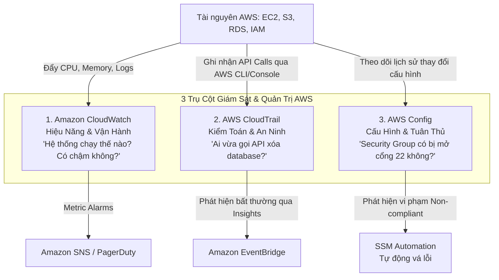
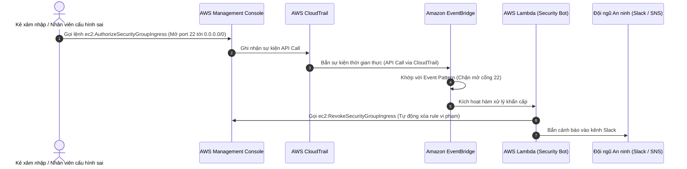

# Tài Liệu Học Tập Chuyên Sâu: Amazon CloudWatch, AWS CloudTrail & AWS Config (Hệ Thống Quan Sát, Kiểm Toán & Quản Trị Tuân Thủ)

> **Tài liệu chuẩn hóa kiến trúc đám mây**: Hướng dẫn toàn diện theo tiêu chuẩn Senior AWS Solutions Architect & Cloud DevOps Engineer.  
> **Ngôn ngữ**: Tiếng Việt (Bảo lưu toàn bộ thuật ngữ chuyên ngành tiếng Anh chuẩn AWS).  
> **Các bài giảng liên quan**: Chương 24 (AWS Monitoring & Audit: CloudWatch, CloudTrail, Config: Bài 264 đến Bài 281).

---

## 6.1. Tổng Quan Dịch Vụ (Service Overview)

### Dịch vụ gì?
Bộ ba dịch vụ **Amazon CloudWatch**, **AWS CloudTrail**, và **AWS Config** tạo nên trụ cột vững chắc nhất cho khả năng quan sát (**Observability**), điều tra an ninh (**Security Audit**), và quản trị tuân thủ quy chuẩn (**Compliance Governance**) trên toàn bộ hệ thống AWS.
1. **Amazon CloudWatch**: Nền tảng giám sát hiệu năng và vận hành tập trung. Thu thập các chỉ số định lượng (**Metrics**), nhật ký văn bản (**Logs**), thiết lập cảnh báo (**Alarms**), và kích hoạt các phản ứng tự động.
2. **AWS CloudTrail**: Dịch vụ ghi nhật ký kiểm toán toàn bộ các cuộc gọi API trên tài khoản AWS. Trả lời câu hỏi kinh điển: **"Ai (Who) đã làm gì (What), vào lúc nào (When), từ đâu (Where), và bằng cách nào (How)?"**.
3. **AWS Config**: Dịch vụ ghi lại lịch sử thay đổi cấu hình tài nguyên theo thời gian và đánh giá tính tuân thủ của các tài nguyên đó dựa trên các quy tắc chuẩn mực (**Config Rules**), hỗ trợ tự động khắc phục sai lệch (**Automated Remediation**).

---

## 6.2. Các Khái Niệm và Thành Phần Cốt Lõi (Core Concepts and Components)

### 1. Phân biệt then chốt giữa Bộ Ba: CloudWatch vs CloudTrail vs AWS Config

| Tiêu chí | Amazon CloudWatch | AWS CloudTrail | AWS Config |
| :--- | :--- | :--- | :--- |
| **Mục đích chính** | **Giám sát hiệu năng và sức khỏe vận hành (Performance & Operations)**. | **Ghi nhật ký kiểm toán hành vi người dùng và gọi API (Audit & Security)**. | **Theo dõi lịch sử thay đổi cấu hình và tuân thủ chuẩn an toàn (Compliance)**. |
| **Loại dữ liệu** | **Metrics** (CPU, RAM, Network) và **Logs** (Application logs, OS logs). | **API Events** (Console logins, CLI actions, SDK calls). | **Configuration Items** (Trạng thái và quan hệ giữa các tài nguyên theo thời gian). |
| **Câu hỏi trả lời** | *"Hệ thống có bị quá tải không? Tỷ lệ lỗi 5xx là bao nhiêu? RAM còn bao nhiêu?"* | *"Ai đã thực hiện lệnh xóa bảng DynamoDB lúc 2 giờ sáng từ IP nào?"* | *"Cấu hình Security Group này đã thay đổi như thế nào trong 3 tháng qua? Có vi phạm luật không?"* |
| **Hành động phản ứng** | Kích hoạt Auto Scaling, tự động phục hồi máy ảo (EC2 Recovery), gửi cảnh báo SNS. | Phát hiện các hành vi gọi API bất thường bằng thuật toán học máy (**CloudTrail Insights**). | Tự động thực thi kịch bản khắc phục (**Remediation**) bằng AWS Systems Manager Runbook khi có vi phạm. |

### 2. Các thành phần chuyên sâu của Amazon CloudWatch
- **CloudWatch Metrics**:
  - Dữ liệu dạng chuỗi thời gian (Time-series data). Mỗi metric bao gồm: **Namespace** (ví dụ `AWS/EC2`), **Metric Name** (ví dụ `CPUUtilization`), các chiều phân loại **Dimensions** (ví dụ `InstanceId=i-12345`), và **Timestamp**.
  - *Mặc định*: AWS tự động thu thập các metric ở cấp độ Hypervisor (CPU, Network In/Out, Disk Read/Write Ops).
  - **Lưu ý sống còn**: AWS **KHÔNG THỂ tự động biết được mức sử dụng bộ nhớ RAM (Memory Utilization)** hoặc dung lượng trống của ổ đĩa bên trong hệ điều hành! Muốn thu thập RAM và Disk Space, bạn **bắt buộc phải cài đặt Unified CloudWatch Agent** bên trong máy ảo EC2.
- **CloudWatch Logs**:
  - **Log Groups** (Nhóm log đại diện cho 1 ứng dụng) chứa nhiều **Log Streams** (Luồng log đại diện cho từng instance hoặc container).
  - **CloudWatch Logs Insights**: Công cụ truy vấn mạnh mẽ cho phép chạy các câu lệnh tìm kiếm tương tự SQL để lọc hàng triệu dòng log trong vài giây (ví dụ: `fields @timestamp, @message | filter @message like /ERROR/ | sort @timestamp desc | limit 20`).
  - **CloudWatch Logs Live Tail**: Tính năng theo dõi luồng log thời gian thực trực tiếp trên bảng điều khiển để debug ứng dụng đang chạy.
- **CloudWatch Alarms**:
  - Gồm 3 trạng thái: `OK`, `ALARM`, `INSUFFICIENT_DATA`.
  - Hỗ trợ: **Static Threshold** (Ngưỡng cố định ví dụ CPU > 80%) và **Anomaly Detection** (Tự động học đường cong sử dụng bình thường và cảnh báo khi có sự bất thường đột biến).
  - **Hành động của Alarm (Alarm Actions)**:
    1. Gửi thông báo tới **Amazon SNS Topic**.
    2. Kích hoạt chính sách co giãn của **Auto Scaling Group**.
    3. Thực hiện thao tác quản trị trên EC2: **Stop**, **Terminate**, **Reboot**, hoặc **Recover** (chuyển máy sang phần cứng mới khi System Check fail mà giữ nguyên IP/Instance ID).

### 3. Phân tích chi tiết AWS CloudTrail
- **Event History (Lịch sử sự kiện)**: Mặc định lưu giữ lịch sử các sự kiện quản trị (Management Events) trong vòng **90 ngày** hoàn toàn miễn phí.
- **CloudTrail Trails**: Để lưu giữ log vĩnh viễn và phục vụ kiểm toán, bạn tạo một Trail để xuất toàn bộ log nén dạng JSON về một **Amazon S3 Bucket** (có thể cấu hình khóa Object Lock WORM để chống hacker xóa vết).
- **Phân loại sự kiện (Event Types)**:
  - *Management Events*: Các thao tác quản trị tài nguyên (ví dụ: `CreateVpc`, `RunInstances`, `AttachPolicy`).
  - *Data Events*: Các thao tác trên dữ liệu (mặc định bị tắt vì lượng log khổng lồ): Các thao tác đọc/ghi file trên S3 (`s3:GetObject`, `s3:PutObject`), các lượt gọi hàm Lambda (`lambda:InvokeFunction`).
  - *CloudTrail Insights*: Tự động phân tích các mẫu hành vi bình thường và phát hiện các đợt bùng nổ gọi API bất thường (ví dụ: tài khoản đột ngột bị gọi hàng ngàn lệnh xóa tài nguyên).

### 4. AWS Config: Quản Trị Tuân Thủ Quy Chuẩn
- Liên tục ghi lại trạng thái cấu hình của các tài nguyên AWS thành các **Configuration Items (CIs)**.
- **Config Rules**: Các quy tắc đánh giá tuân thủ (Managed Rules do AWS cung cấp sẵn hoặc Custom Rules viết bằng Lambda).
  - *Ví dụ Managed Rules phổ biến*:
    - `s3-bucket-public-read-prohibited`: Kiểm tra xem có S3 bucket nào bị mở public không.
    - `restricted-ssh`: Kiểm tra xem có Security Group nào mở cổng 22 tới `0.0.0.0/0` không.
    - `encrypted-volumes`: Kiểm tra xem các ổ đĩa EBS có được mã hóa bằng KMS không.
- **Remediation**: Khi một tài nguyên bị đánh dấu là `NON-COMPLIANT` (Không tuân thủ), Config có thể tự động kích hoạt một tài liệu tự động hóa **AWS Systems Manager (SSM Automation Document)** để tự động sửa lỗi (ví dụ: tự động thu hồi rule mở cổng 22 trên Security Group vi phạm).

---

## 6.3. Kiến Trúc và Luồng Vận Hành (Architecture and Workflow)

### Sơ đồ luồng tự động hóa phát hiện và xử lý vi phạm bảo mật kết hợp CloudTrail, EventBridge & Lambda

---

## 6.4. Bảng Tích Hợp với Các Dịch Vụ AWS Khác (Integration Table)

| Related AWS Service | Purpose (Mục đích tích hợp) | Integration Method (Phương thức tích hợp) | Practical Example (Ví dụ thực tiễn) |
| :--- | :--- | :--- | :--- |
| **Amazon S3** | Lưu trữ dài hạn cho CloudWatch Logs và CloudTrail Trails | S3 Bucket Policy & Lifecycle | Xuất toàn bộ CloudTrail log sang S3 và tự động chuyển sang S3 Glacier Deep Archive sau 90 ngày. |
| **Amazon OpenSearch Service** | Tìm kiếm toàn văn và trực quan hóa phân tích log nâng cao | CloudWatch Logs Subscription Filter | Đẩy luồng log ứng dụng từ CloudWatch sang OpenSearch Dashboards để vẽ biểu đồ và phân tích lỗi. |
| **AWS Systems Manager** | Cài đặt tự động CloudWatch Agent và thực thi kịch bản khắc phục của Config | State Manager & Run Command | Tự động cài đặt Unified CloudWatch Agent lên toàn bộ 100 máy chủ EC2 mới tạo qua SSM Distributor. |
| **AWS X-Ray** | Truy vết phân tán (Distributed Tracing) kết hợp với CloudWatch | CloudWatch ServiceLens & X-Ray SDK | Hiển thị bản đồ Service Map phân tích chi tiết độ trễ của từng microservice từ frontend tới database. |

---

## 6.5. Mô Hình Tính Phí Dịch Vụ & Chiến Lược Tối Ưu Chi Phí Theo Từng Use Case (Observability Cost Breakdown & Optimization)

Khả năng quan sát toàn diện (Full-stack Observability) là chìa khóa để vận hành hệ thống đám mây tin cậy và an toàn. Tuy nhiên, nếu không nắm vững mô hình tính cước của bộ ba **CloudWatch**, **CloudTrail** và **AWS Config**, chi phí giám sát có thể dễ dàng vượt qua cả chi phí hạ tầng máy chủ thực tế.

### 6.5.1. Bảng Cấu Trúc Định Giá Chi Tiết (Pricing Dimensions Matrix)

| Dịch Vụ Giám Sát | Có tính phí hay Miễn phí? | Cơ chế tính phí chi tiết (Pricing Dimensions) | Mức phí tham chiếu điển hình (US East/Singapore) | Lưu ý rủi ro chi phí (Cost Pitfalls) |
| :--- | :--- | :--- | :--- | :--- |
| **CloudWatch Metrics** | Miễn phí Basic Metrics | 1. **Basic Monitoring** (chu kỳ 5 phút): **MIỄN PHÍ 100%**. 2. **Detailed Monitoring** (chu kỳ 1 phút cho EC2): $2.10/instance/tháng. 3. **Custom Metrics**: Tính theo số lượng metrics gửi lên. | - Basic: **$0.00**. - Custom Metrics: **$0.30 / metric / tháng** (10,000 metrics đầu). - Metric Streams: **$0.003 / 1,000 metric updates**. | Gửi quá nhiều Custom Metrics có độ phân giải cao (High Resolution) với các Dimension có cardinality lớn (như User ID, Request ID) làm bùng nổ số lượng custom metrics. |
| **CloudWatch Alarms** | Miễn phí 10 standard alarms | 1. **Standard Resolution** (60s): Tính theo số lượng cảnh báo hoạt động. 2. **High Resolution** (10s/30s). 3. **Composite Alarms**. | - **Standard**: **$0.10 / alarm metric / tháng**. - **High-res**: **$0.30 / alarm / tháng**. - **Composite**: **$0.50 / alarm / tháng**. | Tạo hàng ngàn Alarm riêng lẻ cho từng ổ đĩa hoặc từng tiến trình máy chủ mà không dọn dẹp khi máy chủ bị xóa. |
| **CloudWatch Logs** | Rủi ro chi phí cao nhất | 1. **Log Ingestion**: Cước nạp dữ liệu log vào CloudWatch. 2. **Log Storage**: Cước lưu trữ tích lũy theo tháng. 3. **Logs Insights**: Cước quét dữ liệu khi chạy truy vấn phân tích. | - **Ingestion (Standard)**: **$0.50 / GB nạp vào**. - **Ingestion (Infrequent Access)**: **$0.25 / GB**. - **Storage**: **$0.03 / GB / tháng**. - **Insights Query**: **$0.005 / GB quét**. | **Bẫy chi phí kép**: Để ứng dụng ghi log mức DEBUG tràn lan ra stdout làm tăng tiền Ingestion, kết hợp để `Retention = Never Expire` khiến tiền lưu trữ tăng lũy kế vĩnh viễn! |
| **AWS CloudTrail** | Miễn phí kiểm toán cơ bản | 1. **Event History** (90 ngày tra cứu console): **MIỄN PHÍ 100%**. 2. **1st Management Trail** (lưu vào S3): **MIỄN PHÍ 100%** (chỉ trả tiền S3). 3. **Data Events**: Ghi nhật ký thao tác dữ liệu (S3 object, Lambda invoke). | - **Event History & 1st Trail**: **$0.00**. - **Additional Trails**: **$2.00 / 100,000 events**. - **Data Events**: **$0.10 / 100,000 events**. - **CloudTrail Insights**: **$0.35 / 100,000 write events**. | Bật CloudTrail Data Events trên các S3 Bucket chứa tài sản tĩnh phục vụ website có hàng trăm triệu request mỗi tháng. |
| **AWS Config** | Tính phí theo bản ghi | 1. **Configuration Items (CIs)**: Cước ghi nhận mỗi khi tài nguyên thay đổi trạng thái. 2. **Rule Evaluations**: Cước kiểm tra tính tuân thủ của rule. | - **CIs Recorded**: **$0.003 / CI**. - **Rule Evaluations**: **$0.001 / lần đánh giá**. | Chọn "Record all resource types" khiến AWS Config ghi nhận liên tục hàng ngàn ENI và security group tạm do Auto Scaling hoặc EMR sinh ra. |

---

### 6.5.2. 5 Kịch Bản Tối Ưu Hóa Chi Phí Kiến Trúc Thực Tế (Architectural Cost Optimization Use Cases)

#### Use Case 1: Đặt thời hạn hết hạn tự động cho CloudWatch Log Groups (Log Retention Expiry Policy)
- **Bối cảnh**: Doanh nghiệp vận hành 150 microservices trong 3 năm qua. Theo mặc định của AWS, toàn bộ các Log Group được tạo ra đều có thuộc tính thời gian lưu trữ là **`Never Expire`** (Không bao giờ hết hạn). Tổng dung lượng log tích lũy đã đạt **40 TB (40,000 GB)**.
- **Rủi ro chi phí**:
  - Hàng tháng, doanh nghiệp phải trả: 40,000 GB * $0.03/GB = **$1,200/tháng ($14,400/năm)** chỉ để lưu trữ các dòng log từ 1-2 năm trước mà không ai còn đọc đến.
- **Giải pháp tối ưu**:
  - Viết script tự động hóa (hoặc dùng AWS Config Rule) để đặt Retention Period cho toàn bộ Log Groups:
    - Môi trường Dev/Test: Đặt thời hạn **7 ngày** hoặc **14 ngày**.
    - Môi trường Production: Đặt thời hạn **30 ngày** hoặc **90 ngày**.
  - Với các loại log bắt buộc phải lưu trữ 1-7 năm phục vụ quy chuẩn tài chính/kiểm toán (Compliance): Sử dụng **CloudWatch Subscription Filter** xuất tự động log sang **Amazon S3**, sau đó thiết lập S3 Lifecycle chuyển sang **S3 Glacier Flexible Archive ($0.0036/GB)** hoặc **Glacier Deep Archive ($0.00099/GB)**.
- **Hiệu quả kinh tế**:
  - Dung lượng log lưu trên CloudWatch Logs giảm từ 40 TB xuống còn 3 TB (log của 30 ngày gần nhất).
  - Chi phí lưu trữ CloudWatch giảm từ $1,200 xuống còn $90/tháng.
  - Chi phí 37 TB log cũ lưu trên Glacier Deep Archive chỉ tốn: 37,000 GB * $0.00099 = **$36.63/tháng**.
  - **Tổng tiết kiệm: Hơn $1,070/tháng (giảm 89% chi phí lưu trữ log)**.

#### Use Case 2: Kiểm soát bẫy chi phí Log Ingestion bằng Log Level Tuning & Log Filters
- **Bối cảnh**: Một hệ thống ứng dụng Java Spring Boot chạy trên cụm 60 máy ảo EC2. Do sơ suất của lập trình viên, cấu hình logging trong file `application.properties` ở môi trường Production vẫn được đặt ở mức `DEBUG`.
- **Rủi ro chi phí**: Hệ thống ghi log chi tiết từng truy vấn SQL, từng chu kỳ Health Check 5 giây một lần của ALB. Mỗi ngày cụm máy chủ sinh ra và đẩy lên CloudWatch tới **250 GB log**:
  - Chi phí nạp log: 250 GB/ngày * 30 ngày = 7,500 GB/tháng * $0.50/GB = **$3,750/tháng** chỉ riêng tiền nạp log (Log Ingestion)!
- **Giải pháp tối ưu**:
  - Đổi Log Level trên môi trường Production từ `DEBUG` sang `INFO` hoặc `WARN`.
  - Cấu hình Nginx / Web Server loại bỏ việc ghi log truy cập đối với endpoint `/health` và `/ping`.
  - Với các ứng dụng chỉ cần lưu trữ log để tra cứu hậu kiểm sự cố mà không cần tính năng cảnh báo thời gian thực (Metric Filters / Live Tail), chuyển đổi Log Group sang lớp **CloudWatch Logs Infrequent Access (IA)** với cước nạp chỉ **$0.25/GB** (giảm 50% cước nạp).
- **Hiệu quả kinh tế**:
  - Dung lượng log đẩy lên giảm từ 250 GB/ngày xuống còn **25 GB/ngày** (giảm 90% dung lượng rác).
  - Hóa đơn nạp log giảm từ $3,750/tháng xuống còn **$375/tháng**.
  - **Tiết kiệm ngay $3,375/tháng ($40,500/năm)**.

#### Use Case 3: Tránh bẫy chi phí CloudTrail Data Events trên S3 Buckets lưu lượng cao
- **Bối cảnh**: Đội ngũ bảo mật cấu hình một AWS CloudTrail Trail mới và tích chọn "All S3 Data Events" cho toàn bộ tài khoản để đáp ứng yêu cầu kiểm toán truy cập dữ liệu.
- **Rủi ro chi phí**: Trong tài khoản có một S3 Bucket đóng vai trò CDN Origin phục vụ các file ảnh, biểu đồ cho hàng triệu khách hàng di động, phát sinh trung bình **400 triệu lượt gọi `s3:GetObject` mỗi tháng**.
  - Cước CloudTrail Data Events: 400,000,000 / 100,000 * $0.10 = **$400/tháng** chỉ riêng tiền ghi nhận sự kiện của 1 bucket công khai!
- **Giải pháp tối ưu**:
  - Tắt Data Events đối với các bucket công khai và bucket phục vụ tài sản tĩnh (Assets / Static Web Hosting).
  - Sử dụng **Advanced Event Selectors** trong CloudTrail để khoanh vùng:
    - Chỉ bật Data Events trên các S3 Bucket chứa dữ liệu nhạy cảm (tài khoản ngân hàng, thông tin định danh PII).
    - Chỉ lọc các sự kiện ghi/xóa quan trọng: `PutObject`, `DeleteObject`, `DeleteBucketPolicy` và loại trừ `GetObject` nếu không cần thiết.
  - Nếu cần thống kê lượt tải file tĩnh phục vụ tiếp thị, bật **S3 Server Access Logging** (tính năng này hoàn toàn MIỄN PHÍ cước ghi log, chỉ trả tiền dung lượng lưu file text log trên S3).
- **Hiệu quả kinh tế**:
  - Triệt tiêu hoàn toàn khoản phụ phí $400/tháng cho S3 Data Events mà vẫn đảm bảo tính an toàn cho các bucket bảo mật cốt lõi.

#### Use Case 4: Tinh chỉnh phạm vi ghi nhận của AWS Config (Specific Resource Types)
- **Bối cảnh**: Doanh nghiệp kích hoạt AWS Config với tùy chọn mặc định là "Record all resources supported in this region". Hệ thống sử dụng rất nhiều máy chủ tạm thời (Spot Instances, EMR Spark clusters, ECS Tasks).
- **Rủi ro chi phí**: Mỗi khi một task container hay máy ảo bật lên và tắt đi, các Elastic Network Interface (ENI), Security Group Attachment, và EBS Volume Attachments đều thay đổi trạng thái, khiến AWS Config ghi nhận hơn **400,000 Configuration Items (CIs)** mỗi tháng:
  - Cước CIs: 400,000 * $0.003/CI = **$1,200/tháng**.
- **Giải pháp tối ưu**:
  - Chuyển chế độ ghi nhận của AWS Config Recorder từ "All resources" sang **"Specific resource types"**.
  - Chỉ chọn các loại tài nguyên cốt lõi có rủi ro cấu hình dài hạn: `AWS::IAM::*`, `AWS::S3::Bucket`, `AWS::EC2::SecurityGroup`, `AWS::EC2::Instance`, `AWS::RDS::DBInstance`.
  - Loại trừ toàn bộ các tài nguyên ngắn hạn có vòng đời vài phút như `AWS::EC2::NetworkInterface`, `AWS::EC2::SubnetRouteTableAssociation`.
- **Hiệu quả kinh tế**:
  - Số lượng CIs ghi nhận giảm từ 400,000 xuống còn **20,000 CIs/tháng**.
  - Chi phí AWS Config giảm từ $1,200 xuống còn **$60/tháng (Tiết kiệm 95% chi phí)**.

#### Use Case 5: Tối ưu hóa chi phí truy vấn CloudWatch Logs Insights (Scan Optimization)
- **Bối cảnh**: Khi có sự cố website bị chậm, các kỹ sư thường mở bảng điều khiển CloudWatch Logs Insights, chọn phạm vi thời gian mặc định là "Last 4 weeks" trên Log Group có dung lượng 6 TB và nhấn "Run query" nhiều lần với các câu lệnh lọc khác nhau.
- **Rủi ro chi phí**: Cước truy vấn CloudWatch Logs Insights là **$0.005 cho mỗi 1 GB dữ liệu quét**.
  - Một lần quét toàn bộ 6 TB log: 6,000 GB * $0.005 = **$30.00 cho DUY NHẤT một lần click chuột**! Nếu 5 kỹ sư thực hiện 10 lần truy vấn trong quá trình gỡ lỗi, chi phí phát sinh là **$1,500 trong một buổi sáng**!
- **Giải pháp tối ưu**:
  - Luôn thu hẹp khung thời gian tìm kiếm về khoảng thời gian xảy ra sự cố (ví dụ: chỉ chọn 15 phút hoặc 30 phút xung quanh thời điểm xảy ra lỗi, thay vì quét cả tuần).
  - Thêm điều kiện `@logStream` cụ thể nếu đã xác định được instance hoặc container gây lỗi.
  - Với các nhu cầu phân tích log quy mô lớn (Big Data Analytics), sử dụng **S3 Export Task** để đẩy log sang Amazon S3, nén dưới định dạng Parquet và truy vấn bằng **Amazon Athena** (cước Athena chỉ $5.00/TB quét, và Parquet chỉ quét đúng các cột cần thiết giúp giảm 80-90% dữ liệu quét).
- **Hiệu quả kinh tế**:
  - Dung lượng quét mỗi truy vấn giảm từ 6 TB xuống dưới 10 GB.
  - Chi phí mỗi lần chạy query giảm từ $30.00 xuống còn **$0.05 (Tiết kiệm 99.8%)**.

---

## 6.6. Khắc Phục Sự Cố Thực Tế (Troubleshooting Guide)

| Vấn đề (Problem) | Nguyên nhân khả dĩ (Possible Causes) | Các bước điều tra (Investigation Steps) | Giải pháp (Solution) | Biện pháp phòng ngừa (Prevention) |
| :--- | :--- | :--- | :--- | :--- |
| **Không thấy metric RAM (Memory) của máy ảo EC2 trên CloudWatch** | Chưa cài đặt hoặc chưa khởi động dịch vụ **Unified CloudWatch Agent** trên máy ảo. | Kiểm tra tiến trình `amazon-cloudwatch-agent` có đang chạy trên EC2 không. | Cài đặt agent và cấu hình file `config.json` thu thập metric `mem_used_percent`. | Chuẩn hóa việc cài sẵn CloudWatch Agent vào Golden AMI bằng EC2 Image Builder. |
| **CloudTrail không ghi lại các thao tác tải file trên S3 (`s3:GetObject`)** | Chưa bật cấu hình **Data Events** trong Trail (mặc định CloudTrail chỉ ghi Management Events). | Kiểm tra cài đặt "Data events" trong cấu hình của CloudTrail Trail. | Thêm mục S3 Data Events cho bucket cần giám sát. | Cân nhắc chi phí vì Data Events phát sinh lượng log cực lớn; chỉ bật cho bucket nhạy cảm. |
| **CloudWatch Alarm liên tục ở trạng thái `INSUFFICIENT_DATA`** | Metric không gửi dữ liệu định kỳ hoặc khoảng thời gian đánh giá (Period) quá ngắn so với tần suất gửi số liệu. | Kiểm tra xem metric có đang có datapoint mới gửi về không. | Cấu hình cài đặt "Treat missing data" (ví dụ chọn `treat as bad` hoặc `ignore`), hoặc đảm bảo ứng dụng gửi metric đều đặn. | Kiểm tra IAM role của máy ảo có quyền `cloudwatch:PutMetricData` chưa. |
| **Chi phí AWS Config tăng đột biến trong tháng** | Số lượng tài nguyên thay đổi quá nhiều (Configuration Items tăng vọt do các tác vụ batch ngắn hạn). | Xem mục "Resource types recorded" trong cài đặt của AWS Config. | Giới hạn AWS Config chỉ theo dõi các loại tài nguyên cốt lõi (EC2, S3, IAM, SG) thay vì chọn "Record all resources". | Tắt ghi nhận các tài nguyên biến động liên tục không cần thiết. |

---

## 6.7. Bộ Câu Hỏi Ôn Tập và Kiểm Tra Kiến Thức (Knowledge Review)

### A. 10 Câu hỏi Cốt lõi (Core Concepts)
1. Theo mặc định, Amazon CloudWatch có thể tự động thu thập chỉ số mức độ sử dụng bộ nhớ RAM (Memory Utilization) của máy chủ ảo EC2 từ tầng Hypervisor không?
2. Dịch vụ nào của AWS đóng vai trò ghi nhật ký kiểm toán toàn bộ các cuộc gọi API và hoạt động của người dùng bên trong tài khoản AWS?
3. Sự khác nhau giữa **Management Events** và **Data Events** trong AWS CloudTrail là gì?
4. Dịch vụ nào liên tục theo dõi và ghi lại lịch sử thay đổi cấu hình của các tài nguyên AWS theo thời gian và đánh giá tính tuân thủ của chúng với các quy chuẩn an toàn?
5. Ba trạng thái hoạt động có thể có của một **CloudWatch Alarm** là gì?
6. Tính năng nào của CloudWatch cho phép chạy các đoạn script tự động (Canaries) 24/7 để mô phỏng hành vi của người dùng và kiểm tra tính sẵn sàng của các endpoint HTTP hoặc giao diện web?
7. Khoảng thời gian lưu giữ mặc định của lịch sử sự kiện (**Event History**) trong AWS CloudTrail trên giao diện Console mà không cần tạo Trail là bao nhiêu ngày?
8. Khi một tài nguyên bị AWS Config đánh giá là không tuân thủ (Non-compliant), cơ chế nào cho phép tự động thực thi kịch bản sửa chữa mà không cần con người can thiệp thủ công?
9. Thuật ngữ **Dimensions** trong một CloudWatch Metric có ý nghĩa kỹ thuật là gì?
10. Tính năng nào của CloudWatch Alarms cho phép kết hợp nhiều cảnh báo độc lập lại với nhau bằng các toán tử logic (AND, OR) để giảm thiểu hiện tượng báo động giả (Alarm Fatigue)?

---

### Đáp án Bộ Câu Hỏi Ôn Tập (Answer Key)

👉 Nhấp vào đây để xem toàn bộ đáp án chi tiết

1. **KHÔNG THỂ**. Hypervisor của AWS chỉ nhìn thấy tài nguyên từ bên ngoài (CPU, Network, Disk I/O). Để lấy được số liệu RAM và dung lượng đĩa bên trong hệ điều hành, người dùng bắt buộc phải cài đặt **Unified CloudWatch Agent**.
2. **AWS CloudTrail**.
3. **Management Events** ghi lại các thao tác quản trị trên mặt phẳng điều khiển (Control Plane) như tạo VPC, xóa máy ảo, gắn IAM policy; trong khi **Data Events** ghi lại các thao tác trên mặt phẳng dữ liệu (Data Plane) như đọc/ghi file trên S3 (`s3:GetObject`) hoặc gọi hàm Lambda (`lambda:Invoke`).
4. **AWS Config**.
5. Gồm 3 trạng thái: **`OK`** (Chỉ số nằm trong ngưỡng an toàn), **`ALARM`** (Chỉ số vượt ngưỡng vi phạm), và **`INSUFFICIENT_DATA`** (Không đủ số liệu để xác định trạng thái).
6. **CloudWatch Synthetics (Canaries)**.
7. Mặc định lưu giữ trong vòng **90 ngày**.
8. Tính năng **AWS Config Automated Remediation** (sử dụng các tài liệu tự động hóa **AWS Systems Manager Automation Runbooks**).
9. **Dimensions** là cặp khóa-giá trị (Name/Value) dùng để phân loại, gán nhãn và định danh duy nhất cho một metric cụ thể (ví dụ: `InstanceId=i-0123456789`).
10. **Composite Alarms**.

---

## 6.8. Tóm Tắt và Danh Mục Kiểm Tra Kiến Thức (Summary & Learning Checklist)

### 5 Khái niệm quan trọng nhất phải nhớ:
1. **CloudWatch = Performance**: Metrics, Logs, Alarms; RAM đòi hỏi phải cài CloudWatch Agent.
2. **CloudTrail = Security Audit**: Ghi lại ai đã gọi API nào, vào lúc nào, từ IP nào; xuất ra S3 để lưu trữ vĩnh viễn.
3. **AWS Config = Compliance & History**: Theo dõi lịch sử thay đổi cấu hình và tự động sửa sai bằng SSM Automation.
4. **EC2 Recovery Action**: CloudWatch Alarm có thể tự động cứu hộ máy ảo khi bị lỗi System Status Check.
5. **Logs Insights**: Công cụ truy vấn SQL-like mạnh mẽ phân tích log hàng triệu dòng trong tích tắc.

### Liên kết và Chủ đề tiếp theo:
- 📖 [Ghi Chú Bài Học Chương 24: Giám Sát CloudWatch, CloudTrail & Config](file:///n:/AWS_XBrain_Note/Lesson_Notes/24_AWS_Monitoring_CloudWatch_CloudTrail_Config.md)
- 📖 [Bảng Thuật Ngữ Kỹ Thuật (GLOSSARY.md)](file:///n:/AWS_XBrain_Note/GLOSSARY.md)
- ⏭️ Tiếp tục chuyển sang chuyên đề: **Bảo Mật Đám Mây & Mã Hóa Dữ Liệu: AWS KMS, Secrets Manager & WAF**.
