# Tài Liệu Học Tập Chuyên Sâu: Tối Ưu Chi Phí, Cơ Sở Dữ Liệu Chuyên Dụng & Di Chuyển Dữ Liệu

> **Tài liệu chuẩn hóa kiến trúc đám mây**: Hướng dẫn toàn diện theo tiêu chuẩn Senior AWS Solutions Architect (SAA-C03) cập nhật 2026.  
> **Ngôn ngữ**: Tiếng Việt chuyên ngành (Bảo lưu 100% thuật ngữ chuyên ngành tiếng Anh chuẩn AWS).  
> **Các dịch vụ bao phủ**: AWS Cost Explorer, AWS Budgets, AWS Compute Optimizer, Savings Plans, Reserved Instances, Amazon EKS, Amazon Neptune, Amazon DocumentDB, AWS DataSync, AWS Transfer Family, AWS Snow Family.

---

## 1. Tổng Quan Nhóm Dịch Vụ (Service Overview)

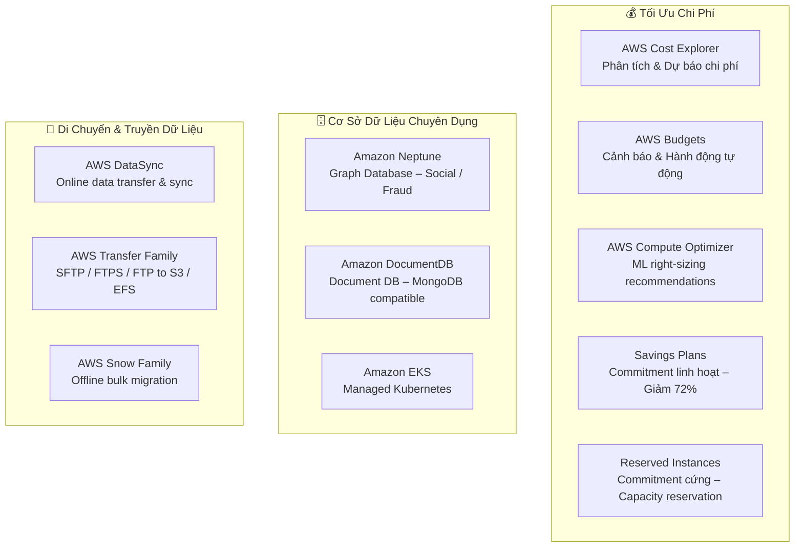

---

## 2. Tối Ưu Chi Phí AWS — Cost Optimization Toolkit

### 2.1 AWS Cost Explorer — Phân Tích & Dự Báo Chi Phí

**AWS Cost Explorer** là công cụ **trực quan hóa, phân tích và dự báo** chi phí AWS theo thời gian.

#### Tính Năng Chính cho Đề Thi

| Tính Năng | Chi Tiết |
| :--- | :--- |
| **Historical Analysis** | Xem chi tiết chi phí 12 tháng qua theo ngày/tuần/tháng |
| **Forecasting** | Dự báo chi phí 12 tháng tới dựa trên xu hướng hiện tại |
| **Granularity** | Phân tích theo: Service, Region, AZ, Account (linked), Resource, Tag |
| **Right-Sizing** | Khuyến nghị downsize EC2/RDS đang hoạt động dưới ngưỡng (powered by Compute Optimizer) |
| **Savings Plans Recommendations** | Gợi ý commitment phù hợp để tiết kiệm chi phí On-Demand |

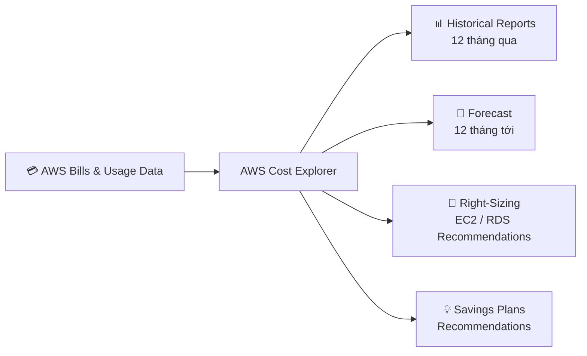

> [!TIP]
> **Từ khóa nhận biết**: "phân tích chi phí lịch sử", "dự báo chi phí", "xem chi phí theo service/account/tag" → **AWS Cost Explorer**

---

### 2.2 AWS Budgets — Giám Sát & Hành Động Tự Động

**AWS Budgets** là công cụ **chủ động** (proactive) giúp đặt ngưỡng ngân sách và tự động cảnh báo hoặc thực hiện hành động khi chi phí vượt ngưỡng.

#### 4 Loại Budget

| Loại | Theo dõi điều gì | Ví dụ |
| :--- | :--- | :--- |
| **Cost Budget** | Tổng chi phí thực tế hoặc dự báo | "Cảnh báo khi chi phí tháng vượt $500" |
| **Usage Budget** | Lượng dùng (GB, giờ EC2...) | "Cảnh báo khi dùng >1,000 EC2 instance-hours" |
| **RI Utilization Budget** | Mức độ sử dụng Reserved Instances | "Cảnh báo khi RI utilization < 80%" |
| **Savings Plans Utilization Budget** | Mức độ sử dụng Savings Plans commitment | "Cảnh báo khi SP coverage < 90%" |

#### Budget Actions — Tự Động Hóa Phản Ứng

Khi vượt ngưỡng, AWS Budgets có thể tự động:
1. **Gắn IAM Policy** vào user/group/role để hạn chế quyền tạo tài nguyên mới
2. **Dừng EC2 / RDS instances** để ngăn chi phí phát sinh thêm
3. **Gửi SNS notification** → trigger Lambda tùy chỉnh

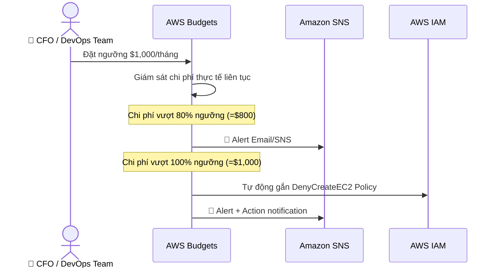

> [!TIP]
> **Từ khóa nhận biết**: "cảnh báo khi vượt ngân sách", "ngăn chặn chi phí tự động", "budget alert" → **AWS Budgets**

---

### 2.3 AWS Compute Optimizer — Right-Sizing với Machine Learning

**AWS Compute Optimizer** dùng **Machine Learning** phân tích metrics lịch sử 14 ngày từ **CloudWatch** để đưa ra khuyến nghị tối ưu kích thước tài nguyên.

#### Tài Nguyên Được Hỗ Trợ

| Tài Nguyên | Khuyến Nghị |
| :--- | :--- |
| **EC2 Instances** | Downsize/upsize instance type, thay đổi instance family |
| **EC2 Auto Scaling Groups** | Tối ưu launch configuration |
| **EBS Volumes** | Chuyển gp2 → gp3, giảm IOPS provisioed dư thừa |
| **AWS Lambda Functions** | Điều chỉnh memory allocation tối ưu |
| **ECS Services on Fargate** | Tối ưu vCPU + memory cho task |

> [!NOTE]
> Compute Optimizer **KHÁC** Cost Explorer:
> - **Cost Explorer Right-Sizing**: Phân tích ở mức billing, kiến nghị đơn giản
> - **Compute Optimizer**: Phân tích sâu performance metrics, ML model, kiến nghị chi tiết hơn

---

### 2.4 Savings Plans vs Reserved Instances — Bẫy Thi Kinh Điển

Đây là **bẫy thi xuất hiện nhiều nhất** trong domain Cost Optimization. Cả hai đều cung cấp giảm giá đến **72%** so với On-Demand.

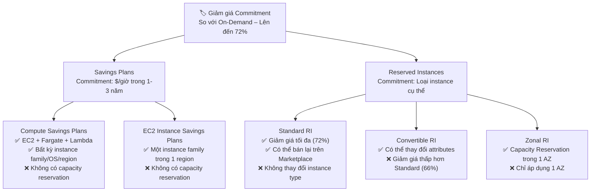

#### Bảng So Sánh Chi Tiết

| Tiêu Chí | Compute Savings Plans | EC2 Instance Savings Plans | Standard Reserved Instance | Zonal Reserved Instance |
| :--- | :--- | :--- | :--- | :--- |
| **Phạm vi áp dụng** | EC2 + Fargate + Lambda | Một instance family + region | Một instance family + region | Một instance type + 1 AZ |
| **Thay đổi instance type** | ✅ Tự do | ✅ Trong cùng family | ❌ Không | ❌ Không |
| **Thay đổi Region** | ✅ Có | ❌ Không | ❌ Không | ❌ Không |
| **Capacity Reservation** | ❌ Không | ❌ Không | ❌ Không | ✅ **CÓ** |
| **Mức giảm giá** | Đến 66% | Đến 72% | Đến 72% | Đến 72% |

> [!IMPORTANT]
> **Quy tắc quyết định cho đề thi:**
> - Câu hỏi nhấn mạnh **"linh hoạt"** khi workload thay đổi instance type/region → **Compute Savings Plans**
> - Câu hỏi nhấn mạnh **"đảm bảo capacity"** trong 1 AZ → **Zonal Reserved Instances**
> - Câu hỏi không có yêu cầu đặc biệt, chỉ muốn **tiết kiệm tối đa** cho EC2 ổn định 1 family → **EC2 Instance Savings Plans** hoặc **Standard RI**

---

## 3. Amazon EKS — Managed Kubernetes Service

### 3.1 Bản Chất

**Amazon Elastic Kubernetes Service (EKS)** là dịch vụ Kubernetes được AWS quản lý hoàn toàn — tự động hóa việc cài đặt, vận hành và bảo trì control plane của Kubernetes.

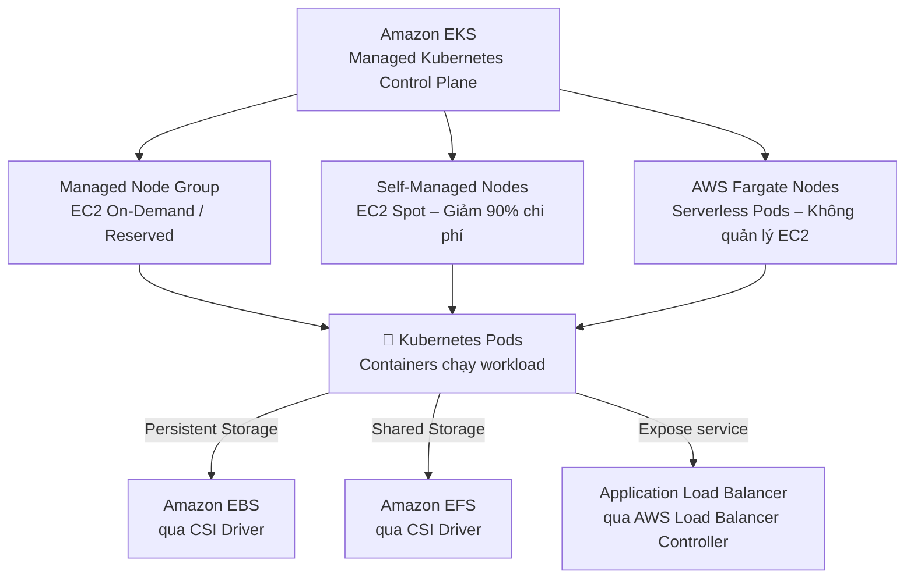

### 3.2 EKS vs ECS — Khi Nào Chọn Gì?

| Tiêu Chí | Amazon ECS | Amazon EKS |
| :--- | :--- | :--- |
| **Orchestrator** | AWS-proprietary (Task, Service) | **Kubernetes** (open-source) |
| **Learning Curve** | Thấp | Cao (phải hiểu Kubernetes) |
| **Multi-cloud / Hybrid** | ❌ Chỉ trên AWS | ✅ **EKS Anywhere** (on-prem + multi-cloud) |
| **Ecosystem** | AWS-centric | Rộng lớn (Helm, Istio, ArgoCD...) |
| **Use case** | Greenfield AWS apps, đơn giản hơn | Migrate workloads từ on-prem K8s, chuẩn hóa container |

> [!TIP]
> **Từ khóa nhận biết EKS**: "Kubernetes", "kubectl", "Helm charts", "chuẩn hóa container workloads", "EKS Anywhere", "hybrid Kubernetes"

---

## 4. Amazon Neptune — Graph Database

### 4.1 Bản Chất & Use Cases

**Amazon Neptune** là dịch vụ **cơ sở dữ liệu đồ thị (Graph Database)** được quản lý hoàn toàn, tối ưu cho các workload có dữ liệu **kết nối dày đặc** (highly connected data).

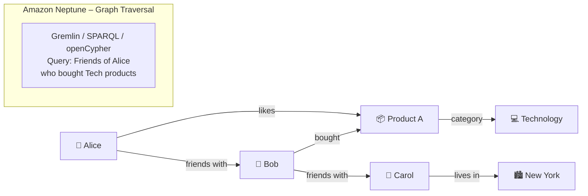

### 4.2 Query Languages & Graph Models

| Graph Model | Query Language | Use Case |
| :--- | :--- | :--- |
| **Property Graph** | **Apache Gremlin** | Social networks, recommendation engines |
| **Property Graph** | **openCypher** | Fraud detection, identity graphs |
| **RDF (Resource Description Framework)** | **SPARQL** | Knowledge graphs, semantic data |

### 4.3 High Availability Architecture

- **Multi-AZ** tự động: 6 bản sao dữ liệu trải rộng 3 AZs
- Lên đến **15 Read Replicas** để scale đọc
- Failover tự động trong vòng < 30 giây

### 4.4 Từ Khóa Nhận Biết Neptune Trong Đề Thi

| Từ khóa | Giải thích |
| :--- | :--- |
| **"Social network graph"** | Mối quan hệ bạn bè, followers |
| **"Fraud detection"** | Phát hiện gian lận qua mạng lưới giao dịch kết nối |
| **"Recommendation engine"** | Gợi ý sản phẩm qua quan hệ người dùng-sản phẩm |
| **"Knowledge graph"** | Mối quan hệ ngữ nghĩa giữa các khái niệm |
| **Gremlin / SPARQL / openCypher** | Ngôn ngữ truy vấn graph → gần như chắc chắn là Neptune |

> [!WARNING]
> **Bẫy thi**: Không dùng DynamoDB hay Aurora cho "deep relationship traversal" (ví dụ: "tìm bạn của bạn của bạn 4 cấp"). Đây là domain của Neptune.

---

## 5. Amazon DocumentDB — MongoDB-Compatible Document Database

### 5.1 Bản Chất

**Amazon DocumentDB** (with MongoDB compatibility) là dịch vụ **cơ sở dữ liệu tài liệu (Document Database)** lưu trữ dữ liệu dạng **JSON/BSON**, tương thích với MongoDB wire protocol.

> [!NOTE]
> DocumentDB **KHÔNG** chạy MongoDB thực sự bên dưới. Nó **emulate** MongoDB wire protocol, cho phép MongoDB drivers, tools và code hiện có kết nối mà không cần thay đổi.

### 5.2 Kiến Trúc & Scaling

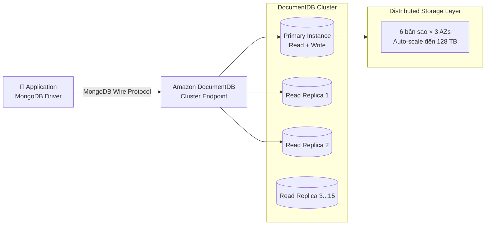

**Đặc điểm kiến trúc giống Aurora**:
- Tách biệt compute và storage
- Storage tự động scale đến **128 TB** (không cần provision thủ công)
- **6 bản sao** dữ liệu trải rộng **3 AZs**
- Lên đến **15 Read Replicas**

### 5.3 Phân Biệt DocumentDB vs DynamoDB vs Neptune

| Tiêu Chí | Amazon DocumentDB | Amazon DynamoDB | Amazon Neptune |
| :--- | :--- | :--- | :--- |
| **Mô hình dữ liệu** | Document (JSON/BSON) | Key-Value + Document | Graph (Nodes + Edges) |
| **Tương thích** | **MongoDB** API | AWS-proprietary API | Gremlin / SPARQL / openCypher |
| **Use Case chính** | Catalog, User profiles, CMS | High-speed KV, session, gaming | Social networks, Fraud, Recommendation |
| **Trigger từ khóa** | "MongoDB", "JSON documents", "flexible schema" | "Single-digit ms", "serverless scaling", "DynamoDB" | "Graph", "relationships", "connected data" |
| **Storage Auto-Scale** | ✅ 128 TB | ✅ Không giới hạn | ✅ 128 TB |

> [!TIP]
> **Quy tắc vàng**: Đề thi nhắc đến **"MongoDB"** hoặc **"migrate MongoDB app"** → Luôn chọn **DocumentDB**.

---

## 6. AWS DataSync — Truyền Dữ Liệu Online Nhanh & Bảo Mật

### 6.1 Bản Chất

**AWS DataSync** là dịch vụ **truyền và đồng bộ dữ liệu online** được quản lý, giúp di chuyển lượng lớn dữ liệu từ:
- **On-Premises** → AWS (NFS, SMB, HDFS, Object Storage)
- **AWS ↔ AWS** (giữa các dịch vụ storage trong cùng hoặc khác region)

### 6.2 Kiến Trúc DataSync Agent

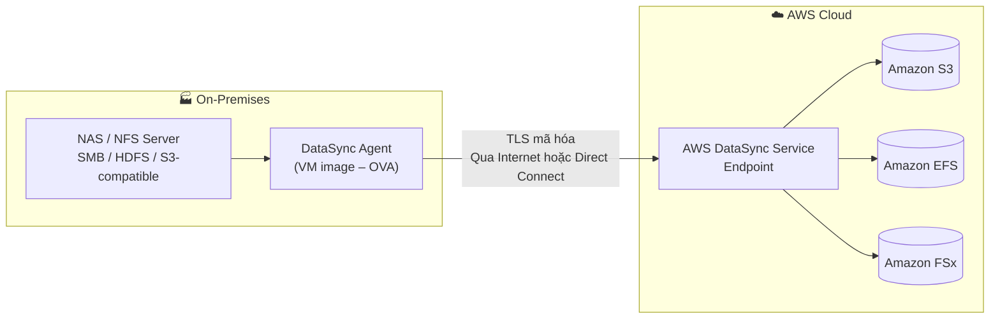

### 6.3 Tính Năng Nổi Bật

| Tính Năng | Chi Tiết |
| :--- | :--- |
| **Tốc độ** | Tối ưu hóa tốc độ truyền, có thể đạt **10x nhanh hơn** open-source tools |
| **Toàn vẹn dữ liệu** | Tự động kiểm tra checksums trong và sau khi truyền |
| **Mã hóa transit** | TLS 1.2 end-to-end |
| **Lịch trình** | Hỗ trợ **recurring/scheduled transfers** |
| **Filtering** | Lọc file theo pattern để chỉ sync dữ liệu cần thiết |
| **Giám sát** | Tích hợp CloudWatch để theo dõi tiến độ và tốc độ |

### 6.4 Phân Biệt DataSync vs Storage Gateway vs Snow Family

| Yêu cầu | Dịch vụ | Lý do |
| :--- | :--- | :--- |
| "Di chuyển dữ liệu online, có internet/Direct Connect, nhanh" | **AWS DataSync** | Online transfer + tốc độ cao |
| "Ứng dụng on-prem cần đọc/ghi vào S3 như ổ đĩa local" | **AWS Storage Gateway** | File Gateway / Volume Gateway |
| "Di chuyển PB dữ liệu, kết nối internet kém/không có" | **AWS Snow Family** | Vật lý + offline |
| "Di chuyển database giữa engines (Oracle → Aurora)" | **AWS DMS** | Schema conversion + replication |

---

## 7. AWS Transfer Family — SFTP/FTP Managed Vào S3/EFS

### 7.1 Bản Chất

**AWS Transfer Family** là dịch vụ managed cung cấp endpoint **SFTP, FTPS, FTP, và AS2** cho phép đối tác/khách hàng bên thứ ba upload/download file trực tiếp vào **Amazon S3** hoặc **Amazon EFS** mà không cần quản lý server FTP thủ công.

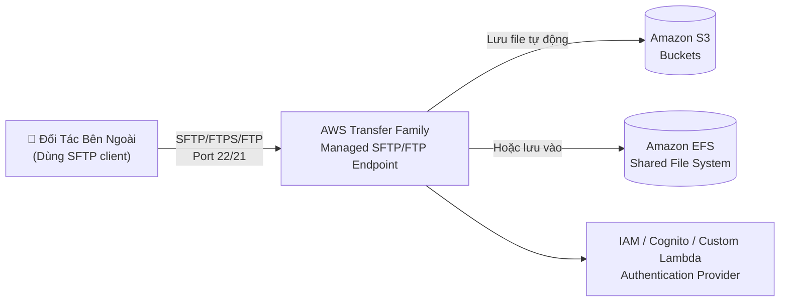

### 7.2 Protocols Hỗ Trợ

| Protocol | Use Case |
| :--- | :--- |
| **SFTP** (SSH File Transfer Protocol) | Phổ biến nhất — secure file transfer |
| **FTPS** (FTP over SSL/TLS) | Legacy B2B transfers với encryption |
| **FTP** (Unencrypted) | Chỉ dùng trong VPC nội bộ, legacy |
| **AS2** (Applicability Statement 2) | B2B EDI (Electronic Data Interchange) trong supply chain |

> [!TIP]
> **Từ khóa nhận biết**: "đối tác cần upload file bằng SFTP", "thay thế FTP server", "B2B file transfer to S3" → **AWS Transfer Family**

---

## 8. AWS Snow Family — Di Chuyển Dữ Liệu Offline Quy Mô Lớn

### 8.1 Bản Chất & Vấn Đề Giải Quyết

Khi lượng dữ liệu cần di chuyển quá lớn (TB → PB) mà băng thông mạng bị giới hạn hoặc không có, **AWS Snow Family** cung cấp các thiết bị vật lý để **di chuyển dữ liệu offline** bằng cách ship thiết bị.

**Ví dụ minh họa**: Nếu bạn có 100 TB dữ liệu và đường truyền 1 Gbps, sẽ mất **~9 ngày** chỉ để truyền data. Với Snowball Edge, bạn có thể hoàn thành trong **1-2 tuần** bao gồm thời gian ship thiết bị qua lại.

### 8.2 Phân Loại Thiết Bị Snow Family

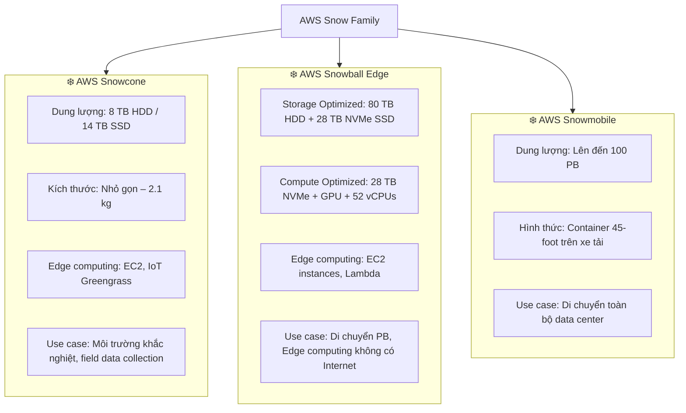

### 8.3 Snow Family vs DataSync — Quy Tắc Chọn

| Kịch Bản | Chọn | Lý Do |
| :--- | :--- | :--- |
| "Có Internet/Direct Connect, cần sync định kỳ" | **AWS DataSync** | Online, scheduled, automated |
| "< 10 TB, kết nối tốt" | **DataSync / S3 Transfer Acceleration** | Đủ nhanh qua network |
| "10 TB – 1 PB, kết nối kém hoặc quá tốn kém" | **AWS Snowball Edge** | Vật lý + offline |
| "> 1 PB (di chuyển data center)" | **AWS Snowmobile** | Quy mô cực lớn |
| "Môi trường xa, không Internet, thu thập IoT data" | **AWS Snowcone** | Nhỏ gọn + edge computing |

> [!NOTE]
> **Snowball Edge không chỉ là thiết bị lưu trữ** — nó có thể **chạy EC2 instances, Lambda functions, và IoT Greengrass** ở edge (ví dụ: trên tàu, nhà máy không có Internet).

### 8.4 Quy Trình Sử Dụng Snowball Edge

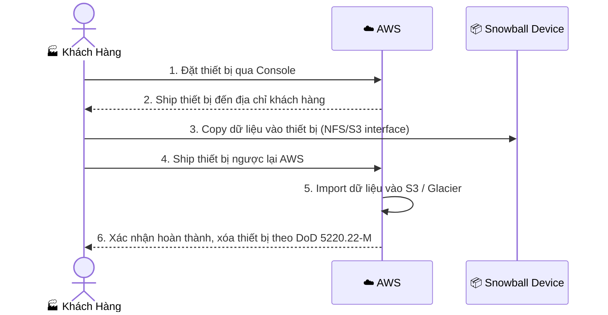

---

## 9. Bảng Quyết Định Nhanh — Cost Optimization

### 9.1 Chọn Công Cụ Quản Lý Chi Phí

| Từ Khóa / Yêu Cầu | Công Cụ | Chức Năng |
| :--- | :--- | :--- |
| "Xem tiền đã tiêu thế nào trong 3 tháng qua" | **Cost Explorer** | Phân tích lịch sử |
| "Dự báo chi phí tháng sau" | **Cost Explorer** | Forecasting |
| "Nhận alert khi chi phí vượt $500" | **AWS Budgets** | Proactive alerting |
| "Tự động dừng EC2 khi vượt budget" | **AWS Budgets Actions** | Automated governance |
| "AI/ML gợi ý downsize EC2 đang idle" | **Compute Optimizer** | ML right-sizing |
| "Giảm chi phí EC2 ổn định 3 năm, linh hoạt thay đổi type" | **Compute Savings Plans** | Flexible commitment |
| "Giảm chi phí EC2 ổn định, cần đảm bảo capacity trong 1 AZ" | **Zonal Reserved Instances** | Capacity reservation |

### 9.2 Chọn Database Chuyên Dụng

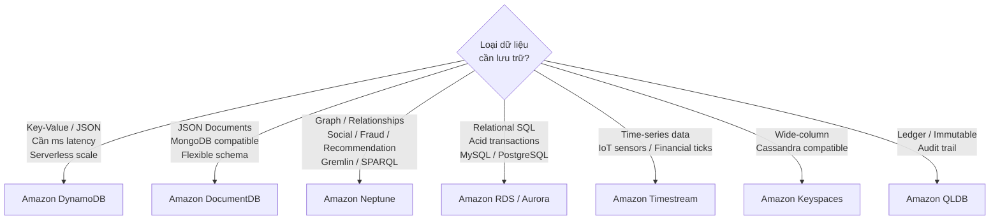

### 9.3 Chọn Phương Thức Di Chuyển Dữ Liệu

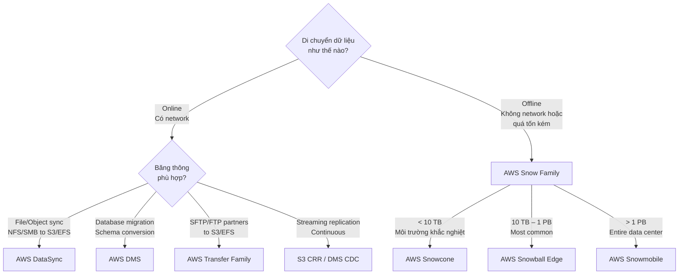

---

## 10. Bẫy Thi Thường Gặp (Exam Traps) — Tổng Hợp

### ❌ Lỗi Sai Phổ Biến:

1. **Bẫy Savings Plans vs Reserved Instances Capacity**:
   - Savings Plans **KHÔNG** cung cấp capacity reservation
   - Chỉ **Zonal Reserved Instances** mới có capacity reservation
   - → Nếu đề hỏi "đảm bảo capacity khởi động" → phải chọn **Zonal RI + On-Demand Capacity Reservation**

2. **Bẫy DocumentDB vs DynamoDB**:
   - DocumentDB = **MongoDB-compatible** (JSON documents, rich queries)
   - DynamoDB = **Key-Value + simple document** (single-digit ms, serverless)
   - → Từ khóa "MongoDB" hoặc "rich query JSON" → DocumentDB

3. **Bẫy Neptune vs DynamoDB cho relationship data**:
   - DynamoDB có thể lưu relationships nhưng **không hiệu quả** cho deep graph traversal
   - → "4 degrees of separation", "fraud network", "social graph" → Neptune

4. **Bẫy DataSync vs Storage Gateway**:
   - DataSync: **Di chuyển / sync dữ liệu** (migration, one-time hoặc recurring)
   - Storage Gateway: **Extend on-prem storage** lên AWS (ứng dụng on-prem tiếp tục dùng)

5. **Bẫy Snowball Edge vs DataSync**:
   - Không phải cứ dữ liệu lớn là Snowball — nếu có Internet tốt, DataSync nhanh hơn và rẻ hơn
   - Snowball khi: network **không có / quá chậm / quá tốn kém** so với thuê thiết bị

6. **Bẫy Cost Explorer vs Budgets**:
   - Cost Explorer: **Reactive** — phân tích sau
   - Budgets: **Proactive** — cảnh báo và hành động trước khi vượt ngưỡng

7. **Bẫy EKS vs ECS**:
   - Nếu không nhắc đến Kubernetes → thường là ECS (đơn giản hơn)
   - "Kubernetes", "kubectl", "Helm" → chắc chắn EKS

---

## 11. Quick Reference — Từ Khóa Nhận Dạng Dịch Vụ

| Từ Khóa / Pattern | → Dịch Vụ |
| :--- | :--- |
| "Phân tích chi phí lịch sử, dự báo tương lai" | **AWS Cost Explorer** |
| "Cảnh báo vượt budget, tự động dừng EC2" | **AWS Budgets + Budget Actions** |
| "ML recommendations để downsize EC2 / EBS / Lambda" | **AWS Compute Optimizer** |
| "Linh hoạt: EC2 + Fargate + Lambda, nhiều regions" | **Compute Savings Plans** |
| "Cần capacity reservation trong 1 AZ" | **Zonal Reserved Instances** |
| "Kubernetes, kubectl, Helm, EKS Anywhere" | **Amazon EKS** |
| "Graph, social network, fraud detection, Gremlin/SPARQL" | **Amazon Neptune** |
| "MongoDB, JSON documents, migrate MongoDB app" | **Amazon DocumentDB** |
| "Sync NFS/SMB on-prem → S3/EFS, có Internet" | **AWS DataSync** |
| "SFTP partner uploads, B2B file transfer → S3" | **AWS Transfer Family** |
| "Di chuyển TB–PB, kết nối kém, offline" | **AWS Snowball Edge** |
| "Di chuyển PB, môi trường xa, edge computing" | **AWS Snowcone** |
| "Di chuyển toàn bộ data center, > 1 PB" | **AWS Snowmobile** |

