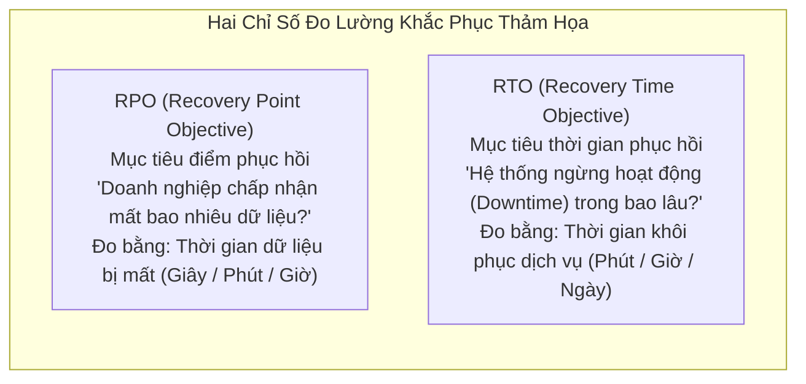
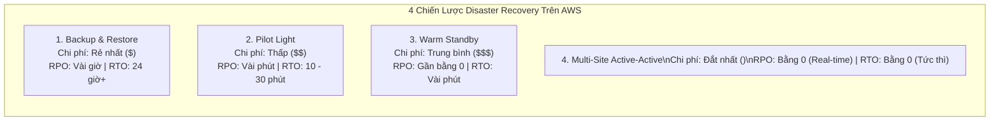
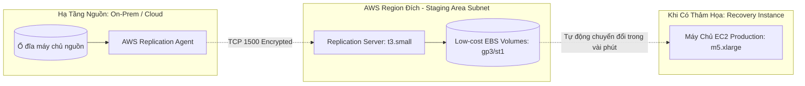
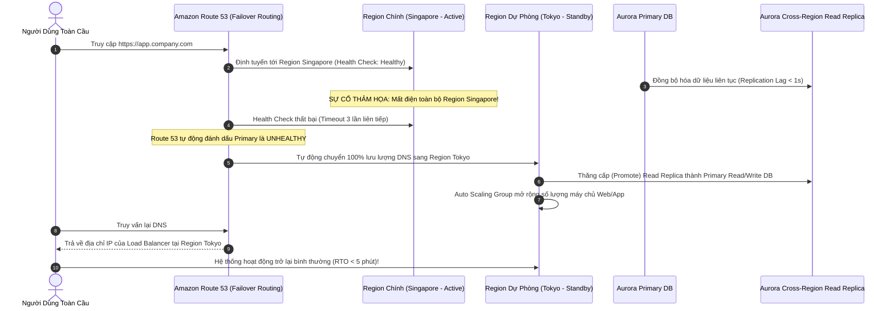

# Tài Liệu Học Tập Chuyên Sâu: Khắc Phục Thảm Họa (Disaster Recovery) & Di Chuyển Lên Đám Mây (Cloud Migration)

> **Tài liệu chuẩn hóa kiến trúc đám mây**: Hướng dẫn toàn diện theo tiêu chuẩn Senior AWS Solutions Architect & Cloud DevOps Engineer (cập nhật mới nhất 2026).  
> **Ngôn ngữ**: Tiếng Việt (Bảo lưu toàn bộ thuật ngữ chuyên ngành tiếng Anh chuẩn AWS).  
> **Các dịch vụ liên quan**: AWS Elastic Disaster Recovery (AWS DRS), AWS Database Migration Service (AWS DMS), AWS Application Migration Service (AWS MGN), AWS Backup, AWS DataSync, AWS Snow Family.

---

## 6.1. Tổng Quan Dịch Vụ (Service Overview)

### Dịch vụ gì?
Khắc phục thảm họa (**Disaster Recovery - DR**) và di chuyển hạ tầng lên đám mây (**Cloud Migration**) là các bài toán kiến trúc sống còn đối với sự tồn vong và tính liên tục trong hoạt động kinh doanh (Business Continuity) của doanh nghiệp. AWS cung cấp bộ giải pháp toàn diện:
1. **AWS Elastic Disaster Recovery (AWS DRS)**: Dịch vụ khắc phục thảm họa thế hệ mới, liên tục sao chép dữ liệu ở cấp độ khối ổ đĩa (Block-level replication) từ các máy chủ vật lý, máy ảo On-Premises (VMware, Hyper-V) hoặc từ các AWS Region khác sang một vùng lưu trữ chi phí thấp (Staging Area) trên AWS, cho phép phục hồi hệ thống nhanh chóng trong vài phút khi có sự cố.
2. **AWS Database Migration Service (AWS DMS)**: Dịch vụ di chuyển cơ sở dữ liệu lên AWS nhanh chóng và an toàn, hỗ trợ cả di chuyển đồng nhất (Homogeneous) và không đồng nhất (Heterogeneous kết hợp với **AWS Schema Conversion Tool - SCT**), duy trì cơ chế sao chép dữ liệu thay đổi liên tục (**Change Data Capture - CDC**) giúp quá trình chuyển đổi không gây gián đoạn hoạt động (Near-zero downtime).
3. **AWS Application Migration Service (AWS MGN)**: Dịch vụ di chuyển máy chủ chuyên dụng (Lift-and-Shift Migration) tự động chuyển đổi các máy chủ vật lý và máy ảo on-premises thành các máy chủ EC2 nguyên bản trên AWS.
4. **AWS Backup**: Dịch vụ quản trị và tự động hóa sao lưu dữ liệu tập trung dựa trên chính sách (Policy-based backup) cho toàn bộ hệ sinh thái AWS (EBS, RDS, Aurora, DynamoDB, EFS, S3, EC2) với tính năng bảo vệ chống mã độc tống tiền **AWS Backup Vault Lock**.
5. **AWS Snow Family & AWS DataSync**: Bộ giải pháp di chuyển khối lượng dữ liệu khổng lồ (Terabytes đến Petabytes) từ trung tâm dữ liệu lên AWS an toàn và bảo mật.

---

## 6.2. Các Khái Niệm, Kiến Trúc & Vận Hành Cốt Lõi (Core Concepts, Security & Day-2 Operations)

### 1. Hai Chỉ Số Sống Còn Của Disaster Recovery: RPO & RTO



---

### 2. 4 Chiến Lược Khắc Phục Thảm Họa Kinh Điển Trên AWS



| Chiến lược DR | Cơ chế hoạt động của dữ liệu | Trạng thái máy chủ tính toán (Compute) | RPO | RTO | Mức chi phí đánh đổi |
| :--- | :--- | :--- | :--- | :--- | :--- |
| **Backup & Restore** | Định kỳ sao lưu dữ liệu (Snapshot, S3 backup) và gửi sang Region dự phòng. | **Hoàn toàn KHÔNG CHẠY máy chủ nào**. Khi có thảm họa mới dùng script tạo máy mới. | **Cao nhất** (Vài giờ đến 24 giờ). | **Cao nhất** (Nhiều giờ để tải dữ liệu và dựng lại hạ tầng). | **Rẻ nhất ($)** (Chỉ tốn tiền lưu trữ dữ liệu sao lưu). |
| **Pilot Light** | Dữ liệu cốt lõi (Database) được **sao chép liên tục theo thời gian thực** sang Region phụ. | Máy chủ ứng dụng (Web/App) **TẮT HOÀN TOÀN** (chỉ lưu sẵn Golden AMI hoặc template IaC). | **Thấp** (Vài giây đến vài phút). | **Trung bình** (10 - 30 phút để Auto Scaling khởi chạy máy ảo lên). | **Thấp ($$)** (Chỉ tốn tiền nuôi 1 máy chủ DB nhỏ hoặc Standby). |
| **Warm Standby** | Dữ liệu được đồng bộ hóa liên tục thời gian thực sang Region phụ. | Chạy sẵn một phiên bản hệ thống thu nhỏ (**Scaled-down minimal version**) phục vụ tải nhỏ. | **Rất thấp** (Gần bằng 0). | **Rất nhanh** (Vài phút: chỉ cần scale-out cụm máy ảo và đổi Route 53 DNS). | **Trung bình ($$$)** (Nuôi cả cụm server nhỏ chạy 24/7). |
| **Multi-Site Active-Active** | Dữ liệu đồng bộ 2 chiều thời gian thực (Aurora Global, DynamoDB Global Tables). | Hệ thống chạy ở **quy mô sản xuất đầy đủ (Full production scale)** đồng thời ở cả 2 Region. | **Bằng 0** (Zero data loss). | **Tức thì (Zero downtime)**: Route 53 tự động chuyển hướng traffic ngay lập tức. | **Đắt nhất ($$$$)** (Gấp đôi chi phí hạ tầng). |

---

### 3. AWS Elastic Disaster Recovery (AWS DRS)



- **Nguyên lý hoạt động**: Cài đặt **AWS Replication Agent** lên các máy chủ nguồn. Agent liên tục bắt các khối thay đổi (Block-level delta) nén và mã hóa gửi qua cổng **TCP 1500** về một máy chủ sao chép siêu nhỏ (`t3.small`) trong vùng đệm (**Staging Area Subnet**) trên AWS.
- **Tối ưu chi phí FinOps**: Trong trạng thái bình thường, bạn không cần phải trả tiền cho các máy chủ EC2 mạnh mẽ; dữ liệu chỉ được ghi vào các ổ đĩa EBS giá rẻ. Chỉ khi thảm họa xảy ra (hoặc khi tổ chức diễn tập DR Drill), AWS DRS mới tự động khởi chạy hàng loạt máy chủ EC2 mạnh mẽ trong vòng vài phút.

---

### 4. AWS Database Migration Service (AWS DMS) & AWS SCT

- **Homogeneous Migration (Di chuyển đồng nhất)**: Chuyển giữa hai cơ sở dữ liệu cùng loại (ví dụ: Oracle sang Oracle, PostgreSQL sang Aurora PostgreSQL). Không cần thay đổi cấu trúc bảng.
- **Heterogeneous Migration (Di chuyển không đồng nhất)**: Chuyển giữa hai cơ sở dữ liệu khác loại (ví dụ: Oracle sang Aurora PostgreSQL hoặc SQL Server sang MySQL). Bắt buộc phải sử dụng công cụ **AWS Schema Conversion Tool (AWS SCT)** để tự động chuyển đổi các câu lệnh DDL, bảng, views, stored procedures và triggers sang cú pháp của engine đích.
- **Change Data Capture (CDC)**: DMS liên tục đọc các transaction logs của database nguồn để đồng bộ các bản ghi mới nhất sang database đích. Ứng dụng nguồn vẫn hoạt động bình thường cho đến thời điểm chuyển đổi chính thức (Cut-over) với downtime chỉ tính bằng phút.

---

### 5. Chiến Lược Chuyển Dữ Liệu Dung Lượng Lớn (Snow Family & DataSync)

| Phương thức | Dung lượng tối ưu | Băng thông mạng yêu cầu | Kịch bản sử dụng chuẩn mực & Trạng thái 2026 |
| :--- | :--- | :--- | :--- |
| **AWS DataSync** | Hàng chục đến hàng trăm TB | Cần kết nối Internet tốc độ cao hoặc Direct Connect | Tự động hóa đồng bộ tệp tin định kỳ từ NAS/SAN (NFS/SMB) lên S3, EFS, FSx với tốc độ nhanh gấp 10 lần các công cụ mã nguồn mở. |
| **AWS Snowcone** | Tối đa **8 TB** (hoặc 14 TB SSD) | Không cần mạng (Thiết bị nhỏ 2.1 kg vận chuyển bưu điện) | Di chuyển dữ liệu ở vùng xa xôi, trên tàu biển, xe cứu hộ hoặc biên giới mạng (Edge Computing). |
| **AWS Snowball Edge** | Lên tới **80 TB** (Storage Optimized) hoặc 210 TB NVMe | Không cần mạng (Thiết bị chống va đập, bảo mật vận chuyển đường bộ) | **Chuẩn mực di chuyển dữ liệu lớn hiện nay**: Di chuyển từ hàng chục TB đến hàng trăm TB dữ liệu khi đường truyền Internet quá chậm hoặc chi phí kéo cáp quá đắt. |
| **AWS Snowmobile** | Lên tới 100 PB (Xe container) | `[CHÍNH THỨC BỊ KHAI TỬ - DEPRECATED]` | **AWS đã chính thức ngừng cung cấp dịch vụ Snowmobile**. Việc di chuyển dữ liệu cấp Petabyte ngày nay được thay thế hoàn toàn bởi cụm nhiều thiết bị **AWS Snowball Edge** kết hợp với đường truyền **AWS Direct Connect 100 Gbps dedicated links**. |

---

### 🏛️ I. Các Kịch Bản Kiến Trúc Chuẩn (Best Practice Scenarios)

#### 1. Di Chuyển Máy Chủ Toàn Diện Bằng AWS Application Migration Service (AWS MGN)
- **Tình huống thi**: Doanh nghiệp cần di chuyển hàng trăm máy chủ vật lý (Physical Servers) và máy ảo VMware/Hyper-V từ Datacenter On-Premises lên AWS EC2 với thời gian gián đoạn chuyển đổi (Cutover Downtime) tối thiểu dưới vài phút.
- **Giải pháp tối ưu chuẩn AWS**:
  - Triển khai **AWS Application Migration Service (AWS MGN)** (dịch vụ kế nhiệm chính thức của CloudEndure Migration).
  - Cài đặt AWS Replication Agent lên các máy chủ nguồn.
  - Dữ liệu ổ đĩa được sao chép liên tục ở cấp độ khối (**Block-level Replication**) lên AWS qua kênh mã hóa an toàn mà không làm gián đoạn ứng dụng đang chạy.
  - Khi đến ngày chuyển giao, chỉ cần kích hoạt quy trình Cutover: AWS MGN tự động khởi tạo máy ảo EC2 mới từ dữ liệu đã đồng bộ gần nhất trong vài phút.

#### 2. Di Chuyển Cơ Sở Dữ Liệu Khác Loại Với Bộ Đôi: AWS SCT + AWS DMS
- **Tình huống thi**: Doanh nghiệp muốn chuyển đổi hệ quản trị cơ sở dữ liệu thương mại tốn kém bản quyền (Oracle hoặc Microsoft SQL Server tại On-Premises) sang cơ sở dữ liệu mã nguồn mở đám mây trên AWS (Amazon Aurora PostgreSQL / MySQL).
- **Quy trình 2 bước chuẩn mực**:
  - **Bước 1 (Chuyển đổi Schema)**: Sử dụng **AWS Schema Conversion Tool (AWS SCT)** để tự động phân tích và chuyển đổi cấu trúc bảng, views, stored procedures và triggers từ Oracle/MSSQL sang định dạng tương thích với PostgreSQL/MySQL.
  - **Bước 2 (Chuyển đổi Dữ liệu)**: Sử dụng **AWS Database Migration Service (AWS DMS)**:
    - Thực hiện Full Load dữ liệu ban đầu.
    - Kích hoạt tính năng **Change Data Capture (CDC)** để liên tục bắt các giao dịch thay đổi mới nhất từ database nguồn sang database đích cho đến khi thời điểm cắt chuyển chính thức diễn ra với Zero Downtime.

#### 3. Tối Ưu Tốc Độ Truyền Dữ Liệu Lớn Bằng AWS DataSync
- **Tình huống thi**: Doanh nghiệp cần định kỳ đồng bộ hàng chục Terabytes dữ liệu nghiên cứu từ các hệ thống lưu trữ mạng On-Premises (NFS, SMB) lên Amazon S3 hoặc Amazon EFS.
- **Giải pháp chuẩn**:
  - Cài đặt **AWS DataSync Agent** tại trung tâm dữ liệu On-Premises.
  - DataSync tự động tăng tốc truyền dữ liệu gấp **10 lần** so với rsync/scp truyền thống bằng cách sử dụng giao thức truyền thông đa luồng được thiết kế riêng của AWS.
  - Tự động nén dữ liệu, mã hóa trong quá trình truyền (TLS), và kiểm tra tính toàn vẹn dữ liệu (Data Integrity Verification) tự động sau mỗi lần truyền.

---

### 🪤 II. Các Bẫy Thi Tinh Vi & Phân Tích Phương Án Sai (Exam Traps & Distractors)

#### 🪤 Bẫy 1: Nâng Cấp Amazon FSx for Windows Từ Single-AZ Lên Multi-AZ — (CM-PT1 Q05)
- **Tình huống đề thi**: *"Doanh nghiệp thử nghiệm Amazon FSx for Windows File Server trên một Availability Zone duy nhất (Single-AZ). Sau giai đoạn thử nghiệm thành công, công ty quyết định nâng cấp hệ thống này lên cấu hình Multi-AZ để đảm bảo tính chịu lỗi cao. Giải pháp nào đúng và không gây gián đoạn hoạt động?"*
- **Các phương án bẫy**:
  - ❌ *Tắt file system cũ và đổi cấu hình sang Multi-AZ*: AWS **KHÔNG hỗ trợ** sửa đổi trực tiếp (in-place modification) một hệ thống FSx từ Single-AZ thành Multi-AZ. Lựa chọn này là bất khả thi về mặt kỹ thuật.
  - ❌ *Dùng AWS DMS để chuyển dữ liệu*: DMS chỉ dùng cho cơ sở dữ liệu quan hệ/NoSQL, hoàn toàn không hỗ trợ hệ thống tệp tin mạng FSx.
  - ❌ *Dùng AWS Transfer Family*: Transfer Family là cổng kết nối SFTP/FTPS, không phải công cụ đồng bộ tệp tin đám mây.
- **Giải pháp ĐÚNG**:
  - Khởi tạo một hệ thống **Amazon FSx for Windows File Server MỚI** với kiểu triển khai **Multi-AZ**.
  - Sử dụng **AWS DataSync** để đồng bộ toàn bộ dữ liệu từ hệ thống Single-AZ cũ sang hệ thống Multi-AZ mới. Sau khi đồng bộ xong, cập nhật DNS/DFS trỏ sang hệ thống mới.

#### 🪤 Bẫy 2: Di Chuyển Hệ Thống Tệp Tin Windows DFS Doanh Nghiệp — (U-PT2 Q10, U-PT1 Q64)
- **Tình huống đề thi**: *"Ứng dụng doanh nghiệp chạy trên máy chủ Windows yêu cầu chia sẻ tệp tin thông qua giao thức SMB, tích hợp xác thực với Microsoft Active Directory hiện có, và hỗ trợ Microsoft Distributed File System (DFS) Namespaces."*
- **Giải pháp ĐÚNG DUY NHẤT**: **Amazon FSx for Windows File Server**.
  - Xây dựng trên nền tảng Windows Server native của AWS.
  - Hỗ trợ đầy đủ các tính năng nâng cao của hệ sinh thái Windows: SMB v2/v3, AD Domain Join, DFS Namespaces, DFS Replication, NTFS permissions (ACLs), và tự động sao lưu Volume Shadow Copy (VSS).

#### 🪤 Bẫy 3: Phân Biệt 4 Chiến Lược Disaster Recovery Theo RPO và RTO
- **Bẫy thi kinh điển**: Đề bài đưa ra yêu cầu về RPO (thời gian mất mát dữ liệu tối đa chấp nhận được) và RTO (thời gian phục hồi dịch vụ tối đa chấp nhận được) cùng ngân sách chi phí để bắt thí sinh chọn đúng chiến lược:

```
Chi Phí Rẻ Nhất / RTO-RPO Lâu Nhất                Chi Phí Đắt Nhất / RTO-RPO Tức Thì
┌──────────────────┐    ┌──────────────┐    ┌──────────────┐    ┌─────────────────────────┐
│ Backup & Restore │───▶│ Pilot Light  │───▶│ Warm Standby │───▶│ Multi-Region Act-Act    │
└──────────────────┘    └──────────────┘    └──────────────┘    └─────────────────────────┘
  RPO: Hàng giờ           RPO: Vài phút       RPO: Vài giây       RPO: Gần như bằng 0 (Real-time)
  RTO: 24h+               RTO: Hàng chục phút RTO: Vài phút       RTO: Tức thì (Dưới 1 giây)
  Compute: Tắt 100%       Compute: Tắt 100%   Compute: Chạy 20%   Compute: Chạy 100% ở cả 2 vùng
```

- **Quy tắc thi cử**:
  - *"Chi phí thấp nhất, chấp nhận RTO/RPO tính bằng giờ"* -> **Backup & Restore**.
  - *"Dữ liệu được nhân bản liên tục, tài nguyên tính toán tắt hoàn toàn chỉ bật khi sự cố"* -> **Pilot Light**.
  - *"Một phiên bản thu nhỏ (scaled-down copy) luôn chạy 24/7 ở Region thứ hai, sẵn sàng tăng tải"* -> **Warm Standby**.
  - *"Hệ thống chạy song song 100% công suất ở 2 Region, RTO/RPO dưới 1 phút"* -> **Multi-Region Active-Active** (Aurora Global DB + Route 53 / Global Accelerator).

---

### 📊 III. Ma Trận Quyết Định Công Cụ Di Chuyển & DR Nhanh (Exam Decision Matrix)

| Tình huống / Yêu cầu trong đề thi | Giải pháp chuẩn AWS | Giải pháp bị loại & Lý do |
|:---|:---|:---|
| **Di chuyển máy ảo/vật lý Lift-and-Shift lên EC2** | **AWS Application Migration Service (MGN)** | AWS DMS (chỉ dành cho database) |
| **Đổi engine Oracle/MSSQL sang Aurora PostgreSQL** | **AWS SCT (Schema) + AWS DMS (Dữ liệu)** | AWS DataSync (không chuyển đổi schema DB) |
| **Truyền Terabytes dữ liệu từ NFS/SMB On-Prem lên S3** | **AWS DataSync** | AWS Snowball (chỉ dùng khi mạng quá chậm) |
| **Tập tin Windows SMB, tích hợp AD, DFS** | **Amazon FSx for Windows File Server** | Amazon EFS (chỉ hỗ trợ giao thức Linux NFS) |
| **Đồng bộ FSx Single-AZ sang Multi-AZ** | **Tạo FSx Multi-AZ mới + AWS DataSync** | Sửa in-place trên FSx cũ (AWS không hỗ trợ) |
| **Ứng dụng On-Premises mount S3 như ổ NFS cục bộ** | **AWS Storage Gateway (S3 File Gateway)** | AWS Direct Connect đơn thuần |
| **Di chuyển hàng trăm Petabytes không có mạng cáp** | **AWS Snowball Edge / AWS Snowmobile** | Truyền qua Internet / Direct Connect (mất nhiều tháng) |

---

---

---

## 6.3. Kiến Trúc Thực Tế và Luồng Vận Hành (Production Architecture & Workflow)

### Quy Trình Tự Động Chuyển Đổi Dự Phòng Đa Vùng (Cross-Region DR Failover) với Route 53 & RDS



---

## 6.4. Bảng Tích Hợp với Các Dịch Vụ AWS Khác (Integration Table)

| Related AWS Service | Purpose (Mục đích tích hợp) | Integration Method (Phương thức tích hợp) | Practical Example (Ví dụ thực tiễn) |
| :--- | :--- | :--- | :--- |
| **Amazon Route 53** | Tự động chuyển đổi lưu lượng người dùng sang Region dự phòng | **Failover Routing Policy** | Khi Route 53 phát hiện Region Singapore bị sập, tự động chuyển hướng toàn bộ DNS sang Region Tokyo. |
| **AWS Backup** | Tự động hóa lịch trình sao lưu tập trung xuyên Region và xuyên tài khoản | Cross-Region & Cross-Account Backup | Tự động sao chép các bản backup của RDS từ tài khoản Production sang một tài khoản riêng biệt (Backup Vault Lock). |
| **Amazon S3** | Nơi tiếp nhận dữ liệu di chuyển từ On-Premises | DMS Target / Snowball Destination | Sử dụng AWS DMS đẩy dữ liệu dạng file Parquet lên S3 để xây dựng Data Lake phân tích dữ liệu lớn. |
| **Amazon CloudWatch** | Giám sát độ trễ đồng bộ dữ liệu (Replication Lag) | Metric Alarms (`CDCLatencyTarget`) | Bắn cảnh báo cho đội ngũ kỹ sư nếu độ trễ đồng bộ của tác vụ DMS CDC vượt quá 60 giây. |
| **AWS Systems Manager** | Tự động hóa kịch bản chuyển đổi dự phòng (Failover Runbooks) | SSM Automation Document | Kích hoạt kịch bản thăng cấp database replica và mở rộng ASG chỉ bằng một nút bấm khi xảy ra thảm họa. |

---

## 6.5. Bảng So Sánh Trong Hệ Sinh Thái AWS (Ecosystem Comparison)

### So sánh các giải pháp Khắc phục Thảm họa và Di chuyển Dữ liệu

| Tiêu chuẩn so sánh | AWS DRS | AWS Application Migration (MGN) | AWS DMS | AWS Backup | AWS DataSync |
| :--- | :--- | :--- | :--- | :--- | :--- |
| **Mục đích chính** | **Khắc phục thảm họa liên tục (Disaster Recovery)**. | **Di chuyển máy chủ lên mây một lần (Lift-and-Shift)**. | **Di chuyển và đồng bộ cơ sở dữ liệu (Database Migration)**. | **Sao lưu và khôi phục dữ liệu tập trung dựa trên chính sách**. | **Đồng bộ hóa tệp tin và đối tượng lưu trữ dung lượng lớn**. |
| **Tầng dữ liệu tác động** | Cấp độ khối ổ đĩa (**Block-level**). | Cấp độ khối ổ đĩa (**Block-level**). | Tầng dữ liệu cơ sở dữ liệu (**Transaction Log / CDC**). | Cấp độ snapshot và sao lưu tài nguyên AWS. | Tầng hệ thống tệp tin mạng (**File/Object-level** qua NFS/SMB/S3). |
| **Thời gian vận hành** | Chạy liên tục **24/7/365** ở chế độ dự phòng. | Chạy tạm thời trong vài tuần cho đến ngày Cut-over. | Chạy tạm thời hoặc duy trì sao chép liên tục. | Chạy theo lịch trình định kỳ (Cron schedule). | Chạy định kỳ hoặc chạy theo đợt đồng bộ dữ liệu. |
| **Tác động đến máy chủ nguồn** | Rất thấp (Agent nén block-level nhẹ). | Rất thấp (Agent nén block-level nhẹ). | Đọc transaction logs, tiêu tốn một phần nhỏ I/O database. | Không ảnh hưởng (sử dụng API snapshot nền của AWS). | Sử dụng DataSync Agent on-prem tối ưu hóa đường truyền mạng. |
| **Khả năng diễn tập (Drills)** |  **Hỗ trợ diễn tập định kỳ** không ảnh hưởng hệ thống nguồn. | Hỗ trợ kiểm thử Cut-over (Testing instances). | Hỗ trợ chạy thử nghiệm trên database đích độc lập. | Hỗ trợ tính năng kiểm tra phục hồi (Restore Testing). | Hỗ trợ kiểm tra toàn vẹn dữ liệu (Data verification). |
| **Mô hình tính phí** | Phí theo giờ trên từng máy chủ nguồn ($0.03/h) + Staging EBS. | Miễn phí 90 ngày đầu tiên cho mỗi server di chuyển. | Tính phí theo giờ máy chủ replication instance + storage. | Tính theo dung lượng backup Warm ($0.05/GB) và Cold ($0.01/GB). | **$0.0125 / GB** dữ liệu truyền tải thành công. |

---

## 6.6. Mô Hình Tính Phí & Chiến Lược Tối Ưu Chi Phí (FinOps & Cost Optimization)

### 6.6.1. Bảng Cấu Trúc Định Giá Chi Tiết

| Thành phần Dịch Vụ | Đơn giá AWS niêm yết (us-east-1) | Cơ chế đo lường | Ghi chú tối ưu hóa chi phí FinOps |
| :--- | :--- | :--- | :--- |
| **AWS DRS (Bản quyền Server)** | **$0.03 / giờ / server** (~$21.60/tháng) | Tính trên mỗi máy chủ nguồn đang sao chép | Rẻ hơn 70% so với việc nuôi máy chủ EC2 cấu hình lớn chạy không tải 24/7. |
| **AWS DRS Staging Storage** | **$0.08 / GB / tháng** (gp3) hoặc $0.045/GB (st1) | Tính theo dung lượng ổ đĩa Staging | Sử dụng ổ đĩa dung lượng thấp và gom 1 Staging EC2 cho nhiều máy chủ. |
| **AWS DMS Replication Instance** | `dms.t3.medium`: **$0.07 / giờ**<br>`dms.c5.xlarge`: **$0.30 / giờ** | Tính theo giờ máy chủ chạy | Dùng instance lớn cho Full Load, hạ cấu hình xuống t3.medium cho CDC và xóa ngay khi cut-over. |
| **AWS DataSync** | **$0.0125 / GB** ($12.50 / TB) | Tính theo dung lượng dữ liệu truyền | Dùng bộ lọc loại trừ các thư mục rác, file tạm để tránh tốn cước truyền tải. |
| **AWS Snowball Edge (80 TB)** | **$300 trọn gói** (10 ngày sử dụng) | $30 / ngày từ ngày thứ 11 trở đi | Miễn phí hoàn toàn cước nạp dữ liệu vào S3 (Data Ingress = $0.00). |
| **AWS Backup (Warm Storage)** | **$0.05 / GB / tháng** | Tính theo dung lượng snapshot | Tự động chuyển sang Cold Storage sau 30 ngày để giảm 80% chi phí. |
| **AWS Backup (Cold Storage / Archive)** | **$0.01 / GB / tháng** | Tiết kiệm 80% so với Warm Storage | Dành cho các bản backup lưu trữ dài hạn từ 1 đến 7 năm phục vụ quy chuẩn pháp lý. |

---

### 6.6.2. 5 Kịch Bản Tối Ưu Hóa Chi Phí Thực Tế (FinOps Scenarios)

#### Kịch bản 1: Tối ưu chi phí DR bằng AWS Elastic Disaster Recovery (AWS DRS vs Warm Standby)
- **Bối cảnh**: Doanh nghiệp có 25 máy chủ ứng dụng (mỗi máy `m5.large` = $0.096/giờ). Kỹ sư duy trì 25 máy ảo này chạy không tải 24/7 ở Region dự phòng theo chiến lược Warm Standby.
- **Tính toán chi phí Warm Standby**:
  $$\text{Cost}_{\text{WarmStandby}} = 25 \times \$0.096 \times 730 \text{ giờ} = \$1{,}752/\text{tháng} \quad (\$21{,}024/\text{năm})$$
- **Giải pháp tối ưu bằng AWS DRS**:
  - Bản quyền DRS: $25 \text{ servers} \times \$0.03/\text{giờ} \times 730 \text{ giờ} = \$547.50/\text{tháng}$.
  - Vùng đệm Staging Area: Chỉ cần 2 máy chủ nhỏ gom dữ liệu `t3.small` ($0.0208 \times 730 \times 2 \approx \$30.37$) và ổ đĩa lưu trữ gp3/st1 giá rẻ (~$180/tháng):
  $$\text{Cost}_{\text{DRS}} = \$547.50 + \$30.37 + \$180 = \$757.87/\text{tháng}$$
- **Hiệu quả kinh tế**:
  $$\text{Tiết kiệm} = \$1{,}752 - \$757.87 = \$994.13/\text{tháng} \quad (\$11{,}930/\text{năm}) \implies \text{Tiết kiệm } 56.7\% \text{ chi phí DR}$$

#### Kịch bản 2: Phân tầng cấu hình máy chủ di chuyển AWS DMS (Full-Load vs CDC)
- **Bối cảnh**: Doanh nghiệp di chuyển cơ sở dữ liệu Oracle 4 TB lên Amazon Aurora PostgreSQL. Kỹ sư khởi tạo máy chủ DMS cỡ lớn `dms.c5.4xlarge` ($1.20/giờ) và để chạy liên tục trong 5 tháng chuẩn bị.
- **Tính toán chi phí khi không tối ưu**:
  $$\text{Cost}_{\text{DMS\_Unoptimized}} = 5 \text{ tháng} \times (730 \text{ giờ} \times \$1.20) = \$4{,}380$$
- **Giải pháp tối ưu**:
  - **Giai đoạn Full Load (3 ngày đầu)**: Dùng máy chủ lớn `dms.c5.2xlarge` ($0.60/giờ) để tải dữ liệu ban đầu trong thời gian nhanh nhất: $3 \times 24 \times \$0.60 = \$43.20$.
  - **Giai đoạn CDC (4.9 tháng tiếp theo)**: Hạ cấu hình máy chủ DMS xuống `dms.t3.medium` ($0.07/giờ) vì lưu lượng transaction logs hàng ngày rất nhỏ: $147 \text{ ngày} \times 24 \times \$0.07 \approx \$246.96$.
  - **Ngay khi Cut-over xong**: Xóa ngay DMS Replication Instance.
  $$\text{Total Cost}_{\text{DMS\_Optimized}} = \$43.20 + \$246.96 = \$290.16$$
- **Hiệu quả kinh tế**:
  $$\text{Tiết kiệm} = \$4{,}380 - \$290.16 = \$4{,}089.84 \implies \text{Cắt giảm } 93.4\% \text{ chi phí máy chủ di chuyển}$$

#### Kịch bản 3: Di chuyển 80 TB dữ liệu từ On-Premises lên S3 (Internet Leased-line vs Snowball Edge)
- **Bối cảnh**: Doanh nghiệp có 80 TB dữ liệu lưu trữ tại Data Center cần chuyển lên Amazon S3. Đường truyền Internet doanh nghiệp có băng thông khả dụng cho việc chuyển dữ liệu là 50 Mbps.
- **Đánh giá thời gian truyền qua Internet**:
  $$\text{Thời gian} = \frac{80 \times 10^{12} \times 8 \text{ bits}}{50 \times 10^6 \text{ bps}} = 12{,}800{,}000 \text{ giây} \approx 148 \text{ ngày (hơn 4.9 tháng!)}$$
  *(Chi phí nâng cấp băng thông Internet tạm thời lên 1 Gbps tốn hơn $3,000/tháng)*.
- **Giải pháp tối ưu bằng AWS Snowball Edge Storage Optimized (80 TB)**:
  - Thuê 1 thiết bị Snowball Edge 80 TB: Phí trọn gói cho 10 ngày sử dụng là **$300.00**.
  - Phí nạp dữ liệu vào Amazon S3: **$0.00 (Hoàn toàn Miễn phí)**.
  - Thời gian: Copy dữ liệu qua mạng LAN 10 Gbps mất 2 ngày, vận chuyển đường bộ mất 3 ngày.
- **Hiệu quả kinh tế**:
  $$\text{Thời gian hoàn tất rút ngắn từ 5 tháng xuống còn 1 tuần; Tiết kiệm hàng ngàn USD chi phí viễn thông}$$

#### Kịch bản 4: Quản lý vòng đời sao lưu dài hạn bằng AWS Backup Lifecycle (Warm to Cold Storage)
- **Bối cảnh**: Doanh nghiệp tài chính cần lưu trữ 12 TB bản sao lưu cơ sở dữ liệu hàng ngày trong vòng 7 năm để tuân thủ pháp luật. Toàn bộ backup được lưu ở dạng snapshot thông thường (Warm Storage = $0.05/GB/tháng).
- **Tính toán chi phí Warm Storage**:
  $$\text{Cost}_{\text{WarmOnly}} = 12{,}000 \text{ GB} \times \$0.05/\text{GB} = \$600/\text{tháng} \quad (\$7{,}200/\text{năm})$$
- **Giải pháp tối ưu**:
  - Thiết lập **AWS Backup Plan** với chính sách vòng đời tự động (Lifecycle Rules):
    1. Giữ ở **Warm Storage** trong **30 ngày đầu tiên** (phục vụ khôi phục khẩn cấp).
    2. Sau 30 ngày, tự động chuyển bản sao lưu sang **Cold Storage / Glacier Archive** với mức giá chỉ **$0.01 / GB / tháng**.
    3. Tự động xóa sau 7 năm.
  $$\text{Cost}_{\text{Optimized}} = 12{,}000 \text{ GB} \times \$0.01 = \$120/\text{tháng} \quad (\$1{,}440/\text{năm})$$
- **Hiệu quả kinh tế**:
  $$\text{Tiết kiệm} = \$600 - \$120 = \$480/\text{tháng} \quad (\$5{,}760/\text{năm}) \implies \text{Tiết kiệm } 80\% \text{ chi phí lưu trữ backup}$$

#### Kịch bản 5: Tối ưu chi phí truyền dữ liệu Cross-Region Data Transfer cho DR
- **Bối cảnh**: Đồng bộ hóa dữ liệu cơ sở dữ liệu và snapshots liên tục giữa Region Singapore (`ap-southeast-1`) và Region Tokyo (`ap-northeast-1`). Dữ liệu thay đổi phát sinh khoảng 25 TB mỗi tháng. Cước Cross-Region Data Transfer Out là $0.02/GB.
- **Tính toán chi phí truyền dữ liệu ban đầu**:
  $$\text{Cost}_{\text{DataTransfer}} = 25{,}000 \text{ GB} \times \$0.02/\text{GB} = \$500/\text{tháng}$$
- **Giải pháp tối ưu**:
  - Sử dụng cơ chế nén dữ liệu cấp độ khối (Block-level delta compression) tích hợp sẵn trong **AWS DRS Agent** trước khi truyền qua mạng.
  - Tận dụng cơ chế **Incremental Replication** (chỉ truyền các khối block thay đổi thực sự thay vì truyền toàn bộ file database). Dung lượng truyền tải thực tế giảm 70% xuống còn 7.5 TB:
  $$\text{Cost}_{\text{OptimizedTransfer}} = 7{,}500 \text{ GB} \times \$0.02 = \$150/\text{tháng}$$
- **Hiệu quả kinh tế**:
  $$\text{Tiết kiệm} = \$500 - \$150 = \$350/\text{tháng} \quad (\$4{,}200/\text{năm}) \implies \text{Cắt giảm } 70\% \text{ cước truyền dữ liệu xuyên vùng}$$

---

## 6.7. Khắc Phục Sự Cố Thực Tế (Troubleshooting Guide)

| Tình huống sự cố (Problem) | Nguyên nhân cốt lõi (Root Cause) | Các bước điều tra & Chỉ số giám sát (Metrics & Logs) | Giải pháp khắc phục (Remediation) | Biện pháp phòng ngừa (Prevention) |
| :--- | :--- | :--- | :--- | :--- |
| **AWS DRS không thể đồng bộ dữ liệu từ máy chủ On-Premises** | Cổng mạng TCP 1500 (dành cho luồng dữ liệu mã hóa) hoặc cổng 443 bị tường lửa doanh nghiệp chặn. | - Kiểm tra trạng thái Agent: `aws-replication-agent status`.<br>- Kiểm tra kết nối qua lệnh `telnet <endpoint> 1500` hoặc `Test-NetConnection`. | Mở cổng Outbound TCP 1500 và 443 trên tường lửa On-Premises trỏ tới dải IP của AWS DRS Staging Subnet. | Luôn kiểm tra kỹ tài liệu Network Architecture Requirements của AWS DRS trước khi cài đặt. |
| **Tác vụ AWS DMS chạy rất chậm ở giai đoạn Full Load** | Máy chủ DMS Replication Instance bị quá tải CPU/RAM, hoặc database nguồn thiếu chỉ mục phù hợp. | - Giám sát CloudWatch metric `CPUUtilization` và `MemoryUsage` của DMS Instance.<br>- Kiểm tra log tác vụ `dms-task.log`. | Nâng cấp cấu hình máy chủ DMS lên instance lớn hơn (ví dụ `dms.c5.2xlarge`) hoặc chia bảng lớn thành nhiều tác vụ song song. | Chọn cấu hình DMS instance phù hợp dựa trên khối lượng bảng cần chuyển; tắt bớt indexes trên database đích trong lúc Full Load. |
| **Lỗi xung đột kiểu dữ liệu khi chuyển dịch bằng AWS DMS (Heterogeneous)** | Các kiểu dữ liệu đặc thù của Oracle/SQL Server không có kiểu tương đương trực tiếp trên Aurora PostgreSQL. | - Xem tab **Table Statistics** và file log của tác vụ DMS trên Console tìm lỗi `Data truncation` hoặc `Type mismatch`. | Sử dụng **AWS Schema Conversion Tool (SCT)** để tạo Action Items và hiệu chỉnh thủ công các stored procedure/triggers chưa tương thích. | Luôn chạy báo cáo đánh giá **SCT Assessment Report** tối thiểu 2 tuần trước khi tiến hành di chuyển thật. |
| **Thời gian khôi phục thảm họa (RTO) bị kéo dài vượt quá cam kết** | Kịch bản chuyển đổi dự phòng (Failover) phụ thuộc quá nhiều vào các bước thủ công của con người thay vì tự động hóa. | - Đo đạc thời gian thực tế trong các buổi diễn tập sự cố (Disaster Recovery Game Days). | Tự động hóa toàn bộ quy trình khôi phục bằng **AWS Systems Manager Automation Runbooks** hoặc Terraform IaC. | Định kỳ tổ chức diễn tập Game Days 6 tháng/lần để kiểm chứng và tối ưu hóa quy trình RTO. |
| **Không thể xóa hoặc sửa bản sao lưu trong Backup Vault** | Tính năng **AWS Backup Vault Lock** đang được bật ở chế độ **Compliance Mode** và đã hết thời gian ân hạn (Cooling-off Period). | - Kiểm tra trạng thái Lock State của Vault trên AWS Backup Console. | Đây là tính năng an toàn có chủ đích (WORM) để chống ransomware. Không có giải pháp can thiệp thủ công (kể cả AWS Support cũng không thể mở khóa). | Chỉ sử dụng Governance Mode trong giai đoạn thử nghiệm; chỉ bật Compliance Mode khi đã chắc chắn về chính sách lưu trữ. |

---

---

## 6.8. Tóm Tắt và Danh Mục Kiểm Tra Kiến Thức (Summary & Learning Checklist)

### 7 Nguyên Tắc Vàng Khắc Phục Thảm Họa & Di Chuyển AWS (Golden Rules)
1. **RPO & RTO là kim chỉ nam**: Mọi quyết định kiến trúc DR đều là sự đánh đổi trực tiếp giữa ngân sách tài chính và tốc độ phục hồi.
2. **Ưu tiên AWS DRS cho Máy Chủ**: Thay thế mô hình Warm Standby tốn kém bằng AWS DRS để tiết kiệm hơn 60% chi phí hạ tầng dự phòng.
3. **Phân tầng cấu hình DMS**: Luôn dùng instance lớn cho giai đoạn Full Load, hạ cấu hình xuống `t3.medium` cho CDC và xóa ngay sau khi Cut-over.
4. **Sử dụng SCT cho Heterogeneous Migration**: Luôn chạy báo cáo SCT Assessment Report để đánh giá độ tương thích trước khi chuyển đổi cơ sở dữ liệu khác loại.
5. **Snow Family cho dữ liệu lớn**: Không bao giờ truyền qua mạng Internet nếu dung lượng lớn hơn 15 TB trên đường truyền dưới 100 Mbps; hãy dùng Snowball Edge.
6. **Bảo vệ chống Ransomware bằng Vault Lock**: Luôn bật AWS Backup Vault Lock ở chế độ WORM để bảo vệ các bản sao lưu cốt lõi.
7. **Định kỳ diễn tập Game Days**: Mọi kế hoạch DR trên giấy tờ đều vô giá trị nếu không được kiểm chứng bằng các buổi diễn tập sự cố thực tế 6 tháng/lần.

---

### Danh Mục Kiểm Tra Năng Lực (Learning Checklist)
- [ ] Tôi phân biệt được định nghĩa và mối quan hệ giữa RPO và RTO.
- [ ] Tôi nắm vững 4 chiến lược DR (Backup & Restore, Pilot Light, Warm Standby, Multi-Site Active-Active).
- [ ] Tôi hiểu nguyên lý hoạt động của AWS DRS và cấu trúc của Staging Area.
- [ ] Tôi phân biệt được Homogeneous Migration và Heterogeneous Migration với AWS DMS và AWS SCT.
- [ ] Tôi hiểu cơ chế Change Data Capture (CDC) của DMS để di chuyển dữ liệu không gián đoạn.
- [ ] Tôi nắm vững các dòng thiết bị Snowcone, Snowball Edge và Snowmobile.
- [ ] Tôi biết cách cấu hình AWS Backup Vault Lock để bảo vệ dữ liệu chống Ransomware.

---

### Liên kết và Tài liệu Liên quan
- 📖 [Ghi Chú Bài Học Chương 28: Disaster Recovery & Migrations](../Lesson_Notes/28_Disaster_Recovery_and_Migrations.md)
- 📖 [Bảng Thuật Ngữ Kỹ Thuật (GLOSSARY.md)](../GLOSSARY.md)
- ⏭️ Tiếp tục chuyển sang chuyên đề: [Khung Kiến Trúc Chuẩn Mực: AWS Well-Architected Framework 6 Trụ Cột](./AWS_Well_Architected_Framework.md).
