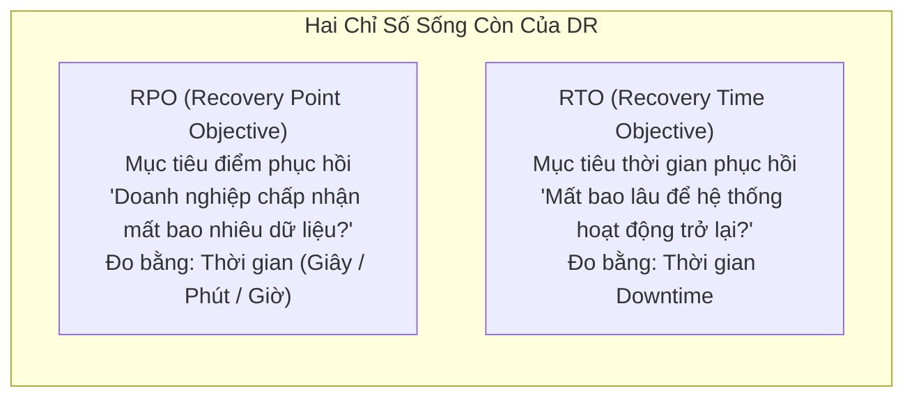
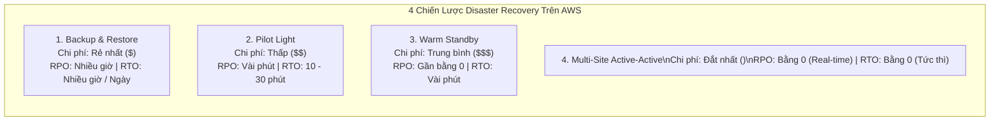
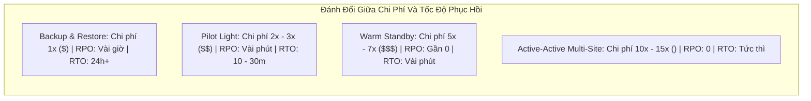

# Tài Liệu Học Tập Chuyên Sâu: Khắc Phục Thảm Họa (Disaster Recovery) & Di Chuyển Lên Đám Mây (Cloud Migration)

> **Tài liệu chuẩn hóa kiến trúc đám mây**: Hướng dẫn toàn diện theo tiêu chuẩn Senior AWS Solutions Architect & Cloud DevOps Engineer.  
> **Ngôn ngữ**: Tiếng Việt (Bảo lưu toàn bộ thuật ngữ chuyên ngành tiếng Anh chuẩn AWS).  
> **Các bài giảng liên quan**: Chương 28 (Disaster Recovery & Migrations: Bài 351 đến Bài 361).

---

## 6.1. Tổng Quan Dịch Vụ (Service Overview)

### Dịch vụ gì?
Khắc phục thảm họa (**Disaster Recovery - DR**) và di chuyển hạ tầng lên đám mây (**Cloud Migration**) là các bài toán kiến trúc sống còn đối với sự tồn vong và tính liên tục trong kinh doanh của doanh nghiệp. AWS cung cấp bộ giải pháp toàn diện:
1. **AWS Elastic Disaster Recovery (AWS DRS)**: Dịch vụ khắc phục thảm họa tự động thế hệ mới, liên tục sao chép dữ liệu ở cấp độ khối (Block-level replication) từ các máy chủ vật lý, máy ảo On-Premises (VMware, Hyper-V) hoặc từ các AWS Region khác sang một vùng lưu trữ chi phí thấp (Staging Area) trên AWS, cho phép phục hồi hệ thống nhanh chóng trong vài phút khi có sự cố.
2. **AWS Database Migration Service (AWS DMS)**: Dịch vụ di chuyển cơ sở dữ liệu lên AWS nhanh chóng và an toàn, hỗ trợ cả di chuyển đồng nhất (Homogeneous) và không đồng nhất (Heterogeneous kết hợp với **AWS Schema Conversion Tool - SCT**), duy trì cơ chế sao chép dữ liệu thay đổi liên tục (**Continuous Data Replication - CDC**) giúp quá trình chuyển đổi không gây gián đoạn hoạt động kinh doanh (Near-zero downtime).
3. **AWS Application Migration Service (AWS MGN)**: Dịch vụ di chuyển máy chủ chuyên dụng (Lift-and-Shift Migration) tự động chuyển đổi các máy chủ vật lý và máy ảo on-premises thành các máy chủ EC2 nguyên bản trên AWS.
4. **AWS Backup**: Dịch vụ quản trị và tự động hóa sao lưu dữ liệu tập trung dựa trên chính sách (Policy-based backup) cho toàn bộ hệ sinh thái AWS (EBS, RDS, DynamoDB, EFS, S3, EC2).

---

## 6.2. Các Khái Niệm và Thành Phần Cốt Lõi (Core Concepts and Components)

### 1. Bốn Chiến Lược Khắc Phục Thảm Họa Kinh Điển Trên AWS (The 4 DR Strategies)

| Chiến lược DR | Cơ chế hoạt động của dữ liệu | Trạng thái máy chủ tính toán (Compute) | RPO | RTO | Chi phí vận hành |
| :--- | :--- | :--- | :--- | :--- | :--- |
| **Backup & Restore** | Định kỳ sao lưu dữ liệu (Snapshot, S3 backup) và gửi sang Region dự phòng. | **Hoàn toàn KHÔNG CHẠY máy chủ nào**. Khi có thảm họa mới dùng script tạo máy mới. | **Cao nhất** (Vài giờ đến 24 giờ). | **Cao nhất** (Nhiều giờ để tải dữ liệu và dựng lại hạ tầng). | **Rẻ nhất ($)** (Chỉ tốn tiền lưu trữ dữ liệu sao lưu). |
| **Pilot Light** | Dữ liệu cốt lõi (Database) được **sao chép liên tục theo thời gian thực** sang Region phụ. | Máy chủ ứng dụng (Web/App) **TẮT HOÀN TOÀN** (chỉ lưu sẵn AMI hoặc template CloudFormation). | **Thấp** (Vài giây đến vài phút). | **Trung bình** (10 - 30 phút để Auto Scaling bật máy ảo lên). | **Thấp ($$)** (Chỉ tốn tiền nuôi 1 máy chủ DB nhỏ hoặc Standby). |
| **Warm Standby** | Dữ liệu được đồng bộ hóa liên tục thời gian thực sang Region phụ. | Chạy sẵn một phiên bản hệ thống thu nhỏ (**Scaled-down minimal version**) phục vụ tải nhỏ. | **Rất thấp** (Gần bằng 0). | **Rất nhanh** (Vài phút: chỉ cần scale-out cụm máy ảo và đổi Route 53 DNS). | **Trung bình ($$$)** (Nuôi cả cụm server nhỏ chạy 24/7). |
| **Multi-Site Active-Active** | Dữ liệu đồng bộ 2 chiều thời gian thực (Aurora Global, DynamoDB Global Tables). | Hệ thống chạy ở **quy mô sản xuất đầy đủ (Full production scale)** đồng thời ở cả 2 Region. | **Bằng 0** (Zero data loss). | **Tức thì (Zero downtime)**: Route 53 tự động chuyển hướng traffic ngay lập tức. | **Đắt nhất ($$$$)** (Gấp đôi chi phí hạ tầng). |

### 2. AWS Elastic Disaster Recovery (AWS DRS)
- **Cơ chế hoạt động**: Cài đặt một phần mềm nhỏ (**AWS Replication Agent**) lên các máy chủ nguồn (On-Premises hoặc AWS). Agent liên tục ghi nhận các thay đổi ở cấp độ khối ổ đĩa (Block-level) và nén mã hóa gửi về vùng đệm (**Staging Area Subnet**) trên AWS.
- **Tối ưu chi phí vượt trội**: Trong trạng thái bình thường, bạn không cần phải trả tiền cho các máy chủ EC2 đắt tiền; dữ liệu chỉ được ghi vào các ổ đĩa EBS dung lượng thấp giá rẻ. Chỉ khi thảm họa xảy ra (Drill hoặc Failover), DRS mới tự động khởi chạy hàng loạt máy chủ EC2 mạnh mẽ trong vài phút.

### 3. AWS Database Migration Service (AWS DMS)
- **Nguồn và Đích (Source & Target)**: Hỗ trợ đa dạng nguồn/đích giữa On-Premises, EC2, RDS, Aurora, S3, DynamoDB, DocumentDB.
- **Hai hình thức chuyển dịch**:
  1. **Homogeneous Migration (Di chuyển đồng nhất)**: Chuyển giữa hai cơ sở dữ liệu cùng loại (ví dụ: Oracle sang Oracle, PostgreSQL sang Aurora PostgreSQL). Không cần chuyển đổi cấu trúc bảng.
  2. **Heterogeneous Migration (Di chuyển không đồng nhất)**: Chuyển giữa hai cơ sở dữ liệu khác loại (ví dụ: Oracle sang Aurora PostgreSQL hoặc Microsoft SQL Server sang MySQL). Bắt buộc phải sử dụng công cụ **AWS Schema Conversion Tool (AWS SCT)** để tự động dịch các câu lệnh DDL, bảng, views, stored procedures và triggers sang cú pháp của engine đích.
- **Continuous Data Replication (CDC - Bắt dữ liệu thay đổi liên tục)**: DMS đọc các transaction log của database nguồn để liên tục đồng bộ các bản ghi mới sang database đích. Ứng dụng vẫn hoạt động bình thường trên database cũ; khi dữ liệu hai bên đạt trạng thái đồng bộ tuyệt đối, doanh nghiệp chỉ cần chuyển hướng kết nối trong 1-2 phút downtime.

### 4. Chiến lược chuyển dữ liệu dung lượng lớn lên AWS (Large Datasets Transfer)

| Phương thức chuyển dữ liệu | Dung lượng dữ liệu tối ưu | Băng thông mạng yêu cầu | Kịch bản sử dụng chuẩn mực |
| :--- | :--- | :--- | :--- |
| **AWS DataSync** | Hàng chục đến hàng trăm TB | Cần kết nối Internet tốc độ cao hoặc Direct Connect | Tự động hóa đồng bộ tệp tin định kỳ từ NAS/SAN (NFS/SMB) lên S3, EFS, FSx. |
| **AWS Snowcone** | Tối đa **8 TB** | Không cần mạng (Thiết bị vận chuyển vật lý) | Thiết bị nhỏ gọn (2.1 kg) gửi qua đường bưu điện cho các văn phòng vùng sâu vùng xa. |
| **AWS Snowball Edge** | Lên tới **80 TB** mỗi thiết bị | Không cần mạng (Xe tải chuyên dụng vận chuyển) | Di chuyển từ hàng chục TB đến vài trăm TB dữ liệu khi đường truyền Internet quá chậm. |
| **AWS Snowmobile** | Lên tới **100 PB** (Petabytes) | Không cần mạng (Xe container 14 mét) | Di chuyển toàn bộ trung tâm dữ liệu khổng lồ (Datacenter Consolidation) lên AWS. |

---

## 6.3. Bảng Tích Hợp với Các Dịch Vụ AWS Khác (Integration Table)

| Related AWS Service | Purpose (Mục đích tích hợp) | Integration Method (Phương thức tích hợp) | Practical Example (Ví dụ thực tiễn) |
| :--- | :--- | :--- | :--- |
| **Amazon Route 53** | Tự động chuyển đổi lưu lượng người dùng sang Region dự phòng | **Failover Routing Policy** | Khi Route 53 phát hiện Region Singapore bị sập, tự động chuyển hướng toàn bộ DNS sang Region Tokyo. |
| **AWS Backup** | Tự động hóa lịch trình sao lưu tập trung xuyên Region và xuyên tài khoản | Cross-Region & Cross-Account Backup | Tự động sao chép các bản backup của RDS từ tài khoản Production sang một tài khoản riêng biệt (Backup Vault Lock). |
| **Amazon S3** | Nơi tiếp nhận dữ liệu di chuyển từ On-Premises | DMS Target / Snowball Destination | Sử dụng AWS DMS đẩy dữ liệu dạng file Parquet lên S3 để xây dựng Data Lake phân tích dữ liệu lớn. |

---

## 6.4. Mô Hình Tính Phí Dịch Vụ & Chiến Lược Tối Ưu Chi Phí Theo Từng Use Case (Cost Breakdown & Optimization)

Trong thiết kế kiến trúc Khắc phục thảm họa (Disaster Recovery - DR) và Di chuyển lên Đám mây (Cloud Migration), chi phí luôn là **yếu tố đánh đổi trực tiếp** với hai chỉ số RPO và RTO. Hiểu rõ từng thành phần tính phí giúp doanh nghiệp bảo vệ tính liên tục trong kinh doanh mà không làm bội chi ngân sách.

---

### 6.4.1. Bảng Phân Tích Cơ Chế Tính Phí Các Dịch Vụ DR & Migration

| Dịch vụ / Chiến lược | Cơ chế tính phí chi tiết (Pricing Dimensions) | Mức phí tham chiếu điển hình | Rủi ro phát sinh chi phí (Cost Pitfalls) |
| :--- | :--- | :--- | :--- |
| **AWS Elastic Disaster Recovery (AWS DRS)** | • **Phí bản quyền máy chủ**: ~$0.02 - $0.03 / giờ / máy chủ nguồn (~$15 - $20 / tháng / server). • **Phí Staging Area**: Các ổ đĩa EBS dung lượng thấp (gp3/st1) + 1 instance EC2 t3.small sao chép gom chung cho nhiều máy chủ. • Không phải trả tiền cho các máy chủ EC2 dung lượng lớn cho tới khi có thảm họa (Failover/Drill). | Rẻ hơn 80% so với việc duy trì máy chủ chạy không tải 24/7 ở Region phụ. | Quên xóa các máy ảo thử nghiệm phục hồi (Drill Instances) sau khi diễn tập diễn ra. |
| **AWS Database Migration Service (AWS DMS)** | • **Phí máy chủ sao chép (Replication Instance)**: Tính theo giờ hoạt động (ví dụ `dms.t3.medium` ~$0.07/giờ, `dms.c5.xlarge` ~$0.30/giờ). • **Phí ổ đĩa lưu trữ**: 50 GB mặc định miễn phí, dung lượng bổ sung ~$0.115/GB/tháng. • **Miễn phí nạp dữ liệu (Ingress Data Free)**. | Có gói **DMS Free Tier**: 750 giờ sử dụng `dms.t2.micro`/`dms.t3.micro` Single-AZ miễn phí mỗi tháng trong 6 tháng đầu. | Duy trì máy chủ DMS instance cỡ lớn chạy 24/7 sau khi quá trình di chuyển đã hoàn tất. |
| **AWS DataSync** | • Tính phí cố định trên mỗi Gigabyte dữ liệu truyền tải thành công: **$0.0125 / GB** ($12.50 / TB). • Không có chi phí duy trì phần mềm hay phí bản quyền agent. | Rẻ, minh bạch và dự toán được chính xác chi phí theo tổng dung lượng dữ liệu cần chuyển. | Đồng bộ hóa liên tục các file rác hoặc file log tạm thời không cần thiết. |
| **AWS Snowcone** | • **Phí dịch vụ cố định**: $60 cho 5 ngày sử dụng tại chỗ. • **Phí quá hạn**: $15 / ngày nếu giữ thiết bị quá 5 ngày. • **Phí vận chuyển bưu điện** tùy theo vị trí địa lý. | Phù hợp chuyển dữ liệu nhỏ lẻ (< 8 TB) ở vùng hẻo lánh không có Internet. | Giữ thiết bị quá lâu mà không gửi trả lại cho AWS. |
| **AWS Snowball Edge** (Storage Optimized - 80 TB) | • **Phí dịch vụ cố định**: ~$300 trọn gói cho 10 ngày sử dụng tại chỗ. • **Phí quá hạn**: $30 / ngày từ ngày thứ 11 trở đi. • **Phí nạp dữ liệu vào S3: 0$ (Hoàn toàn Miễn phí)**. | Tiết kiệm vượt trội khi chuyển từ 20 TB đến hàng trăm TB dữ liệu so với truyền qua Internet. | Chọn sai loại thiết bị (Compute Optimized thay vì Storage Optimized) làm tăng chi phí thuê thiết bị. |
| **AWS Backup** | • **Lưu trữ Warm Storage**: Tính theo giá Snapshot thông thường (~$0.05 / GB / tháng). • **Lưu trữ Cold Storage / Archive**: Giảm chỉ còn **~$0.01 / GB / tháng** (tiết kiệm 80%). • **Phí khôi phục dữ liệu (Restore fee)**: ~$0.02 / GB. • **Phí truyền dữ liệu Cross-Region**: ~$0.02 / GB. | Tự động hóa vòng đời sao lưu giúp giảm thiểu dung lượng lưu trữ dư thừa. | Không cấu hình Lifecycle sang Cold Storage cho các bản backup cần giữ nhiều năm (pháp lý/tuân thủ). |

---

### 6.4.2. Bảng So Sánh Chi Phí Của 4 Chiến Lược Disaster Recovery (The Cost-RPO Trade-Off)

---

### 6.4.3. Chiến Lược Tối Ưu Hóa Chi Phí Theo 5 Kịch Bản Thực Tế (Use Cases Optimization)

#### Use Case 1: Tối ưu kiến trúc DR cho hệ thống Máy chủ ứng dụng (AWS DRS vs Warm Standby)
* **Vấn đề & Cách tính tiền cũ**:
  - Doanh nghiệp có 20 máy chủ ứng dụng (mỗi máy `m5.large` = $0.096/giờ).
  - Triển khai chiến lược **Warm Standby** bằng cách duy trì 20 máy ảo này chạy không tải 24/7 ở Region dự phòng:
    $$\text{Chi phí Compute dự phòng} = 20 \times 0.096\$ \times 720 = \mathbf{1,382.40\$/\text{tháng}}$$
* **Giải pháp Tối ưu kiến trúc**:
  - Chuyển sang sử dụng **AWS Elastic Disaster Recovery (AWS DRS)**.
  - Phí bản quyền DRS: $20 \text{ servers} \times 0.03\$ \times 720 = \mathbf{432\$/\text{tháng}}$.
  - Vùng đệm Staging Area: Chỉ cần 1 instance `t3.small` ($0.0208/giờ ≈ $15/tháng) gom dữ liệu và ghi vào các ổ đĩa EBS giá rẻ.
  - Tổng chi phí DRS: $432\$ + 15\$ + 150\$ \text{ (EBS)} = \mathbf{597\$/\text{tháng}}$.
* **Kết quả tiết kiệm**: Tiết kiệm hơn **$785/tháng (~57% chi phí)** so với Warm Standby, trong khi vẫn đạt được RPO vài giây và RTO dưới 10 phút.

#### Use Case 2: Di chuyển Cơ sở dữ liệu On-Premises lên AWS (DMS Instance Sizing Optimization)
* **Vấn đề & Cách tính tiền cũ**:
  - Doanh nghiệp thuê máy chủ DMS cấu hình cực lớn (`dms.c5.4xlarge` = $1.20/giờ ≈ $864/tháng) và để chạy liên tục trong 6 tháng chuẩn bị di chuyển.
* **Giải pháp Tối ưu kiến trúc**:
  - **Giai đoạn Full Load (1-2 ngày đầu)**: Khởi tạo instance lớn (`dms.c5.2xlarge`) để tận dụng tối đa CPU và RAM tải sạch dữ liệu ban đầu trong thời gian ngắn nhất.
  - **Giai đoạn CDC (Continuous Data Replication)**: Hạ cấu hình máy chủ DMS xuống mức vừa phải (`dms.t3.medium` = $0.07/giờ ≈ $50/tháng) vì lưu lượng transaction log phát sinh hàng ngày rất nhỏ.
  - **Ngay khi Cut-over thành công**: Tạo bản snapshot kiểm toán và **xóa ngay DMS Replication Instance**.
* **Kết quả tiết kiệm**: Giảm chi phí chạy máy chủ di chuyển từ $864/tháng xuống dưới $100/tháng (tiết kiệm > 85%).

#### Use Case 3: Di chuyển 80 TB dữ liệu lưu trữ từ On-Premises lên Amazon S3 (Internet vs Snowball Edge)
* **Vấn đề & So sánh chi phí**:
  - Doanh nghiệp có 80 TB dữ liệu hình ảnh/tài liệu lưu trữ tại Data Center cần chuyển lên S3.
  - *Nếu truyền qua đường truyền Internet leased-line hiện có (50 Mbps)*:
    - Thời gian truyền tải lý thuyết: Mất hơn **150 ngày (5 tháng)** liên tục chiếm dụng toàn bộ băng thông của công ty.
    - Chi phí duy trì nâng cấp băng thông Internet tạm thời tốn hàng nghìn USD.
  - *Nếu sử dụng AWS Snowball Edge Storage Optimized (80 TB)*:
    - Chi phí trọn gói thiết bị: **~$300**.
    - Phí nạp dữ liệu vào S3: **0$ (Hoàn toàn Miễn phí)**.
    - Thời gian: Copy dữ liệu qua mạng LAN nội bộ 10 Gbps chỉ mất 1-2 ngày, vận chuyển bưu điện mất 2-3 ngày.
* **Kết quả tối ưu**: Hoàn tất di chuyển trong vòng **1 tuần**, tiết kiệm hàng nghìn USD và giải phóng 100% băng thông Internet công ty.

#### Use Case 4: Quản lý chi phí Sao lưu Dữ liệu Dài hạn (AWS Backup Lifecycle Optimization)
* **Vấn đề & Cách tính tiền cũ**:
  - Doanh nghiệp tài chính cần lưu trữ bản sao lưu cơ sở dữ liệu hàng ngày trong vòng 7 năm để tuân thủ pháp luật.
  - Lưu trữ toàn bộ 10 TB backup trên ổ đĩa Snapshot thông thường (Warm Storage = $0.05/GB/tháng):
    $$\text{Chi phí Warm Storage hàng tháng} = 10,000 \text{ GB} \times 0.05\$ = \mathbf{500\$/\text{tháng}} \implies \mathbf{6,000\$/\text{năm}}$$
* **Giải pháp Tối ưu kiến trúc**:
  - Thiết lập **AWS Backup Plan** với chính sách vòng đời tự động (Lifecycle Rules):
    1. Giữ ở **Warm Storage** trong **30 ngày đầu tiên** (phục vụ khôi phục khẩn cấp).
    2. Sau 30 ngày, tự động chuyển bản sao lưu sang **Cold Storage / Glacier Archive** với mức giá chỉ **$0.01 / GB / tháng**.
    3. Tự động xóa (Expire) sau 7 năm.
* **Kết quả tiết kiệm**:
  $$\text{Chi phí sau tối ưu} = (10,000 \times 0.01\$) = \mathbf{100\$/\text{tháng}}$$
  Tiết kiệm **$400/tháng ($4,800/năm - Giảm 80% chi phí)** mà vẫn đảm bảo 100% tính tuân thủ pháp lý.

#### Use Case 5: Tối ưu chi phí sao chép dữ liệu xuyên vùng cho DR (Cross-Region Data Transfer)
* **Vấn đề**: Sao chép dữ liệu database và ảnh snapshot liên tục giữa Singapore và Tokyo chịu phí Cross-Region Data Transfer Out (~$0.02/GB). Nếu đồng bộ 20 TB dữ liệu thay đổi mỗi tháng tốn $400/tháng tiền truyền tải.
* **Giải pháp Tối ưu**:
  - Bật tính năng nén dữ liệu trước khi sao chép.
  - Sử dụng **Differential / Incremental Backup** (chỉ truyền các khối block thay đổi thay vì sao chép toàn bộ file database).
  - Tận dụng cơ chế đồng bộ cấp độ block của AWS DRS (DRS tích hợp thuật toán nén dữ liệu tại agent nguồn trước khi gửi ra khỏi mạng on-premises/VPC).

---

## 6.5. Khắc Phục Sự Cố Thực Tế (Troubleshooting Guide)

| Vấn đề (Problem) | Nguyên nhân khả dĩ (Possible Causes) | Các bước điều tra (Investigation Steps) | Giải pháp (Solution) | Biện pháp phòng ngừa (Prevention) |
| :--- | :--- | :--- | :--- | :--- |
| **DMS chạy rất chậm khi đang thực hiện giai đoạn Full Load** | Instance của máy chủ di chuyển (DMS Replication Instance) bị thiếu hụt CPU hoặc RAM. | Xem metric `CPUUtilization` và `MemoryUsage` của DMS Instance trên CloudWatch. | Nâng cấp cấu hình máy chủ DMS lên dòng lớn hơn (ví dụ `dms.c5.2xlarge`) hoặc chia tải thành nhiều tác vụ song song. | Chọn cấu hình DMS Replication Instance phù hợp trước khi chạy. |
| **AWS DRS không thể đồng bộ dữ liệu từ máy chủ On-Premises** | Cổng mạng TCP 1500 (dành cho luồng dữ liệu) hoặc cổng 443 bị tường lửa công ty chặn. | Kiểm tra kết nối mạng từ agent tới Endpoint của DRS trên AWS. | Mở cổng Inbound/Outbound TCP 1500 và 443 trên tường lửa On-Premises. | Kiểm tra kỹ tài liệu Network Requirements của AWS DRS. |
| **Lỗi xung đột kiểu dữ liệu khi chuyển dịch bằng AWS DMS (Heterogeneous)** | Các kiểu dữ liệu đặc thù của Oracle/SQL Server không có kiểu tương đương trực tiếp trên PostgreSQL. | Xem log của tác vụ DMS Task. | Sử dụng **AWS Schema Conversion Tool (SCT)** để tạo Action Items và chỉnh sửa thủ công các đoạn stored procedure chưa tương thích. | Luôn chạy báo cáo đánh giá SCT Assessment Report trước khi di chuyển thật. |
| **Thời gian khôi phục thảm họa (RTO) bị kéo dài vượt quá cam kết** | Kịch bản phục hồi phụ thuộc quá nhiều vào các bước thủ công của con người thay vì tự động hóa. | Đo lường thời gian thực tế trong các buổi diễn tập sự cố (Game Days). | Viết toàn bộ quy trình phục hồi thành mã nguồn **Infrastructure as Code (Terraform/CloudFormation)** hoặc sử dụng AWS DRS. | Định kỳ tổ chức Game Days 6 tháng/lần để kiểm chứng RTO. |

---

## 6.6. Bộ Câu Hỏi Ôn Tập và Kiểm Tra Kiến Thức (Knowledge Review)

### A. 10 Câu hỏi Cốt lõi (Core Concepts)
1. Hãy định nghĩa chính xác sự khác nhau giữa hai chỉ số **RPO (Recovery Point Objective)** và **RTO (Recovery Time Objective)**?
2. Trong 4 chiến lược khắc phục thảm họa kinh điển của AWS, chiến lược nào mang lại RPO và RTO gần bằng 0 nhưng có chi phí vận hành đắt nhất?
3. Sự khác biệt giữa chiến lược **Pilot Light** và **Warm Standby** là gì?
4. Khi thực hiện di chuyển một cơ sở dữ liệu từ Microsoft SQL Server On-Premises sang Amazon Aurora PostgreSQL, bạn bắt buộc phải sử dụng công cụ nào để chuyển đổi lược đồ (Schema) và stored procedures?
5. Tính năng nào của AWS Database Migration Service (DMS) cho phép liên tục bắt các giao dịch mới trên database nguồn để giữ cho database đích luôn cập nhật trong suốt quá trình di chuyển?
6. Dịch vụ nào của AWS cung cấp khả năng sao chép dữ liệu liên tục ở cấp độ khối ổ đĩa (Block-level) để phục vụ khắc phục thảm họa tự động với chi phí vùng đệm (Staging area) cực rẻ?
7. Thiết bị phần cứng vật lý nào của dòng AWS Snow Family có khả năng lưu trữ tối đa 80 TB dữ liệu để vận chuyển bằng đường bưu điện?
8. Tính năng nào của **AWS Backup** giúp bảo vệ các bản sao lưu dữ liệu chống lại việc bị sửa đổi hoặc xóa bỏ trước thời hạn (kể cả bởi tài khoản AWS Root) để chống lại mã độc tống tiền (Ransomware)?
9. Dịch vụ nào của AWS chuyên phục vụ việc di chuyển nguyên trạng (Lift-and-Shift) toàn bộ hệ điều hành và ứng dụng của các máy chủ vật lý lên Amazon EC2?
10. Tại sao việc di chuyển 500 TB dữ liệu qua một đường truyền Internet 100 Mbps lại không khả thi và giải pháp thay thế chuẩn mực là gì?

---

### Đáp án Bộ Câu Hỏi Ôn Tập (Answer Key)

👉 Nhấp vào đây để xem toàn bộ đáp án chi tiết

1. **RPO (Recovery Point Objective)** là khoảng thời gian mất mát dữ liệu tối đa mà doanh nghiệp chấp nhận được khi có sự cố; **RTO (Recovery Time Objective)** là khoảng thời gian gián đoạn dịch vụ tối đa cho phép từ khi thảm họa xảy ra đến khi hệ thống hoạt động trở lại bình thường.
2. Chiến lược **Multi-Site Active-Active**.
3. Trong **Pilot Light**, các máy chủ tính toán (Compute/EC2) **hoàn toàn tắt** và chỉ được bật lên khi có thảm họa (chỉ có database chạy để đồng bộ dữ liệu); trong khi ở **Warm Standby**, luôn luôn có một cụm máy chủ tính toán thu nhỏ (**Scaled-down version**) chạy 24/7 sẵn sàng mở rộng quy mô tức thì.
4. **AWS Schema Conversion Tool (AWS SCT)**.
5. Tính năng **Continuous Data Replication (Change Data Capture - CDC)**.
6. **AWS Elastic Disaster Recovery (AWS DRS)**.
7. **AWS Snowball Edge Storage Optimized** (dung lượng khả dụng 80 TB).
8. **AWS Backup Vault Lock** (áp dụng mô hình bảo vệ WORM - Write Once, Read Many).
9. **AWS Application Migration Service (AWS MGN)**.
10. Vì đường truyền 100 Mbps trên lý thuyết sẽ mất hơn 460 ngày (hơn 1.2 năm) để truyền tải hết 500 TB dữ liệu. Giải pháp chuẩn mực là đặt hàng cụm thiết bị **AWS Snowball Edge** (mất khoảng vài ngày để nạp dữ liệu và vận chuyển bằng đường bưu điện tới trung tâm dữ liệu của AWS).

---

## 6.7. Tóm Tắt và Danh Mục Kiểm Tra Kiến Thức (Summary & Learning Checklist)

### 5 Khái niệm quan trọng nhất phải nhớ:
1. **RPO & RTO**: Căn cứ duy nhất để lựa chọn chiến lược DR phù hợp với ngân sách của doanh nghiệp.
2. **4 Chiến lược DR**: Backup & Restore ($) ➔ Pilot Light ($$) ➔ Warm Standby ($$$) ➔ Multi-Site Active-Active ($$$$).
3. **AWS DMS + SCT**: SCT dịch cấu hình DDL; DMS chuyển dữ liệu và đồng bộ liên tục (CDC) với downtime gần bằng 0.
4. **AWS DRS**: Giải pháp DR hiện đại nhất, sao chép block-level với chi phí vùng đệm tối thiểu.
5. **Snow Family**: Snowcone (8TB), Snowball Edge (80TB), Snowmobile (100PB) để chuyển dữ liệu khổng lồ không qua Internet.

### Liên kết và Chủ đề tiếp theo:
- 📖 [Ghi Chú Bài Học Chương 28: Disaster Recovery & Migrations](file:///n:/AWS_XBrain_Note/Lesson_Notes/28_Disaster_Recovery_and_Migrations.md)
- 📖 [Bảng Thuật Ngữ Kỹ Thuật (GLOSSARY.md)](file:///n:/AWS_XBrain_Note/GLOSSARY.md)
- ⏭️ Khép lại toàn bộ các dịch vụ cốt lõi, tiếp tục hoàn thiện cổng mục lục điều hướng **README.md** của Knowledge Base.
