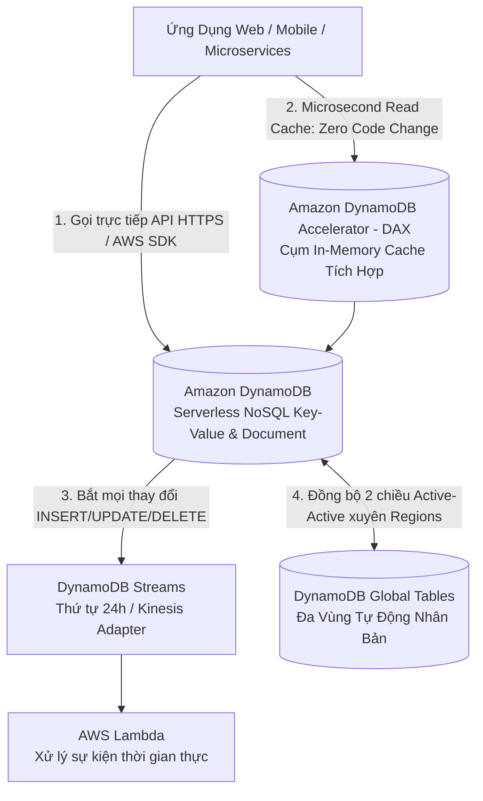
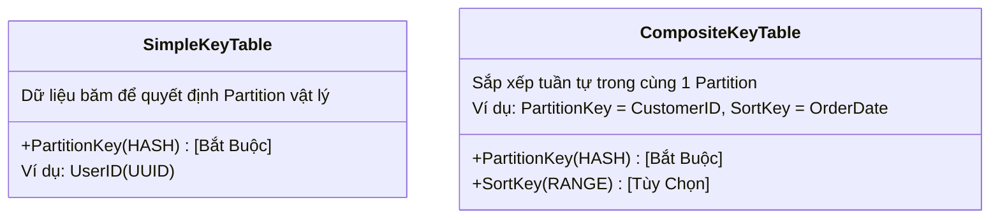
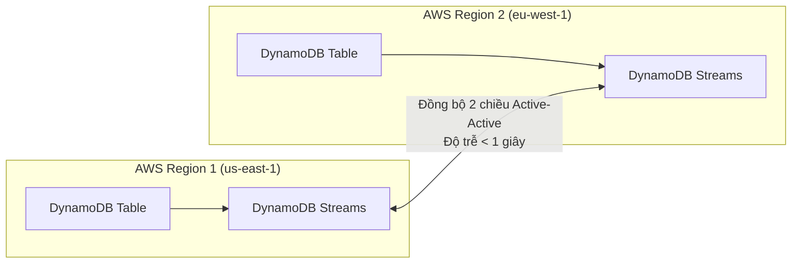
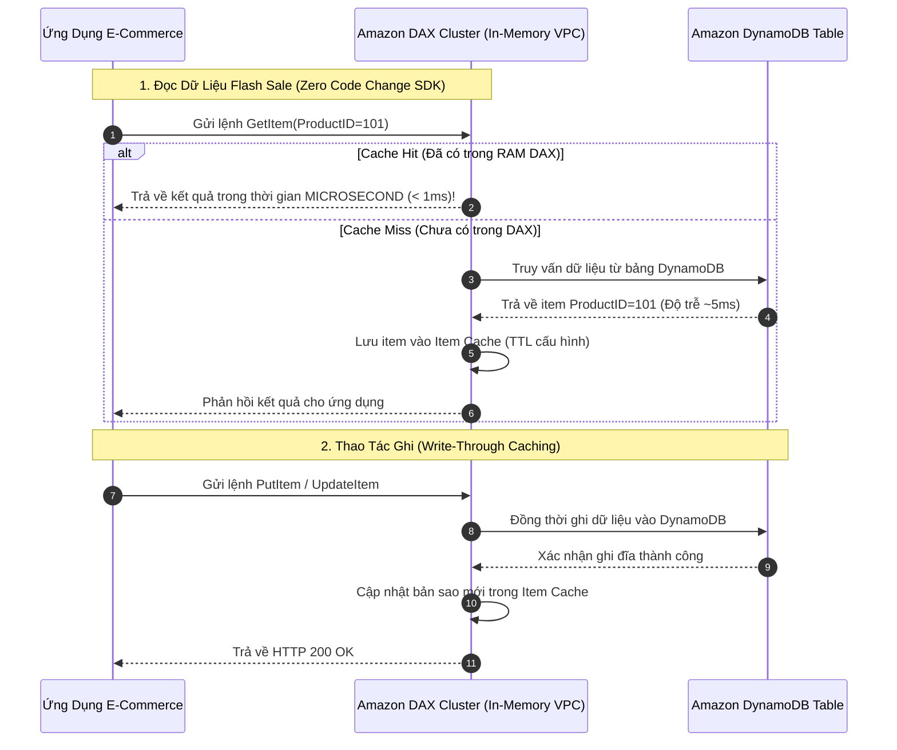

# Tài Liệu Học Tập Chuyên Sâu: Amazon DynamoDB & Cơ Sở Dữ Liệu NoSQL Đám Mây (DAX, Streams, Global Tables)

> **Tài liệu chuẩn hóa kiến trúc đám mây**: Hướng dẫn toàn diện theo tiêu chuẩn Principal AWS Solutions Architect & Senior Database Specialist (Cập nhật phiên bản kiến trúc mới nhất 2026).  
> **Ngôn ngữ**: Tiếng Việt chuyên ngành (Bảo lưu toàn bộ thuật ngữ chuyên ngành tiếng Anh chuẩn AWS).  
> **Mục tiêu**: Phục vụ thi chứng chỉ cấp độ Professional/Specialty (**SAA-C03, SAP-C02, Database Specialty**) và thiết kế kiến trúc NoSQL cấp độ doanh nghiệp (**Production-grade**).  
> **Các bài giảng liên quan**: Chương 19 & 20 (Serverless, DynamoDB, API Gateway) & Chương 21 (Databases in AWS).

---

## 1. Tổng Quan Dịch Vụ (Service Overview)

### 1. Định nghĩa chuẩn xác và Phân nhóm dịch vụ
**Amazon DynamoDB** là dịch vụ cơ sở dữ liệu phi quan hệ (**NoSQL Database**) dạng Khóa-Giá trị (**Key-Value**) và Tài liệu (**Document**) được quản lý hoàn toàn phi máy chủ (**Serverless**), cung cấp hiệu năng dưới 10 mili-giây (**Single-digit millisecond latency**) ở bất kỳ quy mô dữ liệu nào (từ vài Gigabytes đến hàng trăm Terabytes).

---

### 2. Bài toán cốt lõi mà DynamoDB giải quyết

1. **Hiệu năng nhất quán ở mọi quy mô (Predictable Performance at Scale)**: Khác với cơ sở dữ liệu quan hệ (RDS) bị chậm dần khi bảng dữ liệu phình to lên hàng trăm Gigabytes, DynamoDB tự động chia nhỏ dữ liệu thành các **Partitions (mỗi partition tối đa 10 GB)**. Do đó, truy vấn 10 items mất 5ms thì truy vấn giữa 10 tỷ items vẫn chỉ mất 5ms!
2. **Loại bỏ hoàn toàn gánh nặng quản trị máy chủ (Zero Server Management)**: Không cần chọn instance size, không vá lỗi OS, không quản lý connection pool, không lo downtime khi mở rộng dung lượng ổ đĩa.
3. **Mô hình tính phí linh hoạt (On-Demand vs Provisioned)**: Hỗ trợ co giãn tức thì đáp ứng các sự kiện flash sale hàng triệu requests/giây với On-Demand mode.
4. **Tính khả dụng cực cao và nhân bản toàn cầu (Multi-Region Active-Active)**: Tự động nhân bản 3 bản sao trên 3 Availability Zones trong Region; hỗ trợ **Global Tables** với khả năng đọc và ghi đồng thời tại nhiều AWS Regions trên thế giới.

---

### 3. Khi nào KHÔNG nên dùng DynamoDB (Anti-patterns & Giải pháp thay thế)

* ❌ **Cần thực thi các câu lệnh `JOIN` nhiều bảng phức tạp hoặc hàm tổng hợp (`GROUP BY`, `SUM`, `AVG`)**: DynamoDB không hỗ trợ JOIN; việc JOIN bằng code ứng dụng sẽ tốn chi phí và cực kỳ chậm.  
  👉 *Giải pháp thay thế*: Sử dụng **Amazon Aurora** hoặc **Amazon RDS**.
* ❌ **Phân tích dữ liệu lớn dạng kho dữ liệu (OLAP/Data Warehousing)**:  
  👉 *Giải pháp thay thế*: Sử dụng **Amazon Redshift** hoặc **Amazon Athena**.
* ❌ **Tìm kiếm toàn văn bản (Full-text search) theo từ khóa tự do**: DynamoDB chỉ tìm kiếm nhanh theo Partition Key / Sort Key.  
  👉 *Giải pháp thay thế*: Đồng bộ dữ liệu qua DynamoDB Streams sang **Amazon OpenSearch Service**.

---

## 2. Các Khái Niệm, Kiến Trúc & Vận Hành Cốt Lõi (Core Concepts & Operations)

### 1. Khóa Chính (Primary Keys): Partition Key vs Composite Primary Key

* **Simple Primary Key (Partition Key - HASH)**: 
  - Khóa phân vùng; DynamoDB sử dụng hàm băm nội bộ (internal hash function) để xác định chính xác Partition vật lý nào sẽ lưu trữ item đó.
  - Các item trong bảng phải có Partition Key duy nhất.
* **Composite Primary Key (Partition Key + Sort Key - RANGE)**:
  - Cho phép nhiều items có cùng Partition Key nhưng bắt buộc phải có Sort Key khác nhau.
  - Tất cả items có cùng Partition Key được lưu trữ liền kề nhau trên cùng một Partition vật lý và được **sắp xếp tuần tự theo Sort Key**.
  - Hỗ trợ các câu lệnh truy vấn dải (Range Queries) cực nhanh: `<`, `>`, `BETWEEN`, `begins_with`.

---

### 2. Bảng So Sánh Chỉ Mục Phụ: GSI (Global) vs LSI (Local)

| Tiêu chí kỹ thuật | Local Secondary Index (LSI) | Global Secondary Index (GSI) |
| :--- | :--- | :--- |
| **Partition Key** | **BẮT BUỘC TRÙNG** với Partition Key của bảng gốc | **CÓ THỂ KHÁC** hoàn toàn so với bảng gốc |
| **Sort Key** | Bắt buộc phải là một thuộc tính khác | Tùy chọn (có thể có hoặc không) |
| **Thời điểm tạo** | **CHỈ TẠO ĐƯỢC KHI TẠO BẢNG** (Không thể thêm/xóa sau này) | **Tạo hoặc xóa BẤT KỲ LÚC NÀO** (Online Indexing) |
| **Dung lượng tối đa** | Tối đa **10 GB** cho mỗi Partition Key value | **Không giới hạn dung lượng** |
| **Tính nhất quán đọc** | Hỗ trợ cả **Eventually** và **Strongly Consistent Reads** | **CHỈ HỖ TRỢ Eventually Consistent Reads** |
| **Quản trị RCU / WCU** | Dùng chung RCU/WCU của bảng gốc | **Có RCU / WCU cấp phát độc lập riêng** |

---

### 3. Hai Chế Độ Năng Lượng: On-Demand Mode vs Provisioned Mode

| Tiêu chí | On-Demand Capacity Mode | Provisioned Capacity Mode |
| :--- | :--- | :--- |
| **Cơ chế hoạt động** | Tự động đáp ứng lưu lượng tăng vọt tức thì không cần dự đoán | Cấp phát tĩnh số lượng **RCU** và **WCU** cố định |
| **Mô hình thanh toán** | Trả tiền theo từng triệu requests đọc/ghi thực tế phát sinh | Trả tiền theo số lượng RCU/WCU cấp phát mỗi giờ |
| **Nguy cơ Throttling** | **Gần như bằng 0** (chỉ throttle nếu tải tăng gấp đôi trong vài giây) | Có nguy cơ bị lỗi `400 ProvisionedThroughputExceededException` |
| **Auto Scaling** | Tích hợp sẵn tự động co giãn | Phải cấu hình **Application Auto Scaling** theo ngưỡng % utilization |
| **Trường hợp tối ưu** | • Ứng dụng mới ra mắt, **lưu lượng khó dự đoán**. • Tải tăng đột biến (Spiky / Flash sale). • Tải nền thấp trong thời gian dài. | • Ứng dụng chạy ổn định 24/7, **tải dự đoán được**. • Cho phép mua DynamoDB Reserved Capacity để tiết kiệm tới 77%. |

---

### 4. Đơn Vị Tính Toán Năng Lực (Capacity Units Calculation)

* **1 WCU (Write Capacity Unit)**: Đại diện cho **1 thao tác ghi** mỗi giây cho một item có kích thước tối đa **1 KB**.
  - Nếu ghi item 3.5 KB $\rightarrow$ Tính thành **4 WCUs** (luôn làm tròn lên).
* **1 RCU (Read Capacity Unit)**:
  - **Strongly Consistent Read**: 1 RCU = **1 thao tác đọc** mỗi giây cho item tối đa **4 KB**.
  - **Eventually Consistent Read (Mặc định)**: 1 RCU = **2 thao tác đọc** mỗi giây cho item tối đa **4 KB** (tiết kiệm 50% chi phí RCU!).
  - **Transactional Read**: 1 RCU = **0.5 thao tác đọc** (tốn gấp đôi chi phí).

---

### 5. DynamoDB Global Tables: Kiến Trúc Đa Vùng Tự Động Nhân Bản Active-Active

- **Nguyên lý hoạt động**:
  - Global Tables cung cấp giải pháp cơ sở dữ liệu phân tán toàn cầu hoàn toàn được quản lý (**Fully Managed Multi-Region, Multi-Active**).
  - Ứng dụng tại từng Region có thể thực hiện **cả thao tác đọc và ghi cục bộ** (Local Reads & Local Writes) với độ trễ một chữ số mili-giây (**single-digit millisecond latency**).
  - Bản ghi được tự động nhân bản 2 chiều giữa các replica tables ở các Region khác nhau thông qua **DynamoDB Streams** (độ trễ đồng bộ thường dưới 1 giây).
- **Yêu cầu kỹ thuật bắt buộc**:
  - Bảng phải có cùng tên và cùng cấu trúc Primary Key (Partition Key & Sort Key).
  - Phải kích hoạt **DynamoDB Streams** với cấu hình `NEW_AND_OLD_IMAGES`.
  - Phiên bản hiện đại (**Global Tables v2019.11.21**): Tự động quản lý số lượng Partitions đồng nhất giữa các Region và không tính thêm chi phí hạ tầng ngoài phí nhân bản dữ liệu (Replicated Write Capacity Units - rWCU).
- **Cơ chế giải quyết xung đột (Conflict Resolution)**:
  - Sử dụng quy tắc **"Last-writer-wins"**: Khi hai client ghi đè đồng thời vào cùng một item ở 2 Region khác nhau, DynamoDB sẽ căn cứ vào timestamp phát sinh thao tác ghi gần nhất để xác định bản ghi chiến thắng và nhân bản tới tất cả các Region còn lại.

---

### 6. Sao Lưu & Khôi Phục: Point-in-Time Recovery (PITR) vs On-Demand Backup

| Tiêu chí | Point-in-Time Recovery (PITR) | On-Demand Backup |
| :--- | :--- | :--- |
| **Bản chất** | **Bảo vệ dữ liệu liên tục theo từng giây** | Chụp ảnh dữ liệu tĩnh tại một thời điểm (Snapshot) |
| **Cửa sổ lưu trữ (Retention)** | **35 ngày liên tục** (Rolling 35-day window) | Lưu trữ vĩnh viễn cho đến khi người dùng xóa |
| **Độ chính xác khôi phục** | Khôi phục về **bất kỳ giây nào** trong 35 ngày qua | Chỉ khôi phục về đúng thời điểm chụp snapshot |
| **Ảnh hưởng hiệu năng bảng** | **Không ảnh hưởng hiệu năng**, không tiêu tốn RCU/WCU | **Không ảnh hưởng hiệu năng**, không tiêu tốn RCU/WCU |
| **Quy trình phục hồi** | **Luôn tạo ra một BẢNG MỚI** (Không bao giờ ghi đè trực tiếp lên bảng đang chạy) | **Luôn tạo ra một BẢNG MỚI** |
| **Kịch bản thi cử** | Phục hồi sau thảm họa thao tác: Kỹ sư chạy lệnh xóa nhầm hoặc code ứng dụng làm hỏng dữ liệu | Lưu trữ dài hạn phục vụ tuân thủ pháp lý (Compliance/Auditing) |

---

### 7. Amazon DocumentDB: Cơ Sở Dữ Liệu Dạng Tài Liệu JSON Tương Thích MongoDB (TD-Set3 Q08, CM-PT2 Q18)
* **Bản chất dịch vụ**:
  - Dịch vụ cơ sở dữ liệu tài liệu (Document Database) được quản trị hoàn toàn, tương thích nguyên bản với các công cụ, ứng dụng và trình điều khiển (drivers) chuẩn **MongoDB (phiên bản 3.6, 4.0, 5.0)** (`TD-Set3 Q08`).
  - Tách rời tính toán (Compute) và lưu trữ (Storage), tự động sao chép **6 bản sao dữ liệu trên 3 Availability Zones** tương tự kiến trúc của Amazon Aurora.
* **Amazon DocumentDB Serverless** (`CM-PT2 Q18`):
  - Tự động đo lường và co giãn năng lực tính toán theo thời gian thực (tính theo DocumentDB Capacity Units - DCU), chỉ tính phí theo dung lượng và tài nguyên thực tế sử dụng.
  - Phù hợp hoàn hảo cho các ứng dụng quản lý danh mục sản phẩm thương mại điện tử, hồ sơ người dùng lưu dưới dạng tài liệu JSON lớn ($> 1\text{ MB}$, vượt quá giới hạn 400 KB của DynamoDB) có lưu lượng truy cập biến động mạnh theo khung giờ (`CM-PT2 Q18`).

---

### 8. Amazon Neptune: Cơ Sở Dữ Liệu Đồ Thị Quản Trị (Graph Database) (CM-PT3 Q40, CM-PT3 Q60)
* **Bản chất dịch vụ**:
  - Cơ sở dữ liệu đồ thị phân tán, được tối ưu hóa chuyên biệt để lưu trữ và điều hướng các mối quan hệ phức tạp, liên kết chặt chẽ giữa hàng tỷ đỉnh (nodes/vertices) và cạnh (edges/relationships) với độ trễ phản hồi tính bằng mili-giây.
* **Hai mô hình đồ thị và ngôn ngữ truy vấn cốt lõi trong đề thi**:
  1. **Property Graph (Apache TinkerPop Gremlin & openCypher)** (`CM-PT3 Q60`):
     - Mô hình đồ thị thuộc tính trực quan, thích hợp nhất cho các bài toán mạng xã hội (Social Networks), đề xuất bạn bè / sản phẩm theo mối quan hệ, và phát hiện gian lận tài chính (Fraud Detection) theo chuỗi giao dịch liên đới.
  2. **W3C Resource Description Framework - RDF (SPARQL)** (`CM-PT3 Q40`):
     - Mô hình đồ thị ngữ nghĩa (Semantic Web / Knowledge Graph) lưu trữ theo bộ ba chủ ngữ - vị ngữ - tân ngữ (Triples: Subject - Predicate - Object).
     - Phù hợp hoàn hảo cho việc lập bản đồ phụ thuộc hạ tầng mạng và an ninh thông tin doanh nghiệp (Security Dependency Mapping), truy vấn phân loại theo ontology chuẩn W3C (`CM-PT3 Q40`).

---

### 🏛️ I. Các Kịch Bản Kiến Trúc Chuẩn (Best Practice Scenarios)

#### 1. Tăng Tốc Độ Đọc DynamoDB Lên Hàng Chục Lần Không Sửa Mã Nguồn Bằng DAX — (CM-PT2 Q25, CM-PT4 Q60, TD-Set2 Q48, TD-Set3 Q04)
- **Tình huống thi**: Ứng dụng thương mại điện tử, GraphQL API hoặc mobile game gặp tình trạng độ trễ đọc dữ liệu từ DynamoDB tăng cao vào các khung giờ cao điểm. Doanh nghiệp muốn giảm độ trễ đọc xuống mức **microsecond** mà **không được phép sửa đổi mã nguồn logic nghiệp vụ** của ứng dụng (`TD-Set2 Q48`, `TD-Set3 Q04`).
- **Giải pháp tối ưu chuẩn AWS**:
  - Triển khai một cụm **Amazon DynamoDB Accelerator (DAX)** trong cùng VPC với ứng dụng.
  - Cập nhật SDK client của ứng dụng: Chỉ cần trỏ endpoint kết nối từ URL DynamoDB mặc định sang **DAX Cluster Endpoint**.
  - Không cần sửa đổi bất kỳ câu lệnh truy vấn nào. DAX tự động đóng vai trò là một in-memory cache thông minh (Item Cache & Query Cache), cung cấp tốc độ phản hồi dưới 1 mili-giây.

#### 2. Cấu Hình DynamoDB Cho Tải Lưu Lượng Hoàn Toàn Không Thể Dự Đoán Trước — (CM-PT2 Q43, CM-PT6 Q42, TD-Set5 Q26)
- **Tình huống thi**: Một công ty khởi nghiệp chuẩn bị phát hành một tựa game di động mới. Họ hoàn toàn không thể dự đoán được số lượng người chơi (có thể chỉ vài trăm người hoặc đột ngột tăng vọt lên hàng triệu người chơi nếu game viral). Yêu cầu hệ thống phải tự động co giãn tức thì, không bị lỗi nghẽn và chi phí tối ưu nhất (`TD-Set5 Q26`).
- **Giải pháp chuẩn**:
  - Thiết lập bảng DynamoDB ở chế độ **On-Demand Capacity Mode**.
  - Không cần ước lượng hay cấp phát trước RCU/WCU. Bảng tự động đáp ứng mọi đợt bùng nổ lưu lượng và doanh nghiệp chỉ phải trả tiền cho số lượng request thực tế phát sinh.

#### 3. Thiết Kế Partition Key Có Độ Biến Thiên Cao (High Cardinality) Chống Hot Partition — (TD-Set1 Q37)
- **Tình huống thi**: Ứng dụng container chạy trên Amazon ECS cluster đọc/ghi tải rất nặng vào DynamoDB. Mặc dù tổng dung lượng provisioned throughput đã được cấu hình rất lớn, ứng dụng vẫn liên tục bị lỗi nghẽn tải (Throttling) ở một số thời điểm nhất định (`TD-Set1 Q37`).
- **Nguyên nhân & Khắc phục**:
  - Do thiết kế **Partition Key có độ biến thiên thấp (Low Cardinality)** (ví dụ: dùng `Status` hoặc `CountryCode` làm khóa phân vùng), khiến 90% các bản ghi bị gom vào cùng một partition vật lý duy nhất (**Hot Partition**), làm partition đó bị vượt trần 1,000 WCU / 3,000 RCU trong khi các partition khác rảnh rỗi.
  - **Giải pháp ĐÚNG**: Chọn Partition Key có tính ngẫu nhiên và phân tán cao (High Cardinality - ví dụ `UserID`, `DeviceID`, `TransactionUUID`) hoặc áp dụng kỹ thuật **Write Sharding (Partition Key Salting)** (thêm hậu tố số ngẫu nhiên từ `1` đến `N` vào sau khóa) để phân bổ đều tải trên tất cả các partitions vật lý.

#### 4. Bắt Thay Đổi Dữ Liệu Thời Gian Thực Bằng DynamoDB Streams & Lambda — (TD-Set1 Q65)
- **Tình huống thi**: Mạng xã hội lưu trữ thông tin trên DynamoDB. Cần phát triển tính năng "Theo dõi (Follow)" người dùng: Khi một người dùng đăng bài viết mới hoặc có người bấm theo dõi, hệ thống phải tự động gửi email thông báo qua Amazon SNS cho tất cả người theo dõi theo thời gian thực (`TD-Set1 Q65`).
- **Giải pháp chuẩn AWS**:
  - Bật tính năng **Amazon DynamoDB Streams** trên bảng dữ liệu.
  - Tạo một hàm **AWS Lambda** làm consumer và liên kết với DynamoDB Streams qua cơ chế **Event Source Mapping**.
  - Khi có hành động `INSERT` hoặc `MODIFY` phát sinh, DynamoDB Streams ghi lại bản ghi thay đổi theo đúng thứ tự 24 giờ và tự động kích hoạt Lambda để gửi email qua **Amazon SNS** hoặc **Amazon SES**.

#### 5. Ứng Dụng Toàn Cầu Đa Vùng Active-Active Với DynamoDB Global Tables — (TD-Set5 Q39)
- **Tình huống thi**: Nền tảng game trực tuyến toàn cầu phục vụ hàng triệu game thủ tại Bắc Mỹ, Châu Âu và Châu Á. Yêu cầu người chơi ở bất kỳ khu vực nào cũng có thể đọc và cập nhật hồ sơ cá nhân với độ trễ dưới 10 mili-giây, đồng thời cung cấp khả năng tự động chịu lỗi toàn diện khi một Region AWS gặp thảm họa (`TD-Set5 Q39`).
- **Giải pháp chuẩn AWS**:
  - Sử dụng **Amazon DynamoDB Global Tables**.
  - Tự động sao chép đa hướng (Fully Managed Multi-Region Active-Active Replication) giữa các bảng DynamoDB ở các Region khác nhau.
  - Người chơi đọc và ghi cục bộ tại Region gần nhất, dữ liệu được đồng bộ hóa ngầm xuyên đại dương trong vòng dưới 1 giây. Nếu một Region sập, ứng dụng tự động chuyển hướng sang Region khả dụng kế tiếp mà không mất mát dữ liệu.

#### 6. Tính Toán Chuẩn Xác Thông Lượng Cấp Phát (RCU & WCU Formula) — (TD-Set2 Q14)
- **Quy tắc tính toán cốt lõi trong đề thi**:
  - **WCU (Write Capacity Unit)**: Mỗi WCU = 1 item ghi/giây có dung lượng tối đa 1 KB.  
    $$\text{WCU cần thiết} = \text{Số item ghi mỗi giây} \times \lceil \frac{\text{Dung lượng item (KB)}}{1\text{ KB}} \rceil$$
  - **RCU (Read Capacity Unit)**: Mỗi RCU = 1 item đọc/giây (Strongly Consistent) hoặc 2 items đọc/giây (Eventually Consistent) cho item tối đa 4 KB.  
    $$\text{RCU (Strongly Consistent)} = \text{Số item đọc mỗi giây} \times \lceil \frac{\text{Dung lượng item (KB)}}{4\text{ KB}} \rceil$$  
    $$\text{RCU (Eventually Consistent)} = \frac{\text{RCU Strongly Consistent}}{2}$$

#### 7. Mẫu Thiết Kế Large Payload Trên Amazon S3 Khi Vượt Quá Giới Hạn 400 KB — (CM-PT4 Q06)
- **Tình huống thi**: Ứng dụng xử lý đơn đặt hàng hoặc hồ sơ y tế cần lưu trữ các tài liệu JSON có kích thước biến động từ vài chục KB đến 700 KB vào DynamoDB. DynamoDB ném lỗi `ValidationException: Item size has exceeded the acceptable limit of 400 KB` (`CM-PT4 Q06`).
- **Giải pháp chuẩn AWS (S3 Large Payload Pattern)**:
  - Khi payload $> 400\text{ KB}$: Ứng dụng tải trực tiếp nội dung payload lớn đó lên **Amazon S3**.
  - Bảng DynamoDB chỉ lưu trữ khóa chính (Partition Key, Sort Key), các thuộc tính siêu dữ liệu (Metadata) cần lập chỉ mục tìm kiếm, và **đường dẫn S3 Object URI / Presigned URL** trỏ tới file trên S3.
  - Có thể sử dụng thư viện **AWS SDK for Java DynamoDB S3 Storage Plugin** để tự động hóa quá trình nén và đẩy payload sang S3 một cách trong suốt (transparent).

---

### 🪤 II. Các Bẫy Thi Tinh Vi & Phân Tích Phương Án Sai (Exam Traps & Distractors)

#### 🪤 Bẫy 1: Tối Ưu Chi Phí Kết Nối Riêng Tư Từ VPC Tới DynamoDB — (CM-PT4 Q50)
- **Tình huống đề thi**: *"Các máy chủ EC2 trong Private Subnet cần đọc/ghi dữ liệu vào DynamoDB table một cách an toàn mà không đi qua Internet công cộng và không tốn chi phí truyền dữ liệu."*
- **Các phương án bẫy**:
  - ❌ *Dùng NAT Gateway*: NAT Gateway tính phí \$0.045/giờ + \$0.045/GB dữ liệu xử lý $\rightarrow$ Tốn kém không cần thiết.
  - ❌ *Dùng Interface VPC Endpoint (PrivateLink)*: Mặc dù DynamoDB đã hỗ trợ PrivateLink, nhưng Interface Endpoint vẫn tính phí duy trì hàng giờ và phí dữ liệu.
- **Giải pháp ĐÚNG**: Sử dụng **Gateway VPC Endpoint cho DynamoDB**.
  - Cấu hình trực tiếp vào Route Table của subnet.
  - **HOÀN TOÀN MIỄN PHÍ (\$0)**, không tính cước kết nối, không tính cước truyền dữ liệu và lưu lượng đi trực tiếp qua mạng trục riêng của AWS.

#### 🪤 Bẫy 2: Ngăn Chặn Xóa Nhầm Bảng Dữ Liệu Quan Trọng Bằng Deletion Protection — (CM-PT5 Q26)
- **Tình huống đề thi**: *"Doanh nghiệp muốn đảm bảo các bảng DynamoDB chứa dữ liệu sản xuất quan trọng không thể bị xóa bỏ bởi bất kỳ ai do vô tình thực hiện thao tác trên Console hoặc chạy nhầm lệnh Terraform/CloudFormation."*
- **Giải pháp ĐÚNG**: Bật tính năng **Deletion Protection** trên bảng DynamoDB.
  - Khi bật Deletion Protection, mọi API call `DeleteTable` đều bị từ chối ngay lập tức, kể cả khi được gọi bởi tài khoản có quyền `AdministratorAccess`!

#### 🪤 Bẫy 3: Phân Biệt Sự Kiện Đổi Dữ Liệu Realtime (DynamoDB Streams) vs Sự Kiện Định Kỳ Theo Lịch (EventBridge + Scan) — (CM-PT3 Q45 vs TD-Set1 Q65)
- **Quy tắc chuẩn (TD-Set1 Q65)**: Khi ứng dụng cần bắt các thay đổi dữ liệu theo thời gian thực (khi có đơn hàng mới chèn vào, user cập nhật profile) $\rightarrow$ Bắt buộc dùng **DynamoDB Streams kết hợp Lambda Event Source Mapping**. Tuyệt đối không dùng cron job Scan toàn bảng vì lãng phí RCU và có độ trễ.
- **NGOẠI LỆ ĐẶC BIỆT TRONG ĐỀ THI (CM-PT3 Q45)**:
  - *Đề bài*: "Công ty có **15 nhân viên**. Thông tin ngày bắt đầu làm việc của nhân viên được lưu trong bảng DynamoDB. Công ty muốn gửi email chúc mừng cho từng nhân viên vào **ngày kỷ niệm làm việc hàng năm** theo lịch. Giải pháp nào đạt hiệu quả vận hành cao nhất (MOST operational efficiency)?"
  - *Cạm bẫy phân tích*:
    - Ngày kỷ niệm làm việc xảy ra theo **thời gian thực tế trên lịch** (ngày/tháng/năm), hoàn toàn **KHÔNG CÓ THAO TÁC SỬA ĐỔI DỮ LIỆU NÀO** trên bảng DynamoDB!
    - **DynamoDB Streams CHỈ KÍCH HOẠT khi có thao tác INSERT, MODIFY, hoặc REMOVE**. Không có thao tác ghi thì DynamoDB Streams hoàn toàn nằm yên, không thể tự kích hoạt theo ngày kỷ niệm!
    - Bảng chỉ có vỏn vẹn **15 bản ghi**, thao tác `Scan` 15 items chỉ tiêu tốn chưa đầy 0.5 RCU một lần mỗi ngày.
  - *Giải pháp ĐÚNG của CM-PT3 Q45*: Thiết lập **Amazon EventBridge Scheduled Rule chạy mỗi ngày một lần $\rightarrow$ Gọi AWS Lambda thực hiện `Scan` bảng 15 nhân viên $\rightarrow$ Kiểm tra ngày kỷ niệm và gửi thông báo qua Amazon SNS**!

#### 🪤 Bẫy 4: Xử Lý Lỗi ProvisionedThroughputExceededException Khi Tải Bùng Nổ — (TD-Set4 Q15)
- **Tình huống đề thi**: *"Ứng dụng AR Mobile Game sử dụng DynamoDB với capacity cố định. Khi lượng người chơi tăng vọt trong sự kiện, ứng dụng gặp lỗi `ProvisionedThroughputExceededException` làm rớt kết nối của game thủ."*
- **Các giải pháp ĐÚNG**:
  - Giải pháp 1: Bật **DynamoDB Auto Scaling** để tự động nâng RCU/WCU khi tải đạt ngưỡng (ví dụ 70%).
  - Giải pháp 2: Chuyển sang **On-Demand Capacity Mode** để hệ thống tự động hấp thụ các đợt bùng nổ tức thì.
  - Giải pháp 3: Đặt một hàng đợi **Amazon SQS** phía trước DynamoDB để lưu trữ các yêu cầu ghi và san phẳng đỉnh tải (**Load Leveling**).
  - Giải pháp 4: Phía client áp dụng thuật toán **Exponential Backoff with Jitter** khi retry.

#### 🪤 Bẫy 5: Kiến Trúc Đa Vùng Active-Active Ghi/Đọc Cục Bộ Toàn Cầu — (U-PT4 Q38, U-PT4 Q53)
- **Tình huống đề thi**: *"Hệ thống thương mại điện tử hoặc cổng game phục vụ người dùng tại cả Bắc Mỹ (us-east-1) và Châu Âu (eu-west-1). Hệ thống yêu cầu người dùng ở mỗi khu vực đều có thể ghi và đọc dữ liệu tại chỗ với độ trễ tối thiểu (sub-second / single-digit millisecond latency), đồng thời đảm bảo cơ chế Active-Active chịu lỗi cao nếu một Region sụp đổ hoàn toàn."*
- **Các phương án bẫy**:
  - ❌ *Sử dụng Amazon Aurora Global Database*: Aurora Global Database có 1 Primary DB cluster duy nhất nhận lệnh Ghi (Writes), các Region phụ chỉ nhận lệnh Đọc (Read Replicas). Người dùng tại Châu Âu khi ghi đơn hàng bắt buộc phải gọi xuyên đại dương về Region Mỹ $\rightarrow$ Tăng độ trễ mạng và vi phạm kiến trúc multi-active.
- **Giải pháp ĐÚNG**: Sử dụng **Amazon DynamoDB Global Tables**.
  - Người dùng tại Mỹ ghi vào bảng tại `us-east-1`, người dùng tại Châu Âu ghi vào bảng tại `eu-west-1`. Dữ liệu được đồng bộ hóa hai chiều (bi-directional replication) giữa các vùng ngầm định với độ trễ dưới 1 giây.

#### 🪤 Bẫy 6: Khôi Phục Dữ Liệu Thời Gian Thực Bằng PITR vs Sao Lưu Xuyên Tài Khoản Bằng AWS Backup — (TD-Set1 Q25, TD-Set2 Q48, CM-PT4 Q57, U-PT3 Q32)
- **Amazon DynamoDB Point-in-Time Recovery (PITR)** (`TD-Set1 Q25`, `CM-PT4 Q57`, `U-PT3 Q32`):
  - PITR duy trì bảo vệ dữ liệu liên tục trong vòng **35 ngày**.
  - Cho phép người quản trị khôi phục bảng về **bất kỳ giây nào** trong vòng 35 ngày qua với RPO gần như bằng 0 (`RPO = 1s`).
  - Quá trình khôi phục diễn ra trên hạ tầng sao lưu ngầm của AWS, **không tiêu tốn RCU/WCU** và **luôn tạo ra một bảng mới (New Table)**, không bao giờ ghi đè lên bảng cũ.
- **Sao lưu xuyên tài khoản / xuyên vùng bằng AWS Backup** (`TD-Set2 Q48`):
  - Khi yêu cầu tuân thủ đòi hỏi bản sao lưu phải được cách ly sang một **Tài khoản AWS độc lập (Separate Security Account)** hoặc lưu giữ dài hạn $> 35$ ngày $\rightarrow$ Tích hợp **AWS Backup** với tính năng **Cross-Account Backup Copy** và **Backup Vault Lock (Compliance Mode)**.

#### 🪤 Bẫy 7: Giải Quyết Xung Đột Ghi Đồng Thời Trong Global Tables: Last-Writer-Wins — (CM-PT2 Q43, U-PT4 Q38, U-PT4 Q53)
- **Tình huống đề thi**: *"Hai người dùng ở hai khu vực địa lý khác nhau (Mỹ và Châu Âu) cùng truy cập ứng dụng và đồng thời sửa đổi cùng một thuộc tính của một Item trên DynamoDB Global Tables. Cơ chế giải quyết xung đột nào được AWS áp dụng để đảm bảo tính nhất quán cuối cùng (Eventual Consistency) giữa các vùng?"*
- **Giải pháp ĐÚNG**: Áp dụng quy tắc **"Last-writer-wins"**.
  - DynamoDB Global Tables sử dụng timestamp của thao tác ghi cục bộ. Nếu có xung đột đồng thời, bản ghi có timestamp mới nhất sẽ được chọn làm phiên bản chính xác và tự động nhân bản đè lên các bản sao ở những Region còn lại.

#### 🪤 Bẫy 8: Tối Ưu Tốc Độ Đọc Microsecond Cho DynamoDB: DAX vs ElastiCache — (U-PT1 Q06, TD-Set2 Q48, TD-Set3 Q04)
- **Tình huống đề thi**: *"Ứng dụng cần tăng tốc độ đọc từ bảng DynamoDB từ mili-giây xuống microsecond cho các truy vấn đọc dữ liệu lặp đi lặp lại (Read-heavy workload), với ràng buộc kiến trúc là không được phép sửa đổi mã nguồn hoặc tái cấu trúc logic truy vấn của ứng dụng."*
- **Giải pháp ĐÚNG**: Triển khai cụm **Amazon DynamoDB Accelerator (DAX)**.
  - DAX là giải pháp in-memory cache chuyên dụng cho DynamoDB, tương thích 100% với API DynamoDB.
  - Ứng dụng chỉ cần đổi Endpoint kết nối sang DAX Cluster Endpoint trong SDK client, giữ nguyên 100% logic câu lệnh truy vấn `GetItem`, `BatchGetItem`, `Query`.

#### 🪤 Bẫy 9: Ràng Buộc Định Dạng Bắt Buộc Của DynamoDB Time to Live (TTL) — (CM-PT6 Q61, U-PT4 Q59)
- **Tình huống đề thi**: *"Kỹ sư kích hoạt tính năng DynamoDB TTL trên bảng `user_sessions` để tự động dọn dẹp các phiên đăng nhập hết hạn sau 24 giờ. Kỹ sư lưu giá trị hết hạn vào thuộc tính `expiration_time` dưới dạng chuỗi ISO-8601 (`'2026-05-20T15:30:00Z'`) hoặc số mili-giây (`1747755000000`). Tuy nhiên sau nhiều ngày, các item hết hạn vẫn không hề bị xóa. Nguyên nhân là gì?" (`CM-PT6 Q61`, `U-PT4 Q59`)*
- **Cạm bẫy kỹ thuật của DynamoDB TTL**:
  - AWS quy định cứng: Thuộc tính được chọn làm TTL **BẮT BUỘC PHẢI Ở KIỂU DỮ LIỆU SỐ (Number Data Type)**!
  - Giá trị của thuộc tính **BẮT BUỘC PHẢI LÀ UNIX EPOCH TIMESTAMP TÍNH BẰNG GIÂY (Seconds)** (ví dụ: `1747755000`), tuyệt đối không được dùng mili-giây và không được dùng định dạng chuỗi String (ISO-8601).
  - Khi thỏa mãn định dạng này, tiến trình nền của DynamoDB sẽ tự động quét và xóa các item hết hạn trong vòng 48 giờ hoàn toàn miễn phí mà không tiêu tốn bất kỳ WCU nào của bảng.

#### 🪤 Bẫy 10: Lựa Chọn NoSQL Chuyên Dụng: Amazon DocumentDB Cho Dữ Liệu JSON Lớn & Serverless — (TD-Set3 Q08, CM-PT2 Q18)
- **Tình huống đề thi**: *"Doanh nghiệp di chuyển ứng dụng danh mục hàng hóa từ MongoDB on-premises lên AWS. Kích thước mỗi tài liệu JSON là 1.5 MB và tần suất truy cập biến động mạnh theo giờ mở cửa của các đối tác thương mại."*
- **Cạm bẫy**: DynamoDB giới hạn kích thước Item tối đa chỉ là 400 KB, không phù hợp cho tài liệu 1.5 MB nếu không tách S3; đồng thời viết lại API MongoDB sang DynamoDB API tốn kém công sức.
- **Giải pháp ĐÚNG**: Triển khai **Amazon DocumentDB Serverless**.
  - Tương thích 100% với MongoDB drivers và lệnh truy vấn `find()`, `aggregate()`.
  - Hỗ trợ kích thước tài liệu lên tới 16 MB và tự động co giãn theo đơn vị DCU theo thời gian thực.

#### 🪤 Bẫy 11: Amazon Neptune Graph Database: Gremlin / openCypher vs SPARQL (RDF) — (CM-PT3 Q40, CM-PT3 Q60)
- **Tình huống đề thi 1**: *"Ngân hàng cần xây dựng hệ thống phát hiện gian lận thẻ tín dụng theo thời gian thực dựa trên các mối quan hệ đa tầng giữa chủ tài khoản, địa chỉ IP, số điện thoại và thiết bị sử dụng." (`CM-PT3 Q60`)*
  $\rightarrow$ **Giải pháp ĐÚNG**: **Amazon Neptune** với mô hình **Property Graph**, sử dụng ngôn ngữ truy vấn **Apache TinkerPop Gremlin** hoặc **openCypher**.
- **Tình huống đề thi 2**: *"Hệ thống kiểm toán an ninh cần lập bản đồ phụ thuộc hạ tầng mạng và tài sản thông tin (IT Asset Dependency Mapping) theo chuẩn W3C RDF Ontology." (`CM-PT3 Q40`)*
  $\rightarrow$ **Giải pháp ĐÚNG**: **Amazon Neptune** với mô hình **W3C RDF Graph**, sử dụng ngôn ngữ truy vấn **SPARQL**.

---

### 📊 III. Ma Trận Quyết Định Công Nghệ NoSQL Nhanh (Exam Decision Matrix)

| Tình huống / Yêu cầu trong đề thi | Giải pháp chuẩn AWS | Giải pháp bị loại & Lý do | Nguồn thực chứng |
|:---|:---|:---|:---|
| **Độ trễ đọc microsecond, không sửa mã nguồn** | **Amazon DynamoDB Accelerator (DAX)** | ElastiCache Redis (bắt buộc phải sửa code ứng dụng) | `U-PT1 Q06`, `TD-Set2 Q48`, `TD-Set3 Q04` |
| **Lưu lượng truy cập không thể dự đoán trước** | **DynamoDB On-Demand Mode** | Provisioned Mode (dễ bị throttling hoặc cấp phát thừa) | `TD-Set5 Q26` |
| **EC2 Private truy cập DynamoDB an toàn miễn phí** | **Gateway VPC Endpoint cho DynamoDB** | NAT Gateway (tốn phí data processing đắt đỏ) | `TD-Set1 Q33`, `CM-PT4 Q50` |
| **Chống xóa nhầm bảng Production kể cả Admin** | **Bật Deletion Protection** | IAM Policy (Admin vẫn có quyền sửa policy xóa) | `CM-PT5 Q26` |
| **Bắt thay đổi dữ liệu realtime khi có đơn hàng/update** | **DynamoDB Streams (+ Lambda Event Source Mapping)** | Viết cronjob chạy lệnh Scan (ngốn RCU, độ trễ cao) | `TD-Set1 Q65` |
| **Gửi email chúc mừng kỷ niệm 15 nhân viên theo lịch hàng năm** | **EventBridge chạy hàng ngày gọi Lambda Scan 15 người + SNS** | DynamoDB Streams (không tự kích hoạt nếu data không đổi) | `CM-PT3 Q45` |
| **Payload vượt quá giới hạn 400 KB của DynamoDB** | **Lưu payload lớn lên Amazon S3, lưu S3 URL trong DynamoDB** | Cố ghi vào DynamoDB (bị lỗi ValidationException) | `CM-PT4 Q06` |
| **Định dạng cấu hình thuộc tính DynamoDB TTL** | **Số nguyên Unix Epoch Timestamp tính bằng GIÂY (Number)** | Chuỗi ISO-8601 String hoặc số tính bằng mili-giây | `CM-PT6 Q61`, `U-PT4 Q59` |
| **Đồng bộ dữ liệu đa vùng Active-Active, RPO < 1s** | **DynamoDB Global Tables** | Aurora Global Database (chỉ hỗ trợ ghi ở 1 Region chính) | `TD-Set1 Q28`, `U-PT4 Q38`, `U-PT4 Q53` |
| **Giải quyết xung đột ghi đồng thời trong Global Tables** | **Quy tắc Last-Writer-Wins (Timestamp)** | Two-Phase Commit / Distributed Locking | `CM-PT2 Q43`, `U-PT4 Q38` |
| **Phục hồi dữ liệu về bất kỳ giây nào sau khi bị lỗi** | **Point-in-Time Recovery (PITR - 35 ngày, ra BẢNG MỚI)** | Chỉ chụp snapshot thủ công định kỳ (mất dữ liệu giữa 2 snapshot) | `TD-Set1 Q25`, `CM-PT4 Q57` |
| **Sao chép bản sao lưu DynamoDB sang tài khoản kiểm toán độc lập** | **AWS Backup (Cross-Account Backup Copy + Vault Lock)** | PITR đơn thuần (PITR không tự copy chéo tài khoản) | `TD-Set2 Q48` |
| **Tài liệu JSON lớn > 1 MB, tương thích MongoDB, Serverless** | **Amazon DocumentDB Serverless (DCUs)** | DynamoDB (bị giới hạn 400 KB, không native MongoDB API) | `CM-PT2 Q18`, `TD-Set3 Q08` |
| **Bản đồ quan hệ mạng xã hội, phát hiện gian lận đa tầng** | **Amazon Neptune (Property Graph - Gremlin / openCypher)** | Cơ sở dữ liệu quan hệ RDS (truy vấn JOIN đa tầng rất chậm) | `CM-PT3 Q60` |
| **Đồ thị tri thức ngữ nghĩa W3C RDF, kiểm toán an ninh IT** | **Amazon Neptune (RDF Graph - SPARQL)** | DynamoDB / DocumentDB (không hỗ trợ SPARQL engine) | `CM-PT3 Q40` |
| **Xử lý lỗi Throttling khi traffic bùng nổ đột biến** | **Auto Scaling / DAX / SQS Buffer** | Tăng thủ công RCU/WCU (chậm trễ, không phản ứng kịp) | `TD-Set4 Q15` |
| **Tránh hiện tượng Hot Partition làm nghẽn throughput** | **Partition Key High Cardinality (hoặc Salting)** | Dùng Enum/Status làm partition key (dồn tải 1 partition) | `TD-Set1 Q37` |
| **Tính toán RCU đọc Eventually Consistent rẻ hơn 50%** | **1 RCU = 2 Reads/giây (item tối đa 4 KB)** | Mặc định tính 1 RCU cho 1 read (tính thừa chi phí) | `TD-Set2 Q14` |

---

## 3. Kiến Trúc Thực Tế và Luồng Vận Hành (Production Architecture & Workflow)

### Cụm Caching Tốc Độ Microsecond Với DynamoDB Accelerator (DAX)

---

## 4. Bảng Tích Hợp với Các Dịch Vụ AWS Khác (Integration Table)

| Dịch vụ liên kết | Phương thức tích hợp | Mục đích kỹ thuật & Kịch bản thực tế |
| :--- | :--- | :--- |
| **AWS Lambda** | DynamoDB Streams Trigger | Kiến trúc hướng sự kiện: Tự động gửi email thông báo khi đơn hàng được tạo hoặc cập nhật trạng thái. |
| **Amazon S3** | Export to S3 / Import from S3 | Xuất toàn bộ dữ liệu DynamoDB sang file Parquet trên S3 mà không tiêu tốn RCU để phân tích bằng Athena. |
| **Amazon OpenSearch** | OpenSearch Ingestion / Streams | Cung cấp tính năng tìm kiếm văn bản tự do (Full-text search) cho sản phẩm lưu trong DynamoDB. |
| **AWS KMS** | Customer Managed Key (CMK) | Mã hóa toàn bộ dữ liệu At-Rest trên bảng, chỉ mục phụ GSI và các bản sao lưu PITR. |
| **VPC Endpoint** | **Gateway VPC Endpoint (Miễn phí)** | Cho phép các máy chủ EC2 / Lambda trong Private Subnet truy cập DynamoDB an toàn không tốn phí NAT. |

---

## 5. Bảng So Sánh Toàn Bộ Các Dịch Vụ NoSQL & In-Memory Trên AWS (Ecosystem Comparison)

| Dịch vụ AWS | Loại hình kiến trúc | Ngôn ngữ / Chuẩn truy vấn | Giới hạn Payload | Khả năng tự động co giãn | Trường hợp sử dụng tối ưu |
| :--- | :--- | :--- | :--- | :--- | :--- |
| **Amazon DynamoDB** | NoSQL Key-Value & Document | DynamoDB API (`GetItem`, `Query`) | **Tối đa 400 KB / Item** | Auto Scaling hoặc **On-Demand** | Serverless Web, Game State, Shopping Cart, IoT, quy mô hàng triệu RPS với độ trễ $< 10\text{ ms}$. |
| **Amazon DocumentDB** | Managed JSON Document DB | **MongoDB API** (BSON format) | **Lên tới 16 MB / Document** | Compute scaling hoặc **DocumentDB Serverless** | Ứng dụng di chuyển từ MongoDB, Catalog sản phẩm JSON lớn ($> 1\text{ MB}$), nội dung biến động mạnh. |
| **Amazon Neptune** | Managed Graph Database | **Gremlin, openCypher, SPARQL (RDF)** | Tùy biến đồ thị hàng tỷ cạnh | Multi-AZ Read Replicas | Mạng xã hội, phát hiện gian lận đa tầng, Knowledge Graphs, sơ đồ phụ thuộc hạ tầng CNTT. |
| **DynamoDB Accelerator (DAX)** | In-Memory Write-Through Cache | DynamoDB API (Zero code change) | Tương thích DynamoDB | Cluster node scaling (1-10 nodes) | Tăng tốc độ đọc DynamoDB lên 10x (microsecond latency) cho ứng dụng đọc lặp lại nặng. |
| **Amazon ElastiCache** | Managed In-Memory Cache | **Redis / Valkey / Memcached** | Vài trăm MB đến GB theo RAM | Auto Scaling / Cluster Sharding | Caching đa dụng cho RDS/EBS, quản lý session đăng nhập, Geospatial, Sorted Sets Leaderboard. |
| **Amazon MemoryDB** | Primary In-Memory Database | Redis OSS Protocol | Dung lượng theo RAM cụm | Sharding đa partition | Cơ sở dữ liệu chính in-memory siêu tốc, đảm bảo độ bền vững tuyệt đối chuẩn ACID bằng Multi-AZ WAL. |

---

## 6. FinOps & Chiến Lược Tối Ưu Chi Phí (Cost Optimization)

### 1. Phép tính so sánh: On-Demand vs Provisioned với Auto Scaling
* **Tình huống thực tế**:
  Một bảng DynamoDB của dịch vụ game di động có lưu lượng truy cập ban ngày đạt 5,000 WCU (từ 12h đến 22h = 10 tiếng), ban đêm giảm về 200 WCU (14 tiếng).
* **Phương án 1: Cấp phát tĩnh Provisioned cố định 5,000 WCU**:
  $$\text{Chi phí WCU} = 5,000 \text{ WCU} \times 0.00065\$/\text{giờ} \times 24 \times 30 = \mathbf{2,340.00\$/\text{tháng}}$$
* **Phương án 2: Bật Provisioned Auto Scaling (Min=200, Max=5000, Target=70%)**:
  $$\text{Chi phí ban ngày} = 5,000 \times 0.00065\$ \times 10 \times 30 = 975.00\$$$
  $$\text{Chi phí ban đêm} = 200 \times 0.00065\$ \times 14 \times 30 = 54.60\$$$
  $$\text{Tổng chi phí} = 975.00\$ + 54.60\$ = \mathbf{1,029.60\$/\text{tháng}} \quad (\text{Tiết kiệm } 56\%)$$
* **Phương án 3: Chuyển sang On-Demand Mode**:
  Nếu lưu lượng chỉ có vài đợt đột biến ngắn trong 1 giờ mỗi tuần, On-Demand sẽ chỉ tốn dưới \$50/tháng!

---

## 7. Khắc Phục Sự Cố Thực Tế (Troubleshooting Guide)

| Vấn đề (Problem) | Nguyên nhân khả dĩ (Possible Causes) | Các bước điều tra (Investigation Steps) | Giải pháp xử lý (Solution) | Biện pháp phòng ngừa (Prevention) |
| :--- | :--- | :--- | :--- | :--- |
| **Lỗi `ProvisionedThroughputExceededException`** | 1. Tải vượt quá RCU/WCU đã cấp phát. 2. **Hiện tượng Hot Partition**: Chọn Partition Key có tính ngẫu nhiên thấp (ví dụ: `country=VN` cho 99% users) khiến toàn bộ tải dồn vào 1 partition duy nhất. | Xem metric CloudWatch `UserErrors`, `ThrottledRequests` và `ReadThrottleEvents`. | 1. Bật **Auto Scaling** hoặc chuyển sang **On-Demand Mode**. 2. Thêm hậu tố ngẫu nhiên (Partition Key Salting) vào key. | Sử dụng thuật toán băm phân tán partition key đều đặn. |
| **GSI Throttling làm nghẽn luôn cả bảng gốc (GSI Backpressure)** | Tốc độ ghi vào GSI bị thiếu WCU. Do cơ chế đồng bộ, nếu GSI bị throttle thì **thao tác ghi vào BẢNG GỐC cũng sẽ bị từ chối**! | Kiểm tra metric `WriteThrottleEvents` riêng của từng GSI. | Tăng WCU cho GSI ngang bằng hoặc lớn hơn WCU của bảng gốc. | Luôn để WCU của GSI ở chế độ On-Demand hoặc cùng profile scaling với bảng chính. |
| **Bảng bị xóa nhầm bởi kỹ sư hoặc script tự động** | Không bật tính năng bảo vệ chống xóa bảng. | Xem sự kiện `DeleteTable` trong AWS CloudTrail. | Kích hoạt tính năng **Point-in-Time Recovery (PITR)** để phục hồi dữ liệu về thời điểm 1 giây trước khi bị xóa. | Luôn bật **Deletion Protection** trên tất cả bảng Production! |

---

## 8. Tóm Tắt và Danh Mục Kiểm Tra Kiến Thức (Summary & Learning Checklist)

### 7 Nguyên Tắc Kiến Trúc "Sống Còn" Của Amazon DynamoDB
1. **Thiết kế Partition Key đồng đều**: Luôn chọn thuộc tính có tính phân tán cao (High Cardinality - như UserID, DeviceID) làm Partition Key để tránh hiện tượng **Hot Partition**.
2. **Ưu tiên Query thay vì Scan**: Lệnh `Query` chỉ tìm kiếm theo Partition Key cụ thể; lệnh `Scan` quét toàn bộ bảng và ngốn sạch RCU.
3. **DAX cho Microsecond Latency**: Khi cần cache đọc cho DynamoDB mà không muốn viết lại mã nguồn ứng dụng $\rightarrow$ Chọn DAX.
4. **Gateway Endpoint cho DynamoDB**: Luôn tạo Gateway VPC Endpoint trong route table để truy cập DynamoDB miễn phí từ Private Subnet.
5. **On-Demand cho Spiky Workload**: Khi tải biến động đột ngột hoặc giai đoạn MVP chưa rõ nhu cầu $\rightarrow$ Chọn On-Demand. Khi tải ổn định $\rightarrow$ Chọn Provisioned + Auto Scaling để tiết kiệm chi phí.
6. **DynamoDB TTL hoàn toàn miễn phí**: Xóa các item hết hạn bằng tính năng TTL không tiêu tốn bất kỳ WCU nào của bảng (bắt buộc định dạng là Number Unix Epoch Timestamp tính bằng giây).
7. **Bảo vệ bảng Production bằng 2 lớp**: Luôn bật **Deletion Protection** (chống xóa bảng) và **Point-in-Time Recovery (PITR)** (cho phép hoàn nguyên dữ liệu về từng giây).

---

### Danh Mục Kiểm Tra Kiến Thức Cốt Lõi (Learning Checklist)
- [ ] Phân biệt rõ Partition Key (HASH) vs Composite Key (HASH + RANGE Sort Key) và kỹ thuật chống Hot Partition bằng High Cardinality / Salting (`TD-Set1 Q37`).
- [ ] Nắm vững công thức tính WCU: Mỗi WCU = 1 item ghi/giây tối đa 1 KB; và RCU: Strongly Consistent (1 item/s up to 4 KB) vs Eventually Consistent (2 items/s up to 4 KB) (`TD-Set2 Q14`).
- [ ] Phân biệt LSI (cùng Partition Key, tạo khi tạo bảng, tối đa 5 LSI) vs GSI (Partition Key khác, tạo bất kỳ lúc nào, WCU/RCU độc lập, nếu GSI bị throttle sẽ throttle cả bảng gốc).
- [ ] Hiểu rõ cơ chế DynamoDB Streams + Lambda Event Source Mapping: Bắt thay đổi realtime INSERT/MODIFY/REMOVE theo thứ tự (`TD-Set1 Q65`).
- [ ] Nắm vững ngoại lệ `CM-PT3 Q45`: Bảng 15 người cần gửi email ngày kỷ niệm theo lịch hàng năm $\rightarrow$ Dùng EventBridge Scheduled Rule hàng ngày gọi Lambda `Scan` + SNS (vì Streams không chạy nếu data không sửa).
- [ ] Nắm vững giới hạn kích thước 400 KB của Item DynamoDB: Khi payload $> 400\text{ KB}$, áp dụng mẫu thiết kế lưu file lớn lên Amazon S3 và lưu S3 URL trong DynamoDB (`CM-PT4 Q06`).
- [ ] Nắm vững định dạng của DynamoDB Time to Live (TTL): Bắt buộc là kiểu Number, giá trị là Unix Epoch Timestamp tính bằng GIÂY (`CM-PT6 Q61`, `U-PT4 Q59`).
- [ ] Hiểu rõ DynamoDB Global Tables: Multi-Region Active-Active replication hai chiều, giải quyết xung đột bằng Last-Writer-Wins dựa trên timestamp (`TD-Set5 Q39`, `U-PT4 Q38`).
- [ ] Nắm vững Point-in-Time Recovery (PITR): Khôi phục về bất kỳ giây nào trong 35 ngày qua, LUÔN tạo ra một BẢNG MỚI không ghi đè (`TD-Set1 Q25`, `CM-PT4 Q57`).
- [ ] Phân biệt sao lưu xuyên tài khoản bằng AWS Backup (Cross-Account Backup Copy + Backup Vault Lock) (`TD-Set2 Q48`).
- [ ] Hiểu rõ Amazon DocumentDB: Tương thích MongoDB API, sao chép 6 bản sao trên 3 AZs, DocumentDB Serverless cho tài liệu JSON lớn $> 1\text{ MB}$ biến động theo giờ (`CM-PT2 Q18`, `TD-Set3 Q08`).
- [ ] Phân biệt Amazon Neptune Graph Database: Property Graph (Gremlin/openCypher cho mạng xã hội & fraud detection - `CM-PT3 Q60`) vs RDF Graph (SPARQL cho Knowledge Graph & Security Dependency Mapping - `CM-PT3 Q40`).
- [ ] Nắm vững Gateway VPC Endpoint cho DynamoDB: Cấu hình vào Route Table, hoàn toàn miễn phí (\$0) (`CM-PT4 Q50`).
- [ ] Nắm vững Deletion Protection trên DynamoDB: Chặn API `DeleteTable` kể cả tài khoản AdministratorAccess (`CM-PT5 Q26`).
- [ ] Phân biệt DAX (Zero code change, microsecond latency đọc) vs ElastiCache (phải sửa mã nguồn ứng dụng) (`U-PT1 Q06`, `TD-Set2 Q48`).

---

### Liên Kết Nội Bộ và Tài Liệu Tham Khảo (Internal Links)
- 📖 [Ghi Chú Bài Học Chương 19 & 20: Serverless & DynamoDB](../Lesson_Notes/19_20_Serverless_Lambda_APIGW_DynamoDB.md)
- 📖 [Ghi Chú Bài Học Chương 21: Databases in AWS](../Lesson_Notes/21_Databases_in_AWS.md)
- 📖 [Tài Liệu Chuyên Sâu: Amazon RDS & Aurora](./RDS_Aurora_Databases.md)
- 📖 [Cẩm Nang Từ Vựng Giải Mã Đề Thi](../EXAM_VOCABULARY.md)
- 📖 [Bảng Thuật Ngữ Kỹ Thuật Đám Mây](../GLOSSARY.md)

