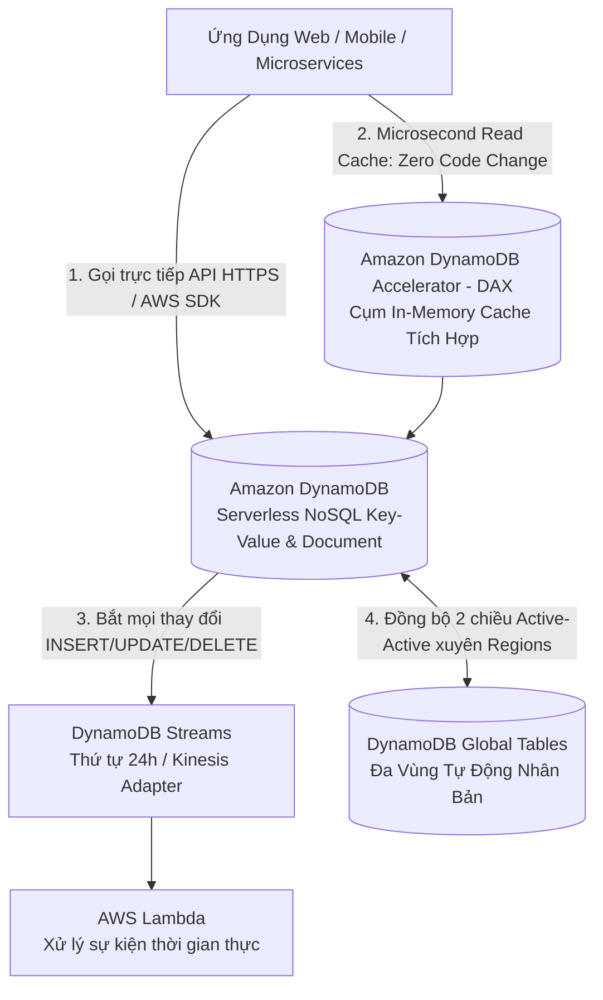
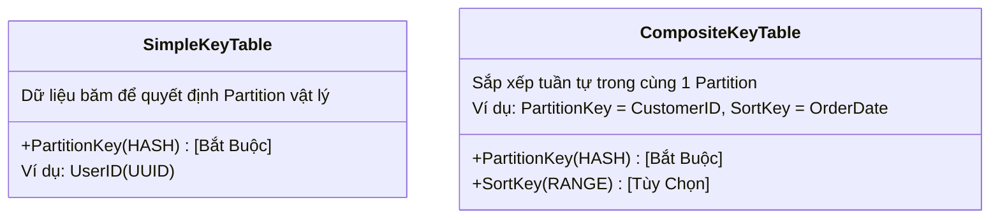
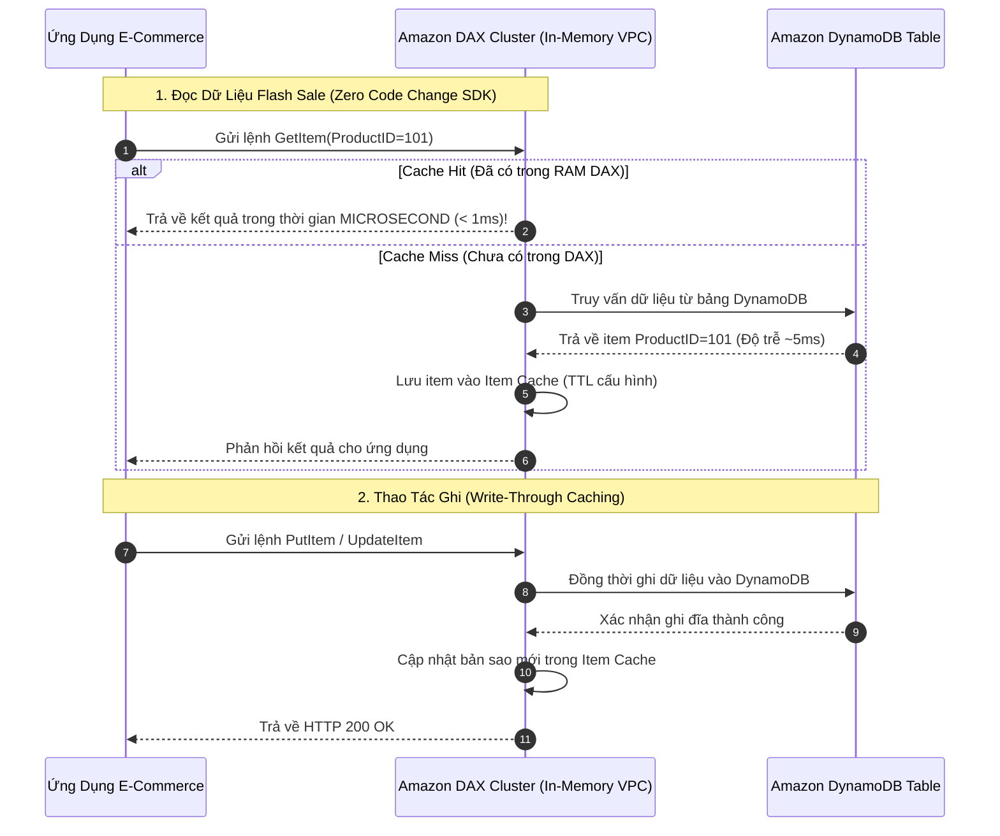

# Tài Liệu Học Tập Chuyên Sâu: Amazon DynamoDB & Cơ Sở Dữ Liệu NoSQL Đám Mây (DAX, Streams, Global Tables)

> **Tài liệu chuẩn hóa kiến trúc đám mây**: Hướng dẫn toàn diện theo tiêu chuẩn Principal AWS Solutions Architect & Senior Database Specialist (Cập nhật phiên bản kiến trúc mới nhất 2026).  
> **Ngôn ngữ**: Tiếng Việt chuyên ngành (Bảo lưu toàn bộ thuật ngữ chuyên ngành tiếng Anh chuẩn AWS).  
> **Mục tiêu**: Phục vụ thi chứng chỉ cấp độ Professional/Specialty (**SAA-C03, SAP-C02, Database Specialty**) và thiết kế kiến trúc NoSQL cấp độ doanh nghiệp (**Production-grade**).  
> **Các bài giảng liên quan**: Chương 19 & 20 (Serverless, DynamoDB, API Gateway) & Chương 21 (Databases in AWS).

---

## 6.1. Tổng Quan Dịch Vụ (Service Overview)

### 1. Định nghĩa chuẩn xác và Phân nhóm dịch vụ
**Amazon DynamoDB** là dịch vụ cơ sở dữ liệu phi quan hệ (**NoSQL Database**) dạng Khóa-Giá trị (**Key-Value**) và Tài liệu (**Document**) được quản lý hoàn toàn phi máy chủ (**Serverless**), cung cấp hiệu năng dưới 10 mili-giây (**Single-digit millisecond latency**) ở bất kỳ quy mô dữ liệu nào (từ vài Gigabytes đến hàng trăm Terabytes).

---

### 2. Bài toán cốt lõi mà DynamoDB giải quyết

1. **Hiệu năng nhất quán ở mọi quy mô (Predictable Performance at Scale)**: Khác với cơ sở dữ liệu quan hệ (RDS) bị chậm dần khi bảng dữ liệu phình to lên hàng trăm Gigabytes, DynamoDB tự động chia nhỏ dữ liệu thành các **Partitions (mỗi partition tối đa 10 GB)**. Do đó, truy vấn 10 items mất 5ms thì truy vấn giữa 10 tỷ items vẫn chỉ mất 5ms!
2. **Loại bỏ hoàn toàn gánh nặng quản trị máy chủ (Zero Server Management)**: Không cần chọn instance size, không vá lỗi OS, không quản lý connection pool, không lo downtime khi mở rộng dung lượng ổ đĩa.
3. **Mô hình tính phí linh hoạt (On-Demand vs Provisioned)**: Hỗ trợ co giãn tức thì đáp ứng các sự kiện flash sale hàng triệu requests/giây với On-Demand mode.
4. **Tính khả dụng cực cao và nhân bản toàn cầu (Multi-Region Active-Active)**: Tự động nhân bản 3 bản sao trên 3 Availability Zones trong Region; hỗ trợ **Global Tables** với khả năng đọc và ghi đồng thời tại nhiều AWS Regions trên thế giới.

---

### 3. Khi nào KHÔNG nên dùng DynamoDB (Anti-patterns & Giải pháp thay thế)

* ❌ **Cần thực thi các câu lệnh `JOIN` nhiều bảng phức tạp hoặc hàm tổng hợp (`GROUP BY`, `SUM`, `AVG`)**: DynamoDB không hỗ trợ JOIN; việc JOIN bằng code ứng dụng sẽ tốn chi phí và cực kỳ chậm.  
  👉 *Giải pháp thay thế*: Sử dụng **Amazon Aurora** hoặc **Amazon RDS**.
* ❌ **Phân tích dữ liệu lớn dạng kho dữ liệu (OLAP/Data Warehousing)**:  
  👉 *Giải pháp thay thế*: Sử dụng **Amazon Redshift** hoặc **Amazon Athena**.
* ❌ **Tìm kiếm toàn văn bản (Full-text search) theo từ khóa tự do**: DynamoDB chỉ tìm kiếm nhanh theo Partition Key / Sort Key.  
  👉 *Giải pháp thay thế*: Đồng bộ dữ liệu qua DynamoDB Streams sang **Amazon OpenSearch Service**.

---

## 6.2. Các Khái Niệm, Kiến Trúc & Vận Hành Cốt Lõi (Core Concepts & Operations)

### 1. Khóa Chính (Primary Keys): Partition Key vs Composite Primary Key

* **Simple Primary Key (Partition Key - HASH)**: 
  - Khóa phân vùng; DynamoDB sử dụng hàm băm nội bộ (internal hash function) để xác định chính xác Partition vật lý nào sẽ lưu trữ item đó.
  - Các item trong bảng phải có Partition Key duy nhất.
* **Composite Primary Key (Partition Key + Sort Key - RANGE)**:
  - Cho phép nhiều items có cùng Partition Key nhưng bắt buộc phải có Sort Key khác nhau.
  - Tất cả items có cùng Partition Key được lưu trữ liền kề nhau trên cùng một Partition vật lý và được **sắp xếp tuần tự theo Sort Key**.
  - Hỗ trợ các câu lệnh truy vấn dải (Range Queries) cực nhanh: `<`, `>`, `BETWEEN`, `begins_with`.

---

### 2. Bảng So Sánh Chỉ Mục Phụ: GSI (Global) vs LSI (Local)

| Tiêu chí kỹ thuật | Local Secondary Index (LSI) | Global Secondary Index (GSI) |
| :--- | :--- | :--- |
| **Partition Key** | **BẮT BUỘC TRÙNG** với Partition Key của bảng gốc | **CÓ THỂ KHÁC** hoàn toàn so với bảng gốc |
| **Sort Key** | Bắt buộc phải là một thuộc tính khác | Tùy chọn (có thể có hoặc không) |
| **Thời điểm tạo** | **CHỈ TẠO ĐƯỢC KHI TẠO BẢNG** (Không thể thêm/xóa sau này) | **Tạo hoặc xóa BẤT KỲ LÚC NÀO** (Online Indexing) |
| **Dung lượng tối đa** | Tối đa **10 GB** cho mỗi Partition Key value | **Không giới hạn dung lượng** |
| **Tính nhất quán đọc** | Hỗ trợ cả **Eventually** và **Strongly Consistent Reads** | **CHỈ HỖ TRỢ Eventually Consistent Reads** |
| **Quản trị RCU / WCU** | Dùng chung RCU/WCU của bảng gốc | **Có RCU / WCU cấp phát độc lập riêng** |

---

### 3. Hai Chế Độ Năng Lượng: On-Demand Mode vs Provisioned Mode

| Tiêu chí | On-Demand Capacity Mode | Provisioned Capacity Mode |
| :--- | :--- | :--- |
| **Cơ chế hoạt động** | Tự động đáp ứng lưu lượng tăng vọt tức thì không cần dự đoán | Cấp phát tĩnh số lượng **RCU** và **WCU** cố định |
| **Mô hình thanh toán** | Trả tiền theo từng triệu requests đọc/ghi thực tế phát sinh | Trả tiền theo số lượng RCU/WCU cấp phát mỗi giờ |
| **Nguy cơ Throttling** | **Gần như bằng 0** (chỉ throttle nếu tải tăng gấp đôi trong vài giây) | Có nguy cơ bị lỗi `400 ProvisionedThroughputExceededException` |
| **Auto Scaling** | Tích hợp sẵn tự động co giãn | Phải cấu hình **Application Auto Scaling** theo ngưỡng % utilization |
| **Trường hợp tối ưu** | • Ứng dụng mới ra mắt, **lưu lượng khó dự đoán**. • Tải tăng đột biến (Spiky / Flash sale). • Tải nền thấp trong thời gian dài. | • Ứng dụng chạy ổn định 24/7, **tải dự đoán được**. • Cho phép mua DynamoDB Reserved Capacity để tiết kiệm tới 77%. |

---

### 4. Đơn Vị Tính Toán Năng Lực (Capacity Units Calculation)

* **1 WCU (Write Capacity Unit)**: Đại diện cho **1 thao tác ghi** mỗi giây cho một item có kích thước tối đa **1 KB**.
  - Nếu ghi item 3.5 KB $\rightarrow$ Tính thành **4 WCUs** (luôn làm tròn lên).
* **1 RCU (Read Capacity Unit)**:
  - **Strongly Consistent Read**: 1 RCU = **1 thao tác đọc** mỗi giây cho item tối đa **4 KB**.
  - **Eventually Consistent Read (Mặc định)**: 1 RCU = **2 thao tác đọc** mỗi giây cho item tối đa **4 KB** (tiết kiệm 50% chi phí RCU!).
  - **Transactional Read**: 1 RCU = **0.5 thao tác đọc** (tốn gấp đôi chi phí).

---

## 6.3. Kiến Trúc Thực Tế và Luồng Vận Hành (Production Architecture & Workflow)

### Cụm Caching Tốc Độ Microsecond Với DynamoDB Accelerator (DAX)

---

## 6.4. Bảng Tích Hợp với Các Dịch Vụ AWS Khác (Integration Table)

| Dịch vụ liên kết | Phương thức tích hợp | Mục đích kỹ thuật & Kịch bản thực tế |
| :--- | :--- | :--- |
| **AWS Lambda** | DynamoDB Streams Trigger | Kiến trúc hướng sự kiện: Tự động gửi email thông báo khi đơn hàng được tạo hoặc cập nhật trạng thái. |
| **Amazon S3** | Export to S3 / Import from S3 | Xuất toàn bộ dữ liệu DynamoDB sang file Parquet trên S3 mà không tiêu tốn RCU để phân tích bằng Athena. |
| **Amazon OpenSearch** | OpenSearch Ingestion / Streams | Cung cấp tính năng tìm kiếm văn bản tự do (Full-text search) cho sản phẩm lưu trong DynamoDB. |
| **AWS KMS** | Customer Managed Key (CMK) | Mã hóa toàn bộ dữ liệu At-Rest trên bảng, chỉ mục phụ GSI và các bản sao lưu PITR. |
| **VPC Endpoint** | **Gateway VPC Endpoint (Miễn phí)** | Cho phép các máy chủ EC2 / Lambda trong Private Subnet truy cập DynamoDB an toàn không tốn phí NAT. |

---

## 6.5. Bảng So Sánh Các Dịch Vụ Caching: DAX vs ElastiCache vs MemoryDB

| Tiêu chí | DynamoDB Accelerator (DAX) | Amazon ElastiCache for Redis | Amazon MemoryDB for Redis |
| :--- | :--- | :--- | :--- |
| **Mục đích** | **Bộ đệm chuyên dụng riêng cho DynamoDB** | Bộ đệm in-memory đa dụng (Mọi DB / Session) | Cơ sở dữ liệu chính in-memory bền vững chuẩn ACID |
| **Sửa đổi mã nguồn** | **ZERO CODE CHANGE** (Chỉ đổi DAX endpoint trong SDK) | **PHẢI SỬA CODE** (Ứng dụng tự quản lý logic get/set cache) | Thay thế database chính |
| **Tầng lưu trữ** | RAM Cache (Item Cache + Query Cache) | RAM Cache tạm thời | RAM + Multi-AZ Transaction Log trên SSD |
| **Độ trễ** | **Microsecond** | **Microsecond** | Microsecond đọc / Single-digit ms ghi |

---

## 6.6. FinOps & Chiến Lược Tối Ưu Chi Phí (Cost Optimization)

### 1. Phép tính so sánh: On-Demand vs Provisioned với Auto Scaling
* **Tình huống thực tế**:
  Một bảng DynamoDB của dịch vụ game di động có lưu lượng truy cập ban ngày đạt 5,000 WCU (từ 12h đến 22h = 10 tiếng), ban đêm giảm về 200 WCU (14 tiếng).
* **Phương án 1: Cấp phát tĩnh Provisioned cố định 5,000 WCU**:
  $$\text{Chi phí WCU} = 5,000 \text{ WCU} \times 0.00065\$/\text{giờ} \times 24 \times 30 = \mathbf{2,340.00\$/\text{tháng}}$$
* **Phương án 2: Bật Provisioned Auto Scaling (Min=200, Max=5000, Target=70%)**:
  $$\text{Chi phí ban ngày} = 5,000 \times 0.00065\$ \times 10 \times 30 = 975.00\$$$
  $$\text{Chi phí ban đêm} = 200 \times 0.00065\$ \times 14 \times 30 = 54.60\$$$
  $$\text{Tổng chi phí} = 975.00\$ + 54.60\$ = \mathbf{1,029.60\$/\text{tháng}} \quad (\text{Tiết kiệm } 56\%)$$
* **Phương án 3: Chuyển sang On-Demand Mode**:
  Nếu lưu lượng chỉ có vài đợt đột biến ngắn trong 1 giờ mỗi tuần, On-Demand sẽ chỉ tốn dưới $50/tháng!

---

## 6.7. Khắc Phục Sự Cố Thực Tế (Troubleshooting Guide)

| Vấn đề (Problem) | Nguyên nhân khả dĩ (Possible Causes) | Các bước điều tra (Investigation Steps) | Giải pháp xử lý (Solution) | Biện pháp phòng ngừa (Prevention) |
| :--- | :--- | :--- | :--- | :--- |
| **Lỗi `ProvisionedThroughputExceededException`** | 1. Tải vượt quá RCU/WCU đã cấp phát. 2. **Hiện tượng Hot Partition**: Chọn Partition Key có tính ngẫu nhiên thấp (ví dụ: `country=VN` cho 99% users) khiến toàn bộ tải dồn vào 1 partition duy nhất. | Xem metric CloudWatch `UserErrors`, `ThrottledRequests` và `ReadThrottleEvents`. | 1. Bật **Auto Scaling** hoặc chuyển sang **On-Demand Mode**. 2. Thêm hậu tố ngẫu nhiên (Partition Key Salting) vào key. | Sử dụng thuật toán băm phân tán partition key đều đặn. |
| **GSI Throttling làm nghẽn luôn cả bảng gốc (GSI Backpressure)** | Tốc độ ghi vào GSI bị thiếu WCU. Do cơ chế đồng bộ, nếu GSI bị throttle thì **thao tác ghi vào BẢNG GỐC cũng sẽ bị từ chối**! | Kiểm tra metric `WriteThrottleEvents` riêng của từng GSI. | Tăng WCU cho GSI ngang bằng hoặc lớn hơn WCU của bảng gốc. | Luôn để WCU của GSI ở chế độ On-Demand hoặc cùng profile scaling với bảng chính. |
| **Bảng bị xóa nhầm bởi kỹ sư hoặc script tự động** | Không bật tính năng bảo vệ chống xóa bảng. | Xem sự kiện `DeleteTable` trong AWS CloudTrail. | Kích hoạt tính năng **Point-in-Time Recovery (PITR)** để phục hồi dữ liệu về thời điểm 1 giây trước khi bị xóa. | Luôn bật **Deletion Protection** trên tất cả bảng Production! |

---

## 🏛️ I. Các Kịch Bản Kiến Trúc Chuẩn (Best Practice Scenarios)

#### 1. Tăng Tốc Độ Đọc DynamoDB Lên Hàng Chục Lần Không Sửa Mã Nguồn Bằng DAX — (CM-PT2 Q25, CM-PT4 Q60)
- **Tình huống thi**: Ứng dụng thương mại điện tử gặp tình trạng độ trễ đọc dữ liệu danh mục sản phẩm từ DynamoDB tăng cao vào các khung giờ cao điểm (mất từ 5 đến 12 mili-giây). Doanh nghiệp muốn giảm độ trễ xuống mức microsecond mà **không được phép sửa đổi mã nguồn logic nghiệp vụ** của ứng dụng.
- **Giải pháp tối ưu chuẩn AWS**:
  - Triển khai một cụm **Amazon DynamoDB Accelerator (DAX)** trong cùng VPC với ứng dụng.
  - Cập nhật SDK client của ứng dụng: Chỉ cần trỏ endpoint kết nối từ URL DynamoDB mặc định sang **DAX Cluster Endpoint**.
  - Không cần sửa đổi bất kỳ câu lệnh truy vấn nào. DAX tự động đóng vai trò là một in-memory cache thông minh (Item Cache & Query Cache), cung cấp tốc độ phản hồi dưới 1 mili-giây.

#### 2. Cấu Hình DynamoDB Cho Tải Lưu Lượng Hoàn Toàn Không Thể Dự Đoán Trước — (CM-PT2 Q43, CM-PT6 Q42)
- **Tình huống thi**: Một công ty khởi nghiệp chuẩn bị phát hành một tựa game di động mới. Họ hoàn toàn không thể dự đoán được số lượng người chơi (có thể chỉ vài trăm người hoặc đột ngột tăng vọt lên hàng triệu người chơi nếu game viral). Yêu cầu hệ thống phải tự động co giãn tức thì, không bị lỗi nghẽn và chi phí tối ưu nhất.
- **Giải pháp chuẩn**:
  - Thiết lập bảng DynamoDB ở chế độ **On-Demand Capacity Mode**.
  - Không cần ước lượng hay cấp phát trước RCU/WCU. Bảng tự động đáp ứng mọi đợt bùng nổ lưu lượng và doanh nghiệp chỉ phải trả tiền cho số lượng request thực tế phát sinh.

---

## 🪤 II. Các Bẫy Thi Tinh Vi & Phân Tích Phương Án Sai (Exam Traps & Distractors)

#### 🪤 Bẫy 1: Tối Ưu Chi Phí Kết Nối Riêng Tư Từ VPC Tới DynamoDB — (CM-PT4 Q50)
- **Tình huống đề thi**: *"Các máy chủ EC2 trong Private Subnet cần đọc/ghi dữ liệu vào DynamoDB table một cách an toàn mà không đi qua Internet công cộng và không tốn chi phí truyền dữ liệu."*
- **Các phương án bẫy**:
  - ❌ *Dùng NAT Gateway*: NAT Gateway tính phí $0.045/giờ + $0.045/GB dữ liệu xử lý $\rightarrow$ Tốn kém không cần thiết.
  - ❌ *Dùng Interface VPC Endpoint (PrivateLink)*: Mặc dù DynamoDB đã hỗ trợ PrivateLink, nhưng Interface Endpoint vẫn tính phí duy trì hàng giờ và phí dữ liệu.
- **Giải pháp ĐÚNG**: Sử dụng **Gateway VPC Endpoint cho DynamoDB**.
  - Cấu hình trực tiếp vào Route Table của subnet.
  - **HOÀN TOÀN MIỄN PHÍ ($0)**, không tính cước kết nối, không tính cước truyền dữ liệu và lưu lượng đi trực tiếp qua mạng trục riêng của AWS.

#### 🪤 Bẫy 2: Ngăn Chặn Xóa Nhầm Bảng Dữ Liệu Quan Trọng Bằng Deletion Protection — (CM-PT5 Q26)
- **Tình huống đề thi**: *"Doanh nghiệp muốn đảm bảo các bảng DynamoDB chứa dữ liệu sản xuất quan trọng không thể bị xóa bỏ bởi bất kỳ ai do vô tình thực hiện thao tác trên Console hoặc chạy nhầm lệnh Terraform/CloudFormation."*
- **Giải pháp ĐÚNG**: Bật tính năng **Deletion Protection** trên bảng DynamoDB.
  - Khi bật Deletion Protection, mọi API call `DeleteTable` đều bị từ chối ngay lập tức, kể cả khi được gọi bởi tài khoản có quyền `AdministratorAccess`!

#### 🪤 Bẫy 3: Quét Bảng Lấy Dữ Liệu Thay Đổi: Scan vs DynamoDB Streams — (CM-PT3 Q45)
- **Tình huống đề thi**: *"Hệ thống cần theo dõi các thay đổi dữ liệu trong DynamoDB (khi có đơn hàng mới) để gửi thông báo real-time qua SNS với chi phí và hiệu năng tối ưu nhất."*
- **Các phương án bẫy**:
  - ❌ *Dùng Lambda chạy định kỳ mỗi 5 phút gọi lệnh `Scan` toàn bộ bảng*: Lệnh `Scan` đọc toàn bộ partition, tiêu tốn lượng RCU khổng lồ và làm chậm hệ thống.
- **Giải pháp ĐÚNG**: Kích hoạt **DynamoDB Streams** kết hợp **AWS Lambda Event Source Mapping**.
  - DynamoDB Streams tự động bắt mọi thay đổi (Insert, Modify, Remove) theo đúng thứ tự thời gian thực và kích hoạt hàm Lambda xử lý ngay lập tức mà không tiêu tốn RCU của bảng!

---

## 📊 III. Ma Trận Quyết Định Công Nghệ NoSQL Nhanh (Exam Decision Matrix)

| Tình huống / Yêu cầu trong đề thi | Giải pháp chuẩn AWS | Giải pháp bị loại & Lý do |
|:---|:---|:---|
| **Độ trễ đọc microsecond, không sửa mã nguồn** | **Amazon DynamoDB Accelerator (DAX)** | ElastiCache Redis (bắt buộc phải sửa code ứng dụng) |
| **Lưu lượng truy cập không thể dự đoán trước** | **DynamoDB On-Demand Mode** | Provisioned Mode (dễ bị throttling hoặc cấp phát thừa) |
| **EC2 Private truy cập DynamoDB an toàn miễn phí** | **Gateway VPC Endpoint cho DynamoDB** | NAT Gateway (tốn phí data processing đắt đỏ) |
| **Chống xóa nhầm bảng Production kể cả Admin** | **Bật Deletion Protection** | IAM Policy (Admin vẫn có quyền sửa policy xóa) |
| **Bắt mọi thay đổi dữ liệu thời gian thực để gọi Lambda** | **DynamoDB Streams** | Viết cronjob chạy lệnh Scan (ngốn RCU, độ trễ cao) |
| **Đồng bộ dữ liệu đa vùng Active-Active, RPO < 1s** | **DynamoDB Global Tables** | Tự viết script sao chép dữ liệu cross-region |
| **Tự động xóa các session đăng nhập sau 7 ngày** | **DynamoDB Time to Live (TTL)** | Viết Lambda cron quét và xóa (tốn WCU đắt đỏ) |
| **Phục hồi dữ liệu về bất kỳ giây nào trong 35 ngày** | **Point-in-Time Recovery (PITR)** | Chỉ chụp snapshot thủ công định kỳ |

---

## 6.8. Tóm Tắt và Danh Mục Kiểm Tra Kiến Thức (Summary & Learning Checklist)

### 7 Nguyên Tắc Kiến Trúc "Sống Còn" Của Amazon DynamoDB
1. **Thiết kế Partition Key đồng đều**: Luôn chọn thuộc tính có tính phân tán cao (High Cardinality - như UserID, DeviceID) làm Partition Key để tránh hiện tượng **Hot Partition**.
2. **Ưu tiên Query thay vì Scan**: Lệnh `Query` chỉ tìm kiếm theo Partition Key cụ thể; lệnh `Scan` quét toàn bộ bảng và ngốn sạch RCU.
3. **DAX cho Microsecond Latency**: Khi cần cache đọc cho DynamoDB mà không muốn viết lại mã nguồn ứng dụng $\rightarrow$ Chọn DAX.
4. **Gateway Endpoint cho DynamoDB**: Luôn tạo Gateway VPC Endpoint trong route table để truy cập DynamoDB miễn phí từ Private Subnet.
5. **On-Demand cho Spiky Workload**: Khi tải biến động đột ngột hoặc giai đoạn MVP chưa rõ nhu cầu $\rightarrow$ Chọn On-Demand. Khi tải ổn định $\rightarrow$ Chọn Provisioned + Auto Scaling để tiết kiệm chi phí.
6. **DynamoDB TTL hoàn toàn miễn phí**: Xóa các item hết hạn bằng tính năng TTL không tiêu tốn bất kỳ WCU nào của bảng.
7. **Bảo vệ bảng Production bằng 2 lớp**: Luôn bật **Deletion Protection** (chống xóa bảng) và **Point-in-Time Recovery (PITR)** (cho phép hoàn nguyên dữ liệu về từng giây).

---

### Liên Kết Nội Bộ và Tài Liệu Tham Khảo (Internal Links)
- 📖 [Ghi Chú Bài Học Chương 19 & 20: Serverless & DynamoDB](../Lesson_Notes/19_20_Serverless_Lambda_APIGW_DynamoDB.md)
- 📖 [Ghi Chú Bài Học Chương 21: Databases in AWS](../Lesson_Notes/21_Databases_in_AWS.md)
- 📖 [Tài Liệu Chuyên Sâu: Amazon RDS & Aurora](./RDS_Aurora_Databases.md)
- 📖 [Cẩm Nang Từ Vựng Giải Mã Đề Thi](../EXAM_VOCABULARY.md)
- 📖 [Bảng Thuật Ngữ Kỹ Thuật Đám Mây](../GLOSSARY.md)

