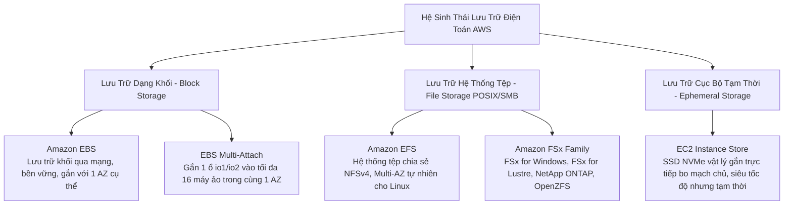
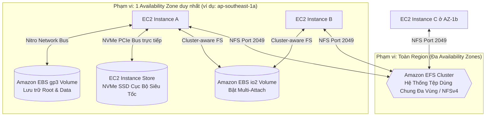
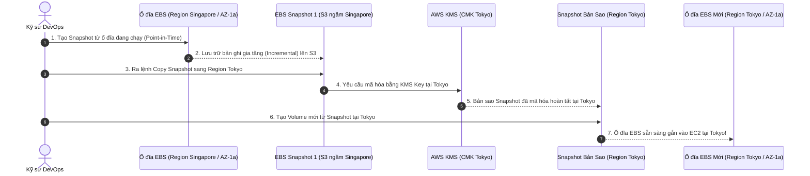

# Tài Liệu Học Tập Chuyên Sâu: Amazon EBS, Amazon EFS & EC2 Instance Store (Lưu Trữ Khối & Tệp Tin Đám Mây)

> **Tài liệu chuẩn hóa kiến trúc đám mây**: Hướng dẫn toàn diện theo tiêu chuẩn Principal AWS Solutions Architect & Senior Cloud DevOps Engineer (Cập nhật phiên bản kiến trúc mới nhất 2026).  
> **Ngôn ngữ**: Tiếng Việt chuyên ngành (Bảo lưu toàn bộ thuật ngữ chuyên ngành tiếng Anh chuẩn AWS).  
> **Mục tiêu**: Phục vụ thi chứng chỉ cấp độ Professional/Specialty (**SAA-C03, SAP-C02, DOP-C02**) và vận hành hệ thống cấp độ doanh nghiệp (**Production-grade**).  
> **Các bài giảng liên quan**: Chương 07 (EC2 Instance Storage: Bài 56 đến Bài 69).

---

## 6.1. Tổng Quan Dịch Vụ (Service Overview)

### 1. Định nghĩa chuẩn xác và Phân nhóm dịch vụ
Hệ sinh thái lưu trữ đám mây gắn kèm máy chủ của AWS được chia thành 3 nhóm kiến trúc chuyên biệt dựa trên bản chất vật lý và giao thức truy cập:



1. **Amazon Elastic Block Store (Amazon EBS)**: Dịch vụ lưu trữ khối ảo (**Block Storage**) hiệu năng cao, bền vững, hoạt động độc lập với vòng đời của máy ảo EC2. Dữ liệu được kết nối qua mạng nội bộ chuyên dụng của hệ thống phần cứng **AWS Nitro System**. Tương đương với ổ cứng ảo SAN/DAS gắn ngoài, phạm vi hoạt động bị giới hạn chặt chẽ trong **duy nhất một Availability Zone (AZ-locked)**.
2. **Amazon Elastic File System (Amazon EFS)**: Dịch vụ lưu trữ tệp tin chia sẻ (**Shared File Storage**) hoàn toàn được quản lý, tuân thủ chuẩn **POSIX NFSv4**. Tự động co giãn dung lượng từ 0 byte tới hàng Petabyte và cho phép hàng ngàn máy ảo EC2, container (ECS/EKS) và hàm AWS Lambda gắn kết đọc/ghi đồng thời xuyên qua **nhiều Availability Zones trong một Region**.
3. **EC2 Instance Store (Lưu trữ tạm thời / Ephemeral Storage)**: Ổ cứng thể rắn vật lý (NVMe SSD) được tích hợp trực tiếp trên bo mạch chủ của máy chủ vật lý đang chạy máy ảo EC2. Cung cấp thông lượng I/O hàng triệu IOPS với độ trễ microsecond, nhưng dữ liệu **sẽ bị mất hoàn toàn (Ephemeral)** khi máy ảo bị **Stop** hoặc chuyển sang máy chủ vật lý khác.

---

### 2. Bài toán cốt lõi & Ranh giới lựa chọn kiến trúc

| Tiêu chí kỹ thuật | Amazon EBS | Amazon EFS | EC2 Instance Store |
| :--- | :--- | :--- | :--- |
| **Loại hình lưu trữ** | **Block Storage (Khối)** | **File Storage (Hệ thống tệp NFSv4)** | **Block Storage (Phần cứng cục bộ)** |
| **Phạm vi địa lý (Scope)** | Giới hạn trong **1 Availability Zone** | Trải rộng trên **Đa Availability Zones** | Cố định trên **1 Máy chủ vật lý** |
| **Khả năng chia sẻ (Sharing)** | 1 instance (trừ Multi-Attach tối đa 16) | **Hàng ngàn instances/containers đồng thời** | Chỉ 1 máy ảo duy nhất đang chạy |
| **Tính bền vững (Durability)** | Bền vững (Sao chép tự động trong 1 AZ) | Cực kỳ bền vững (**99.999999999% - 11 số 9**) | **Tạm thời (Mất khi Stop/Terminate/Hardware fail)** |
| **Hiệu năng I/O & Độ trễ** | Tới 256,000 IOPS, độ trễ sub-millisecond | Độ trễ millisecond, throughput tới hàng chục GB/s | **Hàng triệu IOPS**, độ trễ microsecond cực thấp |
| **Giao thức kết nối** | Mạng riêng ảo hóa (Nitro NVMe protocol) | Giao thức mạng **NFSv4 (Port 2049)** | Bus phần cứng PCIe / NVMe trực tiếp |
| **Khả năng Boot OS** |  Có (Root Volume chuẩn) | ❌ Không thể dùng làm OS Boot Volume |  Có (trên một số dòng instance cụ thể) |

---

### 3. Khi nào KHÔNG nên dùng (Anti-patterns & Giải pháp thay thế)

* ❌ **Dùng Amazon EBS để chia sẻ tệp tin giữa các máy ảo ở các Availability Zone khác nhau**: EBS Volume bị khóa chặt trong một AZ cụ thể và không thể mount xuyên AZ.  
  👉 *Giải pháp thay thế*: Chuyển sang **Amazon EFS** (cho Linux) hoặc **Amazon FSx for Windows File Server** (cho Windows/SMB).
* ❌ **Lưu trữ dữ liệu quan trọng dài hạn trên EC2 Instance Store**: Dữ liệu sẽ bốc hơi sạch sẽ nếu máy ảo bị khởi động lại dạng Stop/Start hoặc gặp lỗi phần cứng.  
  👉 *Giải pháp thay thế*: Sử dụng **Amazon EBS** hoặc định kỳ sao lưu dữ liệu sang **Amazon S3**.
* ❌ **Dùng Amazon EFS cho cơ sở dữ liệu quan hệ có tần suất I/O ngẫu nhiên cao (RDBMS như MySQL, PostgreSQL)**: EFS sử dụng giao thức NFS qua mạng, độ trễ ghi metadata và locking tệp sẽ bóp nghẹt hiệu năng database.  
  👉 *Giải pháp thay thế*: Sử dụng **Amazon EBS `gp3` / `io2 Block Express`** hoặc chuyển sang dịch vụ chuyên biệt **Amazon RDS / Aurora**.
* ❌ **Lưu trữ hàng triệu tệp tin tĩnh (Static Assets, Media, PDF) trên EBS Volume khổng lồ**: Tốn kém chi phí lưu trữ khối, khó chia sẻ cho CDN và giới hạn dung lượng 64 TiB.  
  👉 *Giải pháp thay thế*: Sử dụng **Amazon S3** kết hợp **Amazon CloudFront**.

---

## 6.2. Các Khái Niệm, Kiến Trúc & Vận Hành Cốt Lõi (Core Concepts, Security & Day-2 Operations)

### 1. Sơ đồ các mô hình lưu trữ gắn kèm máy chủ



---

### 2. Phân loại chuyên sâu các dòng ổ đĩa Amazon EBS (EBS Volume Types 2026)

AWS chia các dòng ổ đĩa EBS thành 2 nhóm công nghệ vật lý: **SSD** (cho các giao dịch I/O ngẫu nhiên, độ trễ thấp) và **HDD** (cho các luồng dữ liệu tuần tự khối lượng lớn).

```mermaid
flowchart LR
    EBSFleet[Họ Ổ Đĩa Amazon EBS] --> SSD[Nhóm SSD: Tải Giao Dịch & Boot OS]
    EBSFleet --> HDD[Nhóm HDD: Tải Tuần Tự Dung Lượng Lớn]

    SSD --> gp3[gp3: Chuẩn Mặc Định Vàng\nTách rời độc lập Dung lượng, IOPS, Throughput]
    SSD --> gp2[gp2: Thế Hệ Cũ [Legacy]\nIOPS bị gắn chặt với dung lượng 3:1]
    SSD --> io2[io2 Block Express: Hiệu Năng Cực Đại\n256,000 IOPS / Sub-ms Latency / Multi-Attach]

    HDD --> st1[st1: Throughput Optimized HDD\nBig Data, Data Warehouse, Log Processing]
    HDD --> sc1[sc1: Cold HDD\nLưu trữ lạnh, chi phí thấp nhất, ít truy cập]
```

#### A. Nhóm ổ cứng SSD (Solid State Drives)
1. **General Purpose SSD (`gp3` - Chuẩn mực mặc định hiện đại)**:
   - Thay thế hoàn toàn cho thế hệ cũ `gp2` với giá rẻ hơn **20%**.
   - **Tách biệt độc lập 3 tham số**: Dung lượng (GiB), Số lượng IOPS và Băng thông Throughput (MB/s).
   - **Baseline miễn phí**: Mặc định cung cấp sẵn **3,000 IOPS** và **125 MB/s throughput** hoàn toàn miễn phí ở bất kỳ kích thước ổ đĩa nào (từ 1 GiB tới 64 TiB).
   - Có thể mở rộng độc lập lên tới **16,000 IOPS** và **1,000 MB/s** mà không cần phải mua thêm dung lượng đĩa thừa.
2. **General Purpose SSD (`gp2` - Thế hệ cũ [Legacy / Tránh dùng])**:
   - Hiệu năng IOPS bị gắn chặt vào dung lượng: $3 \text{ IOPS} / 1 \text{ GiB}$. Để có 9,000 IOPS, bắt buộc phải tạo ổ đĩa 3,000 GiB (lãng phí tiền dung lượng).
   - Cơ chế Burst IOPS lên 3,000 bằng bình chứa I/O Credits; khi hết credit hiệu năng bị sập về baseline. Khuyến nghị nâng cấp 100% sang `gp3`.
3. **Provisioned IOPS SSD (`io2 Block Express`)**:
   - Dành riêng cho các hệ thống phần mềm thương mại lõi (Oracle RAC, SAP HANA, Microsoft SQL Server).
   - Thông số kỹ thuật đỉnh cao: Đạt tới **256,000 IOPS**, throughput **4,000 MB/s**, độ trễ **dưới 1 mili-giây** và độ bền dữ liệu đạt **99.999%** (gấp 100 lần so với gp3).
   - Hỗ trợ tính năng **EBS Multi-Attach**.

#### B. Nhóm ổ đĩa HDD (Hard Disk Drives - KHÔNG THỂ DÙNG LÀM BOOT VOLUME)
4. **Throughput Optimized HDD (`st1`)**:
   - Tối ưu cho dữ liệu tuần tự đọc/ghi liên tục (MapReduce, Kafka, Log Processing, ETL jobs). Tối đa 500 MB/s và 500 IOPS.
5. **Cold HDD (`sc1`)**:
   - Chi phí rẻ nhất trong các dòng EBS ($0.015/GiB/tháng), dành cho dữ liệu lịch sử ít truy cập, sao lưu dạng file nén.

---

### 3. Vòng đời Snapshot & Cơ chế di chuyển xuyên Region



* **Cơ chế Snapshot Incremental (Sao lưu gia tăng)**: Bản snapshot đầu tiên lưu toàn bộ block dữ liệu; các bản tiếp theo chỉ lưu các block dữ liệu **đã thay đổi** kể từ lần chụp trước, giúp tiết kiệm chi phí tối đa.
* **EBS Snapshot Archive**: Bậc lưu trữ giá siêu rẻ (giảm 75% chi phí so với Standard Snapshot) cho các bản snapshot cần lưu giữ từ 90 ngày trở lên để tuân thủ pháp lý.
* **Recycle Bin for Snapshots**: Thùng rác bảo vệ chống lại việc nhân viên vô tình xóa nhầm snapshot quan trọng; cho phép khôi phục lại trong khoảng thời gian Retention cài đặt trước.
* **Fast Snapshot Restore (FSR)**: Loại bỏ độ trễ khởi động chậm (Lazy Loading) khi khôi phục volume từ snapshot; volume được cấp phát đầy đủ 100% hiệu năng I/O tức thì (tính phí $0.75/giờ/AZ).

---

### 4. Amazon EFS & Các tầng lưu trữ tối ưu chi phí

* **Bản chất kỹ thuật**: Hệ thống tệp phân tán tuân thủ chuẩn **POSIX**, hoạt động trên giao thức **NFSv4.1**. Cho phép hàng ngàn máy ảo Linux mount đồng thời và chia sẻ chung một thư mục.
* **Kiến trúc Multi-AZ tự nhiên**: Dữ liệu ghi vào EFS được nhân bản tức thời xuyên qua **3 Availability Zones** trong cùng Region với độ bền 11 số 9 (99.999999999%). Ngoài ra còn có tùy chọn **EFS One Zone** (tiết kiệm 47% chi phí cho môi trường Dev/Test chỉ chạy trên 1 AZ).
* **Quản lý vòng đời lưu trữ (EFS Lifecycle Management)**:
  - **EFS Standard**: Phục vụ các tệp tin truy cập thường xuyên (Hot Data).
  - **EFS Infrequent Access (EFS IA)**: Rẻ hơn **91%** so với Standard; tự động chuyển file sau 7, 14, 30 hoặc 90 ngày không có lượt truy cập.
  - **EFS Archive**: Rẻ hơn **97%** so với Standard ($0.008/GiB/tháng), tối ưu cho các tệp tin lưu trữ dài hạn chỉ đọc vài lần mỗi năm.

---

### 5. Bảo mật & Quản trị mã hóa (Security & Operations)

#### A. Quy trình mã hóa ổ đĩa EBS chưa mã hóa (KMS Encryption)
⚠️ **NGUYÊN TẮC BẤT BIẾN**: Không thể bật mã hóa trực tiếp trên một ổ đĩa EBS đang chạy mà chưa được mã hóa. Quy trình chuẩn mực 4 bước:
1. Chụp **EBS Snapshot** từ ổ đĩa chưa mã hóa.
2. Thực hiện **Copy Snapshot**, trong quá trình copy tích chọn bật **Encryption** và chỉ định **KMS Customer Managed Key (CMK)**.
3. Tạo một **EBS Volume mới** từ bản Snapshot đã mã hóa.
4. Gán ổ đĩa mới vào máy ảo EC2 thay thế ổ đĩa cũ.

#### B. Tính năng EBS Multi-Attach
* Cho phép gắn đồng thời một ổ đĩa EBS vào **tối đa 16 máy ảo EC2** trong **CÙNG MỘT AVAILABILITY ZONE**.
* Chỉ hỗ trợ trên các dòng ổ đĩa Provisioned IOPS: **`io1`** và **`io2 Block Express`**.
* **Yêu cầu kỹ thuật bắt buộc**: Ứng dụng phải sử dụng hệ thống tệp tin phân cụm chuyên dụng (**Cluster-aware File System** như GFS2, OCFS2) để điều phối việc ghi đĩa, tránh nguy cơ ghi đè làm hỏng dữ liệu.

---

### 🏛️ I. Các Kịch Bản Kiến Trúc Chuẩn (Best Practice Scenarios)

#### 1. Lựa Chọn Đúng 4 Loại Ổ Đĩa Amazon EBS Phổ Biến Theo Khối Lượng Công Việc
- **Bảng so sánh 4 loại ổ đĩa EBS cốt lõi trong đề thi**:

| Loại Ổ Đĩa EBS | Công nghệ | IOPS / Băng Thông tối đa | Trường hợp sử dụng tối ưu (Use Case) |
|:---|:---|:---|:---|
| **General Purpose SSD (`gp3`)** | SSD | 16,000 IOPS / 1,000 MB/s | **Lựa chọn mặc định tốt nhất**: Cung cấp baseline 3,000 IOPS và 125 MB/s miễn phí độc lập với dung lượng đĩa. Rẻ hơn `gp2` tới 20%. |
| **Provisioned IOPS SSD (`io2 Block Express`)** | SSD | **256,000 IOPS** / 4,000 MB/s | **Cơ sở dữ liệu nhiệm vụ sống còn (Mission-Critical)**: Oracle, SAP HANA, MSSQL yêu cầu độ trễ dưới 1 millisecond và độ tin cậy 99.999%. |
| **Throughput Optimized HDD (`st1`)** | HDD | 500 IOPS / 500 MB/s | **Dữ liệu lớn tuần tự, thông lượng cao**: Big Data, Data Warehousing, Log Processing, Kafka, Hadoop. Không dùng làm ổ boot OS. |
| **Cold HDD (`sc1`)** | HDD | 250 IOPS / 250 MB/s | **Lưu trữ tuần tự ít truy cập, chi phí rẻ nhất**: Sao lưu dự phòng, dữ liệu lưu trữ lịch sử dạng file lớn. |

#### 2. Tự Động Hóa Vòng Đời Bản Chụp EBS Bằng Amazon Data Lifecycle Manager (DLM)
- **Tình huống thi**: Doanh nghiệp cần tự động hóa quy trình chụp snapshot hàng ngày cho toàn bộ các ổ đĩa EBS của máy chủ EC2, lưu giữ trong vòng 30 ngày rồi tự động xóa các bản cũ, và sao chép snapshot sang Region dự phòng để khắc phục thảm họa với ít công sức nhất.
- **Giải pháp tối ưu chuẩn AWS**:
  - Không tự viết script Python/Lambda và EventBridge (Anti-pattern tốn công vận hành).
  - Sử dụng dịch vụ **Amazon Data Lifecycle Manager (Amazon DLM)**.
  - Tạo một **EBS Snapshot Lifecycle Policy**: Áp dụng dựa trên Resource Tags (ví dụ: `Environment=Prod`), thiết lập lịch biểu chạy (hàng ngày lúc 0h), chu kỳ lưu giữ (Retention Rule: 30 ngày) và kích hoạt tính năng **Cross-Region Copy** tự động.

#### 3. Hệ Thống Tệp Tin Tốc Độ Cực Cao Cho HPC & Machine Learning (Amazon FSx for Lustre)
- **Tình huống thi**: Khối lượng công việc tính toán hiệu năng cao (HPC), huấn luyện mô hình học máy (Machine Learning), hoặc tự động hóa thiết kế điện tử (EDA) cần hệ thống tệp tin tuân chuẩn POSIX có khả năng đọc/ghi với băng thông hàng trăm Gigabytes/giây và độ trễ sub-millisecond.
- **Giải pháp chuẩn**:
  - Triển khai **Amazon FSx for Lustre**.
  - **Tích hợp Native với Amazon S3**: FSx for Lustre có thể liên kết trực tiếp với một S3 bucket, tự động nạp dữ liệu từ S3 vào hệ thống tệp tin khi cần và đẩy kết quả tính toán ngược trở lại S3 khi hoàn tất.

#### 4. Hệ Cấp Bậc Chi Phí Lưu Trữ: S3 vs EFS vs EBS
- **Quy tắc phân tầng chi phí**:
  $$\text{Amazon S3 Standard (\$0.023/GB)} < \text{Amazon EFS Standard-IA (\$0.025/GB)} < \text{Amazon EBS gp3 (\$0.08/GB)} < \text{Amazon EFS Standard (\$0.30/GB)}$$
- *Lưu ý quan trọng*: EBS tính tiền theo **dung lượng cấp phát tĩnh (Provisioned Storage)** dù bạn có dùng hết hay không; trong khi S3 và EFS tính tiền theo **dung lượng thực tế sử dụng (Pay-as-you-go)**.

---

### 🪤 II. Các Bẫy Thi Tinh Vi & Phân Tích Phương Án Sai (Exam Traps & Distractors)

#### 🪤 Bẫy 1: Hệ Thống Tệp Tin Chia Sẻ Cho Cụm ASG: EFS vs EBS — (U-PT2 Q21)
- **Tình huống đề thi**: *"Ứng dụng chia sẻ video chạy trên một cụm máy chủ EC2 được quản lý bởi Auto Scaling Group. Người dùng tải video lên một máy chủ bất kỳ, nhưng video đó phải được hiển thị ngay lập tức cho toàn bộ các máy chủ khác trong cụm."*
- **Nguyên lý bất biến**:
  - **Amazon EBS**: Ổ cứng gắn trực tiếp vào **1 máy chủ duy nhất** trong **1 Availability Zone duy nhất** (trừ io1/io2 Multi-Attach trong cùng AZ). Khi ASG sinh thêm máy chủ ở các AZ khác nhau, mỗi máy chủ mang ổ đĩa riêng -> Dữ liệu tải lên máy A hoàn toàn vô hình đối với máy B!
  - **Amazon EFS**: Hệ thống tệp tin mạng chuẩn **POSIX NFSv4**, hỗ trợ mount đồng thời trên hàng trăm máy chủ EC2 trải dài trên nhiều AZs trong cùng Region -> **Tất cả các máy chủ đều nhìn thấy chung một thư mục chia sẻ**.

#### 🪤 Bẫy 2: Tiết Kiệm Tới 91% Chi Phí Cho EFS Bằng EFS Standard-IA — (U-PT2 Q38)
- **Tình huống đề thi**: *"Doanh nghiệp sử dụng Amazon EFS để lưu trữ tệp tin chia sẻ giữa các máy chủ. Qua phân tích, hơn 85% tệp tin sau 30 ngày hầu như không còn được truy cập nữa. Cần tối ưu chi phí lưu trữ mà ứng dụng không phải thay đổi đường dẫn tệp."*
- **Giải pháp ĐÚNG**: Kích hoạt **EFS Lifecycle Management** chuyển đổi sang lớp lưu trữ **EFS Standard-IA (Infrequent Access)** sau 30 ngày không truy cập.
  - Chi phí lưu trữ giảm từ $0.30/GB xuống chỉ còn **$0.025/GiB/tháng** (tiết kiệm ~91%).
  - Đường dẫn tệp tin trên hệ điều hành Linux vẫn giữ nguyên, trong suốt hoàn toàn với ứng dụng.

#### 🪤 Bẫy 3: Đặc Tính Vòng Đời Của EC2 Ephemeral Instance Store — (U-PT6 Q50)
- **Bẫy bất biến**:
  - Instance Store là ổ cứng NVMe vật lý gắn trực tiếp vào bo mạch chủ của máy chủ EC2.
  - **KHÔNG THỂ gỡ ra (Detach)** khỏi instance này để gắn vào instance khác.
  - Dữ liệu bị **xóa sạch hoàn toàn** khi instance bị **STOP** hoặc **TERMINATE** hoặc gặp sự cố phần cứng máy chủ vật lý.
  - Dữ liệu trong Instance Store **KHÔNG được lưu vào AMI**.
  - *Chỉ dùng cho*: Cache, swap, buffer, và dữ liệu tạm thời cần IOPS cực cao.

#### 🪤 Bẫy 4: Quy Trình 4 Bước Bắt Buộc Để Mã Hóa EBS Volume Đang Tồn Tại — (U-PT2 Q16)
- **Quy tắc**: AWS **KHÔNG cho phép bật mã hóa trực tiếp (in-place)** trên một EBS volume đang unencrypted.
- **Quy trình 4 bước chuẩn xác**:
  1. Chụp **Snapshot** từ volume chưa mã hóa hiện tại.
  2. **Copy Snapshot** đó và tích hợp bật cờ mã hóa kèm chọn **KMS Key**.
  3. Tạo **EBS Volume MỚI** từ Encrypted Snapshot vừa copy.
  4. Stop máy chủ EC2 -> Detach volume cũ -> Attach volume mới mã hóa -> Start lại máy chủ.

#### 🪤 Bẫy 5: Điều Kiện Khắt Khe Của Tính Năng EBS Multi-Attach — (U-PT6 Q45)
- **Bẫy thi**: Đề thi hỏi về việc gắn một EBS volume vào nhiều máy chủ EC2 cùng một lúc.
- **Ràng buộc kỹ thuật**:
  - Chỉ hỗ trợ trên các dòng ổ đĩa cao cấp: **`io1`** hoặc **`io2`**.
  - Các máy chủ EC2 và ổ đĩa EBS **bắt buộc phải nằm trong CÙNG MỘT Availability Zone** (không hỗ trợ Cross-AZ Multi-Attach).
  - Hệ điều hành trên các máy chủ bắt buộc phải sử dụng **Cluster-Aware File System** (ví dụ: GFS2, OCFS2) để điều phối ghi đĩa, tránh xung đột hỏng dữ liệu.

---

### 📊 III. Ma Trận Quyết Định Lưu Trữ Khối & Tệp Nhanh (Exam Decision Matrix)

| Tình huống / Yêu cầu trong đề thi | Giải pháp chuẩn AWS | Giải pháp bị loại & Lý do |
|:---|:---|:---|
| **Hệ thống tệp tin chia sẻ nhiều máy chủ Linux** | **Amazon EFS** | Amazon EBS (chỉ gắn 1 máy chủ/1 AZ) |
| **Hệ thống tệp tin Windows SMB, tích hợp AD** | **Amazon FSx for Windows File Server** | Amazon EFS (chỉ hỗ trợ giao thức Linux NFS) |
| **Tính toán HPC, Machine Learning, kết nối S3** | **Amazon FSx for Lustre** | Amazon EFS (băng thông thấp hơn Lustre) |
| **Ổ đĩa hệ điều hành EC2 đa dụng rẻ nhất** | **Amazon EBS `gp3`** | `gp2` (đắt hơn 20%, bị trói buộc IOPS theo GB) |
| **Cơ sở dữ liệu Oracle/SAP cần > 100,000 IOPS** | **Amazon EBS `io2 Block Express`** | `gp3` (giới hạn tối đa 16,000 IOPS) |
| **Xử lý dữ liệu lớn tuần tự (Hadoop, Kafka, Logs)** | **Amazon EBS `st1` (Throughput Optimized)** | `sc1` (băng thông thấp hơn) |
| **Tự động chụp và dọn dẹp snapshot định kỳ** | **Amazon Data Lifecycle Manager (DLM)** | Viết Lambda cron script thủ công |
| **Bộ nhớ tạm IOPS hàng triệu, mất khi tắt máy** | **EC2 Instance Store** | Amazon EBS (độ trễ cao hơn Instance Store) |
| **Gắn 1 ổ đĩa EBS vào nhiều EC2 cùng lúc** | **EBS Multi-Attach (`io1`/`io2`, cùng 1 AZ)** | `gp3` (không hỗ trợ Multi-Attach) |

---

---

## 6.3. Kiến Trúc Thực Tế và Luồng Vận Hành (Production Architecture & Workflow)

### Sơ đồ luồng chia sẻ tệp tin đa vùng cho cụm Web Farm Container kết hợp EFS và EBS


---

## 6.4. Bảng Tích Hợp với Các Dịch Vụ AWS Khác (Integration Table)

| Related AWS Service | Purpose (Mục đích tích hợp) | Integration Method (Phương thức kỹ thuật chính xác) | Practical Example (Ví dụ thực tiễn) |
| :--- | :--- | :--- | :--- |
| **AWS KMS** | Quản lý khóa mã hóa dữ liệu lưu trữ (Encryption at Rest) cho EBS và EFS | Tích hợp gốc thông qua **KMS Customer Managed Key (CMK)** | Mã hóa toàn bộ ổ đĩa EBS của cơ sở dữ liệu tài chính bằng khóa KMS chuyên biệt có chính sách phân quyền nghiêm ngặt. |
| **AWS Backup** | Quản lý lịch trình sao lưu tập trung, tuân thủ chính sách toàn doanh nghiệp | Khai báo **Backup Plan** dựa trên tag tài nguyên (`Backup = Daily`) | Tự động chụp snapshot cho 200 ổ đĩa EBS lúc 01:00 AM mỗi ngày và tự động xóa sau 30 ngày. |
| **Amazon ECS & Amazon EKS** | Cung cấp bộ lưu trữ bền vững (Persistent Storage) cho các Stateful Container Pods | Sử dụng **Amazon EFS CSI Driver** và **Amazon EBS CSI Driver** | Gắn một thư mục EFS dùng chung cho 15 WordPress Pods chạy trên EKS để lưu trữ hình ảnh người dùng tải lên. |
| **AWS DataSync** | Di chuyển dữ liệu dung lượng lớn từ NAS On-Premises lên EFS hoặc FSx | Cài đặt **DataSync Agent** tại Data Center kết nối qua Direct Connect | Di chuyển 40 TB tệp tin đồ họa từ hệ thống NetApp tại chỗ lên Amazon EFS với tốc độ truyền tải tối đa. |
| **Amazon CloudWatch** | Giám sát hiệu năng I/O, độ sâu hàng đợi và gửi cảnh báo cạn kiệt dung lượng | Thu thập tự động các metric cấp Hypervisor và Storage | Thiết lập cảnh báo CloudWatch Alarm kích hoạt khi metric `VolumeQueueLength > 5` trong 15 phút. |

---

## 6.5. Bảng So Sánh Toàn Bộ Các Giải Pháp Lưu Trữ Trên AWS (Ecosystem Comparison)

| Dịch vụ Lưu trữ | Loại hình lưu trữ | Phạm vi địa lý | Giao thức truy cập | Độ trễ truy vấn | Kịch bản sử dụng chuẩn mực |
| :--- | :--- | :--- | :--- | :--- | :--- |
| **Amazon EBS** | Block Storage (Ổ cứng ảo) | **1 Availability Zone** | NVMe / Nitro Block Protocol | Sub-ms đến vài ms | Boot volume cho OS, cơ sở dữ liệu quan hệ (PostgreSQL, MySQL, Oracle) trên EC2. |
| **Amazon EFS** | Shared File Storage | **Đa Availability Zones** | **NFSv4.1** (Port 2049) | Millisecond | Web Farm chia sẻ mã nguồn, thư mục uploads CMS (WordPress, Drupal), DevOps CI/CD tools. |
| **EC2 Instance Store** | Ephemeral Block Storage | **1 Máy chủ vật lý** | PCIe / NVMe phần cứng | **Microsecond** | Bộ nhớ đệm tạm thời (Cache), TempDB, scratch pad, distributed replica (Kafka, Cassandra). |
| **Amazon S3** | Object Storage (Đối tượng) | Toàn Region (Đa AZs) | REST APIs (HTTP / HTTPS) | 100 – 200 ms (Sub-10ms với Express) | Data Lake, sao lưu backup, video/hình ảnh tĩnh cho website, phân tích Big Data. |
| **Amazon FSx for Windows** | Managed Windows File Server | Single-AZ hoặc Multi-AZ | **SMB** / CIFS, NTFS | Millisecond | Ứng dụng doanh nghiệp Windows, tích hợp Active Directory, chia sẻ tệp kế toán ERP. |
| **Amazon FSx for Lustre** | High Performance File System | Single-AZ hoặc Multi-AZ | Giao thức mạng Lustre POSIX | Sub-millisecond | Điện toán hiệu năng cao (HPC), máy học AI/ML Training, mô phỏng dự báo thời tiết. |
| **Amazon FSx for NetApp ONTAP** | Multi-protocol File Storage | Single-AZ hoặc Multi-AZ | NFS, SMB, iSCSI đa giao thức | Sub-millisecond | Di chuyển các hệ thống lưu trữ On-Premises phức tạp lên AWS mà không cần viết lại ứng dụng. |

---

## 6.6. Mô Hình Tính Phí & Chiến Lược Tối Ưu Chi Phí (FinOps & Cost Optimization)

### 6.6.1. Bảng Phân Tích Cơ Chế Tính Phí Chi Tiết Của Amazon EBS & EFS

| Thành phần tính phí | Cơ chế tính phí (Pricing Dimensions) | Mức phí tham chiếu điển hình (US-East-1) | Bẫy chi phí nghiêm trọng (Cost Pitfalls) |
| :--- | :--- | :--- | :--- |
| **EBS General Purpose (`gp2`)** | • $0.10 / GiB / tháng.<br>• IOPS bị gắn chặt với dung lượng (3 IOPS/GiB). | Đắt hơn gp3 tới 20%. | Vẫn dùng `gp2` theo thói quen cũ khiến chi phí bị đội cao vô ích. |
| **EBS General Purpose (`gp3`)** | • **$0.08 / GiB / tháng** (Rẻ hơn gp2 20%).<br>• Miễn phí 3,000 IOPS và 125 MB/s.<br>• Mua thêm: $0.005/IOPS và $0.04/(MB/s). | **Chuẩn mực tối ưu nhất cho 95% workloads**. | Cấp phát thừa Throughput khi ứng dụng không có nhu cầu đọc tuần tự lớn. |
| **EBS Provisioned IOPS (`io2`)** | • Dung lượng: $0.125 / GiB / tháng.<br>• Phí IOPS: **$0.065 / IOPS cấp phát / tháng**. | Cấp 20,000 IOPS = $1,300/tháng riêng tiền IOPS! | Chọn `io2` cho các database thông thường thay vì tối ưu hóa chỉ mục trên `gp3`. |
| **Ổ đĩa mồ côi (Unattached EBS)** | • Tính nguyên giá 100% theo dung lượng ngay cả khi không gắn vào máy ảo nào. | $0.08 – $0.125 / GiB / tháng. | Xóa máy ảo EC2 nhưng quên bật cờ `DeleteOnTermination` khiến ổ đĩa bị bỏ quên tích tiền hàng tháng. |
| **EBS Snapshots** | • Standard: $0.05 / GiB / tháng.<br>• Archive: **$0.0125 / GiB / tháng** (Giảm 75%). | Cơ chế Incremental giúp tiết kiệm dữ liệu. | Duy trì snapshot hàng ngày trong nhiều năm mà không chuyển sang tầng Archive. |
| **Fast Snapshot Restore (FSR)** | • Tính phí cố định: **$0.75 / giờ / AZ** cho mỗi snapshot bật FSR! | ~$540 / tháng / AZ cho 1 snapshot! | Bật FSR trên nhiều AZ rồi quên tắt sau khi khôi phục xong. |
| **Amazon EFS Standard** | • **$0.30 / GiB / tháng** (Multi-AZ).<br>• One Zone: $0.16 / GiB / tháng. | Đắt gấp gần 4 lần so với EBS gp3. | Lưu trữ toàn bộ dữ liệu tĩnh hoặc file nén trong EFS Standard mà không cấu hình Lifecycle. |
| **Amazon EFS Infrequent Access (IA)** | • **$0.025 / GiB / tháng** (Giảm 91%).<br>• Phí đọc file: $0.01 / GiB truy xuất. | Cực rẻ cho tệp tin ít truy cập sau 30 ngày. | Truy xuất đọc đi đọc lại liên tục trên tầng IA sẽ làm tăng cước Request Read. |
| **Amazon EFS Archive** | • **$0.008 / GiB / tháng** (Giảm 97% so với Standard). | Phù hợp cho tệp tin tuân thủ chỉ đọc vài lần/năm. | Lưu trữ tệp tin nóng (Hot data) trên tầng Archive. |

---

### 6.6.2. Chiến Lược Tối Ưu Hóa Chi Phí Theo 5 Kịch Bản Thực Tế (Use Cases Optimization)

#### Kịch bản 1: Chuyển Đổi Toàn Bộ Ổ Đĩa Từ `gp2` Sang `gp3` (Instant 20% Cost Reduction)
* **Bối cảnh thực tế**:
  Doanh nghiệp vận hành 80 ổ đĩa `gp2` dung lượng trung bình 500 GiB mỗi ổ (tổng cộng 40,000 GiB) phục vụ hệ thống máy chủ ứng dụng.
  $$\text{Chi phí gp2 ban đầu} = 40,000 \text{ GiB} \times 0.10\$ = \mathbf{4,000.00\$/\text{tháng}}$$
* **Chiến lược tối ưu hóa**:
  - Tận dụng tính năng **EBS Elastic Volumes**, chạy script tự động sửa đổi toàn bộ các ổ đĩa sang dòng **`gp3`** mà không làm gián đoạn máy chủ (**Zero Downtime**).
  - Ổ đĩa `gp3` giữ nguyên 500 GiB đi kèm sẵn 3,000 IOPS và 125 MB/s miễn phí (hiệu năng cao gấp đôi so với 1,500 IOPS của gp2 500 GiB).
  $$\text{Chi phí gp3 sau tối ưu} = 40,000 \text{ GiB} \times 0.08\$ = \mathbf{3,200.00\$/\text{tháng}}$$
* **Kết quả tiết kiệm**:
  $$\text{Số tiền tiết kiệm} = 4,000.00\$ - 3,200.00\$ = \mathbf{800.00\$/\text{tháng}} \quad (\approx \mathbf{9,600\$/\text{năm}})$$
  **Tiết kiệm ngay 20% chi phí lưu trữ khối** đồng thời tăng gấp đôi hiệu năng I/O cơ sở.

---

#### Kịch bản 2: Tối Ưu Chi Phí Cơ Sở Dữ Liệu Hiệu Năng Cao Giữa `io2` và `gp3`
* **Bối cảnh thực tế**:
  Một cơ sở dữ liệu PostgreSQL đang sử dụng ổ đĩa **`io2` dung lượng 600 GiB với 12,000 Provisioned IOPS**.
  $$\text{Phí dung lượng io2} = 600 \text{ GiB} \times 0.125\$ = 75.00\$$$
  $$\text{Phí Provisioned IOPS} = 12,000 \text{ IOPS} \times 0.065\$ = 780.00\$$$
  $$\text{Tổng chi phí io2 ban đầu} = 75.00\$ + 780.00\$ = \mathbf{855.00\$/\text{tháng}}$$
* **Chiến lược tối ưu hóa**:
  - Dòng `gp3` cho phép cấp phát lên tới **16,000 IOPS** độc lập. Chuyển đổi ổ đĩa sang **`gp3` 600 GiB với 12,000 IOPS** (bao gồm 3,000 IOPS miễn phí + 9,000 IOPS mua thêm):
  $$\text{Phí dung lượng gp3} = 600 \text{ GiB} \times 0.08\$ = 48.00\$$$
  $$\text{Phí IOPS bổ sung} = (12,000 - 3,000) \times 0.005\$ = 45.00\$$$
  $$\text{Tổng chi phí gp3 mới} = 48.00\$ + 45.00\$ = \mathbf{93.00\$/\text{tháng}}$$
* **Kết quả tiết kiệm**:
  $$\text{Số tiền tiết kiệm} = 855.00\$ - 93.00\$ = \mathbf{762.00\$/\text{tháng}} \quad (\approx \mathbf{9,144\$/\text{năm}})$$
  **Tỷ lệ tiết kiệm đạt ~89.1%** trên một ổ đĩa duy nhất mà database vẫn nhận đủ 12,000 IOPS ổn định.

---

#### Kịch bản 3: Truy Quét Và Tiêu Hủy Ổ Đĩa EBS Mồ Côi (Unattached EBS Cleanup)
* **Bối cảnh thực tế**:
  Doanh nghiệp sau nhiều đợt xóa máy ảo EC2 mà không kích hoạt cờ `DeleteOnTermination`, để sót lại **60 ổ đĩa EBS gp2 mồ côi (trạng thái `available`)**, trung bình 250 GiB mỗi ổ (tổng cộng 15,000 GiB) vẫn đang bị tính tiền đều đặn mỗi tháng.
  $$\text{Chi phí lãng phí hàng tháng} = 15,000 \text{ GiB} \times 0.10\$ = \mathbf{1,500.00\$/\text{tháng}}$$
* **Chiến lược tối ưu hóa**:
  - Viết script tự động thông qua **Amazon EventBridge + AWS Lambda**:
    1. Quét toàn bộ volume có trạng thái `available` kéo dài hơn 7 ngày.
    2. Tự động chụp 1 bản EBS Snapshot cuối cùng để lưu trữ an toàn (phí snapshot chỉ $0.05/GiB cho block thực dùng).
    3. Gọi API `DeleteVolume` để xóa bỏ hoàn toàn 60 ổ đĩa mồ côi.
* **Kết quả tiết kiệm**:
  $$\text{Số tiền tiết kiệm} = \mathbf{1,500.00\$/\text{tháng}} \quad (\approx \mathbf{18,000\$/\text{năm}})$$
  **Thu hồi 100% ngân sách thất thoát thụ động**.

---

#### Kịch bản 4: Kích Hoạt Vòng Đời Tự Động Với Amazon EFS Lifecycle Management
* **Bối cảnh thực tế**:
  Hệ thống quản lý nội dung số lưu trữ 12 TiB (12,000 GiB) tài liệu và hình ảnh chia sẻ trên **Amazon EFS Standard**. Thống kê cho thấy có tới 80% dữ liệu (9,600 GiB) là các bài viết cũ từ hơn 1 tháng trước hầu như không có ai truy cập lại.
  $$\text{Chi phí EFS Standard ban đầu} = 12,000 \text{ GiB} \times 0.30\$ = \mathbf{3,600.00\$/\text{tháng}}$$
* **Chiến lược tối ưu hóa**:
  - Bật tính năng **EFS Lifecycle Management**: Tự động chuyển tệp sang **EFS Infrequent Access (IA)** sau **30 ngày** không có truy cập.
  - Cơ cấu lưu trữ sau tối ưu: 2,400 GiB ở Standard và 9,600 GiB ở IA:
  $$\text{Chi phí tầng Standard} = 2,400 \text{ GiB} \times 0.30\$ = 720.00\$$$
  $$\text{Chi phí tầng IA} = 9,600 \text{ GiB} \times 0.025\$ = 240.00\$$$
  $$\text{Ước tính phí đọc 500 GiB từ IA} = 500 \text{ GiB} \times 0.01\$ = 5.00\$$$
  $$\text{Tổng chi phí sau tối ưu} = 720.00\$ + 240.00\$ + 5.00\$ = \mathbf{965.00\$/\text{tháng}}$$
* **Kết quả tiết kiệm**:
  $$\text{Số tiền tiết kiệm} = 3,600.00\$ - 965.00\$ = \mathbf{2,635.00\$/\text{tháng}} \quad (\approx \mathbf{31,620\$/\text{năm}})$$
  **Tỷ lệ tiết kiệm đạt ~73.2% chi phí**, người dùng vẫn mở file bình thường mà không cần sửa đường dẫn.

---

#### Kịch bản 5: Chuyển Đổi Snapshot Dài Hạn Sang EBS Snapshot Archive
* **Bối cảnh thực tế**:
  Theo quy định ngân hàng, doanh nghiệp phải lưu trữ các bản snapshot sao lưu định kỳ hàng tháng trong thời hạn 5 năm. Hiện tại đang duy trì 30,000 GiB dữ liệu snapshot trên tầng Standard.
  $$\text{Chi phí Snapshot Standard ban đầu} = 30,000 \text{ GiB} \times 0.05\$ = \mathbf{1,500.00\$/\text{tháng}}$$
* **Chiến lược tối ưu hóa**:
  - Sử dụng **Amazon Data Lifecycle Manager (DLM)** tự động lưu trữ các bản Full Snapshot có tuổi thọ trên 90 ngày sang tầng **EBS Snapshot Archive** với đơn giá chỉ $0.0125/GiB/tháng.
  $$\text{Chi phí Snapshot Archive sau chuyển đổi} = 30,000 \text{ GiB} \times 0.0125\$ = \mathbf{375.00\$/\text{tháng}}$$
* **Kết quả tiết kiệm**:
  $$\text{Số tiền tiết kiệm} = 1,500.00\$ - 375.00\$ = \mathbf{1,125.00\$/\text{tháng}} \quad (\approx \mathbf{13,500\$/\text{năm}})$$
  **Tỷ lệ tiết kiệm đạt ~75% chi phí lưu trữ sao lưu tuân thủ**.

---

## 6.7. Khắc Phục Sự Cố Thực Tế (Troubleshooting Guide)

| Vấn đề (Problem) | Nguyên nhân khả dĩ (Possible Causes) | Các bước điều tra (Investigation Steps - Metrics/Logs) | Giải pháp xử lý (Solution) | Biện pháp phòng ngừa (Prevention) |
| :--- | :--- | :--- | :--- | :--- |
| **Không thể gắn (Attach) ổ đĩa EBS vào máy ảo EC2** | Ổ đĩa EBS và máy ảo EC2 nằm ở **hai Availability Zones khác nhau** (EBS Volume bị khóa chặt trong 1 AZ). | So sánh Availability Zone của Instance và của EBS Volume trên console. | Chụp **Snapshot** từ ổ đĩa đó $\rightarrow$ Tạo một Volume mới từ Snapshot và chọn đúng Availability Zone của máy ảo $\rightarrow$ Gắn vào máy ảo. | Quy hoạch phân vùng cẩn thận khi tạo ổ đĩa; sử dụng Infrastructure as Code (Terraform) để tự động hóa gán AZ. |
| **Lệnh mount Amazon EFS bị treo (Hanging / Timed Out)** | Security Group gắn trên EFS Mount Target chưa mở cổng **NFS (Port 2049)** từ Security Group của EC2. | 1. Kiểm tra Inbound Rules của Security Group gắn vào EFS Mount Target.<br>2. Kiểm tra kết nối mạng bằng lệnh `nc -zv <efs-dns-name> 2049`. | Thêm Inbound Rule cho phép cổng 2049 (NFS) với Source là Security Group của máy ảo EC2. | Sử dụng Security Group tham chiếu chéo (Security Group Referencing) thay vì gõ IP tĩnh. |
| **Máy ảo EC2 bị mất sạch dữ liệu sau khi Stop và Start lại** | Dữ liệu được lưu trữ trên ổ đĩa **EC2 Instance Store** (ổ đĩa tạm) thay vì lưu trên Amazon EBS. | Kiểm tra thuộc tính Block Devices của instance để xác nhận loại ổ đĩa. | Di chuyển toàn bộ thư mục dữ liệu quan trọng sang ổ đĩa Amazon EBS hoặc Amazon EFS. | Nắm vững bản chất Ephemeral của Instance Store; chỉ sử dụng cho cache, temporary scratch pad. |
| **Hiệu năng ổ đĩa `gp2` bị tụt dốc thảm hại sau vài giờ tải cao** | Ổ đĩa `gp2` có dung lượng nhỏ (< 1TB) đã cạn kiệt số lượng **I/O Burst Credits** trong bình chứa. | Xem biểu đồ CloudWatch Metric **`BurstBalance`** (khi giá trị giảm về 0%). | Thực hiện nâng cấp trực tiếp (in-place) loại ổ đĩa từ `gp2` sang **`gp3`** trên console (không cần tắt máy ảo). | Chuẩn hóa 100% các ổ đĩa sang dòng `gp3` để không còn phụ thuộc vào cơ chế Burst Credits. |
| **Độ trễ I/O đọc ghi trên EBS tăng vọt (`High Disk Latency`)** | Tải đọc ghi của ứng dụng vượt quá ngưỡng IOPS hoặc Throughput đã cấp phát; hàng đợi I/O bị dồn ứ. | Xem các metric CloudWatch: `VolumeQueueLength`, `VolumeReadOps`, `VolumeWriteOps`, `VolumeThroughputPercentage`. | Sử dụng tính năng **Elastic Volumes** tăng thêm IOPS và Throughput cho ổ đĩa `gp3` ngay lập tức. | Thiết lập CloudWatch Alarm cảnh báo khi `VolumeQueueLength > 5` kéo dài trên 10 phút. |
| **Chi phí hóa đơn Snapshot tăng đột biến không rõ nguyên nhân** | Tính năng **Fast Snapshot Restore (FSR)** bị bật nhầm trên nhiều Availability Zones mà không được tắt sau khi dùng. | Kiểm tra mục Fast Snapshot Restore trên EC2 Console và hóa đơn chi tiết Cost Explorer. | Tắt tính năng FSR trên các bản snapshot không còn nhu cầu khôi phục tức thời. | Đặt AWS Budget cảnh báo khi chi phí FSR vượt quá ngưỡng cho phép hàng tháng. |

---

---

## 6.8. Tóm Tắt và Danh Mục Kiểm Tra Kiến Thức (Summary & Learning Checklist)

### 7 Nguyên Tắc Kiến Trúc "Sống Còn" Của Lưu Trữ Đám Mây (Golden Rules)
1. **Phân biệt ranh giới EBS vs EFS vs Instance Store**:  
   - Cần ổ đĩa hệ điều hành, cơ sở dữ liệu trên 1 AZ $\rightarrow$ **Amazon EBS**.  
   - Cần chia sẻ tệp tin đa vùng cho hàng ngàn máy chủ Linux $\rightarrow$ **Amazon EFS**.  
   - Cần tốc độ I/O hàng triệu IOPS tạm thời cho bộ nhớ đệm $\rightarrow$ **EC2 Instance Store**.
2. **Quy tắc chuyển đổi `gp2` sang `gp3`**:  
   Luôn ưu tiên sử dụng **`gp3`** cho mọi thiết kế mới để tiết kiệm ngay 20% chi phí và nhận sẵn 3,000 IOPS / 125 MB/s miễn phí; loại bỏ hoàn toàn rủi ro cạn kiệt Burst Credits.
3. **Phạm vi địa lý của EBS**:  
   Ổ đĩa EBS luôn bị khóa trong **1 Availability Zone (AZ-locked)**; muốn di chuyển sang AZ khác hoặc Region khác, bắt buộc phải thông qua cơ chế **EBS Snapshot**.
4. **Quy trình mã hóa KMS cho ổ đĩa chưa mã hóa**:  
   Không thể bật mã hóa trực tiếp! Bắt buộc phải tuân theo chuỗi 4 bước: *Tạo Snapshot $\rightarrow$ Copy Snapshot kèm bật mã hóa KMS CMK $\rightarrow$ Tạo Volume mới từ Snapshot $\rightarrow$ Gắn vào EC2*.
5. **Tiêu hủy ổ đĩa mồ côi (Unattached Volumes)**:  
   Định kỳ quét và xóa các ổ đĩa EBS ở trạng thái `available` để thu hồi 100% chi phí lãng phí thụ động; luôn cấu hình `DeleteOnTermination = true` khi tạo máy ảo.
6. **Tối ưu chi phí EFS bằng Lifecycle Management**:  
   Luôn kích hoạt chuyển tầng tự động sang **EFS Infrequent Access (IA)** sau 30 ngày để cắt giảm tới 91% chi phí lưu trữ tệp tin.
7. **Điều kiện của EBS Multi-Attach**:  
   Chỉ hỗ trợ trên dòng **`io1` / `io2 Block Express`** trong cùng 1 AZ và ứng dụng bắt buộc phải dùng **Cluster-aware File System** để điều phối ghi đĩa.

---

### Liên Kết Nội Bộ và Tài Liệu Tham Khảo (Internal Links)
- 📖 [Ghi Chú Bài Học Chương 07: EC2 Instance Storage](../Lesson_Notes/07_EC2_Instance_Storage.md)
- 📖 [Tài Liệu Chuyên Sâu: Amazon EC2 & Kiến Trúc Tính Toán](./EC2_Elastic_Compute_Cloud.md)
- 📖 [Tài Liệu Chuyên Sâu: Amazon S3 & CloudFront Storage](./S3_and_CloudFront_Storage.md)
- 📖 [Tài Liệu Chuyên Sâu: Amazon RDS & Aurora Databases](./RDS_Aurora_Databases.md)
- 📖 [Tài Liệu Chuyên Sâu: AWS KMS, Secrets Manager & Bảo Mật Dữ Liệu](./KMS_Security_Encryption.md)
- 📖 [Bảng Thuật Ngữ Kỹ Thuật Đám Mây Toàn Diện](../GLOSSARY.md)
- ⏭️ **Chuyên đề tiếp theo**: [Lưu Trữ Đối Tượng & Mạng Phân Phối Nội Dung: Amazon S3 & Amazon CloudFront](./S3_and_CloudFront_Storage.md)
