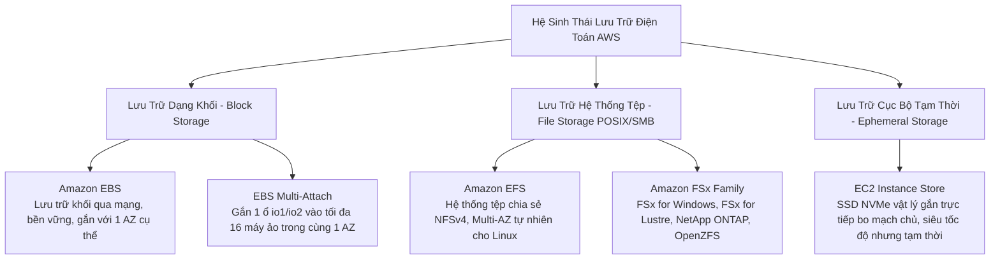
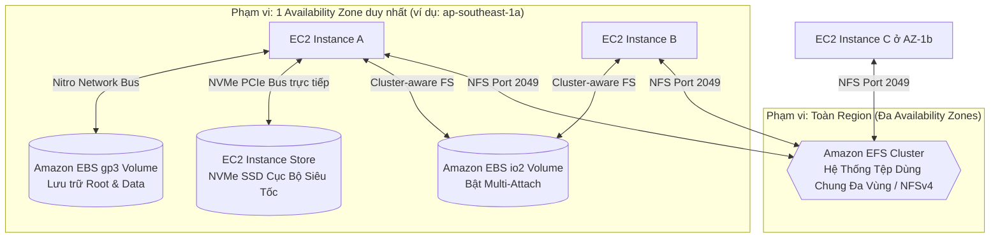
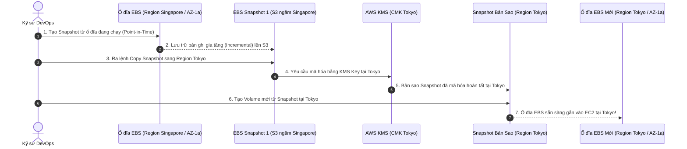
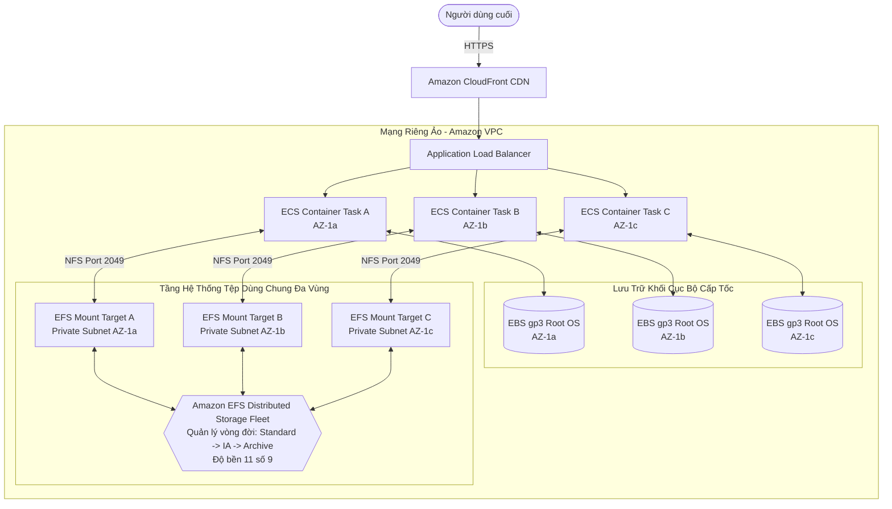

# Tài Liệu Học Tập Chuyên Sâu: Amazon EBS, Amazon EFS & EC2 Instance Store (Lưu Trữ Khối & Tệp Tin Đám Mây)

> **Tài liệu chuẩn hóa kiến trúc đám mây**: Hướng dẫn toàn diện theo tiêu chuẩn Principal AWS Solutions Architect & Senior Cloud DevOps Engineer (Cập nhật phiên bản kiến trúc mới nhất 2026).  
> **Ngôn ngữ**: Tiếng Việt chuyên ngành (Bảo lưu toàn bộ thuật ngữ chuyên ngành tiếng Anh chuẩn AWS).  
> **Mục tiêu**: Phục vụ thi chứng chỉ cấp độ Professional/Specialty (**SAA-C03, SAP-C02, DOP-C02**) và vận hành hệ thống cấp độ doanh nghiệp (**Production-grade**).  
> **Các bài giảng liên quan**: Chương 07 (EC2 Instance Storage: Bài 56 đến Bài 69).

---

## 6.1. Tổng Quan Dịch Vụ (Service Overview)

### 1. Định nghĩa chuẩn xác và Phân nhóm dịch vụ
Hệ sinh thái lưu trữ đám mây gắn kèm máy chủ của AWS được chia thành 3 nhóm kiến trúc chuyên biệt dựa trên bản chất vật lý và giao thức truy cập:



1. **Amazon Elastic Block Store (Amazon EBS)**: Dịch vụ lưu trữ khối ảo (**Block Storage**) hiệu năng cao, bền vững, hoạt động độc lập với vòng đời của máy ảo EC2. Dữ liệu được kết nối qua mạng nội bộ chuyên dụng của hệ thống phần cứng **AWS Nitro System**. Tương đương với ổ cứng ảo SAN/DAS gắn ngoài, phạm vi hoạt động bị giới hạn chặt chẽ trong **duy nhất một Availability Zone (AZ-locked)**.
2. **Amazon Elastic File System (Amazon EFS)**: Dịch vụ lưu trữ tệp tin chia sẻ (**Shared File Storage**) hoàn toàn được quản lý, tuân thủ chuẩn **POSIX NFSv4**. Tự động co giãn dung lượng từ 0 byte tới hàng Petabyte và cho phép hàng ngàn máy ảo EC2, container (ECS/EKS) và hàm AWS Lambda gắn kết đọc/ghi đồng thời xuyên qua **nhiều Availability Zones trong một Region**.
3. **EC2 Instance Store (Lưu trữ tạm thời / Ephemeral Storage)**: Ổ cứng thể rắn vật lý (NVMe SSD) được tích hợp trực tiếp trên bo mạch chủ của máy chủ vật lý đang chạy máy ảo EC2. Cung cấp thông lượng I/O hàng triệu IOPS với độ trễ microsecond, nhưng dữ liệu **sẽ bị mất hoàn toàn (Ephemeral)** khi máy ảo bị **Stop** hoặc chuyển sang máy chủ vật lý khác.

---

### 2. Bài toán cốt lõi & Ranh giới lựa chọn kiến trúc

| Tiêu chí kỹ thuật | Amazon EBS | Amazon EFS | EC2 Instance Store |
| :--- | :--- | :--- | :--- |
| **Loại hình lưu trữ** | **Block Storage (Khối)** | **File Storage (Hệ thống tệp NFSv4)** | **Block Storage (Phần cứng cục bộ)** |
| **Phạm vi địa lý (Scope)** | Giới hạn trong **1 Availability Zone** | Trải rộng trên **Đa Availability Zones** | Cố định trên **1 Máy chủ vật lý** |
| **Khả năng chia sẻ (Sharing)** | 1 instance (trừ Multi-Attach tối đa 16) | **Hàng ngàn instances/containers đồng thời** | Chỉ 1 máy ảo duy nhất đang chạy |
| **Tính bền vững (Durability)** | Bền vững (Sao chép tự động trong 1 AZ) | Cực kỳ bền vững (**99.999999999% - 11 số 9**) | **Tạm thời (Mất khi Stop/Terminate/Hardware fail)** |
| **Hiệu năng I/O & Độ trễ** | Tới 256,000 IOPS, độ trễ sub-millisecond | Độ trễ millisecond, throughput tới hàng chục GB/s | **Hàng triệu IOPS**, độ trễ microsecond cực thấp |
| **Giao thức kết nối** | Mạng riêng ảo hóa (Nitro NVMe protocol) | Giao thức mạng **NFSv4 (Port 2049)** | Bus phần cứng PCIe / NVMe trực tiếp |
| **Khả năng Boot OS** |  Có (Root Volume chuẩn) | ❌ Không thể dùng làm OS Boot Volume |  Có (trên một số dòng instance cụ thể) |

---

### 3. Khi nào KHÔNG nên dùng (Anti-patterns & Giải pháp thay thế)

* ❌ **Dùng Amazon EBS để chia sẻ tệp tin giữa các máy ảo ở các Availability Zone khác nhau**: EBS Volume bị khóa chặt trong một AZ cụ thể và không thể mount xuyên AZ.  
  👉 *Giải pháp thay thế*: Chuyển sang **Amazon EFS** (cho Linux) hoặc **Amazon FSx for Windows File Server** (cho Windows/SMB).
* ❌ **Lưu trữ dữ liệu quan trọng dài hạn trên EC2 Instance Store**: Dữ liệu sẽ bốc hơi sạch sẽ nếu máy ảo bị khởi động lại dạng Stop/Start hoặc gặp lỗi phần cứng.  
  👉 *Giải pháp thay thế*: Sử dụng **Amazon EBS** hoặc định kỳ sao lưu dữ liệu sang **Amazon S3**.
* ❌ **Dùng Amazon EFS cho cơ sở dữ liệu quan hệ có tần suất I/O ngẫu nhiên cao (RDBMS như MySQL, PostgreSQL)**: EFS sử dụng giao thức NFS qua mạng, độ trễ ghi metadata và locking tệp sẽ bóp nghẹt hiệu năng database.  
  👉 *Giải pháp thay thế*: Sử dụng **Amazon EBS `gp3` / `io2 Block Express`** hoặc chuyển sang dịch vụ chuyên biệt **Amazon RDS / Aurora**.
* ❌ **Lưu trữ hàng triệu tệp tin tĩnh (Static Assets, Media, PDF) trên EBS Volume khổng lồ**: Tốn kém chi phí lưu trữ khối, khó chia sẻ cho CDN và giới hạn dung lượng 64 TiB.  
  👉 *Giải pháp thay thế*: Sử dụng **Amazon S3** kết hợp **Amazon CloudFront**.

---

## 6.2. Các Khái Niệm, Kiến Trúc & Vận Hành Cốt Lõi (Core Concepts, Security & Day-2 Operations)

### 1. Sơ đồ các mô hình lưu trữ gắn kèm máy chủ



---

### 2. Phân loại chuyên sâu các dòng ổ đĩa Amazon EBS (EBS Volume Types 2026)

AWS chia các dòng ổ đĩa EBS thành 2 nhóm công nghệ vật lý: **SSD** (cho các giao dịch I/O ngẫu nhiên, độ trễ thấp) và **HDD** (cho các luồng dữ liệu tuần tự khối lượng lớn).

```mermaid
flowchart LR
    EBSFleet[Họ Ổ Đĩa Amazon EBS] --> SSD[Nhóm SSD: Tải Giao Dịch & Boot OS]
    EBSFleet --> HDD[Nhóm HDD: Tải Tuần Tự Dung Lượng Lớn]

    SSD --> gp3[gp3: Chuẩn Mặc Định Vàng\nTách rời độc lập Dung lượng, IOPS, Throughput]
    SSD --> gp2[gp2: Thế Hệ Cũ [Legacy]\nIOPS bị gắn chặt với dung lượng 3:1]
    SSD --> io2[io2 Block Express: Hiệu Năng Cực Đại\n256,000 IOPS / Sub-ms Latency / Multi-Attach]

    HDD --> st1[st1: Throughput Optimized HDD\nBig Data, Data Warehouse, Log Processing]
    HDD --> sc1[sc1: Cold HDD\nLưu trữ lạnh, chi phí thấp nhất, ít truy cập]
```

#### A. Nhóm ổ cứng SSD (Solid State Drives)
1. **General Purpose SSD (`gp3` - Chuẩn mực mặc định hiện đại)**:
   - Thay thế hoàn toàn cho thế hệ cũ `gp2` với giá rẻ hơn **20%**.
   - **Tách biệt độc lập 3 tham số**: Dung lượng (GiB), Số lượng IOPS và Băng thông Throughput (MB/s).
   - **Baseline miễn phí**: Mặc định cung cấp sẵn **3,000 IOPS** và **125 MB/s throughput** hoàn toàn miễn phí ở bất kỳ kích thước ổ đĩa nào (từ 1 GiB tới 64 TiB).
   - Có thể mở rộng độc lập lên tới **16,000 IOPS** và **1,000 MB/s** mà không cần phải mua thêm dung lượng đĩa thừa.
2. **General Purpose SSD (`gp2` - Thế hệ cũ [Legacy / Tránh dùng])**:
   - Hiệu năng IOPS bị gắn chặt vào dung lượng: $3 \text{ IOPS} / 1 \text{ GiB}$. Để có 9,000 IOPS, bắt buộc phải tạo ổ đĩa 3,000 GiB (lãng phí tiền dung lượng).
   - Cơ chế Burst IOPS lên 3,000 bằng bình chứa I/O Credits; khi hết credit hiệu năng bị sập về baseline. Khuyến nghị nâng cấp 100% sang `gp3`.
3. **Provisioned IOPS SSD (`io2 Block Express`)**:
   - Dành riêng cho các hệ thống phần mềm thương mại lõi (Oracle RAC, SAP HANA, Microsoft SQL Server).
   - Thông số kỹ thuật đỉnh cao: Đạt tới **256,000 IOPS**, throughput **4,000 MB/s**, độ trễ **dưới 1 mili-giây** và độ bền dữ liệu đạt **99.999%** (gấp 100 lần so với gp3).
   - Hỗ trợ tính năng **EBS Multi-Attach**.

#### B. Nhóm ổ đĩa HDD (Hard Disk Drives - KHÔNG THỂ DÙNG LÀM BOOT VOLUME)
4. **Throughput Optimized HDD (`st1`)**:
   - Tối ưu cho dữ liệu tuần tự đọc/ghi liên tục (MapReduce, Kafka, Log Processing, ETL jobs). Tối đa 500 MB/s và 500 IOPS.
5. **Cold HDD (`sc1`)**:
   - Chi phí rẻ nhất trong các dòng EBS ($0.015/GiB/tháng), dành cho dữ liệu lịch sử ít truy cập, sao lưu dạng file nén.

---

### 3. Vòng đời Snapshot & Cơ chế di chuyển xuyên Region



* **Cơ chế Snapshot Incremental (Sao lưu gia tăng)**: Bản snapshot đầu tiên lưu toàn bộ block dữ liệu; các bản tiếp theo chỉ lưu các block dữ liệu **đã thay đổi** kể từ lần chụp trước, giúp tiết kiệm chi phí tối đa.
* **EBS Snapshot Archive**: Bậc lưu trữ giá siêu rẻ (giảm 75% chi phí so với Standard Snapshot) cho các bản snapshot cần lưu giữ từ 90 ngày trở lên để tuân thủ pháp lý.
* **Recycle Bin for Snapshots**: Thùng rác bảo vệ chống lại việc nhân viên vô tình xóa nhầm snapshot quan trọng; cho phép khôi phục lại trong khoảng thời gian Retention cài đặt trước.
* **Fast Snapshot Restore (FSR)**: Loại bỏ độ trễ khởi động chậm (Lazy Loading) khi khôi phục volume từ snapshot; volume được cấp phát đầy đủ 100% hiệu năng I/O tức thì (tính phí $0.75/giờ/AZ).

---

### 4. Amazon EFS & Các tầng lưu trữ tối ưu chi phí

* **Bản chất kỹ thuật**: Hệ thống tệp phân tán tuân thủ chuẩn **POSIX**, hoạt động trên giao thức **NFSv4.1**. Cho phép hàng ngàn máy ảo Linux mount đồng thời và chia sẻ chung một thư mục.
* **Kiến trúc Multi-AZ tự nhiên**: Dữ liệu ghi vào EFS được nhân bản tức thời xuyên qua **3 Availability Zones** trong cùng Region với độ bền 11 số 9 (99.999999999%). Ngoài ra còn có tùy chọn **EFS One Zone** (tiết kiệm 47% chi phí cho môi trường Dev/Test chỉ chạy trên 1 AZ).
* **Quản lý vòng đời lưu trữ (EFS Lifecycle Management)**:
  - **EFS Standard**: Phục vụ các tệp tin truy cập thường xuyên (Hot Data).
  - **EFS Infrequent Access (EFS IA)**: Rẻ hơn **91%** so với Standard; tự động chuyển file sau 7, 14, 30 hoặc 90 ngày không có lượt truy cập.
  - **EFS Archive**: Rẻ hơn **97%** so với Standard ($0.008/GiB/tháng), tối ưu cho các tệp tin lưu trữ dài hạn chỉ đọc vài lần mỗi năm.

---

### 5. Bảo mật & Quản trị mã hóa (Security & Operations)

#### A. Quy trình mã hóa ổ đĩa EBS chưa mã hóa (KMS Encryption)
⚠️ **NGUYÊN TẮC BẤT BIẾN**: Không thể bật mã hóa trực tiếp trên một ổ đĩa EBS đang chạy mà chưa được mã hóa. Quy trình chuẩn mực 4 bước:
1. Chụp **EBS Snapshot** từ ổ đĩa chưa mã hóa.
2. Thực hiện **Copy Snapshot**, trong quá trình copy tích chọn bật **Encryption** và chỉ định **KMS Customer Managed Key (CMK)**.
3. Tạo một **EBS Volume mới** từ bản Snapshot đã mã hóa.
4. Gán ổ đĩa mới vào máy ảo EC2 thay thế ổ đĩa cũ.

#### B. Tính năng EBS Multi-Attach
* Cho phép gắn đồng thời một ổ đĩa EBS vào **tối đa 16 máy ảo EC2** trong **CÙNG MỘT AVAILABILITY ZONE**.
* Chỉ hỗ trợ trên các dòng ổ đĩa Provisioned IOPS: **`io1`** và **`io2 Block Express`**.
* **Yêu cầu kỹ thuật bắt buộc**: Ứng dụng phải sử dụng hệ thống tệp tin phân cụm chuyên dụng (**Cluster-aware File System** như GFS2, OCFS2) để điều phối việc ghi đĩa, tránh nguy cơ ghi đè làm hỏng dữ liệu.

---

## 6.3. Kiến Trúc Thực Tế và Luồng Vận Hành (Production Architecture & Workflow)

### Sơ đồ luồng chia sẻ tệp tin đa vùng cho cụm Web Farm Container kết hợp EFS và EBS



---

## 6.4. Bảng Tích Hợp với Các Dịch Vụ AWS Khác (Integration Table)

| Related AWS Service | Purpose (Mục đích tích hợp) | Integration Method (Phương thức kỹ thuật chính xác) | Practical Example (Ví dụ thực tiễn) |
| :--- | :--- | :--- | :--- |
| **AWS KMS** | Quản lý khóa mã hóa dữ liệu lưu trữ (Encryption at Rest) cho EBS và EFS | Tích hợp gốc thông qua **KMS Customer Managed Key (CMK)** | Mã hóa toàn bộ ổ đĩa EBS của cơ sở dữ liệu tài chính bằng khóa KMS chuyên biệt có chính sách phân quyền nghiêm ngặt. |
| **AWS Backup** | Quản lý lịch trình sao lưu tập trung, tuân thủ chính sách toàn doanh nghiệp | Khai báo **Backup Plan** dựa trên tag tài nguyên (`Backup = Daily`) | Tự động chụp snapshot cho 200 ổ đĩa EBS lúc 01:00 AM mỗi ngày và tự động xóa sau 30 ngày. |
| **Amazon ECS & Amazon EKS** | Cung cấp bộ lưu trữ bền vững (Persistent Storage) cho các Stateful Container Pods | Sử dụng **Amazon EFS CSI Driver** và **Amazon EBS CSI Driver** | Gắn một thư mục EFS dùng chung cho 15 WordPress Pods chạy trên EKS để lưu trữ hình ảnh người dùng tải lên. |
| **AWS DataSync** | Di chuyển dữ liệu dung lượng lớn từ NAS On-Premises lên EFS hoặc FSx | Cài đặt **DataSync Agent** tại Data Center kết nối qua Direct Connect | Di chuyển 40 TB tệp tin đồ họa từ hệ thống NetApp tại chỗ lên Amazon EFS với tốc độ truyền tải tối đa. |
| **Amazon CloudWatch** | Giám sát hiệu năng I/O, độ sâu hàng đợi và gửi cảnh báo cạn kiệt dung lượng | Thu thập tự động các metric cấp Hypervisor và Storage | Thiết lập cảnh báo CloudWatch Alarm kích hoạt khi metric `VolumeQueueLength > 5` trong 15 phút. |

---

## 6.5. Bảng So Sánh Toàn Bộ Các Giải Pháp Lưu Trữ Trên AWS (Ecosystem Comparison)

| Dịch vụ Lưu trữ | Loại hình lưu trữ | Phạm vi địa lý | Giao thức truy cập | Độ trễ truy vấn | Kịch bản sử dụng chuẩn mực |
| :--- | :--- | :--- | :--- | :--- | :--- |
| **Amazon EBS** | Block Storage (Ổ cứng ảo) | **1 Availability Zone** | NVMe / Nitro Block Protocol | Sub-ms đến vài ms | Boot volume cho OS, cơ sở dữ liệu quan hệ (PostgreSQL, MySQL, Oracle) trên EC2. |
| **Amazon EFS** | Shared File Storage | **Đa Availability Zones** | **NFSv4.1** (Port 2049) | Millisecond | Web Farm chia sẻ mã nguồn, thư mục uploads CMS (WordPress, Drupal), DevOps CI/CD tools. |
| **EC2 Instance Store** | Ephemeral Block Storage | **1 Máy chủ vật lý** | PCIe / NVMe phần cứng | **Microsecond** | Bộ nhớ đệm tạm thời (Cache), TempDB, scratch pad, distributed replica (Kafka, Cassandra). |
| **Amazon S3** | Object Storage (Đối tượng) | Toàn Region (Đa AZs) | REST APIs (HTTP / HTTPS) | 100 – 200 ms (Sub-10ms với Express) | Data Lake, sao lưu backup, video/hình ảnh tĩnh cho website, phân tích Big Data. |
| **Amazon FSx for Windows** | Managed Windows File Server | Single-AZ hoặc Multi-AZ | **SMB** / CIFS, NTFS | Millisecond | Ứng dụng doanh nghiệp Windows, tích hợp Active Directory, chia sẻ tệp kế toán ERP. |
| **Amazon FSx for Lustre** | High Performance File System | Single-AZ hoặc Multi-AZ | Giao thức mạng Lustre POSIX | Sub-millisecond | Điện toán hiệu năng cao (HPC), máy học AI/ML Training, mô phỏng dự báo thời tiết. |
| **Amazon FSx for NetApp ONTAP** | Multi-protocol File Storage | Single-AZ hoặc Multi-AZ | NFS, SMB, iSCSI đa giao thức | Sub-millisecond | Di chuyển các hệ thống lưu trữ On-Premises phức tạp lên AWS mà không cần viết lại ứng dụng. |

---

## 6.6. Mô Hình Tính Phí & Chiến Lược Tối Ưu Chi Phí (FinOps & Cost Optimization)

### 6.6.1. Bảng Phân Tích Cơ Chế Tính Phí Chi Tiết Của Amazon EBS & EFS

| Thành phần tính phí | Cơ chế tính phí (Pricing Dimensions) | Mức phí tham chiếu điển hình (US-East-1) | Bẫy chi phí nghiêm trọng (Cost Pitfalls) |
| :--- | :--- | :--- | :--- |
| **EBS General Purpose (`gp2`)** | • $0.10 / GiB / tháng.<br>• IOPS bị gắn chặt với dung lượng (3 IOPS/GiB). | Đắt hơn gp3 tới 20%. | Vẫn dùng `gp2` theo thói quen cũ khiến chi phí bị đội cao vô ích. |
| **EBS General Purpose (`gp3`)** | • **$0.08 / GiB / tháng** (Rẻ hơn gp2 20%).<br>• Miễn phí 3,000 IOPS và 125 MB/s.<br>• Mua thêm: $0.005/IOPS và $0.04/(MB/s). | **Chuẩn mực tối ưu nhất cho 95% workloads**. | Cấp phát thừa Throughput khi ứng dụng không có nhu cầu đọc tuần tự lớn. |
| **EBS Provisioned IOPS (`io2`)** | • Dung lượng: $0.125 / GiB / tháng.<br>• Phí IOPS: **$0.065 / IOPS cấp phát / tháng**. | Cấp 20,000 IOPS = $1,300/tháng riêng tiền IOPS! | Chọn `io2` cho các database thông thường thay vì tối ưu hóa chỉ mục trên `gp3`. |
| **Ổ đĩa mồ côi (Unattached EBS)** | • Tính nguyên giá 100% theo dung lượng ngay cả khi không gắn vào máy ảo nào. | $0.08 – $0.125 / GiB / tháng. | Xóa máy ảo EC2 nhưng quên bật cờ `DeleteOnTermination` khiến ổ đĩa bị bỏ quên tích tiền hàng tháng. |
| **EBS Snapshots** | • Standard: $0.05 / GiB / tháng.<br>• Archive: **$0.0125 / GiB / tháng** (Giảm 75%). | Cơ chế Incremental giúp tiết kiệm dữ liệu. | Duy trì snapshot hàng ngày trong nhiều năm mà không chuyển sang tầng Archive. |
| **Fast Snapshot Restore (FSR)** | • Tính phí cố định: **$0.75 / giờ / AZ** cho mỗi snapshot bật FSR! | ~$540 / tháng / AZ cho 1 snapshot! | Bật FSR trên nhiều AZ rồi quên tắt sau khi khôi phục xong. |
| **Amazon EFS Standard** | • **$0.30 / GiB / tháng** (Multi-AZ).<br>• One Zone: $0.16 / GiB / tháng. | Đắt gấp gần 4 lần so với EBS gp3. | Lưu trữ toàn bộ dữ liệu tĩnh hoặc file nén trong EFS Standard mà không cấu hình Lifecycle. |
| **Amazon EFS Infrequent Access (IA)** | • **$0.025 / GiB / tháng** (Giảm 91%).<br>• Phí đọc file: $0.01 / GiB truy xuất. | Cực rẻ cho tệp tin ít truy cập sau 30 ngày. | Truy xuất đọc đi đọc lại liên tục trên tầng IA sẽ làm tăng cước Request Read. |
| **Amazon EFS Archive** | • **$0.008 / GiB / tháng** (Giảm 97% so với Standard). | Phù hợp cho tệp tin tuân thủ chỉ đọc vài lần/năm. | Lưu trữ tệp tin nóng (Hot data) trên tầng Archive. |

---

### 6.6.2. Chiến Lược Tối Ưu Hóa Chi Phí Theo 5 Kịch Bản Thực Tế (Use Cases Optimization)

#### Kịch bản 1: Chuyển Đổi Toàn Bộ Ổ Đĩa Từ `gp2` Sang `gp3` (Instant 20% Cost Reduction)
* **Bối cảnh thực tế**:
  Doanh nghiệp vận hành 80 ổ đĩa `gp2` dung lượng trung bình 500 GiB mỗi ổ (tổng cộng 40,000 GiB) phục vụ hệ thống máy chủ ứng dụng.
  $$\text{Chi phí gp2 ban đầu} = 40,000 \text{ GiB} \times 0.10\$ = \mathbf{4,000.00\$/\text{tháng}}$$
* **Chiến lược tối ưu hóa**:
  - Tận dụng tính năng **EBS Elastic Volumes**, chạy script tự động sửa đổi toàn bộ các ổ đĩa sang dòng **`gp3`** mà không làm gián đoạn máy chủ (**Zero Downtime**).
  - Ổ đĩa `gp3` giữ nguyên 500 GiB đi kèm sẵn 3,000 IOPS và 125 MB/s miễn phí (hiệu năng cao gấp đôi so với 1,500 IOPS của gp2 500 GiB).
  $$\text{Chi phí gp3 sau tối ưu} = 40,000 \text{ GiB} \times 0.08\$ = \mathbf{3,200.00\$/\text{tháng}}$$
* **Kết quả tiết kiệm**:
  $$\text{Số tiền tiết kiệm} = 4,000.00\$ - 3,200.00\$ = \mathbf{800.00\$/\text{tháng}} \quad (\approx \mathbf{9,600\$/\text{năm}})$$
  **Tiết kiệm ngay 20% chi phí lưu trữ khối** đồng thời tăng gấp đôi hiệu năng I/O cơ sở.

---

#### Kịch bản 2: Tối Ưu Chi Phí Cơ Sở Dữ Liệu Hiệu Năng Cao Giữa `io2` và `gp3`
* **Bối cảnh thực tế**:
  Một cơ sở dữ liệu PostgreSQL đang sử dụng ổ đĩa **`io2` dung lượng 600 GiB với 12,000 Provisioned IOPS**.
  $$\text{Phí dung lượng io2} = 600 \text{ GiB} \times 0.125\$ = 75.00\$$$
  $$\text{Phí Provisioned IOPS} = 12,000 \text{ IOPS} \times 0.065\$ = 780.00\$$$
  $$\text{Tổng chi phí io2 ban đầu} = 75.00\$ + 780.00\$ = \mathbf{855.00\$/\text{tháng}}$$
* **Chiến lược tối ưu hóa**:
  - Dòng `gp3` cho phép cấp phát lên tới **16,000 IOPS** độc lập. Chuyển đổi ổ đĩa sang **`gp3` 600 GiB với 12,000 IOPS** (bao gồm 3,000 IOPS miễn phí + 9,000 IOPS mua thêm):
  $$\text{Phí dung lượng gp3} = 600 \text{ GiB} \times 0.08\$ = 48.00\$$$
  $$\text{Phí IOPS bổ sung} = (12,000 - 3,000) \times 0.005\$ = 45.00\$$$
  $$\text{Tổng chi phí gp3 mới} = 48.00\$ + 45.00\$ = \mathbf{93.00\$/\text{tháng}}$$
* **Kết quả tiết kiệm**:
  $$\text{Số tiền tiết kiệm} = 855.00\$ - 93.00\$ = \mathbf{762.00\$/\text{tháng}} \quad (\approx \mathbf{9,144\$/\text{năm}})$$
  **Tỷ lệ tiết kiệm đạt ~89.1%** trên một ổ đĩa duy nhất mà database vẫn nhận đủ 12,000 IOPS ổn định.

---

#### Kịch bản 3: Truy Quét Và Tiêu Hủy Ổ Đĩa EBS Mồ Côi (Unattached EBS Cleanup)
* **Bối cảnh thực tế**:
  Doanh nghiệp sau nhiều đợt xóa máy ảo EC2 mà không kích hoạt cờ `DeleteOnTermination`, để sót lại **60 ổ đĩa EBS gp2 mồ côi (trạng thái `available`)**, trung bình 250 GiB mỗi ổ (tổng cộng 15,000 GiB) vẫn đang bị tính tiền đều đặn mỗi tháng.
  $$\text{Chi phí lãng phí hàng tháng} = 15,000 \text{ GiB} \times 0.10\$ = \mathbf{1,500.00\$/\text{tháng}}$$
* **Chiến lược tối ưu hóa**:
  - Viết script tự động thông qua **Amazon EventBridge + AWS Lambda**:
    1. Quét toàn bộ volume có trạng thái `available` kéo dài hơn 7 ngày.
    2. Tự động chụp 1 bản EBS Snapshot cuối cùng để lưu trữ an toàn (phí snapshot chỉ $0.05/GiB cho block thực dùng).
    3. Gọi API `DeleteVolume` để xóa bỏ hoàn toàn 60 ổ đĩa mồ côi.
* **Kết quả tiết kiệm**:
  $$\text{Số tiền tiết kiệm} = \mathbf{1,500.00\$/\text{tháng}} \quad (\approx \mathbf{18,000\$/\text{năm}})$$
  **Thu hồi 100% ngân sách thất thoát thụ động**.

---

#### Kịch bản 4: Kích Hoạt Vòng Đời Tự Động Với Amazon EFS Lifecycle Management
* **Bối cảnh thực tế**:
  Hệ thống quản lý nội dung số lưu trữ 12 TiB (12,000 GiB) tài liệu và hình ảnh chia sẻ trên **Amazon EFS Standard**. Thống kê cho thấy có tới 80% dữ liệu (9,600 GiB) là các bài viết cũ từ hơn 1 tháng trước hầu như không có ai truy cập lại.
  $$\text{Chi phí EFS Standard ban đầu} = 12,000 \text{ GiB} \times 0.30\$ = \mathbf{3,600.00\$/\text{tháng}}$$
* **Chiến lược tối ưu hóa**:
  - Bật tính năng **EFS Lifecycle Management**: Tự động chuyển tệp sang **EFS Infrequent Access (IA)** sau **30 ngày** không có truy cập.
  - Cơ cấu lưu trữ sau tối ưu: 2,400 GiB ở Standard và 9,600 GiB ở IA:
  $$\text{Chi phí tầng Standard} = 2,400 \text{ GiB} \times 0.30\$ = 720.00\$$$
  $$\text{Chi phí tầng IA} = 9,600 \text{ GiB} \times 0.025\$ = 240.00\$$$
  $$\text{Ước tính phí đọc 500 GiB từ IA} = 500 \text{ GiB} \times 0.01\$ = 5.00\$$$
  $$\text{Tổng chi phí sau tối ưu} = 720.00\$ + 240.00\$ + 5.00\$ = \mathbf{965.00\$/\text{tháng}}$$
* **Kết quả tiết kiệm**:
  $$\text{Số tiền tiết kiệm} = 3,600.00\$ - 965.00\$ = \mathbf{2,635.00\$/\text{tháng}} \quad (\approx \mathbf{31,620\$/\text{năm}})$$
  **Tỷ lệ tiết kiệm đạt ~73.2% chi phí**, người dùng vẫn mở file bình thường mà không cần sửa đường dẫn.

---

#### Kịch bản 5: Chuyển Đổi Snapshot Dài Hạn Sang EBS Snapshot Archive
* **Bối cảnh thực tế**:
  Theo quy định ngân hàng, doanh nghiệp phải lưu trữ các bản snapshot sao lưu định kỳ hàng tháng trong thời hạn 5 năm. Hiện tại đang duy trì 30,000 GiB dữ liệu snapshot trên tầng Standard.
  $$\text{Chi phí Snapshot Standard ban đầu} = 30,000 \text{ GiB} \times 0.05\$ = \mathbf{1,500.00\$/\text{tháng}}$$
* **Chiến lược tối ưu hóa**:
  - Sử dụng **Amazon Data Lifecycle Manager (DLM)** tự động lưu trữ các bản Full Snapshot có tuổi thọ trên 90 ngày sang tầng **EBS Snapshot Archive** với đơn giá chỉ $0.0125/GiB/tháng.
  $$\text{Chi phí Snapshot Archive sau chuyển đổi} = 30,000 \text{ GiB} \times 0.0125\$ = \mathbf{375.00\$/\text{tháng}}$$
* **Kết quả tiết kiệm**:
  $$\text{Số tiền tiết kiệm} = 1,500.00\$ - 375.00\$ = \mathbf{1,125.00\$/\text{tháng}} \quad (\approx \mathbf{13,500\$/\text{năm}})$$
  **Tỷ lệ tiết kiệm đạt ~75% chi phí lưu trữ sao lưu tuân thủ**.

---

## 6.7. Khắc Phục Sự Cố Thực Tế (Troubleshooting Guide)

| Vấn đề (Problem) | Nguyên nhân khả dĩ (Possible Causes) | Các bước điều tra (Investigation Steps - Metrics/Logs) | Giải pháp xử lý (Solution) | Biện pháp phòng ngừa (Prevention) |
| :--- | :--- | :--- | :--- | :--- |
| **Không thể gắn (Attach) ổ đĩa EBS vào máy ảo EC2** | Ổ đĩa EBS và máy ảo EC2 nằm ở **hai Availability Zones khác nhau** (EBS Volume bị khóa chặt trong 1 AZ). | So sánh Availability Zone của Instance và của EBS Volume trên console. | Chụp **Snapshot** từ ổ đĩa đó $\rightarrow$ Tạo một Volume mới từ Snapshot và chọn đúng Availability Zone của máy ảo $\rightarrow$ Gắn vào máy ảo. | Quy hoạch phân vùng cẩn thận khi tạo ổ đĩa; sử dụng Infrastructure as Code (Terraform) để tự động hóa gán AZ. |
| **Lệnh mount Amazon EFS bị treo (Hanging / Timed Out)** | Security Group gắn trên EFS Mount Target chưa mở cổng **NFS (Port 2049)** từ Security Group của EC2. | 1. Kiểm tra Inbound Rules của Security Group gắn vào EFS Mount Target.<br>2. Kiểm tra kết nối mạng bằng lệnh `nc -zv <efs-dns-name> 2049`. | Thêm Inbound Rule cho phép cổng 2049 (NFS) với Source là Security Group của máy ảo EC2. | Sử dụng Security Group tham chiếu chéo (Security Group Referencing) thay vì gõ IP tĩnh. |
| **Máy ảo EC2 bị mất sạch dữ liệu sau khi Stop và Start lại** | Dữ liệu được lưu trữ trên ổ đĩa **EC2 Instance Store** (ổ đĩa tạm) thay vì lưu trên Amazon EBS. | Kiểm tra thuộc tính Block Devices của instance để xác nhận loại ổ đĩa. | Di chuyển toàn bộ thư mục dữ liệu quan trọng sang ổ đĩa Amazon EBS hoặc Amazon EFS. | Nắm vững bản chất Ephemeral của Instance Store; chỉ sử dụng cho cache, temporary scratch pad. |
| **Hiệu năng ổ đĩa `gp2` bị tụt dốc thảm hại sau vài giờ tải cao** | Ổ đĩa `gp2` có dung lượng nhỏ (< 1TB) đã cạn kiệt số lượng **I/O Burst Credits** trong bình chứa. | Xem biểu đồ CloudWatch Metric **`BurstBalance`** (khi giá trị giảm về 0%). | Thực hiện nâng cấp trực tiếp (in-place) loại ổ đĩa từ `gp2` sang **`gp3`** trên console (không cần tắt máy ảo). | Chuẩn hóa 100% các ổ đĩa sang dòng `gp3` để không còn phụ thuộc vào cơ chế Burst Credits. |
| **Độ trễ I/O đọc ghi trên EBS tăng vọt (`High Disk Latency`)** | Tải đọc ghi của ứng dụng vượt quá ngưỡng IOPS hoặc Throughput đã cấp phát; hàng đợi I/O bị dồn ứ. | Xem các metric CloudWatch: `VolumeQueueLength`, `VolumeReadOps`, `VolumeWriteOps`, `VolumeThroughputPercentage`. | Sử dụng tính năng **Elastic Volumes** tăng thêm IOPS và Throughput cho ổ đĩa `gp3` ngay lập tức. | Thiết lập CloudWatch Alarm cảnh báo khi `VolumeQueueLength > 5` kéo dài trên 10 phút. |
| **Chi phí hóa đơn Snapshot tăng đột biến không rõ nguyên nhân** | Tính năng **Fast Snapshot Restore (FSR)** bị bật nhầm trên nhiều Availability Zones mà không được tắt sau khi dùng. | Kiểm tra mục Fast Snapshot Restore trên EC2 Console và hóa đơn chi tiết Cost Explorer. | Tắt tính năng FSR trên các bản snapshot không còn nhu cầu khôi phục tức thời. | Đặt AWS Budget cảnh báo khi chi phí FSR vượt quá ngưỡng cho phép hàng tháng. |

---

## 6.8. Bộ Câu Hỏi Ôn Tập và Kiểm Tra Kiến Thức (Knowledge Review)

### A. Danh mục câu hỏi trắc nghiệm & Tình huống kiến trúc

#### Câu 1 (Core Concept)
Phạm vi hoạt động địa lý của một ổ đĩa Amazon EBS thông thường bị ràng buộc ở cấp độ nào trong cấu trúc hạ tầng đám mây của AWS?
- A. Toàn cầu (Global).
- B. Toàn bộ Region (Regional).
- C. Duy nhất một Availability Zone (AZ-locked).
- D. Giới hạn trong một Edge Location của CloudFront.

#### Câu 2 (Core Concept)
Dòng ổ đĩa Amazon EBS nào hiện nay là lựa chọn mặc định tối ưu nhất, cho phép kỹ sư cấu hình độc lập giữa dung lượng (GiB), số lượng IOPS và băng thông Throughput (MB/s)?
- A. General Purpose SSD `gp2`.
- B. General Purpose SSD `gp3`.
- C. Throughput Optimized HDD `st1`.
- D. Cold HDD `sc1`.

#### Câu 3 (Core Concept)
Hai dòng ổ đĩa nào sau đây của Amazon EBS thuộc công nghệ đĩa từ tính HDD và **TUYỆT ĐỐI KHÔNG THỂ** sử dụng làm ổ đĩa khởi động hệ điều hành (OS Boot Volume)?
- A. `gp2` và `gp3`.
- B. `io1` và `io2`.
- C. `st1` và `sc1`.
- D. `gp3` và `st1`.

#### Câu 4 (Core Concept)
Điều gì sẽ xảy ra với toàn bộ dữ liệu đang lưu trữ trên một ổ đĩa **EC2 Instance Store** khi bạn thực hiện thao tác **Stop** máy ảo và sau đó **Start** lại?
- A. Dữ liệu được tự động sao lưu sang S3 và nạp lại nguyên vẹn.
- B. Dữ liệu vẫn tồn tại nguyên vẹn trên máy ảo.
- C. Toàn bộ dữ liệu bị xóa sạch hoàn toàn và không thể khôi phục lại được.
- D. Máy ảo chuyển sang chế độ Hibernate.

#### Câu 5 (Core Concept - Day-2 Operations)
Một ổ đĩa Amazon EBS thông thường đang hoạt động tại Availability Zone `us-east-1a`. Bạn có thể gắn (attach) trực tiếp ổ đĩa này vào một máy ảo EC2 đang chạy tại `us-east-1b` không? Nếu không, quy trình chuẩn mực để di chuyển là gì?
- A. Có thể gắn trực tiếp mà không cần làm gì thêm.
- B. Không thể gắn trực tiếp; phải chụp Snapshot $\rightarrow$ Tạo Volume mới từ Snapshot tại `us-east-1b` $\rightarrow$ Gắn vào máy ảo.
- C. Không thể gắn trực tiếp; phải dùng AWS DataSync để đồng bộ qua mạng.
- D. Có thể gắn thông qua dịch vụ AWS Storage Gateway.

#### Câu 6 (Core Concept - Storage Architecture)
Hệ thống tệp tin nào của AWS tuân thủ chuẩn POSIX, hỗ trợ giao thức NFSv4, tự động nhân bản dữ liệu xuyên qua nhiều Availability Zones và cho phép hàng ngàn máy ảo Linux gắn kết đồng thời?
- A. Amazon EBS.
- B. Amazon EFS.
- C. Amazon S3 Glacier.
- D. AWS Storage Gateway Volume Gateway.

#### Câu 7 (Core Concept - Security)
Doanh nghiệp có một ổ đĩa Amazon EBS chứa dữ liệu tài chính đang chạy nhưng chưa được bật tính năng mã hóa (Unencrypted). Để tuân thủ an toàn an ninh, giải pháp chuẩn mực duy nhất để chuyển đổi sang ổ đĩa được mã hóa bằng AWS KMS là gì?
- A. Chỉnh sửa thuộc tính volume trên console và tích chọn "Enable Encryption", sau đó khởi động lại máy ảo.
- B. Chụp Snapshot từ ổ đĩa $\rightarrow$ Sao chép (Copy) Snapshot đó kèm tùy chọn mã hóa với KMS CMK $\rightarrow$ Tạo Volume mới từ Snapshot đã mã hóa $\rightarrow$ Gắn vào EC2.
- C. Sử dụng lệnh Linux `cryptsetup` chạy trực tiếp trên hệ điều hành máy ảo.
- D. Gắn thêm một card mạng ENI thứ hai có bật tính năng mã hóa đường truyền.

#### Câu 8 (Scenario - Cluster File System & Multi-Attach)
Một cụm 4 máy ảo EC2 chạy phần mềm phân cụm Red Hat Enterprise Linux trong cùng một Availability Zone cần truy cập đồng thời vào cùng một ổ đĩa lưu trữ khối chia sẻ chung. Dòng ổ đĩa nào hỗ trợ tính năng **EBS Multi-Attach** và yêu cầu bắt buộc đối với hệ điều hành là gì?
- A. Dòng `gp3`; yêu cầu định dạng tệp tin chuẩn EXT4.
- B. Dòng `io1` hoặc `io2 Block Express`; yêu cầu ứng dụng phải sử dụng hệ thống tệp tin có khả năng nhận biết phân cụm (Cluster-aware File System như GFS2).
- C. Dòng `st1`; yêu cầu định dạng tệp tin XFS.
- D. Mọi dòng ổ đĩa EBS đều hỗ trợ Multi-Attach mà không cần điều kiện gì.

#### Câu 9 (Scenario - FinOps Database Tuning)
Một kỹ sư cơ sở dữ liệu đã cấu hình một ổ đĩa `io2` dung lượng 500 GiB với 10,000 Provisioned IOPS cho database MySQL, làm phát sinh hóa đơn hơn $700/tháng riêng cho ổ đĩa này. Phương án nào sau đây giúp giảm tới 85% chi phí lưu trữ mà cơ sở dữ liệu vẫn đảm bảo nhận đủ 10,000 IOPS hiệu năng?
- A. Giảm dung lượng ổ đĩa xuống còn 100 GiB.
- B. Chuyển đổi ổ đĩa sang dòng **`gp3` 500 GiB và cấp phát 10,000 IOPS** (tận dụng 3,000 IOPS miễn phí và mua thêm 7,000 IOPS với giá rẻ).
- C. Chuyển database sang chạy trên EC2 Instance Store.
- D. Bật tính năng Fast Snapshot Restore trên ổ đĩa io2.

#### Câu 10 (Scenario - Shared File Storage Lifecycle)
Một trang web tin tức lớn lưu trữ 15 TB tài nguyên hình ảnh bài viết trên **Amazon EFS Standard**. Ban giám đốc yêu cầu cắt giảm ít nhất 60% chi phí lưu trữ EFS mà không làm mất liên kết hình ảnh của các bài viết cũ đã đăng từ nhiều tháng trước. Giải pháp kiến trúc nào là tối ưu nhất?
- A. Tải toàn bộ ảnh cũ về nén zip lại và lưu trên máy chủ web.
- B. Kích hoạt tính năng **EFS Lifecycle Management** để tự động di chuyển các tệp tin không được truy cập sau 30 ngày sang tầng **EFS Infrequent Access (IA)**.
- C. Chuyển đổi toàn bộ hệ thống tệp sang Amazon EBS `sc1`.
- D. Xóa các hình ảnh có kích thước lớn hơn 5 MB.

#### Câu 11 (Scenario - Performance Troubleshooting)
Một ứng dụng xử lý dữ liệu lớn chạy trên EC2 ghi dữ liệu liên tục vào ổ đĩa `gp2` dung lượng 200 GiB. Sau 3 tiếng chạy ổn định với tốc độ cao, thông lượng I/O đột ngột bị giảm xuống nghiêm trọng khiến ứng dụng bị nghẽn. Khi kiểm tra CloudWatch, metric nào phản ánh đúng nhất tình trạng này và giải pháp xử lý là gì?
- A. Metric `CPUUtilization`; giải pháp là tăng kích cỡ instance.
- B. Metric **`BurstBalance`** giảm về 0%; giải pháp là nâng cấp trực tiếp ổ đĩa lên dòng **`gp3`** để nhận thông lượng và IOPS ổn định không phụ thuộc vào burst credit.
- C. Metric `DiskQueueDepth`; giải pháp là format lại ổ đĩa.
- D. Metric `VolumeReadBytes`; giải pháp là xóa bớt dữ liệu tạm.

#### Câu 12 (Scenario - HPC Storage Selection)
Một dự án nghiên cứu trí tuệ nhân tạo (AI/ML) cần một hệ thống tệp tin phân tán hiệu năng cực cao, có khả năng kết nối đồng bộ trực tiếp hai chiều với dữ liệu lưu trữ trên Amazon S3 Data Lake và cung cấp thông lượng hàng trăm GB/s cho hàng chục máy ảo GPU huấn luyện mô hình. Dịch vụ lưu trữ tệp nào sau đây đáp ứng hoàn hảo yêu cầu này?
- A. Amazon EFS Standard.
- B. Amazon EBS `gp3`.
- C. **Amazon FSx for Lustre**.
- D. AWS Storage Gateway File Gateway.

---

### B. Đáp án Chi Tiết Bộ Câu Hỏi Ôn Tập (Answer Key & Explanations)

<details>
<summary>👉 Nhấp vào đây để xem toàn bộ đáp án chi tiết và giải thích kiến trúc</summary>

### Đáp án Câu 1: C
- **Giải thích**: Ổ đĩa Amazon EBS là tài nguyên lưu trữ gắn liền với phần cứng trong một Availability Zone duy nhất (**AZ-locked**). Nó không thể tự động co giãn hay mount trực tiếp sang một Availability Zone khác nếu không qua bước chụp Snapshot.

### Đáp án Câu 2: B
- **Giải thích**: Dòng **`gp3`** là chuẩn mực hiện đại nhất của AWS, cho phép tùy chỉnh độc lập 3 thông số: dung lượng, IOPS (tặng sẵn 3,000 IOPS miễn phí) và Throughput (tặng sẵn 125 MB/s miễn phí), đồng thời giá rẻ hơn dòng cũ `gp2` tới 20%.

### Đáp án Câu 3: C
- **Giải thích**: Hai dòng ổ cứng từ tính HDD là **`st1`** (Throughput Optimized) và **`sc1`** (Cold HDD) chỉ được thiết kế cho việc lưu trữ luồng dữ liệu tuần tự lớn. AWS **hoàn toàn không hỗ trợ boot hệ điều hành** từ 2 loại ổ đĩa này (chỉ các dòng SSD `gp2, gp3, io1, io2` mới boot được).

### Đáp án Câu 4: C
- **Giải thích**: **EC2 Instance Store** là ổ cứng vật lý gắn trên máy chủ chứa máy ảo. Khi bạn thực hiện **Stop** máy ảo, AWS sẽ giải phóng máy ảo khỏi máy chủ vật lý đó; do đó toàn bộ dữ liệu trên Instance Store **bị xóa sạch vĩnh viễn (Ephemeral)**.

### Đáp án Câu 5: B
- **Giải thích**: Do EBS bị khóa chặt trong một AZ (`us-east-1a`), nó không thể gắn sang máy ảo ở `us-east-1b`. Quy trình bắt buộc là: Chụp **EBS Snapshot** (snapshot được lưu ở S3 ngầm cấp Region) $\rightarrow$ Tạo Volume mới từ snapshot đó và chọn AZ đích là `us-east-1b` $\rightarrow$ Gắn vào máy ảo tại `us-east-1b`.

### Đáp án Câu 6: B
- **Giải thích**: **Amazon EFS** là hệ thống tệp tin quản trị tương thích chuẩn POSIX NFSv4, có tính sẵn sàng cao tự nhiên nhờ nhân bản dữ liệu qua nhiều AZs trong Region và hỗ trợ hàng ngàn kết nối đồng thời từ EC2, Container và Lambda.

### Đáp án Câu 7: B
- **Giải thích**: Quy tắc an toàn bất biến của AWS: **Không thể bật mã hóa trực tiếp trên một ổ đĩa EBS đang chạy mà chưa được mã hóa**. Chuỗi thao tác chuẩn duy nhất: Snapshot $\rightarrow$ Copy Snapshot kèm tùy chọn Encrypt với KMS CMK $\rightarrow$ Tạo Volume mới từ Encrypted Snapshot $\rightarrow$ Gán vào máy ảo.

### Đáp án Câu 8: B
- **Giải thích**: Tính năng **EBS Multi-Attach** chỉ hỗ trợ trên dòng Provisioned IOPS **`io1`** và **`io2 Block Express`** trong cùng 1 AZ. Để nhiều máy cùng đọc ghi vào 1 block device mà không làm hỏng cấu trúc dữ liệu, hệ điều hành bắt buộc phải sử dụng **Cluster-aware File System** (như GFS2, OCFS2).

### Đáp án Câu 9: B
- **Giải thích**: Ổ đĩa `gp3` cho phép cấp phát độc lập lên tới 16,000 IOPS với chi phí bổ sung cực rẻ ($0.005/IOPS). Khi chuyển sang `gp3` 500 GiB + 10,000 IOPS, chi phí chỉ còn khoảng $93/tháng (so với $780/tháng của `io2`), giúp tiết kiệm gần 89% chi phí mà hiệu năng vẫn tương đương.

### Đáp án Câu 10: B
- **Giải thích**: **EFS Lifecycle Management** tự động chuyển các tệp không truy cập sau 30 ngày sang tầng **EFS Infrequent Access (IA)** với giá rẻ hơn 91% ($0.025/GiB so với $0.30/GiB). Đường dẫn tệp tin trên hệ điều hành vẫn giữ nguyên 100%, không làm ảnh hưởng tới website.

### Đáp án Câu 11: B
- **Giải thích**: Ổ đĩa `gp2` nhỏ tích lũy I/O Credits trong bình chứa `BurstBalance` để có thể bứt phá lên 3,000 IOPS. Khi chạy tác vụ ghi nặng liên tục làm cạn bình chứa (`BurstBalance = 0%`), hiệu năng bị bóp nghẹt về baseline (với 200 GiB chỉ còn 600 IOPS). Nâng cấp sang **`gp3`** sẽ loại bỏ hoàn toàn cơ chế bình chứa credit này.

### Đáp án Câu 12: C
- **Giải thích**: **Amazon FSx for Lustre** là hệ thống tệp tin hiệu năng cao chuẩn POSIX chuyên biệt cho HPC và Machine Learning, cung cấp thông lượng hàng trăm GB/s và tích hợp liền mạch hai chiều với **Amazon S3** để nạp dữ liệu huấn luyện thần tốc.

</details>

---

## 6.9. Tóm Tắt và Danh Mục Kiểm Tra Kiến Thức (Summary & Learning Checklist)

### 7 Nguyên Tắc Kiến Trúc "Sống Còn" Của Lưu Trữ Đám Mây (Golden Rules)
1. **Phân biệt ranh giới EBS vs EFS vs Instance Store**:  
   - Cần ổ đĩa hệ điều hành, cơ sở dữ liệu trên 1 AZ $\rightarrow$ **Amazon EBS**.  
   - Cần chia sẻ tệp tin đa vùng cho hàng ngàn máy chủ Linux $\rightarrow$ **Amazon EFS**.  
   - Cần tốc độ I/O hàng triệu IOPS tạm thời cho bộ nhớ đệm $\rightarrow$ **EC2 Instance Store**.
2. **Quy tắc chuyển đổi `gp2` sang `gp3`**:  
   Luôn ưu tiên sử dụng **`gp3`** cho mọi thiết kế mới để tiết kiệm ngay 20% chi phí và nhận sẵn 3,000 IOPS / 125 MB/s miễn phí; loại bỏ hoàn toàn rủi ro cạn kiệt Burst Credits.
3. **Phạm vi địa lý của EBS**:  
   Ổ đĩa EBS luôn bị khóa trong **1 Availability Zone (AZ-locked)**; muốn di chuyển sang AZ khác hoặc Region khác, bắt buộc phải thông qua cơ chế **EBS Snapshot**.
4. **Quy trình mã hóa KMS cho ổ đĩa chưa mã hóa**:  
   Không thể bật mã hóa trực tiếp! Bắt buộc phải tuân theo chuỗi 4 bước: *Tạo Snapshot $\rightarrow$ Copy Snapshot kèm bật mã hóa KMS CMK $\rightarrow$ Tạo Volume mới từ Snapshot $\rightarrow$ Gắn vào EC2*.
5. **Tiêu hủy ổ đĩa mồ côi (Unattached Volumes)**:  
   Định kỳ quét và xóa các ổ đĩa EBS ở trạng thái `available` để thu hồi 100% chi phí lãng phí thụ động; luôn cấu hình `DeleteOnTermination = true` khi tạo máy ảo.
6. **Tối ưu chi phí EFS bằng Lifecycle Management**:  
   Luôn kích hoạt chuyển tầng tự động sang **EFS Infrequent Access (IA)** sau 30 ngày để cắt giảm tới 91% chi phí lưu trữ tệp tin.
7. **Điều kiện của EBS Multi-Attach**:  
   Chỉ hỗ trợ trên dòng **`io1` / `io2 Block Express`** trong cùng 1 AZ và ứng dụng bắt buộc phải dùng **Cluster-aware File System** để điều phối ghi đĩa.

---

### Liên Kết Nội Bộ và Tài Liệu Tham Khảo (Internal Links)
- 📖 [Ghi Chú Bài Học Chương 07: EC2 Instance Storage](../Lesson_Notes/07_EC2_Instance_Storage.md)
- 📖 [Tài Liệu Chuyên Sâu: Amazon EC2 & Kiến Trúc Tính Toán](./EC2_Elastic_Compute_Cloud.md)
- 📖 [Tài Liệu Chuyên Sâu: Amazon S3 & CloudFront Storage](./S3_and_CloudFront_Storage.md)
- 📖 [Tài Liệu Chuyên Sâu: Amazon RDS & Aurora Databases](./RDS_Aurora_Databases.md)
- 📖 [Tài Liệu Chuyên Sâu: AWS KMS, Secrets Manager & Bảo Mật Dữ Liệu](./KMS_Security_Encryption.md)
- 📖 [Bảng Thuật Ngữ Kỹ Thuật Đám Mây Toàn Diện](../GLOSSARY.md)
- ⏭️ **Chuyên đề tiếp theo**: [Lưu Trữ Đối Tượng & Mạng Phân Phối Nội Dung: Amazon S3 & Amazon CloudFront](./S3_and_CloudFront_Storage.md)
