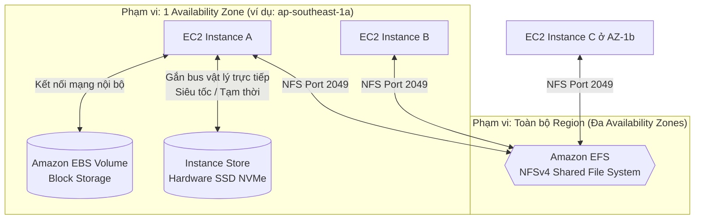
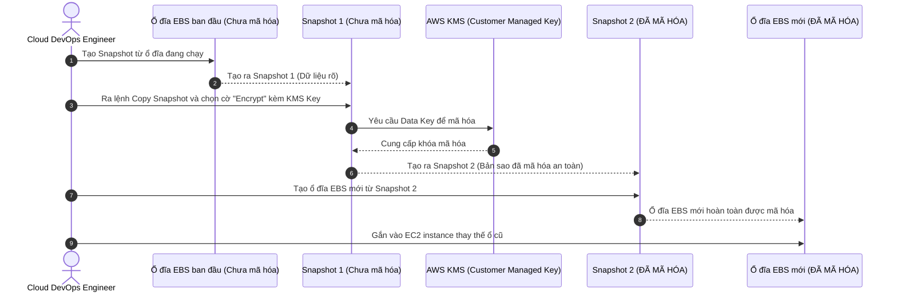

# Tài Liệu Học Tập Chuyên Sâu: Amazon EBS, Amazon EFS & EC2 Instance Store (Lưu Trữ Khối & Tệp Tin Đám Mây)

> **Tài liệu chuẩn hóa kiến trúc đám mây**: Hướng dẫn toàn diện theo tiêu chuẩn Senior AWS Solutions Architect & Cloud DevOps Engineer.  
> **Ngôn ngữ**: Tiếng Việt (Bảo lưu toàn bộ thuật ngữ chuyên ngành tiếng Anh chuẩn AWS).  
> **Các bài giảng liên quan**: Chương 07 (EC2 Instance Storage: Bài 56 đến Bài 69).

---

## 6.1. Tổng Quan Dịch Vụ (Service Overview)

### Dịch vụ gì ?
Hệ sinh thái lưu trữ gắn kèm máy chủ của AWS cung cấp 3 giải pháp kiến trúc lưu trữ chính:
1. **Amazon Elastic Block Store (EBS)**: Dịch vụ lưu trữ khối ảo (Block Storage) hiệu năng cao, bền bỉ, kết nối qua mạng nội bộ tới một máy chủ ảo EC2 duy nhất (hoặc nhiều máy chủ với Multi-Attach). Tương đương với ổ cứng gắn ngoài (USB/SAN).
2. **Amazon Elastic File System (EFS)**: Dịch vụ lưu trữ tệp tin chia sẻ dạng tệp (File Storage) hoàn toàn được quản lý, tuân thủ chuẩn POSIX NFSv4, có khả năng tự động co giãn dung lượng và cho phép hàng ngàn máy chủ EC2/container gắn kết đồng thời xuyên qua nhiều Availability Zones.
3. **EC2 Instance Store**: Ổ cứng vật lý (thường là SSD NVMe) gắn trực tiếp vào bo mạch chủ của máy chủ vật lý đang chạy máy ảo EC2 của bạn. Mang lại hiệu năng đọc/ghi I/O siêu nhanh nhưng mang tính chất tạm thời (Ephemeral Storage - mất dữ liệu khi Stop máy).

### Bảng phân định ranh giới kiến trúc cốt lõi:

| Tiêu chí | Amazon EBS | Amazon EFS | EC2 Instance Store |
| :--- | :--- | :--- | :--- |
| **Loại lưu trữ** | Block Storage (Lưu trữ khối) | File Storage (Hệ thống tệp POSIX) | Block Storage (Ổ đĩa vật lý cục bộ) |
| **Phạm vi hoạt động** | Giới hạn trong **1 Availability Zone** | Trải rộng trên **Đa Availability Zones** | Cố định trên **1 Máy chủ vật lý cụ thể** |
| **Khả năng chia sẻ** | 1 instance (Trừ Multi-Attach: tối đa 16) | Hàng ngàn instances đồng thời | Chỉ duy nhất 1 máy chủ đang chạy |
| **Tính bền vững** | Bền vững (Độc lập với vòng đời EC2) | Cực kỳ bền vững (Sao lưu đa AZ) | **Tạm thời (Ephemeral)**: Mất khi Stop/Terminate |
| **Hiệu năng I/O** | Rất cao (Lên tới 256,000 IOPS với io2) | Độ trễ millisecond, throughput cao | **Siêu khủng (Hàng triệu IOPS)**, độ trễ microsecond |
| **Phương thức kết nối** | Mạng nội bộ chuyên dụng (EBS-optimized) | Giao thức mạng NFSv4 (Port 2049) | Bus phần cứng PCIe / NVMe trực tiếp |

---

## 6.2. Các Khái Niệm và Thành Phần Cốt Lõi (Core Concepts and Components)



### 1. Phân loại các dòng ổ đĩa Amazon EBS (EBS Volume Types)
AWS chia ổ đĩa EBS thành 2 nhóm công nghệ chính: **SSD** (cho tải giao dịch I/O ngẫu nhiên) và **HDD** (cho tải tuần tự dung lượng lớn).

#### A. Nhóm SSD (Solid State Drives) - Phù hợp cho Database, OS Boot, Transactional Workloads
1. **General Purpose SSD (`gp3` - Thế hệ mới nhất)**:
   - Chuẩn mặc định tốt nhất cho mọi khối lượng công việc.
   - **Tách biệt độc lập giữa Dung lượng, IOPS và Throughput**: Mặc định cung cấp sẵn **3,000 IOPS** và **125 MB/s throughput** hoàn toàn miễn phí ở bất kỳ kích thước ổ đĩa nào!
   - Có thể mở rộng lên tới 16,000 IOPS và 1,000 MB/s mà không cần phải tăng dung lượng ổ đĩa.
2. **General Purpose SSD (`gp2` - Thế hệ cũ)**:
   - Hiệu năng IOPS bị gắn chặt với dung lượng lưu trữ (3 IOPS cho mỗi 1 GB dung lượng). Có cơ chế Burst IOPS lên 3,000. **Khuyến nghị**: Luôn chuyển đổi từ `gp2` sang `gp3` để tiết kiệm tới 20% chi phí và tăng hiệu năng.
3. **Provisioned IOPS SSD (`io1` / `io2` Block Express)**:
   - Dành cho các cơ sở dữ liệu quan trọng tối cao đòi hỏi hiệu năng khắt khe (Oracle, SAP HANA, SQL Server).
   - `io2 Block Express`: Đạt tới **256,000 IOPS**, throughput **4,000 MB/s**, và độ trễ dưới 1 millisecond.
   - Hỗ trợ tính năng **EBS Multi-Attach**.

#### B. Nhóm HDD (Hard Disk Drives) - Phù hợp cho Data Streaming, Big Data, Log Processing (KHÔNG THỂ DÙNG LÀM BOOT VOLUME)
4. **Throughput Optimized HDD (`st1`)**:
   - Tối ưu cho dữ liệu tuần tự truy cập thường xuyên (MapReduce, Kafka, ETL log processing). Tối đa 500 MB/s.
5. **Cold HDD (`sc1`)**:
   - Tối ưu cho dữ liệu tuần tự ít truy cập, chi phí rẻ nhất trong các dòng EBS (phù hợp lưu trữ file nén, backup).

### 2. Bản sao lưu chụp nhanh (EBS Snapshots)
- **Cơ chế gia tăng (Incremental Backup)**: Snapshot đầu tiên sao lưu toàn bộ block dữ liệu; các snapshot tiếp theo chỉ lưu trữ các block dữ liệu **đã bị thay đổi** kể từ lần snapshot gần nhất.
- **Vị trí lưu trữ**: Dữ liệu snapshot được lưu an toàn trong dịch vụ ngầm của **Amazon S3** (độ bền 11 số 9), dù bạn không thấy file trong S3 console.
- **Khôi phục xuyên Region**: Để di chuyển một ổ đĩa EBS từ Region này sang Region khác (ví dụ từ Singapore sang Tokyo):
  `Tạo Snapshot ở Region A` ➔ `Copy Snapshot sang Region B` ➔ `Tạo Volume mới từ Snapshot tại Region B`.
- **EBS Snapshot Archive**: Bậc lưu trữ giá rẻ hơn tới 75% cho các snapshot cần lưu giữ từ 90 ngày trở lên phục vụ tuân thủ pháp lý.
- **Recycle Bin for Snapshots**: Thùng rác bảo vệ chống lại việc nhân viên vô tình xóa nhầm snapshot quan trọng; cho phép khôi phục lại trong khoảng thời gian retention cài đặt trước.

### 3. EBS Multi-Attach
- Cho phép gắn đồng thời một ổ đĩa EBS (`io1` hoặc `io2`) vào **tối đa 16 máy chủ ảo EC2** trong **cùng một Availability Zone**.
- *Yêu cầu bắt buộc*: Ứng dụng phải sử dụng một hệ thống tệp tin có khả năng nhận biết phân cụm (Cluster-aware File System như GFS2, OCFS2) để điều phối ghi đĩa, tránh xung đột hỏng dữ liệu.

### 4. Amazon EFS (Elastic File System)
- **Hệ thống tệp tin mạng dùng chung**: Sử dụng giao thức NFSv4. Cho phép hàng ngàn máy ảo Linux mount đồng thời và chia sẻ chung một thư mục.
- **Tính năng Multi-AZ tự nhiên**: Dữ liệu ghi vào EFS được nhân bản tức thời xuyên qua nhiều Availability Zones trong cùng Region.
- **Các tầng lưu trữ và quản lý vòng đời (EFS Storage Tiers & Lifecycle Management)**:
  - *EFS Standard*: Dành cho tệp tin truy cập thường xuyên.
  - *EFS Infrequent Access (EFS IA)*: Chi phí lưu trữ rẻ hơn tới 90%, tự động chuyển tệp tin sau 30 ngày không có lượt đọc/ghi. Có phí khi đọc dữ liệu.
  - *EFS Archive*: Tối ưu cho dữ liệu tệp tin rất hiếm khi truy cập (vài lần mỗi năm).

---

## 6.3. Kiến Trúc và Luồng Vận Hành (Architecture and Workflow)

### Sơ đồ quy trình mã hóa ổ đĩa EBS chưa mã hóa (Encrypting an Unencrypted EBS Volume)



---

## 6.4. Bảng Tích Hợp với Các Dịch Vụ AWS Khác (Integration Table)

| Related AWS Service | Purpose (Mục đích tích hợp) | Integration Method (Phương thức tích hợp) | Practical Example (Ví dụ thực tiễn) |
| :--- | :--- | :--- | :--- |
| **AWS KMS** | Quản lý khóa mã hóa cho dữ liệu lưu trên EBS và EFS | KMS Key Policy | Sử dụng khóa KMS Customer Managed Key để mã hóa toàn bộ ổ đĩa cơ sở dữ liệu trên EC2. |
| **AWS Backup** | Tự động hóa lịch trình sao lưu tập trung cho EBS và EFS | Backup Plan & Backup Vault | Thiết lập chính sách sao lưu tự động chụp snapshot ổ đĩa EBS hàng ngày lúc 2:00 AM và giữ trong 30 ngày. |
| **Amazon ECS & EKS** | Cung cấp lưu trữ bền vững (Persistent Volume) cho Container | CSI Driver (Container Storage Interface) | Gắn Amazon EFS làm thư mục lưu trữ media chung cho 20 WordPress container pods chạy trên EKS. |
| **DataSync** | Đồng bộ hóa dữ liệu từ hệ thống NAS On-Premises lên AWS EFS | DataSync Agent & Task | Chuyển dịch 50TB dữ liệu tệp tin từ hệ thống NetApp tại chỗ lên Amazon EFS qua đường truyền Direct Connect. |

---

## 6.5. Ví Dụ Cấu Hình và Triển Khai Thực Tế (Configuration & CLI Examples)

### 1. Thao tác với EBS Snapshots qua AWS CLI

```bash
# 1. Tạo snapshot cho một ổ đĩa EBS
aws ec2 create-snapshot \
    --volume-id vol-0123456789abcdef0 \
    --description "Snapshot truoc khi nang cap database phien ban 2.0" \
    --tag-specifications 'ResourceType=snapshot,Tags=[{Key=Environment,Value=Production}]'

# 2. Sao chép snapshot sang Region khác và kích hoạt mã hóa KMS
aws ec2 copy-snapshot \
    --source-region ap-southeast-1 \
    --source-snapshot-id snap-0123456789abcdef0 \
    --destination-region ap-northeast-1 \
    --encrypted \
    --kms-key-id arn:aws:kms:ap-northeast-1:123456789012:key/xxxx-yyyy \
    --description "Ban sao ma hoa tai Tokyo"
```

### 2. Gắn kết (Mount) Amazon EFS vào máy ảo Amazon Linux bằng NFS

```bash
# Cài đặt tiện ích hỗ trợ EFS của AWS
sudo dnf install -y amazon-efs-utils

# Tạo thư mục mount cục bộ
sudo mkdir -p /mnt/efs/shared_data

# Mount EFS bằng DNS name thông qua TLS mã hóa đường truyền
sudo mount -t efs -o tls fs-0123456789abcdef0:/ /mnt/efs/shared_data

# Thêm cấu hình vào /etc/fstab để tự động mount lại khi reboot máy ảo
echo "fs-0123456789abcdef0:/ /mnt/efs/shared_data efs _netdev,tls 0 0" | sudo tee -a /etc/fstab
```

---

## 6.6. Mô Hình Tính Phí Dịch Vụ & Chiến Lược Tối Ưu Chi Phí Theo Từng Use Case (EBS & EFS Cost Breakdown & Optimization)

Lưu trữ khối (EBS) và lưu trữ tệp (EFS) là hai dịch vụ có cơ chế tính phí độc lập hoàn toàn với máy ảo EC2. Rất nhiều doanh nghiệp để thất thoát ngân sách nghiêm trọng do duy trì các ổ đĩa mồ côi (Unattached volumes), cấu hình dư thừa IOPS trên dòng `io2` hoặc không bật chính sách vòng đời trên EFS.

---

### 6.6.1. Bảng Phân Tích Cơ Chế Tính Phí Chi Tiết Của Amazon EBS & EFS

| Dịch vụ / Loại lưu trữ | Cơ chế tính phí chi tiết (Pricing Dimensions) | Mức phí tham chiếu điển hình | Rủi ro phát sinh chi phí (Cost Pitfalls) |
| :--- | :--- | :--- | :--- |
| **EBS General Purpose SSD (`gp2`)** | • **$0.10 / GB / tháng**.<br>• IOPS gắn liền với dung lượng (3 IOPS / GB). Cần 10,000 IOPS buộc phải tạo ổ đĩa 3,333 GB! | Đắt hơn gp3 tới 20% mà kém linh hoạt. | Vẫn sử dụng `gp2` cho các hệ thống mới thay vì `gp3`. |
| **EBS General Purpose SSD (`gp3`)** | • **$0.08 / GB / tháng** (Rẻ hơn gp2 20%).<br>• **Miễn phí sẵn 3,000 IOPS và 125 MB/s throughput**.<br>• IOPS bổ sung: $0.005 / IOPS / tháng.<br>• Throughput bổ sung: $0.04 / MB/s / tháng. | Chuẩn mực vàng cho 95% workloads trên AWS hiện nay. | Cấp phát quá nhiều Provisioned Throughput khi ứng dụng không đọc ghi nặng. |
| **EBS Provisioned IOPS SSD (`io2`)** | • **Dung lượng**: $0.125 / GB / tháng.<br>• **Phí IOPS**: **$0.065 / IOPS cấp phát / tháng** (Rất đắt!).<br>• Cấp phát 10,000 IOPS = $650/tháng riêng tiền IOPS! | Dành riêng cho Mission-critical RDBMS (Oracle, SAP) cần độ trễ sub-millisecond. | Chọn `io2` theo thói quen cho các database thông thường thay vì tận dụng `gp3`. |
| **EBS Throughput Optimized HDD (`st1`)** | • **$0.045 / GB / tháng** (Rẻ hơn 50% so với SSD). | Tối ưu cho Big Data, Hadoop, Data Warehouse với các luồng đọc/ghi tuần tự lớn. | Cố gắng sử dụng `st1` làm Boot Volume (AWS không hỗ trợ boot từ HDD). |
| **EBS Snapshots** | • **Standard Tier**: **$0.05 / GB / tháng** (chỉ tính dung lượng các block đã thay đổi).<br>• **Archive Tier**: **$0.0125 / GB / tháng** (tiết kiệm 75%). | Cơ chế Incremental giúp tiết kiệm dữ liệu sao lưu. | Bật tính năng **Fast Snapshot Restore (FSR)**: Tính phí **$0.75 / giờ / AZ** (~$540 / tháng / AZ)! |
| **Ổ đĩa mồ côi (Unattached EBS)** | • **Tính nguyên giá 100%** theo loại ổ đĩa ($0.08 - $0.125 / GB) ngay cả khi không gắn vào bất kỳ máy ảo nào! | Lãng phí 100% ngân sách cho ổ đĩa không hoạt động. | Xóa máy ảo EC2 nhưng quên chọn cờ `DeleteOnTermination` khiến EBS volume bị bỏ quên. |
| **Amazon EFS Standard (Multi-AZ)** | • **$0.30 / GB / tháng** (Đắt gấp 3.75 lần so với EBS gp3). | Lưu trữ đa vùng tự động, chia sẻ hàng nghìn clients. | Lưu trữ dữ liệu tĩnh hoặc file logs khổng lồ trong EFS Standard mà không bật Lifecycle. |
| **Amazon EFS Infrequent Access (EFS IA)** | • **$0.025 / GB / tháng** (Rẻ hơn 91% so với EFS Standard!).<br>• **Phí đọc dữ liệu (Read fee)**: $0.01 / GB truy xuất. | Tối ưu tuyệt đối cho các tệp chia sẻ ít truy cập sau 14-30 ngày. | Đọc đi đọc lại liên tục trên tầng IA sẽ làm tăng phí Request Read. |
| **Amazon EFS Archive** | • **$0.008 / GB / tháng** (Rẻ hơn 97% so với EFS Standard!). | Phù hợp lưu trữ dữ liệu tuân thủ, sao lưu dài hạn. | Phù hợp cho tệp tin chỉ truy cập vài lần mỗi năm. |

---

### 6.6.2. Chiến Lược Tối Ưu Hóa Chi Phí Theo 5 Kịch Bản Thực Tế (Use Cases Optimization)

#### Use Case 1: Chuyển đổi toàn bộ ổ đĩa từ `gp2` sang `gp3` (Instant 20% Cost Reduction)
* **Vấn đề & So sánh chi phí**:
  - Doanh nghiệp có 100 ổ đĩa `gp2` dung lượng 500 GB mỗi ổ (tổng 50 TB).
  - Chi phí ổ `gp2` hàng tháng:
    $$\text{Chi phí gp2} = 50,000 \text{ GB} \times 0.10\$ = \mathbf{5,000\$/\text{tháng}}$$
* **Giải pháp Tối ưu kiến trúc**:
  - Sử dụng tính năng **EBS Elastic Volumes**, chạy lệnh AWS CLI hoặc Terraform chuyển đổi toàn bộ ổ đĩa từ `gp2` sang `gp3`.
  - Quá trình chuyển đổi diễn ra trực tiếp **trong khi hệ điều hành và ứng dụng vẫn đang chạy (Zero Downtime)**.
  - Chi phí ổ `gp3` hàng tháng (đã bao gồm sẵn 3,000 IOPS và 125 MB/s miễn phí):
    $$\text{Chi phí gp3} = 50,000 \text{ GB} \times 0.08\$ = \mathbf{4,000\$/\text{tháng}}$$
* **Kết quả tiết kiệm**: Tiết kiệm ngay **$1,000/tháng ($12,000/năm - Giảm 20%)** mà hiệu năng hệ thống còn tăng từ 1,500 IOPS (gp2 500GB) lên 3,000 IOPS (gp3 baseline).

#### Use Case 2: Tối ưu chi phí Database hiệu năng cao (`io2` vs `gp3` IOPS Tuning)
* **Vấn đề & Cách tính tiền cũ**:
  - Kỹ sư cơ sở dữ liệu cấu hình một ổ đĩa `io2` dung lượng 500 GB với **10,000 Provisioned IOPS** cho cơ sở dữ liệu MySQL.
  - Chi phí hàng tháng của `io2`:
    $$\text{Phí dung lượng} = 500 \text{ GB} \times 0.125\$ = 62.50\$$$
    $$\text{Phí IOPS} = 10,000 \text{ IOPS} \times 0.065\$ = 650.00\$$$
    $$\text{Tổng chi phí io2} = 62.50\$ + 650.00\$ = \mathbf{712.50\$/\text{tháng}}$$
* **Giải pháp Tối ưu kiến trúc**:
  - Dòng `gp3` hiện tại cho phép mở rộng lên tới **16,000 IOPS** và **1,000 MB/s throughput**.
  - Chuyển đổi ổ đĩa sang **`gp3` 500 GB với 10,000 IOPS** (3,000 IOPS miễn phí + 7,000 IOPS bổ sung):
    $$\text{Phí dung lượng gp3} = 500 \text{ GB} \times 0.08\$ = 40.00\$$$
    $$\text{Phí IOPS bổ sung} = (10,000 - 3,000) \times 0.005\$ = 35.00\$$$
    $$\text{Tổng chi phí gp3} = 40.00\$ + 35.00\$ = \mathbf{75.00\$/\text{tháng}}$$
* **Kết quả tiết kiệm**: Tiết kiệm **$637.50/tháng trên 1 ổ đĩa (Giảm tới 89.5% chi phí!)** trong khi cơ sở dữ liệu vẫn nhận được đúng 10,000 IOPS ổn định.

#### Use Case 3: Truy quét và Tiêu hủy Ổ đĩa Mồ côi (Unattached EBS Volume Cleanup)
* **Vấn đề & Cách tính tiền cũ**:
  - Khi kỹ sư xóa (Terminate) máy ảo EC2 bằng AWS CLI hoặc Console nhưng quên tích chọn thuộc tính `DeleteOnTermination`.
  - Các ổ đĩa Data Volume (và cả Root Volume) chuyển sang trạng thái `available` (mồ côi, không gắn vào đâu) nhưng **AWS vẫn tính tiền đủ 100% dung lượng hàng tháng**.
  - 50 ổ đĩa mồ côi kích thước trung bình 200 GB: $10,000 \text{ GB} \times 0.08\$ = \mathbf{800\$/\text{tháng}}$ lãng phí trong vô vọng.
* **Giải pháp Tối ưu**:
  - Sử dụng **AWS Config Rule** (`ec2-volume-inuse-check`) hoặc viết một script **AWS Lambda** định kỳ hàng tuần quét toàn bộ ổ đĩa có trạng thái `status == available`.
  - Chụp một bản EBS Snapshot cuối cùng để lưu trữ phòng hờ, sau đó tự động gọi API `DeleteVolume`.
* **Kết quả tiết kiệm**: Thu hồi ngay **$800/tháng (100% ngân sách thất thoát)**.

#### Use Case 4: Quản lý vòng đời lưu trữ chia sẻ với Amazon EFS Lifecycle Management
* **Vấn đề & Cách tính tiền cũ**:
  - Hệ thống CMS lưu trữ 10 TB hình ảnh, tài liệu người dùng tải lên trên Amazon EFS Standard.
  - Hơn 85% tài liệu cũ (đăng từ 3 tháng trước) gần như không bao giờ được người dùng đọc lại.
  - Chi phí duy trì toàn bộ 10 TB trên EFS Standard:
    $$\text{Chi phí EFS Standard} = 10,000 \text{ GB} \times 0.30\$ = \mathbf{3,000\$/\text{tháng}}$$
* **Giải pháp Tối ưu kiến trúc**:
  - Kích hoạt tính năng **EFS Lifecycle Management**:
    - **Transition into IA**: Tự động chuyển tệp sang **EFS Infrequent Access (IA)** nếu không có lượt truy cập sau **30 ngày**.
    - **Transition into Archive**: Tự động chuyển sang **EFS Archive** sau **90 ngày**.
  - Cơ cấu dữ liệu sau tối ưu: 1.5 TB ở Standard ($450), 8.5 TB ở IA ($212.50):
    $$\text{Tổng chi phí sau tối ưu} = 450\$ + 212.50\$ = \mathbf{662.50\$/\text{tháng}}$$
* **Kết quả tiết kiệm**: Tiết kiệm hơn **$2,337/tháng (Giảm gần 78% hóa đơn lưu trữ EFS)** mà người dùng vẫn có thể truy cập file cũ trong suốt (Transparent) mà không cần thay đổi đường dẫn mã nguồn.

#### Use Case 5: Tối ưu chi phí Lưu trữ Bản ghi Snapshot Dài hạn (EBS Snapshot Archive)
* **Vấn đề**: Doanh nghiệp phải giữ bản sao lưu snapshot hàng tháng trong 5 năm để phục vụ kiểm toán nội bộ. Lưu trữ 20 TB snapshot trên tầng Standard tốn: $20,000 \times 0.05\$ = \mathbf{1,000\$/\text{tháng}}$.
* **Giải pháp Tối ưu**:
  - Chuyển các bản snapshot đầy đủ (Full Snapshots) có độ tuổi trên 90 ngày sang tầng **EBS Snapshot Archive**.
  - Mức phí lưu trữ giảm xuống chỉ còn **$0.0125 / GB / tháng**:
    $$\text{Chi phí sau chuyển sang Archive} = 20,000 \text{ GB} \times 0.0125\$ = \mathbf{250\$/\text{tháng}}$$
* **Kết quả tiết kiệm**: Tiết kiệm **$750/tháng ($9,000/năm - Giảm 75% chi phí)** cho dữ liệu sao lưu tuân thủ.

---

## 6.7. Khắc Phục Sự Cố Thực Tế (Troubleshooting Guide)

| Vấn đề (Problem) | Nguyên nhân khả dĩ (Possible Causes) | Các bước điều tra (Investigation Steps) | Giải pháp (Solution) | Biện pháp phòng ngừa (Prevention) |
| :--- | :--- | :--- | :--- | :--- |
| **Không thể gắn (Attach) ổ đĩa EBS vào máy ảo EC2** | Ổ đĩa EBS và máy ảo EC2 nằm ở **hai Availability Zone khác nhau**. | So sánh Availability Zone của Instance (ví dụ `ap-southeast-1a`) và của EBS Volume (ví dụ `ap-southeast-1b`). | Tạo Snapshot từ ổ đĩa EBS đó, sau đó tạo một Volume mới từ Snapshot và chọn đúng Availability Zone của máy ảo. | Luôn quy hoạch vùng đặt tài nguyên cẩn thận khi tạo ổ đĩa thủ công. |
| **Lệnh mount Amazon EFS bị treo (Hanging / Timed Out)** | Security Group gắn trên EFS Mount Target chưa mở cổng **NFS (Port 2049)** từ Security Group của EC2. | Kiểm tra Inbound Rules của Security Group được gán vào Mount Target của EFS. | Thêm luật Inbound cho phép cổng 2049 (NFS) với Source là Security Group của máy ảo EC2. | Sử dụng Security Group tham chiếu chéo (SG-to-SG rule). |
| **Máy ảo EC2 bị mất dữ liệu sau khi thực hiện thao tác Stop/Start** | Dữ liệu được lưu trữ trên ổ cứng **EC2 Instance Store** (ổ đĩa tạm) thay vì Amazon EBS. | Kiểm tra loại thiết bị lưu trữ gắn với instance trên console. | Di chuyển toàn bộ dữ liệu quan trọng sang ổ đĩa Amazon EBS hoặc Amazon EFS. | Hiểu rõ bản chất Ephemeral của Instance Store; chỉ dùng cho cache, scratch pad. |
| **Hiệu năng ổ đĩa `gp2` bị tụt giảm nghiêm trọng sau vài giờ tải cao** | Ổ đĩa đã cạn kiệt số lượng **I/O Burst Credits** do dung lượng ổ quá nhỏ (< 1TB). | Xem biểu đồ metric `BurstBalance` trên CloudWatch. | Nâng cấp trực tiếp loại ổ đĩa từ `gp2` sang **`gp3`** (không phụ thuộc vào burst credits) mà không gây gián đoạn hệ thống. | Thay thế toàn bộ ổ `gp2` bằng `gp3` trong toàn bộ tổ chức. |

---

## 6.8. Bộ Câu Hỏi Ôn Tập và Kiểm Tra Kiến Thức (Knowledge Review)

### A. 10 Câu hỏi Cốt lõi (Core Concepts)
1. Ổ đĩa Amazon EBS có phạm vi hoạt động ở cấp độ nào (Regional hay Availability Zone)?
2. Dòng ổ đĩa EBS nào là lựa chọn mặc định tốt nhất hiện nay, cho phép tùy chỉnh độc lập giữa dung lượng (GB), IOPS và Throughput (MB/s)?
3. Hai dòng ổ đĩa EBS nào thuộc nhóm HDD và **KHÔNG THỂ** sử dụng để làm ổ đĩa khởi động hệ điều hành (Boot Volume)?
4. Điều gì sẽ xảy ra với dữ liệu nằm trên một ổ đĩa **EC2 Instance Store** khi bạn thực hiện thao tác **Stop** máy ảo và **Start** lại?
5. Một ổ đĩa EBS thông thường có thể được gắn đồng thời vào 2 máy ảo EC2 nằm ở 2 Availability Zones khác nhau được không?
6. Cơ chế chụp nhanh **EBS Snapshot** lưu trữ dữ liệu theo phương thức nào (Full backup mỗi lần hay Incremental backup)?
7. Hệ thống tệp tin nào của AWS tuân thủ chuẩn POSIX, hoạt động đa AZ và cho phép hàng ngàn máy ảo Linux gắn kết đồng thời qua giao thức NFS?
8. Tính năng nào của Amazon EFS giúp tự động di chuyển các tệp tin không được truy cập trong vòng 30 ngày sang tầng lưu trữ giá rẻ để tiết kiệm chi phí?
9. Nếu bạn có một ổ đĩa EBS chưa mã hóa, các bước kỹ thuật chuẩn mực để chuyển đổi nó thành một ổ đĩa được mã hóa an toàn là gì?
10. Tính năng **EBS Multi-Attach** chỉ khả dụng trên những dòng ổ đĩa nào và yêu cầu ứng dụng phải có đặc tính gì?

---

### Đáp án Bộ Câu Hỏi Ôn Tập (Answer Key)

<details>
<summary>👉 Nhấp vào đây để xem toàn bộ đáp án chi tiết</summary>

1. Ổ đĩa Amazon EBS bị giới hạn trong phạm vi duy nhất **một Availability Zone (AZ-locked)**.
2. Dòng **`gp3`** (General Purpose SSD thế hệ 3).
3. **`st1`** (Throughput Optimized HDD) và **`sc1`** (Cold HDD). Chỉ có các dòng SSD (`gp2`, `gp3`, `io1`, `io2`) mới dùng được làm Boot Volume.
4. Toàn bộ dữ liệu trên Instance Store **SẼ BỊ XÓA SẠCH VÀ MẤT HOÀN TOÀN** (vì máy ảo được chuyển sang một máy chủ vật lý mới khi Start lại).
5. **KHÔNG THỂ**. EBS Volume bị khóa chặt trong 1 Availability Zone cụ thể, do đó không thể kết nối tới máy ảo ở AZ khác.
6. **Incremental Backup (Sao lưu gia tăng)**: Chỉ lưu lại những block dữ liệu đã thay đổi so với bản snapshot gần nhất.
7. **Amazon EFS (Elastic File System)**.
8. Tính năng **EFS Lifecycle Management** (tự động chuyển sang tầng **EFS Infrequent Access - IA** hoặc EFS Archive).
9. Các bước: (1) Chụp **EBS Snapshot** từ ổ đĩa chưa mã hóa; (2) Thực hiện **Copy Snapshot**, đánh dấu chọn mã hóa và chọn KMS Key; (3) Tạo **EBS Volume mới** từ Snapshot đã mã hóa đó; (4) Gắn volume mới vào máy ảo.
10. Chỉ khả dụng trên dòng Provisioned IOPS **`io1`** và **`io2`** trong cùng 1 AZ; yêu cầu ứng dụng phải sử dụng **Cluster-aware File System** (như GFS2) để quản trị việc đồng thời ghi đĩa chống hỏng dữ liệu.
</details>

---

## 6.9. Tóm Tắt và Danh Mục Kiểm Tra Kiến Thức (Summary & Learning Checklist)

### 5 Khái niệm quan trọng nhất phải nhớ:
1. **EBS gắn liền với 1 AZ**: Muốn chuyển AZ, bắt buộc phải qua bước tạo Snapshot.
2. **Ưu thế vượt trội của `gp3` so với `gp2`**: Rẻ hơn 20%, cho phép tùy chỉnh IOPS và throughput độc lập với dung lượng.
3. **Bản chất tạm thời của Instance Store**: Tốc độ I/O hàng triệu IOPS nhưng mất trắng dữ liệu khi Stop instance.
4. **EFS là giải pháp chia sẻ đa AZ**: Thích hợp nhất cho web farm chia sẻ mã nguồn/uploads và container storage.
5. **Mã hóa ổ đĩa**: Tích hợp chặt chẽ với AWS KMS, không ảnh hưởng tới hiệu năng I/O.

### Liên kết và Chủ đề tiếp theo:
- 📖 [Ghi Chú Bài Học Chương 07: EC2 Instance Storage](file:///n:/AWS_XBrain_Note/Lesson_Notes/07_EC2_Instance_Storage.md)
- 📖 [Bảng Thuật Ngữ Kỹ Thuật (GLOSSARY.md)](file:///n:/AWS_XBrain_Note/GLOSSARY.md)
- ⏭️ Tiếp tục chuyển sang chuyên đề: **Tính Sẵn Sàng Cao & Co Giãn: Elastic Load Balancing (ELB) & Auto Scaling Group (ASG)**.
