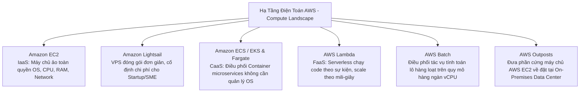
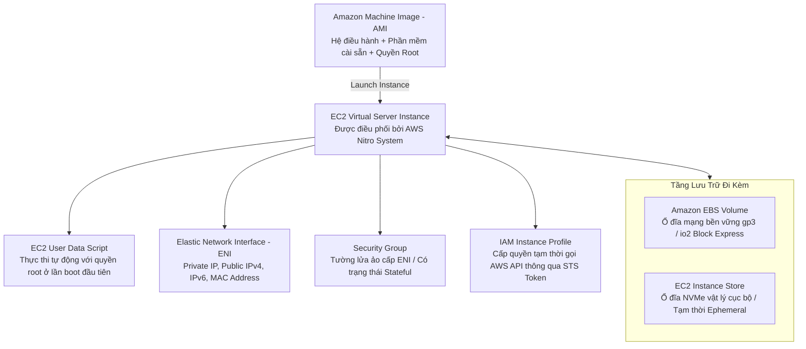
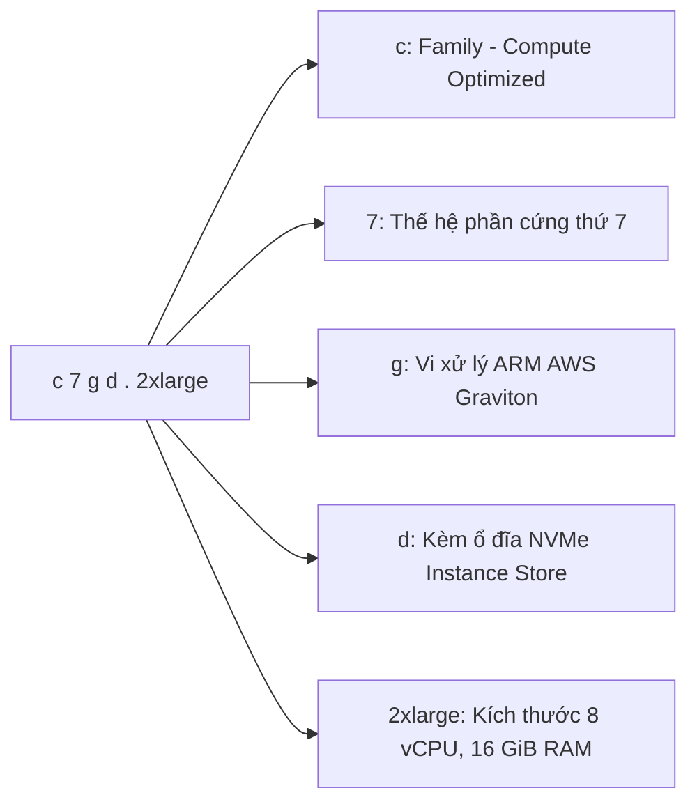
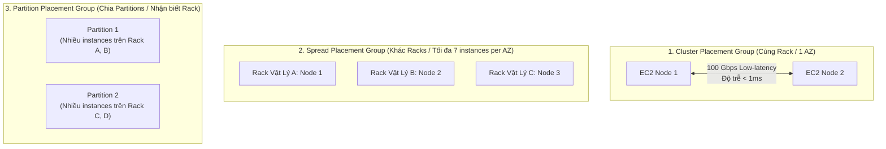
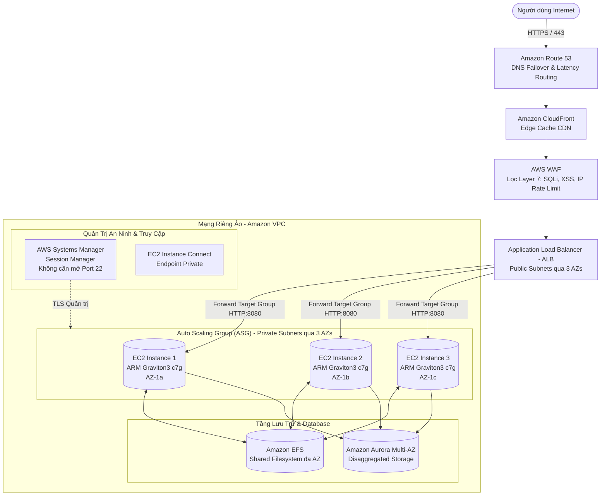
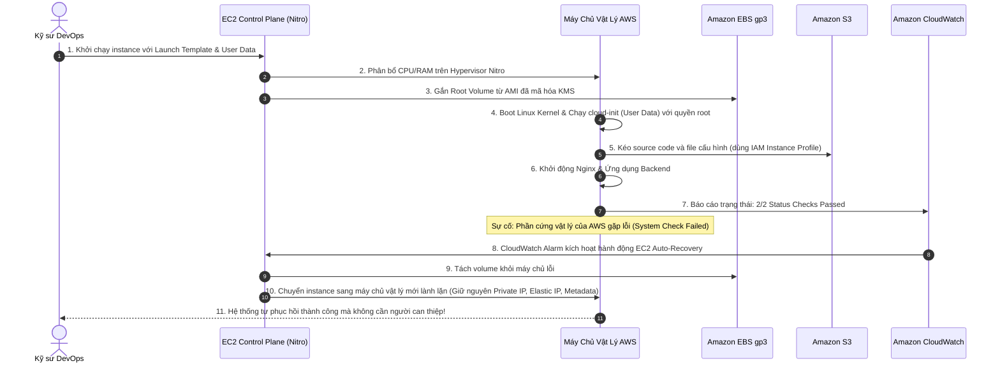

# Tài Liệu Học Tập Chuyên Sâu: Amazon EC2 (Elastic Compute Cloud) & Kiến Trúc Máy Chủ Ảo Đám Mây

> **Tài liệu chuẩn hóa kiến trúc đám mây**: Hướng dẫn toàn diện theo tiêu chuẩn Principal AWS Solutions Architect & Senior Cloud DevOps Engineer (Cập nhật phiên bản kiến trúc mới nhất 2026).  
> **Ngôn ngữ**: Tiếng Việt chuyên ngành (Bảo lưu toàn bộ thuật ngữ chuyên ngành tiếng Anh chuẩn AWS).  
> **Mục tiêu**: Phục vụ thi chứng chỉ cấp độ Professional/Specialty (**SAA-C03, SAP-C02, DOP-C02**) và vận hành hệ thống cấp độ doanh nghiệp (**Production-grade**).  
> **Các bài giảng liên quan**: Chương 05 (EC2 Fundamentals) & Chương 06 (EC2 Solutions Architect Associate).

---

## 1. Tổng Quan Dịch Vụ (Service Overview)

### 1. Định nghĩa chuẩn xác và Phân nhóm dịch vụ
**Amazon Elastic Compute Cloud (Amazon EC2)** là dịch vụ điện toán đám mây nền tảng cốt lõi của AWS (mô hình Infrastructure as a Service - IaaS), cung cấp năng lực tính toán an toàn, có khả năng định cỡ và mở rộng linh hoạt dưới dạng các máy chủ ảo (**EC2 Instances**).

---

### 2. Bài toán cốt lõi mà EC2 giải quyết

1. **Loại bỏ việc mua sắm phần cứng vật lý tốn kém (No CapEx)**: Xóa bỏ rủi ro ước tính sai dung lượng cho 3–5 năm tới và thời gian chờ đợi hàng tháng để nhập linh kiện máy chủ trung tâm dữ liệu.
2. **Khởi tạo và hủy tài nguyên tức thời (Elasticity & Agility)**: Cấp phát hàng trăm máy ảo với đa dạng cấu hình CPU/RAM chỉ trong vài phút qua API, AWS CLI hoặc Terraform; hủy bỏ ngay khi không còn nhu cầu.
3. **Mở rộng quy mô linh hoạt theo nhu cầu (Horizontal & Vertical Scalability)**: Thay đổi kích cỡ instance khi cần nâng cấp phần cứng, hoặc kết hợp với **Auto Scaling Groups (ASG)** để tự động tăng giảm số lượng máy chủ dựa trên lưu lượng thực tế.
4. **Tối ưu hóa chi phí với đa dạng mô hình thanh toán**: Từ On-Demand không ràng buộc, Spot giảm giá tới 90%, đến cam kết Savings Plans giảm giá tới 72%.

---

### 3. Khi nào KHÔNG nên dùng EC2 (Anti-patterns & Giải pháp thay thế)

* ❌ **Xử lý tác vụ ngắn hạn kích hoạt theo sự kiện (Event-driven Microtasks)**: Các hàm API xử lý ảnh, webhook phản hồi dưới 15 phút không nên duy trì máy ảo EC2 chạy 24/7 vì gây lãng phí 95% thời gian nhàn rỗi.  
  👉 *Giải pháp thay thế*: Sử dụng **AWS Lambda** (Serverless, chỉ trả tiền khi code thực thi).
* ❌ **Vận hành ứng dụng Microservices đóng gói dạng Container tiêu chuẩn**: Tự cài đặt Docker engine trên EC2 đòi hỏi phải tự viết script giám sát container crash, tự vá lỗi OS, tự cấu hình rolling updates.  
  👉 *Giải pháp thay thế*: Triển khai trên **Amazon ECS hoặc Amazon EKS với AWS Fargate** (Serverless Container).
* ❌ **Lưu trữ dữ liệu phi cấu trúc lớn tĩnh (Web Assets, Backups, Videos)**: Sử dụng EC2 đính kèm ổ đĩa EBS để làm file server chia sẻ ảnh/video sẽ tốn chi phí lưu trữ khối đắt đỏ và nghẽn băng thông instance.  
  👉 *Giải pháp thay thế*: Chuyển sang **Amazon S3** (Object Storage rẻ hơn, độ bền 11 số 9) kết hợp **Amazon CloudFront**.
* ❌ **Ứng dụng web/blog đơn giản, ngân sách cố định cho doanh nghiệp nhỏ**: Cấu hình EC2 + ALB + VPC quá phức tạp cho các trang web WordPress nhỏ.  
  👉 *Giải pháp thay thế*: Sử dụng **Amazon Lightsail** (gói trọn gói máy chủ, đĩa, IP và băng thông chỉ từ \$1.50/tháng).

---

## 2. Các Khái Niệm, Kiến Trúc & Vận Hành Cốt Lõi (Core Concepts, Security & Day-2 Operations)

### 1. Sơ đồ các thành phần cốt lõi của một EC2 Instance

---

### 2. Quy ước đặt tên kiểu máy chủ & Phân loại dòng máy (Instance Types Naming Convention)

Cú pháp chuẩn hóa: `[Family][Generation][Capabilities].[Size]` (Ví dụ: **`c7g.2xlarge`**, **`m6i.xlarge`**, **`r7gd.4xlarge`**)

* **Các dòng máy chủ chính (Instance Families)**:
  - **Dòng Đa dụng (General Purpose - `t3, t4g, m6i, m7g`)**: Cân bằng tối ưu giữa Compute, Memory và Network. Dòng `t` có tính năng tăng cường xung nhịp (**Burstable Performance**) sử dụng cơ chế CPU Credits.
  - **Dòng Tối ưu Tính toán (Compute Optimized - `c6i, c7g, c8g`)**: Tỷ lệ vCPU/RAM cao, chuyên cho xử lý tính toán nặng, mã hóa video, máy chủ game, phân tích thuật toán, batch processing.
  - **Dòng Tối ưu Bộ nhớ (Memory Optimized - `r6i, r7g, x2idn`)**: Dung lượng RAM khổng lồ, chuyên cho cơ sở dữ liệu in-memory (Redis, Memcached), cơ sở dữ liệu quan hệ doanh nghiệp tải cao.
  - **Dòng Tối ưu Lưu trữ (Storage Optimized - `i3en, i4g, d3`)**: Trang bị ổ cứng thể rắn **NVMe SSD** gắn trực tiếp trên mainboard, cung cấp hàng triệu IOPS với độ trễ microsecond cho NoSQL (Cassandra, MongoDB), Data Warehouses.
  - **Dòng Tăng tốc Phần cứng (Accelerated Computing - `p5, g5, trn1, inf2`)**: Trang bị chip GPU NVIDIA H100/A10G hoặc chip chuyên dụng do AWS thiết kế (**AWS Trainium, AWS Inferentia**) phục vụ huấn luyện và chạy suy luận mô hình AI/LLM.

---

### 3. Bảng phân biệt các mô hình mua sắm máy chủ (EC2 Purchasing Options)

| Mô hình mua sắm | Cam kết thời gian | Mức giảm chi phí | Khả năng bị ngắt quãng | Kịch bản sử dụng chuẩn mực |
| :--- | :--- | :--- | :--- | :--- |
| **On-Demand** | Không cam kết (tính theo giây) | **0% (Giá chuẩn)** | Không bị ngắt quãng | Ứng dụng ngắn hạn, workload chưa dự đoán được tải, giai đoạn phát triển ban đầu (Dev/Test). |
| **Compute Savings Plans** | Cam kết chi tiêu ($/giờ) trong **1 hoặc 3 năm** | Giảm tới **66%** | Không bị ngắt quãng | **Chuẩn mực hiện đại tối ưu nhất**: Tự động áp dụng cho mọi instance EC2 (bất kể Family, Size, OS, Region) lẫn Fargate và Lambda. |
| **EC2 Instance Savings Plans** | Cam kết dòng máy tại 1 Region trong **1 hoặc 3 năm** | Giảm tới **72%** | Không bị ngắt quãng | Dành cho các hệ thống ổn định lâu dài trên một dòng máy cụ thể (ví dụ cam kết dòng `c7g` tại Singapore). |
| **Reserved Instances (Standard / Convertible)** | Cam kết loại instance trong 1 hoặc 3 năm | Giảm tới **72%** | Không bị ngắt quãng | Kế thừa truyền thống; Convertible cho phép đổi dòng instance; có thể bán lại trên **RI Marketplace**. |
| **Spot Instances** | Không cam kết (đấu thầu tài nguyên nhàn rỗi) | Giảm tới **90%** | **Có (Cảnh báo trước 2 phút)** | Tác vụ xử lý hàng loạt (Batch jobs), worker đọc hàng đợi SQS, render đồ họa 3D, CI/CD runners, tác vụ chịu lỗi. |
| **Dedicated Hosts** | Thuê trọn vẹn máy chủ vật lý riêng biệt | Chi phí cao nhất | Không bị ngắt quãng | Đáp ứng yêu cầu tuân thủ bản quyền phần mềm khắt khe theo Socket/Core (**BYOL - Microsoft Windows Server, SQL Server, Oracle**). |
| **Dedicated Instances** | Máy ảo chạy trên phần cứng cô lập | Phí phụ thu theo giờ | Không bị ngắt quãng | Doanh nghiệp yêu cầu không chia sẻ phần cứng vật lý với khách hàng khác (Tenant Isolation). |
| **Capacity Reservations** | Đặt trước năng lực tính toán tại 1 AZ cụ thể | Giá On-Demand | Không bị ngắt quãng | Đảm bảo 100% có sẵn máy chủ trong các dịp lễ cao điểm mua sắm (Black Friday) hoặc Disaster Recovery. |

---

### 4. Kiến trúc mạng & Định vị máy chủ (Networking, IPs & Placement Groups)

#### A. Phân biệt các loại địa chỉ IP trên EC2
* **Private IPv4**: Được gán tự động từ dải CIDR của Subnet; cố định không đổi trong suốt vòng đời của máy ảo; chỉ định tuyến trong mạng nội bộ VPC.
* **Public IPv4**: Cấp phát động từ pool chung của AWS khi bật tùy chọn `Auto-assign Public IP`.  
  ⚠️ **ĐIỂM SỐNG CÒN TRONG VẬN HÀNH & THI CỬ**: Khi bạn **Stop** máy ảo và **Start** lại, địa chỉ Public IPv4 sẽ **BỊ THU HỒI VÀ THAY ĐỔI THÀNH ĐỊA CHỈ MỚI**.
* **Elastic IP (EIP)**: Địa chỉ IPv4 tĩnh công khai cố định do tài khoản của bạn sở hữu; không thay đổi khi Stop/Start. Có thể tháo rời và gán lại tức thì sang instance khác để khắc phục sự cố.  
  ⚠️ **Cập nhật tính phí 2024–2026**: AWS tính phí **\$1.005/giờ/IP** (~\$1.65/tháng) cho **MỌI địa chỉ Public IPv4** (kể cả đang gắn vào máy ảo EC2 đang chạy lẫn EIP để nhàn rỗi).

#### B. EC2 Placement Groups (Nhóm Đặt Vị Trí Máy Chủ Vật Lý)

1. **Cluster Placement Group**:
   - Toàn bộ máy ảo được đặt trên cùng một cụm rack phần cứng vật lý trong **1 Availability Zone**.
   - *Ưu điểm*: Băng thông cực đại (lên tới 100 Gbps hoặc 200 Gbps), độ trễ cực thấp (< 1ms). Phù hợp cho High Performance Computing (HPC), Big Data phân tích khoa học (*TD-Set3 Q14*).
   - *Nhược điểm*: Rủi ro sập toàn bộ nếu rack gặp sự cố nguồn/mạng.
   - ⚠️ **KỸ THUẬT XỬ LÝ LỖI KHẢ NĂNG CẤP PHÁT (INSUFFICIENT CAPACITY ERROR)** (*TD-Set6 Q13*):  
     Khi bạn cố gắng thêm các instance mới vào một Cluster Placement Group đang có các instance chạy sẵn và nhận về lỗi `Insufficient capacity error`, nguyên nhân là do **tủ rack vật lý hiện tại của AWS đã hết chỗ cắm server**.  
     👉 *Cách xử lý chuẩn xác*: **Dừng (Stop) toàn bộ tất cả các instances** trong Placement Group đó, sau đó **khởi động (Start) lại tất cả cùng lúc**. Khi khởi động lại đồng thời, AWS sẽ tự động tìm kiếm một tủ rack phần cứng mới có đủ chỗ trống cho toàn bộ số lượng máy đã tăng thêm và cấp phát thành công!
2. **Spread Placement Group**:
   - Mỗi máy ảo được đặt trên một rack phần cứng vật lý hoàn toàn riêng biệt (riêng nguồn điện và switch mạng).
   - *Giới hạn cứng*: **Tối đa 7 máy ảo trên mỗi Availability Zone**.
   - *Ưu điểm*: Tối đa hóa khả năng chống chịu lỗi phần cứng. Phù hợp cho các node cơ sở dữ liệu quan trọng, quorum nodes (Apache Kafka, Zookeeper, Cassandra).
3. **Partition Placement Group**:
   - Nhóm máy ảo thành các phân vùng (Partitions - tối đa 7 phân vùng/AZ). Các instance trong cùng phân vùng không bao giờ chia sẻ rack vật lý với phân vùng khác.
   - Phù hợp cho các hệ thống phân tán xử lý dữ liệu lớn (HDFS, Apache Spark, Kafka) có cơ chế nhận biết topology mạng để tránh mất dữ liệu khi một partition gặp sự cố.

---

### 5. Vận hành, Bảo mật & Day-2 Operations

#### A. Kiến trúc bảo mật tầng sâu: IMDSv2 vs IMDSv1
* Dịch vụ **Instance Metadata Service (IMDS)** tại địa chỉ IP liên kết nội bộ `http://169.254.169.254/latest/meta-data/` cung cấp thông tin về instance (IP, AMI ID, IAM Security Credentials tạm thời).
* **IMDSv1 `[Deprecated - Khuyến nghị tắt hoàn toàn]`**: Sử dụng phương thức HTTP `GET` đơn giản, dễ bị tin tặc khai thác thông qua lỗ hổng **Server-Side Request Forgery (SSRF)** để đánh cắp IAM Role credentials.
* **IMDSv2 (Bắt buộc chuẩn an ninh 2026)**: Sử dụng cơ chế session-oriented dựa trên token. Bắt buộc phải thực hiện yêu cầu HTTP `PUT` kèm header `X-aws-ec2-metadata-token-ttl-seconds` để nhận Token, sau đó mới được truyền Token trong header `X-aws-ec2-metadata-token` để đọc dữ liệu. Thiết lập `http_put_response_hop_limit = 1` chặn đứng việc chuyển tiếp gói tin ra ngoài container hoặc reverse proxy.

#### B. Quản trị truy cập an toàn không mở cổng: AWS Systems Manager & EC2 Instance Connect Endpoint
* **Loại bỏ SSH (Port 22) và RDP (Port 3389) công khai**: Không bao giờ mở cổng 22/3389 tới `0.0.0.0/0` trên Security Group.
* **AWS Systems Manager Session Manager**: Kết nối trực tiếp vào console máy ảo thông qua giao thức TLS được mã hóa của AWS API. Không yêu cầu mở cổng Inbound nào trên Security Group, không cần Public IP và không cần duy trì Bastion Host. Mọi thao tác lệnh đều được ghi log kiểm toán vào Amazon S3 và CloudWatch Logs.
* **EC2 Instance Connect Endpoint (EICE)**: Giải pháp mạng riêng tư cho phép kết nối SSH/RDP tới máy ảo nằm trong Private Subnet mà không cần thiết lập Internet Gateway, NAT Gateway hay gán Public IP.

#### C. Chế độ ngủ đông (EC2 Hibernate)
* Khi **Stop** thông thường: Dữ liệu trên RAM bị xóa sạch; khi Start lại phải boot lại toàn bộ OS và nạp lại ứng dụng vào RAM (tốn từ 1–3 phút).
* Khi **Hibernate** (*TD-Set3 Q52*): Trạng thái bộ nhớ RAM được ghi tức thời vào ổ đĩa **EBS Root Volume**. Khi Start lại, nội dung RAM được nạp ngược lại, ứng dụng tiếp tục xử lý ngay tại trạng thái trước đó chỉ trong vài giây.
  - *Ứng dụng thực tiễn trong đề thi*: Các ứng dụng Windows Server kết nối FSx hoặc cơ sở dữ liệu mất từ 5 đến 10 phút để khởi động lại dịch vụ; doanh nghiệp muốn tắt máy ngoài giờ để tiết kiệm chi phí tính toán nhưng yêu cầu khi bật lại phải sẵn sàng tức thì $\rightarrow$ Bật **EC2 Hibernation**.
* *Điều kiện kỹ thuật bắt buộc*: Ổ đĩa Root EBS **phải được mã hóa (KMS Encrypted)**; máy ảo dùng Instance Store **không thể** Hibernate; dung lượng trống của EBS Root phải lớn hơn dung lượng RAM; hỗ trợ các dòng máy có dung lượng RAM dưới 150 GiB; thời gian ngủ đông có thể duy trì tối đa lên tới **60 ngày**.

---

### 🏛️ I. Các Kịch Bản Kiến Trúc Chuẩn (Best Practice Scenarios)

#### 1. Tính Toán Hiệu Năng Cao (HPC) Với Cluster Placement Groups & ENA
- **Tình huống thi**: Ứng dụng mô phỏng khí tượng, tài chính định lượng, hoặc xử lý trí tuệ nhân tạo phân tán cần trao đổi dữ liệu giữa các node tính toán với độ trễ mạng thấp nhất và thông lượng cao nhất có thể.
- **Giải pháp tối ưu chuẩn AWS**:
  - Triển khai cụm máy chủ EC2 bên trong một **Cluster Placement Group**.
  - **Cơ chế**: Toàn bộ các máy chủ được đặt gần nhau về mặt vật lý bên trong **cùng một Availability Zone**.
  - Kết hợp sử dụng card mạng **Elastic Network Adapter (ENA)** hoặc **Elastic Fabric Adapter (EFA)** để đạt băng thông mạng liên node lên tới 100 Gbps – 400 Gbps với độ trễ microsecond.
  - *Lưu ý*: Không triển khai Cluster Placement Group qua nhiều AZ.

#### 2. Xử Lý Tác Vụ Hàng Loạt (Batch Processing) Tiết Kiệm Tới 90% Bằng EC2 Spot Instances
- **Tình huống thi**: Hệ thống xử lý chuyển mã video hoặc tính toán dữ liệu lớn chạy theo lô, có khả năng chịu lỗi (fault-tolerant) và có thể tự động chạy lại nếu bị gián đoạn. Mục tiêu là tối thiểu hóa chi phí hạ tầng.
- **Giải pháp chuẩn**:
  - Sử dụng **EC2 Spot Instances** kết hợp với **AWS Batch** hoặc **EC2 Spot Fleet**.
  - Cắt giảm tới **90% chi phí** so với On-Demand.
  - Cấu hình ứng dụng lưu checkpoint thường xuyên lên S3 để khi nhận thông báo thu hồi máy chủ trước 2 phút (**2-Minute Spot Interruption Notice**), tiến trình có thể lưu lại trạng thái kịp thời.

#### 3. Quản Trị Tự Động Chi Phí Môi Trường Phi Sản Xuất Bằng AWS Instance Scheduler
- **Tình huống thi**: Doanh nghiệp có hàng trăm máy chủ EC2 và cơ sở dữ liệu RDS dành cho môi trường Dev/Test/QA. Các tài nguyên này chỉ cần chạy trong giờ hành chính (8h sáng - 6h tối, thứ 2 - thứ 6).
- **Giải pháp chuẩn**:
  - Triển khai giải pháp **AWS Instance Scheduler**.
  - Giải pháp sử dụng AWS Lambda và Amazon EventBridge để tự động gắn lịch Start/Stop tài nguyên dựa trên Resource Tags (ví dụ: `Schedule=office-hours`).
  - **Hiệu quả**: Tự động cắt giảm tới **70% chi phí máy chủ** cho các môi trường phi sản xuất mà không cần can thiệp thủ công mỗi ngày.

---

### 🪤 II. Các Bẫy Thi Tinh Vi & Phân Tích Phương Án Sai (Exam Traps & Distractors)

#### 🪤 Bẫy 1: Dedicated Hosts vs Dedicated Instances Cho Tuân Thủ Bản Quyền Phần Mềm (BYOL) — (U-PT6 Q34)
- **Tình huống đề thi**: *"Doanh nghiệp chuyển đổi máy chủ Windows Server và SQL Server lên AWS. Họ muốn tái sử dụng các bản quyền phần mềm hiện có (BYOL - Bring Your Own License) vốn được cấp phép theo số lượng Socket và Core vật lý của máy chủ. Giải pháp nào đáp ứng đúng yêu cầu?"*
- **Phân biệt rạch ròi 2 khái niệm**:

| Tiêu chuẩn so sánh | Dedicated Instances | Dedicated Hosts |
|:---|:---|:---|
| **Môi trường phần cứng** | Dedicated (không chung phần cứng với khách hàng khác) | Dedicated (toàn quyền sở hữu máy chủ vật lý) |
| **Kiểm soát Socket & Cores** | ❌ **KHÔNG** (AWS tự quản lý việc phân bổ vCPU) | ✅ **CÓ** (Hiển thị chi tiết số lượng Sockets & Cores vật lý) |
| **Hỗ trợ bản quyền BYOL** | ❌ Không hỗ trợ bản quyền tính theo Socket/Core vật lý | ✅ **Lựa chọn duy nhất** cho bản quyền tính theo Socket/Core |
| **Gán cố định máy chủ (Affinity)** | ❌ Không (khi restart có thể chuyển sang host khác) | ✅ Có (đảm bảo instance luôn chạy lại trên cùng host vật lý) |

- **Bẫy thi**: Chọn Dedicated Instances vì thấy chữ "Dedicated" -> **SAI**. Phải là **Dedicated Hosts** khi đề bài nhắc tới *BYOL, Core/Socket Visibility*.

#### 🪤 Bẫy 2: Vòng Đời Của EC2 User Data & Quyền Hạn Root — (U-PT2 Q29)
- **Tình huống đề thi**: *"Một kỹ sư cấu hình một đoạn script trong EC2 User Data để cập nhật bản vá phần mềm mỗi khi máy chủ khởi động lại. Tuy nhiên, script không chạy khi kỹ sư thực hiện Reboot máy chủ."*
- **Nguyên lý cốt lõi**:
  - Mặc định, đoạn mã trong **User Data chỉ thực thi DUY NHẤT 1 LẦN** trong lần khởi động đầu tiên (Initial Launch Boot Cycle) khi instance được tạo ra.
  - Các lần Reboot, Stop rồi Start tiếp theo sẽ **KHÔNG BAO GIỜ** kích hoạt lại User Data (trừ khi dùng cloud-init MIME multi-part đặc biệt).
  - **Quyền hạn**: Script User Data luôn tự động chạy dưới quyền **root** -> Không bao giờ cần viết lệnh `sudo` trong script.

#### 🪤 Bẫy 3: Khôi Phục Tự Động Máy Chủ Đơn Khối (Monolith) Với Chi Phí Rẻ Nhất — (U-PT6 Q44)
- **Tình huống đề thi**: *"Một ứng dụng thương mại legacy không hỗ trợ chạy song song nhiều máy chủ (Single-Instance Monolith) và bắt buộc phải giữ nguyên một địa chỉ IP công khai cố định. Cần thiết lập giải pháp có khả năng phục hồi tự động khi máy chủ gặp sự cố với chi phí thấp nhất."*
- **Các phương án bẫy**:
  - ❌ *Dùng Application Load Balancer đứng trước*: Tốn thêm chi phí duy trì ALB hàng tháng không cần thiết cho 1 máy chủ duy nhất.
  - ❌ *Triển khai 2 máy chủ chạy song song*: Ứng dụng không hỗ trợ đồng bộ dữ liệu phiên, vi phạm kiến trúc.
- **Giải pháp ĐÚNG**:
  - Tạo một **Auto Scaling Group trải dài trên nhiều AZs** với cấu hình: `Min=1, Max=1, Desired=1`.
  - Cấu hình đoạn script trong **User Data** sử dụng AWS CLI để tự động gán lại **Elastic IP (EIP)** cố định cho instance mới ngay khi instance đó vừa boot xong.
  - Khi máy chủ hoặc AZ hiện tại sập, ASG sẽ tự động phát hiện instance Unhealthy và khởi tạo instance thay thế ở AZ khác, sau đó tự gắn lại đúng địa chỉ EIP cũ.

#### 🪤 Bẫy 4: Chiến Lược Phân Bổ Spot Fleet Đa Dạng Hóa (Diversified Strategy) — (U-PT2 Q42)
- **Tình huống đề thi**: *"Hệ thống chạy các tác vụ phân tích batch quy mô lớn trên hàng trăm máy chủ có thể linh hoạt sử dụng nhiều cấu hình CPU và RAM khác nhau. Cần đảm bảo hệ thống không bị dừng hoàn toàn khi một loại instance Spot bị AWS thu hồi đột ngột."*
- **Giải pháp ĐÚNG**:
  - Cấu hình **EC2 Spot Fleet** với chiến lược phân bổ **`diversified`**.
  - Thay vì tập trung mua một loại máy chủ rẻ nhất (`lowestPrice`), chiến lược `diversified` sẽ tự động phân bổ số lượng máy chủ đều trên nhiều Spot Pools (nhiều instance types khác nhau như m5.large, c5.large, r5.large trải dài trên nhiều AZs).
  - Khi một pool cụ thể bị quá tải giá hoặc bị AWS thu hồi, chỉ một phần nhỏ máy chủ bị ảnh hưởng, toàn bộ phần còn lại của fleet vẫn duy trì hoạt động bình thường.

#### 🪤 Bẫy 5: Giới Hạn Cốt Lõi Của EC2 Ephemeral Instance Store — (U-PT6 Q50)
- **Bẫy bất biến**:
  - Instance Store là ổ đĩa vật lý gắn cứng vào bo mạch chủ của máy chủ EC2.
  - **KHÔNG THỂ gỡ ra (Detach)** khỏi instance này để gắn vào instance khác (muốn tính năng này phải dùng EBS).
  - Dữ liệu bị **xóa sạch vĩnh viễn** khi instance bị **STOP** hoặc **TERMINATE** hoặc máy chủ vật lý gặp sự cố phần cứng.
  - Dữ liệu trong Instance Store **KHÔNG được lưu vào AMI** khi bạn tạo image sao lưu.

#### 🪤 Bẫy 6: Cấu Hình EMR Instance Fleet Tự Động Chọn AZ Có Sẵn Dung Lượng Spot — (CM-PT2 Q26, CM-PT6 Q43)
- **Tình huống đề thi**: *"Doanh nghiệp chạy cụm Amazon EMR để xử lý dữ liệu lớn. Nhóm muốn tối ưu chi phí bằng cách sử dụng EC2 Spot Instances cho cụm worker nodes trải dài trên nhiều subnets, nhưng thường xuyên gặp lỗi khởi tạo do thiếu dung lượng Spot tại một số AZ."*
- **Các phương án bẫy**:
  - ❌ *Dùng EMR Instance Groups*: Instance Groups bị khóa vào 1 subnet/AZ duy nhất và chỉ chọn được 1 loại instance type cố định cho mỗi role. Khi AZ đó hết Spot capacity, cụm EMR sẽ bị fail khởi tạo.
- **Giải pháp ĐÚNG**: Cấu hình **Amazon EMR Instance Fleets**.
  - Cho phép khai báo danh sách nhiều subnets ở các AZ khác nhau.
  - Cho phép định nghĩa tới 30 loại EC2 instance types khác nhau (ví dụ: m5.xlarge, m5a.xlarge, c5.xlarge...) kèm mức phân bổ On-Demand và Spot.
  - EMR sẽ tự động thăm dò và chỉ khởi chạy cụm máy tại Availability Zone nào đang có sẵn dung lượng Spot dồi dào nhất.

#### 🪤 Bẫy 7: Tự Động Phục Hồi Máy Ảo Lỗi Phần Cứng Bằng EC2 Auto-Recovery — (CM-PT5 Q03)
- **Tình huống đề thi**: *"Một máy chủ EC2 chạy hệ thống cơ sở dữ liệu nội bộ bị ngắt quãng do máy chủ vật lý bên dưới của AWS bị lỗi phần cứng (System Status Check Failed). Cần thiết lập cơ chế tự động khắc phục với ít công sức nhất mà giữ nguyên cấu hình mạng."*
- **Giải pháp ĐÚNG**: Tạo một **Amazon CloudWatch Alarm** theo dõi metric **`StatusCheckFailed_System`** và gán hành động **EC2 Auto-Recovery**.
  - Khi phát hiện phần cứng sập, CloudWatch Alarm tự động chuyển máy ảo sang một host vật lý mới lành lặn trong cùng Availability Zone.
  - Giữ nguyên hoàn toàn địa chỉ IP riêng (Private IP), IP công khai / Elastic IP, các ổ đĩa EBS đính kèm và Instance ID!
  - *Đặc điểm mạng sống còn (U-PT3 Q27)*: Instance sau khi Auto-Recovery vẫn giữ nguyên Instance ID, Private IP, Elastic IP, **và nếu đã có Public IPv4 tự động cấp phát, nó vẫn giữ nguyên chính xác Public IPv4 đó**!
  - *Lưu ý về Instance Store (U-PT3 Q41)*: Máy ảo dùng Instance Store **KHÔNG** hỗ trợ EC2 Auto-Recovery; với máy ảo Instance Store cần tự phục hồi, phải đặt sau Auto Scaling Group (Min=1, Max=1, Desired=1).

#### 🪤 Bẫy 8: Tải Công Việc Định Kỳ Cùng Khung Giờ: Scheduled Scaling vs Target Tracking — (CM-PT6 Q35)
- **Tình huống đề thi**: *"Ứng dụng chấm công của doanh nghiệp ghi nhận lưu lượng truy cập tăng vọt đột ngột vào đúng 8h30 đến 9h00 sáng mỗi ngày làm việc và giảm mạnh sau 17h30. Nhân viên phàn nàn hệ thống bị chậm trong 10 phút đầu mỗi buổi sáng. Cần giải pháp co giãn tự động tối ưu."*
- **Các phương án bẫy**:
  - ❌ *Dùng Target Tracking Policy theo CPUUtilization*: Target Tracking là cơ chế phản ứng sau (Reactive). Hệ thống phải đợi tải CPU tăng cao trong vài chu kỳ đánh giá (5 phút) thì mới kích hoạt thêm instance, sau đó mất thêm 2-3 phút boot OS $\rightarrow$ Nhân viên vẫn phải chịu nghẽn mạng trong 10 phút đầu!
- **Giải pháp ĐÚNG**: Cấu hình **EC2 Auto Scaling Scheduled Scaling**.
  - Thiết lập lịch biểu co giãn chủ động tăng dung lượng máy chủ lên mức tối đa vào lúc 8h15 sáng (trước giờ cao điểm 15 phút) và tự động giảm về mức cơ sở vào lúc 18h00. Hệ thống đã sẵn sàng 100% tài nguyên khi người dùng ùa vào!

#### 🪤 Bẫy 9: Tính Toán HPC Mạng Siêu Nhanh Bắt Buộc Dùng Cluster Placement Group — (CM-PT6 Q37, CM-PT1 Q54)
- **Tình huống đề thi**: *"Workload tính toán hiệu năng cao (HPC), mô phỏng khí động học hoặc đào tạo mô hình AI yêu cầu các máy chủ EC2 trao đổi thông điệp với độ trễ mạng thấp nhất (LEAST latency) và băng thông liên nút cực cao."*
- **Giải pháp ĐÚNG**: Khởi chạy toàn bộ cụm máy chủ trong một **Cluster Placement Group** kết hợp tính năng mạng nâng cao **Elastic Network Adapter (ENA)**.
  - Các máy chủ được đặt gần nhau về mặt vật lý trong cùng một tủ rack hoặc cụm switch mạng trong 1 AZ duy nhất, đạt độ trễ mạng dưới 1 mili-giây và băng thông lên đến 100 Gbps.

#### 🪤 Bẫy 10: Quy Tắc Kế Thừa Tenancy Giữa VPC và Launch Template — (U-PT3 Q07)
- **Tình huống đề thi**: *"Một VPC được thiết lập thuộc tính Tenancy là `Dedicated`. Kỹ sư tạo một EC2 Launch Template với thuộc tính Tenancy được chỉ định là `Default` (Shared). Khi một máy ảo EC2 được khởi chạy từ Launch Template này vào VPC trên, máy ảo đó sẽ chạy dưới chế độ phần cứng nào?"*
- **Quy tắc kế thừa Tenancy bất biến của AWS**:
  - **Quyền lực của VPC Tenancy luôn ở mức tối cao**: Nếu VPC có thuộc tính Tenancy là `Dedicated`, **MỌI MÁY ẢO** khởi chạy vào VPC đó đều **TỰ ĐỘNG TRỞ THÀNH DEDICATED INSTANCES**, bất kể Launch Template hoặc tham số lệnh API có ghi là `Default` đi chăng nữa!
  - Chỉ khi VPC có Tenancy là `Default`, thì thuộc tính Tenancy trên Launch Template mới có hiệu lực để quyết định máy ảo là Shared, Dedicated hay Host.

#### 🪤 Bẫy 11: Phân Biệt Elastic Network Adapter (ENA) vs Elastic Fabric Adapter (EFA) Cho HPC — (U-PT6 Q23)
- **Tình huống đề thi**: *"Ứng dụng mô phỏng thời tiết chạy trên cụm EC2 Linux sử dụng giao thức truyền thông điệp MPI (Message Passing Interface). Yêu cầu giảm thiểu tối đa độ trễ trao đổi thông tin giữa các tiến trình tính toán xuyên nút (Inter-node Communication)."*
- **Các phương án bẫy**:
  - ❌ *Chỉ bật Enhanced Networking với ENA*: ENA mang lại băng thông cao (lên tới 100 Gbps), nhưng toàn bộ dữ liệu vẫn phải đi qua ngăn xếp giao thức mạng truyền thống của nhân hệ điều hành Linux (OS Kernel Network Stack), tạo ra độ trễ hàng chục microsecond.
- **Giải pháp ĐÚNG**: Sử dụng **Elastic Fabric Adapter (EFA)**.
  - EFA là một thiết bị mạng tùy biến của AWS dành riêng cho các tác vụ HPC và Deep Learning phân tán.
  - Tính năng cốt lõi: **OS Bypass (Bỏ qua nhân hệ điều hành)** — cho phép ứng dụng MPI và NVIDIA NCCL giao tiếp trực tiếp với phần cứng mạng EFA mà không cần can thiệp của OS kernel, đưa độ trễ liên nút xuống mức microsecond thấp nhất!

#### 🪤 Bẫy 12: Lỗi Insufficient Capacity Khi Thêm Instance Mới Vào Cluster Placement Group — (TD-Set6 Q13)
- **Tình huống đề thi**: *"Hệ thống quan trắc thời tiết sử dụng cụm máy ảo EC2 trong một Cluster Placement Group. Cụm chạy bình thường trong vài tuần, nhưng khi kiến trúc sư cố gắng bổ sung thêm các máy ảo mới vào Placement Group này, AWS liên tục trả về lỗi `Insufficient capacity error`."*
- **Nguyên nhân cốt lõi**:
  - Toàn bộ máy ảo trong Cluster Placement Group phải nằm trên cùng một tủ rack phần cứng mạng vật lý trong 1 AZ.
  - Khi tủ rack vật lý hiện tại đã hết chỗ cắm server mới, AWS không thể cấp phát thêm máy ảo vào rack này trong khi các máy cũ vẫn đang chạy.
- **Giải pháp ĐÚNG**:
  - **Dừng (Stop) toàn bộ các instances** đang chạy trong Placement Group.
  - Sau đó tiến hành **Khởi động (Start) lại tất cả các máy cùng một lúc** (bao gồm cả các máy mới).
  - AWS sẽ tìm một tủ rack mới có đủ dung lượng cho toàn bộ cụm máy và khởi chạy thành công.

#### 🪤 Bẫy 13: Mất Dữ Liệu Trên Root Volume Khi Terminate Máy Ảo Instance Store-Backed — (TD-Set4 Q25, TD-Set4 Q27)
- **Tình huống đề thi**: *"Một máy ảo EC2 cũ chạy ứng dụng legacy sử dụng bản ảnh Instance Store-Backed AMI. Khi quản trị viên thực hiện lệnh Terminate máy ảo này, điều gì sẽ xảy ra với dữ liệu nằm trên root volume?"*
- **Bản chất kỹ thuật**:
  - Ổ đĩa **Instance Store** là ổ cứng thể rắn vật lý gắn trực tiếp vào máy chủ host.
  - Khác với EBS (có thể chọn thuộc tính `DeleteOnTermination = false`), dữ liệu trên ổ đĩa gốc Instance Store **TỰ ĐỘNG BỊ XÓA HOÀN TOÀN (Permanently Deleted)** ngay khi instance bị terminate!
  - Tuyệt đối không lưu trữ dữ liệu vĩnh viễn trên Instance Store nếu chưa có cơ chế sao lưu hoặc nhân bản sang S3/EBS.

#### 🪤 Bẫy 14: Đặt Trước Dung Lượng Máy Chủ Theo Khung Giờ Đêm Bằng On-Demand Capacity Reservations — (TD-Set6 Q35)
- **Tình huống đề thi**: *"Ngân hàng đầu tư cần chạy các phép tính tài chính quan trọng từ 22h00 đến 03h00 sáng mỗi đêm tại trung tâm dữ liệu tại chỗ, sau đó đưa lên AWS. Ban giám đốc yêu cầu khi chuyển lên AWS, hệ thống PHẢI ĐẢM BẢO CHẮC CHẮN CÓ ĐỦ DUNG LƯỢNG TÍNH TOÁN trong 1 Availability Zone cụ thể vào khung giờ định kỳ này mà không bao giờ bị trễ hay từ chối."*
- **Các phương án bẫy**:
  - ❌ *Dùng Spot Instances*: Bị thu hồi bất cứ lúc nào, vi phạm yêu cầu không được gián đoạn.
  - ❌ *Dùng On-Demand thuần túy*: Vào giờ cao điểm của Region, AWS có thể tạm thời hết tài nguyên instance type đó trong AZ chỉ định.
- **Giải pháp ĐÚNG**: Sử dụng **On-Demand Capacity Reservations (ODCR)**.
  - Cho phép đặt chỗ trước dung lượng máy ảo tại một Availability Zone cụ thể theo lịch trình định kỳ (recurring schedule).
  - Có thể kết hợp với Savings Plans để được hưởng chiết khấu giảm giá.

#### 🪤 Bẫy 15: Giám Sát Tần Suất Cao (<= 2 Phút) Triển Khai Nhanh, Ít Bảo Trì — (U-PT4 Q01)
- **Tình huống đề thi**: *"Công ty streaming media chuẩn bị phát sóng trực tiếp sự kiện lớn. Đội vận hành cần giám sát hiệu năng máy chủ EC2 với tần suất thu thập dữ liệu không quá 2 phút/lần, yêu cầu giải pháp triển khai nhanh nhất và ít tốn công bảo trì nhất (low-maintenance)."*
- **Các phương án bẫy**:
  - ❌ *Cài đặt CloudWatch Agent trên toàn bộ EC2 và stream custom metric về Athena*: Đạt tần suất nhưng đòi hỏi cài đặt, cấu hình agent thủ công trên từng máy và truy vấn qua Athena tạo độ trễ truy vấn cao.
  - ❌ *Dùng EventBridge bắt state changes EC2 rồi đẩy sang SNS*: EventBridge và SNS phục vụ event-driven và cảnh báo trạng thái, không phải công cụ thu thập liên tục các chỉ số hiệu năng (CPU, Disk, Network).
- **Giải pháp ĐÚNG**: Kích hoạt **Detailed Monitoring** trên các EC2 instances.
  - Mặc định (Basic Monitoring) của EC2 gửi metrics lên CloudWatch với chu kỳ **5 phút** (miễn phí).
  - Bật **Detailed Monitoring** chuyển chu kỳ thu thập về **1 phút** mà không cần cài đặt thêm bất kỳ agent hay phần mềm nào, kích hoạt tức thì qua 1 cú click Console hoặc lệnh CLI `aws ec2 monitor-instances`.

#### 🪤 Bẫy 16: Tự Động Khởi Động Lại (Reboot) Máy Ảo Khi Lỗi Instance Status Check — (U-PT4 Q18)
- **Tình huống đề thi**: *"Ứng dụng điều phối taxi chạy trên EC2 instance thỉnh thoảng bị treo do lỗi phần mềm bên trong hệ điều hành (Instance Status Check Failed). Doanh nghiệp cần cơ chế tự động khởi động lại instance với chi phí rẻ nhất và ít bước quản trị nhất."*
- **Các phương án bẫy**:
  - ❌ *Dùng EventBridge rule kích hoạt AWS Lambda gọi API ec2:RebootInstances*: Hoạt động được nhưng tốn thêm công viết code, duy trì Lambda function và phí thực thi không cần thiết.
- **Giải pháp ĐÚNG**: Thiết lập **CloudWatch Alarm** theo dõi metric **`StatusCheckFailed_Instance`** và gắn trực tiếp hành động **EC2 Reboot Alarm Action**.
  - Phân biệt sống còn trong thi cử:
    - `StatusCheckFailed_System` (lỗi phần cứng máy chủ vật lý AWS) $\rightarrow$ Dùng hành động **EC2 Recover** (chuyển sang host mới).
    - `StatusCheckFailed_Instance` (lỗi OS, kernel, memory bên trong máy ảo) $\rightarrow$ Dùng hành động **EC2 Reboot**.

#### 🪤 Bẫy 17: Kết Nối SSH An Toàn Không Cần Quản Lý Private Key Tĩnh — (U-PT4 Q41)
- **Tình huống đề thi**: *"Đội DevOps cần thiết lập quyền truy cập SSH vào các máy ảo EC2 Linux đang chạy trong Public Subnet nhưng yêu cầu không được lưu trữ, chia sẻ hoặc phân phối các file private key `.pem` tĩnh vì lý do rò rỉ bảo mật."*
- **Các phương án bẫy**:
  - ❌ *Tạo một cặp key pair tĩnh duy nhất rồi chia sẻ cho toàn bộ kỹ sư*: Vi phạm bảo mật và không thể thu hồi quyền của từng cá nhân.
- **Giải pháp ĐÚNG**: Sử dụng **EC2 Instance Connect**.
  - Kỹ sư xác thực danh tính qua IAM permissions (`ec2-instance-connect:SendSSHPublicKey`).
  - AWS tự động tạo và đẩy một SSH Public Key tạm thời (chỉ có hiệu lực trong **60 giây**) trực tiếp vào instance metadata của máy ảo. Kỹ sư kết nối SSH thành công ngay qua Console trình duyệt hoặc CLI mà không cần giữ private key vĩnh viễn trên máy tính.

#### 🪤 Bẫy 18: Tối Ưu Chi Phí Kết Hợp Tải Nền 24/7 Cố Định và Tải Đỉnh Đột Biến — (U-PT4 Q36)
- **Tình huống đề thi**: *"Ứng dụng xử lý dữ liệu tài chính có một mức lưu lượng nền (baseline) hoạt động liên tục 24/7 ổn định quanh năm, nhưng vào các dịp cao điểm có các đợt tăng vọt (spikes) lưu lượng đột ngột xử lý thông điệp từ hàng đợi. Workload xử lý tin nhắn có khả năng chịu lỗi và chạy lại được. Đề xuất chiến lược mua sắm EC2 tối ưu chi phí nhất."*
- **Các phương án bẫy**:
  - ❌ *Mua 100% Reserved Instances / Savings Plans theo mức tải đỉnh*: Gây lãng phí khổng lồ chi phí cam kết khi lưu lượng trở về mức nền.
  - ❌ *Chạy 100% On-Demand*: Chi phí quá đắt đỏ cho lượng tài nguyên nền chạy 24/7.
- **Giải pháp ĐÚNG**: Sử dụng **Reserved Instances (hoặc Savings Plans)** cho mức tải nền baseline cố định (tiết kiệm tới 72%), kết hợp cấu hình **Auto Scaling Group sử dụng EC2 Spot Instances** để tự động co giãn giải quyết các đợt spikes lưu lượng đột biến (tiết kiệm tới 90%).

#### 🪤 Bẫy 19: Quy Tắc Tính Phí Theo Trạng Thái Máy Ảo EC2 & Hibernation vs Reserved Instances — (TD-Set3 Q24, TD-Set4 Q52)
- **Tình huống đề thi**: *"Doanh nghiệp muốn tối ưu hóa chi phí vận hành máy chủ và cần xác định chính xác thời điểm nào EC2 phát sinh chi phí tính toán (compute) và lưu trữ (storage) khi thực hiện dừng hoặc tắt máy ảo."*
- **Các quy tắc tính phí sống còn cần nhớ**:
  1. **Trạng thái Stopping thông thường**: Không bị tính phí compute khi đang chuyển sang stopped. Nhưng **khi chuẩn bị Hibernate (TD-Set4 Q52)**: Máy ảo On-Demand **VẪN BỊ TÍNH PHÍ COMPUTE** trong suốt thời gian hệ điều hành ghi nội dung RAM vào ổ đĩa EBS root!
  2. **Trạng thái Stopped**: Không bị tính phí compute của EC2 instance, nhưng **VẪN BỊ TÍNH PHÍ** dung lượng của các ổ đĩa **Amazon EBS đính kèm** và phí địa chỉ **Elastic IP không sử dụng** (nếu không gắn vào máy đang chạy).
  3. **Reserved Instances (RIs) (TD-Set3 Q24)**: Cam kết hợp đồng 1 năm hoặc 3 năm. Bạn **VẪN BỊ TÍNH PHÍ SUỐT THỜI GIAN CAM KẾT KỂ CẢ KHI INSTANCE ĐÃ BỊ TERMINATED**!

#### 🪤 Bẫy 20: Thanh Lý Standard Reserved Instances Bằng AWS Reserved Instance Marketplace — (TD-Set3 Q17, TD-Set6 Q31)
- **Tình huống đề thi**: *"Một ứng dụng chạy trên cụm EC2 sử dụng Standard Reserved Instances kỳ hạn 3 năm. Do thay đổi chiến lược kinh doanh sau 1 năm, toàn bộ ứng dụng bị ngưng hoạt động vĩnh viễn. Làm thế nào để ngừng phát sinh chi phí cho 2 năm còn lại và thu hồi vốn?"*
- **Các phương án bẫy**:
  - ❌ *Gửi yêu cầu hoàn tiền tới AWS Support*: AWS không hoàn trả tiền cho Reserved Instances đã cam kết.
  - ❌ *Chuyển đổi Standard RI sang loại khác*: Standard RI không thể chuyển đổi linh hoạt sang instance family khác (chỉ Convertible RI mới làm được).
- **Giải pháp ĐÚNG (TD-Set3 Q17, TD-Set6 Q31)**:
  - Chụp EBS snapshot lưu trữ dữ liệu nếu cần, sau đó **Terminate toàn bộ các máy ảo EC2 ngay lập tức** (để tránh phát sinh phí On-Demand khi hợp đồng hết hạn).
  - Đăng ký và **rao bán các gói Standard Reserved Instances còn lại trên AWS Reserved Instance Marketplace** để thu hồi chi phí cho thời gian chưa sử dụng.

#### 🪤 Bẫy 21: Vòng Đời Spot Request, Persistent Spot Request & CreateFleet API — (U-PT3 Q15, U-PT6 Q05, U-PT6 Q16, CM-PT1 Q62)
- **Tình huống đề thi**: *"Kỹ sư hủy một Spot Request đang hoạt động nhưng ngạc nhiên khi thấy các máy ảo Spot vẫn tiếp tục chạy và phát sinh chi phí. Tại sao?"*
- **Nguyên lý cốt lõi (U-PT3 Q15)**:
  - **Hủy (Cancel) một Spot Request chỉ ngăn chặn việc tạo thêm máy mới, KHÔNG BAO GIỜ tự động Terminate các Spot Instances đang chạy**! Bạn phải tự tay terminate các Spot instances đó.
  - **One-time vs Persistent Spot Request (U-PT6 Q16)**: Spot Request dạng *one-time* sẽ đóng lại ngay khi instance được cấp phát. Dạng *persistent* sẽ tự động mở lại khi instance bị gián đoạn hoặc bị Stop; chỉ hỗ trợ với máy ảo **EBS-backed** (cho phép Stop/Start Spot instance).
  - **API CreateFleet (CM-PT1 Q62)**: Sử dụng EC2 CreateFleet (kiểu 
equest, instant hoặc maintain) kết hợp lưu checkpoint lên **Amazon EFS** để chạy các tác vụ tính toán phân tán chịu lỗi với chi phí thấp nhất.

#### 🪤 Bẫy 22: Dedicated Instances vs Dedicated Hosts — Bẫy Chi Phí Ngược Cho Hardware Isolation — (U-PT2 Q06, U-PT6 Q01)
- **Tình huống đề thi**: *"Doanh nghiệp tài chính cần tuân thủ tiêu chuẩn an ninh nghiêm ngặt, yêu cầu máy chủ ứng dụng phải chạy trên phần cứng vật lý chuyên dụng hoàn toàn cô lập (single-tenant hardware isolation), không dùng chung server vật lý với khách hàng khác. Ứng dụng không dùng bản quyền phần mềm theo socket/core. Giải pháp nào tối ưu chi phí nhất?"*
- **Bẫy thi**: Rất nhiều người chọn Dedicated Hosts vì nghĩ nó bảo mật hơn $\rightarrow$ **SAI VỀ MẶT FINOPS**.
- **Giải pháp ĐÚNG (U-PT2 Q06, U-PT6 Q01)**: Chọn **Dedicated Instances**.
  - Đảm bảo 100% phần cứng vật lý không bị chia sẻ với tài khoản AWS khác (đáp ứng đúng tiêu chuẩn kiểm toán).
  - Chi phí rẻ hơn đáng kể so với Dedicated Hosts vì không phải trả tiền thuê nguyên cả một server vật lý khổng lồ.

#### 🪤 Bẫy 23: Chuyển Đổi Dự Phòng Mạng Nhanh Bằng Secondary ENI (eth1) — (TD-Set2 Q38)
- **Tình huống đề thi**: *"Một máy ảo EC2 đóng vai trò license server nội bộ hoặc network gateway có một địa chỉ IP nội bộ tĩnh (Private IPv4) được các ứng dụng khác trỏ tới. Khi máy chủ này gặp sự cố, cần chuyển đổi sang máy chủ dự phòng trong vài giây mà không cần cấu hình lại IP trên các client."*
- **Bản chất kỹ thuật (TD-Set2 Q38)**:
  - Cạc mạng chính (eth0) gắn liền với vòng đời của instance, không thể tháo rời (detach).
  - **Giải pháp ĐÚNG**: Tạo một cạc mạng phụ **Secondary ENI (eth1)**, gán địa chỉ Private IP tĩnh đó lên eth1. Khi máy chính gặp sự cố, viết script hoặc automation để **Detach eth1 từ máy cũ và Attach sang máy dự phòng**.

#### 🪤 Bẫy 24: Bản Sao AMI Liên Vùng, Quy Tắc Mã Hóa & Chia Sẻ Xuyên Tài Khoản — (U-PT1 Q51, U-PT3 Q01, CM-PT4 Q48, CM-PT6 Q49)
- **Quy tắc thi cử bất biến về AMI**:
  1. **Phạm vi tài nguyên (U-PT1 Q51)**: Khi tạo 1 AMI tại us-east-1, sao chép sang us-west-2 và khởi chạy 1 EC2 instance từ AMI đó tại us-west-2 $\rightarrow$ Tại us-west-2 sẽ tồn tại: **1 EC2 Instance, 1 AMI, và 1 EBS Snapshot**!
  2. **Quy tắc mã hóa khi copy (U-PT3 Q01)**: Có thể copy snapshot/AMI không mã hóa thành bản mã hóa; nhưng **KHÔNG THỂ copy snapshot/AMI đã mã hóa thành bản không mã hóa**.
  3. **Chia sẻ AMI mã hóa xuyên tài khoản / OU (CM-PT4 Q48)**: Bắt buộc phải (1) Cấp quyền LaunchPermission cho Account ID/OU mục tiêu, VÀ (2) **Chia sẻ Customer Managed KMS Key (CMK)** dùng để mã hóa snapshot trong Key Policy (bản sao lưu dùng AWS Managed Key ws/ebs không thể chia sẻ xuyên tài khoản).

#### 🪤 Bẫy 25: Đồng Bộ Vị Trí Vật Lý Availability Zone Bằng AZ ID — (U-PT3 Q11)
- **Tình huống đề thi**: *"Doanh nghiệp có 2 tài khoản AWS (Account A và Account B) cần triển khai cụm ứng dụng giao tiếp với nhau qua VPC Peering yêu cầu độ trễ dưới 1ms. Kỹ sư khởi tạo máy tại subnet có tên us-west-2a ở cả 2 tài khoản nhưng độ trễ đo được lại lên tới 2-3ms."*
- **Nguyên nhân cốt lõi (U-PT3 Q11)**:
  - AWS tự động xáo trộn và ánh xạ ngẫu nhiên tên vùng sẵn sàng (AZ Name như us-west-2a) cho từng tài khoản để phân bổ tải đều trên các trung tâm dữ liệu. Do đó, us-west-2a của Account A có thể là us-west-2b hoặc us-west-2c của Account B!
- **Giải pháp ĐÚNG**: Luôn đối chiếu và sử dụng **Availability Zone ID (AZ ID, ví dụ usw2-az1)** để đảm bảo máy ảo ở cả 2 tài khoản nằm trên cùng một trung tâm dữ liệu vật lý.

#### 🪤 Bẫy 26: Giới Hạn Hạn Ngạch vCPU On-Demand & Tác Động Stop/Start Với Instance Store — (TD-Set3 Q39, TD-Set3 Q31, TD-Set5 Q12)
- **Giới hạn vCPU On-Demand (TD-Set3 Q39)**: EC2 không giới hạn số lượng instance cứng mà quản lý theo **hạn ngạch số lượng vCPU tối đa theo từng dòng máy** (ví dụ: Running On-Demand Standard instances vCPU limit). Khi launch máy bị báo lỗi limit, phải gửi yêu cầu tăng hạn ngạch qua **AWS Service Quotas** (TD-Set5 Q12).
- **Tác động của Stop/Start với Instance Store (TD-Set3 Q31)**: Nếu máy ảo EBS-backed có gắn thêm ổ đĩa phụ Instance Store, khi thực hiện lệnh **Stop** rồi **Start**: (1) Toàn bộ dữ liệu trên Instance Store bị xóa sạch vĩnh viễn, (2) Máy ảo được chuyển sang một host vật lý mới, và (3) Địa chỉ Elastic IP vẫn giữ nguyên.

#### 🪤 Bẫy 27: HPC Networking: Enhanced Networking ENA/VF vs EFA Misuse — (TD-Set3 Q37, TD-Set4 Q56, TD-Set5 Q54, TD-Set6 Q51, CM-PT4 Q30, CM-PT5 Q13, U-PT1 Q07)
- **Enhanced Networking ENA (TD-Set5 Q54, TD-Set6 Q51, CM-PT5 Q13)**: Cung cấp cơ chế ảo hóa SR-IOV trực tiếp, đem lại **packets per second (PPS) cao hơn, jitter mạng thấp hơn và độ trễ ổn định hơn**.
- **Hiểu lầm về EFA (TD-Set3 Q37)**: Gắn nhiều Elastic Fabric Adapter (EFA) **KHÔNG** làm tăng tổng băng thông vượt quá giới hạn phần cứng của instance, và EFA không dùng để phòng chống DDoS.

#### 🪤 Bẫy 28: Điện Toán Lai & Vùng Biên: AWS Local Zones, AWS Wavelength và AWS Outposts — (TD-Set2 Q62, TD-Set5 Q36, CM-PT4 Q20, CM-PT5 Q34, CM-PT6 Q11, U-PT1 Q65)
- **AWS Local Zones (CM-PT6 Q11)**: Mở rộng VPC của bạn tới các đô thị lớn gần người dùng cuối (ví dụ: Los Angeles, Dallas, Amsterdam) để đạt độ trễ < 10ms cho ứng dụng streaming, video rendering hoặc tuân thủ quy định dữ liệu địa phương.
- **AWS Wavelength (TD-Set5 Q36)**: Đặt hạ tầng AWS bên trong **mạng 5G của các nhà mạng viễn thông** (Verizon, Vodafone, KDDI...) giúp các thiết bị di động 5G kết nối tới server với độ trễ single-digit millisecond mà không cần đi vòng qua Internet công cộng.
- **AWS Outposts (CM-PT4 Q20, CM-PT5 Q34, U-PT1 Q65, TD-Set2 Q62)**: Tủ rack phần cứng AWS đặt trực tiếp tại trung tâm dữ liệu tại chỗ (On-Premises) của khách hàng để chạy các dịch vụ AWS cục bộ (EC2, ECS, EKS, RDS, EMR) phục vụ xử lý thời gian thực siêu nhanh hoặc quy định dữ liệu nghiêm ngặt.

#### 🪤 Bẫy 29: Nền Tảng PaaS AWS Elastic Beanstalk Kiến Trúc Lưu Trữ & Log — (TD-Set1 Q09, TD-Set6 Q02, TD-Set6 Q10)
- **Kiến trúc Elastic Beanstalk (TD-Set1 Q09, TD-Set6 Q02)**: Nền tảng triển khai nhanh ứng dụng web (.NET, Java, Node.js, Python, Docker) tự động quản lý ELB, ASG, EC2 và RDS.
- **Lưu trữ dữ liệu trong Beanstalk (TD-Set6 Q10)**: Mã nguồn ứng dụng (Application Versions) được lưu trữ trên **Amazon S3**; các file nhật ký (Log files) được lưu tạm cục bộ trên EC2 hoặc tự động xoay vòng lên **Amazon S3** và truyền trực tiếp về **Amazon CloudWatch Logs**.

#### 🪤 Bẫy 30: AWS Compute Optimizer Cho 4 Loại Tài Nguyên & Danh Mục Savings Plans — (CM-PT2 Q55, CM-PT3 Q05, CM-PT3 Q23, CM-PT4 Q18, CM-PT5 Q36, U-PT2 Q50, U-PT2 Q63, U-PT6 Q06, U-PT6 Q49)
- **AWS Compute Optimizer (CM-PT3 Q23, CM-PT4 Q18, U-PT2 Q50, U-PT2 Q63)**: Dùng machine learning phân tích CloudWatch metrics để tối ưu hóa **4 nhóm tài nguyên**: (1) EC2 instances, (2) Auto Scaling groups, (3) **Amazon EBS volumes** (gp2 $\rightarrow$ gp3 - CM-PT3 Q23), và (4) **AWS Lambda functions / ECS tasks trên Fargate** (CM-PT4 Q18).
- **Phân biệt danh mục Savings Plans (CM-PT3 Q05, U-PT6 Q06)**: **Compute Savings Plans** bao phủ **EC2, Fargate và Lambda**; nhưng **KHÔNG bao phủ Amazon SageMaker** (phải mua riêng **SageMaker Savings Plans**).
- **Theo dõi độ phủ Savings Plans (CM-PT5 Q36, U-PT6 Q49)**: Thiết lập **Savings Plans coverage budget** trong **AWS Budgets** để cảnh báo khi tỷ lệ bao phủ tụt dưới 80%; bật **Discount Sharing** trong tài khoản quản trị Organizations để chia sẻ giảm giá cho tất cả tài khoản con (CM-PT2 Q55).

#### 🪤 Bẫy 31: CloudFormation CreationPolicy + cfn-signal & Quản Lý Bản Quyền Với AWS License Manager — (TD-Set3 Q27, TD-Set4 Q57)
- **CloudFormation CreationPolicy (TD-Set3 Q27)**: Ngăn CloudFormation đánh dấu EC2 hoàn thành trước khi User Data script cài đặt xong phần mềm; User Data phải gửi tín hiệu cfn-signal thành công về stack.
- **AWS License Manager (TD-Set4 Q57)**: Quản lý bản quyền theo vCPU/Socket cho EC2/Dedicated Hosts; bật tùy chọn **"Enforce license limit"** để tự động chặn việc khởi tạo thêm máy ảo khi đã dùng hết số lượng bản quyền.

---

### 📊 III. Ma Trận Quyết Định EC2 & Tính Toán Nhanh (Exam Decision Matrix)

| Tình huống / Yêu cầu trong đề thi | Giải pháp chuẩn AWS | Giải pháp bị loại & Lý do | Đề thi thực chứng |
|:---|:---|:---|:---:|
| **Bản quyền BYOL tính theo Socket/Core vật lý** | **EC2 Dedicated Hosts** | Dedicated Instances (không kiểm soát được socket/core) | U-PT6 Q34 |
| **Tính toán HPC mạng siêu nhanh, độ trễ thấp** | **Cluster Placement Group** (+ ENA/EFA) | Spread / Partition Placement Group | TD-Set3 Q14 |
| **Khắc phục lỗi Insufficient Capacity trên Cluster PG** | **Stop toàn bộ máy $\rightarrow$ Start lại cùng lúc** | Cố thử launch lại từng máy lẻ tẻ (vẫn bị lỗi rack cũ) | TD-Set6 Q13 |
| **Ứng dụng Windows boot chậm, cần tắt máy ngoài giờ** | **Bật EC2 Hibernation** (Root EBS encrypted) | Stop/Start thông thường (mất nhiều phút boot lại RAM) | TD-Set3 Q52 |
| **Đảm bảo chắc chắn có máy ảo trong AZ theo lịch đêm** | **On-Demand Capacity Reservations (ODCR)** | On-Demand thông thường (nguy cơ thiếu capacity) | TD-Set6 Q35 |
| **Bộ đệm tạm thời / NoSQL node cần IOPS cực đại** | **EC2 Instance Store (NVMe SSD)** | Amazon EBS (độ trễ cao hơn, tốn thêm phí IOPS) | TD-Set4 Q27 |
| **Dữ liệu Root volume khi Terminate Instance Store** | **Tự động bị xóa sạch vĩnh viễn** | Lưu giữ lại (Instance store không thể detach) | TD-Set4 Q25 |
| **Ứng dụng HPC/MPI cần OS Bypass độ trễ microsecond** | **Elastic Fabric Adapter (EFA)** | Elastic Network Adapter (ENA đi qua kernel stack) | U-PT6 Q23 |
| **VPC có Tenancy: Dedicated, máy ảo khai báo Default** | **Máy ảo TỰ ĐỘNG thành Dedicated Instance** | Chạy shared (VPC Tenancy luôn ghi đè Launch Template) | U-PT3 Q07 |
| **Ứng dụng cực kỳ quan trọng, chống sập phần cứng** | **Spread Placement Group** (tối đa 7 instances/AZ) | Cluster Placement Group (rủi ro sập chung rack) | CM-PT1 Q18 |
| **Xử lý Batch chịu lỗi, tối thiểu chi phí 90%** | **EC2 Spot Fleet (Diversified Strategy)** | On-Demand Instances (chi phí quá cao) | U-PT2 Q42 |
| **Phục hồi tự động máy chủ đơn khối (Monolith) + EIP** | **ASG (Min=1, Max=1) + EIP re-attach qua User Data** | Dùng ALB (tốn thêm chi phí duy trì hàng tháng) | U-PT6 Q44 |
| **Tự động phục hồi máy ảo lỗi phần cứng giữ nguyên IP** | **CloudWatch Alarm (StatusCheckFailed_System) + Auto-Recovery** | Tạo mới máy ảo thủ công (mất thời gian & đổi IP) | CM-PT5 Q03 |
| **Tải công việc tăng giảm định kỳ theo giờ mỗi ngày** | **EC2 Auto Scaling Scheduled Scaling** | Dynamic Target Tracking (bị chậm trễ vài phút ban đầu) | TD-Set1 Q04 |
| **Giám sát EC2 chu kỳ 1 phút nhanh gọn, ít bảo trì** | **Detailed Monitoring (1-minute intervals)** | Cài đặt CloudWatch Agent + Athena (quá phức tạp) | U-PT4 Q01 |
| **Tự động Reboot khi lỗi Instance Status Check** | **CloudWatch Alarm Action (EC2 Reboot)** | Dùng EventBridge + Lambda (dư thừa, tốn kém) | U-PT4 Q18 |
| **SSH an toàn không cần quản lý private key tĩnh** | **EC2 Instance Connect (đẩy public key tạm 60s)** | Chia sẻ file .pem tĩnh (rủi ro bảo mật) | U-PT4 Q41 |
| **Tải nền 24/7 cố định + Tải đỉnh đột biến** | **RI/Savings Plans (nền) + Spot trong ASG (đỉnh)** | Dùng 100% On-Demand hoặc 100% Spot | U-PT4 Q36 |
| **Tự động tắt máy chủ Dev ngoài giờ làm việc** | **AWS Instance Scheduler** | Viết script cron thủ công trên EC2 | TD-Set2 Q19 |
| **Cụm EMR chạy Spot tự động chọn AZ có capacity** | **EMR Instance Fleets (đa Subnet/Instance Types)** | Instance Groups (bị khóa vào 1 AZ cố định) | CM-PT2 Q26 |
| **Tính phí On-Demand khi chuẩn bị Hibernate** | **Bị tính phí Compute bình thường** | Miễn phí (chỉ miễn phí khi Stop thông thường) | TD-Set4 Q52 |
| **Thanh lý Standard Reserved Instances không dùng** | **Bán trên AWS Reserved Instance Marketplace** | Yêu cầu AWS Support hoàn tiền (bị từ chối) | TD-Set3 Q17, TD-Set6 Q31 |
| **Hủy Spot Request đang hoạt động** | **Chỉ đóng Request, KHÔNG tắt máy đang chạy** | Tự động tắt máy (phải terminate thủ công) | U-PT3 Q15 |
| **Tự động phục hồi máy Spot khi có dung lượng** | **Persistent Spot Request (trên ổ EBS-backed)** | One-time Spot Request (bị đóng vĩnh viễn) | U-PT6 Q16 |
| **Chỉ cần cách ly phần cứng (Single-Tenant), không cần Core** | **EC2 Dedicated Instances** | Dedicated Hosts (chi phí đắt hơn nhiều) | U-PT2 Q06, U-PT6 Q01 |
| **Chuyển đổi dự phòng Private IP tĩnh nhanh chóng** | **Gán IP vào Secondary ENI (eth1) rồi di chuyển** | Gán vào Primary ENI (eth0 không thể gỡ ra) | TD-Set2 Q38 |
| **Tài nguyên tạo ra khi copy AMI sang Region mới** | **1 EC2 + 1 AMI + 1 EBS Snapshot tại Region đích** | Chỉ có 1 AMI duy nhất | U-PT1 Q51 |
| **Đồng bộ vị trí vật lý AZ giữa các tài khoản AWS** | **Sử dụng AZ ID (ví dụ usw2-az1)** | Sử dụng AZ Name (bị xáo trộn ngẫu nhiên) | U-PT3 Q11 |
| **Chạy ứng dụng độ trễ < 10ms tại thành phố lớn** | **AWS Local Zones** | Khởi chạy tại AWS Region xa xôi | CM-PT6 Q11 |
| **Kết nối mạng 5G viễn thông độ trễ thấp nhất** | **AWS Wavelength Zones** | Đi vòng qua Internet công cộng | TD-Set5 Q36 |
| **Hạ tầng AWS vật lý đặt tại On-Premises** | **AWS Outposts** | Tự dựng máy chủ VMware/Hyper-V | TD-Set2 Q62, CM-PT4 Q20 |
| **Tối ưu hóa EBS volumes và Lambda memory bằng ML** | **AWS Compute Optimizer** | AWS Trusted Advisor (chỉ hỗ trợ EC2/RDS cơ bản) | CM-PT3 Q23, CM-PT4 Q18 |
| **Chặn khởi tạo máy ảo khi hết bản quyền phần mềm** | **AWS License Manager (Enforce license limit)** | IAM Policy (khó kiểm soát số lượng core động) | TD-Set4 Q57 |
| **Chờ User Data chạy xong mới tạo xong CloudFormation** | **CreationPolicy kết hợp cfn-signal** | WaitCondition (cách tiếp cận cũ, tốn cấu hình) | TD-Set3 Q27 |

------

## 3. Kiến Trúc Thực Tế và Luồng Vận Hành (Production Architecture & Workflow)

### 1. Sơ đồ kiến trúc Web Application chịu lỗi cao kết hợp ALB, ASG và Graviton EC2

---

### 2. Luồng khởi tạo tự động và Xử lý lỗi máy chủ (Auto-Recovery Workflow)

---

## 4. Bảng Tích Hợp với Các Dịch Vụ AWS Khác (Integration Table)

| Related AWS Service | Purpose (Mục đích tích hợp) | Integration Method (Phương thức kỹ thuật chính xác) | Practical Example (Ví dụ thực tiễn) |
| :--- | :--- | :--- | :--- |
| **AWS Systems Manager (SSM)** | Quản trị máy chủ, vá lỗi tự động và truy cập dòng lệnh không cần mở port SSH | **SSM Agent** cài sẵn trong AMI giao tiếp với SSM Endpoints qua HTTPS/443 | Kỹ sư truy cập bash shell của máy ảo trong Private Subnet qua trình duyệt bằng **Session Manager** mà không cần mở cổng 22. |
| **Amazon EBS** | Cung cấp ổ đĩa lưu trữ khối bền vững cho hệ điều hành và cơ sở dữ liệu | Gắn trực tiếp qua giao thức mạng chuyên dụng của phần cứng **AWS Nitro Card** | Gắn ổ `gp3` dung lượng 200 GiB cấp phát sẵn 6,000 IOPS làm ổ chứa transaction logs cho PostgreSQL trên EC2. |
| **Elastic Load Balancing (ALB)** | Cân bằng tải lưu lượng HTTP/HTTPS và kiểm tra sức khỏe máy chủ | Đăng ký Instance ID hoặc Private IP vào **Target Group** của ALB | ALB phân phối 50,000 requests/giây đều qua 10 máy ảo EC2 và tự động cô lập máy ảo nào có health check trả về mã lỗi HTTP 500. |
| **Auto Scaling Groups (ASG)** | Tự động điều chỉnh số lượng máy chủ theo nhu cầu tải thực tế | Khai báo cấu hình mẫu thông qua **EC2 Launch Template** | Tự động tăng từ 4 máy lên 12 máy `c7g.xlarge` khi chỉ số trung bình `CPUUtilization` của nhóm vượt quá 75% trong 3 phút. |
| **AWS IAM** | Cấp quyền ủy nhiệm an toàn cho ứng dụng chạy trên máy ảo gọi AWS APIs | Gắn **IAM Role** vào máy ảo thông qua **IAM Instance Profile** | Ứng dụng chạy trên EC2 tự động lấy temporary credentials từ IMDSv2 để upload file báo cáo lên S3 mà không cần lưu Access Key trong code. |
| **AWS KMS** | Mã hóa bảo vệ toàn bộ dữ liệu lưu trữ trên ổ đĩa Root và Data Volumes | Tích hợp gốc (**Native Integration**) với Amazon EBS sử dụng KMS CMK | Bắt buộc mã hóa toàn bộ ổ cứng EC2 bằng khóa KMS của doanh nghiệp; tự động từ chối khởi chạy máy ảo nếu ổ đĩa không được mã hóa. |
| **Amazon CloudWatch** | Thu thập chỉ số hiệu năng hệ thống, log ứng dụng và kích hoạt hành động phục hồi | Thu thập Hypervisor metrics kết hợp **CloudWatch Unified Agent** trong Guest OS | Cấu hình CloudWatch Alarm theo dõi metric `StatusCheckFailed_System` và tự động kích hoạt hành động **Recover this instance**. |

---

## 5. Bảng So Sánh Trong Hệ Sinh Thái AWS (Ecosystem Comparison)

| Tiêu chí | Amazon EC2 | AWS Lambda | Amazon ECS / EKS on Fargate | Amazon Lightsail |
| :--- | :--- | :--- | :--- | :--- |
| **Mô hình điện toán** | **IaaS (Infrastructure as a Service)** | **FaaS (Function as a Service)** | **CaaS (Containers as a Service)** | **PaaS / Đóng gói VPS đơn giản** |
| **Kiểm soát hệ điều hành** | **Toàn quyền (Root / SSH / Kernel access)** | ❌ Hoàn toàn trừu tượng hóa, không thể can thiệp OS | ❌ Chỉ kiểm soát Container runtime, AWS quản lý OS host |  Có quyền Root/SSH cơ bản |
| **Thời gian khởi động** | **1 – 3 phút** (Boot toàn bộ OS) | **Mili-giây đến vài giây** (Cold start) | **30 – 60 giây** (Kéo image và nạp task) | **1 – 2 phút** |
| **Thời gian chạy tối đa** | **Không giới hạn (24/7 liên tục)** | **Tối đa 15 phút** cho mỗi lần thực thi | **Không giới hạn** | **Không giới hạn** |
| **Cơ chế thanh toán** | Tính theo giây chạy máy ảo + EBS storage | Tính theo số lần gọi + Dung lượng RAM $\times$ thời gian chạy (mili-giây) | Tính theo vCPU và RAM cấp phát cho Container theo giây | Gói cước trọn gói cố định hàng tháng (\$1.50, \$1, \$10...) |
| **Kịch bản sử dụng chuẩn** | Ứng dụng monolithic phức tạp, phần mềm thương mại kế thừa, can thiệp OS sâu | API microservices không trạng thái, xử lý ảnh, webhook, cronjobs tự động | Hệ thống microservices quy mô lớn, containerized APIs, Kubernetes chuẩn | Website doanh nghiệp nhỏ, blog WordPress cá nhân, môi trường học tập |

---

## 6. Mô Hình Tính Phí & Chiến Lược Tối Ưu Chi Phí (FinOps & Cost Optimization)

Điện toán đám mây Amazon EC2 thường chiếm từ **40% đến 65% tổng hóa đơn AWS** của doanh nghiệp. Áp dụng chuẩn xác các chiến lược FinOps 2026 sẽ giúp tiết kiệm từ 30% đến 80% chi phí.

---

### 6.1. Bảng Phân Tích Cơ Chế Tính Phí Chi Tiết Của Amazon EC2

| Thành phần tính phí | Cơ chế tính phí (Pricing Dimensions) | Mức phí tham chiếu điển hình (US-East-1) | Bẫy chi phí nghiêm trọng (Cost Pitfalls) |
| :--- | :--- | :--- | :--- |
| **On-Demand Instance Hours** | • Tính theo từng giây máy chạy (tối thiểu 60 giây đầu tiên). • Dòng chip **AWS Graviton (`m7g`, `c7g`) rẻ hơn ~20%** so với x86 (`m6i`, `c6i`). | `t4g.medium`: ~\$1.0336/giờ. `m7g.xlarge`: ~\$1.1632/giờ. `m6i.xlarge`: ~\$1.192/giờ. | Duy trì máy ảo On-Demand chạy 24/7 liên tục qua nhiều năm thay vì mua Savings Plans. |
| **Compute Savings Plans** | • Cam kết chi tiêu tính bằng **USD/giờ** trong 1 hoặc 3 năm. • Tự động áp dụng xuyên suốt: EC2, Fargate, Lambda. | Giảm tới **66%** so với On-Demand. | Mua cam kết vượt quá mức tải sàn (Baseline Workload) tối thiểu của hệ thống. |
| **Spot Instances** | • Tận dụng tài nguyên nhàn rỗi còn thừa của AWS. • Bị thu hồi với thông báo trước 2 phút khi nhu cầu thị trường tăng. | Giảm tới **70% – 90%** so với On-Demand. | Dùng Spot cho cơ sở dữ liệu quan trọng hoặc các ứng dụng Stateful không thể chịu ngắt quãng. |
| **Địa chỉ Public IPv4** | • Áp dụng từ 2024–2026: AWS tính phí **\$1.005 / giờ / IP** cho TẤT CẢ các Public IPv4 (cả đang gắn vào EC2 lẫn nhàn rỗi). | ~\$1.65 / tháng cho mỗi Public IP. | Bật `Auto-assign Public IP` tràn lan cho hàng trăm máy ảo backend nằm trong Public Subnet thay vì để trong Private Subnet. |
| **Lưu trữ Amazon EBS đính kèm** | • Tính phí theo GB dung lượng ổ đĩa, IOPS và Throughput cấp phát (ngay cả khi EC2 đang ở trạng thái **Stopped**). | `gp3`: \$1.08 / GiB / tháng. `io2`: \$1.125 / GiB + \$1.065 / IOPS. | Xóa máy ảo EC2 nhưng quên bỏ chọn tùy chọn `DeleteOnTermination = true`, khiến ổ cứng EBS vô chủ (Orphaned EBS) vẫn âm thầm tính tiền hàng tháng. |

---

### 6.2. Chiến Lược Tối Ưu Hóa Chi Phí Theo 5 Kịch Bản Thực Tế (Use Cases Optimization)

#### Kịch bản 1: Tối Ưu Chi Phí Ứng Dụng Web Kết Hợp Savings Plans và Spot trong ASG
* **Bối cảnh thực tế**:
  Hệ thống thương mại điện tử vận hành cụm 20 máy chủ `m6i.xlarge` (Intel x86 = \$1.192/giờ) chạy liên tục làm tải nền (Baseline). Vào khung giờ vàng khuyến mãi, hệ thống mở rộng thêm 20 máy nữa (Peak Workload - trung bình 6 giờ/ngày $\times$ 30 ngày = 180 giờ/tháng). Ban đầu toàn bộ 100% đều chạy On-Demand.
* **Chi phí ban đầu**:
  $$\text{Tải nền (20 máy 24/7)} = 20 \times 0.192\$ \times 720 \text{ giờ} = 2,764.80\$$$
  $$\text{Tải cao điểm (20 máy 180 giờ)} = 20 \times 0.192\$ \times 180 \text{ giờ} = 691.20\$$$
  $$\text{Tổng chi phí On-Demand ban đầu} = 2,764.80\$ + 691.20\$ = \mathbf{3,456.00\$/\text{tháng}}$$
* **Chiến lược tối ưu hóa**:
  1. Mua gói **Compute Savings Plans 1 năm (Partial Upfront)** cho 20 máy tải nền với mức chiết khấu ~40%:
     $$\text{Chi phí Tải nền mới} = 2,764.80\$ \times (1 - 0.40) = 1,658.88\$$$
  2. Cấu hình **Auto Scaling Group Mixed Instances Policy** cho 20 máy tải cao điểm: 80% Spot Instances (giảm giá 70%) kết hợp 20% On-Demand:
     $$\text{4 máy On-Demand} = 4 \times 0.192\$ \times 180 = 138.24\$$$
     $$\text{16 máy Spot (giảm 70%)} = 16 \times (0.192\$ \times 0.30) \times 180 = 165.89\$$$
     $$\text{Chi phí Tải cao điểm mới} = 138.24\$ + 165.89\$ = 304.13\$$$
  $$\text{Tổng chi phí sau tối ưu} = 1,658.88\$ + 304.13\$ = \mathbf{1,963.01\$/\text{tháng}}$$
* **Kết quả tiết kiệm**:
  $$\text{Số tiền tiết kiệm} = 3,456.00\$ - 1,963.01\$ = \mathbf{1,492.99\$/\text{tháng}} \quad (\approx \mathbf{17,915\$/\text{năm}})$$
  **Tỷ lệ tiết kiệm đạt ~43.2% tổng chi phí điện toán** mà vẫn đảm bảo độ khả dụng cao.

---

#### Kịch bản 2: Di Chuyển Kiến Trúc Sang Vi Xử Lý ARM AWS Graviton3
* **Bối cảnh thực tế**:
  Doanh nghiệp vận hành 40 microservices viết bằng Node.js, Python, Golang chạy trên máy chủ Intel `c6i.xlarge` (4 vCPU, 8 GiB RAM = \$1.17/giờ).
  $$\text{Chi phí Intel ban đầu} = 40 \times 0.17\$ \times 720 = \mathbf{4,896.00\$/\text{tháng}}$$
* **Chiến lược tối ưu hóa**:
  1. Re-build Docker container sang kiến trúc đa nền tảng (`linux/arm64`).
  2. Chuyển đổi toàn bộ sang máy ảo **`c7g.xlarge` (AWS Graviton3 ARM)** với giá chỉ **\$1.145/giờ**:
  3. Nhờ hiệu năng của Graviton3 cao hơn 25%, số lượng máy chủ cần thiết để xử lý cùng lượng tải giảm từ 40 máy xuống còn **32 máy**:
  $$\text{Chi phí Graviton thực tế} = 32 \times 0.145\$ \times 720 = \mathbf{3,340.80\$/\text{tháng}}$$
* **Kết quả tiết kiệm**:
  $$\text{Số tiền tiết kiệm} = 4,896.00\$ - 3,340.80\$ = \mathbf{1,555.20\$/\text{tháng}} \quad (\approx \mathbf{18,662\$/\text{năm}})$$
  **Tỷ lệ tiết kiệm đạt ~31.8% chi phí**, đồng thời giảm thời gian phản hồi API (P99 Latency) xuống 20%.

---

#### Kịch bản 3: Định Cỡ Tải Chuẩn Xác (Right-Sizing Với AWS Compute Optimizer)
* **Bối cảnh thực tế**:
  Nhóm kỹ sư cấp phát dư dả 10 máy chủ `m5.2xlarge` (8 vCPU, 32 GiB RAM = \$1.384/giờ) cho các dịch vụ nội bộ. Dữ liệu giám sát CloudWatch trong 30 ngày cho thấy mức tiêu thụ CPU thực tế trung bình chỉ **4%** và RAM tiêu thụ dưới **6 GiB**.
  $$\text{Chi phí 10 máy dư tải} = 10 \times 0.384\$ \times 720 = \mathbf{2,764.80\$/\text{tháng}}$$
* **Chiến lược tối ưu hóa**:
  - Dựa trên khuyến nghị của **AWS Compute Optimizer**, hạ cấp máy chủ xuống dòng **`t4g.large` (2 vCPU, 8 GiB RAM = \$1.0672/giờ)**.
  $$\text{Chi phí sau hạ cấp} = 10 \times 0.0672\$ \times 720 = \mathbf{483.84\$/\text{tháng}}$$
* **Kết quả tiết kiệm**:
  $$\text{Số tiền tiết kiệm} = 2,764.80\$ - 483.84\$ = \mathbf{2,280.96\$/\text{tháng}} \quad (\approx \mathbf{27,371\$/\text{năm}})$$
  **Tỷ lệ tiết kiệm đạt ~82.5%** mà không gây ảnh hưởng tới trải nghiệm người dùng nội bộ.

---

#### Kịch bản 4: Tự Động Hóa Lịch Trình Tắt/Bật Môi Trường Dev/QA Bằng Instance Scheduler
* **Bối cảnh thực tế**:
  Doanh nghiệp duy trì 25 máy ảo `t3.xlarge` (\$1.1664/giờ) phục vụ môi trường Dev và QA. Đội ngũ lập trình viên chỉ làm việc 10 giờ/ngày (từ 08:00 đến 18:00) từ thứ Hai đến thứ Sáu (khoảng 220 giờ/tháng). Tuy nhiên, 25 máy này bị để chạy liên tục 24/7 (720 giờ/tháng).
  $$\text{Chi phí chạy 24/7} = 25 \times 0.1664\$ \times 720 = \mathbf{2,995.20\$/\text{tháng}}$$
* **Chiến lược tối ưu hóa**:
  - Triển khai **AWS Instance Scheduler** (sử dụng Amazon EventBridge và Lambda): tự động Stop máy ảo vào lúc 18:30 và Start lại vào lúc 07:30 các ngày làm việc, tắt hoàn toàn vào thứ Bảy và Chủ Nhật.
  $$\text{Chi phí sau khi tự động tắt bật (220 giờ)} = 25 \times 0.1664\$ \times 220 = \mathbf{915.20\$/\text{tháng}}$$
* **Kết quả tiết kiệm**:
  $$\text{Số tiền tiết kiệm} = 2,995.20\$ - 915.20\$ = \mathbf{2,080.00\$/\text{tháng}} \quad (\approx \mathbf{24,960\$/\text{năm}})$$
  **Tỷ lệ tiết kiệm đạt ~69.4% chi phí** cho toàn bộ hạ tầng thử nghiệm!

---

#### Kịch bản 5: Thu Hồi Địa Chỉ Public IPv4 và Dọn Dẹp Ổ Đĩa EBS Vô Chủ (Orphaned EBS)
* **Bối cảnh thực tế**:
  Một tài khoản AWS có 50 máy ảo backend nằm trong Public Subnet được bật cờ `Auto-assign Public IP` (\$1.005/giờ/IP). Ngoài ra, sau nhiều lần xóa máy ảo EC2 mà không bật cờ `DeleteOnTermination`, tài khoản còn tồn đọng **40 ổ đĩa EBS gp2 vô chủ** (mỗi ổ 100 GiB = 4,000 GiB) đang bị bỏ quên.
  $$\text{Chi phí Public IPv4 lãng phí} = 50 \times 0.005\$ \times 720 = 180.00\$/\text{tháng}$$
  $$\text{Chi phí EBS vô chủ lãng phí} = 4,000 \text{ GiB} \times 0.10\$ = 400.00\$/\text{tháng}$$
  $$\text{Tổng lãng phí thụ động} = 180.00\$ + 400.00\$ = \mathbf{580.00\$/\text{tháng}}$$
* **Chiến lược tối ưu hóa**:
  1. Chuyển toàn bộ 50 máy ảo backend vào **Private Subnet** không có Public IP; truy cập qua Application Load Balancer và SSM Session Manager.
  2. Viết script AWS CLI chụp snapshot các ổ EBS vô chủ quan trọng rồi thực hiện xóa sạch (`DeleteVolume`) 40 ổ đĩa này.
* **Kết quả tiết kiệm**:
  $$\text{Số tiền tiết kiệm} = \mathbf{580.00\$/\text{tháng}} \quad (\approx \mathbf{6,960\$/\text{năm}})$$
  **Tiết kiệm 100% chi phí lãng phí thụ động** mà hệ thống lại an toàn hơn trước các đợt quét cổng Internet.

---

## 7. Khắc Phục Sự Cố Thực Tế (Troubleshooting Guide)

| Vấn đề (Problem) | Nguyên nhân khả dĩ (Possible Causes) | Các bước điều tra (Investigation Steps - Metrics/Logs) | Giải pháp xử lý (Solution) | Biện pháp phòng ngừa (Prevention) |
| :--- | :--- | :--- | :--- | :--- |
| **Lỗi `Connection Timed Out` khi kết nối SSH cổng 22** | • Security Group chưa cho phép Inbound cổng 22 từ IP của bạn. • Subnet Route Table thiếu đường định tuyến `0.0.0.0/0` tới Internet Gateway (IGW). • Network ACL của Subnet chặn cổng 22. | 1. Kiểm tra Inbound Rules của Security Group. 2. Kiểm tra Route Table của Subnet có `igw-xxxx` chưa. 3. Sử dụng công cụ **VPC Reachability Analyzer** phân tích đường truyền từ Internet tới ENI của EC2. | Thêm Inbound Rule cho phép địa chỉ IP của bạn trên Security Group và kiểm tra route table. | Chuyển sang kết nối an toàn bằng **AWS Systems Manager Session Manager** để không cần mở cổng 22. |
| **Lỗi `Host Key Verification Failed` hoặc `Unprotected Private Key File`** | Quyền file `.pem` quá lỏng lẻo (`chmod 777` hoặc `644`), hệ điều hành client từ chối kết nối vì lý do bảo mật. | Kiểm tra quyền file bằng lệnh `ls -la my-key.pem` trên máy tính cá nhân. | Chạy lệnh phân quyền nghiêm ngặt: `chmod 400 my-key.pem` (chỉ cho phép user hiện tại đọc). | Khóa quyền file `.pem` ngay sau khi tải về từ AWS Management Console. |
| **Status Check Failed: `System Status Check Failed` (0/2 hoặc 1/2 Checks)** | Sự cố phần cứng vật lý bên dưới của máy chủ AWS (mất điện rack, hỏng nguồn, lỗi switch mạng vật lý). | Xem mục **Status Checks** trên EC2 Console và xem ảnh chụp màn hình qua **Get Instance Screenshot**. | Thực hiện thao tác **Stop** máy ảo, sau đó **Start** lại (AWS sẽ tự động cấp phát máy ảo trên một máy chủ vật lý mới lành lặn). | Thiết lập CloudWatch Alarm tự động kích hoạt hành động **EC2 Auto-Recovery**. |
| **Status Check Failed: `Instance Status Check Failed` (1/2 Checks)** | Lỗi hệ điều hành bên trong máy ảo: Kernel Panic, tràn RAM (OOM - Out of Memory), file hệ thống bị hỏng (`fsck error`). | Xem chi tiết nguyên nhân trong **System Log** (`Actions -> Monitor and troubleshoot -> Get system log`). | Khởi động lại máy ảo (Reboot). Nếu do tràn RAM, hãy nâng kích thước instance (Scale Up) lên dòng có nhiều RAM hơn. | Cài đặt **CloudWatch Agent** theo dõi metric `mem_used_percent` và đặt cảnh báo khi RAM vượt quá 85%. |
| **CPU máy ảo duy trì 100% nhưng ứng dụng bị treo (CPU Throttling trên dòng `t3/t4g`)** | Máy ảo dòng Burstable (`t3`, `t4g`) cạn kiệt số lượng **CPU Credits**, khiến hiệu năng CPU bị bóp nghẹt về mức cơ sở (Baseline Performance). | Xem metric CloudWatch **`CPUCreditBalance`** (bằng 0) và **`CPUSurplusCreditCharged`**. | 1. Nâng cấp instance sang dòng có CPU chuyên dụng như `c7g` hoặc `m7g`. 2. Bật chế độ **T2/T3 Unlimited** để cho phép máy vượt ngưỡng baseline (chấp nhận phụ phí). | Đặt CloudWatch Alarm cảnh báo khi `CPUCreditBalance < 50` để chủ động xử lý trước khi hệ thống bị chậm. |
| **Lỗi `No space left on device` khi cài đặt phần mềm** | Ổ đĩa Root EBS bị đầy 100% do file log ứng dụng phình to hoặc Docker images không được dọn dẹp. | Chạy lệnh `df -h` kiểm tra dung lượng từng phân vùng ổ đĩa. | 1. Tăng dung lượng ổ đĩa EBS trực tiếp trên Console (Elastic Volumes) từ 20 GiB lên 50 GiB. 2. Chạy lệnh mở rộng phân vùng: `growpart /dev/xvda 1` và `xfs_growfs -d /` (hoặc `resize2fs`). | Cấu hình log rotation (`logrotate`) và đẩy log lên Amazon CloudWatch Logs thay vì lưu trữ cục bộ. |

---

## 8. Tóm Tắt và Danh Mục Kiểm Tra Kiến Thức (Summary & Learning Checklist)

### 7 Nguyên Tắc Kiến Trúc "Sống Còn" Của Amazon EC2 (Golden Rules)
1. **Quản lý địa chỉ IP chuẩn xác**: Public IP của EC2 sẽ thay đổi sau mỗi lần Stop/Start; chỉ sử dụng **Elastic IP** khi thực sự cần IP tĩnh công khai (lưu ý phí \$1.005/giờ/IP).
2. **Quy tắc chọn Placement Group**:  
   - Cần độ trễ mạng < 1ms cho HPC $\rightarrow$ **Cluster Placement Group** (cùng 1 rack trong 1 AZ).  
   - Cần chịu lỗi tối đa cho Quorum/Database $\rightarrow$ **Spread Placement Group** (khác rack, tối đa 7 máy/AZ).  
   - Cần phân vùng cho Big Data Hadoop/Kafka $\rightarrow$ **Partition Placement Group**.
3. **Bảo mật không cổng mở (Zero-Open-Port Security)**:  
   Không mở cổng SSH 22 hay RDP 3389 ra Internet; sử dụng **AWS Systems Manager Session Manager** hoặc **EC2 Instance Connect Endpoint** để truy cập nội bộ an toàn.
4. **Bắt buộc bật IMDSv2**:  
   Luôn cấu hình `http_tokens = required` và `hop_limit = 1` trên mọi EC2 Launch Template để chặn đứng nguy cơ rò rỉ quyền IAM qua lỗ hổng SSRF.
5. **Chiến lược FinOps đa tầng**:  
   Dùng **Compute Savings Plans** cho tải nền ổn định 24/7 (tiết kiệm tới 66%), và dùng **Spot Instances** cho tải đột biến/batch jobs trong ASG (tiết kiệm tới 90%).
6. **Tối ưu hóa hiệu năng với AWS Graviton**:  
   Ưu tiên lựa chọn các dòng máy chip ARM Graviton3/4 (`m7g`, `c7g`, `r7g`) để đạt tỷ lệ giá/hiệu năng tốt hơn tới 40% so với x86.
7. **Tự động phục hồi lỗi phần cứng**:  
   Luôn cấu hình CloudWatch Alarm theo dõi metric `StatusCheckFailed_System` kết hợp hành động **EC2 Auto-Recovery** để hệ thống tự chuyển sang máy chủ vật lý mới khi phần cứng AWS gặp sự cố.

---

### Danh Mục Kiểm Tra Năng Lực Cốt Lõi (Learning Checklist)
- [ ] Phân biệt chính xác Dedicated Hosts (kiểm soát socket/core, BYOL) và Dedicated Instances (single-tenant hardware isolation, tối ưu chi phí hơn khi không cần kiểm soát core).
- [ ] Nắm vững hành vi tính phí của EC2: On-Demand bị tính phí khi stopping để Hibernate; khi stopped vẫn tính phí EBS/EIP; Reserved Instances tính phí suốt thời hạn hợp đồng kể cả khi máy đã 	erminated.
- [ ] Biết cách rao bán Reserved Instances không còn nhu cầu trên AWS Reserved Instance Marketplace sau khi terminate EC2.
- [ ] Hiểu rõ vòng đời Spot: Hủy Spot Request không tự ngắt Spot instances đang chạy; chỉ có Persistent Spot Request (trên ổ EBS) mới tự động khởi động lại instance khi có dung lượng.
- [ ] Nắm chắc quy tắc kế thừa Tenancy: VPC Tenancy = Dedicated luôn ghi đè mọi Launch Template về Dedicated Instance.
- [ ] Phân biệt ENA (lên tới 100 Gbps, đi qua kernel stack) và EFA (OS-Bypass, chuyên cho MPI/NCCL độ trễ microsecond trong HPC).
- [ ] Sử dụng secondary ENI (eth1) để failover IP nội bộ tĩnh giữa các EC2 instances.
- [ ] Hiểu rõ phạm vi Regional của AMI: Sao chép AMI sang Region mới tạo ra 1 AMI + 1 EBS Snapshot; chia sẻ AMI mã hóa cần cấp quyền LaunchPermission và chia sẻ KMS CMK.
- [ ] Dùng AZ ID (ví dụ usw2-az1) để đồng bộ vị trí vật lý của Availability Zone giữa các tài khoản AWS khác nhau.
- [ ] Nhận biết sự khác biệt giữa AWS Outposts (on-premise rack), AWS Local Zones (thành phố lớn gần người dùng), và AWS Wavelength (mạng 5G viễn thông).
- [ ] Hiểu kiến trúc lưu trữ của Elastic Beanstalk (mã nguồn trên S3, log xoay vòng lên S3 hoặc CloudWatch Logs).
- [ ] Nắm rõ 4 loại tài nguyên được hỗ trợ bởi AWS Compute Optimizer (EC2, ASG, EBS, Lambda/Fargate) và phạm vi của Compute Savings Plans vs SageMaker Savings Plans.

---

### Liên Kết Nội Bộ và Tài Liệu Tham Khảo (Internal Links)
- 📖 [Ghi Chú Bài Học Chương 05: EC2 Fundamentals](../Lesson_Notes/05_EC2_Fundamentals.md)
- 📖 [Ghi Chú Bài Học Chương 06: EC2 Advanced (EIP, Placement Groups, ENI)](../Lesson_Notes/06_EC2_Solutions_Architect_Associate.md)
- 📖 [Tài Liệu Chuyên Sâu: Amazon EBS, EFS & Lưu Trữ Đám Mây](./EBS_EFS_Storage.md)
- 📖 [Tài Liệu Chuyên Sâu: Elastic Load Balancing & Auto Scaling Groups](./ELB_and_ASG_High_Availability.md)
- 📖 [Tài Liệu Chuyên Sâu: AWS KMS, Secrets Manager & Bảo Mật Dữ Liệu](./KMS_Security_Encryption.md)
- 📖 [Bảng Thuật Ngữ Kỹ Thuật Đám Mây Toàn Diện](../GLOSSARY.md)
- ⏭️ **Chuyên đề tiếp theo**: [Lưu Trữ Khối và Hệ Thống Tệp Đám Mây: Amazon EBS & Amazon EFS](./EBS_EFS_Storage.md)
