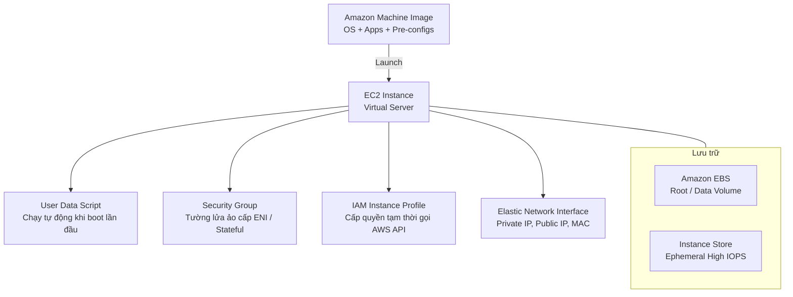
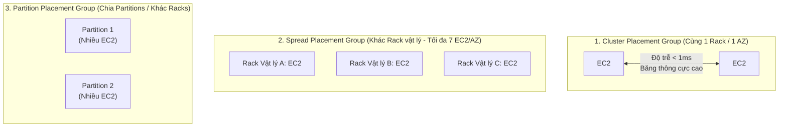
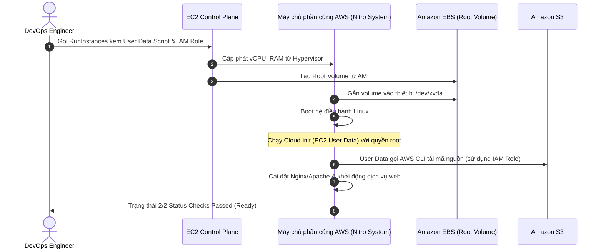

# Tài Liệu Học Tập Chuyên Sâu: Amazon EC2 (Elastic Compute Cloud) & Kiến Trúc Máy Chủ Ảo Đám Mây

> **Tài liệu chuẩn hóa kiến trúc đám mây**: Hướng dẫn toàn diện theo tiêu chuẩn Senior AWS Solutions Architect & Cloud DevOps Engineer.  
> **Ngôn ngữ**: Tiếng Việt (Bảo lưu toàn bộ thuật ngữ chuyên ngành tiếng Anh chuẩn AWS).  
> **Các bài giảng liên quan**: Chương 05 & 06 (EC2 Fundamentals & Solutions Architect Associate).

---

## 6.1. Tổng Quan Dịch Vụ (Service Overview)

### Dịch vụ gì?
**Amazon Elastic Compute Cloud (Amazon EC2)** là dịch vụ điện toán đám mây nền tảng cốt lõi của AWS (mô hình Infrastructure as a Service - IaaS), cung cấp năng lực tính toán an toàn, có khả năng định cỡ và mở rộng linh hoạt dưới dạng các máy chủ ảo (**EC2 Instances**).

### Các vấn đề giải quyết
1. **Loại bỏ việc mua sắm máy chủ vật lý tốn kém**: Không cần phải dự đoán dung lượng 3 năm tới và chờ hàng tuần/tháng để mua phần cứng máy chủ.
2. **Khởi tạo và hủy tài nguyên trong vài phút**: Cấp phát máy chủ ảo với hàng trăm cấu hình CPU/RAM khác nhau chỉ bằng một lệnh CLI hoặc click chuột.
3. **Co giãn quy mô linh hoạt (Elasticity)**: Tăng hoặc giảm số lượng máy chủ theo thời gian thực dựa trên lưu lượng người dùng truy cập.
4. **Tối ưu hóa chi phí với đa dạng mô hình thanh toán**: Từ On-Demand không ràng buộc đến Spot giảm giá tới 90%.

### Ưu điểm, Nhược điểm và Giới hạn
- **Ưu điểm**: Toàn quyền kiểm soát hệ điều hành (Root/Administrator access), đa dạng hệ điều hành (Amazon Linux, Ubuntu, Red Hat, Windows Server), tích hợp sâu với toàn bộ hệ sinh thái AWS.
- **Nhược điểm**: Khách hàng chịu trách nhiệm quản trị hệ điều hành (OS patching, security updates, firewall cấu hình); không có tính năng tự phục hồi dữ liệu trong RAM nếu máy ảo gặp sự cố phần cứng trừ khi có kiến trúc dự phòng.
- **Giới hạn**: Mặc định giới hạn vCPU per Region (Service Quota); địa chỉ Public IP sẽ thay đổi khi máy chủ Stop và Start lại trừ khi gắn Elastic IP.

---

## 6.2. Các Khái Niệm và Thành Phần Cốt Lõi (Core Concepts and Components)



### 1. Quy ước đặt tên kiểu máy chủ (Instance Types Naming Convention)
Cú pháp chuẩn của AWS: `[Family][Generation][Capabilities].[Size]`
- *Ví dụ*: **`m6i.xlarge`**
  - **`m`** (Family): Dòng máy đa dụng (General Purpose). Các dòng chính:
    - **`t/m`**: General Purpose (Cân bằng giữa Compute, Memory và Network).
    - **`c`**: Compute Optimized (Tối ưu cho xử lý tính toán nặng, render, batch processing).
    - **`r/x`**: Memory Optimized (Tối ưu RAM lớn cho cơ sở dữ liệu in-memory, cache, Redis).
    - **`i/d/h`**: Storage Optimized (Tối ưu ổ đĩa NVMe cục bộ cho Data Warehousing, NoSQL).
    - **`p/g/inf`**: Accelerated Computing (Trang bị GPU/NPU chuyên cho AI/ML Training & Inference).
  - **`6`** (Generation): Thế hệ phần cứng thứ 6 (càng cao càng mới và tối ưu).
  - **`i`** (Capabilities): Bộ vi xử lý Intel. (`a` = AMD EPYC, `g` = ARM-based AWS Graviton - tiết kiệm điện và rẻ hơn).
  - **`xlarge`** (Size): Kích thước tài nguyên (nano, micro, small, medium, large, xlarge, 2xlarge, 24xlarge...). Kích cỡ tăng gấp đôi thì số vCPU, RAM và băng thông mạng thường tăng gấp đôi.

### 2. Các mô hình mua sắm máy chủ (EC2 Purchasing Options)

| Mô hình mua sắm | Đặc điểm cốt lõi | Mức giảm chi phí | Kịch bản sử dụng phù hợp nhất |
| :--- | :--- | :--- | :--- |
| **On-Demand** | Trả tiền theo từng giây sử dụng; không cam kết trước; bật/tắt tùy ý. | Giá niêm yết chuẩn (0%) | Ứng dụng ngắn hạn, workload không dự đoán được lưu lượng, môi trường phát triển (Dev/Test). |
| **Reserved Instances (RI)** | Cam kết sử dụng loại instance cụ thể trong 1 năm hoặc 3 năm. Trả trước toàn bộ, một phần hoặc không trả trước. | Giảm tới **72%** | Ứng dụng chạy liên tục 24/7 ổn định (Core Database, ERP backend). |
| **Savings Plans** | Cam kết mức chi tiêu tính bằng USD/giờ (ví dụ $10/hour) trong 1 hoặc 3 năm. Linh hoạt đổi loại máy chủ, OS, Region. | Giảm tới **72%** | Chuẩn mực hiện đại thay thế RI: phù hợp cho doanh nghiệp có tổng chi tiêu điện toán ổn định nhưng linh hoạt công nghệ. |
| **Spot Instances** | Tận dụng năng lực tính toán nhàn rỗi còn thừa của AWS; AWS có thể thu hồi lại máy ảo bất kỳ lúc nào với cảnh báo trước 2 phút. | Giảm tới **90%** | Tác vụ xử lý hàng loạt (Batch jobs), phân tích dữ liệu Big Data, render video, CI/CD runners, container stateless. |
| **Dedicated Hosts** | Thuê trọn vẹn một máy chủ vật lý riêng biệt của AWS. Kiểm soát vị trí socket/core. | Tốn kém nhất | Phục vụ tuân thủ bản quyền phần mềm theo socket/core (BYOL - Microsoft, Oracle) hoặc quy định an ninh khắt khe. |
| **Dedicated Instances** | Máy ảo chạy trên phần cứng vật lý không chia sẻ với khách hàng khác, nhưng không kiểm soát socket/core. | Phụ phí theo giờ | Yêu cầu cô lập phần cứng theo chuẩn compliance. |
| **Capacity Reservations** | Đặt trước năng lực tính toán tại 1 Availability Zone cụ thể để đảm bảo chắc chắn có máy khi cần. | Giá On-Demand | Kịch bản khắc phục thảm họa (DR) hoặc mùa cao điểm mua sắm (Black Friday). |

### 3. Phân biệt Địa chỉ IP: Private IP vs Public IP vs Elastic IP
- **Private IPv4**: Luôn được cấp cho mọi máy ảo; không thay đổi trong suốt vòng đời của máy ảo; chỉ có thể định tuyến trong mạng nội bộ VPC.
- **Public IPv4**: Được cấp tự động nếu subnet cho phép; có thể truy cập từ Internet. **ĐẶC ĐIỂM SỐNG CÒN**: Khi bạn **Stop** máy ảo và **Start** lại, địa chỉ Public IP sẽ **BỊ THAY ĐỔI** thành một IP mới từ dải IP chung của AWS!
- **Elastic IP (EIP)**: Địa chỉ IPv4 tĩnh công khai do bạn sở hữu, không bị thay đổi khi Stop/Start máy ảo. Bạn có thể gỡ EIP từ máy ảo này để gắn sang máy ảo khác ngay lập tức khi xảy ra sự cố (Failover). *Lưu ý chi phí*: EIP miễn phí nếu đang được gắn vào một máy ảo EC2 đang chạy; nhưng sẽ bị AWS tính phí nếu để nhàn rỗi (Unassociated) để tránh lãng phí địa chỉ IPv4 hiếm hoi.

### 4. EC2 Placement Groups (Nhóm Đặt Vị Trí Máy Chủ)



1. **Cluster Placement Group**:
   - Toàn bộ máy ảo được đặt trên cùng một cụm phần cứng vật lý trong cùng **1 Availability Zone**.
   - *Ưu điểm*: Băng thông mạng cực lớn (lên tới 100 Gbps), độ trễ mạng cực thấp (< 1ms).
   - *Rủi ro*: Nếu rack phần cứng gặp sự cố, toàn bộ máy ảo đều sập (Điểm lỗi đơn lẻ SPOF). Phù hợp cho High Performance Computing (HPC), Big Data tính toán khoa học.
2. **Spread Placement Group**:
   - Mỗi máy ảo được đặt trên một rack phần cứng vật lý hoàn toàn riêng biệt (riêng nguồn điện, mạng).
   - Giới hạn: **Tối đa 7 máy ảo trên mỗi AZ**.
   - *Ưu điểm*: Tối đa hóa khả năng chịu lỗi, nếu 1 rack sập các máy khác vẫn hoạt động. Phù hợp cho các node cơ sở dữ liệu quan trọng, quorum nodes (Kafka, Cassandra).
3. **Partition Placement Group**:
   - Chia cụm máy ảo thành nhiều "Phân vùng" (Partitions - tối đa 7 phân vùng mỗi AZ). Các máy ảo trong phân vùng này sẽ không chia sẻ rack vật lý với phân vùng khác.
   - Phù hợp cho các hệ thống phân tán xử lý dữ liệu lớn (Hadoop, HDFS, Cassandra, Apache Kafka) có khả năng nhận biết topology phân vùng.

### 5. EC2 Hibernate (Chế Độ Ngủ Đông)
- Khi Stop máy ảo thông thường: Dữ liệu trong RAM bị xóa sạch; khi bật lại hệ điều hành phải boot lại từ đầu.
- Khi **Hibernate**: Toàn bộ trạng thái bộ nhớ RAM của máy ảo được ghi tức thời xuống ổ đĩa **EBS Root Volume**.
- Khi Start lại: Dữ liệu từ EBS được nạp ngược lại vào RAM, ứng dụng tiếp tục chạy đúng tại vị trí trước đó trong vòng vài giây mà không cần khởi động lại dịch vụ.
- *Điều kiện kỹ thuật*: Kích thước ổ đĩa EBS Root Volume phải đủ lớn để chứa toàn bộ dung lượng RAM; ổ cứng EBS phải được mã hóa (Encrypted); dung lượng RAM của instance không vượt quá 150 GB.

---

## 6.3. Kiến Trúc và Luồng Vận Hành (Architecture and Workflow)

### Sơ đồ luồng khởi chạy máy ảo với EC2 User Data & Instance Profile



---

## 6.4. Bảng Tích Hợp với Các Dịch Vụ AWS Khác (Integration Table)

| Related AWS Service | Purpose (Mục đích tích hợp) | Integration Method (Phương thức tích hợp) | Practical Example (Ví dụ thực tiễn) |
| :--- | :--- | :--- | :--- |
| **Amazon EBS** | Cung cấp ổ đĩa lưu trữ khối bền vững cho hệ điều hành và dữ liệu | Gắn trực tiếp qua mạng nội bộ AWS (Block Device Mapping) | Gắn ổ `gp3` dung lượng 100GB làm ổ cài đặt database PostgreSQL trên EC2. |
| **Elastic Load Balancing (ALB)** | Phân phối lưu lượng người dùng đồng đều tới cụm máy ảo EC2 | Đăng ký Instance ID vào Target Group | ALB đứng phía trước lắng nghe cổng 443 và phân phối traffic vào 5 máy chủ EC2 phía sau. |
| **Auto Scaling Group (ASG)** | Tự động tăng/giảm số lượng EC2 theo tải CPU hoặc lượng truy cập | Launch Template | Tự động bật thêm máy ảo `c6i.xlarge` khi CPU trung bình vượt quá 70%. |
| **AWS Systems Manager (SSM)** | Quản trị và truy cập dòng lệnh vào EC2 an toàn không cần mở cổng SSH (Port 22) | SSM Agent & Session Manager | Kỹ sư truy cập bash shell của máy ảo qua trình duyệt mà không cần Public IP và không cần Bastion Host. |
| **Amazon CloudWatch** | Thu thập chỉ số hiệu năng (CPU, Disk, Network) và gửi cảnh báo | Hypervisor Metrics & CloudWatch Agent | Tạo CloudWatch Alarm cảnh báo khi CPU máy chủ EC2 duy trì trên 90% trong 10 phút. |

---

## 6.5. Ví Dụ Cấu Hình và Triển Khai Thực Tế (Configuration & CLI Examples)

### 1. Khởi chạy EC2 Instance với User Data Script bằng AWS CLI

```bash
# Tạo script User Data cài đặt Apache Web Server
cat << 'EOF' > user_data.sh
#!/bin/bash
yum update -y
yum install -y httpd
systemctl start httpd
systemctl enable httpd
echo "<h1>Hello from AWS EC2 Instance: $(hostname -f)</h1>" > /var/www/html/index.html
EOF

# Khởi chạy EC2 instance t3.micro sử dụng Amazon Linux 2023 AMI
aws ec2 run-instances \
    --image-id ami-0c55b159cbfafe1f0 \
    --instance-type t3.micro \
    --key-name MyDevKeyPair \
    --security-group-ids sg-0123456789abcdef0 \
    --subnet-id subnet-0123456789abcdef0 \
    --user-data file://user_data.sh \
    --tag-specifications 'ResourceType=instance,Tags=[{Key=Name,Value=WebServer-Prod},{Key=Environment,Value=Production}]'
```

### 2. Khai báo EC2 Instance chuẩn hóa bằng Terraform

```hcl
resource "aws_instance" "web_server" {
  ami                  = "ami-0c55b159cbfafe1f0" # Amazon Linux 2023
  instance_type        = "t3.medium"
  subnet_id            = "subnet-xxxxxx"
  iam_instance_profile = "WebServerInstanceProfile"

  vpc_security_group_ids = [
    "sg-xxxxxx"
  ]

  # Kích hoạt bắt buộc sử dụng IMDSv2 để chống tấn công SSRF
  metadata_options {
    http_endpoint               = "enabled"
    http_tokens                 = "required" # IMDSv2
    http_put_response_hop_limit = 1
  }

  root_block_device {
    volume_type           = "gp3"
    volume_size           = 50
    encrypted             = true
    delete_on_termination = true
  }

  user_data = <<-EOF
              #!/bin/bash
              dnf update -y
              dnf install -y nginx
              systemctl start nginx
              systemctl enable nginx
              EOF

  tags = {
    Name        = "Core-API-Server"
    Environment = "Production"
  }
}
```

---

## 6.6. Bảo Mật và Thực Hành Tốt Nhất (Security Best Practices)

1. **Bảo vệ bằng Security Groups (Stateful Firewall)**:
   - Chỉ mở đúng cổng dịch vụ cần thiết (ví dụ: HTTP/80, HTTPS/443).
   - Tuyệt đối KHÔNG mở cổng SSH (Port 22) hay RDP (Port 3389) tới toàn thế giới (`0.0.0.0/0`). Chỉ cho phép từ IP VPN công ty hoặc IP tĩnh cá nhân.
2. **Loại bỏ SSH truyền thống - Thay thế bằng AWS Systems Manager Session Manager**:
   - Sử dụng **SSM Session Manager** cho phép kết nối terminal bảo mật vào máy ảo thông qua AWS API mà **không cần mở bất kỳ cổng Inbound nào trên Security Group** và không cần máy chủ phải có Public IP!
3. **Bắt buộc kích hoạt IMDSv2 (Instance Metadata Service Version 2)**:
   - IMDSv1 dễ bị tấn công qua lỗ hổng Server-Side Request Forgery (SSRF).
   - IMDSv2 bắt buộc phải tạo session token bằng phương thức HTTP `PUT` trước khi truy vấn metadata, chặn đứng các cuộc tấn công khai thác quyền của IAM Role từ xa.
4. **Mã hóa toàn bộ ổ cứng**:
   - Bắt buộc bật mã hóa (Encryption) với AWS KMS cho toàn bộ Root Volumes và Data Volumes.

---

---

## 6.7. Mô Hình Tính Phí Dịch Vụ & Chiến Lược Tối Ưu Chi Phí Theo Từng Use Case (EC2 Cost Breakdown & Optimization)

Điện toán đám mây Amazon EC2 thường chiếm từ **40% đến 65% tổng hóa đơn AWS** của một doanh nghiệp. Tối ưu chi phí EC2 không đơn thuần là tắt máy ảo không dùng, mà là nghệ thuật kết hợp giữa các mô hình mua sắm, kiến trúc vi xử lý và kỹ thuật định cỡ tải chính xác (Right-Sizing).

---

### 6.7.1. Bảng Phân Tích Cơ Chế Tính Phí Chi Tiết Của Amazon EC2

| Yếu tố Tính Phí | Cơ chế tính phí chi tiết (Pricing Dimensions) | Mức chiết khấu / Tiết kiệm | Rủi ro phát sinh chi phí (Cost Pitfalls) |
| :--- | :--- | :--- | :--- |
| **On-Demand Instances** | • Tính phí theo từng giây sử dụng (tối thiểu 60 giây đầu tiên cho Linux/Windows).<br>• Không cần cam kết trước, thanh toán linh hoạt. | **Mức giá cơ sở chuẩn (0% chiết khấu)**. | Chạy các hệ thống tải ổn định 24/7 bằng On-Demand trong nhiều năm gây lãng phí hàng nghìn USD. |
| **Compute Savings Plans** | • Cam kết mức chi tiêu cố định tính bằng **USD/giờ** (ví dụ $10/giờ) trong kỳ hạn **1 năm hoặc 3 năm**.<br>• Áp dụng linh hoạt tự động xuyên suốt: Mọi dòng EC2 (bất kể Family, Size, OS, Region), AWS Fargate và AWS Lambda! | **Tiết kiệm lên tới 66%** so với On-Demand. | Cam kết vượt quá mức tải sàn (Baseline) tối thiểu của doanh nghiệp. |
| **EC2 Instance Savings Plans** | • Cam kết sử dụng một dòng máy ảo cụ thể trong 1 Region (ví dụ: dòng `c6g` tại `ap-southeast-1`) trong 1 hoặc 3 năm.<br>• Cho phép thay đổi kích thước instance trong cùng dòng (từ `xlarge` lên `2xlarge`). | **Tiết kiệm lên tới 72%** (Cao hơn Compute Savings Plans). | Kém linh hoạt nếu ứng dụng cần đổi hẳn sang dòng khác (ví dụ từ Compute-optimized sang Memory-optimized). |
| **Spot Instances** | • Đấu thầu lượng tài nguyên điện toán dư thừa của AWS.<br>• AWS có quyền thu hồi máy ảo bất cứ lúc nào với **thông báo trước 2 phút (2-minute warning)** khi nhu cầu thị trường tăng cao. | **Tiết kiệm lên tới 90%** so với On-Demand! | Dùng Spot Instance cho Database hoặc các tác vụ Stateful quan trọng không hỗ trợ ngắt quãng. |
| **Bộ vi xử lý AWS Graviton (ARM)** | • Sử dụng các instance mang ký tự **`g`** (ví dụ `t4g`, `m7g`, `c7g`, `r7g`) chạy chip ARM Graviton tự chế của AWS.<br>• Giá niêm yết rẻ hơn khoảng 20% so với bản x86 (Intel/AMD) tương đương. | **Rẻ hơn 20% chi phí + Tăng tới 40% hiệu năng/chi phí** (Price-Performance). | Ứng dụng phụ thuộc vào các thư viện nhị phân cũ (compiled binaries) chỉ chạy trên kiến trúc x86. |
| **Địa chỉ Public IPv4** | • Áp dụng từ 01/02/2024: AWS tính phí **$0.005 / giờ / IP** (~$3.65 / tháng / IP) cho mọi Public IPv4 (cả đang gắn vào EC2 lẫn nhàn rỗi). | Phải trả phí cho mọi máy ảo bật Auto-assign Public IP. | Bật Public IP tràn lan cho các máy ảo ứng dụng backend nằm trong Public Subnet. |
| **Ổ đĩa lưu trữ đính kèm (EBS)** | • Tính phí riêng biệt theo GB dung lượng ổ đĩa, IOPS và Throughput cấp phát (xem chi tiết ở chuyên đề EBS). | Tính độc lập ngay cả khi EC2 đang ở trạng thái **Stopped**. | Quên tích chọn `DeleteOnTermination = true` khiến ổ cứng EBS vẫn tồn tại tính tiền sau khi xóa EC2. |

---

### 6.7.2. Chiến Lược Tối Ưu Hóa Chi Phí Theo 5 Kịch Bản Thực Tế (Use Cases Optimization)

#### Use Case 1: Tối ưu chi phí cho Ứng dụng Web / Microservices có Tải nền Ổn định + Đột biến
* **Vấn đề & Cách tính tiền cũ**:
  - Hệ thống vận hành một cụm 20 máy chủ `m5.xlarge` ($0.192/giờ) chạy liên tục quanh năm. Vào giờ cao điểm (Flash Sale), Auto Scaling mở rộng thêm 20 máy nữa.
  - Toàn bộ đều dùng On-Demand:
    $$\text{Tải nền (20 máy)} = 20 \times 0.192\$ \times 720 = \mathbf{2,764.80\$/\text{tháng}}$$
* **Giải pháp Tối ưu kiến trúc Đa Tầng (Multi-Tier Purchasing Strategy)**:
  1. **Tầng Tải Nền (Baseline Workload - 20 máy)**: Mua **Compute Savings Plans kỳ hạn 1 năm trả trước 1 phần (Partial Upfront)**. Mức chiết khấu đạt ~40%:
     $$\text{Chi phí Tải nền sau tối ưu} = 2,764.80\$ \times (1 - 0.40) = \mathbf{1,658.88\$/\text{tháng}}$$
  2. **Tầng Tải Đột Biến (Burst / Peak Workload - 20 máy)**: Sử dụng cấu hình kết hợp trong Auto Scaling Group (**Mixed Instances Policy**): Cấu hình 70% Spot Instances kết hợp 30% On-Demand Instances.
     - 14 Spot Instances được giảm giá 70%: $14 \times (0.192 \times 0.30) \times \text{giờ cao điểm}$.
* **Kết quả tiết kiệm**: Tiết kiệm hơn **$1,100/tháng (giảm > 40% tổng chi phí điện toán)** mà hệ thống vẫn duy trì độ sẵn sàng cao tuyệt đối.

#### Use Case 2: Chuyển đổi kiến trúc sang Vi xử lý AWS Graviton ARM (ARM Migration)
* **Vấn đề & So sánh chi phí**:
  - Doanh nghiệp đang chạy 50 microservices viết bằng Node.js, Python, Golang và Java trên dòng máy `c5.xlarge` (Intel x86 = $0.17/giờ).
  - Chi phí hàng tháng:
    $$\text{Chi phí Intel} = 50 \times 0.17\$ \times 720 = \mathbf{6,120\$/\text{tháng}}$$
* **Giải pháp Tối ưu kiến trúc**:
  - Vì các ngôn ngữ bậc cao (Node.js, Python, Go, Java) độc lập với kiến trúc phần cứng, chỉ cần re-build Docker container trên môi trường `linux/arm64`.
  - Chuyển toàn bộ 50 máy ảo sang dòng **`c7g.xlarge` (AWS Graviton3 ARM)** với giá chỉ **$0.145 / giờ**:
    $$\text{Chi phí Graviton} = 50 \times 0.145\$ \times 720 = \mathbf{5,220\$/\text{tháng}}$$
  - Ngoài ra, Graviton3 mang lại hiệu năng xử lý cao hơn 25%, cho phép giảm tải số lượng máy từ 50 xuống còn 42 máy:
    $$\text{Chi phí thực tế} = 42 \times 0.145\$ \times 720 = \mathbf{4,384.80\$/\text{tháng}}$$
* **Kết quả tiết kiệm**: Tiết kiệm **$1,735.20/tháng (~28.3% chi phí)** trong khi hiệu năng và thời gian phản hồi API nhanh hơn rõ rệt.

#### Use Case 3: Định cỡ tải chuẩn xác (Right-Sizing với AWS Compute Optimizer)
* **Vấn đề & Cách tính tiền cũ**:
  - Các kỹ sư thường có xu hướng cấu hình "dư dả" để an tâm. Ví dụ cấp phát máy chủ `m5.2xlarge` (8 vCPU, 32 GB RAM = $0.384/giờ) cho ứng dụng nội bộ.
  - Sau 3 tháng quan sát trên CloudWatch, mức sử dụng CPU thực tế trung bình chỉ đạt **3% - 6%** và RAM tiêu thụ dưới 4 GB.
  - Chi phí lãng phí: $0.384\$ \times 720 = \mathbf{276.48\$/\text{tháng / máy}}$.
* **Giải pháp Tối ưu**:
  - Kích hoạt dịch vụ **AWS Compute Optimizer** (sử dụng Machine Learning phân tích lịch sử CloudWatch Metrics).
  - Compute Optimizer khuyến nghị hạ cấp máy ảo xuống dòng **`t4g.medium` (2 vCPU, 4 GB RAM = $0.0336/giờ)**.
  - Chi phí sau khi hạ cỡ tải:
    $$\text{Chi phí sau hạ cấp} = 0.0336\$ \times 720 = \mathbf{24.19\$/\text{tháng / máy}}$$
* **Kết quả tiết kiệm**: Tiết kiệm **$252.29/tháng trên MỖI máy ảo (Giảm hơn 91% chi phí lãng phí)** mà ứng dụng vẫn vận hành trơn tru.

#### Use Case 4: Tự động hóa Lịch biểu Bật/Tắt cho Môi trường Non-Production (AWS Instance Scheduler)
* **Vấn đề & Cách tính tiền cũ**:
  - Doanh nghiệp duy trì 30 máy ảo EC2 phục vụ môi trường Dev, QA và Staging.
  - Các lập trình viên chỉ làm việc từ 08:30 sáng đến 18:30 tối từ Thứ Hai đến Thứ Sáu (~50 giờ/tuần).
  - Tuy nhiên, 30 máy ảo này vẫn bị để chạy liên tục 24/7 (168 giờ/tuần):
    - 118 giờ mỗi tuần máy ảo chạy hoàn toàn vô ích (buổi đêm và 2 ngày cuối tuần).
    - Tỷ lệ lãng phí thời gian: $118 / 168 = \mathbf{70.2\%}$!
* **Giải pháp Tối ưu**:
  - Triển khai giải pháp mã nguồn mở **AWS Instance Scheduler** (sử dụng Lambda và DynamoDB gắn Tag `Schedule = office-hours`).
  - Tự động Stop toàn bộ máy ảo Dev/QA vào lúc 19:00 các ngày trong tuần và bật lại vào lúc 08:00 sáng hôm sau; tắt hoàn toàn vào thứ Bảy và Chủ Nhật.
* **Kết quả tiết kiệm**: Cắt giảm ngay **70% chi phí chạy máy ảo** cho toàn bộ môi trường Dev/Test.

#### Use Case 5: Tối ưu Xử lý Hàng loạt và Huấn luyện AI với Spot Fleet Phân tán (Spot Diversification)
* **Vấn đề**: Tác vụ render video hoặc train model AI chạy hàng nghìn vCPU. Nếu dùng On-Demand thì chi phí lên đến hàng chục nghìn USD. Nhưng nếu dùng 1 loại Spot Instance duy nhất, khi loại máy đó bị AWS thu hồi (Spike demand), toàn bộ cụm sẽ sập.
* **Giải pháp Tối ưu**:
  - Cấu hình **Spot Fleet** sử dụng chiến lược cấp phát **Capacity-Optimized Allocation Strategy**.
  - Khai báo đa dạng hóa cấu hình (Diversify) qua nhiều instance families khác nhau: `c5.4xlarge`, `c5a.4xlarge`, `c6i.4xlarge`, `m5.4xlarge`.
  - Spot Fleet sẽ tự động chọn các pool phần cứng có dung lượng dư thừa lớn nhất trên AWS để phân bổ.
* **Kết quả tiết kiệm**: Đạt mức giảm giá **80% - 90%** so với On-Demand trong khi tỷ lệ máy ảo bị gián đoạn (Interruption Rate) giảm xuống **dưới 1%**.

---

## 6.8. Độ Tin Cậy và Xử Lý Sự Cố (Troubleshooting Guide)

| Vấn đề (Problem) | Nguyên nhân khả dĩ (Possible Causes) | Các bước điều tra (Investigation Steps) | Giải pháp (Solution) | Biện pháp phòng ngừa (Prevention) |
| :--- | :--- | :--- | :--- | :--- |
| **Lỗi `Connection Refused` khi kết nối SSH cổng 22** | Dịch vụ SSH Daemon (`sshd`) bên trong máy ảo bị crash hoặc chưa được bật. | Kiểm tra System Log của máy ảo qua EC2 Console (Actions -> Monitor and troubleshoot -> Get system log). | Sử dụng EC2 Serial Console hoặc gắn ổ đĩa EBS sang máy ảo phụ để sửa file cấu hình `sshd_config`. | Không chỉnh sửa file cấu hình SSH thủ công trên production. |
| **Lỗi `Connection Timed Out` khi kết nối SSH** | Security Group chặn Inbound traffic trên cổng 22, hoặc Route Table thiếu đường ra Internet Gateway. | 1. Kiểm tra Inbound Rules của Security Group.<br>2. Kiểm tra Route Table của Subnet có `0.0.0.0/0 -> igw` chưa. | Thêm rule cho phép IP của bạn truy cập cổng 22 trên SG và kiểm tra bảng định tuyến. | Chuyển sang sử dụng AWS Systems Manager Session Manager. |
| **Instance Status Check Failed (0/2 hoặc 1/2 Checks)** | - System Check Failed: Sự cố phần cứng vật lý của AWS.<br>- Instance Check Failed: Lỗi hệ điều hành, tràn bộ nhớ RAM, kernel panic. | Xem màn hình System Log và Instance Screenshot trên Console. | - Nếu System Check lỗi: **Stop và Start lại máy ảo** (AWS sẽ tự động chuyển máy ảo sang máy chủ vật lý mới lành lặn).<br>- Nếu Instance Check lỗi: Khởi động lại hệ điều hành hoặc tăng kích cỡ instance (Scale up). | Cấu hình CloudWatch Alarm tự động kích hoạt hành động **EC2 Auto-Recovery**. |
| **Lỗi `Unprotected Private Key File` khi SSH từ Linux/Mac** | File private key (`.pem`) có quyền hạn quá mở (bị hệ điều hành chặn vì không an toàn). | Chạy lệnh `ls -la my-key.pem` kiểm tra quyền file. | Chạy lệnh: `chmod 400 my-key.pem` để chỉ cấp quyền đọc cho người sở hữu file. | Lưu ý cấu hình quyền file ngay sau khi tải key pair từ AWS về máy. |

---

## 6.9. Các Kịch Bản Sử Dụng Trong Thực Tế (Real-World Use Cases)

### Kịch bản 1: Xử lý Tác vụ Khoa học Hiệu năng cao (HPC - High Performance Computing)
- **Kiến trúc**: Cụm 50 máy chủ `c6i.32xlarge` chạy mô phỏng dự báo thời tiết hoặc phân tích cấu trúc gen.
- **Giải pháp**:
  - Toàn bộ máy chủ được đặt trong một **Cluster Placement Group** tại 1 Availability Zone duy nhất.
  - Sử dụng card mạng **Elastic Fabric Adapter (EFA)** để vượt qua giới hạn của TCP thông thường, đạt độ trễ microsecond.
  - Kết hợp với hệ thống tệp chia sẻ tốc độ cao **Amazon FSx for Lustre**.

### Kịch bản 2: Tối ưu Chi phí cho Hệ thống Xử lý Video (Cost-Optimized Batch Processing)
- **Kiến trúc**: Hệ thống chuyển đổi mã hóa video người dùng tải lên mạng xã hội.
- **Giải pháp**:
  - Sử dụng **Spot Fleet** kết hợp giữa các dòng máy `c5`, `c6i`, `m5` để tối ưu chi phí giảm tới 80% so với On-Demand.
  - Ứng dụng ghi nhận checkpoint tiến độ xử lý video vào DynamoDB; nếu AWS thu hồi Spot Instance sau cảnh báo 2 phút, worker khác sẽ nhận lại công việc từ checkpoint mà không phải xử lý lại từ đầu.

---

## 6.10. Bộ Câu Hỏi Ôn Tập và Kiểm Tra Kiến Thức (Knowledge Review)

### A. 10 Câu hỏi Cốt lõi (Core Concepts)
1. Khi bạn **Stop** và **Start** lại một EC2 instance không có Elastic IP, địa chỉ Public IPv4 của nó có bị thay đổi không?
2. Kiểu máy chủ thuộc dòng nào (Instance Family) được thiết kế chuyên biệt cho các tác vụ cần dung lượng RAM khổng lồ như cơ sở dữ liệu in-memory?
3. Loại Placement Group nào giới hạn tối đa 7 máy ảo trên mỗi Availability Zone và đảm bảo các máy ảo nằm trên các rack phần cứng vật lý hoàn toàn riêng biệt?
4. Điều kiện kỹ thuật bắt buộc của ổ đĩa EBS Root Volume để máy ảo EC2 có thể sử dụng tính năng **Hibernate (Ngủ đông)** là gì?
5. Sự khác biệt giữa **Spot Instance** và **Spot Fleet** là gì?
6. Khi máy ảo khởi động lần đầu tiên, thành phần nào cho phép chạy tự động các câu lệnh bash script để cài đặt phần mềm và cấu hình hệ thống?
7. Security Group của EC2 hoạt động ở cấp độ nào (Instance/ENI hay Subnet) và có đặc tính Stateful hay Stateless?
8. Mô hình mua sắm EC2 nào cho phép giảm chi phí lên tới 72% bằng cách cam kết một mức chi tiêu cố định tính bằng USD/giờ trong 1 hoặc 3 năm?
9. Nếu một EC2 instance gặp lỗi **System Status Check Failed** (lỗi phần cứng máy chủ vật lý bên dưới của AWS), hành động đơn giản nhất mà kỹ sư có thể làm để chuyển máy sang phần cứng mới là gì?
10. Tại sao AWS khuyến nghị sử dụng **AWS Systems Manager Session Manager** thay thế cho việc mở cổng SSH (Port 22)?

---

### Đáp án Bộ Câu Hỏi Ôn Tập (Answer Key)

<details>
<summary>👉 Nhấp vào đây để xem toàn bộ đáp án chi tiết</summary>

1. **CÓ BỊ THAY ĐỔI**. Public IP của EC2 được cấp phát động từ pool của AWS và sẽ bị thu hồi khi máy ảo ở trạng thái Stopped; khi Start lại, máy sẽ nhận một Public IP hoàn toàn mới.
2. Dòng **`R`** (Memory Optimized) hoặc **`X`** (Extra Memory).
3. **Spread Placement Group**.
4. Ổ đĩa EBS Root Volume **bắt buộc phải được mã hóa (Encrypted)** và phải có dung lượng trống lớn hơn hoặc bằng tổng dung lượng RAM của instance để lưu trữ trạng thái bộ nhớ.
5. **Spot Instance** là một máy ảo Spot riêng lẻ; **Spot Fleet** là một tập hợp các Spot Instances (và có thể kèm theo cả On-Demand Instances) tự động lựa chọn từ nhiều Subnet, AZ và Instance Types khác nhau để đạt được mục tiêu dung lượng tính toán mong muốn với mức giá rẻ nhất.
6. **EC2 User Data** (chạy thông qua tiện ích `cloud-init` của hệ điều hành với quyền `root`).
7. Hoạt động ở cấp độ **Card mạng ảo (ENI / Instance level)** và có đặc tính **Stateful (Có trạng thái)**: nếu traffic đi vào được chấp thuận, traffic phản hồi tự động được thông qua mà không cần mở rule Outbound.
8. **Compute Savings Plans** (hoặc EC2 Instance Savings Plans).
9. Thực hiện thao tác **Stop máy ảo**, sau đó **Start lại**. Khi Start lại, AWS Control Plane sẽ tự động phân bổ máy ảo của bạn lên một máy chủ phần cứng vật lý hoàn toàn khác đang khỏe mạnh.
10. Vì Session Manager kết nối an toàn qua kênh mã hóa của AWS API và TLS: không yêu cầu mở cổng 22, không cần duy trì Public IP trên máy chủ, không cần quản lý SSH Key Pair, và toàn bộ các lệnh gõ trên shell đều được ghi lại nhật ký (Audit logs) đẩy về S3 hoặc CloudWatch Logs.
</details>

---

## 6.11. Tóm Tắt và Danh Mục Kiểm Tra Kiến Thức (Summary & Learning Checklist)

### 5 Khái niệm quan trọng nhất phải nhớ:
1. **Public IP động vs Elastic IP tĩnh**: Public IP thay đổi sau mỗi lần Stop/Start; Elastic IP giữ nguyên nhưng sẽ bị tính phí nếu để nhàn rỗi.
2. **Placement Groups**: Cluster (hiệu năng cao, cùng 1 rack), Spread (chịu lỗi cao, tối đa 7 máy/AZ), Partition (chia nhóm rack cho Big Data).
3. **Tối ưu chi phí bằng Purchasing Options**: On-Demand (ngắn hạn), Savings Plans (ổn định 1-3 năm), Spot (xử lý hàng loạt chấp nhận bị ngắt).
4. **Bảo mật EC2 bằng IMDSv2 và SSM Session Manager**: Chặn đứng lỗ hổng SSRF và xóa bỏ nhu cầu mở cổng SSH Port 22.
5. **EC2 User Data**: Chạy một lần duy nhất lúc khởi tạo máy ảo để cấu hình tự động.

### Bảng kiểm tra năng lực (Learning Checklist):
- [ ] Tôi hiểu rõ quy ước đặt tên các dòng instance của AWS (ví dụ: `m6i.xlarge`).
- [ ] Tôi biết cách xử lý khi máy ảo báo lỗi `Connection Timed Out` khi kết nối SSH.
- [ ] Tôi có thể phân biệt chính xác khi nào dùng Cluster, Spread hay Partition Placement Group.
- [ ] Tôi biết cách cấu hình EC2 User Data để triển khai một ứng dụng web tự động.
- [ ] Tôi hiểu cách thức hoạt động của EC2 Hibernate và các điều kiện kỹ thuật đi kèm.

### Liên kết và Chủ đề tiếp theo:
- 📖 [Ghi Chú Bài Học Chương 05: EC2 Fundamentals](file:///n:/AWS_XBrain_Note/Lesson_Notes/05_EC2_Fundamentals.md)
- 📖 [Ghi Chú Bài Học Chương 06: EC2 Advanced (EIP, Placement Groups, ENI)](file:///n:/AWS_XBrain_Note/Lesson_Notes/06_EC2_Solutions_Architect_Associate.md)
- 📖 [Bảng Thuật Ngữ Kỹ Thuật (GLOSSARY.md)](file:///n:/AWS_XBrain_Note/GLOSSARY.md)
- ⏭️ Tiếp tục chuyển sang chuyên đề: **Lưu Trữ EC2: Amazon EBS, EFS & Instance Store**.
