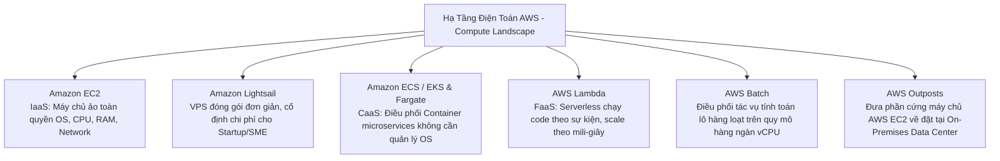
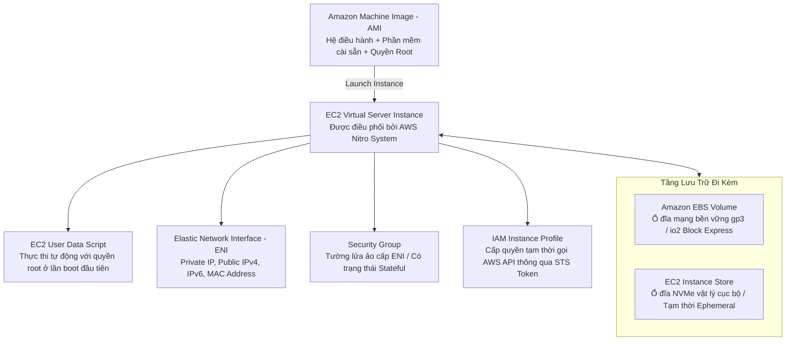
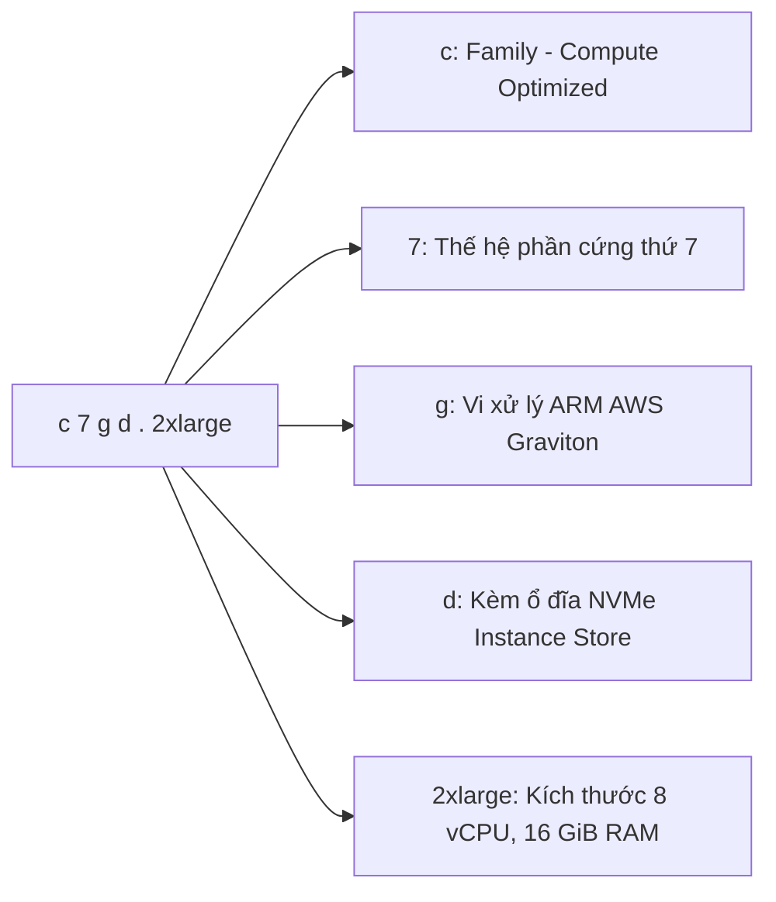
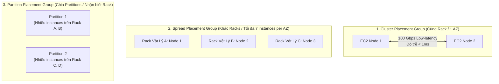
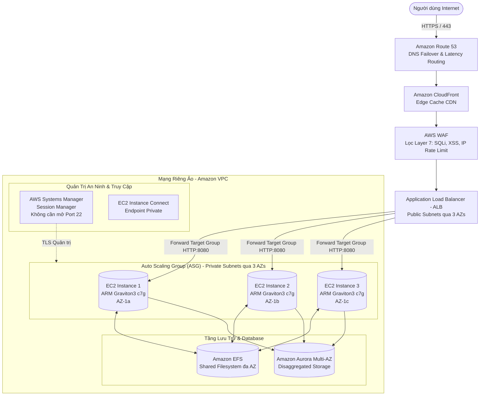
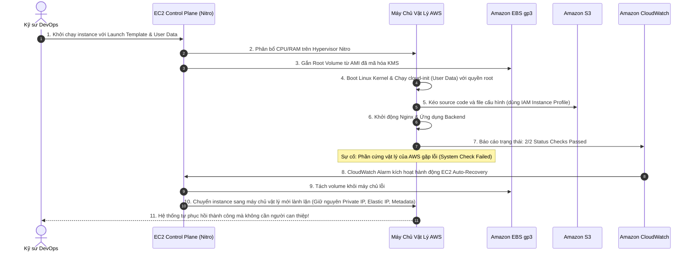

# Tài Liệu Học Tập Chuyên Sâu: Amazon EC2 (Elastic Compute Cloud) & Kiến Trúc Máy Chủ Ảo Đám Mây

> **Tài liệu chuẩn hóa kiến trúc đám mây**: Hướng dẫn toàn diện theo tiêu chuẩn Principal AWS Solutions Architect & Senior Cloud DevOps Engineer (Cập nhật phiên bản kiến trúc mới nhất 2026).  
> **Ngôn ngữ**: Tiếng Việt chuyên ngành (Bảo lưu toàn bộ thuật ngữ chuyên ngành tiếng Anh chuẩn AWS).  
> **Mục tiêu**: Phục vụ thi chứng chỉ cấp độ Professional/Specialty (**SAA-C03, SAP-C02, DOP-C02**) và vận hành hệ thống cấp độ doanh nghiệp (**Production-grade**).  
> **Các bài giảng liên quan**: Chương 05 (EC2 Fundamentals) & Chương 06 (EC2 Solutions Architect Associate).

---

## 6.1. Tổng Quan Dịch Vụ (Service Overview)

### 1. Định nghĩa chuẩn xác và Phân nhóm dịch vụ
**Amazon Elastic Compute Cloud (Amazon EC2)** là dịch vụ điện toán đám mây nền tảng cốt lõi của AWS (mô hình Infrastructure as a Service - IaaS), cung cấp năng lực tính toán an toàn, có khả năng định cỡ và mở rộng linh hoạt dưới dạng các máy chủ ảo (**EC2 Instances**).

---

### 2. Bài toán cốt lõi mà EC2 giải quyết

1. **Loại bỏ việc mua sắm phần cứng vật lý tốn kém (No CapEx)**: Xóa bỏ rủi ro ước tính sai dung lượng cho 3–5 năm tới và thời gian chờ đợi hàng tháng để nhập linh kiện máy chủ trung tâm dữ liệu.
2. **Khởi tạo và hủy tài nguyên tức thời (Elasticity & Agility)**: Cấp phát hàng trăm máy ảo với đa dạng cấu hình CPU/RAM chỉ trong vài phút qua API, AWS CLI hoặc Terraform; hủy bỏ ngay khi không còn nhu cầu.
3. **Mở rộng quy mô linh hoạt theo nhu cầu (Horizontal & Vertical Scalability)**: Thay đổi kích cỡ instance khi cần nâng cấp phần cứng, hoặc kết hợp với **Auto Scaling Groups (ASG)** để tự động tăng giảm số lượng máy chủ dựa trên lưu lượng thực tế.
4. **Tối ưu hóa chi phí với đa dạng mô hình thanh toán**: Từ On-Demand không ràng buộc, Spot giảm giá tới 90%, đến cam kết Savings Plans giảm giá tới 72%.

---

### 3. Khi nào KHÔNG nên dùng EC2 (Anti-patterns & Giải pháp thay thế)

* ❌ **Xử lý tác vụ ngắn hạn kích hoạt theo sự kiện (Event-driven Microtasks)**: Các hàm API xử lý ảnh, webhook phản hồi dưới 15 phút không nên duy trì máy ảo EC2 chạy 24/7 vì gây lãng phí 95% thời gian nhàn rỗi.  
  👉 *Giải pháp thay thế*: Sử dụng **AWS Lambda** (Serverless, chỉ trả tiền khi code thực thi).
* ❌ **Vận hành ứng dụng Microservices đóng gói dạng Container tiêu chuẩn**: Tự cài đặt Docker engine trên EC2 đòi hỏi phải tự viết script giám sát container crash, tự vá lỗi OS, tự cấu hình rolling updates.  
  👉 *Giải pháp thay thế*: Triển khai trên **Amazon ECS hoặc Amazon EKS với AWS Fargate** (Serverless Container).
* ❌ **Lưu trữ dữ liệu phi cấu trúc lớn tĩnh (Web Assets, Backups, Videos)**: Sử dụng EC2 đính kèm ổ đĩa EBS để làm file server chia sẻ ảnh/video sẽ tốn chi phí lưu trữ khối đắt đỏ và nghẽn băng thông instance.  
  👉 *Giải pháp thay thế*: Chuyển sang **Amazon S3** (Object Storage rẻ hơn, độ bền 11 số 9) kết hợp **Amazon CloudFront**.
* ❌ **Ứng dụng web/blog đơn giản, ngân sách cố định cho doanh nghiệp nhỏ**: Cấu hình EC2 + ALB + VPC quá phức tạp cho các trang web WordPress nhỏ.  
  👉 *Giải pháp thay thế*: Sử dụng **Amazon Lightsail** (gói trọn gói máy chủ, đĩa, IP và băng thông chỉ từ $3.50/tháng).

---

## 6.2. Các Khái Niệm, Kiến Trúc & Vận Hành Cốt Lõi (Core Concepts, Security & Day-2 Operations)

### 1. Sơ đồ các thành phần cốt lõi của một EC2 Instance

---

### 2. Quy ước đặt tên kiểu máy chủ & Phân loại dòng máy (Instance Types Naming Convention)

Cú pháp chuẩn hóa: `[Family][Generation][Capabilities].[Size]` (Ví dụ: **`c7g.2xlarge`**, **`m6i.xlarge`**, **`r7gd.4xlarge`**)

* **Các dòng máy chủ chính (Instance Families)**:
  - **Dòng Đa dụng (General Purpose - `t3, t4g, m6i, m7g`)**: Cân bằng tối ưu giữa Compute, Memory và Network. Dòng `t` có tính năng tăng cường xung nhịp (**Burstable Performance**) sử dụng cơ chế CPU Credits.
  - **Dòng Tối ưu Tính toán (Compute Optimized - `c6i, c7g, c8g`)**: Tỷ lệ vCPU/RAM cao, chuyên cho xử lý tính toán nặng, mã hóa video, máy chủ game, phân tích thuật toán, batch processing.
  - **Dòng Tối ưu Bộ nhớ (Memory Optimized - `r6i, r7g, x2idn`)**: Dung lượng RAM khổng lồ, chuyên cho cơ sở dữ liệu in-memory (Redis, Memcached), cơ sở dữ liệu quan hệ doanh nghiệp tải cao.
  - **Dòng Tối ưu Lưu trữ (Storage Optimized - `i3en, i4g, d3`)**: Trang bị ổ cứng thể rắn **NVMe SSD** gắn trực tiếp trên mainboard, cung cấp hàng triệu IOPS với độ trễ microsecond cho NoSQL (Cassandra, MongoDB), Data Warehouses.
  - **Dòng Tăng tốc Phần cứng (Accelerated Computing - `p5, g5, trn1, inf2`)**: Trang bị chip GPU NVIDIA H100/A10G hoặc chip chuyên dụng do AWS thiết kế (**AWS Trainium, AWS Inferentia**) phục vụ huấn luyện và chạy suy luận mô hình AI/LLM.

---

### 3. Bảng phân biệt các mô hình mua sắm máy chủ (EC2 Purchasing Options)

| Mô hình mua sắm | Cam kết thời gian | Mức giảm chi phí | Khả năng bị ngắt quãng | Kịch bản sử dụng chuẩn mực |
| :--- | :--- | :--- | :--- | :--- |
| **On-Demand** | Không cam kết (tính theo giây) | **0% (Giá chuẩn)** | Không bị ngắt quãng | Ứng dụng ngắn hạn, workload chưa dự đoán được tải, giai đoạn phát triển ban đầu (Dev/Test). |
| **Compute Savings Plans** | Cam kết chi tiêu ($/giờ) trong **1 hoặc 3 năm** | Giảm tới **66%** | Không bị ngắt quãng | **Chuẩn mực hiện đại tối ưu nhất**: Tự động áp dụng cho mọi instance EC2 (bất kể Family, Size, OS, Region) lẫn Fargate và Lambda. |
| **EC2 Instance Savings Plans** | Cam kết dòng máy tại 1 Region trong **1 hoặc 3 năm** | Giảm tới **72%** | Không bị ngắt quãng | Dành cho các hệ thống ổn định lâu dài trên một dòng máy cụ thể (ví dụ cam kết dòng `c7g` tại Singapore). |
| **Reserved Instances (Standard / Convertible)** | Cam kết loại instance trong 1 hoặc 3 năm | Giảm tới **72%** | Không bị ngắt quãng | Kế thừa truyền thống; Convertible cho phép đổi dòng instance; có thể bán lại trên **RI Marketplace**. |
| **Spot Instances** | Không cam kết (đấu thầu tài nguyên nhàn rỗi) | Giảm tới **90%** | **Có (Cảnh báo trước 2 phút)** | Tác vụ xử lý hàng loạt (Batch jobs), worker đọc hàng đợi SQS, render đồ họa 3D, CI/CD runners, tác vụ chịu lỗi. |
| **Dedicated Hosts** | Thuê trọn vẹn máy chủ vật lý riêng biệt | Chi phí cao nhất | Không bị ngắt quãng | Đáp ứng yêu cầu tuân thủ bản quyền phần mềm khắt khe theo Socket/Core (**BYOL - Microsoft Windows Server, SQL Server, Oracle**). |
| **Dedicated Instances** | Máy ảo chạy trên phần cứng cô lập | Phí phụ thu theo giờ | Không bị ngắt quãng | Doanh nghiệp yêu cầu không chia sẻ phần cứng vật lý với khách hàng khác (Tenant Isolation). |
| **Capacity Reservations** | Đặt trước năng lực tính toán tại 1 AZ cụ thể | Giá On-Demand | Không bị ngắt quãng | Đảm bảo 100% có sẵn máy chủ trong các dịp lễ cao điểm mua sắm (Black Friday) hoặc Disaster Recovery. |

---

### 4. Kiến trúc mạng & Định vị máy chủ (Networking, IPs & Placement Groups)

#### A. Phân biệt các loại địa chỉ IP trên EC2
* **Private IPv4**: Được gán tự động từ dải CIDR của Subnet; cố định không đổi trong suốt vòng đời của máy ảo; chỉ định tuyến trong mạng nội bộ VPC.
* **Public IPv4**: Cấp phát động từ pool chung của AWS khi bật tùy chọn `Auto-assign Public IP`.  
  ⚠️ **ĐIỂM SỐNG CÒN TRONG VẬN HÀNH & THI CỬ**: Khi bạn **Stop** máy ảo và **Start** lại, địa chỉ Public IPv4 sẽ **BỊ THU HỒI VÀ THAY ĐỔI THÀNH ĐỊA CHỈ MỚI**.
* **Elastic IP (EIP)**: Địa chỉ IPv4 tĩnh công khai cố định do tài khoản của bạn sở hữu; không thay đổi khi Stop/Start. Có thể tháo rời và gán lại tức thì sang instance khác để khắc phục sự cố.  
  ⚠️ **Cập nhật tính phí 2024–2026**: AWS tính phí **$0.005/giờ/IP** (~$3.65/tháng) cho **MỌI địa chỉ Public IPv4** (kể cả đang gắn vào máy ảo EC2 đang chạy lẫn EIP để nhàn rỗi).

#### B. EC2 Placement Groups (Nhóm Đặt Vị Trí Máy Chủ Vật Lý)

1. **Cluster Placement Group**:
   - Toàn bộ máy ảo được đặt trên cùng một cụm rack phần cứng vật lý trong **1 Availability Zone**.
   - *Ưu điểm*: Băng thông cực đại (lên tới 100 Gbps hoặc 200 Gbps), độ trễ cực thấp (< 1ms).
   - *Nhược điểm*: Rủi ro sập toàn bộ nếu rack gặp sự cố nguồn/mạng. Phù hợp cho High Performance Computing (HPC), Big Data phân tích khoa học.
2. **Spread Placement Group**:
   - Mỗi máy ảo được đặt trên một rack phần cứng vật lý hoàn toàn riêng biệt (riêng nguồn điện và switch mạng).
   - *Giới hạn cứng*: **Tối đa 7 máy ảo trên mỗi Availability Zone**.
   - *Ưu điểm*: Tối đa hóa khả năng chống chịu lỗi phần cứng. Phù hợp cho các node cơ sở dữ liệu quan trọng, quorum nodes (Apache Kafka, Zookeeper, Cassandra).
3. **Partition Placement Group**:
   - Nhóm máy ảo thành các phân vùng (Partitions - tối đa 7 phân vùng/AZ). Các instance trong cùng phân vùng không bao giờ chia sẻ rack vật lý với phân vùng khác.
   - Phù hợp cho các hệ thống phân tán xử lý dữ liệu lớn (HDFS, Apache Spark, Kafka) có cơ chế nhận biết topology mạng để tránh mất dữ liệu khi một partition gặp sự cố.

---

### 5. Vận hành, Bảo mật & Day-2 Operations

#### A. Kiến trúc bảo mật tầng sâu: IMDSv2 vs IMDSv1
* Dịch vụ **Instance Metadata Service (IMDS)** tại địa chỉ IP liên kết nội bộ `http://169.254.169.254/latest/meta-data/` cung cấp thông tin về instance (IP, AMI ID, IAM Security Credentials tạm thời).
* **IMDSv1 `[Deprecated - Khuyến nghị tắt hoàn toàn]`**: Sử dụng phương thức HTTP `GET` đơn giản, dễ bị tin tặc khai thác thông qua lỗ hổng **Server-Side Request Forgery (SSRF)** để đánh cắp IAM Role credentials.
* **IMDSv2 (Bắt buộc chuẩn an ninh 2026)**: Sử dụng cơ chế session-oriented dựa trên token. Bắt buộc phải thực hiện yêu cầu HTTP `PUT` kèm header `X-aws-ec2-metadata-token-ttl-seconds` để nhận Token, sau đó mới được truyền Token trong header `X-aws-ec2-metadata-token` để đọc dữ liệu. Thiết lập `http_put_response_hop_limit = 1` chặn đứng việc chuyển tiếp gói tin ra ngoài container hoặc reverse proxy.

#### B. Quản trị truy cập an toàn không mở cổng: AWS Systems Manager & EC2 Instance Connect Endpoint
* **Loại bỏ SSH (Port 22) và RDP (Port 3389) công khai**: Không bao giờ mở cổng 22/3389 tới `0.0.0.0/0` trên Security Group.
* **AWS Systems Manager Session Manager**: Kết nối trực tiếp vào console máy ảo thông qua giao thức TLS được mã hóa của AWS API. Không yêu cầu mở cổng Inbound nào trên Security Group, không cần Public IP và không cần duy trì Bastion Host. Mọi thao tác lệnh đều được ghi log kiểm toán vào Amazon S3 và CloudWatch Logs.
* **EC2 Instance Connect Endpoint (EICE)**: Giải pháp mạng riêng tư cho phép kết nối SSH/RDP tới máy ảo nằm trong Private Subnet mà không cần thiết lập Internet Gateway, NAT Gateway hay gán Public IP.

#### C. Chế độ ngủ đông (EC2 Hibernate)
* Khi **Stop** thông thường: Dữ liệu trên RAM bị xóa sạch; khi Start lại phải boot lại toàn bộ OS và nạp lại ứng dụng vào RAM (tốn từ 1–3 phút).
* Khi **Hibernate**: Trạng thái bộ nhớ RAM được ghi tức thời vào ổ đĩa **EBS Root Volume**. Khi Start lại, nội dung RAM được nạp ngược lại, ứng dụng tiếp tục xử lý ngay tại trạng thái trước đó chỉ trong vài giây.
* *Điều kiện kỹ thuật bắt buộc*: Ổ đĩa Root EBS **phải được mã hóa (KMS Encrypted)**; dung lượng trống của EBS Root phải lớn hơn dung lượng RAM; hỗ trợ các dòng máy có dung lượng RAM dưới 150 GiB.

---

### 🏛️ I. Các Kịch Bản Kiến Trúc Chuẩn (Best Practice Scenarios)

#### 1. Tính Toán Hiệu Năng Cao (HPC) Với Cluster Placement Groups & ENA
- **Tình huống thi**: Ứng dụng mô phỏng khí tượng, tài chính định lượng, hoặc xử lý trí tuệ nhân tạo phân tán cần trao đổi dữ liệu giữa các node tính toán với độ trễ mạng thấp nhất và thông lượng cao nhất có thể.
- **Giải pháp tối ưu chuẩn AWS**:
  - Triển khai cụm máy chủ EC2 bên trong một **Cluster Placement Group**.
  - **Cơ chế**: Toàn bộ các máy chủ được đặt gần nhau về mặt vật lý bên trong **cùng một Availability Zone**.
  - Kết hợp sử dụng card mạng **Elastic Network Adapter (ENA)** hoặc **Elastic Fabric Adapter (EFA)** để đạt băng thông mạng liên node lên tới 100 Gbps – 400 Gbps với độ trễ microsecond.
  - *Lưu ý*: Không triển khai Cluster Placement Group qua nhiều AZ.

#### 2. Xử Lý Tác Vụ Hàng Loạt (Batch Processing) Tiết Kiệm Tới 90% Bằng EC2 Spot Instances
- **Tình huống thi**: Hệ thống xử lý chuyển mã video hoặc tính toán dữ liệu lớn chạy theo lô, có khả năng chịu lỗi (fault-tolerant) và có thể tự động chạy lại nếu bị gián đoạn. Mục tiêu là tối thiểu hóa chi phí hạ tầng.
- **Giải pháp chuẩn**:
  - Sử dụng **EC2 Spot Instances** kết hợp với **AWS Batch** hoặc **EC2 Spot Fleet**.
  - Cắt giảm tới **90% chi phí** so với On-Demand.
  - Cấu hình ứng dụng lưu checkpoint thường xuyên lên S3 để khi nhận thông báo thu hồi máy chủ trước 2 phút (**2-Minute Spot Interruption Notice**), tiến trình có thể lưu lại trạng thái kịp thời.

#### 3. Quản Trị Tự Động Chi Phí Môi Trường Phi Sản Xuất Bằng AWS Instance Scheduler
- **Tình huống thi**: Doanh nghiệp có hàng trăm máy chủ EC2 và cơ sở dữ liệu RDS dành cho môi trường Dev/Test/QA. Các tài nguyên này chỉ cần chạy trong giờ hành chính (8h sáng - 6h tối, thứ 2 - thứ 6).
- **Giải pháp chuẩn**:
  - Triển khai giải pháp **AWS Instance Scheduler**.
  - Giải pháp sử dụng AWS Lambda và Amazon EventBridge để tự động gắn lịch Start/Stop tài nguyên dựa trên Resource Tags (ví dụ: `Schedule=office-hours`).
  - **Hiệu quả**: Tự động cắt giảm tới **70% chi phí máy chủ** cho các môi trường phi sản xuất mà không cần can thiệp thủ công mỗi ngày.

---

### 🪤 II. Các Bẫy Thi Tinh Vi & Phân Tích Phương Án Sai (Exam Traps & Distractors)

#### 🪤 Bẫy 1: Dedicated Hosts vs Dedicated Instances Cho Tuân Thủ Bản Quyền Phần Mềm (BYOL) — (U-PT6 Q34)
- **Tình huống đề thi**: *"Doanh nghiệp chuyển đổi máy chủ Windows Server và SQL Server lên AWS. Họ muốn tái sử dụng các bản quyền phần mềm hiện có (BYOL - Bring Your Own License) vốn được cấp phép theo số lượng Socket và Core vật lý của máy chủ. Giải pháp nào đáp ứng đúng yêu cầu?"*
- **Phân biệt rạch ròi 2 khái niệm**:

| Tiêu chuẩn so sánh | Dedicated Instances | Dedicated Hosts |
|:---|:---|:---|
| **Môi trường phần cứng** | Dedicated (không chung phần cứng với khách hàng khác) | Dedicated (toàn quyền sở hữu máy chủ vật lý) |
| **Kiểm soát Socket & Cores** | ❌ **KHÔNG** (AWS tự quản lý việc phân bổ vCPU) | ✅ **CÓ** (Hiển thị chi tiết số lượng Sockets & Cores vật lý) |
| **Hỗ trợ bản quyền BYOL** | ❌ Không hỗ trợ bản quyền tính theo Socket/Core vật lý | ✅ **Lựa chọn duy nhất** cho bản quyền tính theo Socket/Core |
| **Gán cố định máy chủ (Affinity)** | ❌ Không (khi restart có thể chuyển sang host khác) | ✅ Có (đảm bảo instance luôn chạy lại trên cùng host vật lý) |

- **Bẫy thi**: Chọn Dedicated Instances vì thấy chữ "Dedicated" -> **SAI**. Phải là **Dedicated Hosts** khi đề bài nhắc tới *BYOL, Core/Socket Visibility*.

#### 🪤 Bẫy 2: Vòng Đời Của EC2 User Data & Quyền Hạn Root — (U-PT2 Q29)
- **Tình huống đề thi**: *"Một kỹ sư cấu hình một đoạn script trong EC2 User Data để cập nhật bản vá phần mềm mỗi khi máy chủ khởi động lại. Tuy nhiên, script không chạy khi kỹ sư thực hiện Reboot máy chủ."*
- **Nguyên lý cốt lõi**:
  - Mặc định, đoạn mã trong **User Data chỉ thực thi DUY NHẤT 1 LẦN** trong lần khởi động đầu tiên (Initial Launch Boot Cycle) khi instance được tạo ra.
  - Các lần Reboot, Stop rồi Start tiếp theo sẽ **KHÔNG BAO GIỜ** kích hoạt lại User Data (trừ khi dùng cloud-init MIME multi-part đặc biệt).
  - **Quyền hạn**: Script User Data luôn tự động chạy dưới quyền **root** -> Không bao giờ cần viết lệnh `sudo` trong script.

#### 🪤 Bẫy 3: Khôi Phục Tự Động Máy Chủ Đơn Khối (Monolith) Với Chi Phí Rẻ Nhất — (U-PT6 Q44)
- **Tình huống đề thi**: *"Một ứng dụng thương mại legacy không hỗ trợ chạy song song nhiều máy chủ (Single-Instance Monolith) và bắt buộc phải giữ nguyên một địa chỉ IP công khai cố định. Cần thiết lập giải pháp có khả năng phục hồi tự động khi máy chủ gặp sự cố với chi phí thấp nhất."*
- **Các phương án bẫy**:
  - ❌ *Dùng Application Load Balancer đứng trước*: Tốn thêm chi phí duy trì ALB hàng tháng không cần thiết cho 1 máy chủ duy nhất.
  - ❌ *Triển khai 2 máy chủ chạy song song*: Ứng dụng không hỗ trợ đồng bộ dữ liệu phiên, vi phạm kiến trúc.
- **Giải pháp ĐÚNG**:
  - Tạo một **Auto Scaling Group trải dài trên nhiều AZs** với cấu hình: `Min=1, Max=1, Desired=1`.
  - Cấu hình đoạn script trong **User Data** sử dụng AWS CLI để tự động gán lại **Elastic IP (EIP)** cố định cho instance mới ngay khi instance đó vừa boot xong.
  - Khi máy chủ hoặc AZ hiện tại sập, ASG sẽ tự động phát hiện instance Unhealthy và khởi tạo instance thay thế ở AZ khác, sau đó tự gắn lại đúng địa chỉ EIP cũ.

#### 🪤 Bẫy 4: Chiến Lược Phân Bổ Spot Fleet Đa Dạng Hóa (Diversified Strategy) — (U-PT2 Q42)
- **Tình huống đề thi**: *"Hệ thống chạy các tác vụ phân tích batch quy mô lớn trên hàng trăm máy chủ có thể linh hoạt sử dụng nhiều cấu hình CPU và RAM khác nhau. Cần đảm bảo hệ thống không bị dừng hoàn toàn khi một loại instance Spot bị AWS thu hồi đột ngột."*
- **Giải pháp ĐÚNG**:
  - Cấu hình **EC2 Spot Fleet** với chiến lược phân bổ **`diversified`**.
  - Thay vì tập trung mua một loại máy chủ rẻ nhất (`lowestPrice`), chiến lược `diversified` sẽ tự động phân bổ số lượng máy chủ đều trên nhiều Spot Pools (nhiều instance types khác nhau như m5.large, c5.large, r5.large trải dài trên nhiều AZs).
  - Khi một pool cụ thể bị quá tải giá hoặc bị AWS thu hồi, chỉ một phần nhỏ máy chủ bị ảnh hưởng, toàn bộ phần còn lại của fleet vẫn duy trì hoạt động bình thường.

#### 🪤 Bẫy 5: Giới Hạn Cốt Lõi Của EC2 Ephemeral Instance Store — (U-PT6 Q50)
- **Bẫy bất biến**:
  - Instance Store là ổ đĩa vật lý gắn cứng vào bo mạch chủ của máy chủ EC2.
  - **KHÔNG THỂ gỡ ra (Detach)** khỏi instance này để gắn vào instance khác (muốn tính năng này phải dùng EBS).
  - Dữ liệu bị **xóa sạch vĩnh viễn** khi instance bị **STOP** hoặc **TERMINATE** hoặc máy chủ vật lý gặp sự cố phần cứng.
  - Dữ liệu trong Instance Store **KHÔNG được lưu vào AMI** khi bạn tạo image sao lưu.

---

### 📊 III. Ma Trận Quyết Định EC2 & Tính Toán Nhanh (Exam Decision Matrix)

| Tình huống / Yêu cầu trong đề thi | Giải pháp chuẩn AWS | Giải pháp bị loại & Lý do |
|:---|:---|:---|
| **Bản quyền BYOL tính theo Socket/Core vật lý** | **EC2 Dedicated Hosts** | Dedicated Instances (không kiểm soát được socket/core) |
| **Tính toán HPC mạng siêu nhanh, độ trễ thấp** | **Cluster Placement Group** (+ ENA/EFA) | Spread / Partition Placement Group |
| **Ứng dụng cực kỳ quan trọng, chống sập phần cứng** | **Spread Placement Group** (tối đa 7 instances/AZ) | Cluster Placement Group (rủi ro sập chung rack) |
| **Xử lý Batch chịu lỗi, tối thiểu chi phí 90%** | **EC2 Spot Fleet (Diversified Strategy)** | On-Demand Instances (chi phí quá cao) |
| **Phục hồi tự động máy chủ đơn khối (Monolith) + EIP** | **ASG (Min=1, Max=1) + EIP re-attach qua User Data** | Dùng ALB (tốn thêm chi phí duy trì hàng tháng) |
| **Tự động tắt máy chủ Dev ngoài giờ làm việc** | **AWS Instance Scheduler** | Viết script cron thủ công trên EC2 |
| **Lưu trữ tạm thời tốc độ cực cao, mất khi tắt máy** | **EC2 Instance Store** | Amazon EBS (độ trễ cao hơn Instance Store) |

---

---

---

## 6.3. Kiến Trúc Thực Tế và Luồng Vận Hành (Production Architecture & Workflow)

### 1. Sơ đồ kiến trúc Web Application chịu lỗi cao kết hợp ALB, ASG và Graviton EC2

---

### 2. Luồng khởi tạo tự động và Xử lý lỗi máy chủ (Auto-Recovery Workflow)

---

## 6.4. Bảng Tích Hợp với Các Dịch Vụ AWS Khác (Integration Table)

| Related AWS Service | Purpose (Mục đích tích hợp) | Integration Method (Phương thức kỹ thuật chính xác) | Practical Example (Ví dụ thực tiễn) |
| :--- | :--- | :--- | :--- |
| **AWS Systems Manager (SSM)** | Quản trị máy chủ, vá lỗi tự động và truy cập dòng lệnh không cần mở port SSH | **SSM Agent** cài sẵn trong AMI giao tiếp với SSM Endpoints qua HTTPS/443 | Kỹ sư truy cập bash shell của máy ảo trong Private Subnet qua trình duyệt bằng **Session Manager** mà không cần mở cổng 22. |
| **Amazon EBS** | Cung cấp ổ đĩa lưu trữ khối bền vững cho hệ điều hành và cơ sở dữ liệu | Gắn trực tiếp qua giao thức mạng chuyên dụng của phần cứng **AWS Nitro Card** | Gắn ổ `gp3` dung lượng 200 GiB cấp phát sẵn 6,000 IOPS làm ổ chứa transaction logs cho PostgreSQL trên EC2. |
| **Elastic Load Balancing (ALB)** | Cân bằng tải lưu lượng HTTP/HTTPS và kiểm tra sức khỏe máy chủ | Đăng ký Instance ID hoặc Private IP vào **Target Group** của ALB | ALB phân phối 50,000 requests/giây đều qua 10 máy ảo EC2 và tự động cô lập máy ảo nào có health check trả về mã lỗi HTTP 500. |
| **Auto Scaling Groups (ASG)** | Tự động điều chỉnh số lượng máy chủ theo nhu cầu tải thực tế | Khai báo cấu hình mẫu thông qua **EC2 Launch Template** | Tự động tăng từ 4 máy lên 12 máy `c7g.xlarge` khi chỉ số trung bình `CPUUtilization` của nhóm vượt quá 75% trong 3 phút. |
| **AWS IAM** | Cấp quyền ủy nhiệm an toàn cho ứng dụng chạy trên máy ảo gọi AWS APIs | Gắn **IAM Role** vào máy ảo thông qua **IAM Instance Profile** | Ứng dụng chạy trên EC2 tự động lấy temporary credentials từ IMDSv2 để upload file báo cáo lên S3 mà không cần lưu Access Key trong code. |
| **AWS KMS** | Mã hóa bảo vệ toàn bộ dữ liệu lưu trữ trên ổ đĩa Root và Data Volumes | Tích hợp gốc (**Native Integration**) với Amazon EBS sử dụng KMS CMK | Bắt buộc mã hóa toàn bộ ổ cứng EC2 bằng khóa KMS của doanh nghiệp; tự động từ chối khởi chạy máy ảo nếu ổ đĩa không được mã hóa. |
| **Amazon CloudWatch** | Thu thập chỉ số hiệu năng hệ thống, log ứng dụng và kích hoạt hành động phục hồi | Thu thập Hypervisor metrics kết hợp **CloudWatch Unified Agent** trong Guest OS | Cấu hình CloudWatch Alarm theo dõi metric `StatusCheckFailed_System` và tự động kích hoạt hành động **Recover this instance**. |

---

## 6.5. Bảng So Sánh Trong Hệ Sinh Thái AWS (Ecosystem Comparison)

| Tiêu chí | Amazon EC2 | AWS Lambda | Amazon ECS / EKS on Fargate | Amazon Lightsail |
| :--- | :--- | :--- | :--- | :--- |
| **Mô hình điện toán** | **IaaS (Infrastructure as a Service)** | **FaaS (Function as a Service)** | **CaaS (Containers as a Service)** | **PaaS / Đóng gói VPS đơn giản** |
| **Kiểm soát hệ điều hành** | **Toàn quyền (Root / SSH / Kernel access)** | ❌ Hoàn toàn trừu tượng hóa, không thể can thiệp OS | ❌ Chỉ kiểm soát Container runtime, AWS quản lý OS host |  Có quyền Root/SSH cơ bản |
| **Thời gian khởi động** | **1 – 3 phút** (Boot toàn bộ OS) | **Mili-giây đến vài giây** (Cold start) | **30 – 60 giây** (Kéo image và nạp task) | **1 – 2 phút** |
| **Thời gian chạy tối đa** | **Không giới hạn (24/7 liên tục)** | **Tối đa 15 phút** cho mỗi lần thực thi | **Không giới hạn** | **Không giới hạn** |
| **Cơ chế thanh toán** | Tính theo giây chạy máy ảo + EBS storage | Tính theo số lần gọi + Dung lượng RAM $\times$ thời gian chạy (mili-giây) | Tính theo vCPU và RAM cấp phát cho Container theo giây | Gói cước trọn gói cố định hàng tháng ($3.50, $5, $10...) |
| **Kịch bản sử dụng chuẩn** | Ứng dụng monolithic phức tạp, phần mềm thương mại kế thừa, can thiệp OS sâu | API microservices không trạng thái, xử lý ảnh, webhook, cronjobs tự động | Hệ thống microservices quy mô lớn, containerized APIs, Kubernetes chuẩn | Website doanh nghiệp nhỏ, blog WordPress cá nhân, môi trường học tập |

---

## 6.6. Mô Hình Tính Phí & Chiến Lược Tối Ưu Chi Phí (FinOps & Cost Optimization)

Điện toán đám mây Amazon EC2 thường chiếm từ **40% đến 65% tổng hóa đơn AWS** của doanh nghiệp. Áp dụng chuẩn xác các chiến lược FinOps 2026 sẽ giúp tiết kiệm từ 30% đến 80% chi phí.

---

### 6.6.1. Bảng Phân Tích Cơ Chế Tính Phí Chi Tiết Của Amazon EC2

| Thành phần tính phí | Cơ chế tính phí (Pricing Dimensions) | Mức phí tham chiếu điển hình (US-East-1) | Bẫy chi phí nghiêm trọng (Cost Pitfalls) |
| :--- | :--- | :--- | :--- |
| **On-Demand Instance Hours** | • Tính theo từng giây máy chạy (tối thiểu 60 giây đầu tiên). • Dòng chip **AWS Graviton (`m7g`, `c7g`) rẻ hơn ~20%** so với x86 (`m6i`, `c6i`). | `t4g.medium`: ~$0.0336/giờ. `m7g.xlarge`: ~$0.1632/giờ. `m6i.xlarge`: ~$0.192/giờ. | Duy trì máy ảo On-Demand chạy 24/7 liên tục qua nhiều năm thay vì mua Savings Plans. |
| **Compute Savings Plans** | • Cam kết chi tiêu tính bằng **USD/giờ** trong 1 hoặc 3 năm. • Tự động áp dụng xuyên suốt: EC2, Fargate, Lambda. | Giảm tới **66%** so với On-Demand. | Mua cam kết vượt quá mức tải sàn (Baseline Workload) tối thiểu của hệ thống. |
| **Spot Instances** | • Tận dụng tài nguyên nhàn rỗi còn thừa của AWS. • Bị thu hồi với thông báo trước 2 phút khi nhu cầu thị trường tăng. | Giảm tới **70% – 90%** so với On-Demand. | Dùng Spot cho cơ sở dữ liệu quan trọng hoặc các ứng dụng Stateful không thể chịu ngắt quãng. |
| **Địa chỉ Public IPv4** | • Áp dụng từ 2024–2026: AWS tính phí **$0.005 / giờ / IP** cho TẤT CẢ các Public IPv4 (cả đang gắn vào EC2 lẫn nhàn rỗi). | ~$3.65 / tháng cho mỗi Public IP. | Bật `Auto-assign Public IP` tràn lan cho hàng trăm máy ảo backend nằm trong Public Subnet thay vì để trong Private Subnet. |
| **Lưu trữ Amazon EBS đính kèm** | • Tính phí theo GB dung lượng ổ đĩa, IOPS và Throughput cấp phát (ngay cả khi EC2 đang ở trạng thái **Stopped**). | `gp3`: $0.08 / GiB / tháng. `io2`: $0.125 / GiB + $0.065 / IOPS. | Xóa máy ảo EC2 nhưng quên bỏ chọn tùy chọn `DeleteOnTermination = true`, khiến ổ cứng EBS vô chủ (Orphaned EBS) vẫn âm thầm tính tiền hàng tháng. |

---

### 6.6.2. Chiến Lược Tối Ưu Hóa Chi Phí Theo 5 Kịch Bản Thực Tế (Use Cases Optimization)

#### Kịch bản 1: Tối Ưu Chi Phí Ứng Dụng Web Kết Hợp Savings Plans và Spot trong ASG
* **Bối cảnh thực tế**:
  Hệ thống thương mại điện tử vận hành cụm 20 máy chủ `m6i.xlarge` (Intel x86 = $0.192/giờ) chạy liên tục làm tải nền (Baseline). Vào khung giờ vàng khuyến mãi, hệ thống mở rộng thêm 20 máy nữa (Peak Workload - trung bình 6 giờ/ngày $\times$ 30 ngày = 180 giờ/tháng). Ban đầu toàn bộ 100% đều chạy On-Demand.
* **Chi phí ban đầu**:
  $$\text{Tải nền (20 máy 24/7)} = 20 \times 0.192\$ \times 720 \text{ giờ} = 2,764.80\$$$
  $$\text{Tải cao điểm (20 máy 180 giờ)} = 20 \times 0.192\$ \times 180 \text{ giờ} = 691.20\$$$
  $$\text{Tổng chi phí On-Demand ban đầu} = 2,764.80\$ + 691.20\$ = \mathbf{3,456.00\$/\text{tháng}}$$
* **Chiến lược tối ưu hóa**:
  1. Mua gói **Compute Savings Plans 1 năm (Partial Upfront)** cho 20 máy tải nền với mức chiết khấu ~40%:
     $$\text{Chi phí Tải nền mới} = 2,764.80\$ \times (1 - 0.40) = 1,658.88\$$$
  2. Cấu hình **Auto Scaling Group Mixed Instances Policy** cho 20 máy tải cao điểm: 80% Spot Instances (giảm giá 70%) kết hợp 20% On-Demand:
     $$\text{4 máy On-Demand} = 4 \times 0.192\$ \times 180 = 138.24\$$$
     $$\text{16 máy Spot (giảm 70%)} = 16 \times (0.192\$ \times 0.30) \times 180 = 165.89\$$$
     $$\text{Chi phí Tải cao điểm mới} = 138.24\$ + 165.89\$ = 304.13\$$$
  $$\text{Tổng chi phí sau tối ưu} = 1,658.88\$ + 304.13\$ = \mathbf{1,963.01\$/\text{tháng}}$$
* **Kết quả tiết kiệm**:
  $$\text{Số tiền tiết kiệm} = 3,456.00\$ - 1,963.01\$ = \mathbf{1,492.99\$/\text{tháng}} \quad (\approx \mathbf{17,915\$/\text{năm}})$$
  **Tỷ lệ tiết kiệm đạt ~43.2% tổng chi phí điện toán** mà vẫn đảm bảo độ khả dụng cao.

---

#### Kịch bản 2: Di Chuyển Kiến Trúc Sang Vi Xử Lý ARM AWS Graviton3
* **Bối cảnh thực tế**:
  Doanh nghiệp vận hành 40 microservices viết bằng Node.js, Python, Golang chạy trên máy chủ Intel `c6i.xlarge` (4 vCPU, 8 GiB RAM = $0.17/giờ).
  $$\text{Chi phí Intel ban đầu} = 40 \times 0.17\$ \times 720 = \mathbf{4,896.00\$/\text{tháng}}$$
* **Chiến lược tối ưu hóa**:
  1. Re-build Docker container sang kiến trúc đa nền tảng (`linux/arm64`).
  2. Chuyển đổi toàn bộ sang máy ảo **`c7g.xlarge` (AWS Graviton3 ARM)** với giá chỉ **$0.145/giờ**:
  3. Nhờ hiệu năng của Graviton3 cao hơn 25%, số lượng máy chủ cần thiết để xử lý cùng lượng tải giảm từ 40 máy xuống còn **32 máy**:
  $$\text{Chi phí Graviton thực tế} = 32 \times 0.145\$ \times 720 = \mathbf{3,340.80\$/\text{tháng}}$$
* **Kết quả tiết kiệm**:
  $$\text{Số tiền tiết kiệm} = 4,896.00\$ - 3,340.80\$ = \mathbf{1,555.20\$/\text{tháng}} \quad (\approx \mathbf{18,662\$/\text{năm}})$$
  **Tỷ lệ tiết kiệm đạt ~31.8% chi phí**, đồng thời giảm thời gian phản hồi API (P99 Latency) xuống 20%.

---

#### Kịch bản 3: Định Cỡ Tải Chuẩn Xác (Right-Sizing Với AWS Compute Optimizer)
* **Bối cảnh thực tế**:
  Nhóm kỹ sư cấp phát dư dả 10 máy chủ `m5.2xlarge` (8 vCPU, 32 GiB RAM = $0.384/giờ) cho các dịch vụ nội bộ. Dữ liệu giám sát CloudWatch trong 30 ngày cho thấy mức tiêu thụ CPU thực tế trung bình chỉ **4%** và RAM tiêu thụ dưới **6 GiB**.
  $$\text{Chi phí 10 máy dư tải} = 10 \times 0.384\$ \times 720 = \mathbf{2,764.80\$/\text{tháng}}$$
* **Chiến lược tối ưu hóa**:
  - Dựa trên khuyến nghị của **AWS Compute Optimizer**, hạ cấp máy chủ xuống dòng **`t4g.large` (2 vCPU, 8 GiB RAM = $0.0672/giờ)**.
  $$\text{Chi phí sau hạ cấp} = 10 \times 0.0672\$ \times 720 = \mathbf{483.84\$/\text{tháng}}$$
* **Kết quả tiết kiệm**:
  $$\text{Số tiền tiết kiệm} = 2,764.80\$ - 483.84\$ = \mathbf{2,280.96\$/\text{tháng}} \quad (\approx \mathbf{27,371\$/\text{năm}})$$
  **Tỷ lệ tiết kiệm đạt ~82.5%** mà không gây ảnh hưởng tới trải nghiệm người dùng nội bộ.

---

#### Kịch bản 4: Tự Động Hóa Lịch Trình Tắt/Bật Môi Trường Dev/QA Bằng Instance Scheduler
* **Bối cảnh thực tế**:
  Doanh nghiệp duy trì 25 máy ảo `t3.xlarge` ($0.1664/giờ) phục vụ môi trường Dev và QA. Đội ngũ lập trình viên chỉ làm việc 10 giờ/ngày (từ 08:00 đến 18:00) từ thứ Hai đến thứ Sáu (khoảng 220 giờ/tháng). Tuy nhiên, 25 máy này bị để chạy liên tục 24/7 (720 giờ/tháng).
  $$\text{Chi phí chạy 24/7} = 25 \times 0.1664\$ \times 720 = \mathbf{2,995.20\$/\text{tháng}}$$
* **Chiến lược tối ưu hóa**:
  - Triển khai **AWS Instance Scheduler** (sử dụng Amazon EventBridge và Lambda): tự động Stop máy ảo vào lúc 18:30 và Start lại vào lúc 07:30 các ngày làm việc, tắt hoàn toàn vào thứ Bảy và Chủ Nhật.
  $$\text{Chi phí sau khi tự động tắt bật (220 giờ)} = 25 \times 0.1664\$ \times 220 = \mathbf{915.20\$/\text{tháng}}$$
* **Kết quả tiết kiệm**:
  $$\text{Số tiền tiết kiệm} = 2,995.20\$ - 915.20\$ = \mathbf{2,080.00\$/\text{tháng}} \quad (\approx \mathbf{24,960\$/\text{năm}})$$
  **Tỷ lệ tiết kiệm đạt ~69.4% chi phí** cho toàn bộ hạ tầng thử nghiệm!

---

#### Kịch bản 5: Thu Hồi Địa Chỉ Public IPv4 và Dọn Dẹp Ổ Đĩa EBS Vô Chủ (Orphaned EBS)
* **Bối cảnh thực tế**:
  Một tài khoản AWS có 50 máy ảo backend nằm trong Public Subnet được bật cờ `Auto-assign Public IP` ($0.005/giờ/IP). Ngoài ra, sau nhiều lần xóa máy ảo EC2 mà không bật cờ `DeleteOnTermination`, tài khoản còn tồn đọng **40 ổ đĩa EBS gp2 vô chủ** (mỗi ổ 100 GiB = 4,000 GiB) đang bị bỏ quên.
  $$\text{Chi phí Public IPv4 lãng phí} = 50 \times 0.005\$ \times 720 = 180.00\$/\text{tháng}$$
  $$\text{Chi phí EBS vô chủ lãng phí} = 4,000 \text{ GiB} \times 0.10\$ = 400.00\$/\text{tháng}$$
  $$\text{Tổng lãng phí thụ động} = 180.00\$ + 400.00\$ = \mathbf{580.00\$/\text{tháng}}$$
* **Chiến lược tối ưu hóa**:
  1. Chuyển toàn bộ 50 máy ảo backend vào **Private Subnet** không có Public IP; truy cập qua Application Load Balancer và SSM Session Manager.
  2. Viết script AWS CLI chụp snapshot các ổ EBS vô chủ quan trọng rồi thực hiện xóa sạch (`DeleteVolume`) 40 ổ đĩa này.
* **Kết quả tiết kiệm**:
  $$\text{Số tiền tiết kiệm} = \mathbf{580.00\$/\text{tháng}} \quad (\approx \mathbf{6,960\$/\text{năm}})$$
  **Tiết kiệm 100% chi phí lãng phí thụ động** mà hệ thống lại an toàn hơn trước các đợt quét cổng Internet.

---

## 6.7. Khắc Phục Sự Cố Thực Tế (Troubleshooting Guide)

| Vấn đề (Problem) | Nguyên nhân khả dĩ (Possible Causes) | Các bước điều tra (Investigation Steps - Metrics/Logs) | Giải pháp xử lý (Solution) | Biện pháp phòng ngừa (Prevention) |
| :--- | :--- | :--- | :--- | :--- |
| **Lỗi `Connection Timed Out` khi kết nối SSH cổng 22** | • Security Group chưa cho phép Inbound cổng 22 từ IP của bạn. • Subnet Route Table thiếu đường định tuyến `0.0.0.0/0` tới Internet Gateway (IGW). • Network ACL của Subnet chặn cổng 22. | 1. Kiểm tra Inbound Rules của Security Group. 2. Kiểm tra Route Table của Subnet có `igw-xxxx` chưa. 3. Sử dụng công cụ **VPC Reachability Analyzer** phân tích đường truyền từ Internet tới ENI của EC2. | Thêm Inbound Rule cho phép địa chỉ IP của bạn trên Security Group và kiểm tra route table. | Chuyển sang kết nối an toàn bằng **AWS Systems Manager Session Manager** để không cần mở cổng 22. |
| **Lỗi `Host Key Verification Failed` hoặc `Unprotected Private Key File`** | Quyền file `.pem` quá lỏng lẻo (`chmod 777` hoặc `644`), hệ điều hành client từ chối kết nối vì lý do bảo mật. | Kiểm tra quyền file bằng lệnh `ls -la my-key.pem` trên máy tính cá nhân. | Chạy lệnh phân quyền nghiêm ngặt: `chmod 400 my-key.pem` (chỉ cho phép user hiện tại đọc). | Khóa quyền file `.pem` ngay sau khi tải về từ AWS Management Console. |
| **Status Check Failed: `System Status Check Failed` (0/2 hoặc 1/2 Checks)** | Sự cố phần cứng vật lý bên dưới của máy chủ AWS (mất điện rack, hỏng nguồn, lỗi switch mạng vật lý). | Xem mục **Status Checks** trên EC2 Console và xem ảnh chụp màn hình qua **Get Instance Screenshot**. | Thực hiện thao tác **Stop** máy ảo, sau đó **Start** lại (AWS sẽ tự động cấp phát máy ảo trên một máy chủ vật lý mới lành lặn). | Thiết lập CloudWatch Alarm tự động kích hoạt hành động **EC2 Auto-Recovery**. |
| **Status Check Failed: `Instance Status Check Failed` (1/2 Checks)** | Lỗi hệ điều hành bên trong máy ảo: Kernel Panic, tràn RAM (OOM - Out of Memory), file hệ thống bị hỏng (`fsck error`). | Xem chi tiết nguyên nhân trong **System Log** (`Actions -> Monitor and troubleshoot -> Get system log`). | Khởi động lại máy ảo (Reboot). Nếu do tràn RAM, hãy nâng kích thước instance (Scale Up) lên dòng có nhiều RAM hơn. | Cài đặt **CloudWatch Agent** theo dõi metric `mem_used_percent` và đặt cảnh báo khi RAM vượt quá 85%. |
| **CPU máy ảo duy trì 100% nhưng ứng dụng bị treo (CPU Throttling trên dòng `t3/t4g`)** | Máy ảo dòng Burstable (`t3`, `t4g`) cạn kiệt số lượng **CPU Credits**, khiến hiệu năng CPU bị bóp nghẹt về mức cơ sở (Baseline Performance). | Xem metric CloudWatch **`CPUCreditBalance`** (bằng 0) và **`CPUSurplusCreditCharged`**. | 1. Nâng cấp instance sang dòng có CPU chuyên dụng như `c7g` hoặc `m7g`. 2. Bật chế độ **T2/T3 Unlimited** để cho phép máy vượt ngưỡng baseline (chấp nhận phụ phí). | Đặt CloudWatch Alarm cảnh báo khi `CPUCreditBalance < 50` để chủ động xử lý trước khi hệ thống bị chậm. |
| **Lỗi `No space left on device` khi cài đặt phần mềm** | Ổ đĩa Root EBS bị đầy 100% do file log ứng dụng phình to hoặc Docker images không được dọn dẹp. | Chạy lệnh `df -h` kiểm tra dung lượng từng phân vùng ổ đĩa. | 1. Tăng dung lượng ổ đĩa EBS trực tiếp trên Console (Elastic Volumes) từ 20 GiB lên 50 GiB. 2. Chạy lệnh mở rộng phân vùng: `growpart /dev/xvda 1` và `xfs_growfs -d /` (hoặc `resize2fs`). | Cấu hình log rotation (`logrotate`) và đẩy log lên Amazon CloudWatch Logs thay vì lưu trữ cục bộ. |

---

---

## 6.8. Tóm Tắt và Danh Mục Kiểm Tra Kiến Thức (Summary & Learning Checklist)

### 7 Nguyên Tắc Kiến Trúc "Sống Còn" Của Amazon EC2 (Golden Rules)
1. **Quản lý địa chỉ IP chuẩn xác**: Public IP của EC2 sẽ thay đổi sau mỗi lần Stop/Start; chỉ sử dụng **Elastic IP** khi thực sự cần IP tĩnh công khai (lưu ý phí $0.005/giờ/IP).
2. **Quy tắc chọn Placement Group**:  
   - Cần độ trễ mạng < 1ms cho HPC $\rightarrow$ **Cluster Placement Group** (cùng 1 rack trong 1 AZ).  
   - Cần chịu lỗi tối đa cho Quorum/Database $\rightarrow$ **Spread Placement Group** (khác rack, tối đa 7 máy/AZ).  
   - Cần phân vùng cho Big Data Hadoop/Kafka $\rightarrow$ **Partition Placement Group**.
3. **Bảo mật không cổng mở (Zero-Open-Port Security)**:  
   Không mở cổng SSH 22 hay RDP 3389 ra Internet; sử dụng **AWS Systems Manager Session Manager** hoặc **EC2 Instance Connect Endpoint** để truy cập nội bộ an toàn.
4. **Bắt buộc bật IMDSv2**:  
   Luôn cấu hình `http_tokens = required` và `hop_limit = 1` trên mọi EC2 Launch Template để chặn đứng nguy cơ rò rỉ quyền IAM qua lỗ hổng SSRF.
5. **Chiến lược FinOps đa tầng**:  
   Dùng **Compute Savings Plans** cho tải nền ổn định 24/7 (tiết kiệm tới 66%), và dùng **Spot Instances** cho tải đột biến/batch jobs trong ASG (tiết kiệm tới 90%).
6. **Tối ưu hóa hiệu năng với AWS Graviton**:  
   Ưu tiên lựa chọn các dòng máy chip ARM Graviton3/4 (`m7g`, `c7g`, `r7g`) để đạt tỷ lệ giá/hiệu năng tốt hơn tới 40% so với x86.
7. **Tự động phục hồi lỗi phần cứng**:  
   Luôn cấu hình CloudWatch Alarm theo dõi metric `StatusCheckFailed_System` kết hợp hành động **EC2 Auto-Recovery** để hệ thống tự chuyển sang máy chủ vật lý mới khi phần cứng AWS gặp sự cố.

---

### Liên Kết Nội Bộ và Tài Liệu Tham Khảo (Internal Links)
- 📖 [Ghi Chú Bài Học Chương 05: EC2 Fundamentals](../Lesson_Notes/05_EC2_Fundamentals.md)
- 📖 [Ghi Chú Bài Học Chương 06: EC2 Advanced (EIP, Placement Groups, ENI)](../Lesson_Notes/06_EC2_Solutions_Architect_Associate.md)
- 📖 [Tài Liệu Chuyên Sâu: Amazon EBS, EFS & Lưu Trữ Đám Mây](./EBS_EFS_Storage.md)
- 📖 [Tài Liệu Chuyên Sâu: Elastic Load Balancing & Auto Scaling Groups](./ELB_and_ASG_High_Availability.md)
- 📖 [Tài Liệu Chuyên Sâu: AWS KMS, Secrets Manager & Bảo Mật Dữ Liệu](./KMS_Security_Encryption.md)
- 📖 [Bảng Thuật Ngữ Kỹ Thuật Đám Mây Toàn Diện](../GLOSSARY.md)
- ⏭️ **Chuyên đề tiếp theo**: [Lưu Trữ Khối và Hệ Thống Tệp Đám Mây: Amazon EBS & Amazon EFS](./EBS_EFS_Storage.md)
