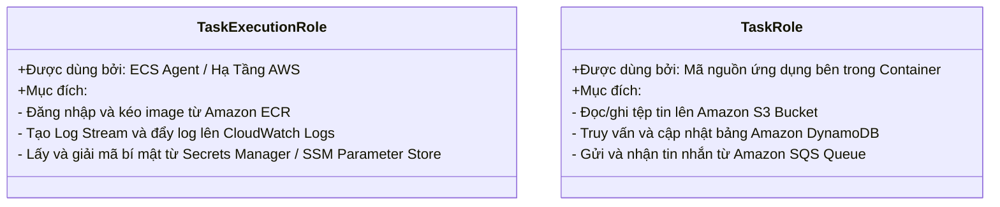
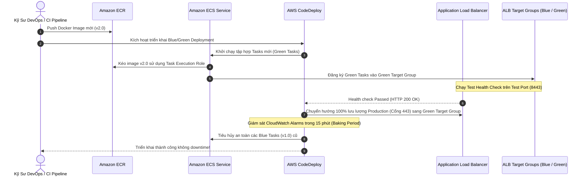

# Tài Liệu Học Tập Chuyên Sâu: Amazon ECS, AWS Fargate, ECR & EKS (Công Nghệ Điều Phối Container Đám Mây)

> **Tài liệu chuẩn hóa kiến trúc đám mây**: Hướng dẫn toàn diện theo tiêu chuẩn Senior AWS Solutions Architect & Cloud DevOps Engineer (cập nhật mới nhất 2026).  
> **Ngôn ngữ**: Tiếng Việt (Bảo lưu toàn bộ thuật ngữ chuyên ngành tiếng Anh chuẩn AWS).  
> **Các dịch vụ liên quan**: Amazon ECS, AWS Fargate, Amazon ECR, Amazon EKS, AWS App Runner, ECS Service Connect.

---

## 6.1. Tổng Quan Dịch Vụ (Service Overview)

### Dịch vụ gì?
Hệ sinh thái công nghệ đóng gói và điều phối container trên AWS cung cấp các giải pháp toàn diện từ mức phi máy chủ đến chuẩn công nghiệp:
1. **Amazon Elastic Container Service (Amazon ECS)**: Dịch vụ điều phối container độc quyền (AWS-native) có độ tin cậy tuyệt đối, tốc độ triển khai cực nhanh và tích hợp chặt chẽ với IAM, ALB, CloudWatch và Secrets Manager.
2. **AWS Fargate**: Động cơ tính toán phi máy chủ (**Serverless Compute Engine**) dành cho cả ECS và EKS. Bạn không cần quản lý bất kỳ cụm máy ảo EC2 nào bên dưới; AWS tự động phân bổ tài nguyên và bạn chỉ trả tiền cho đúng lượng vCPU và RAM mà container thực sự tiêu thụ theo từng giây.
3. **Amazon Elastic Container Registry (Amazon ECR)**: Kho lưu trữ ảnh container (Docker Container Registry) được quản lý toàn diện, hỗ trợ quét lỗ hổng bảo mật tự động bằng Amazon Inspector, tính năng **Pull Through Cache** và mã hóa KMS.
4. **Amazon Elastic Kubernetes Service (Amazon EKS)**: Dịch vụ chạy cụm điều phối container mã nguồn mở **Kubernetes** được chứng nhận tương thích (Certified Conformant), hỗ trợ tính năng **EKS Pod Identity** hiện đại và Karpenter để tối ưu hóa worker nodes.
5. **ECS Service Connect**: Giải pháp Service Mesh và Service Discovery gọn nhẹ tích hợp sẵn vào ECS, cho phép các microservices giao tiếp với nhau bằng tên miền nội bộ (`http://order-service:8080`) mà không cần cấu hình DNS riêng hay Application Load Balancer nội bộ.

---

## 6.2. Các Khái Niệm, Kiến Trúc & Vận Hành Cốt Lõi (Core Concepts, Security & Day-2 Operations)

### 1. Phân Biệt Launch Types: EC2 vs AWS Fargate

```mermaid
flowchart TD
    Dev[Kỹ sư DevOps / CI Pipeline] -->|Docker Push| ECR[Amazon ECR\nKho lưu trữ Container Image]

    subgraph ECSCluster[Amazon ECS Cluster]
        TaskDef[ECS Task Definition\nJSON Blueprint: Image, vCPU, RAM, Ports, Roles]
        
        subgraph LaunchTypes[Lựa chọn Launch Types]
            direction LR
            EC2Type[1. EC2 Launch Type\nBạn quản lý OS, Patching & ASG Nodes]
            FargateType[2. AWS Fargate (Serverless)\nKhông quản lý Node/OS, Chỉ cấp vCPU/RAM]
        end

        Service[ECS Service\nDuy trì số lượng Desired Tasks\nTích hợp ALB Target Group & Service Connect]
        TaskDef --> Service
        Service --> LaunchTypes
    end

    ECR -->|Pull Image| LaunchTypes
    ALB[Application Load Balancer] -->|Dynamic Port Mapping| Service
```

| Tiêu chuẩn so sánh | EC2 Launch Type | AWS Fargate Launch Type |
| :--- | :--- | :--- |
| **Quản trị hạ tầng** | **Tự quản lý**: Phải cấu hình EC2, vá lỗi OS định kỳ, quản lý ECS Container Agent và ECS-optimized AMI. | **Serverless 100%**: Không nhìn thấy máy chủ; AWS chịu trách nhiệm bảo mật và quản lý toàn bộ hệ điều hành bên dưới. |
| **Mô hình tính phí** | Trả tiền theo giờ của các máy ảo EC2 đang chạy (dù container có chạy hết công suất hay không). | **Chỉ trả tiền theo vCPU và RAM** cấp phát cho từng Task trong thời gian Task hoạt động thực tế. |
| **Cơ chế mở rộng (Scaling)** | Co giãn 2 tầng phức tạp: Auto Scaling cho số lượng Task VÀ Auto Scaling cho số lượng máy chủ EC2 (Cluster Auto Scaling). | Co giãn 1 tầng tức thời: Chỉ cần yêu cầu tăng số lượng Task mong muốn (Desired Count). |
| **Lưu trữ dữ liệu** | Hỗ trợ Amazon EBS, Amazon EFS và EC2 Instance Store cục bộ tốc độ cao. | Hỗ trợ Ephemeral Storage (20 GB - 200 GB), **Amazon EFS**, và hỗ trợ gắn trực tiếp **Amazon EBS** cấp Task. |
| **Kịch bản tối ưu** | Khối lượng tải rất lớn chạy ổn định 24/7 để tối ưu chi phí bằng Reserved Instances / Compute Savings Plans. | Microservices phân tán, tác vụ xử lý hàng đợi (Batch Workers), môi trường CI/CD không muốn tốn công bảo trì máy chủ. |

---

### 2. Hai Loại IAM Roles Sống Còn Trong Amazon ECS



- **ECS Task Execution Role**: Cấp quyền cho tiến trình **ECS Container Agent** hoặc hạ tầng Fargate chuẩn bị môi trường chạy container (kéo ảnh từ ECR, ghi log vào CloudWatch, đọc secrets).
- **ECS Task Role**: Cấp quyền nghiệp vụ trực tiếp cho chính mã nguồn ứng dụng chạy bên trong container gọi các API của AWS (tương tự như Instance Profile của EC2). Mỗi microservice sở hữu một Task Role riêng biệt theo nguyên tắc Least Privilege.

---

### 3. Ánh Xạ Cổng Động (Dynamic Port Mapping) & ECS Service Connect

- **Dynamic Port Mapping trên ALB**:
  - Khi chạy nhiều Tasks của cùng một Service trên cùng một máy chủ EC2, việc chỉ định cổng tĩnh sẽ gây xung đột.
  - Bằng cách để trống trường `HostPort` (hoặc đặt giá trị `0`) trong Task Definition, Docker daemon sẽ tự động cấp một cổng ngẫu nhiên trong dải tạm thời (**Ephemeral Ports: 32768 - 61000**).
  - ECS Service tự động đăng ký địa chỉ IP của EC2 kèm theo số cổng ngẫu nhiên này vào Target Group của ALB.
- **ECS Service Connect (Hiện đại)**:
  - Cung cấp mạng dịch vụ nội bộ (Service Mesh) cho các microservices trên ECS.
  - Thay vì phải tạo ALB nội bộ hoặc Cloud Map phức tạp, Service Connect tự động triển khai proxy sidecar gọn nhẹ trong từng task. Microservice A có thể gọi trực tiếp sang Microservice B qua tên miền thân thiện (ví dụ `http://payment-service:8080`) với cơ chế tự động cân bằng tải và giám sát độ trễ P99.

---

### 🏛️ I. Các Kịch Bản Kiến Trúc Chuẩn (Best Practice Scenarios)

#### 1. Điều Phối Container Không Máy Chủ Với AWS Fargate (Minimal Operational Overhead)
- **Tình huống thi**: Doanh nghiệp muốn đóng gói ứng dụng web microservices thành các Docker containers. Đội ngũ không muốn tốn thời gian quản lý cụm máy chủ, vá lỗi hệ điều hành EC2, hay cấu hình dung lượng cụm.
- **Giải pháp tối ưu chuẩn AWS**:
  - Triển khai ứng dụng trên **Amazon ECS (Elastic Container Service)** với kiểu khởi chạy **AWS Fargate (Serverless Launch Type)**.
  - AWS tự động cấp phát, cấu hình và mở rộng hạ tầng tính toán theo từng Task.
  - Bạn chỉ cần trả tiền cho số lượng vCPU và dung lượng RAM được cấp phát chính xác theo từng giây chạy của Task.

#### 2. Phân Định Rạch Ròi Giữa ECS Task Role và ECS Task Execution Role
- **Bẫy thi phổ biến**: Đề bài yêu cầu phân quyền để container kéo ảnh từ ECR hoặc phân quyền để code đọc DynamoDB và đưa ra 2 loại role này:

| Loại IAM Role trong ECS | Đối tượng sử dụng | Các quyền hạn điển hình được gán |
|:---|:---|:---|
| **ECS Task Execution Role** | Dành cho **hạ tầng ECS Agent** (AWS infrastructure agent) | - Kéo Docker image từ **Amazon ECR** (`ecr:GetAuthorizationToken`, `ecr:BatchGetImage`)<br>- Đẩy log ứng dụng vào **CloudWatch Logs** (`logs:CreateLogStream`, `logs:PutLogEvents`)<br>- Lấy biến môi trường nhạy cảm từ **Secrets Manager** hoặc **SSM Parameter Store** |
| **ECS Task Role** | Dành cho **mã nguồn ứng dụng** chạy bên trong Container | - Gọi AWS SDK từ code Python/Java/NodeJS<br>- Đọc/ghi dữ liệu vào **Amazon S3** (`s3:GetObject`, `s3:PutObject`)<br>- Truy vấn cơ sở dữ liệu **Amazon DynamoDB**<br>- Gửi tin nhắn vào hàng đợi **Amazon SQS** |

#### 3. Chạy Tác Vụ Dài Hạn > 15 Phút Không Quản Trị Server (EventBridge + Fargate)
- **Tình huống thi**: Báo cáo tài chính định kỳ vào 2h sáng mỗi ngày cần chạy từ 30 đến 45 phút để tổng hợp dữ liệu. Yêu cầu kiến trúc Serverless, không quản lý EC2.
- **Giải pháp chuẩn**:
  - Không thể dùng Lambda (do giới hạn cứng 15 phút).
  - Sử dụng **Amazon EventBridge Scheduler** kích hoạt một tác vụ **ECS on AWS Fargate** theo lịch cron (`RunTask` API). Fargate chạy xong sẽ tự động tắt và dừng tính phí.

---

### 🪤 II. Các Bẫy Thi Tinh Vi & Phân Tích Phương Án Sai (Exam Traps & Distractors)

#### 🪤 Bẫy 1: Ứng Dụng Container Có Trạng Thái Cần Bộ Nhớ Chia Sẻ (Stateful Microservices Với EFS) — (CM-PT1 Q36)
- **Tình huống đề thi**: *"Doanh nghiệp chuyển đổi ứng dụng xử lý nội dung số chạy trên Docker containers lên AWS Fargate. Nhiều container tasks cần đọc và ghi đồng thời vào một không gian lưu trữ tệp tin dùng chung có tính bền vững cao và tự động co giãn."*
- **Các phương án bẫy**:
  - ❌ *Sử dụng Amazon EBS Volume*: Trước đây Fargate không hỗ trợ EBS; hiện tại dù đã hỗ trợ EBS mount cho từng task đơn lẻ, EBS **hoàn toàn không hỗ trợ chia sẻ đồng thời nhiều máy chủ (Multi-Attach qua nhiều AZ)** cho ứng dụng tệp tin tiêu chuẩn.
  - ❌ *Sử dụng bộ nhớ Ephemeral Storage mặc định của Fargate*: Bộ nhớ này chỉ tồn tại tạm thời cùng vòng đời của Task, khi Task tắt hoặc scale-in toàn bộ dữ liệu sẽ bị xóa sạch!
- **Giải pháp ĐÚNG**: Tích hợp **Amazon Elastic File System (Amazon EFS)** vào ECS Task Definition.
  - EFS là hệ thống tệp tin mạng tiêu chuẩn POSIX.
  - Cho phép hàng trăm ECS Fargate Tasks trải dài trên nhiều Availability Zones cùng mount và đọc/ghi đồng thời với tính nhất quán cao.

#### 🪤 Bẫy 2: Kéo Image Từ Amazon ECR Cho Fargate Trong Private Subnet Tuyệt Đối
- **Tình huống đề thi**: *"Các tác vụ ECS Fargate được triển khai trong Private Subnet hoàn toàn không có Internet Gateway và không có NAT Gateway. Tác vụ bị lỗi không thể khởi động được (CannotPullContainerError)."*
- **Nguyên nhân & Bộ 3 VPC Endpoints bắt buộc**:
  - Để Fargate trong mạng cô lập kéo được Docker image từ ECR, bắt buộc phải cấu hình:
    1. **Interface VPC Endpoint**: `com.amazonaws.<region>.ecr.api` (cho các lệnh gọi điều khiển ECR API).
    2. **Interface VPC Endpoint**: `com.amazonaws.<region>.ecr.dkr` (cho luồng tải các image layer Docker).
    3. **Gateway VPC Endpoint cho Amazon S3**: Đây là **bẫy tinh vi nhất** — toàn bộ các layer nhị phân của Docker image trong Amazon ECR thực tế được lưu trữ trên Amazon S3! Nếu thiếu S3 Gateway Endpoint, lệnh kéo image vẫn sẽ thất bại.

---

### 📊 III. Ma Trận Quyết Định Container Nhanh (Exam Decision Matrix)

| Tình huống / Yêu cầu trong đề thi | Giải pháp chuẩn AWS | Giải pháp bị loại & Lý do |
|:---|:---|:---|
| **Chạy Container không quản trị OS, trả tiền theo giây** | **Amazon ECS on AWS Fargate** | ECS on EC2 (phải quản trị, vá lỗi máy ảo) |
| **Workload Kubernetes hiện có, di chuyển lên AWS** | **Amazon EKS** (+ Fargate hoặc EC2 nodes) | Amazon ECS (phải viết lại Task Definition) |
| **Phân quyền cho code trong container gọi DynamoDB/S3** | **ECS Task Role** | ECS Task Execution Role (chỉ dành cho ECS agent) |
| **Container cần chia sẻ file system đọc/ghi đồng thời** | **ECS on Fargate + Amazon EFS** | Amazon EBS (không chia sẻ nhiều AZ đồng thời) |
| **Script chạy 30-60 phút cần serverless** | **EventBridge Scheduler + ECS Fargate Task** | AWS Lambda (hard limit timeout 15 phút) |
| **Kéo image ECR trong Private Subnet không có NAT** | **VPC Endpoints cho ECR API, DKR + S3 Gateway** | Chỉ tạo ECR endpoints (thiếu S3 endpoint) |

---

---

---

## 6.3. Kiến Trúc Thực Tế và Luồng Vận Hành (Production Architecture & Workflow)

### Quy Trình Triển Khai Blue/Green Không Gián Đoạn trên ECS Fargate với AWS CodeDeploy



---

## 6.4. Bảng Tích Hợp với Các Dịch Vụ AWS Khác (Integration Table)

| Related AWS Service | Purpose (Mục đích tích hợp) | Integration Method (Phương thức tích hợp) | Practical Example (Ví dụ thực tiễn) |
| :--- | :--- | :--- | :--- |
| **Amazon EFS** | Cung cấp ổ đĩa tệp tin mạng chia sẻ bền vững cho Fargate | ECS Volume Mount Point | Gắn thư mục uploads dùng chung vào 8 Fargate Tasks của trang WordPress để không bị mất dữ liệu khi task khởi động lại. |
| **Amazon EBS** | Cung cấp ổ cứng khối hiệu năng cao gắn trực tiếp vào Fargate Task | ECS Task EBS Volume Integration | Gắn ổ đĩa gp3 tốc độ cao vào container xử lý ảnh lớn trên Fargate với chi phí rẻ hơn EFS. |
| **AWS Systems Manager** | Truy cập shell trực tiếp vào container đang chạy (**ECS Exec**) | SSM Channel Integration | Kỹ sư chạy lệnh `aws ecs execute-command --interactive --command "/bin/sh"` để debug lỗi container đang chạy trên Fargate. |
| **AWS Secrets Manager** | Nạp mật khẩu cơ sở dữ liệu an toàn vào container lúc khởi động | `secrets` block trong Task Definition | Nạp biến môi trường `DB_PASS` trực tiếp từ Secrets Manager mà không ghi lộ thông tin vào Dockerfile. |
| **Amazon CloudWatch** | Thu thập log và giám sát tài nguyên container | `awslogs` driver & Container Insights | Kích hoạt Container Insights để thu thập metrics chi tiết CPU, Memory, Disk, Network I/O trên từng task. |
| **AWS Application Auto Scaling** | Tự động tăng giảm số lượng container theo lưu lượng | Target Tracking Scaling Policy | Tự động mở rộng số lượng Task khi chỉ số trung bình `ALBRequestCountPerTarget` vượt quá 1,000 req/phút. |

---

## 6.5. Bảng So Sánh Trong Hệ Sinh Thái AWS (Ecosystem Comparison)

### So sánh các nền tảng chạy Container trên AWS

| Tiêu chuẩn so sánh | Amazon ECS (EC2) | Amazon ECS (Fargate) | Amazon EKS (Kubernetes) | AWS App Runner | Amazon EC2 (Tự cài Docker) |
| :--- | :--- | :--- | :--- | :--- | :--- |
| **Bản chất công nghệ** | Điều phối container độc quyền chạy trên máy ảo do người dùng quản trị. | Động cơ chạy container phi máy chủ (Serverless), không quản trị máy ảo. | Cụm điều phối Kubernetes chuẩn mã nguồn mở được AWS quản lý. | Dịch vụ PaaS triển khai container/web tự động hoàn toàn. | Máy chủ ảo truyền thống, người dùng tự cài Docker engine. |
| **Độ phức tạp vận hành** | Trung bình: Phải cấu hình và bảo trì máy ảo EC2, vá lỗi hệ điều hành. | **Rất thấp**: Không nhìn thấy OS, chỉ cấu hình file Task Definition JSON. | **Cao**: Đòi hỏi kỹ năng chuyên sâu về hệ sinh thái Kubernetes (Pods, Helm, Ingress). | **Cực thấp**: Chỉ cần chỉ đường dẫn repo Git hoặc ECR image. | Rất cao: Tự quản lý toàn bộ vòng đời container, networking, scaling. |
| **Chi phí Control Plane** | **$0.00 (Miễn phí)** | **$0.00 (Miễn phí)** | **$0.10 / giờ / cluster** (~$72/tháng/cụm). | **$0.00 (Miễn phí)** | **$0.00 (Không có)** |
| **Khả năng co giãn (Scaling)** | Co giãn 2 tầng (Task + Node ASG) mất vài phút. | Co giãn 1 tầng (Task-level) hoàn tất trong 30-60 giây. | Co giãn linh hoạt qua HPA kết hợp công cụ Karpenter. | Co giãn tự động tức thì theo số lượng HTTP concurrent requests. | Tự viết script hoặc dùng ASG dựa trên CPU của máy ảo. |
| **Hỗ trợ Multi-Cloud** | Chỉ chạy trên AWS (và ECS Anywhere on-prem). | Chỉ chạy trên nền tảng AWS. | **Tuyệt đối**: Dễ dàng di chuyển sang GCP (GKE) hoặc Azure (AKS). | Chỉ chạy trên nền tảng AWS. | Tùy biến tự do trên bất kỳ hạ tầng nào. |
| **Khuyến nghị kiến trúc** | Doanh nghiệp muốn tối ưu chi phí tối đa cho khối lượng container khổng lồ chạy 24/7. | Lựa chọn mặc định tốt nhất cho Microservices trên AWS, loại bỏ gánh nặng vận hành OS. | Doanh nghiệp lớn chuẩn hóa toàn diện trên chuẩn Kubernetes toàn cầu. | Ứng dụng web frontend/backend đơn giản, startup muốn ra mắt nhanh. | Chỉ dùng cho các ứng dụng legacy hoặc môi trường thử nghiệm cá nhân. |

---

## 6.6. Mô Hình Tính Phí & Chiến Lược Tối Ưu Chi Phí (FinOps & Cost Optimization)

### 6.6.1. Bảng Cấu Trúc Định Giá Chi Tiết

| Thành phần Dịch Vụ | Đơn giá AWS niêm yết (us-east-1) | Cơ chế đo lường | Ghi chú tối ưu hóa chi phí FinOps |
| :--- | :--- | :--- | :--- |
| **Amazon ECS Control Plane** | **$0.00** | Miễn phí không giới hạn cụm | Tạo bao nhiêu cụm (Cluster) phân tách môi trường cũng không tốn chi phí. |
| **Amazon EKS Control Plane** | **$0.10 / giờ** (~$72/tháng/cụm) | Tính trên mỗi cụm Kubernetes | Hợp nhất nhiều microservices vào 1 cụm dùng chung bằng Kubernetes Namespaces. |
| **AWS Fargate (vCPU x86)** | **$0.04048 / vCPU / giờ** | Tính theo từng giây (tối thiểu 1 phút) | Cấu hình vCPU sát với nhu cầu thực tế qua CloudWatch Container Insights. |
| **AWS Fargate (RAM x86)** | **$0.004445 / GB / giờ** | Tính theo từng giây cấp phát | Tránh cấp phát thừa RAM không dùng đến trong Task Definition. |
| **AWS Fargate (Arm64 Graviton)** | **Rẻ hơn 20%** so với x86 | $0.03238/vCPU/h & $0.003556/GB/h | Chuyển đổi kiến trúc container sang Arm64 để tiết kiệm ngay 20%. |
| **AWS Fargate Spot** | **Giảm tới 70%** so với On-Demand | ~$0.01214/vCPU/h & ~$0.00133/GB/h | Sử dụng cho background workers, xử lý hàng đợi SQS, batch jobs không sợ bị ngắt. |
| **Amazon ECR Storage** | **$0.10 / GB / tháng** | Tính theo dung lượng ảnh lưu trữ | Bắt buộc thiết lập ECR Lifecycle Policy để xóa các image untagged và image cũ. |

---

### 6.6.2. 5 Kịch Bản Tối Ưu Hóa Chi Phí Thực Tế (FinOps Scenarios)

#### Kịch bản 1: Tối ưu chi phí Worker xử lý hàng đợi bằng Fargate Spot
- **Bối cảnh**: Hệ thống xử lý video gồm 12 worker container tiêu thụ tin nhắn từ Amazon SQS Queue. Mỗi task được cấp phát 2 vCPU và 4 GB RAM chạy liên tục 24/7 (730 giờ/tháng).
- **Tính toán chi phí Fargate On-Demand chuẩn**:
  $$\text{Cost}_{\text{vCPU}} = 12 \times 2 \times \$0.04048 \times 730 = \$709.21$$
  $$\text{Cost}_{\text{RAM}} = 12 \times 4 \times \$0.004445 \times 730 = \$155.75$$
  $$\text{Total Cost}_{\text{OnDemand}} = \$709.21 + \$155.75 = \$864.96/\text{tháng}$$
- **Giải pháp tối ưu**:
  - Vì các worker là phi trạng thái (Stateless), nếu task bị thu hồi thì SQS sẽ tự động trả lại tin nhắn để worker khác xử lý.
  - Cấu hình ECS Service dùng **Fargate Spot Capacity Provider** (giảm 70% chi phí):
  $$\text{Total Cost}_{\text{Spot}} = \$864.96 \times (1 - 0.70) = \$259.49/\text{tháng}$$
- **Hiệu quả kinh tế**:
  $$\text{Tiết kiệm} = \$864.96 - \$259.49 = \$605.47/\text{tháng} \quad (\$7{,}265/\text{năm}) \implies \text{Tiết kiệm } 70\% \text{ ngân sách}$$

#### Kịch bản 2: Chuyển đổi kiến trúc Fargate Task sang chip ARM64 (AWS Graviton)
- **Bối cảnh**: Doanh nghiệp chạy 25 microservices viết bằng Node.js và Java Spring Boot trên Fargate x86, tiêu tốn $1,200/tháng tiền hạ tầng tính toán.
- **Giải pháp tối ưu**:
  - Cập nhật pipeline CI/CD biên dịch Docker image hỗ trợ đa nền tảng (`docker buildx --platform linux/arm64`).
  - Trong ECS Task Definition, cấu hình cờ:
    ```json
    "runtimePlatform": {
      "cpuArchitecture": "ARM64",
      "operatingSystemFamily": "LINUX"
    }
    ```
  - Đơn giá tài nguyên của kiến trúc Graviton Arm64 tự động rẻ hơn 20% so với x86:
  $$\text{Cost}_{\text{Arm64}} = \$1{,}200 \times (1 - 0.20) = \$960/\text{tháng}$$
- **Hiệu quả kinh tế**:
  $$\text{Tiết kiệm} = \$1{,}200 - \$960 = \$240/\text{tháng} \quad (\$2{,}880/\text{năm}) \implies \text{Tiết kiệm ngay } 20\% \text{ chi phí}$$

#### Kịch bản 3: Tự động hóa dọn dẹp kho ảnh với ECR Lifecycle Policies
- **Bối cảnh**: Hệ thống CI/CD tự động build và push Docker image sau mỗi commit (trung bình 15 bản build/ngày). Mỗi image có dung lượng 1.2 GB. Sau 1 năm, kho lưu trữ tích tụ hơn 5,000 images với tổng dung lượng lên tới 6,000 GB (6 TB).
- **Tính toán chi phí khi không có chính sách dọn dẹp**:
  $$\text{Cost}_{\text{ECR\_Initial}} = 6{,}000 \text{ GB} \times \$0.10/\text{GB} = \$600/\text{tháng} \quad (\$7{,}200/\text{năm})$$
- **Giải pháp tối ưu**:
  - Thiết lập **ECR Lifecycle Policy** trên toàn bộ các repositories:
    1. Xóa các bản build không có tag (`untagged`) sau **2 ngày**.
    2. Chỉ giữ lại tối đa **10 image có tag gần nhất** cho mỗi service (`sinceImagePushed = 10`).
  - Dung lượng lưu trữ thực tế giảm xuống chỉ còn khoảng 150 GB:
  $$\text{Cost}_{\text{ECR\_Optimized}} = 150 \text{ GB} \times \$0.10 = \$15/\text{tháng}$$
- **Hiệu quả kinh tế**:
  $$\text{Tiết kiệm} = \$600 - \$15 = \$585/\text{tháng} \quad (\$7{,}020/\text{năm}) \implies \text{Cắt giảm } 97.5\% \text{ chi phí lưu trữ ECR}$$

#### Kịch bản 4: Hợp nhất cụm Amazon EKS Control Plane (Multi-tenant EKS Cluster)
- **Bối cảnh**: Công ty có 6 nhóm phát triển phần mềm độc lập. Mỗi nhóm tự tạo 1 cụm Amazon EKS riêng biệt để chạy ứng dụng dev/test.
- **Tính toán chi phí Control Plane riêng lẻ**:
  $$\text{Cost}_{\text{EKS\_Separate}} = 6 \text{ cụm} \times \$0.10/\text{giờ} \times 730 \text{ giờ} = \$438/\text{tháng} \quad (\text{chưa kể worker nodes})$$
- **Giải pháp tối ưu**:
  - Hợp nhất 6 nhóm vào **1 cụm EKS Multi-tenant dùng chung**:
    - Phân tách môi trường bằng **Kubernetes Namespaces**.
    - Cấu hình **ResourceQuotas** giới hạn vCPU/RAM tối đa cho từng nhóm.
    - Cấp quyền AWS chi tiết cho từng pod bằng **EKS Pod Identity**.
  $$\text{Cost}_{\text{EKS\_Unified}} = 1 \text{ cụm} \times \$0.10 \times 730 = \$73/\text{tháng}$$
- **Hiệu quả kinh tế**:
  $$\text{Tiết kiệm} = \$438 - \$73 = \$365/\text{tháng} \quad (\$4{,}380/\text{năm}) \implies \text{Tiết kiệm } 83.3\% \text{ chi phí Control Plane}$$

#### Kịch bản 5: Phân định điểm hòa vốn giữa ECS EC2 Launch Type và AWS Fargate
- **Bối cảnh**: Hệ thống thương mại điện tử vận hành 100 container microservices ổn định 24/7, mỗi container cần 1 vCPU và 2 GB RAM.
- **Tính toán chi phí trên Fargate On-Demand**:
  $$\text{Cost}_{\text{Fargate}} = 100 \times [(\$0.04048 \times 1) + (\$0.004445 \times 2)] \times 730 = \$3{,}604/\text{tháng}$$
- **Giải pháp tối ưu bằng EC2 Launch Type với Compute Savings Plans 3 năm**:
  - Thay vì dùng Fargate, triển khai cụm EC2 gồm 7 máy chủ `c6g.4xlarge` (mỗi máy 16 vCPU, 32 GB RAM, đủ sức chứa toàn bộ 100 containers với mật độ nén cao).
  - Mua gói cam kết **Compute Savings Plans 3 năm trả trước một phần** (giảm 64% so với giá On-Demand của EC2):
  $$\text{Cost}_{\text{EC2\_SavingsPlan}} \approx \$1{,}450/\text{tháng}$$
- **Hiệu quả kinh tế**:
  $$\text{Tiết kiệm} = \$3{,}604 - \$1{,}450 = \$2{,}154/\text{tháng} \quad (\$25{,}848/\text{năm}) \implies \text{Tiết kiệm } 59.8\% \text{ chi phí cho tải lớn ổn định}$$

---

## 6.7. Khắc Phục Sự Cố Thực Tế (Troubleshooting Guide)

| Tình huống sự cố (Problem) | Nguyên nhân cốt lõi (Root Cause) | Các bước điều tra & Chỉ số giám sát (Metrics & Logs) | Giải pháp khắc phục (Remediation) | Biện pháp phòng ngừa (Prevention) |
| :--- | :--- | :--- | :--- | :--- |
| **Task Fargate bị dừng ngay sau khi khởi chạy (`Exit Code 1` hoặc `137`)** | `Exit code 1`: Ứng dụng bị crash do thiếu biến môi trường.<br>`Exit code 137`: Container bị hệ thống tiêu hủy do tràn bộ nhớ (**Out-Of-Memory OOM**). | - Xem tab **Stopped Tasks** trên ECS Console kiểm tra `Stopped reason`.<br>- Giám sát CloudWatch metric `MemoryUtilization`. | 1. Sửa lỗi mã nguồn hoặc bổ sung biến môi trường.<br>2. Tăng thông số `memory` trong Task Definition nếu bị OOM. | Luôn thử nghiệm chạy container cục bộ bằng `docker run -m 512m` để kiểm tra giới hạn RAM trước khi deploy. |
| **Lỗi `CannotPullContainerError` khi khởi động Task** | 1. URI của ECR Image bị sai chính tả.<br>2. **Task Execution Role** thiếu quyền `ecr:GetDownloadUrlForLayer`.<br>3. Task ở Private Subnet không có route ra Internet hoặc thiếu VPC Endpoints cho ECR. | - Kiểm tra thông báo lỗi chi tiết trên ECS Events tab.<br>- Kiểm tra Route Table và Security Group của Subnet gắn task. | 1. Cấp quyền `AmazonECSTaskExecutionRolePolicy` cho Execution Role.<br>2. Bổ sung **VPC Endpoints cho ECR** (`ecr.api`, `ecr.dkr`, và S3 Gateway Endpoint) nếu chạy trong mạng kín. | Đảm bảo mạng Private Subnet luôn có NAT Gateway hoặc đủ bộ 3 VPC Endpoints cho ECR. |
| **ALB Health Check liên tục báo Unhealthy cho ECS Service** | 1. Ứng dụng nặng (như Spring Boot) mất 60s để khởi động nhưng ALB kiểm tra sau 10s.<br>2. Security Group của Task chặn traffic từ ALB.<br>3. Đường dẫn health check trả về mã khác 200. | - Xem tab **Targets** trong Target Group kiểm tra trạng thái Unhealthy.<br>- Kiểm tra Inbound Rules của Security Group gắn với Task. | 1. Tăng giá trị **`HealthCheckGracePeriodSeconds`** (ví dụ: 120s) trên ECS Service.<br>2. Cho phép Security Group của Task nhận traffic từ Security Group của ALB. | Cấu hình endpoint `/health` chuyên dụng trả về HTTP 200 nhanh chóng mà không cần kiểm tra DB phức tạp. |
| **Lỗi `No Container Instances Found` trên cụm EC2 Launch Type** | Toàn bộ các máy chủ EC2 hiện có trong cụm đã hết sạch vCPU hoặc RAM trống để đặt thêm Task mới. | - Xem tổng lượng tài nguyên khả dụng của cụm ECS Cluster.<br>- Giám sát CloudWatch metric `CPUReservation` và `MemoryReservation`. | Bổ sung thêm máy chủ EC2 vào cụm bằng Auto Scaling Group hoặc chuyển sang sử dụng **AWS Fargate** để co giãn vô hạn. | Sử dụng **ECS Capacity Providers** kết hợp tính năng Target Capacity Reservation để tự động co giãn máy chủ EC2 theo nhu cầu của Tasks. |
| **Microservices không tìm thấy nhau khi gọi nội bộ** | Cấu hình sai DNS hoặc các container không nằm chung một mạng Service Connect. | - Kiểm tra cấu hình **ECS Service Connect** trong Service Definition.<br>- Kiểm tra CloudWatch metric `ServiceConnectHTTPCode2XX`. | Đảm bảo các microservices tham gia vào cùng một Service Connect Namespace và sử dụng đúng tên miền định tuyến. | Chuẩn hóa quy trình đặt tên dịch vụ qua Terraform IaC. |

---

---

## 6.8. Tóm Tắt và Danh Mục Kiểm Tra Kiến Thức (Summary & Learning Checklist)

### 7 Nguyên Tắc Vàng Quản Trị Container AWS (Golden Rules)
1. **Fargate cho Microservices**: Ưu tiên chọn Fargate để triệt tiêu hoàn toàn công việc quản trị máy chủ và vá lỗi hệ điều hành.
2. **Phân biệt rạch ròi 2 Roles**: Luôn tách biệt **Task Execution Role** (hạ tầng kéo ảnh/ghi log) và **Task Role** (nghiệp vụ ứng dụng gọi AWS API).
3. **Tiết kiệm 70% với Fargate Spot**: Tận dụng Fargate Spot cho các tác vụ xử lý hàng đợi bất đồng bộ hoặc môi trường Dev/Test.
4. **Ưu tiên Arm64 Graviton**: Cấu hình `cpuArchitecture: ARM64` để tiết kiệm ngay 20% chi phí tính toán cho các container Java, Node.js, Python, Go.
5. **Cài đặt ECR Lifecycle Policy**: Luôn thiết lập luật dọn dẹp ảnh cũ để tránh hóa đơn lưu trữ ECR tăng vọt hàng ngàn USD sau các đợt build CI/CD.
6. **Thay thế Internal ALB bằng ECS Service Connect**: Giảm độ trễ mạng và cắt giảm chi phí duy trì Load Balancer cho giao tiếp microservices nội bộ.
7. **Cấu hình Grace Period hợp lý**: Luôn thiết lập `HealthCheckGracePeriodSeconds` để bảo vệ các ứng dụng nặng không bị tiêu hủy sớm khi khởi động.

---

### Danh Mục Kiểm Tra Năng Lực (Learning Checklist)
- [ ] Tôi phân biệt được sự khác biệt giữa ECS EC2 Launch Type và AWS Fargate Serverless.
- [ ] Tôi giải thích được vai trò của ECS Task Definition, ECS Task và ECS Service.
- [ ] Tôi phân biệt rõ ràng giữa ECS Task Execution Role và ECS Task Role.
- [ ] Tôi hiểu nguyên lý hoạt động của Dynamic Port Mapping với Application Load Balancer.
- [ ] Tôi biết cách cấu hình ECS Service Connect để kết nối các microservices nội bộ không cần ALB.
- [ ] Tôi nắm vững các VPC Endpoints cần thiết để Fargate trong Private Subnet kéo ảnh từ Amazon ECR.
- [ ] Tôi hiểu cách sử dụng ECS Exec để mở shell trực tiếp vào container đang chạy phục vụ troubleshooting.

---

### Liên kết và Tài liệu Liên quan
- 📖 [Ghi Chú Bài Học Chương 18: Containers on AWS](../Lesson_Notes/18_Containers_ECS_Fargate_EKS.md)
- 📖 [Bảng Thuật Ngữ Kỹ Thuật (GLOSSARY.md)](../GLOSSARY.md)
- ⏭️ Tiếp tục chuyển sang chuyên đề: [Kiến Trúc Phân Tách: Amazon SQS, SNS & EventBridge](./SQS_SNS_EventBridge_Decoupling.md).
