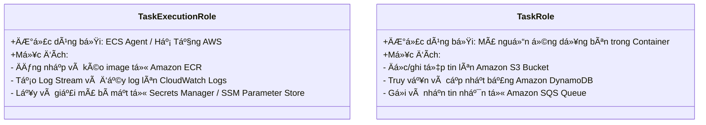
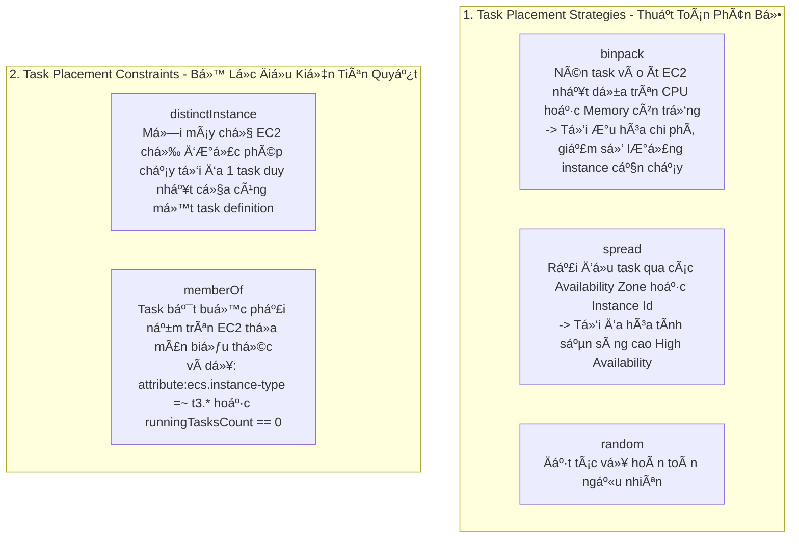
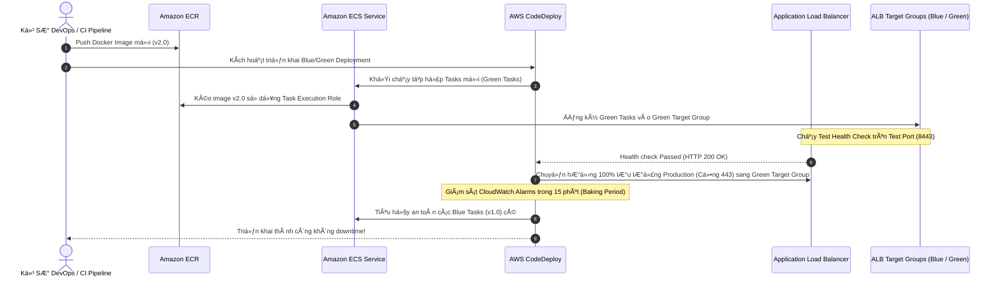

# Tài Liệu Học Tập Chuyên Sâu: Amazon ECS, AWS Fargate, ECR & EKS (Công Nghệ Điều Phối Container Đám Mây)

> **Tài liệu chuẩn hóa kiến trúc đám mây**: Hướng dẫn toàn diện theo tiêu chuẩn Senior AWS Solutions Architect & Cloud DevOps Engineer (cập nhật mới nhất 2026).  
> **Ngôn ngữ**: Tiếng Việt (Bảo lưu toàn bộ thuật ngữ chuyên ngành tiếng Anh chuẩn AWS).  
> **Các dịch vụ liên quan**: Amazon ECS, AWS Fargate, Amazon ECR, Amazon EKS, AWS App Runner, ECS Service Connect.

---

## 1. Tổng Quan Dịch Vụ (Service Overview)

### Dịch vụ gì?
Hệ sinh thái công nghệ đóng gói và điều phối container trên AWS cung cấp các giải pháp toàn diện từ mức phi máy chủ đến chuẩn công nghiệp:
1. **Amazon Elastic Container Service (Amazon ECS)**: Dịch vụ điều phối container độc quyền (AWS-native) có độ tin cậy tuyệt đối, tốc độ triển khai cực nhanh và tích hợp chặt chẽ với IAM, ALB, CloudWatch và Secrets Manager.
2. **AWS Fargate**: Động cơ tính toán phi máy chủ (**Serverless Compute Engine**) dành cho cả ECS và EKS. Bạn không cần quản lý bất kỳ cụm máy ảo EC2 nào bên dưới; AWS tự động phân bổ tài nguyên và bạn chỉ trả tiền cho đúng lượng vCPU và RAM mà container thực sự tiêu thụ theo từng giây.
3. **Amazon Elastic Container Registry (Amazon ECR)**: Kho lưu trữ ảnh container (Docker Container Registry) được quản lý toàn diện, hỗ trợ quét lỗ hổng bảo mật tự động bằng Amazon Inspector, tính năng **Pull Through Cache** và mã hóa KMS.
4. **Amazon Elastic Kubernetes Service (Amazon EKS)**: Dịch vụ chạy cụm điều phối container mã nguồn mở **Kubernetes** được chứng nhận tương thích (Certified Conformant), hỗ trợ tính năng **EKS Pod Identity** hiện đại và Karpenter để tối ưu hóa worker nodes.
5. **ECS Service Connect**: Giải pháp Service Mesh và Service Discovery gọn nhẹ tích hợp sẵn vào ECS, cho phép các microservices giao tiếp với nhau bằng tên miền nội bộ (`http://order-service:8080`) mà không cần cấu hình DNS riêng hay Application Load Balancer nội bộ.

---

## 2. Các Khái Niệm, Kiến Trúc & Vận Hành Cốt Lõi (Core Concepts, Security & Day-2 Operations)

### 1. Phân Biệt Launch Types: EC2 vs AWS Fargate

```mermaid
flowchart TD
    Dev[Kỹ sư DevOps / CI Pipeline] -->|Docker Push| ECR[Amazon ECR\nKho lưu trữ Container Image]

    subgraph ECSCluster[Amazon ECS Cluster]
        TaskDef[ECS Task Definition\nJSON Blueprint: Image, vCPU, RAM, Ports, Roles]
        
        subgraph LaunchTypes[Lựa chọn Launch Types]
            direction LR
            EC2Type[1. EC2 Launch Type\nBạn quản lý OS, Patching & ASG Nodes]
            FargateType[2. AWS Fargate (Serverless)\nKhông quản lý Node/OS, Chỉ cấp vCPU/RAM]
        end

        Service[ECS Service\nDuy trì số lượng Desired Tasks\nTích hợp ALB Target Group & Service Connect]
        TaskDef --> Service
        Service --> LaunchTypes
    end

    ECR -->|Pull Image| LaunchTypes
    ALB[Application Load Balancer] -->|Dynamic Port Mapping| Service
```

| Tiêu chuẩn so sánh | EC2 Launch Type | AWS Fargate Launch Type |
| :--- | :--- | :--- |
| **Quản trị hạ tầng** | **Tự quản lý**: Phải cấu hình EC2, vá lỗi OS định kỳ, quản lý ECS Container Agent và ECS-optimized AMI. | **Serverless 100%**: Không nhìn thấy máy chủ; AWS chịu trách nhiệm bảo mật và quản lý toàn bộ hệ điều hành bên dưới. |
| **Mô hình tính phí** | Trả tiền theo giờ của các máy ảo EC2 đang chạy (dù container có chạy hết công suất hay không). | **Chỉ trả tiền theo vCPU và RAM** cấp phát cho từng Task trong thời gian Task hoạt động thực tế. |
| **Cơ chế mở rộng (Scaling)** | Co giãn 2 tầng phức tạp: Auto Scaling cho số lượng Task VÀ Auto Scaling cho số lượng máy chủ EC2 (Cluster Auto Scaling). | Co giãn 1 tầng tức thời: Chỉ cần yêu cầu tăng số lượng Task mong muốn (Desired Count). |
| **Lưu trữ dữ liệu** | Hỗ trợ Amazon EBS, Amazon EFS và EC2 Instance Store cục bộ tốc độ cao. | Hỗ trợ Ephemeral Storage (20 GB - 200 GB), **Amazon EFS**, và hỗ trợ gắn trực tiếp **Amazon EBS** cấp Task. |
| **Kịch bản tối ưu** | Khối lượng tải rất lớn chạy ổn định 24/7 để tối ưu chi phí bằng Reserved Instances / Compute Savings Plans. | Microservices phân tán, tác vụ xử lý hàng đợi (Batch Workers), môi trường CI/CD không muốn tốn công bảo trì máy chủ. |

---

### 2. Hai Loại IAM Roles Sống Còn Trong Amazon ECS



- **ECS Task Execution Role**: Cấp quyền cho tiến trình **ECS Container Agent** hoặc hạ tầng Fargate chuẩn bị môi trường chạy container (kéo ảnh từ ECR, ghi log vào CloudWatch, đọc secrets).
- **ECS Task Role**: Cấp quyền nghiệp vụ trực tiếp cho chính mã nguồn ứng dụng chạy bên trong container gọi các API của AWS (tương tự như Instance Profile của EC2). Mỗi microservice sở hữu một Task Role riêng biệt theo nguyên tắc Least Privilege.

---

### 3. Ánh Xạ Cổng Động (Dynamic Port Mapping) & ECS Service Connect

- **Dynamic Port Mapping trên ALB**:
  - Khi chạy nhiều Tasks của cùng một Service trên cùng một máy chủ EC2, việc chỉ định cổng tĩnh sẽ gây xung đột.
  - Bằng cách để trống trường `HostPort` (hoặc đặt giá trị `0`) trong Task Definition, Docker daemon sẽ tự động cấp một cổng ngẫu nhiên trong dải tạm thời (**Ephemeral Ports: 32768 - 61000**).
  - ECS Service tự động đăng ký địa chỉ IP của EC2 kèm theo số cổng ngẫu nhiên này vào Target Group của ALB.
- **ECS Service Connect (Hiện đại)**:
  - Cung cấp mạng dịch vụ nội bộ (Service Mesh) cho các microservices trên ECS.
  - Thay vì phải tạo ALB nội bộ hoặc Cloud Map phức tạp, Service Connect tự động triển khai proxy sidecar gọn nhẹ trong từng task. Microservice A có thể gọi trực tiếp sang Microservice B qua tên miền thân thiện (ví dụ `http://payment-service:8080`) với cơ chế tự động cân bằng tải và giám sát độ trễ P99.

---

### 4. Chiến Lược Phân Bổ Tác Vụ ECS: Placement Strategies & Constraints (EC2 Launch Type)

Khi vận hành cụm ECS với kiểu khởi chạy **EC2 Launch Type**, kiến trúc sư có toàn quyền điều khiển cách các task container được đặt lên các máy ảo EC2 thông qua **Task Placement Strategies** và **Task Placement Constraints** (`TD-Set6 Q46`):



- **Quy tắc phối hợp chuẩn kiến trúc**:
  - *Tối ưu High Availability (HA)*: Kết hợp Strategy `spread(attribute:ecs.availability-zone)` tiếp theo là `spread(instanceId)`.
  - *Tối ưu chi phí sản xuất*: Kết hợp Strategy `binpack(memory)` hoặc `binpack(cpu)` để gom task vào ít máy ảo nhất, cho phép Auto Scaling Group tắt bớt các EC2 instances nhàn rỗi (`TD-Set6 Q46`).
  - *Chạy duy nhất 1 task trên mỗi máy ảo*: Áp dụng Constraint `distinctInstance` (`TD-Set6 Q46`).
  - ⚠️ **Lưu ý thi cử sống còn**: Task Placement Strategies & Constraints **CHỈ ÁP DỤNG CHO EC2 LAUNCH TYPE**, hoàn toàn không áp dụng cho AWS Fargate vì Fargate là serverless, AWS tự động quản lý hạ tầng bên dưới (`TD-Set6 Q46`)!

---

### 5. Cơ Chế Tự Động Co Giãn ECS (Service Auto Scaling & Cluster Auto Scaling)

- **ECS Service Auto Scaling**:
  - Tự động điều chỉnh số lượng Task mong muốn (**Desired Task Count**) dựa trên các metric CloudWatch:
    1. *Target Tracking Scaling*: Duy trì mức tải CPU trung bình (`ECSServiceAverageCPUUtilization`) hoặc Memory ở mức mục tiêu (ví dụ 70%).
    2. *ALB RequestCountPerTarget*: Duy trì số lượng requests trung bình trên mỗi container task phía sau ALB, phản hồi ngay lập tức trước các đợt bùng nổ traffic (`TD-Set6 Q59`).
    3. *Step Scaling theo SQS Queue Backlog*: Khi có tệp tin upload lên S3, S3 gửi thông báo vào SQS Queue; ECS Service Auto Scaling tăng số lượng Fargate batch worker tasks tương ứng với số lượng tin nhắn trong hàng đợi (`TD-Set1 Q59`).
- **Amazon ECS Capacity Providers**:
  - Tự động đồng bộ giữa tầng Tasks và tầng EC2 Instances (Cluster Auto Scaling), đảm bảo khi Service cần scale out thêm tasks thì Capacity Provider sẽ tự động ra lệnh cho EC2 Auto Scaling Group bổ sung thêm máy ảo tương ứng.

---

### 🏛️ I. Các Kịch Bản Kiến Trúc Chuẩn (Best Practice Scenarios)

#### 1. Điều Phối Container Không Máy Chủ Với AWS Fargate (Minimal Operational Overhead)
- **Tình huống thi**: Doanh nghiệp muốn đóng gói ứng dụng web microservices thành các Docker containers. Đội ngũ không muốn tốn thời gian quản lý cụm máy chủ, vá lỗi hệ điều hành EC2, hay cấu hình dung lượng cụm.
- **Giải pháp tối ưu chuẩn AWS**:
  - Triển khai ứng dụng trên **Amazon ECS (Elastic Container Service)** với kiểu khởi chạy **AWS Fargate (Serverless Launch Type)**.
  - AWS tự động cấp phát, cấu hình và mở rộng hạ tầng tính toán theo từng Task.
  - Bạn chỉ cần trả tiền cho số lượng vCPU và dung lượng RAM được cấp phát chính xác theo từng giây chạy của Task.

#### 2. Phân Định Rạch Ròi Giữa ECS Task Role và ECS Task Execution Role
- **Bẫy thi phổ biến**: Đề bài yêu cầu phân quyền để container kéo ảnh từ ECR hoặc phân quyền để code đọc DynamoDB và đưa ra 2 loại role này:

| Loại IAM Role trong ECS | Đối tượng sử dụng | Các quyền hạn điển hình được gán |
|:---|:---|:---|
| **ECS Task Execution Role** | Dành cho **hạ tầng ECS Agent** (AWS infrastructure agent) | - Kéo Docker image từ **Amazon ECR** (`ecr:GetAuthorizationToken`, `ecr:BatchGetImage`)<br>- Đẩy log ứng dụng vào **CloudWatch Logs** (`logs:CreateLogStream`, `logs:PutLogEvents`)<br>- Lấy biến môi trường nhạy cảm từ **Secrets Manager** hoặc **SSM Parameter Store** |
| **ECS Task Role** | Dành cho **mã nguồn ứng dụng** chạy bên trong Container | - Gọi AWS SDK từ code Python/Java/NodeJS<br>- Đọc/ghi dữ liệu vào **Amazon S3** (`s3:GetObject`, `s3:PutObject`)<br>- Truy vấn cơ sở dữ liệu **Amazon DynamoDB**<br>- Gửi tin nhắn vào hàng đợi **Amazon SQS** |

#### 3. Chạy Tác Vụ Dài Hạn > 15 Phút Không Quản Trị Server (EventBridge + Fargate)
- **Tình huống thi**: Báo cáo tài chính định kỳ vào 2h sáng mỗi ngày cần chạy từ 30 đến 45 phút để tổng hợp dữ liệu. Yêu cầu kiến trúc Serverless, không quản lý EC2.
- **Giải pháp chuẩn**:
  - Không thể dùng Lambda (do giới hạn cứng 15 phút).
  - Sử dụng **Amazon EventBridge Scheduler** kích hoạt một tác vụ **ECS on AWS Fargate** theo lịch cron (`RunTask` API). Fargate chạy xong sẽ tự động tắt và dừng tính phí.

#### 4. Phân Quyền Chi Tiết Cho Từng Pod Kubernetes Bằng IRSA (IAM Roles for Service Accounts) — (U-PT1 Q04)
- **Tình huống thi**: Một cụm **Amazon EKS (Elastic Kubernetes Service)** chạy hàng chục microservices trên cùng các worker nodes. Microservice xử lý thanh toán (Payment Pod) cần ghi dữ liệu vào Amazon DynamoDB và đọc file nhạy cảm từ S3, trong khi các microservices khác không được phép có bất kỳ quyền hạn nào trên AWS. Đội ngũ bảo mật yêu cầu thực thi nghiêm ngặt nguyên tắc đặc quyền tối thiểu (**Least Privilege**).
- **Giải pháp tối ưu chuẩn AWS**:
  - Bật tính năng **IAM OpenID Connect (OIDC) Identity Provider** cho cụm Amazon EKS.
  - Tạo một **IAM Role** với Trust Policy cho phép OIDC provider assume role và gán điều kiện theo đúng Namespace và tên ServiceAccount của Kubernetes:
    `"StringEquals": { "<OIDC_PROVIDER>:sub": "system:serviceaccount:payments:payment-serviceaccount" }`.
  - Khai báo một Kubernetes ServiceAccount mang tên `payment-serviceaccount` và thêm dòng Annotation:
    `eks.amazonaws.com/role-arn: arn:aws:iam::<Account-ID>:role/PaymentServiceRole`.
  - Pod của Payment microservice sử dụng ServiceAccount này. AWS EKS Pod Identity Webhook sẽ tự động chèn token và AWS credentials tạm thời vào container của Pod đó.
  - **Kết quả**: Chỉ duy nhất Payment Pod có quyền truy cập DynamoDB/S3. Tất cả các Pod khác chạy chung trên cùng một máy chủ EC2 đều hoàn toàn không có quyền!

#### 5. Chạy Cụm Kubernetes Chuẩn AWS Tại Hạ Tầng On-Premises Với EKS Anywhere — (U-PT1 Q65)
- **Tình huống thi**: Doanh nghiệp tài chính có yêu cầu tuân thủ dữ liệu bắt buộc một số workload nhạy cảm phải chạy 100% trên phần cứng máy chủ vật lý đặt tại trung tâm dữ liệu On-Premises. Tuy nhiên, đội ngũ DevOps muốn đồng nhất hóa toàn bộ quy trình CI/CD, công cụ tự động hóa và API quản trị theo chuẩn Amazon EKS trên đám mây.
- **Giải pháp tối ưu**:
  - Triển khai **Amazon EKS Anywhere** trên hạ tầng ảo hóa VMware vSphere hoặc máy chủ vật lý Bare Metal tại chỗ của doanh nghiệp.
  - Sử dụng cùng một phiên bản Kubernetes đã được AWS kiểm định và hỗ trợ (Amazon EKS Distro).
  - Quản lý trạng thái cụm EKS tại chỗ tập trung thông qua **Amazon EKS Connector** trên AWS Management Console.

---

### 🪤 II. Các Bẫy Thi Tinh Vi & Phân Tích Phương Án Sai (Exam Traps & Distractors)

#### 🪤 Bẫy 1: Ứng Dụng Container Có Trạng Thái Cần Bộ Nhớ Chia Sẻ (Stateful Microservices Với EFS) — (CM-PT1 Q36)
- **Tình huống đề thi**: *"Doanh nghiệp chuyển đổi ứng dụng xử lý nội dung số chạy trên Docker containers lên AWS Fargate. Nhiều container tasks cần đọc và ghi đồng thời vào một không gian lưu trữ tệp tin dùng chung có tính bền vững cao và tự động co giãn."*
- **Các phương án bẫy**:
  - ❌ *Sử dụng Amazon EBS Volume*: Trước đây Fargate không hỗ trợ EBS; hiện tại dù đã hỗ trợ EBS mount cho từng task đơn lẻ, EBS **hoàn toàn không hỗ trợ chia sẻ đồng thời nhiều máy chủ (Multi-Attach qua nhiều AZ)** cho ứng dụng tệp tin tiêu chuẩn.
  - ❌ *Sử dụng bộ nhớ Ephemeral Storage mặc định của Fargate*: Bộ nhớ này chỉ tồn tại tạm thời cùng vòng đời của Task, khi Task tắt hoặc scale-in toàn bộ dữ liệu sẽ bị xóa sạch!
- **Giải pháp ĐÚNG**: Tích hợp **Amazon Elastic File System (Amazon EFS)** vào ECS Task Definition.
  - EFS là hệ thống tệp tin mạng tiêu chuẩn POSIX.
  - Cho phép hàng trăm ECS Fargate Tasks trải dài trên nhiều Availability Zones cùng mount và đọc/ghi đồng thời với tính nhất quán cao.

#### 🪤 Bẫy 2: Kéo Image Từ Amazon ECR Cho Fargate Trong Private Subnet Tuyệt Đối
- **Tình huống đề thi**: *"Các tác vụ ECS Fargate được triển khai trong Private Subnet hoàn toàn không có Internet Gateway và không có NAT Gateway. Tác vụ bị lỗi không thể khởi động được (CannotPullContainerError)."*
- **Nguyên nhân & Bộ 3 VPC Endpoints bắt buộc**:
  - Để Fargate trong mạng cô lập kéo được Docker image từ ECR, bắt buộc phải cấu hình:
    1. **Interface VPC Endpoint**: `com.amazonaws.<region>.ecr.api` (cho các lệnh gọi điều khiển ECR API).
    2. **Interface VPC Endpoint**: `com.amazonaws.<region>.ecr.dkr` (cho luồng tải các image layer Docker).
    3. **Gateway VPC Endpoint cho Amazon S3**: Đây là **bẫy tinh vi nhất** — toàn bộ các layer nhị phân của Docker image trong Amazon ECR thực tế được lưu trữ trên Amazon S3! Nếu thiếu S3 Gateway Endpoint, lệnh kéo image vẫn sẽ thất bại.

#### 🪤 Bẫy 3: Phân Quyền Least Privilege: Task Role vs Task Execution Role — (CM-PT2 Q20)
- **Tình huống đề thi**: *"Ứng dụng microservices đóng gói container chạy trên Amazon ECS cần đọc các file trong S3 bucket và ghi bản ghi vào Amazon DynamoDB. Cần phân quyền IAM theo nguyên tắc đặc quyền tối thiểu (Least Privilege). Cấu hình IAM như thế nào?"*
- **Quy tắc phân biệt bất biến**:
  - **Task Role**: Cấp quyền cho **mã nguồn ứng dụng chạy bên trong container**. Khi code Java/Node.js gọi `s3.getObject()` hay `dynamo.putItem()`, nó sẽ nhận credentials từ Task Role. Luôn gắn IAM policy có full ARN của S3/DynamoDB vào **Task Role**!
  - **Task Execution Role**: Cấp quyền cho **hạ tầng ECS Agent của AWS** để thực thi các tác vụ quản trị container (kéo image từ Amazon ECR, đẩy stdout log vào CloudWatch Logs, lấy bí mật từ Secrets Manager đưa vào biến môi trường).
- **Các phương án bẫy**:
  - ❌ *Gán IAM policy đọc S3 vào Task Execution Role*: Mã nguồn ứng dụng bên trong container sẽ bị lỗi `AccessDenied` vì Execution Role không được truyền vào container runtime.
  - ❌ *Gán IAM policy vào EC2 Instance Profile Role*: Vi phạm nghiêm trọng Least Privilege vì tất cả các container khác chạy chung trên máy ảo EC2 đó đều có thể mượn quyền truy cập vào S3 bucket!

#### 🪤 Bẫy 4: Chạy Ứng Dụng Web Container Với Ít Công Vận Hành Nhất: App Runner vs ECS — (CM-PT2 Q57, CM-PT4 Q05)
- **Tình huống đề thi**: *"Doanh nghiệp muốn triển khai một ứng dụng web dạng Docker container với ít chi phí vận hành và quản lý hạ tầng nhất (LEAST operational overhead), không muốn phải tự cấu hình VPC, subnets, Load Balancers hay ECS Clusters."*
- **Giải pháp ĐÚNG**: **AWS App Runner**.
  - Dịch vụ PaaS Serverless Container của riêng AWS: Lập trình viên chỉ cần trỏ tới Docker image trong Amazon ECR hoặc mã nguồn Git.
  - App Runner tự động cung cấp Load Balancer, chứng chỉ SSL/TLS, định tuyến lưu lượng, giám sát và co giãn tự động theo số lượng request đồng thời mà người dùng hoàn toàn không cần quản lý mạng hay cluster.

#### 🪤 Bẫy 5: Cấp Quyền IAM Cho Pod Trên Kubernetes: Node Instance Role vs IRSA — (U-PT1 Q04)
- **Tình huống đề thi**: *"Ứng dụng xử lý đơn hàng chạy trong một Pod trên Amazon EKS cần quyền ghi vào Amazon DynamoDB. Yêu cầu cấp quyền theo nguyên tắc đặc quyền tối thiểu (Least Privilege), đảm bảo các Pod khác chạy chung trên cùng máy chủ không được phép truy cập DynamoDB."*
- **Các phương án bẫy**:
  - ❌ *Gán IAM Policy truy cập DynamoDB vào EC2 Worker Node Instance Profile Role*: Vi phạm nghiêm trọng nguyên tắc Least Privilege! Khi gán quyền vào Node Role, mọi Pod (kể cả frontend web pod hay logging pod) chạy chung trên máy chủ EC2 đó đều có thể mượn quyền của Node để đọc/ghi vào DynamoDB.
  - ❌ *Lưu trữ AWS Access Key và Secret Key cố định vào Kubernetes Secret*: Tiềm ẩn rủi ro lộ lọt thông tin xác thực tĩnh (Static Credentials), không có cơ chế tự động xoay vòng khóa.
- **Giải pháp ĐÚNG**: Sử dụng **IAM Roles for Service Accounts (IRSA)**.
  - Cấu hình OIDC Identity Provider cho cụm EKS.
  - Tạo IAM Role với Trust Policy gắn với Kubernetes ServiceAccount của Pod xử lý đơn hàng.
  - AWS EKS tự động cung cấp temporary credentials thông qua AWS STS chỉ riêng cho Pod đó.

#### 🪤 Bẫy 6: Triển Khai Kubernetes Trên On-Premises Giữ Nguyên AWS API: EKS Anywhere vs Tự Dựng K8s — (U-PT1 Q65)
- **Tình huống đề thi**: *"Doanh nghiệp bắt buộc phải giữ một số ứng dụng xử lý dữ liệu nhạy cảm tại trung tâm dữ liệu On-Premises vì lý do tuân thủ pháp lý, nhưng muốn tận dụng kiến trúc nhất quán, các công cụ quản trị và API chuẩn của Amazon EKS."*
- **Phương án bẫy**:
  - ❌ *Tự cài đặt cụm Kubernetes mã nguồn mở thủ công và tự viết script đồng bộ*: Tốn công sức quản trị và bảo trì phiên bản, không đồng bộ được trạng thái với AWS Console.
- **Giải pháp ĐÚNG**: Sử dụng **Amazon EKS Anywhere** (hoặc triển khai **AWS Outposts** nếu cần phần cứng do AWS quản lý).
  - Cho phép chạy cụm Kubernetes chuẩn AWS trên máy chủ On-Premises của khách hàng.
  - Kết nối và hiển thị trạng thái tập trung trên AWS EKS Console thông qua **EKS Connector**.

#### 🪤 Bẫy 7: Chiến Lược Đặt Tác Vụ ECS Tối Ưu Chi Phí vs Tính Sẵn Sàng: Placement Strategies & Constraints — (CM-PT5 Q02)
- **Tình huống đề thi**: *"Hệ thống High-Performance Computing (HPC) chạy trên Amazon ECS với kiểu khởi chạy Amazon EC2 Launch Type. Cần cấu hình phân bổ tác vụ sao cho: (1) Nén các task vào số lượng ít máy ảo nhất dựa trên RAM/CPU trống để tối ưu hóa chi phí và tắt bớt EC2 thừa, hoặc (2) Rải đều task sang các Availability Zone để đạt tính sẵn sàng cao nhất, hoặc (3) Mỗi máy chủ EC2 chỉ được chạy duy nhất 1 task."*
- **Các phương án bẫy**:
  - ❌ *Cấu hình Placement Strategy trên AWS Fargate*: Fargate là serverless, AWS tự quản lý máy chủ bên dưới nên **hoàn toàn không hỗ trợ và không thể cấu hình Placement Strategies/Constraints**!
  - ❌ *Nhầm lẫn giữa `binpack` và `spread`*: `binpack` gom nén để tiết kiệm chi phí; `spread` rải đều để đảm bảo High Availability.
- **Giải pháp ĐÚNG**: Áp dụng các chiến lược chuẩn trên **EC2 Launch Type** (`TD-Set6 Q46`):
  - Tiết kiệm chi phí, nén task vào ít host nhất: Strategy **`binpack`** (theo `memory` hoặc `cpu`).
  - Tối đa hóa tính sẵn sàng cao (HA): Strategy **`spread`** (theo `attribute:ecs.availability-zone` hoặc `instanceId`).
  - Chạy duy nhất 1 task trên 1 máy ảo: Constraint **`distinctInstance`** (`TD-Set6 Q46`).

#### 🪤 Bẫy 8: Co Giãn Tác Vụ Batch Container Xử Lý File S3: EventBridge RunTask vs SQS Service Scaling — (TD-Set1 Q59, CM-PT6 Q64, TD-Set6 Q60)
- **Tình huống đề thi TD-Set1 Q59 (Nỗ lực quản trị tối thiểu - LEAST effort)**: *"Doanh nghiệp có ứng dụng xử lý batch job chạy trên AWS Fargate mỗi khi có file mới được tải lên Amazon S3. Số lượng ECS task ban đầu đặt là 1 để tiết kiệm chi phí, và chỉ được phép tăng thêm khi có tệp tin mới được tải lên S3. Cần giải pháp tự động kích hoạt nào tốn ít nỗ lực vận hành nhất?"*
- **Các phương án bẫy**:
  - ❌ *Dùng S3 Event Notification gọi Lambda ghi vào SQS rồi cấu hình ECS Service Auto Scaling*: Hoàn toàn hoạt động được nhưng cấu hình quá nhiều thành phần (Lambda, SQS, Alarm, Scaling Policy), vi phạm tiêu chí "Least operational overhead" của câu `TD-Set1 Q59`!
  - ❌ *Cấu hình CloudWatch Alarm theo dõi CPU của Fargate task*: Khi tệp mới tải lên S3, task có thể chưa kịp chạy hoặc CPU chưa tăng, gây trễ.
- **Giải pháp ĐÚNG cho `TD-Set1 Q59` (Least Effort)**:
  - Cấu hình **Amazon EventBridge Rule** bắt sự kiện `Object Created` trực tiếp từ **Amazon S3** và kích hoạt target là **Amazon ECS Task (`RunTask` action)** trên cụm ECS Fargate.
  - Đây là giải pháp không cần viết code, không cần duy trì hàng đợi SQS hay thiết lập chính sách co giãn phức tạp.
- **Khi nào dùng kiến trúc S3 $\rightarrow$ SQS $\rightarrow$ ECS Service Auto Scaling (`CM-PT6 Q64`, `TD-Set6 Q60`)?**:
  - Khi lưu lượng tải lên hàng vạn file/giây và hệ thống cần cơ chế đệm (Buffering), giới hạn tốc độ xử lý (Rate Limiting) hoặc lưu trữ lại tin nhắn lỗi qua Dead-Letter Queue (DLQ) để worker tiêu thụ dần theo năng lực cho phép.

#### 🪤 Bẫy 9: Website ECS Sau ALB Tải Chậm Giờ Cao Điểm: Phân Biệt Hai Tầng Co Giãn (Service Auto Scaling vs Cluster Capacity Providers) — (TD-Set6 Q59, U-PT3 Q26)
- **Tình huống đề thi**: *"Một trang web thương mại điện tử triển khai trên Amazon ECS container instances chạy phía sau Application Load Balancer (ALB). Trong các khung giờ cao điểm, trang web bị tải chậm nghiêm trọng do số lượng container hiện tại không đủ đáp ứng. Khi ECS cố gắng chạy thêm tasks thì lại gặp lỗi không đủ CPU/RAM trên cụm EC2. Cần giải pháp toàn diện nào?"*
- **Hai tầng co giãn sống còn cho Amazon ECS trên EC2**:
  1. **Tầng 1 — ECS Service Auto Scaling (Co giãn số lượng Task replicas)** (`TD-Set6 Q59`):
     - Co giãn số lượng Task mong muốn (`Desired Count`) dựa trên các chỉ số như `ALBRequestCountPerTarget` hoặc `ECSServiceAverageCPUUtilization`.
     - Đảm bảo có đủ số lượng container xử lý lưu lượng người dùng đổ về ALB.
  2. **Tầng 2 — ECS Cluster Auto Scaling qua Capacity Providers (Co giãn số lượng máy chủ EC2)** (`U-PT3 Q26`):
     - Khi ECS Service cần thêm task nhưng các máy ảo EC2 hiện tại đã cạn kiệt CPU hoặc RAM, **Capacity Provider** theo dõi chỉ số `CapacityProviderReservation` và tự động điều phối Auto Scaling Group khởi chạy thêm máy chủ EC2 mới vào cụm.
     - Sau khi máy EC2 mới sẵn sàng, ECS tự động đặt task lên host mới mà không cần kỹ sư can thiệp thủ công!

#### 🪤 Bẫy 10: Tách Rời Hai Tác Vụ Container Bằng Hàng Đợi SQS: Upload Task & Processing Task — (TD-Set2 Q01)
- **Tình huống đề thi**: *"Ứng dụng xử lý hình ảnh dạng batch được thiết kế chạy trên Amazon ECS với 2 tác vụ: Tác vụ 1 nhận ảnh tải lên từ người dùng và lưu tạm; Tác vụ 2 lấy ảnh để giải mã và áp dụng các hiệu ứng đồ họa phức tạp. Tác vụ 2 chạy rất lâu. Cần thiết kế kiến trúc phân rã kết nối giữa 2 tác vụ này để hệ thống vận hành bền bỉ."*
- **Giải pháp ĐÚNG**: Sử dụng **Amazon SQS Queue** đặt làm bộ đệm trung gian giữa hai ECS Tasks (`TD-Set2 Q01`).
  - Tác vụ 1 sau khi lưu ảnh vào S3 sẽ gửi tin nhắn thông báo metadata vào hàng đợi SQS.
  - Tác vụ 2 độc lập poll tin nhắn từ SQS để xử lý tuần tự/song song theo năng lực của mình, đảm bảo lỗi ở Tác vụ 2 không làm gián đoạn việc tải ảnh của Tác vụ 1 (`TD-Set2 Q01`).

#### 🪤 Bẫy 11: Lựa Chọn Launch Type Tối Giản Vận Hành: Fargate vs EC2 — (TD-Set2 Q10, TD-Set4 Q03, TD-Set6 Q07)
- **Tình huống đề thi**: *"Doanh nghiệp chuyển đổi các container Docker lên AWS và yêu cầu nỗ lực quản trị hạ tầng thấp nhất (LEAST operational overhead), không muốn quản lý máy chủ máy ảo, không muốn vá lỗi hệ điều hành hay quản lý cụm EC2."*
- **Giải pháp ĐÚNG**: Chọn kiểu khởi chạy **AWS Fargate (Serverless Launch Type)** (`TD-Set2 Q10`, `TD-Set4 Q03`, `TD-Set6 Q07`).
  - Fargate loại bỏ 100% gánh nặng quản lý máy ảo, quản lý ECS-optimized AMI hay vá lỗi kernel Linux.

#### 🪤 Bẫy 12: AWS Batch Cho Tác Vụ Tính Toán Mô Phỏng Hàng Ngàn Jobs — (TD-Set5 Q35, CM-PT1 Q38, U-PT6 Q11)
- **Tình huống đề thi**: *"Một viện nghiên cứu khoa học cần thực hiện các bài mô phỏng phân tích gene phức tạp đòi hỏi cấu hình cực lớn: mỗi tác vụ cần tới 32 vCPU và 256 GiB RAM. Hàng ngàn tác vụ như vậy được nộp vào cùng lúc theo chu kỳ. Cần kiến trúc nào tự động quản lý việc lập lịch, phân bổ tài nguyên và tối ưu chi phí?"*
- **Giải pháp ĐÚNG**: Triển khai **AWS Batch** (`TD-Set5 Q35`).
  - AWS Batch tự động phân tích định nghĩa công việc (**Job Definitions**), đưa vào hàng đợi (**Job Queues**) và tự động cấp phát môi trường tính toán (**Compute Environments**) sử dụng EC2 On-Demand hoặc **Spot Instances** để tiết kiệm tới 70–90% chi phí.
  - Khi cần điều phối chuỗi công việc đa bước phức tạp (giai đoạn 1 chạy xong mới kích hoạt giai đoạn 2), kết hợp **AWS Step Functions + AWS Batch + SNS Notification** (`CM-PT1 Q38`, `U-PT6 Q11`).

#### 🪤 Bẫy 13: Hệ Sinh Thái Amazon EKS Chuyên Sâu: Co Giãn, Ingress & Bảo Mật — (TD-Set3 Q21, TD-Set4 Q03, TD-Set5 Q22, CM-PT5 Q28, TD-Set8 Q02, TD-Set1 Q13, TD-Set2 Q48, TD-Set5 Q36, CM-PT5 Q51, CM-PT5 Q54, TD-Set5 Q23)
- **Co giãn 2 tầng trên Kubernetes/EKS**:
  - **Tầng Pod**: Cài đặt **Kubernetes Metrics Server** và cấu hình **Horizontal Pod Autoscaler (HPA)** để tự động tăng/giảm số lượng Pod bản sao theo CPU/RAM (`TD-Set3 Q21`, `TD-Set4 Q03`, `CM-PT5 Q28`).
  - **Tầng Worker Node**: Sử dụng **Kubernetes Cluster Autoscaler** hoặc công cụ mã nguồn mở thế hệ mới **Karpenter** (`TD-Set5 Q22`) để tự động khởi chạy thêm các EC2 worker node phù hợp khi các Pod rơi vào trạng thái `Pending`.
- **Định tuyến Ingress trên EKS (`TD-Set8 Q02`)**: Cài đặt **AWS Load Balancer Controller** trên EKS cluster. Controller sẽ tự động phát hiện đối tượng Kubernetes `Ingress` và khởi tạo một Application Load Balancer (ALB) quản lý bên ngoài.
- **Mã hóa phong bì Kubernetes Secrets (`TD-Set1 Q13`)**: Bật tính năng **Envelope Encryption** cho EKS secrets lưu trữ trong `etcd` bằng **AWS KMS Customer Managed Key (CMK)** để tuân thủ tiêu chuẩn an ninh nghiêm ngặt.
- **Quản lý quyền truy cập cụm EKS (`TD-Set2 Q48`, `TD-Set5 Q36`)**: Sử dụng **EKS Cluster Access Management (CAM) API** và Access Entries (thay thế dần `aws-auth` ConfigMap cũ) để phân quyền cho người dùng IAM; triển khai EKS Node Groups tại **AWS Wavelength Zones** cho các ứng dụng 5G siêu trễ (`TD-Set5 Q36`).
- **Lưu trữ chia sẻ đa Pod trên EKS Fargate (`CM-PT5 Q51`)**: Khởi tạo **Amazon EFS** và khai báo đối tượng **`StorageClass`** trỏ tới EFS CSI driver, cho phép các Pod trên Fargate đọc/ghi đồng thời vào chung một hệ thống tệp tin mạng.
- **Giám sát chuyên sâu EKS & ECS Anywhere (`CM-PT5 Q54`, `TD-Set5 Q23`)**: Kích hoạt **CloudWatch Container Insights kết hợp AWS X-Ray** để truy vết phân tán (`CM-PT5 Q54`); kết hợp **ECS Anywhere + CloudWatch Application Insights** cho các container chạy trên phần cứng tại chỗ On-Premises (`TD-Set5 Q23`).

#### 🪤 Bẫy 14: Quét Lỗ Hổng Bảo Mật Container Trên Amazon ECR (Scan on Push) — (CM-PT4 Q17)
- **Tình huống đề thi**: *"Doanh nghiệp yêu cầu mọi Docker image trước khi triển khai lên môi trường sản xuất (Production) phải được tự động kiểm tra lỗ hổng phần mềm (CVE vulnerabilities). Cần kích hoạt tính năng nào trên ECR với chi phí thấp nhất?"*
- **Giải pháp ĐÚNG**: Bật tùy chọn **Scan on Push** trên Amazon ECR Repository (`CM-PT4 Q17`).
  - Mỗi khi lập trình viên hoặc pipeline CI/CD đẩy image mới lên kho ECR, AWS tự động kích hoạt bộ quét bảo mật (Basic Scanning với Clair hoặc Enhanced Scanning với Amazon Inspector) và gửi cảnh báo EventBridge nếu phát hiện lỗ hổng nghiêm trọng.

#### 🪤 Bẫy 15: So Sánh Chi Phí & Lập Lịch Tác Vụ ECS: EC2 vs Fargate — (U-PT1 Q16, TD-Set5 Q19, CM-PT2 Q54, CM-PT4 Q13, CM-PT6 Q01)
- **So sánh chi phí quy mô lớn (`U-PT1 Q16`, `TD-Set5 Q19`)**: Khi ứng dụng container chạy liên tục 24/7 với hàng trăm task và tài nguyên sử dụng đều đặn, mô hình **ECS on EC2 kết hợp Reserved Instances / Compute Savings Plans và EC2 Spot** (`TD-Set5 Q19`) có chi phí thấp hơn đáng kể so với chạy hoàn toàn trên Fargate On-Demand (`U-PT1 Q16`). Fargate chỉ rẻ hơn cho các ứng dụng chạy ngắt quãng, tải biến thiên hoặc startup muốn tiết kiệm công vận hành.
- **Lập lịch chạy tác vụ độc lập định kỳ (`CM-PT2 Q54`, `CM-PT4 Q13`, `CM-PT6 Q01`)**: Sử dụng **Amazon EventBridge Scheduled Rule (Cron pattern) trỏ tới target là ECS Task (`RunTask`)**. Không cần chạy một ECS Service 24/7 chỉ để đợi giờ làm việc!

#### 🪤 Bẫy 16: HPC Trên ECS EC2 Dùng Amazon EFS Chế Độ Max I/O & Provisioned Throughput — (TD-Set6 Q46, U-PT3 Q33)
- **Tình huống đề thi**: *"Cụm tính toán hiệu năng cao (HPC) gồm hàng trăm container chạy trên ECS EC2 cần truy cập đồng thời vào một ổ đĩa mạng chia sẻ. Kỹ sư nhận thấy IOPS và thông lượng bị nghẽn nghiêm trọng khi toàn bộ các container cùng đọc ghi dữ liệu mô phỏng."*
- **Giải pháp ĐÚNG**: Sử dụng **Amazon EFS** cấu hình chế độ hiệu năng **`Max I/O`** (hỗ trợ tổng IOPS cao hơn nhiều lần so với `General Purpose`) kết hợp thông lượng **`Provisioned Throughput`** (`TD-Set6 Q46`, `U-PT3 Q33`). Cho phép băng thông đĩa tăng vọt độc lập với dung lượng thực tế đang lưu trữ trên EFS.

---

### 📊 III. Ma Trận Quyết Định Container Nhanh (Exam Decision Matrix)

| Tình huống / Yêu cầu trong đề thi | Giải pháp chuẩn AWS | Giải pháp bị loại & Lý do | Tham chiếu đề thi |
|:---|:---|:---|:---|
| **Kích hoạt batch job Fargate theo file S3 ít công nhất** | **EventBridge Rule (S3 Put) $\rightarrow$ ECS RunTask** | Dùng S3 $\rightarrow$ SQS $\rightarrow$ Service Scaling (quá nhiều công cấu hình) | `TD-Set1 Q59` |
| **Mô phỏng HPC quy mô lớn cần 32 vCPU / 256 GiB RAM** | **AWS Batch (Quản lý queue, compute environment, Spot)** | Tự dựng cụm ECS/EC2 thủ công (phức tạp phân bổ tài nguyên) | `TD-Set5 Q35`, `CM-PT1 Q38` |
| **Co giãn Pod Kubernetes tự động theo CPU/RAM** | **Kubernetes Metrics Server + Horizontal Pod Autoscaler (HPA)** | Co giãn Node EC2 thủ công qua ASG (không co giãn ở tầng Pod) | `TD-Set3 Q21`, `TD-Set4 Q03` |
| **Tự động cấp phát Worker Node EKS thế hệ mới nhanh nhất** | **Karpenter** (hoặc Kubernetes Cluster Autoscaler) | Co giãn ASG theo metric CPU máy ảo (chậm và không tối ưu instance) | `TD-Set5 Q22` |
| **Tự động tạo ALB từ Kubernetes Ingress** | **AWS Load Balancer Controller** | Cấu hình ALB bên ngoài thủ công rồi trỏ vào NodePort | `TD-Set8 Q02` |
| **Mã hóa Secrets trong etcd của EKS bằng KMS** | **EKS Envelope Encryption với AWS KMS CMK** | Mã hóa base64 thông thường của K8s (chỉ encode, không bảo mật) | `TD-Set1 Q13` |
| **Quét lỗ hổng CVE tự động khi đẩy Docker image** | **Amazon ECR `Scan on Push`** | Quét thủ công ở máy trạm lập trình viên (dễ bị bỏ sót) | `CM-PT4 Q17` |
| **Chạy tác vụ container định kỳ theo lịch giờ** | **EventBridge Scheduled Rule $\rightarrow$ ECS RunTask** | Chạy ECS Service liên tục 24/7 (lãng phí 90% chi phí máy) | `CM-PT2 Q54`, `CM-PT4 Q13` |
| **HPC hàng trăm container đọc ghi EFS thông lượng cao** | **Amazon EFS `Max I/O` + `Provisioned Throughput`** | EFS General Purpose + Bursting (bị nghẽn IOPS và băng thông) | `TD-Set6 Q46`, `U-PT3 Q33` |
| **Nén tasks vào ít host nhất để tiết kiệm chi phí EC2** | **Task Placement Strategy: `binpack` (CPU hoặc Memory)** | Strategy `spread` (rải đều gây lãng phí nhiều EC2 chạy dở) | `CM-PT5 Q02` |
| **Rải đều tasks qua các AZ để đạt High Availability tối đa** | **Task Placement Strategy: `spread(availability-zone)`** | Strategy `binpack` (dồn hết vào 1 AZ rủi ro mất điện) | `CM-PT5 Q02` |
| **Mỗi máy chủ EC2 chỉ được phép chạy duy nhất 1 task** | **Task Placement Constraint: `distinctInstance`** | Task Placement Strategy (không ép buộc được tính độc nhất) | `CM-PT5 Q02` |
| **Tách rời tác vụ upload ảnh và xử lý ảnh nặng trên ECS** | **Đặt hàng đợi Amazon SQS làm bộ đệm giữa 2 ECS Tasks** | Kết nối trực tiếp giữa 2 tasks (dễ gây nghẽn và mất ảnh) | `TD-Set2 Q01` |
| **Chạy Container không quản lý OS/máy chủ với ít công sức nhất** | **Amazon ECS on AWS Fargate (Serverless)** | ECS on EC2 (phải tự vá lỗi hệ điều hành và quản lý cluster) | `TD-Set2 Q10`, `TD-Set4 Q03`, `TD-Set6 Q07` |
| **Phân quyền cho code trong container gọi DynamoDB/S3** | **ECS Task Role** | ECS Task Execution Role (chỉ dành cho ECS agent hạ tầng) | `CM-PT2 Q20` |
| **Container cần chia sẻ file system đọc/ghi đồng thời xuyên AZ** | **ECS on Fargate + Amazon EFS** | Amazon EBS (EBS không thể mount đồng thời qua nhiều AZ) | `CM-PT1 Q36` |
| **Workload Kubernetes hiện có, di chuyển lên AWS** | **Amazon EKS** (+ Fargate hoặc EC2 nodes) | Amazon ECS (phải viết lại toàn bộ Task Definition) | Chuẩn AWS |
| **Phân quyền đặc quyền tối thiểu cho từng Pod EKS truy cập AWS** | **IAM Roles for Service Accounts (IRSA)** | Node IAM Role (vi phạm least privilege vì dùng chung host) | `U-PT1 Q04` |
| **Kéo image ECR trong Private Subnet không có Internet/NAT** | **VPC Endpoints cho ECR API, DKR + Gateway Endpoint S3** | Chỉ tạo ECR endpoints (thiếu S3 endpoint chứa binary layer) | Chuẩn AWS |
| **Triển khai Web App Container với ít công vận hành nhất** | **AWS App Runner** | Tự dựng cụm ECS + ALB + VPC (quá nhiều tham số cấu hình) | `CM-PT2 Q57`, `CM-PT4 Q05` |

---

## 3. Kiến Trúc Thực Tế và Luồng Vận Hành (Production Architecture & Workflow)

### Quy Trình Triển Khai Blue/Green Không Gián Đoạn trên ECS Fargate với AWS CodeDeploy



---

## 4. Bảng Tích Hợp với Các Dịch Vụ AWS Khác (Integration Table)

| Related AWS Service | Purpose (Mục đích tích hợp) | Integration Method (Phương thức tích hợp) | Practical Example (Ví dụ thực tiễn) |
| :--- | :--- | :--- | :--- |
| **Amazon EFS** | Cung cấp ổ đĩa tệp tin mạng chia sẻ bền vững cho Fargate | ECS Volume Mount Point | Gắn thư mục uploads dùng chung vào 8 Fargate Tasks của trang WordPress để không bị mất dữ liệu khi task khởi động lại. |
| **Amazon EBS** | Cung cấp ổ cứng khối hiệu năng cao gắn trực tiếp vào Fargate Task | ECS Task EBS Volume Integration | Gắn ổ đĩa gp3 tốc độ cao vào container xử lý ảnh lớn trên Fargate với chi phí rẻ hơn EFS. |
| **AWS Systems Manager** | Truy cập shell trực tiếp vào container đang chạy (**ECS Exec**) | SSM Channel Integration | Kỹ sư chạy lệnh `aws ecs execute-command --interactive --command "/bin/sh"` để debug lỗi container đang chạy trên Fargate. |
| **AWS Secrets Manager** | Nạp mật khẩu cơ sở dữ liệu an toàn vào container lúc khởi động | `secrets` block trong Task Definition | Nạp biến môi trường `DB_PASS` trực tiếp từ Secrets Manager mà không ghi lộ thông tin vào Dockerfile. |
| **Amazon CloudWatch** | Thu thập log và giám sát tài nguyên container | `awslogs` driver & Container Insights | Kích hoạt Container Insights để thu thập metrics chi tiết CPU, Memory, Disk, Network I/O trên từng task. |
| **AWS Application Auto Scaling** | Tự động tăng giảm số lượng container theo lưu lượng | Target Tracking Scaling Policy | Tự động mở rộng số lượng Task khi chỉ số trung bình `ALBRequestCountPerTarget` vượt quá 1,000 req/phút. |

---

## 5. Bảng So Sánh Trong Hệ Sinh Thái AWS (Ecosystem Comparison)

### So sánh các nền tảng chạy Container trên AWS

| Tiêu chuẩn so sánh | Amazon ECS (EC2) | Amazon ECS (Fargate) | Amazon EKS (Kubernetes) | AWS App Runner | Amazon EC2 (Tự cài Docker) |
| :--- | :--- | :--- | :--- | :--- | :--- |
| **Bản chất công nghệ** | Điều phối container độc quyền chạy trên máy ảo do người dùng quản trị. | Động cơ chạy container phi máy chủ (Serverless), không quản trị máy ảo. | Cụm điều phối Kubernetes chuẩn mã nguồn mở được AWS quản lý. | Dịch vụ PaaS triển khai container/web tự động hoàn toàn. | Máy chủ ảo truyền thống, người dùng tự cài Docker engine. |
| **Độ phức tạp vận hành** | Trung bình: Phải cấu hình và bảo trì máy ảo EC2, vá lỗi hệ điều hành. | **Rất thấp**: Không nhìn thấy OS, chỉ cấu hình file Task Definition JSON. | **Cao**: Đòi hỏi kỹ năng chuyên sâu về hệ sinh thái Kubernetes (Pods, Helm, Ingress). | **Cực thấp**: Chỉ cần chỉ đường dẫn repo Git hoặc ECR image. | Rất cao: Tự quản lý toàn bộ vòng đời container, networking, scaling. |
| **Chi phí Control Plane** | **\$0.00 (Miễn phí)** | **\$0.00 (Miễn phí)** | **\$0.10 / giờ / cluster** (~\$72/tháng/cụm). | **\$0.00 (Miễn phí)** | **\$0.00 (Không có)** |
| **Khả năng co giãn (Scaling)** | Co giãn 2 tầng (Task + Node ASG) mất vài phút. | Co giãn 1 tầng (Task-level) hoàn tất trong 30-60 giây. | Co giãn linh hoạt qua HPA kết hợp công cụ Karpenter. | Co giãn tự động tức thì theo số lượng HTTP concurrent requests. | Tự viết script hoặc dùng ASG dựa trên CPU của máy ảo. |
| **Hỗ trợ Multi-Cloud** | Chỉ chạy trên AWS (và ECS Anywhere on-prem). | Chỉ chạy trên nền tảng AWS. | **Tuyệt đối**: Dễ dàng di chuyển sang GCP (GKE) hoặc Azure (AKS). | Chỉ chạy trên nền tảng AWS. | Tùy biến tự do trên bất kỳ hạ tầng nào. |
| **Khuyến nghị kiến trúc** | Doanh nghiệp muốn tối ưu chi phí tối đa cho khối lượng container khổng lồ chạy 24/7. | Lựa chọn mặc định tốt nhất cho Microservices trên AWS, loại bỏ gánh nặng vận hành OS. | Doanh nghiệp lớn chuẩn hóa toàn diện trên chuẩn Kubernetes toàn cầu. | Ứng dụng web frontend/backend đơn giản, startup muốn ra mắt nhanh. | Chỉ dùng cho các ứng dụng legacy hoặc môi trường thử nghiệm cá nhân. |

---

## 6. Mô Hình Tính Phí & Chiến Lược Tối Ưu Chi Phí (FinOps & Cost Optimization)

### 6.1. Bảng Cấu Trúc Định Giá Chi Tiết

| Thành phần Dịch Vụ | Đơn giá AWS niêm yết (us-east-1) | Cơ chế đo lường | Ghi chú tối ưu hóa chi phí FinOps |
| :--- | :--- | :--- | :--- |
| **Amazon ECS Control Plane** | **\$0.00** | Miễn phí không giới hạn cụm | Tạo bao nhiêu cụm (Cluster) phân tách môi trường cũng không tốn chi phí. |
| **Amazon EKS Control Plane** | **\$0.10 / giờ** (~\$72/tháng/cụm) | Tính trên mỗi cụm Kubernetes | Hợp nhất nhiều microservices vào 1 cụm dùng chung bằng Kubernetes Namespaces. |
| **AWS Fargate (vCPU x86)** | **\$0.04048 / vCPU / giờ** | Tính theo từng giây (tối thiểu 1 phút) | Cấu hình vCPU sát với nhu cầu thực tế qua CloudWatch Container Insights. |
| **AWS Fargate (RAM x86)** | **\$0.004445 / GB / giờ** | Tính theo từng giây cấp phát | Tránh cấp phát thừa RAM không dùng đến trong Task Definition. |
| **AWS Fargate (Arm64 Graviton)** | **Rẻ hơn 20%** so với x86 | \$0.03238/vCPU/h & \$0.003556/GB/h | Chuyển đổi kiến trúc container sang Arm64 để tiết kiệm ngay 20%. |
| **AWS Fargate Spot** | **Giảm tới 70%** so với On-Demand | ~\$0.01214/vCPU/h & ~\$0.00133/GB/h | Sử dụng cho background workers, xử lý hàng đợi SQS, batch jobs không sợ bị ngắt. |
| **Amazon ECR Storage** | **\$0.10 / GB / tháng** | Tính theo dung lượng ảnh lưu trữ | Bắt buộc thiết lập ECR Lifecycle Policy để xóa các image untagged và image cũ. |

---

### 6.2. 5 Kịch Bản Tối Ưu Hóa Chi Phí Thực Tế (FinOps Scenarios)

#### Kịch bản 1: Tối ưu chi phí Worker xử lý hàng đợi bằng Fargate Spot
- **Bối cảnh**: Hệ thống xử lý video gồm 12 worker container tiêu thụ tin nhắn từ Amazon SQS Queue. Mỗi task được cấp phát 2 vCPU và 4 GB RAM chạy liên tục 24/7 (730 giờ/tháng).
- **Tính toán chi phí Fargate On-Demand chuẩn**:
  $$\text{Cost}_{\text{vCPU}} = 12 \times 2 \times \$0.04048 \times 730 = \$709.21$$
  $$\text{Cost}_{\text{RAM}} = 12 \times 4 \times \$0.004445 \times 730 = \$155.75$$
  $$\text{Total Cost}_{\text{OnDemand}} = \$709.21 + \$155.75 = \$864.96/\text{tháng}$$
- **Giải pháp tối ưu**:
  - Vì các worker là phi trạng thái (Stateless), nếu task bị thu hồi thì SQS sẽ tự động trả lại tin nhắn để worker khác xử lý.
  - Cấu hình ECS Service dùng **Fargate Spot Capacity Provider** (giảm 70% chi phí):
  $$\text{Total Cost}_{\text{Spot}} = \$864.96 \times (1 - 0.70) = \$259.49/\text{tháng}$$
- **Hiệu quả kinh tế**:
  $$\text{Tiết kiệm} = \$864.96 - \$259.49 = \$605.47/\text{tháng} \quad (\$7{,}265/\text{năm}) \implies \text{Tiết kiệm } 70\% \text{ ngân sách}$$

#### Kịch bản 2: Chuyển đổi kiến trúc Fargate Task sang chip ARM64 (AWS Graviton)
- **Bối cảnh**: Doanh nghiệp chạy 25 microservices viết bằng Node.js và Java Spring Boot trên Fargate x86, tiêu tốn \$1,200/tháng tiền hạ tầng tính toán.
- **Giải pháp tối ưu**:
  - Cập nhật pipeline CI/CD biên dịch Docker image hỗ trợ đa nền tảng (`docker buildx --platform linux/arm64`).
  - Trong ECS Task Definition, cấu hình cờ:
    ```json
    "runtimePlatform": {
      "cpuArchitecture": "ARM64",
      "operatingSystemFamily": "LINUX"
    }
    ```
  - Đơn giá tài nguyên của kiến trúc Graviton Arm64 tự động rẻ hơn 20% so với x86:
  $$\text{Cost}_{\text{Arm64}} = \$1{,}200 \times (1 - 0.20) = \$960/\text{tháng}$$
- **Hiệu quả kinh tế**:
  $$\text{Tiết kiệm} = \$1{,}200 - \$960 = \$240/\text{tháng} \quad (\$2{,}880/\text{năm}) \implies \text{Tiết kiệm ngay } 20\% \text{ chi phí}$$

#### Kịch bản 3: Tự động hóa dọn dẹp kho ảnh với ECR Lifecycle Policies
- **Bối cảnh**: Hệ thống CI/CD tự động build và push Docker image sau mỗi commit (trung bình 15 bản build/ngày). Mỗi image có dung lượng 1.2 GB. Sau 1 năm, kho lưu trữ tích tụ hơn 5,000 images với tổng dung lượng lên tới 6,000 GB (6 TB).
- **Tính toán chi phí khi không có chính sách dọn dẹp**:
  $$\text{Cost}_{\text{ECR\_Initial}} = 6{,}000 \text{ GB} \times \$0.10/\text{GB} = \$600/\text{tháng} \quad (\$7{,}200/\text{năm})$$
- **Giải pháp tối ưu**:
  - Thiết lập **ECR Lifecycle Policy** trên toàn bộ các repositories:
    1. Xóa các bản build không có tag (`untagged`) sau **2 ngày**.
    2. Chỉ giữ lại tối đa **10 image có tag gần nhất** cho mỗi service (`sinceImagePushed = 10`).
  - Dung lượng lưu trữ thực tế giảm xuống chỉ còn khoảng 150 GB:
  $$\text{Cost}_{\text{ECR\_Optimized}} = 150 \text{ GB} \times \$0.10 = \$15/\text{tháng}$$
- **Hiệu quả kinh tế**:
  $$\text{Tiết kiệm} = \$600 - \$15 = \$585/\text{tháng} \quad (\$7{,}020/\text{năm}) \implies \text{Cắt giảm } 97.5\% \text{ chi phí lưu trữ ECR}$$

#### Kịch bản 4: Hợp nhất cụm Amazon EKS Control Plane (Multi-tenant EKS Cluster)
- **Bối cảnh**: Công ty có 6 nhóm phát triển phần mềm độc lập. Mỗi nhóm tự tạo 1 cụm Amazon EKS riêng biệt để chạy ứng dụng dev/test.
- **Tính toán chi phí Control Plane riêng lẻ**:
  $$\text{Cost}_{\text{EKS\_Separate}} = 6 \text{ cụm} \times \$0.10/\text{giờ} \times 730 \text{ giờ} = \$438/\text{tháng} \quad (\text{chưa kể worker nodes})$$
- **Giải pháp tối ưu**:
  - Hợp nhất 6 nhóm vào **1 cụm EKS Multi-tenant dùng chung**:
    - Phân tách môi trường bằng **Kubernetes Namespaces**.
    - Cấu hình **ResourceQuotas** giới hạn vCPU/RAM tối đa cho từng nhóm.
    - Cấp quyền AWS chi tiết cho từng pod bằng **EKS Pod Identity**.
  $$\text{Cost}_{\text{EKS\_Unified}} = 1 \text{ cụm} \times \$0.10 \times 730 = \$73/\text{tháng}$$
- **Hiệu quả kinh tế**:
  $$\text{Tiết kiệm} = \$438 - \$73 = \$365/\text{tháng} \quad (\$4{,}380/\text{năm}) \implies \text{Tiết kiệm } 83.3\% \text{ chi phí Control Plane}$$

#### Kịch bản 5: Phân định điểm hòa vốn giữa ECS EC2 Launch Type và AWS Fargate
- **Bối cảnh**: Hệ thống thương mại điện tử vận hành 100 container microservices ổn định 24/7, mỗi container cần 1 vCPU và 2 GB RAM.
- **Tính toán chi phí trên Fargate On-Demand**:
  $$\text{Cost}_{\text{Fargate}} = 100 \times [(\$0.04048 \times 1) + (\$0.004445 \times 2)] \times 730 = \$3{,}604/\text{tháng}$$
- **Giải pháp tối ưu bằng EC2 Launch Type với Compute Savings Plans 3 năm**:
  - Thay vì dùng Fargate, triển khai cụm EC2 gồm 7 máy chủ `c6g.4xlarge` (mỗi máy 16 vCPU, 32 GB RAM, đủ sức chứa toàn bộ 100 containers với mật độ nén cao).
  - Mua gói cam kết **Compute Savings Plans 3 năm trả trước một phần** (giảm 64% so với giá On-Demand của EC2):
  $$\text{Cost}_{\text{EC2\_SavingsPlan}} \approx \$1{,}450/\text{tháng}$$
- **Hiệu quả kinh tế**:
  $$\text{Tiết kiệm} = \$3{,}604 - \$1{,}450 = \$2{,}154/\text{tháng} \quad (\$25{,}848/\text{năm}) \implies \text{Tiết kiệm } 59.8\% \text{ chi phí cho tải lớn ổn định}$$

---

## 7. Khắc Phục Sự Cố Thực Tế (Troubleshooting Guide)

| Tình huống sự cố (Problem) | Nguyên nhân cốt lõi (Root Cause) | Các bước điều tra & Chỉ số giám sát (Metrics & Logs) | Giải pháp khắc phục (Remediation) | Biện pháp phòng ngừa (Prevention) |
| :--- | :--- | :--- | :--- | :--- |
| **Task Fargate bị dừng ngay sau khi khởi chạy (`Exit Code 1` hoặc `137`)** | `Exit code 1`: Ứng dụng bị crash do thiếu biến môi trường.<br>`Exit code 137`: Container bị hệ thống tiêu hủy do tràn bộ nhớ (**Out-Of-Memory OOM**). | - Xem tab **Stopped Tasks** trên ECS Console kiểm tra `Stopped reason`.<br>- Giám sát CloudWatch metric `MemoryUtilization`. | 1. Sửa lỗi mã nguồn hoặc bổ sung biến môi trường.<br>2. Tăng thông số `memory` trong Task Definition nếu bị OOM. | Luôn thử nghiệm chạy container cục bộ bằng `docker run -m 512m` để kiểm tra giới hạn RAM trước khi deploy. |
| **Lỗi `CannotPullContainerError` khi khởi động Task** | 1. URI của ECR Image bị sai chính tả.<br>2. **Task Execution Role** thiếu quyền `ecr:GetDownloadUrlForLayer`.<br>3. Task ở Private Subnet không có route ra Internet hoặc thiếu VPC Endpoints cho ECR. | - Kiểm tra thông báo lỗi chi tiết trên ECS Events tab.<br>- Kiểm tra Route Table và Security Group của Subnet gắn task. | 1. Cấp quyền `AmazonECSTaskExecutionRolePolicy` cho Execution Role.<br>2. Bổ sung **VPC Endpoints cho ECR** (`ecr.api`, `ecr.dkr`, và S3 Gateway Endpoint) nếu chạy trong mạng kín. | Đảm bảo mạng Private Subnet luôn có NAT Gateway hoặc đủ bộ 3 VPC Endpoints cho ECR. |
| **ALB Health Check liên tục báo Unhealthy cho ECS Service** | 1. Ứng dụng nặng (như Spring Boot) mất 60s để khởi động nhưng ALB kiểm tra sau 10s.<br>2. Security Group của Task chặn traffic từ ALB.<br>3. Đường dẫn health check trả về mã khác 200. | - Xem tab **Targets** trong Target Group kiểm tra trạng thái Unhealthy.<br>- Kiểm tra Inbound Rules của Security Group gắn với Task. | 1. Tăng giá trị **`HealthCheckGracePeriodSeconds`** (ví dụ: 120s) trên ECS Service.<br>2. Cho phép Security Group của Task nhận traffic từ Security Group của ALB. | Cấu hình endpoint `/health` chuyên dụng trả về HTTP 200 nhanh chóng mà không cần kiểm tra DB phức tạp. |
| **Lỗi `No Container Instances Found` trên cụm EC2 Launch Type** | Toàn bộ các máy chủ EC2 hiện có trong cụm đã hết sạch vCPU hoặc RAM trống để đặt thêm Task mới. | - Xem tổng lượng tài nguyên khả dụng của cụm ECS Cluster.<br>- Giám sát CloudWatch metric `CPUReservation` và `MemoryReservation`. | Bổ sung thêm máy chủ EC2 vào cụm bằng Auto Scaling Group hoặc chuyển sang sử dụng **AWS Fargate** để co giãn vô hạn. | Sử dụng **ECS Capacity Providers** kết hợp tính năng Target Capacity Reservation để tự động co giãn máy chủ EC2 theo nhu cầu của Tasks. |
| **Microservices không tìm thấy nhau khi gọi nội bộ** | Cấu hình sai DNS hoặc các container không nằm chung một mạng Service Connect. | - Kiểm tra cấu hình **ECS Service Connect** trong Service Definition.<br>- Kiểm tra CloudWatch metric `ServiceConnectHTTPCode2XX`. | Đảm bảo các microservices tham gia vào cùng một Service Connect Namespace và sử dụng đúng tên miền định tuyến. | Chuẩn hóa quy trình đặt tên dịch vụ qua Terraform IaC. |


---


## 8. Tóm Tắt và Danh Mục Kiểm Tra Kiến Thức (Summary & Learning Checklist)

### 7 Nguyên Tắc Vàng Quản Trị Container AWS (Golden Rules)
1. **Fargate cho Microservices**: Ưu tiên chọn Fargate để triệt tiêu hoàn toàn công việc quản trị máy chủ và vá lỗi hệ điều hành.
2. **Phân biệt rạch ròi 2 Roles**: Luôn tách biệt **Task Execution Role** (hạ tầng kéo ảnh/ghi log) và **Task Role** (nghiệp vụ ứng dụng gọi AWS API).
3. **Tiết kiệm 70% với Fargate Spot**: Tận dụng Fargate Spot cho các tác vụ xử lý hàng đợi bất đồng bộ hoặc môi trường Dev/Test.
4. **Ưu tiên Arm64 Graviton**: Cấu hình `cpuArchitecture: ARM64` để tiết kiệm ngay 20% chi phí tính toán cho các container Java, Node.js, Python, Go.
5. **Cài đặt ECR Lifecycle Policy**: Luôn thiết lập luật dọn dẹp ảnh cũ để tránh hóa đơn lưu trữ ECR tăng vọt hàng ngàn USD sau các đợt build CI/CD.
6. **Thay thế Internal ALB bằng ECS Service Connect**: Giảm độ trễ mạng và cắt giảm chi phí duy trì Load Balancer cho giao tiếp microservices nội bộ.
7. **Cấu hình Grace Period hợp lý**: Luôn thiết lập `HealthCheckGracePeriodSeconds` để bảo vệ các ứng dụng nặng không bị tiêu hủy sớm khi khởi động.

---

### Danh Mục Kiểm Tra Năng Lực (Learning Checklist)
- [ ] Tôi phân biệt được sự khác biệt giữa ECS EC2 Launch Type và AWS Fargate Serverless.
- [ ] Tôi giải thích được vai trò của ECS Task Definition, ECS Task và ECS Service.
- [ ] Tôi phân biệt rõ ràng giữa ECS Task Execution Role và ECS Task Role.
- [ ] Tôi hiểu nguyên lý hoạt động của Dynamic Port Mapping với Application Load Balancer.
- [ ] Tôi biết cách cấu hình ECS Service Connect để kết nối các microservices nội bộ không cần ALB.
- [ ] Tôi nắm vững các VPC Endpoints cần thiết để Fargate trong Private Subnet kéo ảnh từ Amazon ECR.
- [ ] Tôi hiểu cách sử dụng ECS Exec để mở shell trực tiếp vào container đang chạy phục vụ troubleshooting.

---

### Liên kết và Tài liệu Liên quan
- 📖 [Ghi Chú Bài Học Chương 18: Containers on AWS](../Lesson_Notes/18_Containers_ECS_Fargate_EKS.md)
- 📖 [Bảng Thuật Ngữ Kỹ Thuật (GLOSSARY.md)](../GLOSSARY.md)
- ⏭️ Tiếp tục chuyển sang chuyên đề: [Kiến Trúc Phân Tách: Amazon SQS, SNS & EventBridge](./SQS_SNS_EventBridge_Decoupling.md).
