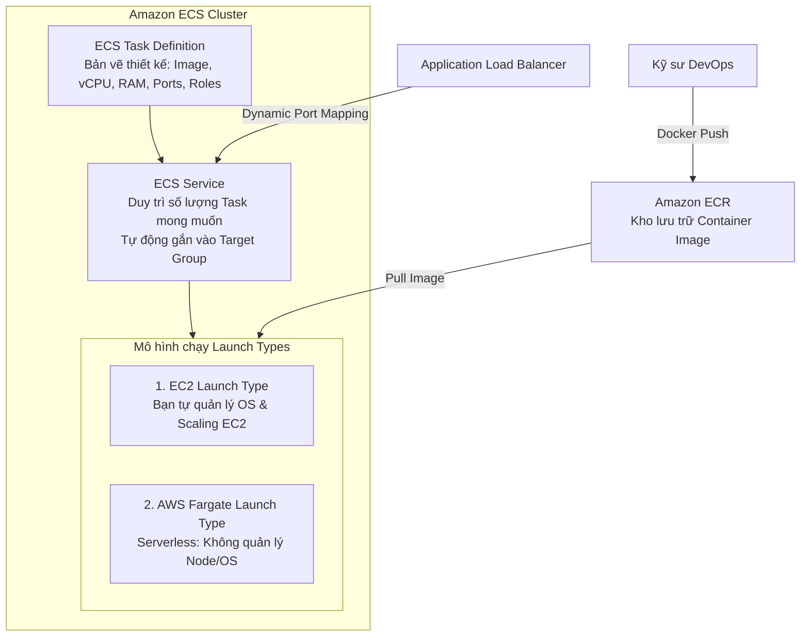
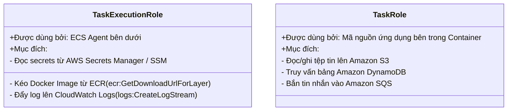
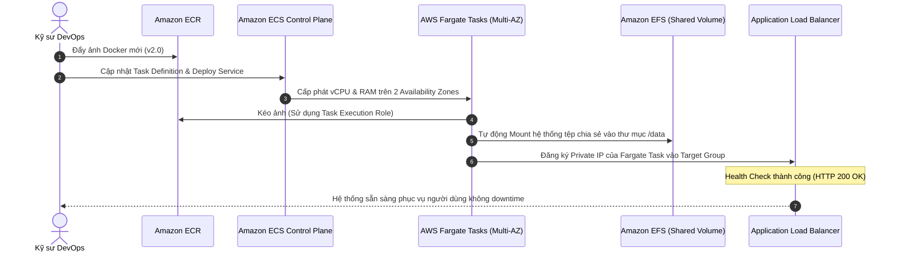

# Tài Liệu Học Tập Chuyên Sâu: Amazon ECS, AWS Fargate, ECR & EKS (Công Nghệ Điều Phối Container Đám Mây)

> **Tài liệu chuẩn hóa kiến trúc đám mây**: Hướng dẫn toàn diện theo tiêu chuẩn Senior AWS Solutions Architect & Cloud DevOps Engineer.  
> **Ngôn ngữ**: Tiếng Việt (Bảo lưu toàn bộ thuật ngữ chuyên ngành tiếng Anh chuẩn AWS).  
> **Các bài giảng liên quan**: Chương 18 (Containers on AWS: ECS, Fargate, ECR, EKS: Bài 198 đến Bài 207).

---

## 6.1. Tổng Quan Dịch Vụ (Service Overview)

### Dịch vụ gì?
Hệ sinh thái công nghệ đóng gói và điều phối container trên AWS cung cấp 4 giải pháp nền tảng:
1. **Amazon Elastic Container Service (Amazon ECS)**: Dịch vụ điều phối container độc quyền của AWS có khả năng mở rộng cao và độ tin cậy tuyệt đối, tích hợp sâu sắc với toàn bộ hệ sinh thái mạng và bảo mật của AWS.
2. **AWS Fargate**: Động cơ tính toán phi máy chủ (**Serverless Compute Engine**) dành cho cả ECS và EKS. Bạn không cần phải cung cấp hay quản lý bất kỳ máy chủ ảo EC2 nào bên dưới; AWS tự động phân bổ tài nguyên và bạn chỉ trả tiền cho đúng lượng vCPU và RAM mà container thực sự tiêu thụ.
3. **Amazon Elastic Container Registry (Amazon ECR)**: Dịch vụ kho lưu trữ ảnh container (Docker Container Registry) an toàn, có tính sẵn sàng cao, hỗ trợ quét lỗ hổng bảo mật tự động và mã hóa dữ liệu.
4. **Amazon Elastic Kubernetes Service (Amazon EKS)**: Dịch vụ chạy cụm điều phối container mã nguồn mở **Kubernetes** được quản lý hoàn toàn, tương thích 100% với các công cụ Kubernetes tiêu chuẩn toàn cầu.

---

## 6.2. Các Khái Niệm và Thành Phần Cốt Lõi (Core Concepts and Components)



### 1. Phân biệt then chốt: EC2 Launch Type vs AWS Fargate Launch Type

| Tiêu chuẩn so sánh | EC2 Launch Type | AWS Fargate Launch Type |
| :--- | :--- | :--- |
| **Quản trị máy chủ** | **Khách hàng tự quản lý**: Phải cấu hình EC2, vá lỗi OS, chọn AMI tối ưu cho ECS (ECS-optimized AMI). | **Hoàn toàn phi máy chủ (Serverless)**: Không nhìn thấy máy chủ; AWS quản lý 100% hạ tầng bên dưới. |
| **Cơ chế thanh toán** | Trả tiền theo chi phí của các máy chủ EC2 đang chạy (dù container có chạy hay không). | **Chỉ trả tiền theo vCPU và RAM** được cấp phát cho từng Task trong thời gian Task hoạt động. |
| **Quy mô co giãn** | Co giãn 2 tầng: Co giãn số lượng Task và co giãn số lượng máy chủ EC2 (Cluster Auto Scaling). | Co giãn 1 tầng cực kỳ đơn giản: Chỉ cần yêu cầu tăng số lượng Task. |
| **Lưu trữ dữ liệu** | Hỗ trợ Amazon EBS, Amazon EFS và EC2 Instance Store. | Hỗ trợ lưu trữ tạm thời (Ephemeral Storage) và **Amazon EFS**. |
| **Kịch bản sử dụng** | Khối lượng công việc lớn liên tục 24/7 cần tối ưu chi phí tối đa bằng Reserved/Spot Instances. | Môi trường vi dịch vụ (Microservices), batch jobs ngắn hạn, không muốn tốn nhân lực quản trị máy chủ. |

### 2. Hai Loại IAM Roles Sống Còn Trong Amazon ECS (Bắt buộc phải phân biệt)



1. **ECS Task Execution Role (Quyền thực thi của hệ thống)**:
   - Được sử dụng bởi chính tiến trình **ECS Container Agent** chạy ngầm trên máy chủ để thực hiện các thao tác hạ tầng trước khi container khởi động: cấp quyền đăng nhập và kéo ảnh từ Amazon ECR, cấp quyền tạo Log Stream và đẩy log lên Amazon CloudWatch Logs, cấp quyền giải mã mật khẩu từ Secrets Manager để nạp vào biến môi trường.
2. **ECS Task Role (Quyền nghiệp vụ của ứng dụng)**:
   - Được gắn trực tiếp vào mã nguồn ứng dụng chạy bên trong container (tương tự như Instance Profile trên EC2).
   - Định nghĩa chính xác ứng dụng trong container đó được phép làm gì trên AWS (ví dụ: container Order Service chỉ có quyền ghi dữ liệu vào bảng DynamoDB Orders).

### 3. Ánh Xạ Cổng Động (Dynamic Port Mapping) với ALB
- **Vấn đề trên Classic Load Balancer (CLB)**: Nếu bạn muốn chạy nhiều bản sao (Tasks) của cùng một microservice trên cùng một máy chủ EC2, các container sẽ bị xung đột nếu cùng cố gắng lắng nghe trên cổng tĩnh (ví dụ cổng 80 hoặc 8080).
- **Giải pháp trên Application Load Balancer (ALB)**:
  - Trong ECS Task Definition, bạn để trống phần `Host Port` (đặt giá trị là `0`).
  - Docker daemon sẽ tự động cấp phát một cổng ngẫu nhiên trong dải cổng tạm thời (**Ephemeral Ports**: từ cổng 32768 đến 61000) trên máy chủ EC2 cho mỗi container.
  - **ALB tự động nhận biết cổng động này**: Khi ECS Service khởi chạy task, nó tự động đăng ký địa chỉ IP của EC2 kèm theo số cổng ngẫu nhiên đó vào Target Group của ALB. Người dùng bên ngoài chỉ cần gọi vào cổng 80/443 của ALB, ALB sẽ tự động định tuyến chính xác vào từng container!

---

## 6.3. Kiến Trúc và Luồng Vận Hành (Architecture and Workflow)

### Sơ đồ luồng triển khai dịch vụ Microservices trên ECS Fargate kèm lưu trữ chia sẻ EFS



---

## 6.4. Bảng Tích Hợp với Các Dịch Vụ AWS Khác (Integration Table)

| Related AWS Service | Purpose (Mục đích tích hợp) | Integration Method (Phương thức tích hợp) | Practical Example (Ví dụ thực tiễn) |
| :--- | :--- | :--- | :--- |
| **Amazon EFS** | Cung cấp ổ đĩa lưu trữ tệp tin chia sẻ bền vững cho container | ECS Volume Configuration | Gắn một hệ thống tệp EFS vào 10 Fargate Tasks để các container chia sẻ chung dữ liệu uploads mà không sợ mất file khi task khởi động lại. |
| **AWS Systems Manager** | Thực thi lệnh trực tiếp vào bên trong container (**ECS Exec**) | SSM Channel Integration | Kỹ sư chạy lệnh `aws ecs execute-command` để mở bash shell trực tiếp vào container Fargate đang chạy nhằm debug lỗi. |
| **Amazon CloudWatch Logs**| Thu thập toàn bộ log đầu ra chuẩn (stdout/stderr) của container | `awslogs` Log Driver | Toàn bộ log in ra từ ứng dụng Node.js/Java trong container tự động được đẩy về CloudWatch Log Group. |
| **AWS Secrets Manager** | Nạp mật khẩu cơ sở dữ liệu an toàn vào container lúc khởi động | `secrets` syntax trong Task Definition | Cấu hình biến môi trường `DB_PASSWORD` lấy trực tiếp từ ARN của Secrets Manager mà không để lộ mật khẩu trong code. |

---

## 6.5. So Sánh Amazon ECS và Amazon EKS

| Tiêu chuẩn so sánh | Amazon ECS | Amazon EKS |
| :--- | :--- | :--- |
| **Công nghệ nền tảng** | Độc quyền của AWS (AWS-native). | **Chuẩn Kubernetes mã nguồn mở** (Open-source K8s). |
| **Độ phức tạp vận hành** | **Rất thấp**: Cấu hình đơn giản, giao diện trực quan, làm quen cực nhanh. | **Cao**: Đòi hỏi kỹ năng chuyên sâu về hệ sinh thái Kubernetes (Pods, Services, Ingress, Helm). |
| **Khả năng tương thích Multi-Cloud**| Chỉ chạy trên nền tảng AWS (và ECS Anywhere). | **Tuyệt đối**: Chạy cùng một cấu hình manifest trên AWS, Azure, Google Cloud hoặc On-Premises. |
| **Chi phí Control Plane** | **HOÀN TOÀN MIỄN PHÍ**. | **0.10 USD/giờ** (~72 USD/tháng) cho mỗi cụm EKS Control Plane. |
| **Khuyến nghị lựa chọn** | Lựa chọn số 1 cho các nhóm muốn tập trung vào phát triển ứng dụng trên AWS mà không muốn gánh nặng vận hành K8s. | Lựa chọn tiêu chuẩn cho các tập đoàn lớn đã chuẩn hóa công nghệ trên Kubernetes toàn cầu. |

---

## 6.6. Mô Hình Tính Phí Dịch Vụ & Chiến Lược Tối Ưu Chi Phí Theo Từng Use Case (Container Cost Breakdown & Optimization)

Chạy ứng dụng Container trên AWS có thể được tối ưu chi phí ở mức tối đa nếu bạn hiểu rõ sự khác biệt giữa **ECS Launch Type EC2** và **AWS Fargate Serverless**, cũng như cách thức tận dụng **Fargate Spot** và vi xử lý **Graviton ARM**.

---

### 6.6.1. Bảng Phân Tích Cơ Chế Tính Phí Các Dịch Vụ Container Trên AWS

| Thành phần Dịch vụ (Component) | Cơ chế tính phí chi tiết (Pricing Dimensions) | Mức phí tham chiếu điển hình | Rủi ro phát sinh chi phí (Cost Pitfalls) |
| :--- | :--- | :--- | :--- |
| **Amazon ECS Control Plane** | **HOÀN TOÀN MIỄN PHÍ ($0.00)** | Tạo bao nhiêu cụm (Cluster), quản lý bao nhiêu Task/Service cũng không tốn phí duy trì. | Không có rủi ro chi phí cố định cho Control Plane. |
| **Amazon EKS Control Plane** | • **$0.10 / giờ / cluster** (~$72.00 / tháng / cụm Kubernetes).<br>• Tính độc lập cho mỗi cụm EKS tạo ra. | Chi phí cố định cho việc AWS quản lý 3 máy chủ Master Nodes phân tán trên 3 AZ. | Tạo riêng lẻ hàng chục cụm EKS cho từng microservice nhỏ lẻ gây lãng phí hàng nghìn USD. |
| **AWS Fargate (Chuẩn On-Demand)** | • Tính theo lượng **vCPU và RAM cấp phát thực tế theo từng giây** (tối thiểu 1 phút):<br>  - vCPU (x86): **$0.04048 / vCPU / giờ**.<br>  - RAM (x86): **$0.004445 / GB / giờ**.<br>  - Kiến trúc **Arm64 (Graviton)**: **Rẻ hơn 20%** so với x86!<br>• Lưu trữ tạm (Ephemeral Storage): 20 GB đầu miễn phí. | Trả tiền chính xác cho kích thước container, không phải trả tiền cho máy chủ EC2 nhàn rỗi. | Cấp phát quá dư thừa vCPU/RAM trong Task Definition mà container không dùng đến. |
| **AWS Fargate Spot** | • Sử dụng hạ tầng điện toán dư thừa của Fargate với cơ chế ngắt quãng.<br>• **GIẢM GIÁ TỚI 70%** so với Fargate chuẩn! | Lựa chọn số 1 cho các tác vụ phi trạng thái (Stateless), worker bốc việc từ queue, môi trường Dev/Test. | Dùng Fargate Spot cho các tác vụ quan trọng không chấp nhận bị ngắt giữa chừng. |
| **ECS Launch Type (EC2 Instances)** | • Tính tiền thuê máy ảo EC2 thông thường.<br>• Áp dụng được các gói chiết khấu **Compute Savings Plans / EC2 Reserved Instances** lên tới 60-70%. | Tiết kiệm hơn Fargate nếu bạn nén được mật độ container dày đặc (High container packing density). | Máy chủ EC2 chạy rỗng tải (tốn tiền nuôi máy ảo dù bên trong chỉ có 1 container nhỏ). |
| **Amazon ECR (Container Registry)** | • **Lưu trữ Image**: **$0.10 / GB / tháng**.<br>• Kéo ảnh (Pull data) trong cùng Region: **0$ (Hoàn toàn Miễn phí)**.<br>• Data Transfer Out ra ngoài Internet: ~$0.09/GB. | Rất rẻ, nhưng dung lượng layer tích tụ qua các bản build CI/CD có thể lên tới hàng TB. | Không cài đặt **ECR Lifecycle Policy** khiến hàng trăm bản build Docker cũ bị giữ lại tính tiền. |

---

### 6.6.2. Chiến Lược Tối Ưu Hóa Chi Phí Theo 5 Kịch Bản Thực Tế (Use Cases Optimization)

#### Use Case 1: Tối ưu chi phí Worker xử lý hàng đợi bằng Fargate Spot (Tiết kiệm 70%)
* **Vấn đề & So sánh chi phí**:
  - Hệ thống xử lý video/hình ảnh có 10 worker container tiêu thụ tin nhắn từ SQS Queue. Mỗi task cần 2 vCPU và 4 GB RAM.
  - Các worker này là phi trạng thái (Stateless), nếu bị ngắt thì tin nhắn trong SQS sẽ tự động được trả lại hàng đợi để worker khác xử lý tiếp.
  - *Nếu chạy Fargate On-Demand thông thường (10 tasks chạy 24/7)*:
    $$\text{Phí vCPU} = 10 \times 2 \times 0.04048\$ \times 720 = 582.91\$$$
    $$\text{Phí RAM} = 10 \times 4 \times 0.004445\$ \times 720 = 128.02\$$$
    $$\text{Tổng chi phí Fargate On-Demand} = 582.91\$ + 128.02\$ = \mathbf{710.93\$/\text{tháng}}$$
* **Giải pháp Tối ưu kiến trúc**:
  - Cấu hình ECS Service sử dụng **Fargate Spot Capacity Provider** (hoặc cấu hình kết hợp 2 task On-Demand làm lõi và 8 task Spot).
  - Mức giá Fargate Spot giảm 70%:
    $$\text{Tổng chi phí Fargate Spot} = 710.93\$ \times (1 - 0.70) = \mathbf{213.28\$/\text{tháng}}$$
* **Kết quả tiết kiệm**: Tiết kiệm ngay **$497.65/tháng (~70% ngân sách)** cho toàn bộ cụm worker xử lý nền.

#### Use Case 2: Chuyển đổi Fargate Task sang Vi xử lý ARM Graviton (Tiết kiệm 20%)
* **Vấn đề**: Doanh nghiệp chạy 30 microservices viết bằng Spring Boot và Node.js trên Fargate x86 tiêu tốn $1,500/tháng.
* **Giải pháp Tối ưu**:
  - Sửa file cấu hình Task Definition (hoặc Terraform):
    ```hcl
    runtime_platform {
      operating_system_family = "LINUX"
      cpu_architecture        = "ARM64"
    }
    ```
  - Cập nhật pipeline CI/CD build Docker image đa nền tảng (`docker buildx --platform linux/arm64`).
* **Kết quả tiết kiệm**: Hóa đơn Fargate giảm trực tiếp **20% (Tiết kiệm $300/tháng)** trong khi tốc độ xử lý của Java và Node.js trên Graviton thậm chí còn nhanh hơn.

#### Use Case 3: Dọn dẹp kho lưu trữ ảnh Docker với ECR Lifecycle Policies
* **Vấn đề & Cạm bẫy chi phí**:
  - Pipeline CI/CD tự động build và đẩy image mới lên Amazon ECR sau mỗi commit (trung bình 10 lần/ngày). Mỗi Docker image nặng khoảng **1.5 GB**.
  - Sau 1 năm, ECR tích tụ hơn **3,500 images** (dung lượng lên tới hơn 5 TB):
    $$\text{Chi phí lưu trữ ECR} = 5,000 \text{ GB} \times 0.10\$ = \mathbf{500\$/\text{tháng}}$$ lãng phí cho các bản build thử nghiệm cũ không dùng tới!
* **Giải pháp Tối ưu**:
  - Thiết lập **ECR Lifecycle Policy** tự động trên tất cả các kho lưu trữ (Repositories):
    1. Tự động xóa các image không gắn tag (`untagged`) sau **3 ngày**.
    2. Chỉ giữ lại tối đa **10 image có tag gần nhất** (`sinceImagePushed = 10`).
* **Kết quả tiết kiệm**: Thu hồi hơn 95% dung lượng lưu trữ, giảm chi phí ECR từ $500/tháng xuống dưới **$20/tháng (Tiết kiệm $480/tháng)**.

#### Use Case 4: Bài toán điểm hòa vốn giữa EC2 Launch Type và AWS Fargate (Breakeven Analysis)
* **Quy tắc phân định kiến trúc của Senior Solutions Architect**:
  - **Khi nào chọn AWS Fargate**:
    - Khi lưu lượng biến thiên mạnh, tải không ổn định, hoặc các ứng dụng có số lượng container ít (1-5 containers).
    - Fargate giúp triệt tiêu hoàn toàn chi phí máy chủ EC2 nhàn rỗi và loại bỏ 100% thời gian vận hành vá lỗi hệ điều hành (OS patching).
  - **Khi nào chọn EC2 Launch Type**:
    - Khi hệ thống ở quy mô cực lớn (hàng trăm containers chạy 24/7 ổn định).
    - Bạn có thể nén mật độ cao (**High Container Packing Density**: nhồi 15-20 containers vào 1 máy ảo EC2 lớn `m6g.4xlarge`) kết hợp mua **Compute Savings Plans 3 năm**.
    - Chi phí trên mỗi container lúc này có thể rẻ hơn Fargate từ **30% đến 45%**.

#### Use Case 5: Hợp nhất cụm Kubernetes (EKS Control Plane Consolidation)
* **Vấn đề & Cách tính tiền cũ**:
  - Một công ty chia 8 nhóm phát triển (Team Payments, Team Orders, Team Inventory...). Mỗi nhóm tự tạo 1 cụm Amazon EKS riêng để cô lập môi trường.
  - Chi phí 8 EKS Control Planes:
    $$\text{Chi phí Control Plane} = 8 \text{ cụm} \times 0.10\$ \times 720 = \mathbf{576.00\$/\text{tháng}}$$ (chưa tính tiền máy chủ worker nodes).
* **Giải pháp Tối ưu kiến trúc**:
  - Hợp nhất 8 nhóm vào **1 cụm EKS dùng chung (Multi-tenant EKS Cluster)**:
    - Sử dụng **Kubernetes Namespaces** để cô lập tài nguyên giữa các nhóm.
    - Sử dụng **ResourceQuotas** và **LimitRanges** để kiểm soát lượng vCPU/RAM tối đa của từng nhóm.
    - Sử dụng **IAM Roles for Service Accounts (IRSA)** để phân quyền truy cập AWS riêng biệt cho từng microservice.
* **Kết quả tiết kiệm**: Giảm chi phí Control Plane từ $576/tháng xuống còn **$72/tháng (Tiết kiệm $504/tháng ~87.5%)**, đồng thời tận dụng tối đa năng lực phần cứng của các worker nodes dùng chung.

---

## 6.7. Khắc Phục Sự Cố Thực Tế (Troubleshooting Guide)

| Vấn đề (Problem) | Nguyên nhân khả dĩ (Possible Causes) | Các bước điều tra (Investigation Steps) | Giải pháp (Solution) | Biện pháp phòng ngừa (Prevention) |
| :--- | :--- | :--- | :--- | :--- |
| **Task Fargate liên tục bị Stop ngay sau khi khởi chạy (`Task stopped with exit code 1`)** | Ứng dụng bên trong container bị crash do lỗi biến môi trường hoặc không kết nối được database. | Vào tab Tasks trên ECS Console -> Nhấp vào Stopped Tasks -> Xem trường `Stopped reason` và xem CloudWatch Logs. | Sửa lỗi mã nguồn hoặc bổ sung đúng các biến môi trường cấu hình trong Task Definition. | Luôn kiểm thử container kỹ lưỡng ở môi trường local bằng lệnh `docker run` trước khi đẩy lên ECR. |
| **Lỗi `CannotPullContainerError` khi khởi động Task** | 1. Tên image/tag trong ECR không tồn tại.<br>2. Task Execution Role thiếu quyền `ecr:GetDownloadUrlForLayer`.<br>3. Task Fargate nằm ở Private Subnet không có lối ra Internet kéo ECR. | 1. Kiểm tra chính tả URI của Image.<br>2. Kiểm tra quyền của Task Execution Role.<br>3. Kiểm tra Subnet có NAT Gateway hoặc VPC Endpoints cho ECR chưa. | Cấp đủ quyền cho Execution Role và cấu hình VPC Interface Endpoints cho ECR (`ecr.api`, `ecr.dkr`, `s3 gateway endpoint`). | Luôn đảm bảo mạng có đủ đường truyền ra ECR cho container. |
| **ALB Health Check liên tục báo Unhealthy cho ECS Service** | 1. Cổng container lắng nghe khác với cổng khai báo trong Target Group.<br>2. Endpoint `/health` trả về mã lỗi.<br>3. Security Group của Task chặn traffic từ ALB. | 1. Xem tab Targets trên Target Group.<br>2. Kiểm tra Inbound Rules trên Security Group của Task. | Đảm bảo Security Group của Task mở cổng cho Security Group của ALB và container phản hồi HTTP 200. | Thêm thời gian `HealthCheckGracePeriodSeconds` để task có đủ thời gian khởi động ứng dụng nặng. |
| **Hết dung lượng lưu trữ trên cụm EC2 Launch Type (`No container instances found`)** | Các máy chủ EC2 hiện có trong cụm đã hết sạch vCPU hoặc RAM trống để đặt thêm Task mới. | Xem tổng lượng tài nguyên khả dụng của cụm ECS Cluster. | Thêm máy chủ EC2 vào cụm bằng Auto Scaling Group hoặc chuyển sang sử dụng **AWS Fargate** để co giãn vô hạn. | Sử dụng **ECS Capacity Providers** để tự động co giãn máy chủ EC2 theo nhu cầu của Tasks. |

---

## 6.8. Bộ Câu Hỏi Ôn Tập và Kiểm Tra Kiến Thức (Knowledge Review)

### A. 10 Câu hỏi Cốt lõi (Core Concepts)
1. Sự khác biệt cốt lõi nhất giữa **ECS Launch Type EC2** và **AWS Fargate** là gì?
2. Trong Amazon ECS, sự khác nhau giữa **ECS Task Execution Role** và **ECS Task Role** là gì?
3. Tính năng nào của Application Load Balancer kết hợp với Amazon ECS cho phép chạy nhiều container của cùng một ứng dụng trên cùng một máy chủ EC2 mà không bị xung đột cổng mạng?
4. Đâu là dịch vụ lưu trữ bền vững dạng tệp tin mạng dùng chung có thể gắn trực tiếp vào các container chạy trên **AWS Fargate**?
5. Dịch vụ lưu trữ ảnh container nào của AWS hỗ trợ quét tự động các lỗ hổng bảo mật của Docker Image?
6. Thành phần nào trong Amazon ECS đóng vai trò như một bản vẽ thiết kế (Blueprint) định nghĩa hình ảnh Docker, lượng CPU, RAM và các cổng mạng của container?
7. Sự khác biệt cơ bản về chi phí Control Plane giữa **Amazon ECS** và **Amazon EKS** là gì?
8. Khi chạy container trên Fargate trong một Private Subnet không có Internet Gateway, bạn cần cấu hình những **VPC Endpoints** nào để Task có thể kéo ảnh từ Amazon ECR?
9. Cơ chế nào cho phép mở một phiên làm việc tương tác dòng lệnh (Interactive Shell) trực tiếp vào một container đang chạy trên Fargate để phục vụ điều tra sự cố?
10. Tham số **`HealthCheckGracePeriodSeconds`** trong cấu hình ECS Service giải quyết vấn đề kỹ thuật nào?

---

### Đáp án Bộ Câu Hỏi Ôn Tập (Answer Key)

<details>
<summary>👉 Nhấp vào đây để xem toàn bộ đáp án chi tiết</summary>

1. Với **EC2 Launch Type**, người dùng phải tự quản lý, cấu hình và vá lỗi hệ điều hành của cụm máy chủ ảo EC2 bên dưới; với **AWS Fargate**, hệ thống hoàn toàn phi máy chủ (Serverless), AWS tự động quản lý toàn bộ hạ tầng phần cứng và người dùng chỉ trả tiền cho vCPU/RAM của từng Task.
2. **Task Execution Role** được sử dụng bởi tiến trình hệ thống ECS Container Agent để kéo Docker Image từ ECR và đẩy log lên CloudWatch; trong khi **Task Role** được sử dụng bởi chính mã nguồn ứng dụng bên trong container để gọi các API dịch vụ AWS (như đọc S3, ghi DynamoDB).
3. Tính năng **Ánh xạ cổng động (Dynamic Port Mapping)**.
4. **Amazon Elastic File System (Amazon EFS)**.
5. **Amazon Elastic Container Registry (Amazon ECR)**.
6. **ECS Task Definition** (Tài liệu JSON định nghĩa cấu hình Task).
7. Control Plane của **Amazon ECS** hoàn toàn **MIỄN PHÍ**; trong khi cụm Control Plane của **Amazon EKS** tính phí **0.10 USD/giờ** cho mỗi cụm cluster.
8. Cần tối thiểu 3 VPC Endpoints: (1) `com.amazonaws.[region].ecr.api` (Interface Endpoint); (2) `com.amazonaws.[region].ecr.dkr` (Interface Endpoint); và (3) **S3 Gateway Endpoint** (để tải các image layers lưu trữ trên S3).
9. Tính năng **Amazon ECS Exec** (sử dụng hạ tầng của AWS Systems Manager Session Manager).
10. Cho phép bộ cân bằng tải ALB tạm thời bỏ qua (chưa kiểm tra sức khỏe) trong một khoảng thời gian đầu (ví dụ: 120 giây) để các ứng dụng nặng (như Java Spring Boot) có đủ thời gian khởi động xong trước khi ALB bắt đầu kiểm tra sức khỏe, tránh việc task bị tiêu hủy nhầm khi chưa kịp sẵn sàng.
</details>

---

## 6.9. Tóm Tắt và Danh Mục Kiểm Tra Kiến Thức (Summary & Learning Checklist)

### 5 Khái niệm quan trọng nhất phải nhớ:
1. **Fargate = Serverless Containers**: Xóa bỏ gánh nặng quản lý máy chủ EC2; trả tiền theo tài nguyên tiêu thụ thực tế.
2. **Phân biệt rạch ròi 2 IAM Roles**: Task Execution Role (Hạ tầng kéo ảnh/ghi log) vs Task Role (Ứng dụng gọi AWS API).
3. **Dynamic Port Mapping**: Để trống host port trong Task Definition để ALB tự định tuyến cổng ngẫu nhiên.
4. **ECS vs EKS**: ECS đơn giản, miễn phí control plane, đậm chất AWS; EKS chuẩn mực Kubernetes mã nguồn mở cho đa đám mây.
5. **Lưu trữ cho Fargate**: Sử dụng Amazon EFS khi container cần chia sẻ hoặc giữ lại dữ liệu bền vững.

### Liên kết và Chủ đề tiếp theo:
- 📖 [Ghi Chú Bài Học Chương 18: Containers on AWS](file:///n:/AWS_XBrain_Note/Lesson_Notes/18_Containers_ECS_Fargate_EKS.md)
- 📖 [Bảng Thuật Ngữ Kỹ Thuật (GLOSSARY.md)](file:///n:/AWS_XBrain_Note/GLOSSARY.md)
- ⏭️ Tiếp tục chuyển sang chuyên đề: **Điện Toán Không Máy Chủ & Kiến Trúc Serverless: AWS Lambda, API Gateway & DynamoDB**.
