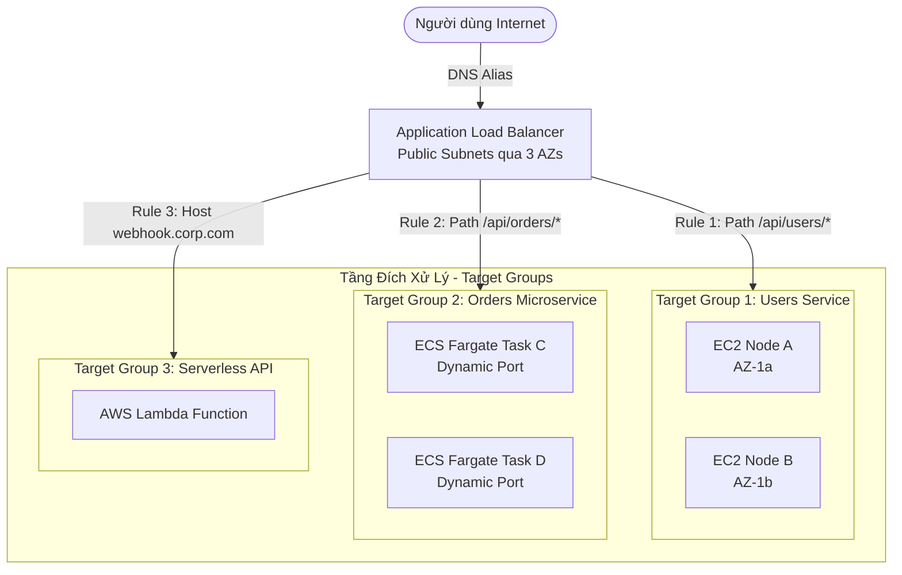
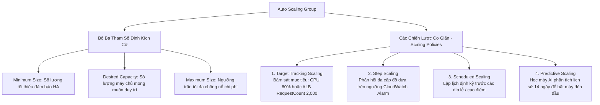

# Tài Liệu Học Tập Chuyên Sâu: Elastic Load Balancing (ELB) & Auto Scaling Groups (ASG) (Kiến Trúc Co Giãn & Độ Sẵn Sàng Cao)

> **Tài liệu chuẩn hóa kiến trúc đám mây**: Hướng dẫn toàn diện theo tiêu chuẩn Principal AWS Solutions Architect & Senior Cloud DevOps Engineer (Cập nhật phiên bản kiến trúc mới nhất 2026).  
> **Ngôn ngữ**: Tiếng Việt chuyên ngành (Bảo lưu toàn bộ thuật ngữ chuyên ngành tiếng Anh chuẩn AWS).  
> **Mục tiêu**: Phục vụ thi chứng chỉ cấp độ Professional/Specialty (**SAA-C03, SAP-C02, DOP-C02**) và vận hành hệ thống cấp độ doanh nghiệp (**Production-grade**).  
> **Các bài giảng liên quan**: Chương 08 (High Availability and Scalability: Bài 70 đến Bài 86).

---

## 6.1. Tổng Quan Dịch Vụ (Service Overview)

### 1. Định nghĩa chuẩn xác và Phân nhóm dịch vụ
Bộ đôi **Elastic Load Balancing (ELB)** và **Auto Scaling Groups (ASG)** là xương sống kiến trúc nền tảng của mọi hệ thống phân tán có tính sẵn sàng cao (**High Availability - HA**), khả năng chịu lỗi (**Fault Tolerance**) và co giãn đàn hồi (**Elasticity**) trên AWS.

```mermaid
flowchart TD
    ELBFamily[Họ Bộ Cân Bằng Tải AWS - Elastic Load Balancing] --> ALB[Application Load Balancer - ALB\nLayer 7: HTTP, HTTPS, gRPC, WebSocket / Content-based Routing]
    ELBFamily --> NLB[Network Load Balancer - NLB\nLayer 4: TCP, UDP, TLS / Cực nhanh microsecond / Static IP per AZ]
    ELBFamily --> GWLB[Gateway Load Balancer - GWLB\nLayer 3: Gói tin IP thô / GENEVE port 6081 / Inline Network Appliances]
    ELBFamily --> CLB[Classic Load Balancer - CLB [Deprecated]\nThế hệ cũ Layer 4/7 / Không khuyến nghị cho thiết kế mới]

    ASGFamily[Hệ Thống Tự Động Co Giãn - Auto Scaling Group] --> ASG_EC2[ASG for Amazon EC2\nTự động điều phối số lượng máy ảo, Self-healing, Mixed Spot/On-Demand]
    ASGFamily --> AppScaling[Application Auto Scaling\nCo giãn ECS Tasks, DynamoDB RCU/WCU, Aurora Replicas]
```

1. **Application Load Balancer (ALB)**: Hoạt động ở **Tầng 7 (Application Layer)** của mô hình OSI. Chuyên biệt cho lưu lượng HTTP, HTTPS, HTTP/2, gRPC và WebSockets. Có khả năng phân tích chi tiết tiêu đề gói tin để định tuyến thông minh dựa trên đường dẫn URL, hostname, HTTP headers, query strings và hỗ trợ mTLS.
2. **Network Load Balancer (NLB)**: Hoạt động ở **Tầng 4 (Transport Layer)**. Có khả năng xử lý hàng chục triệu requests/giây với độ trễ cực thấp ở mức **microsecond**. Hỗ trợ các giao thức TCP, UDP và TLS passthrough/termination. Cung cấp **địa chỉ Anycast IP tĩnh hoặc Elastic IP cố định cho mỗi Availability Zone**.
3. **Gateway Load Balancer (GWLB)**: Hoạt động ở **Tầng 3 (Network Layer)**. Được thiết kế chuyên biệt để triển khai, mở rộng quy mô và điều phối các thiết bị mạng ảo của bên thứ ba (**Virtual Appliances** như Firewall thế hệ mới NGFW, Intrusion Detection/Prevention Systems - IDS/IPS, Deep Packet Inspection). Sử dụng giao thức đóng gói **GENEVE** trên cổng 6081.
4. **Classic Load Balancer (CLB) `[Deprecated]`**: Bộ cân bằng tải thế hệ cũ (Layer 4/7), hiện đã bị AWS ngừng khuyến nghị và không nên sử dụng cho bất kỳ hệ thống mới nào.
5. **Auto Scaling Groups (ASG)**: Dịch vụ tự động điều chỉnh số lượng máy chủ EC2 tăng lên khi lưu lượng truy cập cao để duy trì hiệu năng, và co cụm giảm bớt khi thấp điểm để tiết kiệm chi phí; đồng thời liên tục giám sát và tự động thay thế các máy chủ bị hỏng (**Self-healing**).

---

### 2. Bài toán cốt lõi mà ELB & ASG giải quyết

1. **Loại bỏ Điểm Lỗi Đơn Lẻ (Single Point of Failure - SPOF)**: Tự động phân phối tải xuyên qua nhiều Availability Zones (tối thiểu 2–3 AZs). Nếu một AZ gặp thảm họa mất điện hoặc đứt cáp quang, ELB tự động chuyển hướng toàn bộ lưu lượng sang các AZ lành lặn còn lại.
2. **Tự Động Phục Hồi Máy Chủ Lỗi (Automated Self-Healing)**: Khi kết hợp với ELB Health Checks, ASG tự động phát hiện các máy chủ bị treo ứng dụng (trả về mã lỗi 5xx), thực hiện chấm dứt máy chủ lỗi và khởi tạo máy chủ mới thay thế tức thì mà không cần kỹ sư can thiệp thủ công.
3. **Tối Ưu Hóa Chi Phí Tự Động (Elastic Cost Optimization)**: Co giãn theo nhu cầu thực tế theo thời gian thực (Dynamic Scaling) hoặc dự báo bằng học máy (Predictive Scaling), kết hợp mô hình linh hoạt giữa On-Demand cho tải nền và Spot Instances cho tải đột biến.

---

### 3. Khi nào KHÔNG nên dùng hoặc Giải pháp thay thế

* ❌ **Cần địa chỉ IP tĩnh công khai cố định cho Load Balancer**: Application Load Balancer (ALB) không cung cấp IP tĩnh (IP thay đổi liên tục theo DNS Resolution).  
  👉 *Giải pháp thay thế*: Sử dụng **Network Load Balancer (NLB)** (cung cấp 1 Elastic IP cố định per AZ), hoặc đặt **AWS Global Accelerator** phía trước ALB để nhận 2 Anycast IP tĩnh.
* ❌ **Xử lý lưu lượng giao thức phi-HTTP yêu cầu độ trễ microsecond cực thấp (Gaming, IoT, RTMP Video)**: ALB chỉ hỗ trợ HTTP/HTTPS/gRPC và xử lý ở tầng 7 với độ trễ vài mili-giây.  
  👉 *Giải pháp thay thế*: Chuyển sang **Network Load Balancer (NLB)** hoạt động ở Layer 4.
* ❌ **Ứng dụng Serverless hoàn toàn không có máy chủ**: Không cần phải tạo Auto Scaling Group cho các hàm Lambda vì Lambda có cơ chế tự động mở rộng quy mô tích hợp sẵn.

---

## 6.2. Các Khái Niệm, Kiến Trúc & Vận Hành Cốt Lõi (Core Concepts, Security & Day-2 Operations)

### 1. Sơ đồ các mô hình kiến trúc của Application Load Balancer



---

### 2. Các tính năng nâng cao cốt lõi của Elastic Load Balancing

#### A. Định tuyến nội dung nâng cao (Advanced Content-Based Routing trên ALB)
* **Path-based Routing**: Định tuyến dựa trên đường dẫn URL (ví dụ: `/api/v1/auth/*` gửi về Auth Cluster, `/static/*` gửi về Static Group).
* **Host-based Routing**: Định tuyến dựa trên trường Host trong HTTP Header (ví dụ: `api.domain.com` và `shop.domain.com` dùng chung 1 ALB).
* **HTTP Header / Method / Query Parameter Routing**: Định tuyến dựa trên giá trị của HTTP Header (ví dụ: `User-Agent: iOS` đẩy về nhóm máy chủ tối ưu di động) hoặc phương thức HTTP (`GET` chuyển về Read Group, `POST` chuyển về Write Group).
* **Weighted Target Groups (Chuyển tải theo tỷ lệ phần trăm)**: Cho phép cấu hình phân bổ lưu lượng (ví dụ: 95% traffic vào Target Group Blue - v1, và 5% vào Target Group Green - v2) để triển khai **Canary Deployment** hoặc **Blue/Green Deployment** an toàn.

#### B. Sticky Sessions (Session Affinity)
* Ràng buộc các yêu cầu liên tiếp từ cùng một người dùng cuối luôn được chuyển tiếp tới **cùng một máy chủ backend cụ thể**.
* Hoạt động dựa trên Cookie:
  - **Duration-based Cookie**: Do chính ALB tự tạo ra và quản lý (tên cookie mặc định là `AWSALB`, có thời gian sống cấu hình từ 1 giây đến 7 ngày).
  - **Application-based Cookie**: Do ứng dụng backend tự sinh và ALB sẽ theo dõi cookie tùy chỉnh này.
* ⚠️ *Rủi ro kiến trúc*: Sticky Sessions có thể gây ra hiện tượng **mất cân bằng tải (Load Imbalance)** nếu một vài người dùng gửi lưu lượng quá lớn làm sập máy chủ đó. Khuyến nghị chuẩn mực: Lưu trạng thái phiên làm việc (Session state) tập trung trong **Amazon ElastiCache for Valkey/Redis** để giữ tầng Web hoàn toàn phi trạng thái (**Stateless Web Tier**).

#### C. Cross-Zone Load Balancing (Cân bằng tải chéo vùng)
* **Cơ chế hoạt động**: Mỗi node của Load Balancer sẽ phân phối lưu lượng đồng đều tới toàn bộ các máy chủ backend nằm ở **tất cả các Availability Zones**.
* **So sánh trạng thái mặc định**:
  - **Application Load Balancer (ALB)**: **MẶC ĐỊNH BẬT** và hoàn toàn **MIỄN PHÍ** cước truyền dữ liệu liên AZ ($0.00/GiB).
  - **Network Load Balancer (NLB)**: **MẶC ĐỊNH TẮT**; nếu người dùng chủ động BẬT tính năng này trên NLB, AWS sẽ **tính phí cước Data Transfer Inter-AZ ($0.01/GiB)** cho mỗi chiều truyền nhận.

#### D. Quản lý kết nối & Xử lý chứng chỉ số (SSL Termination & SNI)
* **SSL/TLS Termination**: ALB giải mã kết nối HTTPS ngay tại điểm tiếp nhận của Load Balancer, giúp giải phóng hoàn toàn gánh nặng tính toán CPU mật mã cho các máy chủ backend.
* **Server Name Indication (SNI)**: Cho phép một Listener duy nhất trên cổng 443 của ALB có thể nạp và phục vụ **nhiều chứng chỉ số SSL/TLS khác nhau cho nhiều tên miền độc lập** (ví dụ: `siteA.com`, `siteB.com`, `siteC.com` dùng chung 1 ALB).
* **Mutual TLS (mTLS)**: ALB hỗ trợ xác thực hai chiều qua chứng chỉ số X.509 giữa client và Load Balancer, lý tưởng cho các kết nối B2B an toàn tuyệt đối.
* **Deregistration Delay (Connection Draining)**: Khoảng thời gian ân hạn (mặc định 300 giây, có thể chỉnh từ 0 đến 3,600 giây) để các yêu cầu đang thực thi dở dang (in-flight requests) hoàn tất trước khi máy chủ bị gỡ khỏi Target Group hoặc bị ASG xóa bỏ, ngăn ngừa việc người dùng bị ngắt kết nối đột ngột.

---

### 3. Auto Scaling Groups (ASG) & Các chính sách co giãn hiện đại



1. **Target Tracking Scaling Policy (Chuẩn mực thông dụng nhất)**:
   - Bạn chỉ cần đặt ra một con số mục tiêu (ví dụ: *"Duy trì mức sử dụng CPU trung bình ở 60%"* hoặc *"Mỗi instance phục vụ 1,500 requests/phút"*). AWS sẽ tự động tính toán số lượng máy chủ cần tăng hoặc giảm để giữ ổn định quanh con số đó.
2. **Step Scaling Policy**:
   - Phản ứng linh hoạt theo các ngưỡng bậc thang của CloudWatch Alarm (ví dụ: nếu CPU từ 70%–80% thì thêm 1 máy; nếu CPU vượt 85% thì thêm ngay 3 máy để ứng cứu khẩn cấp).
3. **Predictive Scaling Policy**:
   - Ứng dụng mô hình Machine Learning phân tích dữ liệu lịch sử tải của các tuần trước đó để tự động khởi chạy máy chủ trước khi đợt tăng tải diễn ra (ví dụ: bật máy lúc 07:30 sáng để đón đợt tăng tải lúc 08:00).
4. **ASG Warm Pools & Instance Refresh**:
   - **Warm Pools**: Duy trì một cụm máy ảo ở trạng thái dừng (**Stopped**) đã cài đặt sẵn phần mềm. Khi cần scale-out, máy chỉ mất 30 giây để Start thay vì mất 5–10 phút để cài đặt từ đầu qua User Data.
   - **Instance Refresh**: Cho phép triển khai cập nhật phiên bản AMI mới theo cơ chế rolling update từng phần với các chốt kiểm tra sức khỏe (**Checkpointing**) mà không gây gián đoạn hệ thống.

---

## 6.3. Kiến Trúc Thực Tế và Luồng Vận Hành (Production Architecture & Workflow)

### 1. Sơ đồ kiến trúc Web Tier chịu lỗi cao kết hợp ALB, ASG và cơ chế Self-Healing

```mermaid
flowchart TD
    Client([Người dùng Internet]) --> Route53[Amazon Route 53\nAlias Record trỏ vào ALB DNS]
    Route53 --> WAF[AWS WAF\nChống SQLi, XSS, Rate Limit]
    WAF --> ALB[Application Load Balancer\nMulti-AZ Public Subnets]

    subgraph VPC["Mạng Riêng Ảo - Amazon VPC"]
        subgraph ASG_Tier["Auto Scaling Group - Private Subnets qua 3 AZs"]
            EC2_Healthy_A[(EC2 Node 1\nHealthy\nAZ-1a)]
            EC2_Healthy_B[(EC2 Node 2\nHealthy\nAZ-1b)]
            EC2_Unhealthy[(EC2 Node 3\nUnhealthy 500 Error\nAZ-1c)]
        end
        
        DB[(Amazon Aurora Multi-AZ\nDatabase Cluster)]
    end

    ALB -->|1. Forward Traffic| EC2_Healthy_A
    ALB -->|1. Forward Traffic| EC2_Healthy_B
    ALB -.->|2. Health Check Ping FAIL!| EC2_Unhealthy

    EC2_Healthy_A --> DB
    EC2_Healthy_B --> DB

    Note over ALB,EC2_Unhealthy: 3. ALB đánh dấu Unhealthy và ngừng đẩy traffic
    EC2_Unhealthy -.->|4. Báo cáo lỗi cho ASG| ASG_Tier
    ASG_Tier -->|5. Terminate máy lỗi & Khởi chạy máy mới| EC2_New[(EC2 Node Thay Thế\nMới tinh\nAZ-1c)]
```

---

### 2. Luồng chi tiết cơ chế tự phục hồi (Self-Healing Workflow Step-by-Step)

```mermaid
sequenceDiagram
    autonumber
    participant Client as Người dùng
    participant ALB as Application Load Balancer
    participant EC2_Bad as Máy Chủ EC2 Bị Lỗi
    participant ASG as Auto Scaling Group
    participant EC2_New as Máy Chủ Mới Khởi Tạo

    loop Mỗi 15 giây (Health Check Ping)
        ALB->>EC2_Bad: HTTP GET /health
        EC2_Bad-->>ALB: HTTP 500 Internal Error (hoặc Timeout)
    end
    
    Note over ALB: 1. Đạt ngưỡng 2 lần thất bại liên tiếp (Unhealthy Threshold = 2)
    ALB->>ALB: 2. Đánh dấu node là Unhealthy; lập tức cô lập khỏi bảng định tuyến
    ALB->>ASG: 3. Thông báo Target Health Status = Unhealthy
    
    Note over ASG: 4. Kích hoạt quy trình Self-Healing
    ASG->>EC2_Bad: 5. Kích hoạt Deregistration Delay (draining kết nối dở dang)
    ASG->>EC2_Bad: 6. Ra lệnh Terminate máy chủ bị lỗi
    ASG->>EC2_New: 7. Khởi chạy instance mới từ Launch Template tại cùng AZ
    EC2_New->>EC2_New: 8. Khởi động ứng dụng & sẵn sàng phản hồi
    ALB->>EC2_New: 9. Gửi Health Check ping
    EC2_New-->>ALB: 10. Phản hồi HTTP 200 OK (Healthy)
    ALB->>EC2_New: 11. Bắt đầu phân phối traffic người dùng vào máy mới!
```

---

## 6.4. Bảng Tích Hợp với Các Dịch Vụ AWS Khác (Integration Table)

| Related AWS Service | Purpose (Mục đích tích hợp) | Integration Method (Phương thức kỹ thuật chính xác) | Practical Example (Ví dụ thực tiễn) |
| :--- | :--- | :--- | :--- | :--- |
| **Amazon Route 53** | Phân giải tên miền người dùng vào Load Balancer với độ trễ thấp | **Alias Record** (A / AAAA Record) trỏ vào DNS Name của ALB | Cấu hình Route 53 trỏ tên miền gốc `example.com` vào Application Load Balancer mà không cần dùng địa chỉ IP tĩnh. |
| **AWS Certificate Manager (ACM)** | Cung cấp và tự động gia hạn chứng chỉ bảo mật SSL/TLS miễn phí | Tích hợp chứng chỉ trực tiếp vào HTTPS Listener của ALB | Gắn chứng chỉ SSL đa tên miền bảo vệ `https://api.mycorp.com` và `https://web.mycorp.com` sử dụng tính năng **SNI**. |
| **AWS WAF** | Tường lửa ứng dụng web bảo vệ trước tấn công Layer 7 | Gắn **Web ACL Association** trực tiếp vào ALB | Thiết lập luật WAF chặn đứng các cuộc tấn công SQL Injection và tự động cấm các IP gửi quá 2,000 requests trong 5 phút. |
| **Amazon CloudWatch** | Giám sát trạng thái hoạt động, thời gian phản hồi và kích hoạt co giãn | Tự động đẩy metrics vào CloudWatch; gắn Alarms vào Scaling Policies | Kích hoạt Step Scaling tăng thêm 2 máy chủ khi chỉ số `TargetResponseTime > 0.5s` kéo dài trong 3 phút. |
| **Amazon SQS** | Điều phối co giãn số lượng worker dựa trên lượng tin nhắn tồn đọng | Theo dõi metric `ApproximateNumberOfMessagesVisible` | Tự động tăng số lượng máy chủ xử lý tác vụ ngầm khi hàng đợi SQS có hơn 5,000 thông điệp đang chờ xử lý. |
| **AWS Systems Manager** | Quản lý thông tin cấu hình và tự động khởi chạy kịch bản bảo trì | Tích hợp qua Launch Template gắn IAM Instance Profile | Tự động lấy tham số môi trường từ SSM Parameter Store khi máy ảo mới được ASG khởi chạy. |

---

## 6.5. Bảng So Sánh Toàn Bộ Các Giải Pháp Cân Bằng Tải AWS (Ecosystem Comparison)

| Tiêu chuẩn so sánh | Application Load Balancer (ALB) | Network Load Balancer (NLB) | Gateway Load Balancer (GWLB) | Classic Load Balancer (CLB) `[Deprecated]` |
| :--- | :--- | :--- | :--- | :--- |
| **Tầng mạng (OSI Layer)** | **Tầng 7 (Application)** | **Tầng 4 (Transport)** | **Tầng 3 (Network)** | Tầng 4 và Tầng 7 kết hợp |
| **Giao thức hỗ trợ** | HTTP, HTTPS, HTTP/2, gRPC, WebSocket | TCP, UDP, TLS | Giao thức đóng gói **GENEVE (Port 6081)** | HTTP, HTTPS, TCP, SSL |
| **Độ trễ xử lý (Latency)** | Mili-giây (Miliseconds) | **Siêu tốc (Microseconds)** | Microseconds | Miliseconds |
| **Địa chỉ IP cung cấp** | Tên miền DNS động (IP thay đổi liên tục) | **IP tĩnh (Elastic IP) trên mỗi AZ** | IP riêng nội bộ VPC | Tên miền DNS động |
| **Định tuyến thông minh** | Đường dẫn URL, Host, Headers, Query string | ❌ Chỉ định tuyến theo cổng và IP | Định tuyến toàn bộ luồng gói tin IP | ❌ Không hỗ trợ định tuyến nội dung |
| **Đơn vị tính cước** | Giờ hoạt động + **LCU-hour** | Giờ hoạt động + **NLCU-hour** | Giờ hoạt động + **GLCU-hour** | Giờ hoạt động + GB truyền tải |
| **Cross-Zone Balancing** | **Mặc định BẬT (Miễn phí)** | **Mặc định TẮT (Có phí)** | Mặc định TẮT | Mặc định TẮT |
| **Kịch bản sử dụng chuẩn** | Ứng dụng web, microservices, container ECS, REST APIs | Game online, IoT streaming, hệ thống tài chính cần IP tĩnh | Tường lửa mạng bên thứ ba (Palo Alto, Fortinet), IDS/IPS | **Không dùng cho kiến trúc mới** |

---

## 6.6. Mô Hình Tính Phí & Chiến Lược Tối Ưu Chi Phí (FinOps & Cost Optimization)

### 6.6.1. Bảng Phân Tích Cơ Chế Tính Phí Chi Tiết Của ELB & ASG

| Thành phần tính phí | Cơ chế tính phí chi tiết (Pricing Dimensions) | Mức phí tham chiếu điển hình (US-East-1) | Bẫy chi phí nghiêm trọng (Cost Pitfalls) |
| :--- | :--- | :--- | :--- |
| **Application Load Balancer (ALB)** | • Cước cố định: Tính theo giờ hoạt động.<br>• **Cước LCU (Load Balancer Capacity Units)**: Tính theo chiều tài nguyên tiêu thụ cao nhất trong 4 chiều: New connections (25/s), Active connections (3,000/phút), Processed bytes (1 GB/giờ), Rule evaluations (1,000/s). | • Cố định: **$0.0225 / giờ** (~$16.20/tháng).<br>• LCU: **$0.008 / LCU-giờ**. | Tạo hàng chục ALB riêng lẻ cho từng dịch vụ nhỏ thay vì hợp nhất vào 1 ALB dùng chung Listener Rules. |
| **Network Load Balancer (NLB)** | • Cước cố định: Tính theo giờ hoạt động.<br>• **Cước NLCU**: Đo lường 3 chiều: New connections (800/s), Active connections (100,000/phút), Processed bytes (1 GB/giờ). | • Cố định: **$0.0225 / giờ** (~$16.20/tháng).<br>• NLCU: **$0.006 / NLCU-giờ**. | Bật Cross-Zone Load Balancing trên NLB lưu lượng lớn phát sinh cước truyền dữ liệu xuyên AZ. |
| **Auto Scaling Group (ASG)** | **HOÀN TOÀN MIỄN PHÍ ($0.00)**. | **$0.00** | Chỉ trả tiền cho các tài nguyên EC2 instances do ASG khởi chạy. Lãng phí xảy ra khi đặt ngưỡng scale-out quá nhạy. |
| **Cross-Zone Data Transfer** | • **ALB**: Hoàn toàn **MIỄN PHÍ ($0.00/GB)**.<br>• **NLB**: Tính phí **$0.01 / GB** cho mỗi chiều truyền dữ liệu liên AZ khi bật Cross-Zone. | $0.01 / GB. | Vô tình bật Cross-Zone trên NLB xử lý hàng trăm Terabytes dữ liệu mỗi tháng. |

---

### 6.6.2. Chiến Lược Tối Ưu Hóa Chi Phí Theo 5 Kịch Bản Thực Tế (Use Cases Optimization)

#### Kịch bản 1: Hợp Nhất 10 Microservices Vào Một ALB Duy Nhất (Listener Rules Consolidation)
* **Bối cảnh thực tế**:
  Một công ty khởi nghiệp triển khai 10 dịch vụ vi mô độc lập (Auth, Cart, Order, Product, Payment...). Nhóm lập trình viên ban đầu tạo riêng cho mỗi dịch vụ một Application Load Balancer riêng biệt.
  $$\text{Chi phí cố định ban đầu} = 10 \text{ ALBs} \times 0.0225\$ \times 720 \text{ giờ} = \mathbf{162.00\$/\text{tháng}}$$
* **Chiến lược tối ưu hóa**:
  - Hợp nhất toàn bộ 10 dịch vụ về **1 Application Load Balancer duy nhất**.
  - Sử dụng tính năng **Path-based Routing** (`/api/auth/*`, `/api/orders/*`) và **Host-based Routing** để phân phối lưu lượng vào 10 Target Groups độc lập.
  $$\text{Chi phí cố định 1 ALB} = 1 \times 0.0225\$ \times 720 = \mathbf{16.20\$/\text{tháng}}$$
* **Kết quả tiết kiệm**:
  $$\text{Số tiền tiết kiệm} = 162.00\$ - 16.20\$ = \mathbf{145.80\$/\text{tháng}} \quad (\approx \mathbf{1,749\$/\text{năm}})$$
  **Tỷ lệ tiết kiệm đạt ~90.0% chi phí cố định của Load Balancer**.

---

#### Kịch bản 2: Kiểm Soát Bẫy Chi Phí Cross-Zone Data Transfer Trên NLB
* **Bối cảnh thực tế**:
  Một hệ thống viễn trắc IoT truyền dữ liệu liên tục qua cụm **Network Load Balancer (NLB)** với tổng dung lượng dữ liệu xử lý lên tới **100 TB (100,000 GiB)/tháng** trải dài trên 3 Availability Zones. Do kỹ sư bật cờ `Cross-Zone Load Balancing = ON`, khoảng 66.7% dữ liệu bị truyền chéo sang các AZ khác.
  $$\text{Chi phí Data Transfer chéo AZ} = 100,000 \text{ GiB} \times \frac{2}{3} \times 0.01\$ = \mathbf{666.67\$/\text{tháng}}$$
* **Chiến lược tối ưu hóa**:
  - Tắt tính năng Cross-Zone Load Balancing trên NLB (`Cross-Zone = OFF` - giá trị mặc định).
  - Sử dụng Route 53 hoặc phân bổ client kết nối đều vào từng Elastic IP của NLB tại từng AZ tương ứng để xử lý cục bộ (Local Zone Processing).
* **Kết quả tiết kiệm**:
  $$\text{Số tiền tiết kiệm} = \mathbf{666.67\$/\text{tháng}} \quad (\approx \mathbf{8,000\$/\text{năm}})$$
  **Triệt tiêu 100% chi phí truyền dữ liệu chéo vùng**, đồng thời giảm độ trễ mạng thêm 1–2 mili-giây.

---

#### Kịch bản 3: Áp Dụng ASG Mixed Instances Policy Kết Hợp Spot và On-Demand Cho Worker Tier
* **Bối cảnh thực tế**:
  Một cụm máy chủ worker gồm 25 máy `c6i.xlarge` ($0.17/giờ) chạy liên tục 24/7 để xử lý hàng đợi background jobs. Ban đầu 100% đều sử dụng On-Demand.
  $$\text{Chi phí On-Demand ban đầu} = 25 \times 0.17\$ \times 720 \text{ giờ} = \mathbf{3,060.00\$/\text{tháng}}$$
* **Chiến lược tối ưu hóa**:
  - Cấu hình Auto Scaling Group sử dụng **Mixed Instances Policy**:
    - **Base Capacity (On-Demand)**: Duy trì 5 máy nòng cốt ($5 \times 0.17\$ \times 720 = 612.00\$$).
    - **Spot Percentage**: 80% cho 20 máy còn lại với mức chiết khấu trung bình 70% ($20 \times (0.17\$ \times 0.30) \times 720 = 734.40\$$).
  $$\text{Tổng chi phí sau tối ưu} = 612.00\$ + 734.40\$ = \mathbf{1,346.40\$/\text{tháng}}$$
* **Kết quả tiết kiệm**:
  $$\text{Số tiền tiết kiệm} = 3,060.00\$ - 1,346.40\$ = \mathbf{1,713.60\$/\text{tháng}} \quad (\approx \mathbf{20,563\$/\text{năm}})$$
  **Tỷ lệ tiết kiệm đạt ~56.0%**, các tác vụ xử lý hàng đợi vẫn đảm bảo nhờ khả năng retry của SQS.

---

#### Kịch bản 4: Rút Ngắn Thời Gian Deregistration Delay Giảm Lãng Phí Khi Triển Khai CI/CD
* **Bối cảnh thực tế**:
  Một cụm API microservices thực hiện deploy liên tục 8 lần/ngày. Thông số `deregistration_delay.timeout_seconds` đang để mặc định là **300 giây (5 phút)**. Mỗi lần deploy, các máy chủ cũ phải chạy không tải trong 5 phút trước khi bị terminate, trong khi thời gian xử lý request của ứng dụng chỉ dưới **200 mili-giây**.
  - 8 lần deploy $\times$ 10 máy $\times$ 5 phút = 400 instance-minutes lãng phí mỗi ngày (~200 instance-hours/tháng).
* **Chiến lược tối ưu hóa**:
  - Giảm thời gian `deregistration_delay.timeout_seconds` trên Target Group từ 300 giây xuống còn **20 giây**.
  - Thiết lập kịch bản graceful shutdown trên container để đóng socket ngay khi hoàn tất các request đang chờ.
* **Kết quả tiết kiệm**:
  Giảm thời gian sống dư thừa của máy chủ tới **93%**, giúp các đợt rolling update hoàn tất trong vòng 3 phút thay vì 25 phút.

---

#### Kịch bản 5: Tối Ưu Thứ Tự Ưu Tiên Listener Rules Trên ALB Giảm Phí LCU
* **Bối cảnh thực tế**:
  Một ALB tiếp nhận 80 triệu requests/ngày với 50 Listener Rules phức tạp. Do các rule được sắp xếp ngẫu nhiên, các request phổ biến nhất (chiếm 85% lưu lượng) lại nằm ở Priority 40–50, buộc ALB phải đánh giá qua 40–50 điều kiện trước khi chuyển tiếp, làm tiêu tốn thêm **12 LCU-hours mỗi ngày**.
  $$\text{Chi phí LCU lãng phí} = 12 \text{ LCU} \times 0.008\$ \times 30 \text{ ngày} = \mathbf{2.88\$/\text{ngày}} \approx \mathbf{86.40\$/\text{tháng}}$$
* **Chiến lược tối ưu hóa**:
  - Phân tích ALB Access Logs và đẩy các đường dẫn có lưu lượng cao nhất (Trang chủ `/`, Health check `/health`, Auth `/api/v1/auth`) lên các số ưu tiên đầu tiên (**Priority 1, 2, 3**).
  - Khi request khớp với rule đầu tiên, ALB dừng việc đánh giá các rule còn lại, đưa số lượng rule evaluations về mức tối thiểu.
* **Kết quả tiết kiệm**:
  Triệt tiêu hoàn toàn kích thước chiều Rule Evaluations LCU, tiết kiệm 100% phụ phí LCU không đáng có.

---

## 6.7. Khắc Phục Sự Cố Thực Tế (Troubleshooting Guide)

| Vấn đề (Problem) | Nguyên nhân khả dĩ (Possible Causes) | Các bước điều tra (Investigation Steps - Metrics/Logs) | Giải pháp xử lý (Solution) | Biện pháp phòng ngừa (Prevention) |
| :--- | :--- | :--- | :--- | :--- |
| **ALB trả về mã lỗi `HTTP 504 Gateway Timeout`** | Máy chủ backend mất quá nhiều thời gian để xử lý hoặc Security Group của backend chặn traffic phản hồi về ALB. | 1. Xem Access Logs của ALB.<br>2. Xem CloudWatch Metric **`TargetResponseTime`**.<br>3. Kiểm tra nhật ký Slow Query Logs trên database. | Tăng giá trị `Idle Timeout` trên ALB hoặc tối ưu hóa hiệu năng câu truy vấn của ứng dụng backend. | Thiết lập CloudWatch Alarm cảnh báo khi `TargetResponseTime > 1s` kéo dài 5 phút. |
| **Toàn bộ Target trong Target Group đều báo `Unhealthy`** | • Đường dẫn Health Check path cấu hình sai (ứng dụng không có endpoint `/`).<br>• Security Group của EC2 chưa mở cổng cho IP của ALB.<br>• Backend server bị sập dịch vụ web. | 1. Kiểm tra mã phản hồi mong muốn (Matcher: mặc định 200).<br>2. Xem CloudWatch Metric **`UnHealthyHostCount`**.<br>3. Thử lệnh `curl -Iv http://localhost:port/health` trực tiếp trong máy ảo. | Đảm bảo Security Group của EC2 mở cổng từ Security Group của ALB và endpoint `/health` trả về mã HTTP 200. | Sử dụng endpoint riêng biệt chuyên phục vụ kiểm tra sức khỏe hệ thống (Health Check Endpoint). |
| **ALB trả về lỗi `HTTP 503 Service Unavailable`** | Target Group không có bất kỳ máy chủ nào ở trạng thái Healthy (toàn bộ máy chủ đều chết hoặc chưa kịp khởi động). | Kiểm tra tab Targets của Target Group trên console; xem metric `HealthyHostCount = 0`. | Kiểm tra lại nguyên nhân các máy chủ bị đánh dấu Unhealthy và khởi chạy máy chủ mới khẩn cấp. | Luôn duy trì số lượng máy tối thiểu (`Min size >= 2`) trong ASG trên đa AZ. |
| **Hiện tượng lệch tải nghiêm trọng giữa các máy chủ (Load Imbalance)** | Tính năng **Sticky Sessions** đang được bật kết hợp với một vài người dùng lớn (heavy clients/bot) gửi lưu lượng khổng lồ vào 1 máy. | Kiểm tra cài đặt Target Group attributes và xem metric `RequestCountPerTarget`. | Tắt Sticky Sessions nếu ứng dụng hỗ trợ cơ chế lưu phiên phi trạng thái (Stateless qua Redis/ElastiCache). | Thiết kế tầng ứng dụng theo mô hình hoàn toàn Stateless Web Tier. |
| **ASG liên tục bật tắt máy chủ liên hồi (Flapping / Scaling Oscillation)** | Khoảng cách giữa ngưỡng Scale-Out và Scale-In quá hẹp, hoặc thời gian Cooldown Period quá ngắn. | Xem lịch sử hoạt động trong tab **Activity History** của ASG trên console. | Nới rộng khoảng cách giữa ngưỡng kích hoạt cảnh báo tăng và giảm; tăng thời gian **Cooldown Period** (ví dụ lên 300 giây). | Sử dụng **Target Tracking Scaling Policy** thay vì Simple Scaling để AWS tự động tính toán biên độ an toàn. |
| **Lỗi `Target.FailedHealthChecks` do ứng dụng khởi động quá chậm** | Ứng dụng Java/Spring Boot mất 2–3 phút để nạp vào RAM, trong khi ALB đã gửi health check và đánh dấu máy hỏng trước khi app sẵn sàng. | So sánh thời gian khởi động ứng dụng với thông số **Health Check Grace Period** của ASG. | Tăng thông số **Health Check Grace Period** trên ASG lên 300 giây để cho phép máy chủ đủ thời gian khởi động hoàn tất. | Sử dụng **ASG Warm Pools** hoặc tối ưu hóa quá trình khởi động ứng dụng. |

---

## 6.8. Bộ Câu Hỏi Ôn Tập và Kiểm Tra Kiến Thức (Knowledge Review)

### A. Danh mục câu hỏi trắc nghiệm & Tình huống kiến trúc

#### Câu 1 (Core Concept)
Bộ cân bằng tải nào của AWS hoạt động ở **Tầng 7 (Application Layer)** của mô hình OSI, hỗ trợ định tuyến thông minh theo đường dẫn URL, hostname, HTTP headers và hỗ trợ Dynamic Port Mapping cho Docker containers?
- A. Network Load Balancer (NLB).
- B. Application Load Balancer (ALB).
- C. Gateway Load Balancer (GWLB).
- D. Classic Load Balancer (CLB).

#### Câu 2 (Core Concept)
Bộ cân bằng tải nào có khả năng cấp phát **địa chỉ IP tĩnh công khai (Elastic IP) trên mỗi Availability Zone** và xử lý hàng chục triệu requests/giây với độ trễ ở mức microsecond?
- A. Application Load Balancer.
- B. Network Load Balancer.
- C. Classic Load Balancer.
- D. Amazon Route 53.

#### Câu 3 (Core Concept - Security & TLS)
Tính năng **Server Name Indication (SNI)** trên Application Load Balancer giải quyết bài toán kỹ thuật nào sau đây?
- A. Tự động mã hóa ổ đĩa cứng của các máy chủ backend.
- B. Cho phép một Load Balancer duy nhất có thể phục vụ **nhiều chứng chỉ số SSL/TLS khác nhau cho nhiều tên miền độc lập** trên cùng một cổng HTTPS (Port 443).
- C. Chuyển đổi giao thức từ IPv4 sang IPv6.
- D. Cấp phát địa chỉ IP tĩnh cho máy chủ web.

#### Câu 4 (Core Concept - Operations)
Khái niệm **Deregistration Delay** (trước đây gọi là Connection Draining) trên Target Group có tác dụng gì trong quá trình vận hành?
- A. Giữ kết nối SSH mở liên tục trong 24 giờ.
- B. Cho phép các yêu cầu đang thực thi dở dang (in-flight requests) có đủ thời gian hoàn tất trước khi máy chủ bị gỡ khỏi Target Group hoặc bị ASG tắt bỏ.
- C. Trì hoãn việc kiểm tra sức khỏe máy chủ khi có lỗi xảy ra.
- D. Tự động chuyển hướng traffic sang một Region khác.

#### Câu 5 (Core Concept - Health Checks)
Sự khác biệt cốt lõi giữa việc cấu hình thuộc tính **Health Check Type** của Auto Scaling Group là `EC2` so với `ELB` là gì?
- A. `EC2` chỉ kiểm tra phần cứng/OS của máy ảo; trong khi `ELB` sẽ kiểm tra thêm mã phản hồi HTTP của ứng dụng web bên trong máy ảo để kích hoạt thay thế máy chủ lỗi.
- B. `ELB` chỉ kiểm tra CPU; `EC2` kiểm tra bộ nhớ RAM.
- C. `EC2` là bắt buộc; `ELB` là tùy chọn không thể dùng độc lập.
- D. Cả hai cấu hình đều hoạt động hoàn toàn giống nhau.

#### Câu 6 (Core Concept - Networking)
Để cấu hình tên miền từ **Amazon Route 53** trỏ trực tiếp vào một Application Load Balancer, bạn phải sử dụng loại bản ghi DNS nào?
- A. CNAME Record thông thường trỏ vào IP của ALB.
- B. **Alias Record** (bản ghi bí danh loại A hoặc AAAA) trỏ vào DNS Name của ALB.
- C. TXT Record chứa mã xác thực.
- D. PTR Record định tuyến ngược.

#### Câu 7 (Core Concept - ASG Scaling)
Chính sách co giãn (**Scaling Policy**) nào của Auto Scaling Group cho phép kỹ sư chỉ cần chỉ định một chỉ số mục tiêu (ví dụ: *"Luôn duy trì mức sử dụng CPU trung bình ở 50%"*) và để AWS tự động tính toán số lượng máy chủ cần tăng hoặc giảm?
- A. Simple Scaling Policy.
- B. Step Scaling Policy.
- C. Target Tracking Scaling Policy.
- D. Scheduled Scaling Policy.

#### Câu 8 (Core Concept - Cross-Zone)
Cơ chế **Cross-Zone Load Balancing** có trạng thái mặc định và chính sách tính phí dữ liệu như thế nào trên Application Load Balancer so với Network Load Balancer?
- A. Mặc định BẬT và miễn phí trên ALB; Mặc định TẮT và có tính phí truyền dữ liệu liên AZ trên NLB.
- B. Mặc định TẮT trên cả hai dịch vụ.
- C. Mặc định BẬT và có tính phí trên cả hai dịch vụ.
- D. Mặc định TẮT trên ALB; Mặc định BẬT trên NLB.

#### Câu 9 (Scenario - Blue/Green Deployment with ALB)
Đội ngũ DevOps cần thực hiện kiểm thử phiên bản ứng dụng mới (Version 2) trên môi trường Production bằng cách chuyển thử nghiệm **10% lưu lượng người dùng** vào cụm máy chủ mới và giữ 90% lưu lượng trên cụm máy chủ cũ. Tính năng nào của Application Load Balancer đáp ứng yêu cầu này một cách chuẩn mực nhất?
- A. Sticky Sessions dựa trên Duration cookie.
- B. **Weighted Target Groups (Phân bổ trọng số Target Groups)** trong Listener Rules.
- C. Chuyển hướng HTTP Redirect sang cổng 8080.
- D. Cấu hình hai CloudFront Distributions độc lập.

#### Câu 10 (Scenario - Unhealthy Host Due to Slow Startup)
Một ứng dụng Java Microservices chạy trên EC2 mất 3 phút để nạp dữ liệu khởi động ứng dụng. Khi Auto Scaling Group khởi chạy máy ảo mới, ALB gửi Health Check ngay sau 30 giây và đánh dấu máy ảo là `Unhealthy`, dẫn tới việc ASG liên tục hủy và bật lại máy ảo trong một vòng lặp vô tận. Giải pháp xử lý triệt để là gì?
- A. Tăng dung lượng ổ đĩa EBS lên gấp đôi.
- B. Tăng thông số **Health Check Grace Period** trên Auto Scaling Group lên 300 giây (5 phút).
- C. Đổi loại Load Balancer sang Network Load Balancer.
- D. Tắt hoàn toàn tính năng Health Check trên Target Group.

#### Câu 11 (Scenario - Client IP Preservation)
Ứng dụng phân tích gian lận chạy trên máy chủ EC2 phía sau Application Load Balancer nhận thấy toàn bộ các gói tin HTTP gửi đến đều mang địa chỉ IP nguồn là địa chỉ IP riêng của ALB thay vì IP thật của khách hàng trên Internet. Để lấy được địa chỉ IP công khai thực sự của khách hàng, ứng dụng cần đọc thông tin từ đâu?
- A. Đọc trường `Remote_Addr` trong TCP Socket.
- B. Đọc tiêu đề HTTP Header **`X-Forwarded-For`** do ALB tự động chèn vào.
- C. Cấu hình lại ALB sang chế độ Transparent Proxy.
- D. Gắn thêm một Elastic IP thứ hai vào máy chủ EC2.

#### Câu 12 (Scenario - Cost-Optimized Background Processing)
Một hệ thống xử lý tác vụ chuyển đổi mã hóa video sử dụng Auto Scaling Group gồm 30 máy chủ EC2. Ứng dụng được thiết kế không trạng thái và nhận việc từ hàng đợi Amazon SQS. Để tối ưu hóa chi phí lên tới 60% – 70% mà vẫn đảm bảo luôn có máy chủ xử lý các video ưu tiên cao của khách hàng VIP, kiến trúc sư nên áp dụng giải pháp nào?
- A. Mua 100% On-Demand Instances và tắt máy vào ban đêm.
- B. Cấu hình ASG sử dụng **Mixed Instances Policy**: duy trì một lượng nhỏ On-Demand cho tải cơ sở (Base Capacity) và sử dụng 80%–90% **Spot Instances** cho phần dung lượng còn lại.
- C. Chuyển toàn bộ các máy chủ sang chạy trên một máy chủ vật lý Dedicated Host duy nhất.
- D. Giảm số lượng Availability Zones từ 3 xuống còn 1.

---

### B. Đáp án Chi Tiết Bộ Câu Hỏi Ôn Tập (Answer Key & Explanations)

<details>
<summary>👉 Nhấp vào đây để xem toàn bộ đáp án chi tiết và giải thích kiến trúc</summary>

### Đáp án Câu 1: B
- **Giải thích**: **Application Load Balancer (ALB)** hoạt động ở Tầng 7 của mô hình OSI, có khả năng phân tích nội dung gói tin HTTP/HTTPS để định tuyến dựa trên đường dẫn URL, Hostname, HTTP Headers, Query Parameters và hỗ trợ Dynamic Port Mapping cho các container trên Amazon ECS.

### Đáp án Câu 2: B
- **Giải thích**: **Network Load Balancer (NLB)** hoạt động ở Tầng 4, có khả năng cấp phát một **địa chỉ IP tĩnh cố định (Elastic IP)** trên mỗi Availability Zone và xử lý hàng chục triệu requests/giây với độ trễ microsecond cực thấp.

### Đáp án Câu 3: B
- **Giải thích**: **Server Name Indication (SNI)** là phần mở rộng của giao thức TLS, cho phép client gửi tên miền muốn kết nối ngay trong quá trình bắt tay SSL ban đầu. Nhờ đó, một ALB duy nhất có thể phục vụ **nhiều chứng chỉ SSL độc lập cho nhiều tên miền khác nhau** trên cùng một cổng 443.

### Đáp án Câu 4: B
- **Giải thích**: **Deregistration Delay** giúp các kết nối đang thực thi dở dang (in-flight requests) có đủ thời gian hoàn tất trước khi máy chủ bị rút khỏi Target Group hoặc bị ASG terminate, ngăn ngừa tình trạng người dùng bị ngắt kết nối đột ngột hoặc nhận mã lỗi 502/504.

### Đáp án Câu 5: A
- **Giải thích**: Nếu chọn Health Check Type là `EC2`, ASG chỉ biết máy hỏng khi phần cứng vật lý hoặc OS sập (System/Instance check failed). Nếu chọn `ELB`, ASG sẽ dựa vào kết quả kiểm tra sức khỏe của Load Balancer: nếu ứng dụng web bị treo hoặc trả về mã lỗi 5xx, ASG sẽ lập tức tiêu hủy máy chủ đó và bật máy mới thay thế (**Self-healing**).

### Đáp án Câu 6: B
- **Giải thích**: Do địa chỉ IP của Application Load Balancer thay đổi liên tục, Route 53 cung cấp bản ghi đặc biệt **Alias Record (Bí danh)** loại A hoặc AAAA để trỏ trực tiếp tên miền gốc (`example.com`) vào tên miền DNS của ALB một cách tự động và hoàn toàn miễn phí truy vấn DNS.

### Đáp án Câu 7: C
- **Giải thích**: **Target Tracking Scaling Policy** cho phép bạn chỉ cần đặt ra con số mục tiêu mong muốn (ví dụ: CPU = 50%), AWS sẽ tự động tính toán thêm bớt số lượng instance để giữ cho chỉ số luôn xoay quanh mục tiêu đó, loại bỏ việc phải tự tính toán các ngưỡng cảnh báo phức tạp.

### Đáp án Câu 8: A
- **Giải thích**: **Cross-Zone Load Balancing** được **BẬT mặc định và hoàn toàn MIỄN PHÍ** trên Application Load Balancer. Ngược lại, trên Network Load Balancer, tính năng này **TẮT mặc định** và nếu người dùng chủ động bật sẽ bị tính phí cước dữ liệu truyền xuyên AZ ($0.01/GiB).

### Đáp án Câu 9: B
- **Giải thích**: Tính năng **Weighted Target Groups** trên Listener Rules của ALB cho phép phân bổ lưu lượng theo tỷ lệ phần trăm tùy ý (ví dụ: 90% vào Target Group Blue và 10% vào Target Group Green), hoàn hảo cho các đợt phát hành Canary Deployments.

### Đáp án Câu 10: B
- **Giải thích**: Khi ứng dụng khởi động chậm, thông số **Health Check Grace Period** trên ASG xác định khoảng thời gian ân hạn (ví dụ 300 giây) mà trong đó ASG sẽ bỏ qua các kết quả kiểm tra sức khỏe Unhealthy ban đầu, cho phép ứng dụng đủ thời gian nạp bộ nhớ và sẵn sàng phục vụ.

### Đáp án Câu 11: B
- **Giải thích**: Khi đi qua Load Balancer, địa chỉ IP nguồn trong gói tin TCP bị đổi thành IP riêng của ALB. Để ứng dụng biết được IP thật của người dùng, ALB tự động chèn thêm tiêu đề HTTP **`X-Forwarded-For`** chứa IP gốc của client.

### Đáp án Câu 12: B
- **Giải thích**: Cấu hình **ASG Mixed Instances Policy** kết hợp một phần nhỏ On-Demand cho tải nền và 80%–90% Spot Instances cho phần tải còn lại là giải pháp kiến trúc tối ưu kinh điển của AWS, giúp tiết kiệm tới 70% chi phí mà hệ thống vẫn duy trì khả năng xử lý liên tục.

</details>

---

## 6.9. Tóm Tắt và Danh Mục Kiểm Tra Kiến Thức (Summary & Learning Checklist)

### 7 Nguyên Tắc Kiến Trúc "Sống Còn" Của ELB & ASG (Golden Rules)
1. **Lựa chọn đúng loại Load Balancer**:  
   - Cần định tuyến thông minh HTTP/HTTPS, URL path, Host, mTLS $\rightarrow$ **Application Load Balancer (ALB)**.  
   - Cần IP tĩnh cố định, giao thức TCP/UDP, độ trễ microsecond $\rightarrow$ **Network Load Balancer (NLB)**.  
   - Cần triển khai cụm Firewall / IDS / IPS ảo của bên thứ ba $\rightarrow$ **Gateway Load Balancer (GWLB)**.
2. **Thiết kế High Availability tối thiểu 2–3 AZs**:  
   Luôn triển khai Load Balancer trên các Public Subnets trải rộng trên tối thiểu 2 Availability Zones, và phân bổ các máy chủ backend trong Private Subnets qua các AZ tương ứng.
3. **Bật ELB Health Check trên ASG**:  
   Luôn cấu hình `Health Check Type = ELB` trên Auto Scaling Group để ASG tự động phát hiện và thay thế các máy chủ bị treo ứng dụng web (thực thi cơ chế Self-Healing).
4. **Hợp nhất Microservices trên ALB**:  
   Tận dụng Listener Rules (Path-based và Host-based Routing) để phục vụ nhiều dịch vụ trên một ALB duy nhất, tránh lãng phí cước phí cố định hàng tháng của Load Balancer.
5. **Cảnh giác bẫy chi phí Cross-Zone trên NLB**:  
   Giữ nguyên tùy chọn tắt `Cross-Zone Load Balancing` trên NLB đối với các hệ thống có lưu lượng hàng trăm Terabytes để tránh phát sinh cước truyền dữ liệu liên AZ.
6. **Lấy IP thật người dùng qua `X-Forwarded-For`**:  
   Luôn cấu hình ứng dụng backend đọc tiêu đề HTTP `X-Forwarded-For` để phân tích nhật ký hoặc kiểm tra địa chỉ IP thực tế của khách hàng.
7. **Tối ưu chi phí co giãn với Mixed Instances Policy**:  
   Kết hợp On-Demand cho tải nền và Spot Instances cho tải đột biến trong Auto Scaling Group để tiết kiệm từ 50% đến 70% chi phí điện toán.

---

### Liên Kết Nội Bộ và Tài Liệu Tham Khảo (Internal Links)
- 📖 [Ghi Chú Bài Học Chương 08: High Availability and Scalability](../Lesson_Notes/08_High_Availability_and_Scalability.md)
- 📖 [Tài Liệu Chuyên Sâu: Amazon EC2 & Kiến Trúc Tính Toán](./EC2_Elastic_Compute_Cloud.md)
- 📖 [Tài Liệu Chuyên Sâu: Amazon Route 53 & Hệ Thống DNS Đám Mây](./Route53_DNS.md)
- 📖 [Tài Liệu Chuyên Sâu: Amazon RDS & Aurora Databases](./RDS_Aurora_Databases.md)
- 📖 [Tài Liệu Chuyên Sâu: Amazon S3 & CloudFront Storage](./S3_and_CloudFront_Storage.md)
- 📖 [Bảng Thuật Ngữ Kỹ Thuật Đám Mây Toàn Diện](../GLOSSARY.md)
- ⏭️ **Chuyên đề tiếp theo**: [Hệ Thống Phân Giải Tên Miền Đám Mây: Amazon Route 53](./Route53_DNS.md)
