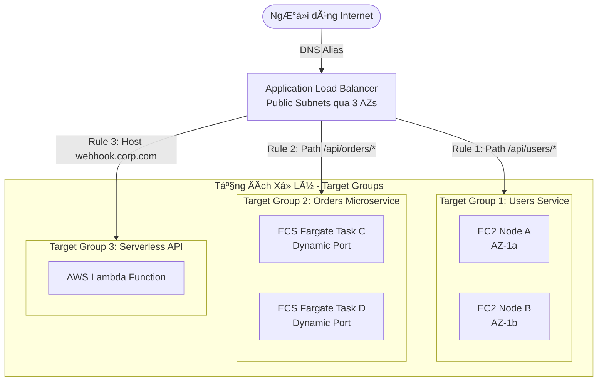
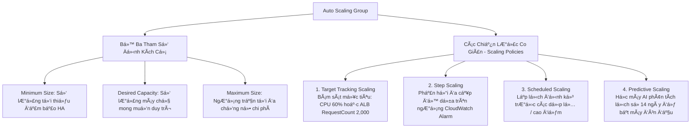
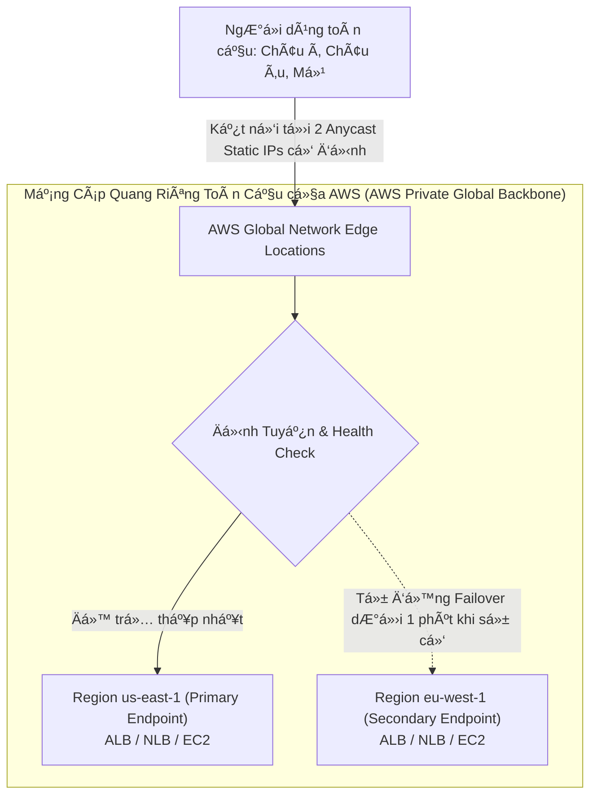

# Tài Liệu Học Tập Chuyên Sâu: Elastic Load Balancing (ELB) & Auto Scaling Groups (ASG) (Kiến Trúc Co Giãn & Độ Sẵn Sàng Cao)

> **Tài liệu chuẩn hóa kiến trúc đám mây**: Hướng dẫn toàn diện theo tiêu chuẩn Principal AWS Solutions Architect & Senior Cloud DevOps Engineer (Cập nhật phiên bản kiến trúc mới nhất 2026).  
> **Ngôn ngữ**: Tiếng Việt chuyên ngành (Bảo lưu toàn bộ thuật ngữ chuyên ngành tiếng Anh chuẩn AWS).  
> **Mục tiêu**: Phục vụ thi chứng chỉ cấp độ Professional/Specialty (**SAA-C03, SAP-C02, DOP-C02**) và vận hành hệ thống cấp độ doanh nghiệp (**Production-grade**).  
> **Các bài giảng liên quan**: Chương 08 (High Availability and Scalability: Bài 70 đến Bài 86).

---

## 1. Tổng Quan Dịch Vụ (Service Overview)

### 1. Định nghĩa chuẩn xác và Phân nhóm dịch vụ
Bộ đôi **Elastic Load Balancing (ELB)** và **Auto Scaling Groups (ASG)** là xương sống kiến trúc nền tảng của mọi hệ thống phân tán có tính sẵn sàng cao (**High Availability - HA**), khả năng chịu lỗi (**Fault Tolerance**) và co giãn đàn hồi (**Elasticity**) trên AWS.

```mermaid
flowchart TD
    ELBFamily[Họ Bộ Cân Bằng Tải AWS - Elastic Load Balancing] --> ALB[Application Load Balancer - ALB\nLayer 7: HTTP, HTTPS, gRPC, WebSocket / Content-based Routing]
    ELBFamily --> NLB[Network Load Balancer - NLB\nLayer 4: TCP, UDP, TLS / Cá»±c nhanh microsecond / Static IP per AZ]
    ELBFamily --> GWLB[Gateway Load Balancer - GWLB\nLayer 3: Gói tin IP thô / GENEVE port 6081 / Inline Network Appliances]
    ELBFamily --> CLB[Classic Load Balancer - CLB [Deprecated]\nThế hệ cũ Layer 4/7 / Không khuyến nghị cho thiết kế mới]

    ASGFamily[Hệ Thống Tự Động Co Giãn - Auto Scaling Group] --> ASG_EC2[ASG for Amazon EC2\nTự động điều phối số lượng máy ảo, Self-healing, Mixed Spot/On-Demand]
    ASGFamily --> AppScaling[Application Auto Scaling\nCo giãn ECS Tasks, DynamoDB RCU/WCU, Aurora Replicas]
```

1. **Application Load Balancer (ALB)**: Hoạt động ở **Tầng 7 (Application Layer)** của mô hình OSI. Chuyên biệt cho lưu lượng HTTP, HTTPS, HTTP/2, gRPC và WebSockets. Có khả năng phân tích chi tiết tiêu đề gói tin để định tuyến thông minh dựa trên đường dẫn URL, hostname, HTTP headers, query strings và hỗ trợ mTLS.
2. **Network Load Balancer (NLB)**: Hoạt động ở **Tầng 4 (Transport Layer)**. Có khả năng xử lý hàng chục triệu requests/giây với độ trễ cực thấp ở mức **microsecond**. Hỗ trợ các giao thức TCP, UDP và TLS passthrough/termination. Cung cấp **địa chỉ Anycast IP tĩnh hoặc Elastic IP cố định cho mỗi Availability Zone**.
3. **Gateway Load Balancer (GWLB)**: Hoạt động ở **Tầng 3 (Network Layer)**. Được thiết kế chuyên biệt để triển khai, mở rộng quy mô và điều phối các thiết bị mạng ảo của bên thứ ba (**Virtual Appliances** như Firewall thế hệ mới NGFW, Intrusion Detection/Prevention Systems - IDS/IPS, Deep Packet Inspection). Sử dụng giao thức đóng gói **GENEVE** trên cổng 6081.
4. **Classic Load Balancer (CLB) `[Deprecated]`**: Bộ cân bằng tải thế hệ cũ (Layer 4/7), hiện đã bị AWS ngừng khuyến nghị và không nên sử dụng cho bất kỳ hệ thống mới nào.
5. **Auto Scaling Groups (ASG)**: Dịch vụ tự động điều chỉnh số lượng máy chủ EC2 tăng lên khi lưu lượng truy cập cao để duy trì hiệu năng, và co cụm giảm bớt khi thấp điểm để tiết kiệm chi phí; đồng thời liên tục giám sát và tự động thay thế các máy chủ bị hỏng (**Self-healing**).

---

### 2. Bài toán cốt lõi mà ELB & ASG giải quyết

1. **Loại bỏ Điểm Lỗi Đơn Lẻ (Single Point of Failure - SPOF)**: Tự động phân phối tải xuyên qua nhiều Availability Zones (tối thiểu 2–3 AZs). Nếu một AZ gặp thảm họa mất điện hoặc đứt cáp quang, ELB tự động chuyển hướng toàn bộ lưu lượng sang các AZ lành lặn còn lại.
2. **Tự Động Phục Hồi Máy Chủ Lỗi (Automated Self-Healing)**: Khi kết hợp với ELB Health Checks, ASG tự động phát hiện các máy chủ bị treo ứng dụng (trả về mã lỗi 5xx), thực hiện chấm dứt máy chủ lỗi và khởi tạo máy chủ mới thay thế tức thì mà không cần kỹ sư can thiệp thủ công.
3. **Tối Ưu Hóa Chi Phí Tự Động (Elastic Cost Optimization)**: Co giãn theo nhu cầu thực tế theo thời gian thực (Dynamic Scaling) hoặc dự báo bằng học máy (Predictive Scaling), kết hợp mô hình linh hoạt giữa On-Demand cho tải nền và Spot Instances cho tải đột biến.

---

### 3. Khi nào KHÔNG nên dùng hoặc Giải pháp thay thế

* ❌ **Cần địa chỉ IP tĩnh công khai cố định cho Load Balancer**: Application Load Balancer (ALB) không cung cấp IP tĩnh (IP thay đổi liên tục theo DNS Resolution).  
  👉 *Giải pháp thay thế*: Sử dụng **Network Load Balancer (NLB)** (cung cấp 1 Elastic IP cố định per AZ), hoặc đặt **AWS Global Accelerator** phía trước ALB để nhận 2 Anycast IP tĩnh.
* ❌ **Xử lý lưu lượng giao thức phi-HTTP yêu cầu độ trễ microsecond cực thấp (Gaming, IoT, RTMP Video)**: ALB chỉ hỗ trợ HTTP/HTTPS/gRPC và xử lý ở tầng 7 với độ trễ vài mili-giây.  
  👉 *Giải pháp thay thế*: Chuyển sang **Network Load Balancer (NLB)** hoạt động ở Layer 4.
* ❌ **Ứng dụng Serverless hoàn toàn không có máy chủ**: Không cần phải tạo Auto Scaling Group cho các hàm Lambda vì Lambda có cơ chế tự động mở rộng quy mô tích hợp sẵn.

---

## 2. Các Khái Niệm, Kiến Trúc & Vận Hành Cốt Lõi (Core Concepts, Security & Day-2 Operations)

### 1. Sơ đồ các mô hình kiến trúc của Application Load Balancer



---

### 2. Các tính năng nâng cao cốt lõi của Elastic Load Balancing

#### A. Định tuyến nội dung nâng cao (Advanced Content-Based Routing trên ALB)
* **Path-based Routing**: Định tuyến dựa trên đường dẫn URL (ví dụ: `/api/v1/auth/*` gửi về Auth Cluster, `/static/*` gửi về Static Group).
* **Host-based Routing**: Định tuyến dựa trên trường Host trong HTTP Header (ví dụ: `api.domain.com` và `shop.domain.com` dùng chung 1 ALB).
* **HTTP Header / Method / Query Parameter Routing**: Định tuyến dựa trên giá trị của HTTP Header (ví dụ: `User-Agent: iOS` đẩy về nhóm máy chủ tối ưu di động) hoặc phương thức HTTP (`GET` chuyển về Read Group, `POST` chuyển về Write Group).
* **Weighted Target Groups (Chuyển tải theo tỷ lệ phần trăm)**: Cho phép cấu hình phân bổ lưu lượng (ví dụ: 95% traffic vào Target Group Blue - v1, và 5% vào Target Group Green - v2) để triển khai **Canary Deployment** hoặc **Blue/Green Deployment** an toàn.

#### B. Sticky Sessions (Session Affinity)
* Ràng buộc các yêu cầu liên tiếp từ cùng một người dùng cuối luôn được chuyển tiếp tới **cùng một máy chủ backend cụ thể**.
* Hoạt động dựa trên Cookie:
  - **Duration-based Cookie**: Do chính ALB tự tạo ra và quản lý (tên cookie mặc định là `AWSALB`, có thời gian sống cấu hình từ 1 giây đến 7 ngày).
  - **Application-based Cookie**: Do ứng dụng backend tự sinh và ALB sẽ theo dõi cookie tùy chỉnh này.
* ⚠️ *Rủi ro kiến trúc*: Sticky Sessions có thể gây ra hiện tượng **mất cân bằng tải (Load Imbalance)** nếu một vài người dùng gửi lưu lượng quá lớn làm sập máy chủ đó. Khuyến nghị chuẩn mực: Lưu trạng thái phiên làm việc (Session state) tập trung trong **Amazon ElastiCache for Valkey/Redis** để giữ tầng Web hoàn toàn phi trạng thái (**Stateless Web Tier**).

#### C. Cross-Zone Load Balancing (Cân bằng tải chéo vùng)
* **Cơ chế hoạt động**: Mỗi node của Load Balancer sẽ phân phối lưu lượng đồng đều tới toàn bộ các máy chủ backend nằm ở **tất cả các Availability Zones**.
* **So sánh trạng thái mặc định**:
  - **Application Load Balancer (ALB)**: **MẶC ĐỊNH BẬT** và hoàn toàn **MIỄN PHÍ** cước truyền dữ liệu liên AZ (\$0.00/GiB).
  - **Network Load Balancer (NLB)**: **MẶC ĐỊNH TẮT**; nếu người dùng chủ động BẬT tính năng này trên NLB, AWS sẽ **tính phí cước Data Transfer Inter-AZ (\$0.01/GiB)** cho mỗi chiều truyền nhận.

#### D. Quản lý kết nối & Xử lý chứng chỉ số (SSL Termination & SNI)
* **SSL/TLS Termination**: ALB giải mã kết nối HTTPS ngay tại điểm tiếp nhận của Load Balancer, giúp giải phóng hoàn toàn gánh nặng tính toán CPU mật mã cho các máy chủ backend.
* **Server Name Indication (SNI)**: Cho phép một Listener duy nhất trên cổng 443 của ALB có thể nạp và phục vụ **nhiều chứng chỉ số SSL/TLS khác nhau cho nhiều tên miền độc lập** (ví dụ: `siteA.com`, `siteB.com`, `siteC.com` dùng chung 1 ALB).
* **Mutual TLS (mTLS)**: ALB hỗ trợ xác thực hai chiều qua chứng chỉ số X.509 giữa client và Load Balancer, lý tưởng cho các kết nối B2B an toàn tuyệt đối.
* **Deregistration Delay (Connection Draining)**: Khoảng thời gian ân hạn (mặc định 300 giây, có thể chỉnh từ 0 đến 3,600 giây) để các yêu cầu đang thực thi dở dang (in-flight requests) hoàn tất trước khi máy chủ bị gỡ khỏi Target Group hoặc bị ASG xóa bỏ, ngăn ngừa việc người dùng bị ngắt kết nối đột ngột.

---

### 3. Auto Scaling Groups (ASG) & Các chính sách co giãn hiện đại



1. **Target Tracking Scaling Policy (Chuẩn mực thông dụng nhất)**:
   - Bạn chỉ cần đặt ra một con số mục tiêu (ví dụ: *"Duy trì mức sử dụng CPU trung bình ở 60%"* hoặc *"Mỗi instance phục vụ 1,500 requests/phút"*). AWS sẽ tự động tính toán số lượng máy chủ cần tăng hoặc giảm để giữ ổn định quanh con số đó. Rất phù hợp cho các mô hình tải biến thiên mượt mà và dự đoán được xu hướng.
2. **Step Scaling Policy (Xử lý bùng nổ tải đột biến không dự đoán trước)**:
   - Phản ứng linh hoạt theo các ngưỡng bậc thang của CloudWatch Alarm (ví dụ: nếu CPU từ 70%–80% thì thêm 1 máy; nếu CPU vượt 85% thì thêm ngay 3 máy để ứng cứu khẩn cấp).
   - **Ưu điểm vượt trội so với Simple Scaling**: Simple Scaling bắt buộc phải chờ hết thời gian Cooldown (ví dụ 300s) mới được đánh giá tiếp, dễ làm sập hệ thống khi tải tăng vọt. **Step Scaling hoàn toàn không bị trói buộc bởi Cooldown khi các ngưỡng Alarm mới bị kích hoạt**, cho phép scale-out tức thời theo mức độ nghiêm trọng của tải (*CM-PT1 Q30*).
3. **Scheduled Scaling Policy**:
   - Tự động thay đổi Min/Desired/Max capacity theo lịch trình định sẵn (ví dụ: tăng máy vào 9h sáng thứ Hai mở bán vé Flash Sale, hạ máy lúc 23h đêm) (*CM-PT2 Q34*).
4. **Predictive Scaling Policy**:
   - Ứng dụng mô hình Machine Learning phân tích dữ liệu lịch sử tải của các tuần trước đó để tự động khởi chạy máy chủ trước khi đợt tăng tải diễn ra (ví dụ: bật máy lúc 07:30 sáng để đón đợt tăng tải lúc 08:00).
5. **ASG Warm Pools & Instance Refresh**:
   - **Warm Pools**: Duy trì một cụm máy ảo ở trạng thái dừng (**Stopped**) đã cài đặt sẵn phần mềm. Khi cần scale-out, máy chỉ mất 30 giây để Start thay vì mất 5–10 phút để cài đặt từ đầu qua User Data.
   - **Instance Refresh**: Cho phép triển khai cập nhật phiên bản AMI mới theo cơ chế rolling update từng phần với các chốt kiểm tra sức khỏe (**Checkpointing**) mà không gây gián đoạn hệ thống.
6. **ASG Lifecycle Hooks (Can thiệp vòng đời máy ảo)** (*TD-Set5 Q45*):
   - Cho phép tạm dừng tiến trình đưa máy ảo vào hoạt động (`Pending:Wait`) hoặc tiến trình chấm dứt máy ảo (`Terminating:Wait`) trong một khoảng thời gian chờ (Heartbeat Timeout - mặc định 3,600 giây).
   - **Ứng dụng sống còn trong đề thi**: Khi máy ảo bị ALB đánh dấu Unhealthy do lỗi ứng dụng, ASG mặc định sẽ terminate máy ngay lập tức làm mất toàn bộ các ephemeral log chẩn đoán cục bộ. Bằng cách thêm **Lifecycle Hook (`Terminating:Wait`)**, ASG giữ máy lại ở trạng thái chờ, phát sự kiện qua Amazon EventBridge kích hoạt Lambda/SSM Run Command đẩy toàn bộ file log lên **CloudWatch Logs**, sau đó mới gọi hàm `CompleteLifecycleAction` để tiếp tục terminate instance an toàn!

---

### 4. AWS Global Accelerator — Tăng Tốc Lưu Lượng Mạng Toàn Cầu & Chuyển Đổi Dự Phòng Tức Thì (Bypass DNS Caching)



* **Cơ chế hoạt động**:
  - Cung cấp **2 địa chỉ Anycast Static IPv4 cố định** duy nhất đóng vai trò làm điểm tiếp nhận lưu lượng toàn cầu (Global Ingress).
  - Ngay tại điểm biên (Edge Location) gần người dùng nhất, lưu lượng được đưa ngay vào **Mạng cáp quang riêng toàn cầu của AWS (AWS Global Private Fiber Backbone)**, hoàn toàn tránh khỏi tình trạng nghẽn mạng và packet loss của mạng Internet công cộng.
* **Hỗ trợ giao thức đa dạng**:
  - Hỗ trợ cả **TCP và UDP** (trong khi CloudFront chỉ hỗ trợ HTTP/HTTPS/WebSockets). Cực kỳ lý tưởng cho game online nhiều người chơi (Multiplayer Gaming), thoại qua mạng (VoIP), streaming media, và thiết bị IoT (*CM-PT2 Q15, U-PT3 Q10*).
* **Khả năng chuyển đổi dự phòng tức thì (Bypassing DNS Caching)**:
  - Khi dùng Route 53 Multi-Region Failover, việc chuyển hướng phụ thuộc vào TTL và DNS cache của client/ISP (có thể mất từ vài phút đến hàng giờ khiến người dùng vẫn truy cập vào server bị lỗi).
  - Với **AWS Global Accelerator**, địa chỉ IP của client kết nối là **CỐ ĐỊNH**. Khi một Region gặp sự cố, hệ thống định tuyến nội bộ của AWS phát hiện qua health check và **tự động chuyển hướng lưu lượng sang Region lành lặn còn lại trong vòng dưới 1 phút mà hoàn toàn không bị ảnh hưởng bởi DNS caching** (*CM-PT1 Q40, U-PT1 Q58*).

---

#### So Sánh Toàn Diện: AWS Global Accelerator vs Amazon CloudFront

| Tiêu chuẩn so sánh | AWS Global Accelerator | Amazon CloudFront |
|:---|:---|:---|
| **Mục đích chính** | Tối ưu hóa định tuyến mạng qua cáp quang AWS cho TCP/UDP | Bộ nhớ đệm biên (Edge Caching) cho website và media |
| **Cơ chế Caching** | ❌ **KHÔNG CÓ BỘ NHỚ ĐỆM** (Lưu lượng luôn truyền thẳng về backend) | ✅ **CÓ BỘ NHỚ ĐỆM BIÊN** (Lưu trữ HTML, CSS, ảnh, video tại Edge) |
| **Giao thức hỗ trợ** | **TCP, UDP, HTTP, HTTPS** | **Chỉ HTTP, HTTPS, WebSockets** |
| **Điểm cuối cung cấp** | **2 Anycast Static IPv4 Addresses** cố định | Tên miền DNS động (ví dụ: `d123.cloudfront.net`) |
| **Khả năng chống chịu DNS Cache** | ✅ Tuyệt đối (Không phụ thuộc DNS resolver của máy khách) | ❌ Phụ thuộc vào phân giải DNS của trình duyệt và ISP |
| **Kịch bản chuẩn thi cử** | Game UDP, ứng dụng tài chính TCP, failover đa Region nhanh | Website tĩnh S3, tăng tốc API REST, stream video HLS/DASH |

---

### 🏛️ I. Các Kịch Bản Kiến Trúc Chuẩn (Best Practice Scenarios)

#### 1. Kiến Trúc Chịu Lỗi Cao Đa Tầng Mẫu Mực (ALB + Multi-AZ ASG + Multi-AZ RDS)
- **Tình huống thi**: Xây dựng kiến trúc cho ứng dụng Web quan trọng của doanh nghiệp. Yêu cầu tính sẵn sàng cao (High Availability), tự động chịu lỗi (Fault-Tolerant) khi toàn bộ một Availability Zone bị sập mà không làm gián đoạn dịch vụ của người dùng cuối.
- **Giải pháp tối ưu chuẩn AWS**:
  - **Tầng Web / Load Balancer**: **Application Load Balancer (ALB)** được cấu hình triển khai trên tối thiểu 2 Public Subnets ở 2 AZs khác nhau.
  - **Tầng Ứng Dụng (Compute Tier)**: Máy chủ EC2 chạy trong Private Subnets, được quản lý bởi **Auto Scaling Group (ASG)** trải dài qua tối thiểu 2 hoặc 3 AZs.
  - **Tầng Cơ Sở Dữ Liệu**: Sử dụng **Amazon RDS Multi-AZ** (chế độ đồng bộ dữ liệu thời gian thực sang Standby replica ở AZ khác và tự động failover trong 60–120s).

#### 2. Định Tuyến Nhiều Dịch Vụ Trên Một ALB Duy Nhất (Path-Based & Host-Based Routing)
- **Tình huống thi**: Doanh nghiệp chuyển đổi kiến trúc Monolith sang Microservices gồm 3 dịch vụ: Giao diện web, API thanh toán, và Quản lý người dùng. Cần định tuyến yêu cầu tới đúng nhóm máy chủ với chi phí hạ tầng thấp nhất.
- **Giải pháp chuẩn**:
  - Triển khai **DUY NHẤT một Application Load Balancer**.
  - Thiết lập các **Listener Rules** với điều kiện định tuyến:
    - Path Pattern `/api/payment/*` -> Chuyển tiếp tới Target Group Thanh Toán.
    - Path Pattern `/api/users/*` -> Chuyển tiếp tới Target Group Người Dùng.
    - Host Header `admin.example.com` -> Chuyển tiếp tới Target Group Quản Trị.
  - Tiết kiệm 66% chi phí so với việc tạo mỗi microservice một Load Balancer riêng.

#### 3. Co Giãn Động Theo Tải Thực Tế Bằng Target Tracking Scaling Policy
- **Tình huống thi**: Ứng dụng có lưu lượng truy cập biến động liên tục trong ngày. Cần tự động bổ sung máy chủ khi nhu cầu tăng và tự động tắt máy chủ khi nhu cầu giảm để tiết kiệm chi phí, không cần tính toán thủ công ngưỡng CloudWatch Alarm.
- **Giải pháp chuẩn**:
  - Cấu hình chính sách **Target Tracking Scaling Policy** trên ASG.
  - Chọn các chỉ số định sẵn:
    - `ASGAverageCPUUtilization` = 50% (giữ CPU trung bình của cụm ở mức 50%).
    - `ALBRequestCountPerTarget` = 1000 (mỗi instance chịu tối đa 1000 requests/phút).
  - ASG tự động tính toán số lượng instances cần thêm hoặc bớt để giữ chỉ số bám sát mục tiêu.

#### 4. Phục Vụ Nhiều Tên Miền Độc Lập Qua Cùng Một ALB Bằng Server Name Indication (SNI) — (TD-Set3 Q20)
- **Tình huống thi**: Công ty du lịch vận hành nhiều trang web khác nhau (`i-love-manila.com`, `i-love-boracay.com`, `i-love-cebu.com`) trên một cụm máy chủ EC2 Auto Scaling. Cần chuyển đổi toàn bộ các trang web sang giao thức bảo mật HTTPS với chi phí thấp nhất mà không cần tạo riêng mỗi domain một bộ cân bằng tải và không phải cấp lại chứng chỉ số khi bổ sung thêm domain mới.
- **Giải pháp tối ưu chuẩn AWS**:
  - Sử dụng một **Application Load Balancer (ALB)** duy nhất.
  - Tải toàn bộ chứng chỉ SSL/TLS của các domain lên **AWS Certificate Manager (ACM)**.
  - Gắn nhiều chứng chỉ SSL này vào cùng một HTTPS Listener (cổng 443) trên ALB.
  - ALB tự động sử dụng phần mở rộng **Server Name Indication (SNI)** của giao thức TLS để phục vụ chứng chỉ số chính xác tương ứng với tên miền mà người dùng truy cập.

#### 5. Tự Động Thu Thập Nhật Ký Ứng Dụng Khi Máy Bị Xóa Bằng ASG Lifecycle Hooks — (TD-Set5 Q45)
- **Tình huống thi**: Khi một máy ảo EC2 trong Auto Scaling Group bị Application Load Balancer đánh dấu Unhealthy (lỗi HTTPS Health Check), ASG lập tức chấm dứt (terminate) máy ảo đó, khiến toàn bộ các file log lỗi cục bộ trên máy bị biến mất vĩnh viễn và không thể điều tra nguyên nhân gốc rễ (Root Cause Analysis). Cần tự động hóa việc thu thập log trước khi instance bị xóa sổ.
- **Giải pháp chuẩn**:
  - Thêm một **Lifecycle Hook** vào Auto Scaling Group để chuyển các instance chuẩn bị bị xóa từ trạng thái `Terminating` sang trạng thái **`Terminating:Wait`** (hoãn việc chấm dứt máy).
  - Cấu hình một **Amazon EventBridge Rule** bắt sự kiện `EC2 Instance-terminate Lifecycle Action` để kích hoạt một hàm **AWS Lambda**.
  - Hàm Lambda ra lệnh cho CloudWatch Agent trên instance đẩy toàn bộ file log cục bộ lên **CloudWatch Logs**.
  - Sau khi log được nạp xong, Lambda gọi hàm `CompleteLifecycleAction` để cho phép ASG tiếp tục tiến trình terminate instance an toàn.

---

### 🪤 II. Các Bẫy Thi Tinh Vi & Phân Tích Phương Án Sai (Exam Traps & Distractors)

#### 🪤 Bẫy 1: Tạm Dừng Tiến Trình ASG & Đưa Vào Trạng Thái Standby Khi Khắc Phục Sự Cố Máy Chủ — (U-PT1 Q22)
- **Tình huống đề thi**: *"Một máy chủ EC2 trong Auto Scaling Group bị đánh dấu là Unhealthy do ứng dụng bị crash. Kỹ sư cần giữ nguyên trạng thái máy chủ này để kết nối vào thu thập log và điều tra nguyên nhân cốt lõi (troubleshoot). Cần thực hiện những hành động nào? (Chọn 2 đáp án)"*
- **Các phương án bẫy**:
  - ❌ *Không làm gì cả và nhanh chóng SSH vào*: ASG sẽ lập tức kích hoạt quy trình thay thế và **hủy diệt (Terminate)** máy chủ lỗi ngay sau đó -> Toàn bộ dữ liệu log trong bộ nhớ và ổ đĩa bị mất sạch!
  - ❌ *Tháo máy chủ ra khỏi ASG (Detach)*: Tốn công và có thể kích hoạt ASG sinh instance mới làm sai lệch số lượng desired capacity.
- **Hai giải pháp ĐÚNG chuẩn AWS (Chọn 2)**:
  1. **Tạm dừng (Suspend) tiến trình `ReplaceUnhealthy` trong Auto Scaling Group**: Thao tác này ngăn chặn ASG xóa máy chủ bị lỗi. Kỹ sư có toàn bộ thời gian cần thiết để điều tra sự cố. Sau khi sửa xong, kích hoạt lại (`Resume`) tiến trình.
  2. **Chuyển máy chủ sang trạng thái `Standby` (`aws autoscaling enter-standby`)**: Khi ở trạng thái Standby, máy chủ tạm thời không nhận traffic từ Load Balancer, ASG không quản lý kiểm tra sức khỏe và không tự động terminate nó. Kỹ sư thoải mái kiểm tra, sửa lỗi; sau đó chuyển lại về `InService` (`exit-standby`).

#### 🪤 Bẫy 2: Tính Toán Dung Lượng Dự Phòng Chịu Lỗi Khi Mất 1 AZ (N+1 Capacity Sizing) — (U-PT2 Q19, U-PT2 Q37)
- **Tình huống đề thi**: *"Hệ thống yêu cầu bắt buộc phải duy trì tối thiểu 8 máy chủ hoạt động 100% công suất kể cả trong trường hợp xấu nhất là toàn bộ một Availability Zone bị sập. Cấu hình nào đáp ứng yêu cầu với CHI PHÍ THẤP NHẤT?"*
- **Phân tích toán học kiến trúc**:
  - **Phương án 2 AZs**: Mỗi AZ phải gánh \$8 \text{ instances}$ (Tổng cộng = 16 instances). Khi 1 AZ sập, AZ còn lại còn đúng 8 instances -> Đạt yêu cầu nhưng tốn chi phí 16 máy.
  - **Phương án 3 AZs**: Mỗi AZ chỉ cần bố trí **\$4 \text{ instances}$** (Tổng cộng = 12 instances). Khi 1 AZ bất kỳ bị sập (mất 4 instances), 2 AZs còn lại vẫn có \$4 + 4 = 8 \text{ instances}$ -> **Đạt 100% công suất**!
  - **Kết luận**: Triển khai trên **3 AZs với 4 instances/AZ** tiết kiệm hơn phương án 2 AZs tới **25% chi phí phần cứng dự phòng** (\$12 \text{ máy}$ so với \$16 \text{ máy}$).

#### 🪤 Bẫy 3: Elastic Load Balancing KHÔNG PHẢI Là Dịch Vụ Toàn Cầu (ELB Is Regional) — (U-PT6 Q48)
- **Tình huống đề thi**: *"Doanh nghiệp muốn sử dụng Elastic Load Balancing để cân bằng tải giữa các máy chủ Web đặt tại Region Singapore (ap-southeast-1) và Region Tokyo (ap-northeast-1)."*
- **Nguyên lý bất biến**:
  - Mọi Load Balancer của AWS (ALB, NLB, Classic LB) đều là **tài nguyên thuộc phạm vi 1 Region (Regional Resource)**.
  - ELB **KHÔNG THỂ** phân phối lưu lượng hoặc kiểm tra sức khỏe trực tiếp xuyên qua 2 Region khác nhau.
- **Giải pháp ĐÚNG**:
  - Triển khai ALB riêng biệt tại từng Region.
  - Sử dụng **Amazon Route 53** (với chính sách Latency-based Routing hoặc Geolocation Routing kèm Health Check) hoặc **AWS Global Accelerator** để điều phối lưu lượng toàn cầu giữa 2 Region.

#### 🪤 Bẫy 4: Thứ Tự Ưu Tiên Của Chính Sách Hủy Máy Chủ Mặc Định (Default Termination Policy) — (U-PT2 Q18)
- **Tình huống đề thi**: *"Khi Auto Scaling Group kích hoạt sự kiện Scale-In (giảm tải), máy chủ EC2 nào sẽ bị chọn để chấm dứt (terminate) đầu tiên?"*
- **Quy trình đánh giá 4 bước chuẩn xác**:
  1. **Bước 1 (Chọn AZ)**: Xác định Availability Zone nào đang có **nhiều instance nhất** và có ít nhất một instance không được bật tính năng Scale-In Protection.
  2. **Bước 2 (Chọn cấu hình cũ - Tie-breaker sống còn U-PT2 Q18)**: Trong AZ đó, tìm instance được khởi tạo từ cấu hình cũ nhất theo thứ tự ưu tiên:
     - **Ưu tiên 1**: Instance dùng **Launch Configuration cũ nhất (`OldestLaunchConfiguration`)**.
     - **Ưu tiên 2**: Nếu không có hoặc cùng loại, chọn instance dùng **Launch Template cũ nhất (`OldestLaunchTemplate`)**.
     - *Lý do*: AWS khuyến khích chuyển dịch hoàn toàn từ Launch Configuration sang Launch Template, nên các máy dùng Launch Configuration cũ luôn bị đào thải trước.
  3. **Bước 3 (Tối ưu giờ thanh toán)**: Nếu vẫn có nhiều instance trùng cấu hình, chọn instance **gần tới mốc chu kỳ tính cước giờ tiếp theo nhất** (Closest to the next billing hour).
  4. **Bước 4 (Ngẫu nhiên)**: Nếu tất cả các tiêu chí trên đều như nhau, chọn ngẫu nhiên một instance.

#### 🪤 Bẫy 5: Yêu Cầu Cân Bằng Tải Cung Cấp IP Tĩnh và Hỗ Trợ Hybrid Targets — (CM-PT2 Q61, CM-PT3 Q14, CM-PT5 Q49)
- **Tình huống đề thi**: *"Doanh nghiệp tích hợp hệ thống thanh toán với các đối tác tài chính ngân hàng. Đối tác yêu cầu Load Balancer phải có địa chỉ IP tĩnh công khai (Static / Elastic IP) để cấu hình mở tường lửa (IP Whitelisting). Ngoài ra, hệ thống cần cân bằng tải lưu lượng đồng thời giữa các máy chủ EC2 trên AWS và cụm máy chủ vật lý On-Premises. Chọn loại cân bằng tải nào?"*
- **Các phương án bẫy**:
  - ❌ *Dùng Application Load Balancer (ALB)*: ALB không hỗ trợ gán địa chỉ IP tĩnh công khai (ALB chỉ cung cấp DNS Name và IP thay đổi liên tục).
- **Giải pháp ĐÚNG**: **Network Load Balancer (NLB)**.
  - NLB hoạt động ở Layer 4 (TCP/UDP), cho phép gán trực tiếp **Elastic IP cố định cho từng Availability Zone**.
  - Target Group của NLB hỗ trợ loại **IP addresses**, cho phép khai báo cả Private IP của các máy chủ On-Premises kết nối qua Direct Connect hoặc VPN để cân bằng tải hỗn hợp (Hybrid Architecture).

#### 🪤 Bẫy 6: Duy Trì Phiên Người Dùng Cho Ứng Dụng Web Stateful Bằng ALB Sticky Sessions — (CM-PT6 Q40)
- **Tình huống đề thi**: *"Một ứng dụng web thương mại cổ điển lưu trữ thông tin giỏ hàng và phiên đăng nhập trực tiếp trong bộ nhớ RAM của từng máy chủ EC2 (Stateful Sessions). Khi triển khai cụm máy chủ phía sau Application Load Balancer, người dùng liên tục phàn nàn bị mất giỏ hàng khi click chuyển trang. Cần giải pháp xử lý ngay mà không sửa code ứng dụng."*
- **Giải pháp ĐÚNG**: Bật tính năng **Sticky Sessions (Session Affinity)** trên Target Group của Application Load Balancer.
  - ALB sử dụng cookie (hoặc mã hóa cookie tùy chỉnh từ ứng dụng) để nhận diện người dùng và đảm bảo toàn bộ các HTTP requests tiếp theo của client đó luôn được chuyển hướng chính xác tới cùng một máy chủ backend ban đầu.

#### 🪤 Bẫy 7: Chèn Tường Lửa Ảo Kiểm Tra Gói Tin Sâu L3/L4 Bằng Gateway Load Balancer (GWLB) — (CM-PT2 Q48)
- **Tình huống đề thi**: *"Doanh nghiệp yêu cầu chèn cụm thiết bị tường lửa ảo của bên thứ 3 (Firewalls, IDS/IPS) để kiểm tra gói tin sâu cho toàn bộ luồng mạng ra vào VPC mà không làm đứt kết nối hay thay đổi IP header gốc."*
- **Giải pháp ĐÚNG**: **Gateway Load Balancer (GWLB)**.
  - Hoạt động ở OSI Layer 3 (Network Layer), sử dụng giao thức **GENEVE (port UDP 6081)** để dẫn toàn bộ gói tin nguyên bản qua cụm firewall ảo và tự động kiểm tra sức khỏe, cân bằng tải giữa các firewall instances.

#### 🪤 Bẫy 8: Phân Bổ Tải Đồng Đều Giữa Các AZ: Cross-Zone Load Balancing Trên ALB vs NLB — (TD-Set6 Q28, U-PT3 Q39)
- **Tình huống đề thi**: *"Ứng dụng phát trực tuyến video chạy trên Auto Scaling Group của EC2 trên nhiều AZs. Cần cấu hình bộ cân bằng tải phân phối các yêu cầu đến đồng đều cho tất cả các máy ảo trên mọi AZ."*
- **Quy tắc phân biệt trạng thái Cross-Zone Load Balancing**:
  - Với **Application Load Balancer (ALB)**: Tính năng Cross-Zone Load Balancing **luôn luôn được BẬT mặc định ở cấp độ Load Balancer** và hoàn toàn miễn phí (không thể tắt).
  - Với **Network Load Balancer (NLB)**: Mặc định tính năng này bị **TẮT**. Muốn phân bổ đều traffic tới các target xuyên AZ, người dùng **bắt buộc phải chủ động BẬT Cross-Zone Load Balancing trên NLB Target Group** (AWS có tính phí data transfer cross-AZ).
- **Giải pháp ĐÚNG**: Đảm bảo **Cross-zone load balancing** được kích hoạt để mỗi node load balancer phân phối đều các request cho các target ở mọi AZ.
- **Bài toán thực tế phân bổ tải khi BẬT vs TẮT Cross-Zone (U-PT3 Q39)**:
  Giả sử hệ thống có 2 AZs: AZ-A có **1 instance**, AZ-B có **4 instances** (Tổng 5 instances).
  - **Khi TẮT Cross-Zone Load Balancing**:
    - DNS phân bổ 50% traffic tới Node LB ở AZ-A và 50% traffic tới Node LB ở AZ-B.
    - 1 instance ở AZ-A phải gánh trọn vẹn **50% tổng lưu lượng** hệ thống!
    - 4 instances ở AZ-B chia đều 50% lưu lượng $\rightarrow$ Mỗi instance chỉ gánh \(50\% / 4 = \mathbf{12.5\%}\)!
    - $\rightarrow$ *Hệ quả*: Instance ở AZ-A bị quá tải nghiêm trọng gấp 4 lần so với các máy ở AZ-B!
  - **Khi BẬT Cross-Zone Load Balancing**:
    - Cả 2 Node LB đều phân bổ lưu lượng đều cho toàn bộ 5 instances trên cả 2 AZ.
    - Mỗi instance nhận đúng \(100\% / 5 = \mathbf{20\%}\) tổng lưu lượng $\rightarrow$ Tải cân bằng hoàn hảo!

#### 🪤 Bẫy 9: Tạo Nhiều Load Balancer Cho Từng Domain HTTPS Thay Vì Dùng SNI — (TD-Set3 Q20)
- **Tình huống đề thi**: *"Doanh nghiệp sở hữu 10 tên miền độc lập cần chuyển sang HTTPS. Đội ngũ đề xuất khởi tạo 10 Application Load Balancers riêng biệt để gắn từng chứng chỉ SSL của từng domain."*
- **Phương án bẫy**: Rất tốn kém chi phí (10 ALBs $\approx \$220\text{/tháng}$ tiền phí duy trì cơ sở chưa tính LCU), phức tạp vận hành và lãng phí tài nguyên.
- **Giải pháp ĐÚNG**: Chỉ cần sử dụng **1 Application Load Balancer duy nhất**. Bật tính năng **Server Name Indication (SNI)** và gắn toàn bộ 10 chứng chỉ SSL vào chung một HTTPS listener (cổng 443).

#### 🪤 Bẫy 10: Vá Lỗi An Toàn Cho Máy Chủ Nằm Sau ALB Bằng SSM Automation — (U-PT4 Q02)
- **Tình huống đề thi**: *"Ứng dụng render nội dung chạy trên cụm EC2 đăng ký với Application Load Balancer (ALB). Doanh nghiệp sử dụng AWS Systems Manager để cập nhật bản vá định kỳ. Yêu cầu tuân thủ mới bắt buộc các EC2 instance phải được rút khỏi lưu lượng sản xuất (deregister khỏi ALB) một cách an toàn trong lúc vá lỗi để tránh lỗi 502/timeout cho người dùng, sau đó tự động đăng ký lại khi vá xong."*
- **Các phương án bẫy**:
  - ❌ *Dùng CloudWatch Logs theo dõi rồi điều chỉnh target group thủ công*: Dễ sai sót và chậm trễ, không tự động hóa.
  - ❌ *Đổi Target Group sang IP-based hoặc vô hiệu hóa card mạng qua Lambda*: Gây đứt gãy kết nối in-flight và không kiểm soát được connection draining.
- **Giải pháp ĐÚNG**: Sử dụng **AWS Systems Manager Automation** với document chuẩn **`AWSEC2-PatchLoadBalancerInstance`** kết hợp **SSM Maintenance Windows**.
  - Document này được AWS thiết kế chuyên dụng: tự động deregister instance khỏi ALB target group, chờ đợi connection draining hoàn tất các request đang xử lý dở, thực hiện cài đặt bản vá, reboot instance nếu cần, kiểm tra health check và tự động re-register instance vào ALB!

#### 🪤 Bẫy 11: Sự Khác Biệt Giữa ASG Health Check và ALB Health Check — (U-PT4 Q35)
- **Tình huống đề thi**: *"Hệ thống streaming chạy trên EC2 được quản lý bởi Auto Scaling Group đằng sau Application Load Balancer. Khi ứng dụng web bên trong máy chủ bị crash (trả về lỗi HTTP 500/503), ALB phát hiện và chuyển trạng thái target thành Unhealthy. Tuy nhiên, Auto Scaling Group vẫn KHÔNG THỂ thay thế instance lỗi này mà tiếp tục để nó chạy. Nguyên nhân cốt lõi là gì?"*
- **Bản chất kỹ thuật sống còn**:
  - Mặc định, Auto Scaling Group chỉ sử dụng **EC2 Health Checks** (chỉ kiểm tra trạng thái phần cứng hypervisor của máy chủ vật lý). Nếu phần cứng vẫn bật, ASG coi máy ảo là "Healthy", bất kể ứng dụng web bên trong đã sập hoàn toàn!
  - Trong khi đó, **ALB Health Checks** gửi HTTP ping trực tiếp vào ứng dụng web định kỳ (ví dụ `/healthz`).
- **Giải pháp ĐÚNG**: Bắt buộc phải chuyển cấu hình **Health Check Type của Auto Scaling Group sang `ELB`** (thay vì chỉ để `EC2`). Khi đó, bất cứ khi nào ALB đánh giá target là Unhealthy, ASG sẽ lập tức kích hoạt quy trình terminate instance lỗi và khởi tạo instance mới thay thế!

#### 🪤 Bẫy 12: Co Giãn Tự Động Theo Chiều Dài Hàng Đợi SQS (Backlog-Based Auto Scaling) — (U-PT4 Q04)
- **Tình huống đề thi**: *"Hệ thống logistics xử lý đơn hàng gồm 2 giai đoạn: tiếp nhận đơn hàng (job intake) và xử lý phân tích đơn hàng (job processing). Lượng đơn hàng biến động rất lớn theo từng giờ. Cần kiến trúc tách rời 2 giai đoạn và tự động co giãn các cụm máy chủ worker độc lập dựa trên khối lượng công việc đang tồn đọng."*
- **Giải pháp ĐÚNG**: Thiết lập **2 hàng đợi Amazon SQS độc lập** (Queue 1 cho intake, Queue 2 cho processing) và cấu hình **Auto Scaling Group co giãn dựa trên số lượng tin nhắn trong hàng đợi** (`ApproximateNumberOfMessagesVisible`).
  - Phân tách hoàn toàn sự phụ thuộc giữa tầng tiếp nhận và tầng xử lý.
  - Cấu hình metric toán học chuẩn: `Backlog Per Instance = SQS Queue Length / Running ASG Capacity` kết hợp Target Tracking Policy để tăng/giảm worker kịp thời khi đơn hàng dồn ứ.

#### 🪤 Bẫy 13: Cấu Hình Minimum Capacity Tránh Sập Toàn Bộ Ứng Dụng Khi Giảm Tải — (U-PT4 Q29)
- **Tình huống đề thi**: *"Ứng dụng y tế trực tuyến ghi nhận lưu lượng truy cập giảm mạnh vào ban đêm. Khi tính năng Auto Scaling kích hoạt giảm tải (Scale-In), toàn bộ các máy chủ EC2 bị tắt hết khiến các bệnh nhân cấp cứu nửa đêm không thể truy cập hệ thống. Cần cấu hình thông số nào để luôn đảm bảo có sẵn một số lượng máy chủ tối thiểu phục vụ 24/7?"*
- **Giải pháp ĐÚNG**: Cấu hình thuộc tính **Minimum Capacity (`min-size`)** của Auto Scaling Group lớn hơn hoặc bằng mức năng lực tối thiểu bắt buộc (ví dụ: `Min = 2` trải trên 2 AZs). ASG sẽ không bao giờ giảm số lượng instance xuống dưới ngưỡng này, bất kể lưu lượng CPU hay network xuống thấp đến đâu.

#### 🪤 Bẫy 14: Giới Hạn Phạm Vi Vùng Của Auto Scaling Group (ASG Is Regional) — (U-PT4 Q58)
- **Tình huống đề thi**: *"Doanh nghiệp SaaS muốn thiết kế kiến trúc có tính sẵn sàng cao cho ứng dụng web. Một kỹ sư đề xuất cấu hình một Auto Scaling Group duy nhất trải dài trên các Availability Zone thuộc hai AWS Regions khác nhau (ví dụ: us-east-1 và us-west-2) và đăng ký vào chung một ALB. Đề xuất này có khả thi không?"*
- **Nguyên lý bất biến**:
  - **Auto Scaling Group và Application Load Balancer đều là tài nguyên cấp Vùng (Regional Resource)**.
  - ASG **KHÔNG THỂ trải dài qua nhiều Regions**; ASG chỉ có thể bao phủ nhiều Availability Zones trong **CÙNG MỘT Region**.
- **Giải pháp ĐÚNG**: Cấu hình Auto Scaling Group trải trên **nhiều Availability Zones trong 1 Region duy nhất** đằng sau một Application Load Balancer cấp Region. Nếu muốn mở rộng đa Region, phải tạo 2 ASG độc lập ở 2 Region và điều phối bằng **Amazon Route 53** hoặc **AWS Global Accelerator**.

#### 🪤 Bẫy 15: Tăng Tốc Lưu Lượng TCP/UDP & Bỏ Qua Bộ Nhớ Đệm DNS Bằng AWS Global Accelerator — (CM-PT1 Q40, CM-PT2 Q15, U-PT1 Q58, U-PT3 Q10)
- **Tình huống đề thi**: *"Ứng dụng game online toàn cầu sử dụng giao thức UDP độc quyền yêu cầu độ trễ thấp nhất có thể cho game thủ trên toàn thế giới. Ngoài ra, khi xảy ra sự cố tại Region chính, hệ thống phải tự động chuyển đổi sang Region dự phòng trong vòng dưới 1 phút mà không bị ảnh hưởng bởi việc các nhà mạng (ISP) và trình duyệt người dùng lưu cache bản ghi DNS (bypassing DNS caching). Dịch vụ nào đáp ứng tối ưu?"*
- **Các phương án bẫy**:
  - ❌ *Sử dụng Amazon CloudFront*: Sai vì CloudFront chỉ hỗ trợ HTTP/HTTPS/WebSocket, hoàn toàn KHÔNG hỗ trợ giao thức UDP của game.
  - ❌ *Sử dụng Amazon Route 53 Failover Routing*: Route 53 phụ thuộc vào giá trị TTL của bản ghi DNS. Nhiều ISP và ứng dụng máy khách tự ý lưu cache IP hàng chục phút bất chấp TTL ngắn, khiến game thủ vẫn gửi gói tin vào Region bị sập.
- **Giải pháp ĐÚNG**: Triển khai **AWS Global Accelerator**.
  - Cung cấp **2 địa chỉ Anycast Static IPv4** cố định không bao giờ thay đổi, giải quyết triệt để vấn đề DNS caching.
  - Hỗ trợ đầy đủ giao thức **UDP và TCP**.
  - Tự động phát hiện endpoint hỏng qua health check nội bộ và chuyển hướng lưu lượng sang Region lành lặn trong vòng **vài chục giây** qua mạng cáp quang riêng của AWS.

#### 🪤 Bẫy 16: Phản Ứng Với Đợt Tăng Tải Đột Biến Khó Dự Đoán Bằng Step Scaling — (CM-PT1 Q30, CM-PT2 Q34)
- **Tình huống đề thi**: *"Trang web thương mại điện tử thỉnh thoảng có các đợt phát sóng quảng cáo truyền hình đột xuất, lượng truy cập tăng vọt gấp 10 lần chỉ trong vài chục giây. Nhóm kỹ sư nhận thấy chính sách Target Tracking và Simple Scaling phản ứng quá chậm chạp do thời gian chờ Cooldown khiến hệ thống bị sập trước khi máy chủ mới kịp khởi động. Cần chọn chính sách co giãn nào?"*
- **Các phương án bẫy**:
  - ❌ *Sử dụng Simple Scaling*: Bắt buộc phải đợi hết thời gian Cooldown giữa mỗi lần scale, không thể mở rộng nhiều cấp độ cùng lúc khi tải tăng vọt.
  - ❌ *Sử dụng Scheduled Scaling*: Không khả thi vì các đợt phát sóng truyền hình hoặc tin tức viral diễn ra ngẫu nhiên, không có lịch trình cố định.
- **Giải pháp ĐÚNG**: Sử dụng **Step Scaling Policy**.
  - Cho phép định nghĩa các bậc thang co giãn (Step Adjustments) dựa trên độ lệch chỉ số CloudWatch Alarm (ví dụ: CPU tăng 10% -> thêm 2 máy; CPU tăng 30% -> thêm ngay 6 máy).
  - Hoạt động ngay lập tức mà không bị trì hoãn bởi Cooldown khi các ngưỡng cảnh báo cao hơn bị kích hoạt liên tiếp.

#### 🪤 Bẫy 17: ALB Tự Động Chuyển Hướng HTTP sang HTTPS & Định Tuyến Hostname/Subdomain — (TD-Set4 Q50, CM-PT4 Q12)
- **Tình huống đề thi**: *"Doanh nghiệp muốn đảm bảo 100% người dùng truy cập web phải sử dụng kết nối mã hóa HTTPS an toàn. Nếu người dùng gõ `http://`, hệ thống phải tự động đổi hướng sang `https://` với mã HTTP 301/302 mà không tốn tài nguyên xử lý của backend EC2. Đồng thời, các yêu cầu tới `api.example.com` và `shop.example.com` phải được chuyển đến hai cụm EC2 khác nhau."*
- **Giải pháp ĐÚNG**:
  - Cấu hình **HTTP Listener (Cổng 80)** trên Application Load Balancer với quy tắc **Redirect Action** chuyển hướng toàn bộ sang HTTPS Cổng 443 (HTTP 301 Moved Permanently) (`TD-Set4 Q50`). Hoàn toàn xử lý tại tầng ALB, không cần viết code rewrite trong Nginx/Apache.
  - Cấu hình **Host-based Routing Rules** trên HTTPS Listener: Kiểm tra tiêu đề `Host` (ví dụ `api.example.com` $\rightarrow$ Target Group API; `shop.example.com` $\rightarrow$ Target Group Shop) (`CM-PT4 Q12`).

#### 🪤 Bẫy 18: Di Chuyển Ứng Dụng Không Gián Đoạn Bằng ALB Weighted Target Groups — (TD-Set5 Q32)
- **Tình huống đề thi**: *"Doanh nghiệp đang di chuyển dần một hệ thống xử lý giao dịch từ trung tâm dữ liệu tại chỗ (On-Premises) lên AWS. Ban lãnh đạo yêu cầu phân bổ 50% lưu lượng tới cụm máy chủ tại chỗ và 50% tới cụm máy ảo EC2 mới trên AWS trong giai đoạn thử nghiệm tải. Cần cấu hình thế nào với effort tối thiểu?"*
- **Giải pháp ĐÚNG**: Sử dụng **ALB Weighted Target Groups (Target Group Weighting)** (`TD-Set5 Q32`).
  - Tạo 2 Target Groups: `TG-OnPrem` (loại IP addresses trỏ về On-Premises qua Direct Connect/VPN) và `TG-AWS` (loại Instance ID trên EC2).
  - Cấu hình một Forward Action duy nhất trên ALB Listener Rule với trọng số **Weight 50:50** (hoặc chuyển dần 90:10 $\rightarrow$ 80:20 $\rightarrow$ 50:50 $\rightarrow$ 0:100 cho Blue/Green Deployment). Không cần can thiệp tầng DNS hay phần mềm cân bằng tải bên thứ ba.

#### 🪤 Bẫy 19: Phân Tích ALB Access Logs Trên Amazon S3 Bằng Amazon Athena — (TD-Set3 Q57, TD-Set5 Q23, CM-PT5 Q42)
- **Tình huống đề thi**: *"Khách hàng báo cáo thỉnh thoảng gặp lỗi 504 Gateway Timeout hoặc độ trễ phản hồi rất cao vào các khung giờ cao điểm. Đội ngũ kỹ sư cần kiểm tra lịch sử tất cả các request trong 30 ngày qua (gồm IP client, target IP, target processing time, latency) với chi phí thấp nhất và không phải dựng máy chủ quản lý log."*
- **Giải pháp ĐÚNG**:
  - Bật tính năng **Access Logs** trên Application Load Balancer, chỉ định đích ghi là một **Amazon S3 Bucket**.
  - Sử dụng **Amazon Athena** để tạo bảng ngoại quan (External Table) phân vùng theo ngày/giờ và chạy truy vấn chuẩn SQL trực tiếp trên các file nén `.log.gz` trên S3 (`TD-Set3 Q57`, `CM-PT5 Q42`). Không cần dựng cụm OpenSearch đắt đỏ.

#### 🪤 Bẫy 20: Đăng Ký Đích Cho Network Load Balancer (NLB): Instance ID vs IP Address — (U-PT3 Q23)
- **Tình huống đề thi**: *"Một máy chủ EC2 đa card mạng (Dual-homed: `eth0` cho mạng quản trị nội bộ, `eth1` cho mạng tiếp nhận dữ liệu streaming khách hàng). Kỹ sư đăng ký máy chủ vào NLB Target Group theo Instance ID nhưng lưu lượng khách hàng lại bị đổ vào `eth0` thay vì `eth1`. Tại sao?"*
- **Bản chất kỹ thuật sống còn**:
  - Khi đăng ký Target vào NLB theo **Instance ID**: NLB sẽ **luôn luôn định tuyến lưu lượng tới Primary Private IPv4 của card mạng chính (`eth0`)** của EC2 instance đó.
  - Khi cần định tuyến tới **Secondary Private IP** trên `eth0`, hoặc bất kỳ IP nào trên **Secondary Network Interface (`eth1`)**, bắt buộc phải đăng ký Target Group theo **IP Address Target Type** (`U-PT3 Q23`).

#### 🪤 Bẫy 21: NLB TLS Offloading & Đứng Trước Cụm Bastion Host Multi-AZ — (U-PT6 Q14, U-PT6 Q26, CM-PT2 Q30, CM-PT5 Q15, CM-PT5 Q45, CM-PT6 Q53, TD-Set2 Q54)
- **Tình huống đề thi 1**: *"Ứng dụng TCP yêu cầu mã hóa đầu cuối nhưng muốn giảm tải công việc giải mã TLS/SSL cho cụm máy chủ backend mà vẫn duy trì thông lượng hàng triệu kết nối mỗi giây với địa chỉ IP tĩnh."*
  - **Giải pháp**: **NLB TLS Listener (TLS Offloading)** (`U-PT6 Q14`). NLB gắn chứng chỉ số từ AWS Certificate Manager (ACM), thực hiện giải mã SSL tại tầng NLB và chuyển tiếp TCP thuần túy về backend.
- **Tình huống đề thi 2**: *"Thiết kế cổng kết nối SSH (Port 22) có tính sẵn sàng cao, chịu lỗi đa AZ cho quản trị viên truy cập vào các máy chủ trong Private Subnets mà không để lộ trực tiếp từng máy Bastion ra Internet."*
  - **Giải pháp**: Triển khai cụm **Bastion Hosts trong Auto Scaling Group trải trên nhiều AZs** nằm sau một **Internet-facing Network Load Balancer** (`U-PT6 Q26`, `CM-PT2 Q30`, `TD-Set2 Q54`). Cung cấp Elastic IP cố định, cân bằng tải SSH traffic và tự động loại bỏ bastion node hỏng.

#### 🪤 Bẫy 22: Thứ Tự Thực Thi Của ASG AZ Rebalancing — (U-PT1 Q57)
- **Tình huống đề thi**: *"Một Auto Scaling Group đang chạy trên 2 AZs (AZ-A có 2 máy, AZ-B có 4 máy). Do lệch số lượng máy giữa các AZ, cơ chế AZ Rebalancing của ASG được kích hoạt để đưa về tỷ lệ cân bằng 3:3. Quá trình rebalancing diễn ra theo thứ tự nào để đảm bảo không làm gián đoạn ứng dụng?"*
- **Nguyên tắc an toàn của AWS ASG**:
  - ASG **LUÔN LUÔN khởi chạy máy mới (Launch) ở AZ đang thiếu hụt TRƯỚC (AZ-A: từ 2 lên 3 máy)**.
  - Chờ máy mới đạt trạng thái `InService` và vượt qua Health Check.
  - Sau đó mới **chấm dứt (Terminate) một máy cũ ở AZ đang thừa (AZ-B: từ 4 xuống 3 máy)** (`U-PT1 Q57`).
  - *Ý nghĩa*: Trong suốt quá trình rebalancing, tổng công suất của hệ thống tạm thời tăng lên \((6 \rightarrow 7 \rightarrow 6)\), không bao giờ bị sụt giảm dung lượng dưới mức mong muốn.

#### 🪤 Bẫy 23: Co Giãn ASG Theo Tuổi Tin Nhắn Cũ Nhất vs Khối Lượng Tồn Đọng — (TD-Set5 Q26, CM-PT2 Q03, U-PT6 Q41)
- **Tình huống đề thi**: *"Một hệ thống xử lý giao dịch thanh toán từ Amazon SQS có SLA khắt khe: mọi giao dịch phải được xử lý trong vòng tối đa 5 phút kể từ khi gửi vào hàng đợi. Thỉnh thoảng có vài tin nhắn kích thước lớn khiến worker xử lý rất lâu làm các tin nhắn sau bị trễ quá 5 phút. Cần chọn chỉ số nào cho Auto Scaling?"*
- **Quy tắc phân biệt 2 chỉ số SQS Scaling**:
  - **`ApproximateAgeOfOldestMessage` (Tuổi của tin nhắn cũ nhất)** (`TD-Set5 Q26`): Dùng khi hệ thống có **cam kết thời gian SLA nghiêm ngặt** (ví dụ SLA $\le 5$ phút). Khi tuổi của message vượt quá 3 phút, ASG lập tức scale-out khẩn cấp để xử lý tin nhắn đó ngay.
  - **`BacklogPerInstance` (`ApproximateNumberOfMessagesVisible / Capacity`)** (`CM-PT2 Q03`, `U-PT6 Q41`): Dùng khi hệ thống cần duy trì tỷ lệ số lượng tin nhắn trên mỗi worker ổn định (ví dụ 10 tin nhắn/worker).

#### 🪤 Bẫy 24: ASG Predictive Scaling, Cooldown vs Instance Warm-up & Co Giãn Theo RAM — (TD-Set4 Q47, CM-PT5 Q25, TD-Set2 Q47, TD-Set5 Q40, CM-PT1 Q30, TD-Set1 Q12, TD-Set1 Q45, TD-Set2 Q61, TD-Set4 Q35)
- **Predictive Scaling (Dự báo nhu cầu)** (`TD-Set4 Q47`, `CM-PT5 Q25`): Sử dụng Machine Learning phân tích dữ liệu lịch sử ít nhất 24–48 giờ để lập lịch khởi chạy máy chủ **trước khi tải thực tế ập đến**, triệt tiêu hoàn toàn thời gian chờ khởi động ứng dụng.
- **Default Cooldown (300 giây mặc định)** (`TD-Set2 Q47`): Áp dụng cho **Simple Scaling**. Ngăn chặn ASG tiếp tục kích hoạt thêm/bớt máy khi các máy vừa khởi tạo chưa kịp ổn định tải.
- **Step Scaling Instance Warm-up** (`TD-Set5 Q40`, `CM-PT1 Q30`): Thay thế cho Cooldown trong Step Scaling. Khi một máy mới đang trong thời gian warm-up, nó không được tính vào số liệu metric CloudWatch để tránh gây báo động giả.
- **Co giãn theo Bộ nhớ RAM (`MemoryUtilization`) hoặc Ổ đĩa (`DiskUtilization`)** (`TD-Set1 Q12`, `TD-Set1 Q45`, `TD-Set2 Q61`, `TD-Set4 Q35`): Bản thân AWS Hypervisor **KHÔNG THỂ** thấy được RAM của máy ảo. Bắt buộc phải cài đặt **CloudWatch Unified Agent** trên EC2, lưu trữ cấu hình file JSON trên **AWS Systems Manager Parameter Store**, và đẩy custom metric `mem_used_percent` lên CloudWatch để ASG co giãn!

---

### 📊 III. Ma Trận Quyết Định Cân Bằng Tải & Co Giãn Nhanh (Exam Decision Matrix)

| Tình huống / Yêu cầu trong đề thi | Giải pháp chuẩn AWS | Giải pháp bị loại & Lý do | Đề thi thực chứng |
|:---|:---|:---|:---:|
| **Tự động redirect HTTP sang HTTPS & Host routing** | **ALB Listener Rules (Redirect 301 & Host conditions)** | Viết code rewrite ở backend Nginx (tốn tài nguyên máy ảo) | TD-Set4 Q50, CM-PT4 Q12 |
| **Chia tải Hybrid 50/50 giữa On-Prem và AWS** | **ALB Weighted Target Groups (Weight 50:50)** | Route 53 Weighted DNS (vướng client DNS cache) | TD-Set5 Q32 |
| **Phân tích lịch sử truy cập ALB không dựng server** | **ALB Access Logs trên S3 + Amazon Athena (SQL)** | AWS OpenSearch Service (chi phí duy trì cụm rất cao) | TD-Set3 Q57, CM-PT5 Q42 |
| **NLB định tuyến tới Secondary ENI (`eth1`)** | **NLB Target Group loại `IP addresses`** | Đăng ký theo `Instance ID` (chỉ trỏ về `eth0` chính) | U-PT3 Q23 |
| **Chịu lỗi Bastion Host SSH đa AZ không mở IP** | **NLB Internet-facing + ASG Bastion Hosts** | Gán EIP trực tiếp vào 1 Bastion EC2 (đơn điểm lỗi SPOF) | U-PT6 Q26, TD-Set2 Q54 |
| **Thứ tự thực thi AZ Rebalancing của ASG** | **Launch máy mới ở AZ thiếu TRƯỚC, Terminate máy thừa SAU** | Terminate máy thừa trước (gây thiếu hụt dung lượng) | U-PT1 Q57 |
| **Co giãn ASG theo SLA thời gian phản hồi tin nhắn** | **Metric `ApproximateAgeOfOldestMessage`** | Co giãn theo `ApproximateNumberOfMessagesVisible` | TD-Set5 Q26 |
| **Co giãn máy chủ theo % sử dụng RAM** | **CloudWatch Unified Agent + SSM Parameter Store** | Standard CloudWatch Metrics (chỉ đo CPU/Disk I/O) | TD-Set1 Q12, TD-Set4 Q35 |
| **Tăng tốc TCP/UDP game toàn cầu, failover bỏ qua DNS cache** | **AWS Global Accelerator (Anycast Static IPs)** | CloudFront (chỉ HTTP/S) / Route 53 (vướng DNS cache) | CM-PT1 Q40, CM-PT2 Q15 |
| **Xử lý lưu lượng tăng vọt đột biến không có Cooldown** | **ASG Step Scaling Policy (Step Adjustments)** | Simple Scaling (bị khóa bởi Cooldown giữa các lần) | CM-PT1 Q30 |
| **Phục vụ nhiều domain SSL độc lập chi phí thấp nhất** | **ALB với Server Name Indication (SNI)** | Tạo nhiều ALB riêng biệt (tốn kém chi phí) | TD-Set3 Q20 |
| **Vá lỗi EC2 sau ALB an toàn không gây downtime** | **SSM Automation (`AWSEC2-PatchLoadBalancerInstance`)** | Đổi target group sang IP hoặc gỡ thủ công | U-PT4 Q02 |
| **Ứng dụng web sập (HTTP 5xx) nhưng ASG không thay thế** | **Chuyển ASG Health Check Type sang `ELB`** | Giữ mặc định `EC2` (chỉ check hypervisor) | U-PT4 Q35 |
| **Co giãn máy chủ theo khối lượng đơn hàng tồn đọng** | **ASG Target Tracking theo SQS Backlog** | Co giãn theo CPU (CPU thấp dù queue đang ứ) | U-PT4 Q04 |
| **Đảm bảo luôn có máy chủ 24/7 kể cả lúc vắng khách** | **Cấu hình ASG Minimum Capacity $\ge 2$** | Để `Min = 0` (hệ thống bị scale-in về 0 máy) | U-PT4 Q29 |
| **Phạm vi triển khai của Auto Scaling Group** | **Đa AZ trong CÙNG 1 Region** | Trải dài xuyên nhiều AWS Regions (ASG bị cấm) | U-PT4 Q58 |
| **Thu thập log trước khi instance lỗi bị terminate** | **ASG Lifecycle Hook (`Terminating:Wait`)** | Không cấu hình hook (instance bị terminate mất log) | TD-Set5 Q45 |
| **Phân phối request đồng đều cho targets ở mọi AZ** | **Cross-Zone Load Balancing** | Disabled Cross-zone (gây lệch tải giữa các AZ) | TD-Set6 Q28 |
| **Tải công việc tăng giảm định kỳ theo giờ mỗi ngày** | **ASG Scheduled Scaling Actions** | Dynamic Scaling (bị trễ khi lưu lượng ùa vào) | TD-Set1 Q04 |
| **Định tuyến HTTP/HTTPS, Path-based, microservices** | **Application Load Balancer (ALB)** | Network Load Balancer (chỉ hoạt động ở Layer 4) | TD-Set1 Q16 |
| **Giao thức TCP/UDP, độ trễ cực thấp, Static IP** | **Network Load Balancer (NLB)** | Application Load Balancer (chỉ hoạt động ở Layer 7) | TD-Set2 Q51 |
| **Giữ máy chủ lỗi để điều tra root cause trực tiếp** | **Suspend `ReplaceUnhealthy` / Chuyển `Standby`** | Để mặc định (instance bị terminate mất dữ liệu RAM) | U-PT1 Q22 |
| **Cân bằng tải toàn cầu giữa nhiều AWS Regions** | **Route 53 DNS / Global Accelerator** | Dùng ELB (ELB chỉ hoạt động trong 1 Region) | U-PT6 Q48 |
| **Co giãn tự động bám sát mức CPU trung bình** | **Target Tracking Scaling Policy** | Simple Scaling (phải tính toán thủ công alarm) | TD-Set1 Q38 |
| **Dung lượng dự phòng chịu sập 1 AZ rẻ nhất** | **Triển khai 3 AZs (mỗi AZ gánh N/2 instances)** | Triển khai 2 AZs (tốn thêm 25% chi phí máy) | U-PT2 Q19 |
| **Cung cấp Static IP cố định & cân bằng tải Hybrid** | **Network Load Balancer (NLB)** | Application Load Balancer (IP động, không cố định) | CM-PT2 Q61 |
| **Duy trì phiên đăng nhập/giỏ hàng ứng dụng web** | **ALB Sticky Sessions (Session Affinity)** | Tắt sticky session (user bị mất giỏ hàng khi đổi server) | CM-PT6 Q40 |
| **Kiểm tra an ninh gói tin sâu bằng Firewall ảo bên thứ 3** | **Gateway Load Balancer (GWLB, UDP 6081)** | ALB / NLB (không giữ nguyên IP packet thô) | TD-Set6 Q28, TD-Set8 Q02 |


---


## 3. Kiến Trúc Thực Tế và Luồng Vận Hành (Production Architecture & Workflow)

### 1. Sơ đồ kiến trúc Web Tier chịu lỗi cao kết hợp ALB, ASG và cơ chế Self-Healing

```mermaid
flowchart TD
    Client([Người dùng Internet]) --> Route53[Amazon Route 53\nAlias Record trỏ vào ALB DNS]
    Route53 --> WAF[AWS WAF\nChống SQLi, XSS, Rate Limit]
    WAF --> ALB[Application Load Balancer\nMulti-AZ Public Subnets]

    subgraph VPC["Mạng Riêng Ảo - Amazon VPC"]
        subgraph ASG_Tier["Auto Scaling Group - Private Subnets qua 3 AZs"]
            EC2_Healthy_A[(EC2 Node 1\nHealthy\nAZ-1a)]
            EC2_Healthy_B[(EC2 Node 2\nHealthy\nAZ-1b)]
            EC2_Unhealthy[(EC2 Node 3\nUnhealthy 500 Error\nAZ-1c)]
        end
        
        DB[(Amazon Aurora Multi-AZ\nDatabase Cluster)]
    end

    ALB -->|1. Forward Traffic| EC2_Healthy_A
    ALB -->|1. Forward Traffic| EC2_Healthy_B
    ALB -.->|2. Health Check Ping FAIL!| EC2_Unhealthy

    EC2_Healthy_A --> DB
    EC2_Healthy_B --> DB

    Note over ALB,EC2_Unhealthy: 3. ALB đánh dấu Unhealthy và ngừng đẩy traffic
    EC2_Unhealthy -.->|4. Báo cáo lỗi cho ASG| ASG_Tier
    ASG_Tier -->|5. Terminate máy lỗi & Khởi chạy máy mới| EC2_New[(EC2 Node Thay Thế\nMới tinh\nAZ-1c)]
```

---

### 2. Luồng chi tiết cơ chế tự phục hồi (Self-Healing Workflow Step-by-Step)

```mermaid
sequenceDiagram
    autonumber
    participant Client as Người dùng
    participant ALB as Application Load Balancer
    participant EC2_Bad as Máy Chủ EC2 Bị Lỗi
    participant ASG as Auto Scaling Group
    participant EC2_New as Máy Chủ Mới Khởi Tạo

    loop Mỗi 15 giây (Health Check Ping)
        ALB->>EC2_Bad: HTTP GET /health
        EC2_Bad-->>ALB: HTTP 500 Internal Error (hoặc Timeout)
    end
    
    Note over ALB: 1. Đạt ngưỡng 2 lần thất bại liên tiếp (Unhealthy Threshold = 2)
    ALB->>ALB: 2. Đánh dấu node là Unhealthy; lập tức cô lập khỏi bảng định tuyến
    ALB->>ASG: 3. Thông báo Target Health Status = Unhealthy
    
    Note over ASG: 4. Kích hoạt quy trình Self-Healing
    ASG->>EC2_Bad: 5. Kích hoạt Deregistration Delay (draining kết nối dở dang)
    ASG->>EC2_Bad: 6. Ra lệnh Terminate máy chủ bị lỗi
    ASG->>EC2_New: 7. Khởi chạy instance mới từ Launch Template tại cùng AZ
    EC2_New->>EC2_New: 8. Khởi động ứng dụng & sẵn sàng phản hồi
    ALB->>EC2_New: 9. Gá»­i Health Check ping
    EC2_New-->>ALB: 10. Phản hồi HTTP 200 OK (Healthy)
    ALB->>EC2_New: 11. Bắt đầu phân phối traffic người dùng vào máy mới!
```

---

## 4. Bảng Tích Hợp với Các Dịch Vụ AWS Khác (Integration Table)

| Related AWS Service | Purpose (Mục đích tích hợp) | Integration Method (Phương thức kỹ thuật chính xác) | Practical Example (Ví dụ thực tiễn) |
| :--- | :--- | :--- | :--- | :--- |
| **Amazon Route 53** | Phân giải tên miền người dùng vào Load Balancer với độ trễ thấp | **Alias Record** (A / AAAA Record) trỏ vào DNS Name của ALB | Cấu hình Route 53 trỏ tên miền gốc `example.com` vào Application Load Balancer mà không cần dùng địa chỉ IP tĩnh. |
| **AWS Certificate Manager (ACM)** | Cung cấp và tự động gia hạn chứng chỉ bảo mật SSL/TLS miễn phí | Tích hợp chứng chỉ trực tiếp vào HTTPS Listener của ALB | Gắn chứng chỉ SSL đa tên miền bảo vệ `https://api.mycorp.com` và `https://web.mycorp.com` sử dụng tính năng **SNI**. |
| **AWS WAF** | Tường lửa ứng dụng web bảo vệ trước tấn công Layer 7 | Gắn **Web ACL Association** trực tiếp vào ALB | Thiết lập luật WAF chặn đứng các cuộc tấn công SQL Injection và tự động cấm các IP gửi quá 2,000 requests trong 5 phút. |
| **Amazon CloudWatch** | Giám sát trạng thái hoạt động, thời gian phản hồi và kích hoạt co giãn | Tự động đẩy metrics vào CloudWatch; gắn Alarms vào Scaling Policies | Kích hoạt Step Scaling tăng thêm 2 máy chủ khi chỉ số `TargetResponseTime > 0.5s` kéo dài trong 3 phút. |
| **Amazon SQS** | Điều phối co giãn số lượng worker dựa trên lượng tin nhắn tồn đọng | Theo dõi metric `ApproximateNumberOfMessagesVisible` | Tự động tăng số lượng máy chủ xử lý tác vụ ngầm khi hàng đợi SQS có hơn 5,000 thông điệp đang chờ xử lý. |
| **AWS Systems Manager** | Quản lý thông tin cấu hình và tự động khởi chạy kịch bản bảo trì | Tích hợp qua Launch Template gắn IAM Instance Profile | Tự động lấy tham số môi trường từ SSM Parameter Store khi máy ảo mới được ASG khởi chạy. |

---

## 5. Bảng So Sánh Toàn Bộ Các Giải Pháp Cân Bằng Tải AWS (Ecosystem Comparison)

| Tiêu chuẩn so sánh | Application Load Balancer (ALB) | Network Load Balancer (NLB) | Gateway Load Balancer (GWLB) | Classic Load Balancer (CLB) `[Deprecated]` |
| :--- | :--- | :--- | :--- | :--- |
| **Tầng mạng (OSI Layer)** | **Tầng 7 (Application)** | **Tầng 4 (Transport)** | **Tầng 3 (Network)** | Tầng 4 và Tầng 7 kết hợp |
| **Giao thức hỗ trợ** | HTTP, HTTPS, HTTP/2, gRPC, WebSocket | TCP, UDP, TLS | Giao thức đóng gói **GENEVE (Port 6081)** | HTTP, HTTPS, TCP, SSL |
| **Độ trễ xử lý (Latency)** | Mili-giây (Miliseconds) | **Siêu tốc (Microseconds)** | Microseconds | Miliseconds |
| **Địa chỉ IP cung cấp** | Tên miền DNS động (IP thay đổi liên tục) | **IP tĩnh (Elastic IP) trên mỗi AZ** | IP riêng nội bộ VPC | Tên miền DNS động |
| **Định tuyến thông minh** | Đường dẫn URL, Host, Headers, Query string | ❌ Chỉ định tuyến theo cổng và IP | Định tuyến toàn bộ luồng gói tin IP | ❌ Không hỗ trợ định tuyến nội dung |
| **Đơn vị tính cước** | Giờ hoạt động + **LCU-hour** | Giờ hoạt động + **NLCU-hour** | Giờ hoạt động + **GLCU-hour** | Giờ hoạt động + GB truyền tải |
| **Cross-Zone Balancing** | **Mặc định BẬT (Miễn phí)** | **Mặc định TẮT (Có phí)** | Mặc định TẮT | Mặc định TẮT |
| **Kịch bản sử dụng chuẩn** | Ứng dụng web, microservices, container ECS, REST APIs | Game online, IoT streaming, hệ thống tài chính cần IP tĩnh | Tường lửa mạng bên thứ ba (Palo Alto, Fortinet), IDS/IPS | **Không dùng cho kiến trúc mới** |

---

## 6. Mô Hình Tính Phí & Chiến Lược Tối Ưu Chi Phí (FinOps & Cost Optimization)

### 6.1. Bảng Phân Tích Cơ Chế Tính Phí Chi Tiết Của ELB & ASG

| Thành phần tính phí | Cơ chế tính phí chi tiết (Pricing Dimensions) | Mức phí tham chiếu điển hình (US-East-1) | Bẫy chi phí nghiêm trọng (Cost Pitfalls) |
| :--- | :--- | :--- | :--- |
| **Application Load Balancer (ALB)** | • Cước cố định: Tính theo giờ hoạt động.<br>• **Cước LCU (Load Balancer Capacity Units)**: Tính theo chiều tài nguyên tiêu thụ cao nhất trong 4 chiều: New connections (25/s), Active connections (3,000/phút), Processed bytes (1 GB/giờ), Rule evaluations (1,000/s). | • Cố định: **\$0.0225 / giờ** (~\$16.20/tháng).<br>• LCU: **\$0.008 / LCU-giờ**. | Tạo hàng chục ALB riêng lẻ cho từng dịch vụ nhỏ thay vì hợp nhất vào 1 ALB dùng chung Listener Rules. |
| **Network Load Balancer (NLB)** | • Cước cố định: Tính theo giờ hoạt động.<br>• **Cước NLCU**: Đo lường 3 chiều: New connections (800/s), Active connections (100,000/phút), Processed bytes (1 GB/giờ). | • Cố định: **\$0.0225 / giờ** (~\$16.20/tháng).<br>• NLCU: **\$0.006 / NLCU-giờ**. | Bật Cross-Zone Load Balancing trên NLB lưu lượng lớn phát sinh cước truyền dữ liệu xuyên AZ. |
| **Auto Scaling Group (ASG)** | **HOÀN TOÀN MIỄN PHÍ (\$0.00)**. | **\$0.00** | Chỉ trả tiền cho các tài nguyên EC2 instances do ASG khởi chạy. Lãng phí xảy ra khi đặt ngưỡng scale-out quá nhạy. |
| **Cross-Zone Data Transfer** | • **ALB**: Hoàn toàn **MIỄN PHÍ (\$0.00/GB)**.<br>• **NLB**: Tính phí **\$0.01 / GB** cho mỗi chiều truyền dữ liệu liên AZ khi bật Cross-Zone. | \$0.01 / GB. | Vô tình bật Cross-Zone trên NLB xử lý hàng trăm Terabytes dữ liệu mỗi tháng. |

---

### 6.2. Chiến Lược Tối Ưu Hóa Chi Phí Theo 5 Kịch Bản Thực Tế (Use Cases Optimization)

#### Kịch bản 1: Hợp Nhất 10 Microservices Vào Một ALB Duy Nhất (Listener Rules Consolidation)
* **Bối cảnh thực tế**:
  Một công ty khởi nghiệp triển khai 10 dịch vụ vi mô độc lập (Auth, Cart, Order, Product, Payment...). Nhóm lập trình viên ban đầu tạo riêng cho mỗi dịch vụ một Application Load Balancer riêng biệt.
  $$\text{Chi phí cố định ban đầu} = 10 \text{ ALBs} \times 0.0225\$ \times 720 \text{ giờ} = \mathbf{162.00\$/\text{tháng}}$$
* **Chiến lược tối ưu hóa**:
  - Hợp nhất toàn bộ 10 dịch vụ về **1 Application Load Balancer duy nhất**.
  - Sử dụng tính năng **Path-based Routing** (`/api/auth/*`, `/api/orders/*`) và **Host-based Routing** để phân phối lưu lượng vào 10 Target Groups độc lập.
  $$\text{Chi phí cố định 1 ALB} = 1 \times 0.0225\$ \times 720 = \mathbf{16.20\$/\text{tháng}}$$
* **Kết quả tiết kiệm**:
  $$\text{Số tiền tiết kiệm} = 162.00\$ - 16.20\$ = \mathbf{145.80\$/\text{tháng}} \quad (\approx \mathbf{1,749\$/\text{năm}})$$
  **Tỷ lệ tiết kiệm đạt ~90.0% chi phí cố định của Load Balancer**.

---

#### Kịch bản 2: Kiểm Soát Bẫy Chi Phí Cross-Zone Data Transfer Trên NLB
* **Bối cảnh thực tế**:
  Một hệ thống viễn trắc IoT truyền dữ liệu liên tục qua cụm **Network Load Balancer (NLB)** với tổng dung lượng dữ liệu xử lý lên tới **100 TB (100,000 GiB)/tháng** trải dài trên 3 Availability Zones. Do kỹ sư bật cờ `Cross-Zone Load Balancing = ON`, khoảng 66.7% dữ liệu bị truyền chéo sang các AZ khác.
  $$\text{Chi phí Data Transfer chéo AZ} = 100,000 \text{ GiB} \times \frac{2}{3} \times 0.01\$ = \mathbf{666.67\$/\text{tháng}}$$
* **Chiến lược tối ưu hóa**:
  - Tắt tính năng Cross-Zone Load Balancing trên NLB (`Cross-Zone = OFF` - giá trị mặc định).
  - Sử dụng Route 53 hoặc phân bổ client kết nối đều vào từng Elastic IP của NLB tại từng AZ tương ứng để xử lý cục bộ (Local Zone Processing).
* **Kết quả tiết kiệm**:
  $$\text{Số tiền tiết kiệm} = \mathbf{666.67\$/\text{tháng}} \quad (\approx \mathbf{8,000\$/\text{năm}})$$
  **Triệt tiêu 100% chi phí truyền dữ liệu chéo vùng**, đồng thời giảm độ trễ mạng thêm 1–2 mili-giây.

---

#### Kịch bản 3: Áp Dụng ASG Mixed Instances Policy Kết Hợp Spot và On-Demand Cho Worker Tier
* **Bối cảnh thực tế**:
  Một cụm máy chủ worker gồm 25 máy `c6i.xlarge` (\$0.17/giờ) chạy liên tục 24/7 để xử lý hàng đợi background jobs. Ban đầu 100% đều sử dụng On-Demand.
  $$\text{Chi phí On-Demand ban đầu} = 25 \times 0.17\$ \times 720 \text{ giờ} = \mathbf{3,060.00\$/\text{tháng}}$$
* **Chiến lược tối ưu hóa**:
  - Cấu hình Auto Scaling Group sử dụng **Mixed Instances Policy**:
    - **Base Capacity (On-Demand)**: Duy trì 5 máy nòng cốt (\$5 \times 0.17\$ \times 720 = 612.00\$$).
    - **Spot Percentage**: 80% cho 20 máy còn lại với mức chiết khấu trung bình 70% (\$20 \times (0.17\$ \times 0.30) \times 720 = 734.40\$$).
  $$\text{Tổng chi phí sau tối ưu} = 612.00\$ + 734.40\$ = \mathbf{1,346.40\$/\text{tháng}}$$
* **Kết quả tiết kiệm**:
  $$\text{Số tiền tiết kiệm} = 3,060.00\$ - 1,346.40\$ = \mathbf{1,713.60\$/\text{tháng}} \quad (\approx \mathbf{20,563\$/\text{năm}})$$
  **Tỷ lệ tiết kiệm đạt ~56.0%**, các tác vụ xử lý hàng đợi vẫn đảm bảo nhờ khả năng retry của SQS.

---

#### Kịch bản 4: Rút Ngắn Thời Gian Deregistration Delay Giảm Lãng Phí Khi Triển Khai CI/CD
* **Bối cảnh thực tế**:
  Một cụm API microservices thực hiện deploy liên tục 8 lần/ngày. Thông số `deregistration_delay.timeout_seconds` đang để mặc định là **300 giây (5 phút)**. Mỗi lần deploy, các máy chủ cũ phải chạy không tải trong 5 phút trước khi bị terminate, trong khi thời gian xử lý request của ứng dụng chỉ dưới **200 mili-giây**.
  - 8 lần deploy $\times$ 10 máy $\times$ 5 phút = 400 instance-minutes lãng phí mỗi ngày (~200 instance-hours/tháng).
* **Chiến lược tối ưu hóa**:
  - Giảm thời gian `deregistration_delay.timeout_seconds` trên Target Group từ 300 giây xuống còn **20 giây**.
  - Thiết lập kịch bản graceful shutdown trên container để đóng socket ngay khi hoàn tất các request đang chờ.
* **Kết quả tiết kiệm**:
  Giảm thời gian sống dư thừa của máy chủ tới **93%**, giúp các đợt rolling update hoàn tất trong vòng 3 phút thay vì 25 phút.

---

#### Kịch bản 5: Tối Ưu Thứ Tự Ưu Tiên Listener Rules Trên ALB Giảm Phí LCU
* **Bối cảnh thực tế**:
  Một ALB tiếp nhận 80 triệu requests/ngày với 50 Listener Rules phức tạp. Do các rule được sắp xếp ngẫu nhiên, các request phổ biến nhất (chiếm 85% lưu lượng) lại nằm ở Priority 40–50, buộc ALB phải đánh giá qua 40–50 điều kiện trước khi chuyển tiếp, làm tiêu tốn thêm **12 LCU-hours mỗi ngày**.
  $$\text{Chi phí LCU lãng phí} = 12 \text{ LCU} \times 0.008\$ \times 30 \text{ ngày} = \mathbf{2.88\$/\text{ngày}} \approx \mathbf{86.40\$/\text{tháng}}$$
* **Chiến lược tối ưu hóa**:
  - Phân tích ALB Access Logs và đẩy các đường dẫn có lưu lượng cao nhất (Trang chủ `/`, Health check `/health`, Auth `/api/v1/auth`) lên các số ưu tiên đầu tiên (**Priority 1, 2, 3**).
  - Khi request khớp với rule đầu tiên, ALB dừng việc đánh giá các rule còn lại, đưa số lượng rule evaluations về mức tối thiểu.
* **Kết quả tiết kiệm**:
  Triệt tiêu hoàn toàn kích thước chiều Rule Evaluations LCU, tiết kiệm 100% phụ phí LCU không đáng có.

---

## 7. Khắc Phục Sự Cố Thực Tế (Troubleshooting Guide)

| Vấn đề (Problem) | Nguyên nhân khả dĩ (Possible Causes) | Các bước điều tra (Investigation Steps - Metrics/Logs) | Giải pháp xử lý (Solution) | Biện pháp phòng ngừa (Prevention) |
| :--- | :--- | :--- | :--- | :--- |
| **ALB trả về mã lỗi `HTTP 504 Gateway Timeout`** | Máy chủ backend mất quá nhiều thời gian để xử lý hoặc Security Group của backend chặn traffic phản hồi về ALB. | 1. Xem Access Logs của ALB.<br>2. Xem CloudWatch Metric **`TargetResponseTime`**.<br>3. Kiểm tra nhật ký Slow Query Logs trên database. | Tăng giá trị `Idle Timeout` trên ALB hoặc tối ưu hóa hiệu năng câu truy vấn của ứng dụng backend. | Thiết lập CloudWatch Alarm cảnh báo khi `TargetResponseTime > 1s` kéo dài 5 phút. |
| **Toàn bộ Target trong Target Group đều báo `Unhealthy`** | • Đường dẫn Health Check path cấu hình sai (ứng dụng không có endpoint `/`).<br>• Security Group của EC2 chưa mở cổng cho IP của ALB.<br>• Backend server bị sập dịch vụ web. | 1. Kiểm tra mã phản hồi mong muốn (Matcher: mặc định 200).<br>2. Xem CloudWatch Metric **`UnHealthyHostCount`**.<br>3. Thử lệnh `curl -Iv http://localhost:port/health` trực tiếp trong máy ảo. | Đảm bảo Security Group của EC2 mở cổng từ Security Group của ALB và endpoint `/health` trả về mã HTTP 200. | Sử dụng endpoint riêng biệt chuyên phục vụ kiểm tra sức khỏe hệ thống (Health Check Endpoint). |
| **ALB trả về lỗi `HTTP 503 Service Unavailable`** | Target Group không có bất kỳ máy chủ nào ở trạng thái Healthy (toàn bộ máy chủ đều chết hoặc chưa kịp khởi động). | Kiểm tra tab Targets của Target Group trên console; xem metric `HealthyHostCount = 0`. | Kiểm tra lại nguyên nhân các máy chủ bị đánh dấu Unhealthy và khởi chạy máy chủ mới khẩn cấp. | Luôn duy trì số lượng máy tối thiểu (`Min size >= 2`) trong ASG trên đa AZ. |
| **Hiện tượng lệch tải nghiêm trọng giữa các máy chủ (Load Imbalance)** | Tính năng **Sticky Sessions** đang được bật kết hợp với một vài người dùng lớn (heavy clients/bot) gửi lưu lượng khổng lồ vào 1 máy. | Kiểm tra cài đặt Target Group attributes và xem metric `RequestCountPerTarget`. | Tắt Sticky Sessions nếu ứng dụng hỗ trợ cơ chế lưu phiên phi trạng thái (Stateless qua Redis/ElastiCache). | Thiết kế tầng ứng dụng theo mô hình hoàn toàn Stateless Web Tier. |
| **ASG liên tục bật tắt máy chủ liên hồi (Flapping / Scaling Oscillation)** | Khoảng cách giữa ngưỡng Scale-Out và Scale-In quá hẹp, hoặc thời gian Cooldown Period quá ngắn. | Xem lịch sử hoạt động trong tab **Activity History** của ASG trên console. | Nới rộng khoảng cách giữa ngưỡng kích hoạt cảnh báo tăng và giảm; tăng thời gian **Cooldown Period** (ví dụ lên 300 giây). | Sử dụng **Target Tracking Scaling Policy** thay vì Simple Scaling để AWS tự động tính toán biên độ an toàn. |
| **Lỗi `Target.FailedHealthChecks` do ứng dụng khởi động quá chậm** | Ứng dụng Java/Spring Boot mất 2–3 phút để nạp vào RAM, trong khi ALB đã gửi health check và đánh dấu máy hỏng trước khi app sẵn sàng. | So sánh thời gian khởi động ứng dụng với thông số **Health Check Grace Period** của ASG. | Tăng thông số **Health Check Grace Period** trên ASG lên 300 giây để cho phép máy chủ đủ thời gian khởi động hoàn tất. | Sử dụng **ASG Warm Pools** hoặc tối ưu hóa quá trình khởi động ứng dụng. |

---

## 8. Tóm Tắt và Danh Mục Kiểm Tra Kiến Thức (Summary & Learning Checklist)

### 7 Nguyên Tắc Kiến Trúc "Sống Còn" Của ELB & ASG (Golden Rules)
1. **Lựa chọn đúng loại Load Balancer**:  
   - Cần định tuyến thông minh HTTP/HTTPS, URL path, Host, mTLS $\rightarrow$ **Application Load Balancer (ALB)**.  
   - Cần IP tĩnh cố định, giao thức TCP/UDP, độ trễ microsecond $\rightarrow$ **Network Load Balancer (NLB)**.  
   - Cần triển khai cụm Firewall / IDS / IPS ảo của bên thứ ba $\rightarrow$ **Gateway Load Balancer (GWLB)**.
2. **Thiết kế High Availability tối thiểu 2–3 AZs**:  
   Luôn triển khai Load Balancer trên các Public Subnets trải rộng trên tối thiểu 2 Availability Zones, và phân bổ các máy chủ backend trong Private Subnets qua các AZ tương ứng.
3. **Bật ELB Health Check trên ASG**:  
   Luôn cấu hình `Health Check Type = ELB` trên Auto Scaling Group để ASG tự động phát hiện và thay thế các máy chủ bị treo ứng dụng web (thực thi cơ chế Self-Healing).
4. **Hợp nhất Microservices trên ALB**:  
   Tận dụng Listener Rules (Path-based và Host-based Routing) để phục vụ nhiều dịch vụ trên một ALB duy nhất, tránh lãng phí cước phí cố định hàng tháng của Load Balancer.
5. **Cảnh giác bẫy chi phí Cross-Zone trên NLB**:  
   Giữ nguyên tùy chọn tắt `Cross-Zone Load Balancing` trên NLB đối với các hệ thống có lưu lượng hàng trăm Terabytes để tránh phát sinh cước truyền dữ liệu liên AZ.
6. **Lấy IP thật người dùng qua `X-Forwarded-For`**:  
   Luôn cấu hình ứng dụng backend đọc tiêu đề HTTP `X-Forwarded-For` để phân tích nhật ký hoặc kiểm tra địa chỉ IP thực tế của khách hàng.
7. **Tối ưu chi phí co giãn với Mixed Instances Policy**:  
   Kết hợp On-Demand cho tải nền và Spot Instances cho tải đột biến trong Auto Scaling Group để tiết kiệm từ 50% đến 70% chi phí điện toán.

---

### Danh Mục Kiểm Tra Nhanh Kiến Thức SAA-C03 (Exam Readiness Checklist)
- [ ] Phân biệt được khi nào dùng ALB (Layer 7 HTTP/HTTPS/gRPC, Path/Host/Query routing, SNI, OIDC/Cognito) vs NLB (Layer 4 TCP/UDP/TLS, Ultra-low latency, Elastic IP cố định, PrivateLink) vs GWLB (Layer 3 GENEVE bump-in-the-wire cho Firewall ảo).
- [ ] Nắm vững thứ tự ưu tiên Default Termination Policy của ASG: Chọn AZ nhiều máy nhất $\rightarrow$ Ưu tiên hủy máy dùng `OldestLaunchConfiguration` trước `OldestLaunchTemplate` $\rightarrow$ Gần chu kỳ thanh toán giờ tiếp theo nhất $\rightarrow$ Ngẫu nhiên (`U-PT2 Q18`).
- [ ] Hiểu rõ 2 hành động cần làm khi khắc phục sự cố máy chủ ASG: Tạm dừng tiến trình `ReplaceUnhealthy` HOẶC chuyển instance sang trạng thái `Standby` (`U-PT1 Q22`).
- [ ] Tính toán chính xác phân bổ lưu lượng khi bật/tắt Cross-Zone Load Balancing (`U-PT3 Q39`) và dung lượng chịu lỗi $N+1$ đa AZ (`U-PT2 Q19`).
- [ ] Nắm vững cơ chế AZ Rebalancing: Luôn Launch máy mới ở AZ thiếu TRƯỚC rồi mới Terminate máy thừa SAU (`U-PT1 Q57`).
- [ ] Phân biệt các chính sách co giãn: Target Tracking (theo CPU hoặc SQS Backlog), Step Scaling (phản ứng tức thì không chờ cooldown), Scheduled Scaling (theo lịch định kỳ), và Predictive Scaling (ML dự báo trước nhu cầu).
- [ ] Hiểu cách thu thập log trước khi instance bị terminate bằng ASG Lifecycle Hook `Terminating:Wait` (`TD-Set5 Q45`).
- [ ] Phân biệt đăng ký target vào NLB bằng `Instance ID` (chỉ định tuyến tới `eth0` Primary IP) vs `IP Address` (hỗ trợ `eth1` hoặc On-Premises IP) (`U-PT3 Q23`).

---

### Liên Kết Nội Bộ và Tài Liệu Tham Khảo (Internal Links)
- 📖 [Ghi Chú Bài Học Chương 08: High Availability and Scalability](../Lesson_Notes/08_High_Availability_and_Scalability.md)
- 📖 [Tài Liệu Chuyên Sâu: Amazon EC2 & Kiến Trúc Tính Toán](./EC2_Elastic_Compute_Cloud.md)
- 📖 [Tài Liệu Chuyên Sâu: Amazon Route 53 & Hệ Thống DNS Đám Mây](./Route53_DNS.md)
- 📖 [Tài Liệu Chuyên Sâu: Amazon RDS & Aurora Databases](./RDS_Aurora_Databases.md)
- 📖 [Tài Liệu Chuyên Sâu: Amazon S3 & CloudFront Storage](./S3_and_CloudFront_Storage.md)
- 📖 [Bảng Thuật Ngữ Kỹ Thuật Đám Mây Toàn Diện](../GLOSSARY.md)
- ⏭️ **Chuyên đề tiếp theo**: [Hệ Thống Phân Giải Tên Miền Đám Mây: Amazon Route 53](./Route53_DNS.md)
