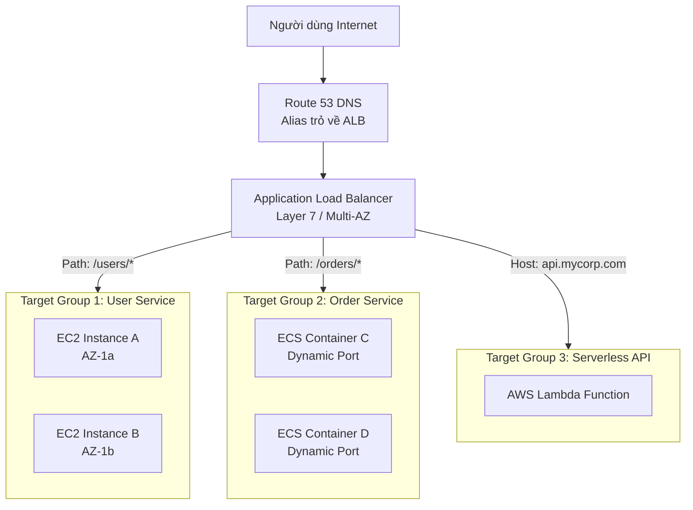
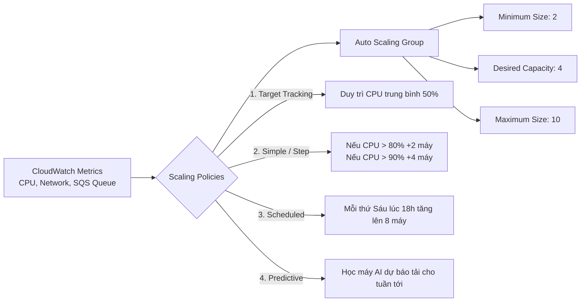
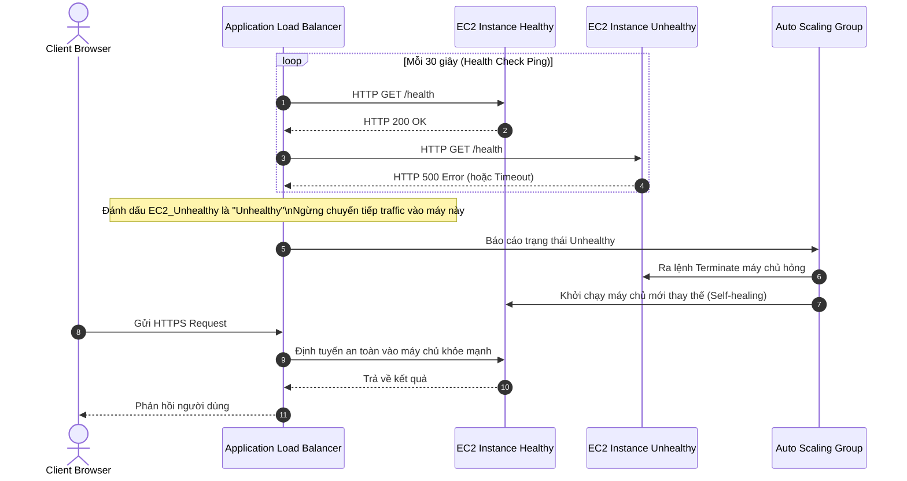

# Tài Liệu Học Tập Chuyên Sâu: Elastic Load Balancing (ELB) & Auto Scaling Groups (ASG) (Kiến Trúc Co Giãn & Độ Sẵn Sàng Cao)

> **Tài liệu chuẩn hóa kiến trúc đám mây**: Hướng dẫn toàn diện theo tiêu chuẩn Senior AWS Solutions Architect & Cloud DevOps Engineer.  
> **Ngôn ngữ**: Tiếng Việt (Bảo lưu toàn bộ thuật ngữ chuyên ngành tiếng Anh chuẩn AWS).  
> **Các bài giảng liên quan**: Chương 08 (High Availability and Scalability: Bài 70 đến Bài 86).

---

## 6.1. Tổng Quan Dịch Vụ (Service Overview)

### Dịch vụ gì?
Bộ đôi **Elastic Load Balancing (ELB)** và **Auto Scaling Groups (ASG)** là xương sống kiến trúc của mọi hệ thống phân tán có tính sẵn sàng cao (**High Availability - HA**) và khả năng co giãn đàn hồi (**Scalability & Elasticity**) trên AWS.
- **Elastic Load Balancing (ELB)**: Dịch vụ cân bằng tải được quản lý hoàn toàn, tự động phân phối lưu lượng truy cập của người dùng đến nhiều máy chủ đích (EC2 instances, containers, Lambda functions, địa chỉ IP) trên nhiều Availability Zones.
- **Auto Scaling Groups (ASG)**: Dịch vụ tự động điều chỉnh số lượng máy chủ ảo EC2 tăng lên khi lưu lượng truy cập cao để duy trì hiệu năng, và giảm xuống khi lưu lượng thấp để tối ưu chi phí, đồng thời tự động thay thế các máy chủ bị hỏng (Self-healing).

### Các loại bộ cân bằng tải trên AWS (4 Loại ELB):
1. **Application Load Balancer (ALB)**: Hoạt động ở **Tầng 7 (Application Layer)** của mô hình OSI. Hỗ trợ HTTP, HTTPS, HTTP/2, gRPC và WebSocket. Có khả năng phân tích nội dung gói tin HTTP để định tuyến thông minh theo URL path, hostname, query string, headers.
2. **Network Load Balancer (NLB)**: Hoạt động ở **Tầng 4 (Transport Layer)**. Xử lý hàng triệu request/giây với độ trễ cực thấp (microsecond). Hỗ trợ giao thức TCP, UDP, TLS. Cung cấp **địa chỉ IP tĩnh (Static IP / Elastic IP) trên mỗi AZ**.
3. **Gateway Load Balancer (GWLB)**: Hoạt động ở **Tầng 3 (Network Layer)**. Triển khai, mở rộng và quản lý các thiết bị ảo mạng của bên thứ ba (Virtual Appliances như Firewalls, Intrusion Detection/Prevention Systems - IDS/IPS, Deep Packet Inspection). Sử dụng giao thức **GENEVE** trên cổng 6081.
4. **Classic Load Balancer (CLB)**: Thế hệ cũ (Layer 4/7), đã ngừng khuyến nghị sử dụng (Deprecated).

---

## 6.2. Các Khái Niệm và Thành Phần Cốt Lõi (Core Concepts and Components)



### 1. Phân tích chi tiết Application Load Balancer (ALB)
- **Target Groups**: Tập hợp các tài nguyên đích nhận traffic từ ALB. Health Check được cấu hình độc lập ở cấp độ từng Target Group. Hỗ trợ 4 loại Target:
  1. *Instance ID*: Máy chủ EC2.
  2. *IP Address*: Địa chỉ IP riêng (Private IP trong VPC hoặc IP máy chủ On-Premises kết nối qua Direct Connect/VPN).
  3. *Lambda Function*: Xử lý HTTP request trực tiếp bằng hàm Serverless.
  4. *Application Load Balancer*: ALB khác (để lồng kiến trúc).
- **Quy tắc định tuyến thông minh (Advanced Content-based Routing)**:
  - *Path-based*: Định tuyến theo URL đường dẫn (ví dụ: `/api/v1` chuyển về API cluster, `/static` chuyển về S3/Nginx).
  - *Host-based*: Định tuyến theo tên miền (ví dụ: `mobile.app.com` và `web.app.com` dùng chung 1 ALB).
  - *HTTP Header / Method / Query Parameter*: Ví dụ request mang header `User-Agent: Android` sẽ được đẩy sang Mobile Target Group.
- **Chuyển tiếp và Phản hồi cố định (Redirects & Fixed Responses)**:
  - Tự động chuyển hướng từ HTTP cổng 80 sang HTTPS cổng 443 ngay tại ALB mà không cần gọi vào backend.
  - Trả về mã lỗi HTTP 403/503 hoặc trang HTML bảo trì trực tiếp từ ALB.

### 2. Các tính năng nâng cao của Elastic Load Balancing
- **Sticky Sessions (Session Affinity)**:
  - Đảm bảo các request tiếp theo từ cùng một người dùng sẽ luôn được định tuyến đến đúng một máy chủ backend ban đầu.
  - Hoạt động dựa trên Cookie (Application-based cookie hoặc Duration-based cookie do ALB tự tạo `AWSALB`).
  - *Hạn chế*: Có thể gây mất cân bằng tải giữa các máy chủ (Imbalance load).
- **Cross-Zone Load Balancing (Cân bằng tải chéo vùng)**:
  - Mỗi node của Load Balancer sẽ phân phối traffic đồng đều đến toàn bộ các máy chủ backend ở **tất cả các Availability Zones**.
  - *Trạng thái mặc định*: **BẬT sẵn** trên ALB (miễn phí cước truyền dữ liệu liên AZ); **TẮT mặc định** trên NLB/GWLB (nếu bật sẽ tính phí Data Transfer inter-AZ).
- **SSL/TLS & Server Name Indication (SNI)**:
  - ALB hỗ trợ SSL Termination (giải mã SSL tại Load Balancer để giải phóng CPU cho backend).
  - **SNI (Server Name Indication)**: Cho phép một ALB duy nhất lắng nghe trên cổng 443 và phục vụ **nhiều chứng chỉ SSL cho nhiều tên miền khác nhau** (ví dụ: `siteA.com` và `siteB.com` cùng trỏ vào 1 ALB).
- **Connection Draining (Deregistration Delay)**:
  - Khoảng thời gian chờ (mặc định 300 giây) để các request đang xử lý dở dang trên một máy chủ hoàn tất trước khi máy chủ đó bị rút khỏi Target Group hoặc bị Auto Scaling Group tắt đi.

### 3. Auto Scaling Groups (ASG) & Các chính sách co giãn (Scaling Policies)



1. **Target Tracking Scaling**:
   - Chính sách trực quan và thông dụng nhất: Bạn chỉ cần đặt ra một con số mục tiêu (ví dụ: *"Luôn duy trì mức sử dụng CPU trung bình của cụm ở 50%"* hoặc *"Số request trên mỗi instance là 1,000 RPS"*), ASG sẽ tự động tính toán tăng hoặc giảm số lượng máy chủ để bám sát mục tiêu đó.
2. **Simple / Step Scaling**:
   - Phản hồi dựa trên ngưỡng của CloudWatch Alarm. Step Scaling ưu việt hơn Simple Scaling vì cho phép chia nhiều bậc phản ứng nhanh hơn (ví dụ: CPU vượt 70% thì thêm 1 máy; CPU vượt 90% thì lập tức thêm 3 máy).
3. **Scheduled Scaling**:
   - Dự đoán trước lịch trình sự kiện định kỳ (ví dụ: trang web bán vé xem phim luôn có lượng truy cập tăng vọt vào 19:00 mỗi tối thứ Sáu).
4. **Predictive Scaling**:
   - Sử dụng thuật toán học máy (Machine Learning) phân tích dữ liệu lịch sử tải của các tuần trước đó để tự động lập lịch khởi động máy chủ trước khi đợt tăng tải diễn ra.

---

## 6.3. Kiến Trúc và Luồng Vận Hành (Architecture and Workflow)

### Sơ đồ luồng xử lý gói tin và giám sát sức khỏe (Health Checks)



---

## 6.4. Bảng Tích Hợp với Các Dịch Vụ AWS Khác (Integration Table)

| Related AWS Service | Purpose (Mục đích tích hợp) | Integration Method (Phương thức tích hợp) | Practical Example (Ví dụ thực tiễn) |
| :--- | :--- | :--- | :--- |
| **Amazon Route 53** | Định tuyến tên miền người dùng vào Load Balancer | **Alias Record** (A / AAAA Record) | Cấu hình Route 53 trỏ tên miền `example.com` vào DNS Name của ALB (không dùng IP tĩnh). |
| **AWS Certificate Manager (ACM)** | Cấp phát và tự động gia hạn chứng chỉ bảo mật SSL/TLS miễn phí | SSL Certificate Attachment | Gắn chứng chỉ SSL đa tên miền vào ALB với tính năng Server Name Indication (SNI). |
| **AWS WAF** | Tường lửa ứng dụng web bảo vệ trước tấn công SQLi, XSS, DDoS | WAF Web ACL Association | Gắn WAF Web ACL trực tiếp lên ALB để chặn toàn bộ request xuất phát từ các địa chỉ IP độc hại. |
| **Amazon CloudWatch** | Thu thập chỉ số hiệu năng và kích hoạt cảnh báo co giãn | CloudWatch Alarms & Metrics | Theo dõi metric `TargetResponseTime` và `HTTPCode_Target_5XX_Count` trên ALB. |
| **Amazon SQS** | Điều khiển co giãn ASG dựa trên độ dài hàng đợi thông điệp | Metric `ApproximateNumberOfMessagesVisible` | Tự động bật thêm máy chủ xử lý tác vụ ngầm khi hàng đợi SQS có hơn 10,000 tin nhắn đang chờ. |

---

## 6.5. Ví Dụ Cấu Hình và Triển Khai Thực Tế (Configuration & CLI Examples)

### 1. Tạo ALB, Target Group và Listener bằng AWS CLI

```bash
# 1. Tạo Target Group lắng nghe trên cổng 80 (HTTP)
aws elbv2 create-target-group \
    --name my-web-target-group \
    --protocol HTTP \
    --port 80 \
    --vpc-id vpc-0123456789abcdef0 \
    --health-check-path /health \
    --health-check-interval-seconds 30 \
    --target-type instance

# 2. Tạo Application Load Balancer trên 2 Public Subnets
aws elbv2 create-load-balancer \
    --name my-production-alb \
    --subnets subnet-11111111 subnet-22222222 \
    --security-groups sg-0123456789abcdef0 \
    --scheme internet-facing \
    --type application

# 3. Tạo Listener chuyển tiếp toàn bộ traffic cổng 80 vào Target Group
aws elbv2 create-listener \
    --load-balancer-arn arn:aws:elasticloadbalancing:ap-southeast-1:123456789012:loadbalancer/app/my-production-alb/xxxx \
    --protocol HTTP \
    --port 80 \
    --default-actions Type=forward,TargetGroupArn=arn:aws:elasticloadbalancing:ap-southeast-1:123456789012:targetgroup/my-web-target-group/yyyy
```

---

## 6.6. Mô Hình Tính Phí Dịch Vụ & Chiến Lược Tối Ưu Chi Phí Theo Từng Use Case (ELB & ASG Cost Breakdown & Optimization)

Trong các hệ thống phân tán High Availability trên AWS, **Elastic Load Balancing (ELB)** và **Auto Scaling Group (ASG)** là thành phần cốt lõi định tuyến lưu lượng và điều phối tài nguyên máy chủ. Mặc dù ASG không tính phí dịch vụ, nhưng thiết kế sai lệch về Load Balancer và chiến lược co giãn ASG có thể làm hóa đơn hàng tháng tăng vọt.

### 6.6.1. Bảng Cấu Trúc Định Giá Chi Tiết (Pricing Dimensions Matrix)

| Thành phần Dịch vụ (Component) | Có tính phí hay Miễn phí? | Cơ chế tính phí chi tiết (Pricing Dimensions) | Mức phí tham chiếu điển hình (US East/Singapore) | Lưu ý rủi ro chi phí (Cost Pitfalls) |
| :--- | :--- | :--- | :--- | :--- |
| **Application Load Balancer (ALB)** | Tính phí | 1. **Cước duy trì cố định**: Tính theo từng giờ hoạt động của ALB.<br>2. **Cước LCU (Load Balancer Capacity Units)**: Đo lường 4 chiều tài nguyên (chiều nào đạt mức cao nhất trong giờ sẽ tính tiền chiều đó). | - Cố định: **~$0.0225/giờ** (~$16.20/tháng/ALB).<br>- LCU: **$0.008/LCU-giờ**.<br>*(1 LCU = 25 kết nối mới/s, HOẶC 3,000 kết nối hoạt động/phút, HOẶC 1 GB dữ liệu/giờ, HOẶC 1,000 rule evaluations/s)*. | Tạo nhiều ALB riêng biệt cho từng service nhỏ thay vì dùng chung Listener Rules dẫn đến lãng phí tiền cước cố định hàng tháng. |
| **Network Load Balancer (NLB)** | Tính phí | 1. **Cước duy trì cố định**: Tính theo từng giờ hoạt động của NLB.<br>2. **Cước NLCU (Network LCU)**: Đo theo 3 chiều: New connections, Active connections, Processed bytes. | - Cố định: **~$0.0225/giờ** (~$16.20/tháng/NLB).<br>- NLCU: **$0.006/NLCU-giờ**. | Bật Cross-Zone Load Balancing trên NLB sẽ bị tính tiền Data Transfer giữa các AZ ($0.01/GB), trong khi trên ALB là miễn phí. |
| **Auto Scaling Group (ASG)** | **MIỄN PHÍ** (100% Free) | Không có bất kỳ khoản phí nào cho bản thân dịch vụ ASG. | **$0.00** | Chỉ trả tiền cho các tài nguyên EC2 instances, EBS volumes và CloudWatch Alarms do ASG tạo ra. Rủi ro chi phí đến từ việc cấu hình sai ngưỡng co giãn (Scaling threshold) khiến hệ thống scale-out quá đà. |
| **Data Transfer Out (Internet Egress)** | Tính phí | Dữ liệu từ ELB truyền ngược ra Internet tới người dùng cuối. | - 100 GB đầu: Miễn phí.<br>- Tiếp theo: **~$0.09/GB** (US/EU) hoặc **~$0.12/GB** (Singapore). | Phục vụ trực tiếp file tĩnh (ảnh, video) dung lượng lớn qua ALB thay vì đẩy qua CloudFront để hưởng cước CDN rẻ hơn. |
| **Cross-Zone Data Transfer** | Khác nhau theo loại ELB | Băng thông truyền dữ liệu giữa các Availability Zones trong cùng Region. | - **ALB**: Miễn phí ($0.00/GB).<br>- **NLB**: **$0.01/GB** mỗi chiều nếu BẬT Cross-Zone balancing. | Vô tình bật Cross-Zone trên NLB xử lý lưu lượng Data Ingestion hàng trăm TB/tháng sẽ tốn thêm hàng nghìn USD cước Inter-AZ transfer. |

---

### 6.6.2. 5 Kịch Bản Tối Ưu Hóa Chi Phí Kiến Trúc Thực Tế (Architectural Cost Optimization Use Cases)

#### Use Case 1: Hợp nhất nhiều Microservices vào một ALB duy nhất (Listener Rules Consolidation)
- **Bối cảnh**: Doanh nghiệp triển khai 12 microservices (User, Cart, Order, Payment, Inventory, Catalog...). Đội ngũ DevOps ban đầu tạo mỗi service 1 ALB internet-facing riêng biệt.
- **Rủi ro chi phí**: 12 ALB * $0.0225/giờ * 730 giờ = **$197.10/tháng** chỉ riêng tiền phí cố định, chưa tính cước LCU, trong khi lưu lượng của mỗi service rất nhỏ (< 5 req/s).
- **Giải pháp tối ưu**:
  - Hợp nhất toàn bộ 12 dịch vụ về **1 Application Load Balancer duy nhất**.
  - Sử dụng **Path-based Routing** (`/api/users/*`, `/api/orders/*`) hoặc **Host-based Routing** (`users.api.domain.com`, `orders.api.domain.com`) với các Listener Rules trỏ về từng Target Group tương ứng.
- **Hiệu quả kinh tế**:
  - Chi phí ALB cố định giảm từ $197.10 xuống còn **$16.42/tháng**.
  - **Tiết kiệm ngay 91.7% chi phí ELB base fee** ($2,168/năm) mà không ảnh hưởng tới hiệu năng và bảo mật.

#### Use Case 2: Kiểm soát bẫy chi phí Cross-Zone Load Balancing trên NLB lưu lượng lớn
- **Bối cảnh**: Hệ thống nhận dữ liệu IoT hoặc Video Streaming UDP/TCP qua Network Load Balancer (NLB) với tổng dung lượng dữ liệu xử lý lên tới 80 TB/tháng trải dài trên 3 Availability Zones.
- **Rủi ro chi phí**: Kỹ sư bật cờ `cross_zone_load_balancing.enabled = true` trên NLB. Khi NLB ở AZ-a nhận gói tin và chuyển tiếp sang EC2 instance ở AZ-b, AWS tính cước Inter-AZ Data Transfer là $0.01/GB cho cả chiều gửi và nhận.
  - Phí phát sinh: 80,000 GB * 2/3 (tỷ lệ truyền xuyên AZ) * $0.01 = **~$533/tháng** lãng phí.
- **Giải pháp tối ưu**:
  - Tắt tính năng Cross-Zone Load Balancing trên NLB (`cross_zone_load_balancing.enabled = false` - đây là giá trị mặc định).
  - Sử dụng Route 53 với tính năng DNS Latency Routing hoặc cấu hình client phân bổ đều theo từng Elastic IP của NLB trên từng AZ.
  - Mỗi AZ sẽ tự xử lý lưu lượng cục bộ (Local Zone Processing).
- **Hiệu quả kinh tế**:
  - Triệt tiêu hoàn toàn khoản phụ phí Inter-AZ transfer, **tiết kiệm $533/tháng ($6,396/năm)**. Độ trễ mạng (latency) còn được cải thiện thêm 1-2ms do gói tin không phải nhảy qua các trung tâm dữ liệu khác nhau.

#### Use Case 3: ASG Mixed Instances Policy - Kết hợp Spot Instances và On-Demand cho Worker Tier
- **Bối cảnh**: Hệ thống xử lý hàng đợi background jobs (render video, xử lý ảnh, ETL dữ liệu) chạy trong một Auto Scaling Group gồm 20 máy ảo `c6i.xlarge` chạy liên tục 24/7.
- **Chi phí ban đầu**: 20 máy * $0.17/giờ * 730 giờ = **$2,482/tháng** (100% On-Demand).
- **Giải pháp tối ưu**:
  - Cấu hình Auto Scaling Group sử dụng **Mixed Instances Policy**:
    - **Base Capacity On-Demand**: Đặt là 2 instances để đảm bảo luôn có máy chủ nòng cốt xử lý các tác vụ quan trọng khẩn cấp.
    - **Spot Percentage**: 90% cho dung lượng vượt mức cơ sở.
    - **Allocation Strategy**: `capacity-optimized` kết hợp đa dạng hóa instance types (`c6i.xlarge`, `c5.xlarge`, `c5a.xlarge`, `m6i.xlarge`).
- **Hiệu quả kinh tế**:
  - 2 On-Demand instances: 2 * $0.17 * 730 = $248.20/tháng.
  - 18 Spot instances (chiết khấu trung bình ~70%): 18 * ($0.17 * 0.3) * 730 = $670.14/tháng.
  - Tổng chi phí mới: $248.20 + $670.14 = **$918.34/tháng**.
  - **Tiết kiệm $1,563.66/tháng (giảm 63% tổng chi phí điện toán)** với độ bền vững tác vụ 100% nhờ hàng đợi SQS cho phép retry khi Spot bị thu hồi.

#### Use Case 4: Tinh chỉnh Deregistration Delay trên Target Group để giảm lãng phí máy chủ
- **Bối cảnh**: Hệ thống Web API microservices triển khai CI/CD triển khai liên tục (5-10 đợt deploy/ngày) và có lưu lượng biến động theo giờ khiến ASG co cụm liên tục.
- **Rủi ro chi phí**: Thuộc tính `deregistration_delay.timeout_seconds` trên Target Group đang để mặc định là **300 giây (5 phút)**. Khi ASG ra lệnh Scale-In hoặc khi triển khai rolling update, máy chủ cũ bị rút khỏi Target Group và chuyển sang trạng thái `draining`. Máy chủ này phải chạy rỗng và không nhận request mới trong suốt 5 phút trước khi thực sự bị terminate, trong khi các request HTTP của ứng dụng hoàn tất chỉ trong 100-200ms.
- **Giải pháp tối ưu**:
  - Đánh giá thời gian phản hồi tối đa của ứng dụng backend (P99 latency). Với API web thông thường, giảm `deregistration_delay.timeout_seconds` từ 300 giây xuống còn **15 đến 30 giây**.
  - Cấu hình script graceful shutdown trên container/OS để đóng socket ngay khi hết request đang chờ.
- **Hiệu quả kinh tế**:
  - Giảm thời gian sống dư thừa của máy chủ ảo EC2 tới 90% trong mỗi chu kỳ scale-in và deployment.
  - Tăng tốc độ triển khai CI/CD pipeline từ 25 phút xuống còn 4 phút, tiết kiệm hàng chục compute-hours mỗi tuần.

#### Use Case 5: Tối ưu LCU Rule Evaluations bằng cách cấu hình Rule Priority thông minh
- **Bối cảnh**: Một Application Load Balancer internet-facing phục vụ 100 triệu request mỗi ngày với 60 Listener Rules phức tạp (kiểm tra HTTP headers, Query Strings, Host, Path).
- **Rủi ro chi phí**: Cước LCU tính theo metric `Rule Evaluations`. 10 rules đầu tiên được miễn phí; mỗi 1,000 rule evaluations/giây tiếp theo sẽ tiêu tốn thêm LCU. Do các rule được đánh số ngẫu nhiên, các request phổ biến nhất (chiếm 80% lưu lượng) lại nằm ở Priority 45-55, buộc ALB phải đánh giá qua 45-55 điều kiện cho mỗi request trước khi forward!
- **Giải pháp tối ưu**:
  - Phân tích nhật ký ALB Access Logs để thống kê tần suất khớp của từng route.
  - Đặt các quy tắc phục vụ các endpoint có lưu lượng lớn nhất (ví dụ: Trang chủ `/`, Health check `/health`, Auth `/api/v1/auth`) ở các số ưu tiên thấp nhất (**Priority 1, 2, 3...**).
  - Khi request khớp với rule đầu tiên, ALB sẽ lập tức forward và dừng việc đánh giá các rule còn lại.
- **Hiệu quả kinh tế**:
  - Giảm số lượt Rule Evaluations trung bình từ 48 xuống còn 2.1 evaluations/request.
  - Triệt tiêu hoàn toàn kích thước chiều LCU Rule Evaluations, giảm từ 15 LCU-hours/ngày xuống mức tối thiểu, tiết kiệm hàng trăm USD phụ phí LCU không đáng có.

---

## 6.7. Khắc Phục Sự Cố Thực Tế (Troubleshooting Guide)

| Vấn đề (Problem) | Nguyên nhân khả dĩ (Possible Causes) | Các bước điều tra (Investigation Steps) | Giải pháp (Solution) | Biện pháp phòng ngừa (Prevention) |
| :--- | :--- | :--- | :--- | :--- |
| **ALB trả về mã lỗi `HTTP 504 Gateway Timeout`** | Máy chủ backend mất quá nhiều thời gian để xử lý hoặc Security Group của backend chặn phản hồi về ALB. | 1. Xem Access Logs của ALB.<br>2. Kiểm tra thời gian xử lý của database backend hoặc ứng dụng. | Tăng giá trị `Idle Timeout` trên ALB hoặc tối ưu hóa truy vấn của ứng dụng backend. | Thiết lập CloudWatch Alarm theo dõi metric `TargetResponseTime`. |
| **Toàn bộ Target trong Target Group đều báo `Unhealthy`** | 1. Đường dẫn Health Check path cấu hình sai (ví dụ ứng dụng không có endpoint `/`).<br>2. Security Group của EC2 chưa mở cổng cho IP của ALB. | 1. Kiểm tra mã phản hồi mong muốn (Matcher: mặc định 200).<br>2. Thử curl thủ công vào endpoint `/health` từ trong máy ảo. | Đảm bảo Security Group của EC2 mở cổng từ Security Group của ALB và endpoint trả về đúng mã HTTP 200. | Sử dụng endpoint riêng biệt chuyên phục vụ kiểm tra sức khỏe hệ thống. |
| **ALB trả về lỗi `HTTP 503 Service Unavailable`** | Target Group không có bất kỳ máy chủ đích nào đang ở trạng thái Healthy (toàn bộ máy chủ đều chết hoặc chưa kịp khởi động). | Kiểm tra tab Targets của Target Group trên console. | Khởi chạy máy chủ mới hoặc kiểm tra lại nguyên nhân các máy chủ bị đánh dấu Unhealthy. | Luôn duy trì số lượng máy tối thiểu (Min size >= 2) trong ASG trên đa AZ. |
| **Một máy chủ EC2 nhận quá nhiều traffic trong khi các máy khác nhàn rỗi** | Tính năng **Sticky Sessions** đang được bật kết hợp với một vài người dùng lớn (heavy users) hoặc bot cào dữ liệu. | Kiểm tra cài đặt Target Group attributes và cookie duration. | Tắt Sticky Sessions nếu ứng dụng hỗ trợ cơ chế lưu phiên phi trạng thái (Stateless qua Redis/ElastiCache). | Thiết kế ứng dụng theo mô hình Stateless Web Tier. |

---

## 6.8. Bộ Câu Hỏi Ôn Tập và Kiểm Tra Kiến Thức (Knowledge Review)

### A. 10 Câu hỏi Cốt lõi (Core Concepts)
1. Bộ cân bằng tải nào hoạt động ở Tầng 7 của mô hình OSI, hỗ trợ định tuyến theo URL path và hỗ trợ Dynamic Port Mapping cho Docker containers?
2. Bộ cân bằng tải nào có khả năng cấp phát địa chỉ IP tĩnh công khai (Elastic IP) trên mỗi Availability Zone và xử lý hàng triệu request/giây với độ trễ microsecond?
3. Tính năng **Server Name Indication (SNI)** trên Application Load Balancer giải quyết bài toán kỹ thuật nào?
4. Khái niệm **Connection Draining** (trên CLB) hay **Deregistration Delay** (trên ALB/NLB) có tác dụng gì?
5. Sự khác biệt giữa việc cấu hình **Health Check Type** của Auto Scaling Group là `EC2` so với `ELB` là gì?
6. Để kết nối tên miền từ Amazon Route 53 trỏ trực tiếp vào một Application Load Balancer, bạn phải sử dụng loại bản ghi DNS nào?
7. Trong Auto Scaling Group, ba thông số kích thước cơ bản cần phải khai báo là gì?
8. Chính sách co giãn (Scaling Policy) nào cho phép bạn chỉ cần đặt mục tiêu mức sử dụng CPU trung bình là 60% và để AWS tự động tính toán số lượng máy chủ cần thêm hoặc bớt?
9. Cơ chế **Cross-Zone Load Balancing** có trạng thái mặc định như thế nào trên ALB so với NLB?
10. Làm thế nào để máy chủ backend nằm phía sau ALB biết được địa chỉ IP thật của người dùng cuối trên Internet?

---

### Đáp án Bộ Câu Hỏi Ôn Tập (Answer Key)

<details>
<summary>👉 Nhấp vào đây để xem toàn bộ đáp án chi tiết</summary>

1. **Application Load Balancer (ALB)**.
2. **Network Load Balancer (NLB)**.
3. Cho phép một Load Balancer duy nhất có thể tiếp nhận và phục vụ **nhiều chứng chỉ số SSL/TLS khác nhau cho nhiều tên miền khác nhau** trên cùng một cổng kết nối bảo mật (HTTPS 443).
4. Giúp các kết nối đang hoạt động (in-flight requests) có đủ thời gian để hoàn thành việc truyền nhận dữ liệu trước khi một máy chủ bị rút khỏi Target Group hoặc bị Auto Scaling Group tắt bỏ, ngăn chặn việc người dùng bị ngắt kết nối đột ngột.
5. Nếu chọn `EC2`: ASG chỉ đánh dấu một máy chủ là hỏng khi phần cứng máy chủ hoặc OS sập (System/Instance check failed). Nếu chọn `ELB`: Ngoài lỗi phần cứng, nếu ứng dụng web bên trong bị treo và trả về mã lỗi cho bộ cân bằng tải (ALB Health check failed), ASG cũng sẽ chủ động tiêu hủy máy chủ đó và bật máy mới thay thế.
6. Sử dụng bản ghi **Alias Record** (bản ghi Bí danh loại A hoặc AAAA) của Amazon Route 53.
7. **Minimum Capacity** (Số lượng tối thiểu), **Desired Capacity** (Số lượng mong muốn duy trì), và **Maximum Capacity** (Số lượng tối đa cho phép).
8. **Target Tracking Scaling Policy**.
9. **Mặc định BẬT** trên Application Load Balancer (miễn phí); **Mặc định TẮT** trên Network Load Balancer (nếu bật sẽ bị tính phí cước dữ liệu truyền xuyên AZ).
10. Đọc giá trị được ALB chèn thêm vào tiêu đề HTTP request: header **`X-Forwarded-For`** (chứa IP thật của Client), **`X-Forwarded-Port`** (cổng kết nối ban đầu) và **`X-Forwarded-Proto`** (giao thức HTTP hoặc HTTPS).
</details>

---

## 6.9. Tóm Tắt và Danh Mục Kiểm Tra Kiến Thức (Summary & Learning Checklist)

### 5 Khái niệm quan trọng nhất phải nhớ:
1. **ALB (Layer 7)**: Định tuyến đường dẫn/host thông minh; sử dụng DNS Name (không dùng IP tĩnh); hỗ trợ microservices và containers.
2. **NLB (Layer 4)**: Hiệu năng cực đỉnh, độ trễ cực thấp, cấp IP tĩnh cố định cho mỗi AZ.
3. **ASG Self-Healing**: Luôn tự động giám sát và thay thế máy chủ lỗi dựa trên ELB Health Checks.
4. **Target Tracking**: Cách cấu hình co giãn tối ưu và đơn giản nhất cho bài toán duy trì mức tải mong muốn.
5. **X-Forwarded-For**: Chìa khóa để lấy địa chỉ IP gốc của khách hàng khi máy chủ đứng sau Load Balancer.

### Bảng kiểm tra năng lực (Learning Checklist):
- [ ] Tôi biết cách cấu hình chuyển hướng HTTP sang HTTPS trên ALB Listener Rules.
- [ ] Tôi hiểu rõ khi nào nên chọn ALB và khi nào bắt buộc phải dùng NLB.
- [ ] Tôi biết cách cấu hình ASG co giãn tự động dựa trên độ dài hàng đợi SQS.
- [ ] Tôi hiểu bản chất của Deregistration Delay và cách chống gián đoạn dịch vụ khi deploy phiên bản mới.
- [ ] Tôi có thể thiết kế kiến trúc High Availability chịu lỗi khi một Availability Zone bị sập hoàn toàn.

### Liên kết và Chủ đề tiếp theo:
- 📖 [Ghi Chú Bài Học Chương 08: High Availability and Scalability](file:///n:/AWS_XBrain_Note/Lesson_Notes/08_High_Availability_and_Scalability.md)
- 📖 [Bảng Thuật Ngữ Kỹ Thuật (GLOSSARY.md)](file:///n:/AWS_XBrain_Note/GLOSSARY.md)
- ⏭️ Tiếp tục chuyển sang chuyên đề: **Cơ Sở Dữ Liệu Đám Mây: Amazon RDS, Aurora & ElastiCache**.
