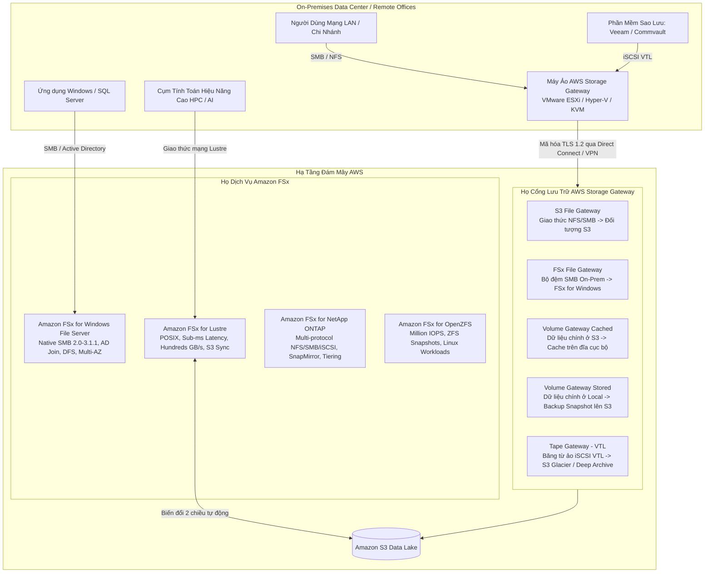
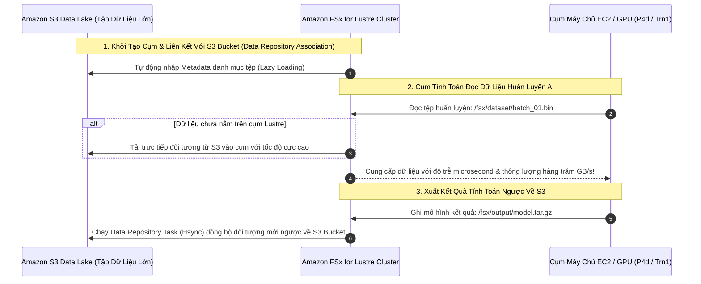
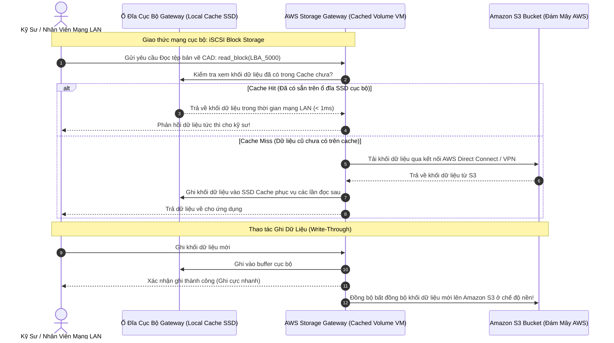

# Tài Liệu Học Tập Chuyên Sâu: Amazon FSx & AWS Storage Gateway (Hệ Thống Lưu Trữ Lai & Tệp Tin Chuyên Biệt Doanh Nghiệp)

> **Tài liệu chuẩn hóa kiến trúc đám mây**: Hướng dẫn toàn diện theo tiêu chuẩn Principal Storage & Hybrid Cloud Solutions Architect (Cập nhật phiên bản kiến trúc mới nhất 2026).  
> **Ngôn ngữ**: Tiếng Việt chuyên ngành (Bảo lưu 100% thuật ngữ chuyên ngành tiếng Anh chuẩn AWS).  
> **Mục tiêu**: Phục vụ thi chứng chỉ cấp độ Professional/Specialty (**SAA-C03, SAP-C02, Storage Specialty**) và thiết kế kiến trúc lưu trữ lai (**Hybrid Cloud Storage**) cấp độ doanh nghiệp lớn.  
> **Các bài giảng liên quan**: Chương 16 (AWS Storage Extras: Snow Family, FSx, Storage Gateway) & Đề thi thực hành Udemy SAA-C03 (PT1, PT2, PT3, PT6).

---

## 1. Tổng Quan Dịch Vụ Lưu Trữ Lai & Chuyên Biệt (Service Overview)

### 1. Phân vai kiến trúc giữa Amazon FSx và AWS Storage Gateway

Khi các doanh nghiệp di chuyển hoặc mở rộng hạ tầng từ On-Premises lên đám mây, họ thường gặp phải 2 thách thức lưu trữ lớn:
1. **Ứng dụng kế thừa đòi hỏi hệ thống tệp tin chuyên biệt (Enterprise Native File Systems)**: Các ứng dụng Windows yêu cầu giao thức **SMB**, phân quyền **NTFS ACLs** và gia nhập miền **Microsoft Active Directory**; hoặc các tác vụ khoa học máy tính đòi hỏi hiệu năng cực cao (**HPC**) chuẩn **POSIX** với băng thông hàng trăm GB/s. $\rightarrow$ **Amazon FSx** giải quyết trọn vẹn bài toán này bằng các cụm lưu trữ được quản lý hoàn toàn (**Fully Managed**).
2. **Cầu nối lưu trữ giữa Data Center tại chỗ và Đám mây (Hybrid Cloud Storage Gateway)**: Máy chủ On-Premises cần mở rộng dung lượng không giới hạn lên Amazon S3, hoặc cần một bộ đệm cục bộ (**Local Cache**) để truy cập dữ liệu đám mây với độ trễ mạng LAN dưới 1 mili-giây. $\rightarrow$ **AWS Storage Gateway** cung cấp cầu nối phần mềm ảo hóa chuẩn công nghiệp (**NFS, SMB, iSCSI, VTL**) kết nối trực tiếp vào AWS.



---

### 2. Bảng Phân Nhóm 4 Dòng Động Cơ Amazon FSx

| Động cơ Amazon FSx | Giao thức hỗ trợ | Hệ điều hành & Tích hợp | Đặc điểm hiệu năng | Kịch bản sử dụng tối ưu trong đề thi |
| :--- | :--- | :--- | :--- | :--- |
| **FSx for Windows File Server** | **SMB (2.0 đến 3.1.1)** | Windows, Linux, macOS.<br>Tích hợp trực tiếp **Microsoft Active Directory**. | Lên tới hàng chục GB/s, hàng trăm nghìn IOPS.<br>Tùy chọn ổ **SSD hoặc HDD**. | **(U-PT1 Q64, U-PT2 Q10, U-PT2 Q61)**: Di chuyển chia sẻ file Windows, ứng dụng ERP/kế toán, Microsoft SQL Server AlwaysOn, chia sẻ DFS Namespaces. |
| **FSx for Lustre** | **POSIX-compliant** Lustre client | Linux (Amazon Linux, Red Hat, CentOS, Ubuntu). | **Hàng trăm GB/s**, **hàng triệu IOPS**, độ trễ **dưới 1 mili-giây** (**Sub-millisecond**). | **(U-PT1 Q40)**: Điện toán hiệu năng cao (**HPC**), EDA, máy học AI/ML, mô phỏng tài chính, xử lý video; **Liên kết trực tiếp 2 chiều với Amazon S3**. |
| **FSx for NetApp ONTAP** | **NFS, SMB, iSCSI** (Đa giao thức) | Mọi hệ điều hành. | Sub-millisecond. Hỗ trợ tính năng nén (**Compression**), khử trùng lặp (**Deduplication**). | **(U-PT3 Q18)**: Doanh nghiệp đang dùng thiết bị phần cứng lưu trữ NetApp On-Premises, muốn giữ nguyên quy trình sao chép **SnapMirror/SnapVault** khi chuyển lên AWS. |
| **FSx for OpenZFS** | **NFS (v3, v4, v4.1, v4.2)** | Linux, Unix. | Lên tới 1 triệu IOPS, độ trễ 100 microsecond (NVMe cache). | Di chuyển các máy chủ tệp ZFS từ On-Premises lên AWS mà không cần sửa đổi ứng dụng. |

---

### 3. Bảng Phân Nhóm Các Loại Cổng AWS Storage Gateway

| Loại Storage Gateway | Giao thức phía On-Premises | Cơ chế lưu trữ phía AWS | Trường hợp sử dụng tối ưu trong đề thi |
| :--- | :--- | :--- | :--- |
| **Amazon S3 File Gateway** | **NFS (v3, v4.1)** & **SMB (2.0, 3.0)** | Lưu trữ trực tiếp dưới dạng **S3 Objects** (1 file = 1 object trong S3 bucket). Có local cache. | **(U-PT1 Q21, U-PT3 Q57)**: Cung cấp giao thức chia sẻ tệp NFS/SMB cho ứng dụng tại chỗ ghi trực tiếp vào S3 Data Lake; tích hợp S3 Lifecycle. |
| **Amazon FSx File Gateway** | **SMB (v2, v3)** | Đóng vai trò là **Bộ đệm tệp cục bộ (Local Cache)** cho **FSx for Windows File Server**. | Chi nhánh văn phòng ở xa cần truy cập hệ thống tệp FSx for Windows trên AWS với độ trễ mạng LAN mà không tốn băng thông đường truyền. |
| **Volume Gateway - Cached Volumes** | **iSCSI Block Storage** | **Dữ liệu chính lưu trên Amazon S3**; chỉ lưu dữ liệu thường xuyên đọc (**Frequently Accessed**) trên ổ đĩa cục bộ. | **(U-PT3 Q60)**: Mở rộng dung lượng lưu trữ cục bộ với chi phí thấp; giải phóng ổ cứng SAN/NAS đắt đỏ tại chỗ. |
| **Volume Gateway - Stored Volumes** | **iSCSI Block Storage** | **Toàn bộ dữ liệu chính lưu trên ổ đĩa cục bộ (On-Prem)**; tự động sao lưu bất đồng bộ định kỳ thành **EBS Snapshots** trên S3. | Yêu cầu toàn bộ dữ liệu phải nằm tại chỗ để đạt độ trễ cực thấp; cần cơ chế sao lưu dự phòng thảm họa (DR) lên AWS với RPO thấp. |
| **Tape Gateway (VTL)** | **iSCSI VTL** (Virtual Tape Library) | Giả lập thư viện băng từ ảo; lưu trữ trên **S3 Glacier Flexible** và **S3 Glacier Deep Archive**. | Thay thế toàn bộ hệ thống băng từ vật lý tốn kém; tích hợp trực tiếp với phần mềm sao lưu doanh nghiệp sẵn có (Veeam, Backup Exec). |

---

## 2. Đi Sâu Kiến Trúc Amazon FSx

### 2.1. Amazon FSx for Windows File Server: Các Tính Năng Doanh Nghiệp

```mermaid
flowchart LR
    subgraph MultiAZ[Amazon FSx for Windows - Multi-AZ Architecture]
        direction LR
        Primary[Active File Server\nAvailability Zone A] <-->|Đồng bộ dữ liệu cấp khối liên tục (Sync Replication)| Standby[Standby File Server\nAvailability Zone B]
        Primary -.->|Lưu trữ| StorageA[(Shared SSD / HDD Storage)]
        Standby -.->|Lưu trữ| StorageB[(Shared SSD / HDD Storage)]
    end

    AD[Microsoft Active Directory\n(AWS Managed AD hoặc On-Premises AD)] -->|Xác thực Kerberos / NTLM| MultiAZ
    Client[Máy chủ Windows / EC2 / On-Prem] -->|Truy cập qua SMB| Primary
    Primary -->|Tự động Failover < 30s khi AZ lỗi| Standby
```

1. **Khả dụng cao Multi-AZ với tính năng tự động chuyển đổi dự phòng (Automatic Failover)**:
   - Triển khai Active-Standby trên 2 Availability Zones khác nhau.
   - Tự động đồng bộ dữ liệu liên tục ở cấp độ khối (**Block-level synchronous replication**).
   - Khi AZ chính gặp sự cố, hệ thống tự động chuyển sang AZ phụ trong vòng dưới 30 giây mà **không làm đứt phiên làm việc của người dùng hay ứng dụng**.
2. **Hệ Thống Tệp Phân Tán (DFS Namespaces & DFS Replication)**:
   - Cho phép gom nhiều hệ thống tệp FSx for Windows khác nhau lại dưới một đường dẫn thư mục chia sẻ duy nhất (ví dụ: `\\corp.company.com\shares`).
   - Hỗ trợ lưu trữ hàng chục Petabytes dữ liệu tệp tin Windows phân tán.
3. **Tùy Chọn Ổ Đĩa SSD vs HDD (Tối Ưu Chi Phí)**:
   - **Ổ SSD**: Dành cho tác vụ nhạy cảm về độ trễ, I/O ngẫu nhiên cao (Cơ sở dữ liệu SQL Server, phân tích dữ liệu, ứng dụng ERP).
   - **Ổ HDD**: Dành cho tác vụ lưu trữ tài liệu văn phòng, thư mục người dùng cá nhân (Home directories), sao lưu dữ liệu với chi phí cực rẻ (tiết kiệm tới 70% so với SSD).
4. **Khử Trùng Lặp Dữ Liệu (Data Deduplication)**:
   - Tự động phát hiện và loại bỏ các phần dữ liệu trùng lặp trên ổ đĩa.
   - Thường giúp tiết kiệm từ **50% đến 60% dung lượng lưu trữ** thực tế đối với các thư mục chia sẻ tài liệu văn phòng hoặc hình ảnh hệ điều hành!

---

### 2.2. Amazon FSx for Lustre: Động Cơ Tốc Độ Cho AI, ML & HPC



* **Hai Chế Độ Triển Khai (Deployment Types)**:
  - **Scratch File System**: Thiết kế cho các tác vụ xử lý tạm thời, ngắn hạn. Dữ liệu không được nhân bản qua máy chủ khác trong cụm (nếu máy chủ vật lý lỗi, dữ liệu tạm thời bị mất). **Chi phí rẻ nhất, hiệu năng cao nhất**.
  - **Persistent File System**: Thiết kế cho các tác vụ tính toán dài hạn. Dữ liệu được nhân bản tự động trong cùng 1 Availability Zone; nếu máy chủ lỗi sẽ tự động thay thế mà không mất dữ liệu.

---

### 2.3. Amazon FSx for NetApp ONTAP: Lưu Trữ Đa Giao Thức & Khối Đa Vùng (Multi-AZ iSCSI)

```mermaid
flowchart TD
    subgraph MultiAZ_ONTAP["Amazon FSx for NetApp ONTAP (Multi-AZ File System)"]
        direction LR
        PrimaryNode[Active Storage Controller\nAvailability Zone A] <-->|Đồng bộ cấp khối tự động (NVMe Mirror)| StandbyNode[Standby Storage Controller\nAvailability Zone B]
        PrimaryNode --- PoolA[(Primary Storage Tier: SSD)]
        StandbyNode --- PoolB[(Standby Storage Tier: SSD)]
        PoolA -.-> CapacityPool[(Capacity Pool Tier: Tự động chuyển dữ liệu nguội sang S3)]
    end

    ClientWin[EC2 Windows Server AZ-A] -->|iSCSI Block Protocol| PrimaryNode
    ClientWinB[EC2 Windows Server AZ-B] -->|iSCSI Block Protocol / Failover| StandbyNode
    ClientLinux[EC2 Linux Cluster] -->|NFS v3 / v4.1| PrimaryNode
    ClientOffice[User Desktops] -->|SMB 3.0| PrimaryNode
```

1. **Đột phá Lưu Trữ Khối Đa Vùng Khả Dụng (Multi-AZ Block Storage via iSCSI)** (*TD-Set1 Q10, TD-Set8 Q18*):
   - **Bản chất giới hạn của Amazon EBS**: EBS là tài nguyên **Single-AZ**. Ổ đĩa EBS không thể mount xuyên qua Availability Zone khác (ngay cả EBS Multi-Attach cũng chỉ hỗ trợ trong cùng 1 AZ).
   - **Giải pháp của FSx for NetApp ONTAP**: Hỗ trợ giao thức **iSCSI Block Storage** trên kiến trúc **Multi-AZ**. Cho phép các máy chủ EC2 Windows hoặc Linux trải rộng trên 2 Availability Zones cùng truy cập vào một khối lưu trữ block dùng chung với độ trễ thấp và tự động failover, hoàn hảo cho các cụm giao dịch tài chính hoặc Windows Server Failover Cluster (WSFC).
2. **Lưu trữ đa tầng tự động (Automated Storage Tiering)**:
   - Dữ liệu nóng truy cập thường xuyên nằm trên **Primary Storage Tier (NVMe SSD)**.
   - Dữ liệu nguội ít truy cập được tự động đẩy xuống **Capacity Pool Tier (lưu trữ S3 chi phí thấp)** không giới hạn dung lượng, giúp giảm chi phí lưu trữ lên đến 70%.
3. **Đa giao thức đồng thời (Multi-Protocol)**:
   - Cho phép cùng một khối dữ liệu có thể được truy cập đồng thời qua cả giao thức **NFS** (cho Linux) và **SMB** (cho Windows) mà không cần chuyển đổi định dạng.

---

### 2.4. Họ Thiết Bị Di Chuyển Dữ Liệu Ngoại Tuyến: AWS Snow Family

| Thiết bị Snow | Dung lượng khả dụng | Năng lực tính toán (Compute) | Kịch bản sử dụng chuẩn |
| :--- | :--- | :--- | :--- |
| **AWS Snowcone** | **8 TB HDD** hoặc **14 TB SSD** | 2 vCPUs, 4 GB RAM, hỗ trợ **AWS IoT Greengrass** và EC2 | **(TD-Set4 Q51)**: Thiết bị siêu nhỏ gọn (2.1 kg), chạy bằng pin/USB-C; dùng ở môi trường khắc nghiệt không có mạng (xe cứu thương, trạm thời tiết, flycam). |
| **AWS Snowball Edge Storage Optimized** | **80 TB** hoặc **210 TB NVMe** | 40 vCPUs, 80 GiB RAM, chạy EC2 AMIs & Lambda | Di chuyển hàng chục tới hàng trăm Terabytes dữ liệu cục bộ lên S3 khi đường truyền mạng Internet bị chậm (mất nhiều tuần/tháng nếu tải online). |
| **AWS Snowball Edge Compute Optimized** | **28 TB NVMe** hoặc **42 TB** | **104 vCPUs, 416 GiB RAM, GPU NVIDIA** | Xử lý dữ liệu nặng tại biên (Edge Computing, máy học AI, phân tích video trực tiếp tại hiện trường không có Internet). |
| **AWS Snowmobile** | Lên tới **100 PB** mỗi xe tải container | Container dài 45-foot, hộ tống an ninh 24/7 | Di chuyển toàn bộ trung tâm dữ liệu khổng lồ (hàng trăm Petabytes) lên AWS trong vài tuần. |

---


### 2.5. AWS Transfer Family: Cổng Truyền Tệp An Toàn SFTP, FTPS & FTP Không Máy Chủ
- **AWS Transfer Family** cung cấp giao thức truyền tệp tiêu chuẩn công nghiệp (**SFTP, FTPS, FTP, AS2**) trực tiếp vào bộ lưu trữ đám mây AWS:
  1. **Tích hợp bộ lưu trữ gốc**: Lưu trữ dữ liệu trực tiếp vào **Amazon S3** hoặc **Amazon EFS** mà người dùng và ứng dụng đối tác bên ngoài không cần thay đổi client SFTP quen thuộc (U-PT3 Q52).
  2. **Quản trị xác thực linh hoạt**:
     - *Service-managed*: Quản lý danh sách người dùng và SSH public keys trực tiếp trên AWS Transfer Family.
     - *Microsoft Active Directory*: Tích hợp với Active Directory doanh nghiệp qua AWS Directory Service.
     - *Custom IdP qua AWS Lambda*: Tích hợp với bất kỳ hệ thống IdP nào (Okta, Auth0, REST API nội bộ).
  3. **Kết nối mạng an toàn (VPC Endpoints)**: Hỗ trợ triển khai SFTP endpoint ở chế độ **VPC (Internal)** kết hợp với **AWS PrivateLink** $\rightarrow$ Các máy chủ đối tác hoặc On-Premises có thể truyền file qua AWS Direct Connect / Site-to-Site VPN an toàn mà không đi qua Internet công cộng (U-PT4 Q40).
  4. **Managed Workflows**: Tự động kích hoạt chuỗi xử lý sau khi tải tệp lên (quét mã độc, nén/giải nén, gắn tag S3, gọi Step Functions).

---


### 🏛️ I. Các Kịch Bản Kiến Trúc Chuẩn (Best Practice Scenarios)

#### 1. Di Chuyển Hệ Thống Chia Sẻ Tệp Tin Windows Doanh Nghiệp Không Sửa Ứng Dụng — (U-PT1 Q64, U-PT2 Q10, U-PT2 Q61)
- **Tình huống thi**: Doanh nghiệp vận hành cụm máy chủ chia sẻ tệp Windows Server tại chỗ, phục vụ ứng dụng chỉnh sửa video và phần mềm kế toán ERP. Hệ thống sử dụng giao thức SMB, phân quyền thư mục theo NTFS ACLs, tích hợp Active Directory và dùng kiến trúc **DFS Namespaces**. Doanh nghiệp muốn di chuyển lên AWS với yêu cầu giữ nguyên toàn bộ kiến trúc phân quyền và đường dẫn mạng của người dùng.
- **Giải pháp tối ưu chuẩn AWS**:
  - Triển khai **Amazon FSx for Windows File Server (Multi-AZ Deployment)**.
  - Gia nhập hệ thống tệp FSx trực tiếp vào **Microsoft Active Directory** hiện có của doanh nghiệp (qua AWS Managed AD hoặc AD Connector).
  - Cấu hình **DFS Namespaces** để nhóm các hệ thống tệp FSx lại dưới cùng một đường dẫn chia sẻ mạng quen thuộc.
  - Bật tính năng **Data Deduplication** và **Shadow Copies** để tự phục hồi tệp bị ghi đè.

#### 2. Xử Lý Tác Vụ Tính Toán Hiệu Năng Cao HPC & Máy Học AI Đọc Trực Tiếp Từ S3 — (U-PT1 Q40)
- **Tình huống thi**: Viện nghiên cứu công nghệ sinh học cần xử lý hàng triệu mẫu giải mã gen. Toàn bộ tập dữ liệu thô hàng trăm Terabytes nằm trong Amazon S3. Cụm máy chủ tính toán EC2 GPU chạy hệ điều hành Linux yêu cầu hệ thống tệp tin chuẩn POSIX có khả năng đọc/ghi với độ trễ dưới 1 mili-giây và băng thông hàng trăm GB/s.
- **Giải pháp tối ưu**:
  - Khởi chạy một cụm **Amazon FSx for Lustre (Scratch hoặc Persistent File System)**.
  - Thiết lập liên kết **Data Repository Association** trỏ trực tiếp vào S3 Bucket chứa dữ liệu gen.
  - FSx for Lustre tự động nạp dữ liệu từ S3 vào cụm tính toán khi có yêu cầu (Lazy loading), cho phép cụm GPU đọc dữ liệu với băng thông cực đại.
  - Sau khi xử lý xong, chạy tác vụ xuất dữ liệu kết quả ngược trở lại S3 và tắt cụm Lustre để tiết kiệm chi phí!

#### 3. Cung Cấp Bộ Đệm Cục Bộ Cho Văn Phòng Chi Nhánh Truy Cập Đám Mây — (U-PT1 Q21, U-PT3 Q57, U-PT3 Q60)
- **Tình huống thi**: Công ty có các chi nhánh văn phòng làm việc từ xa. Nhân viên cần lưu trữ các tệp thiết kế dung lượng lớn. Doanh nghiệp muốn toàn bộ dữ liệu chính được lưu an toàn trên Amazon S3 để tận dụng chính sách vòng đời lưu trữ (Lifecycle Rules), nhưng nhân viên tại chi nhánh phải mở tệp với tốc độ mạng LAN nhanh chóng mà không bị ảnh hưởng bởi độ trễ Internet.
- **Giải pháp tối ưu**:
  - Cài đặt một máy ảo **AWS Storage Gateway (S3 File Gateway)** ngay trên hạ tầng VMware/Hyper-V tại văn phòng chi nhánh.
  - Cấp phát ổ đĩa SSD cục bộ cho máy ảo làm **Local Cache**.
  - Chia sẻ thư mục qua giao thức **SMB/NFS** cho máy tính của nhân viên.
  - Tệp thường xuyên sử dụng sẽ được đọc trực tiếp từ Local Cache SSD với độ trễ mili-giây. Dữ liệu mới được tự động đồng bộ bất đồng bộ lên Amazon S3 ở chế độ nền.

#### 4. Lưu Trữ Khối Đa Vùng Khả Dụng (Multi-AZ Block Storage via iSCSI) Bằng FSx for NetApp ONTAP — (TD-Set1 Q10, TD-Set8 Q18)
- **Tình huống thi**: Một công ty dịch vụ tài chính cần di chuyển ứng dụng giao dịch chứng khoán từ máy chủ Microsoft Windows Server tại chỗ lên AWS. Ứng dụng yêu cầu tính sẵn sàng cao trải rộng trên nhiều Availability Zones (Multi-AZ) và bắt buộc phải truy cập dữ liệu qua giao thức lưu trữ dạng khối (**Block Storage**) với độ trễ cực thấp.
- **Giải pháp tối ưu chuẩn AWS**:
  - Khởi chạy các máy ảo EC2 Windows Server trên 2 Availability Zones.
  - Tạo hệ thống tệp **Amazon FSx for NetApp ONTAP** ở chế độ **Multi-AZ**.
  - Cấu hình các máy chủ Windows kết nối và mount dữ liệu thông qua giao thức **iSCSI Block Storage Protocol**.
  - *Lý do*: Ổ đĩa Amazon EBS chỉ là Single-AZ (không thể mount xuyên AZ); chỉ duy nhất FSx for NetApp ONTAP cung cấp giao diện khối iSCSI có tính sẵn sàng cao đa vùng Multi-AZ tự động failover trong tích tắc.

#### 5. Tự Động Hóa Di Chuyển Hồ Sơ Dung Lượng Khổng Lồ Lên S3/Glacier Bằng AWS DataSync — (TD-Set2 Q18, TD-Set2 Q28, TD-Set4 Q51, TD-Set8 Q23)
- **Tình huống thi**: Trung tâm dữ liệu tại chỗ của doanh nghiệp sắp cạn dung lượng ổ cứng. Cần di chuyển hàng trăm Terabytes hồ sơ tài chính lịch sử lên đám mây AWS để giải phóng không gian cho dữ liệu mới. Quá trình di chuyển phải được tự động hóa, kiểm tra tính toàn vẹn dữ liệu, tối ưu hóa băng thông mạng và lưu trữ trực tiếp vào Amazon S3 Glacier Deep Archive với chi phí và công sức quản trị thấp nhất.
- **Giải pháp chuẩn**:
  - Cài đặt **AWS DataSync Agent** tại trung tâm dữ liệu tại chỗ.
  - Tạo **DataSync Task** với đích đến là Amazon S3 bucket (chọn cấu hình lưu trữ trực tiếp vào **S3 Glacier Deep Archive** hoặc S3 Standard-IA).
  - Bật tính năng kiểm tra tính toàn vẹn dữ liệu tự động (**Checksum Verification**) và lên lịch chạy tác vụ vào ban đêm.
  - DataSync tự động tăng tốc truyền tải mạng gấp 10 lần so với các công cụ mã nguồn mở và không đòi hỏi viết script tùy chỉnh.

---


---


### 🪤 II. Các Bẫy Thi Tinh Vi & Phân Tích Phương Án Sai (Exam Traps & Distractors)

#### 🪤 Bẫy 1: Chọn Hệ Thống Tệp Cho Ứng Dụng Windows: Amazon EFS vs Amazon FSx for Windows — (U-PT2 Q10, U-PT3 Q04)
- **Tình huống đề thi**: *"Ứng dụng doanh nghiệp chạy trên máy chủ Windows Server yêu cầu hệ thống tệp tin dùng chung qua giao thức SMB, hỗ trợ phân quyền NTFS và tích hợp Microsoft Active Directory."*
- **Phương án bẫy**:
  - ❌ *Chọn Amazon EFS (Elastic File System)*: Sai lầm nghiêm trọng! Amazon EFS là hệ thống tệp **chỉ hỗ trợ giao thức Linux NFS (NFSv4)**; EFS không hỗ trợ giao thức SMB bản địa và không tích hợp được với Active Directory của Windows!
- **Giải pháp ĐÚNG**: Chọn **Amazon FSx for Windows File Server**.

#### 🪤 Bẫy 2: Phân Biệt Giữa Volume Gateway Cached Volumes và Stored Volumes — (U-PT3 Q60)
- **Tình huống đề thi**: *"Doanh nghiệp tại chỗ có dung lượng ổ cứng hạn chế, muốn mở rộng không gian lưu trữ chi phí thấp lên đám mây mà người dùng vẫn truy cập các tệp hay dùng với tốc độ mạng LAN."*
- **Phương án bẫy**:
  - ❌ *Chọn Volume Gateway Stored Volumes*: Sai vì Stored Volumes bắt buộc phải có đủ dung lượng ổ cứng tại chỗ để lưu **100% dữ liệu chính**, không giải quyết được bài toán thiếu ổ cứng tại chỗ!
- **Giải pháp ĐÚNG**: Chọn **Volume Gateway Cached Volumes**.
  - Dữ liệu chính nằm hoàn toàn trên Amazon S3. Ổ đĩa cục bộ chỉ lưu phần dữ liệu thường xuyên truy cập (**Frequently accessed cache**), giúp mở rộng dung lượng không giới hạn mà không cần mua thêm ổ đĩa SAN/NAS đắt đỏ!

#### 🪤 Bẫy 3: Thay Thế Băng Từ Vật Lý: Snowball vs Tape Gateway — (U-PT3 Q57)
- **Tình huống đề thi**: *"Doanh nghiệp muốn bãi bỏ hệ thống sao lưu băng từ vật lý (Physical Tape Library) tốn kém và cồng kềnh, nhưng muốn tiếp tục sử dụng phần mềm sao lưu doanh nghiệp sẵn có (như Veeam) để lưu trữ lâu dài trên S3 Glacier Deep Archive."*
- **Phương án bẫy**:
  - ❌ *Dùng AWS Snowball Edge gửi hàng tháng*: Tốn kém chi phí vận chuyển, quy trình thủ công và không tự động hóa được theo lịch trình của phần mềm sao lưu.
- **Giải pháp ĐÚNG**: Triển khai **AWS Storage Gateway - Tape Gateway (VTL)**.
  - Tape Gateway cung cấp giao diện băng từ ảo iSCSI VTL, tương thích 100% với các phần mềm sao lưu hiện có mà không cần thay đổi quy trình vận hành của kỹ sư.

#### 🪤 Bẫy 4: Lưu Trữ Khối (Block Storage) Đa Vùng Multi-AZ: EBS vs FSx for NetApp ONTAP — (TD-Set1 Q10)
- **Tình huống đề thi**: *"Cần cung cấp lưu trữ dạng khối (Block Storage) có tính sẵn sàng cao trải rộng trên nhiều Availability Zones cho ứng dụng Windows với độ trễ thấp."*
- **Phương án bẫy**:
  - ❌ *Dùng Amazon EBS io2 Multi-Attach*: EBS Multi-Attach **CHỈ HOẠT ĐỘNG TRONG CÙNG 1 AVAILABILITY ZONE DUY NHẤT**! Không thể mount EBS xuyên sang AZ khác.
- **Giải pháp ĐÚNG**: Triển khai **Amazon FSx for NetApp ONTAP (Multi-AZ)** kết nối qua giao thức **iSCSI Block Storage**.

#### 🪤 Bẫy 5: Không Thể Nâng Cấp In-Place FSx for Windows Single-AZ Lên Multi-AZ — (TD-Set1 Q55)
- **Tình huống đề thi**: *"Doanh nghiệp đang chạy FSx for Windows Single-AZ và muốn chuyển đổi sang Multi-AZ mà không gây gián đoạn dịch vụ."*
- **Phương án bẫy**:
  - ❌ *Vào AWS Console chỉnh sửa cấu hình in-place từ Single-AZ thành Multi-AZ*: AWS không hỗ trợ sửa đổi trực tiếp cấu hình này trên hệ thống tệp FSx đang chạy!
- **Giải pháp ĐÚNG**: Khởi tạo một file system **FSx for Windows Multi-AZ mới**, sau đó sử dụng **AWS DataSync** để đồng bộ dữ liệu nền từ file system cũ sang file system mới mà không gây downtime.

#### 🪤 Bẫy 6: Cung Cấp Bộ Nhớ Đệm Tệp Cục Bộ Cho Ứng Dụng On-Premises Bằng S3 File Gateway — (U-PT4 Q44, U-PT4 Q07)
- **Tình huống đề thi**: *"Ứng dụng tại chỗ (On-Premises) cần đọc/ghi dữ liệu tệp tin qua giao thức chuẩn mạng (NFS hoặc SMB) với độ trễ cực thấp cho các tệp truy cập thường xuyên, đồng thời doanh nghiệp muốn toàn bộ dữ liệu được lưu trữ bền vững, tiết kiệm chi phí trên Amazon S3 và có thể áp dụng chính sách vòng đời (S3 Lifecycle)."*
- **Phương án bẫy**:
  - ❌ *Mount trực tiếp Amazon EFS hoặc Amazon FSx qua đường truyền VPN*: Độ trễ mạng diện rộng (WAN latency) sẽ làm chậm ứng dụng và không có cơ chế lưu bộ đệm (cache) cục bộ tại trung tâm dữ liệu On-Premises.
  - ❌ *Viết lại toàn bộ ứng dụng để gọi trực tiếp S3 API (REST)*: Tốn kém nhiều thời gian, công sức và thay đổi kiến trúc mã nguồn ứng dụng kế thừa.
- **Giải pháp ĐÚNG**: Triển khai **AWS Storage Gateway (Amazon S3 File Gateway)** dưới dạng máy ảo (VMware ESXi, Hyper-V, hoặc KVM) tại trung tâm dữ liệu On-Premises.
  - S3 File Gateway ánh xạ các thư mục chia sẻ NFS/SMB cục bộ trực tiếp thành các đối tượng (objects 1:1) trong Amazon S3 bucket.
  - Cung cấp ổ đĩa bộ nhớ đệm cục bộ (**Local Cache**) giúp người dùng và ứng dụng đọc/ghi các tệp dữ liệu nóng với tốc độ mạng LAN (độ trễ dưới mili-giây).
  - Đối với bài toán di chuyển dữ liệu ban đầu khối lượng lớn kết hợp duy trì truy cập liên tục: Sử dụng **AWS DataSync** để chuyển dữ liệu ban đầu lên S3, sau đó triển khai **S3 File Gateway** để ứng dụng tiếp tục làm việc bình thường (`U-PT4 Q07`).

---


#### 🪤 Bẫy 5: Triển Khai Lưu Trữ Lai Tại Chi Nhánh Không Có Máy Chủ Ảo: Storage Gateway Hardware Appliance — (TD-Set5 Q55)
- **Tình huống đề thi**: *"Doanh nghiệp bán lẻ có hàng trăm cửa hàng chi nhánh nhỏ. Mỗi chi nhánh cần một giải pháp lưu trữ tệp cục bộ có bộ đệm (local cache) đồng bộ với Amazon S3. Tuy nhiên tại các chi nhánh này hoàn toàn không có máy chủ ảo hóa VMware ESXi hay Microsoft Hyper-V, và nhân viên tại chỗ không có kỹ năng quản trị IT. Giải pháp nào tối ưu nhất?"*
- **Các phương án bẫy**:
  - ❌ *Yêu cầu chi nhánh mua máy chủ Dell/HP và cài đặt VMware vSphere*: Tốn chi phí bản quyền phần mềm ảo hóa đắt đỏ và tăng gánh nặng bảo trì IT tại từng điểm bán lẻ.
  - ❌ *Gắn ổ cứng ngoài USB và dùng script sync thủ công*: Không tự động hóa, dễ mất dữ liệu và thiếu cơ chế cache thông minh.
- **Giải pháp ĐÚNG**: Mua và triển khai **AWS Storage Gateway Hardware Appliance** (TD-Set5 Q55).
  - Thiết bị phần cứng vật lý chuyên dụng (1U/2U server) do chính AWS cung cấp, đã được cài đặt sẵn phần mềm Storage Gateway.
  - Chỉ cần cắm điện, kết nối cáp mạng LAN/Internet và kích hoạt qua AWS Management Console trong vài phút.
  - Tự động hoạt động như một S3 File Gateway với ổ SSD local cache gắn sẵn, không cần bất kỳ hạ tầng máy ảo nào tại chi nhánh.

#### 🪤 Bẫy 6: Tăng Tốc Tính Toán Song Song HPC Bằng FSx for Lustre Kết Hợp Elastic Fabric Adapter (EFA) — (CM-PT4 Q30)
- **Tình huống đề thi**: *"Một dự án mô phỏng động lực học chất lưu khí động học (Computational Fluid Dynamics - CFD) chạy trên cụm hàng trăm máy ảo EC2 c5n/p4d. Cụm máy chủ tính toán cần trao đổi thông điệp qua chuẩn MPI (Message Passing Interface) với băng thông mạng tối đa và đọc ghi đồng thời vào hệ thống tệp dùng chung với độ trễ microsecond. Lựa chọn kiến trúc nào?"*
- **Giải pháp ĐÚNG**: Kết hợp **EC2 Instances có gắn thẻ mạng Elastic Fabric Adapter (EFA)** với **Amazon FSx for Lustre** (CM-PT4 Q30).
  - EFA cung cấp cơ chế OS-bypass (bỏ qua kernel Linux), cho phép các tác vụ MPI giao tiếp trực tiếp với phần cứng thẻ mạng với độ trễ cực thấp và độ biến thiên (jitter) tối thiểu.
  - FSx for Lustre cung cấp hệ thống tệp song song chuẩn POSIX, liên kết trực tiếp với Amazon S3 để nạp tập dữ liệu ban đầu và ghi kết quả tính toán mô phỏng.

---


### 📊 III. Ma Trận Quyết Định Công Nghệ Lưu Trữ Nhanh (Exam Decision Matrix)

| Tình huống / Yêu cầu trong đề thi | Giải pháp chuẩn AWS | Giải pháp bị loại & Lý do | Đề thi thực chứng |
|:---|:---|:---|:---:|
| **Local Cache NFS/SMB độ trễ thấp cho On-Premises lên S3** | **AWS Storage Gateway - S3 File Gateway** | EFS qua VPN (độ trễ WAN cao, thiếu local cache) | U-PT4 Q44 |
| **Di chuyển dữ liệu lớn lên S3 và duy trì truy cập hybrid** | **AWS DataSync (nạp data) + S3 File Gateway (truy cập)** | Copy thủ công (chậm, không có local cache) | U-PT4 Q07 |
| **Chia sẻ tệp cho Windows, giao thức SMB, Microsoft Active Directory** | **Amazon FSx for Windows File Server** | Amazon EFS (chỉ hỗ trợ Linux NFS) | U-PT1 Q64, TD-Set1 Q52 |
| **Gom nhiều file system Windows thành 1 đường dẫn chia sẻ** | **FSx for Windows với DFS Namespaces** | LVM stripe trên EC2 (khó quản trị, không HA) | TD-Set1 Q55 |
| **Lưu trữ khối (Block Storage) độ trễ thấp trải rộng Multi-AZ** | **FSx for NetApp ONTAP (iSCSI Protocol)** | Amazon EBS (EBS bị giới hạn trong 1 AZ duy nhất) | TD-Set1 Q10, TD-Set8 Q18 |
| **Tính toán HPC, Machine Learning, kết nối S3 hai chiều, sub-millisecond** | **Amazon FSx for Lustre kết hợp EFA** | Amazon EFS (băng thông và IOPS thấp hơn Lustre) | TD-Set1 Q34, CM-PT4 Q30 |
| **Di chuyển thiết bị lưu trữ NetApp tại chỗ lên AWS giữ nguyên SnapMirror** | **Amazon FSx for NetApp ONTAP** | FSx for Windows (không hỗ trợ tính năng NetApp ONTAP) | U-PT3 Q18 |
| **Truyền tệp SFTP/FTPS không máy chủ vào thẳng S3/EFS qua PrivateLink** | **AWS Transfer Family (VPC Endpoint Mode)** | Tự dựng SFTP Server trên EC2 (tốn công quản trị) | U-PT3 Q52, U-PT4 Q40 |
| **Lưu trữ lai tại văn phòng không có hạ tầng máy chủ ảo (No Hypervisor)** | **AWS Storage Gateway Hardware Appliance** | Virtual Appliance (yêu cầu VMware/Hyper-V) | TD-Set5 Q55 |
| **Di chuyển nhanh hàng chục/trăm TB tệp từ NAS lên S3/Glacier tự động** | **AWS DataSync** | Chạy lệnh rsync thủ công (chậm, tốn công vận hành) | TD-Set2 Q18, TD-Set2 Q28 |
| **Ứng dụng On-Premises cần ghi dữ liệu trực tiếp vào S3 qua NFS/SMB** | **AWS Storage Gateway - S3 File Gateway** | Volume Gateway (chỉ hỗ trợ giao thức khối iSCSI) | U-PT1 Q21, TD-Set1 Q20 |
| **Mở rộng dung lượng lưu trữ cục bộ giá rẻ, dữ liệu chính nằm trên S3** | **Storage Gateway - Cached Volumes** | Stored Volumes (yêu cầu toàn bộ dữ liệu nằm ở local) | U-PT3 Q60 |
| **Dữ liệu chính bắt buộc nằm ở local, chỉ backup snapshot định kỳ lên S3** | **Storage Gateway - Stored Volumes** | Cached Volumes (dữ liệu chính nằm trên S3) | U-PT3 Q57 |
| **Thay thế băng từ vật lý, giữ nguyên phần mềm sao lưu Veeam/Commvault** | **AWS Storage Gateway - Tape Gateway (VTL)** | AWS DataSync (không hỗ trợ giao diện băng từ iSCSI VTL) | U-PT3 Q57 |
| **Thiết bị di chuyển dữ liệu siêu nhỏ gọn tại hiện trường khắc nghiệt** | **AWS Snowcone (8 TB HDD / 14 TB SSD)** | Snowball Edge (quá nặng, cần nguồn điện lớn) | TD-Set4 Q51 |

---


## 3. Kiến Trúc Thực Tế và Luồng Vận Hành (Production Architecture & Workflow)

### Kịch Bản: Mở Rộng Dung Lượng Tệp Cục Bộ Bằng Storage Gateway Cached Volume



---


---


## 4. Bảng Tích Hợp với Các Dịch Vụ AWS Khác (Integration Table)

| Dịch vụ liên kết | Phương thức tích hợp | Mục đích kỹ thuật & Kịch bản thực tế |
| :--- | :--- | :--- |
| **Amazon S3** | Data Repository Association (FSx for Lustre) | Đọc trực tiếp tập dữ liệu khổng lồ từ S3 vào cụm tính toán HPC và tự động ghi ngược kết quả ra S3. |
| **AWS Directory Service** | Microsoft Active Directory Domain Join | Cho phép FSx for Windows và Storage Gateway xác thực người dùng doanh nghiệp qua Kerberos và quản lý quyền tệp bằng Windows ACLs. |
| **AWS DataSync** | DataSync Task | **(U-PT3 Q62)**: Tự động di chuyển hàng chục Terabytes tệp tin từ hệ thống NAS On-Premises lên FSx hoặc EFS với tốc độ tăng tốc mạng gấp 10 lần. |
| **AWS Backup** | Centralized Backup Plan | Quản lý lịch trình chụp snapshot tự động, thiết lập chính sách lưu giữ và khóa bản sao lưu (**Vault Lock Compliance**) cho toàn bộ hệ thống tệp FSx. |
| **AWS Direct Connect / VPN** | Hybrid Network Link | Cung cấp đường truyền riêng tư, băng thông cao, độ trễ thấp để các máy ảo Storage Gateway tại chỗ giao tiếp với hạ tầng lưu trữ AWS. |

---


---


## 5. Bảng So Sánh Toàn Bộ Các Giải Pháp Lưu Trữ Chuyên Biệt & Lai (Ecosystem Comparison)

| Dịch vụ | Giao thức hỗ trợ | Khách hàng mục tiêu | Bộ nhớ đệm cục bộ (Local Cache) | Tính năng nổi bật | Đề thi thực chứng |
|:---|:---|:---|:---:|:---|:---:|
| **FSx for Windows File Server** | **SMB (2.0 - 3.1.1)** | Windows Server, Active Directory, SQL Server, IIS | Không (Cloud Native) | **NTFS ACLs, DFS Namespaces, Data Deduplication, Shadow Copies** | U-PT1 Q64, TD-Set1 Q52 |
| **FSx for Lustre** | **POSIX** | Linux HPC, Big Data, ML Training (GPU clusters) | Không | **Liên kết trực tiếp hai chiều S3, độ trễ < 1ms, hàng trăm GB/s** | TD-Set1 Q34, CM-PT4 Q30 |
| **FSx for NetApp ONTAP** | **NFS, SMB, iSCSI** | Doanh nghiệp dùng NetApp, Multi-protocol, Block HA | Không | **Multi-AZ iSCSI Block Storage, SnapMirror, Deduplication, Tiering** | TD-Set1 Q10, TD-Set8 Q18 |
| **FSx for OpenZFS** | **NFS** | Linux workloads cần snapshot mili-giây, zfs send/recv | Không | **Hàng trăm nghìn IOPS, chi phí thấp cho Linux app** | Chuẩn AWS |
| **S3 File Gateway** | **NFS, SMB** | On-Premises cần local cache đọc/ghi S3 | **Có (Local SSD)** | **Ánh xạ 1:1 tệp sang S3 Object, áp dụng S3 Lifecycle Rules** | U-PT4 Q44, TD-Set1 Q20 |
| **Volume Gateway (Cached)** | **iSCSI Block** | On-Premises cần mở rộng ổ đĩa cục bộ giá rẻ | **Có (Local SSD)** | **Dữ liệu chính lưu trên S3, snapshot tự động lên EBS Snapshot** | U-PT3 Q60 |
| **Tape Gateway (VTL)** | **iSCSI VTL** | Doanh nghiệp muốn bỏ băng từ vật lý tape drive | **Có** | **Tương thích Veeam/Backup Exec, lưu trữ Glacier Deep Archive** | U-PT3 Q57 |
| **AWS Transfer Family** | **SFTP, FTPS, FTP, AS2** | Khách hàng/đối tác bên ngoài truyền file | Không (Serverless) | **Ghi thẳng vào S3/EFS, Managed Workflows, VPC Endpoint** | U-PT3 Q52, U-PT4 Q40 |

---


## 6. FinOps & Chiến Lược Tối Ưu Chi Phí (Cost Optimization)

### 1. Phép tính so sánh: FSx for Windows Ổ SSD vs Ổ HDD kết hợp Data Deduplication
* **Tình huống thực tế**:
  Một doanh nghiệp cần lưu trữ **50 TB** tài liệu chia sẻ văn phòng và thư mục cá nhân người dùng (Home directories). Tốc độ truy cập trung bình, dữ liệu có mức độ trùng lặp cao (nhiều bản sao tài liệu giống nhau).
* **Phương án 1: Cấp phát ổ SSD không bật tính năng khử trùng lặp**:
  - Đơn giá lưu trữ SSD: $\sim 0.13\$/\text{GB/tháng}$.
  - Chi phí lưu trữ = \$50,000 \text{ GB} \times 0.13\$ = \mathbf{6,500.00\$/\text{tháng}}$.
* **Phương án 2: Chuyển sang ổ HDD kết hợp bật Data Deduplication (Tỷ lệ tiết kiệm 50%)**:
  - Dung lượng thực tế sau khử trùng lặp: \$50 \text{ TB} \times 50\% = \mathbf{25 \text{ TB}}$.
  - Đơn giá lưu trữ HDD: $\sim 0.025\$/\text{GB/tháng}$.
  - Chi phí lưu trữ HDD = \$25,000 \text{ GB} \times 0.025\$ = \mathbf{625.00\$/\text{tháng}}$.
  - Cấp phát thêm một lượng nhỏ bộ đệm SSD Cache để tăng tốc: $\sim 100\$/\text{tháng}$.
  - 👉 **Tổng chi phí mới $\approx 725.00\$/\text{tháng}$ (Tiết kiệm gần 89% ngân sách hàng tháng)!**

---


---


## 7. Khắc Phục Sự Cố Thực Tế (Troubleshooting Guide)

| Tình huống sự cố | Nguyên nhân cốt lõi | Phương pháp điều tra | Giải pháp xử lý |
| :--- | :--- | :--- | :--- |
| **Storage Gateway File Gateway báo lỗi không thể upload tệp lên S3** | 1. IAM Role của Gateway thiếu quyền `s3:PutObject`.<br>2. S3 Bucket bật mã hóa KMS nhưng Gateway không có quyền `kms:GenerateDataKey`. | Kiểm tra CloudWatch Logs của Storage Gateway và CloudTrail Event `PutObject` tìm lỗi `AccessDenied`. | 1. Cập nhật IAM Role gắn trên Gateway cấp quyền đầy đủ trên Bucket ARN.<br>2. Cấp quyền `kms:Decrypt` và `kms:GenerateDataKey` trên KMS Key Policy. |
| **Người dùng mạng LAN truy cập Storage Gateway bị chậm bất thường** | Dung lượng bộ nhớ đệm cục bộ (**Local Cache Disk**) bị đầy, dẫn đến tỷ lệ **Cache Miss** cao (Gateway phải liên tục tải dữ liệu từ S3 qua mạng Internet). | Kiểm tra metric CloudWatch `CachePercentDirty` và `CachePercentUsed`. | Tăng thêm ổ đĩa cứng SSD vật lý làm Local Cache cho máy ảo Storage Gateway tại chỗ. |
| **Không thể gia nhập (Join) FSx for Windows vào Active Directory** | Cấu hình sai DNS IP trong VPC DHCP Option Sets hoặc Security Group chặn các cổng Kerberos/LDAP (Port 53, 88, 389, 445). | Kiểm tra nhật ký tạo hệ thống tệp trong AWS Console; kiểm tra kết nối mạng từ VPC tới máy chủ Domain Controller (DC). | 1. Mở các cổng cần thiết trên Security Group của FSx và máy chủ Active Directory.<br>2. Đảm bảo VPC Route Table có đường truyền tới Domain Controllers. |

---


---


## 8. Tóm Tắt và Danh Mục Kiểm Tra Kiến Thức (Summary & Learning Checklist)

### 7 Nguyên Tắc Kiến Trúc "Sống Còn" Của FSx & Storage Gateway
1. **Windows SMB là đất diễn của FSx for Windows**: Cứ thấy đề bài nhắc đến *Windows*, *SMB*, *Active Directory*, *NTFS*, *DFS* $\rightarrow$ Lập tức chọn FSx for Windows File Server (Không bao giờ chọn EFS!).
2. **Lustre sinh ra cho HPC và S3 Data Lake**: Cứ thấy *HPC*, *Machine Learning*, *Sub-millisecond*, *High Throughput (GB/s)*, *S3 integration* $\rightarrow$ Chọn FSx for Lustre.
3. **NetApp ONTAP cho khách hàng NetApp lâu năm**: Cứ thấy nhắc đến các tính năng đặc thù của NetApp như *SnapMirror*, *SnapVault*, *Multi-protocol (NFS/SMB/iSCSI)* $\rightarrow$ Chọn FSx for NetApp ONTAP.
4. **S3 File Gateway cho tệp, Volume Gateway cho khối đĩa iSCSI**: Nhớ quy tắc: Ứng dụng cần nhìn thấy file trên S3 $\rightarrow$ File Gateway. Ứng dụng cần ổ đĩa iSCSI $\rightarrow$ Volume Gateway.
5. **Cached Volume để tiết kiệm đĩa, Stored Volume để ưu tiên tốc độ local**: Đề bài bảo ổ đĩa On-Premises sắp đầy $\rightarrow$ Chọn Cached Volumes. Đề bài bảo cần lưu toàn bộ tại chỗ với độ trễ siêu thấp $\rightarrow$ Chọn Stored Volumes.
6. **Tape Gateway cứu cánh cho sao lưu lâu dài**: Muốn bãi bỏ kho lưu trữ băng từ vật lý mà không muốn vứt bỏ phần mềm sao lưu cũ $\rightarrow$ Chọn Tape Gateway.
7. **FSx for Windows HDD + Deduplication siêu tiết kiệm**: Với dữ liệu văn phòng chia sẻ ít khi dùng, kết hợp ổ HDD với tính năng Data Deduplication giúp giảm tới gần 90% chi phí lưu trữ!

---

### Liên Kết Nội Bộ và Tài Liệu Tham Khảo (Internal Links)
- 📖 [Tài Liệu Chuyên Sâu: Amazon EBS & Amazon EFS](./EBS_EFS_Storage.md)
- 📖 [Tài Liệu Chuyên Sâu: Amazon S3 & CloudFront](./S3_and_CloudFront_Storage.md)
- 📖 [Tài Liệu Chuyên Sâu: Di Chuyển & Phục Hồi Thảm Họa (DR & Migration)](./Disaster_Recovery_Migration.md)
- 📖 [Cẩm Nang Từ Vựng Giải Mã Đề Thi](../EXAM_VOCABULARY.md)
- 📖 [Bảng Thuật Ngữ Kỹ Thuật Đám Mây](../GLOSSARY.md)
