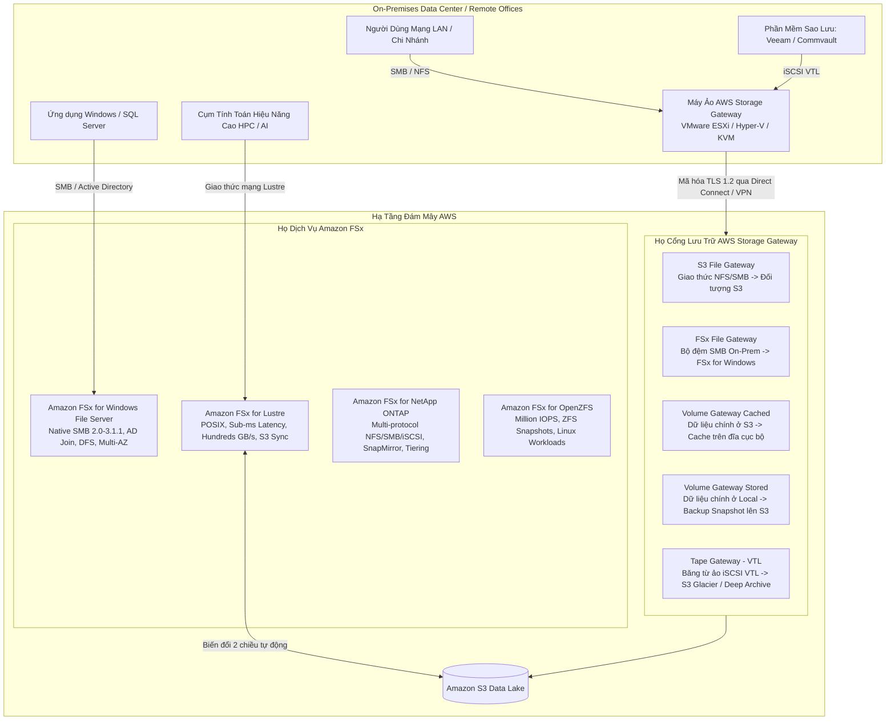
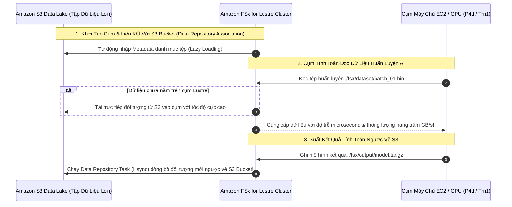
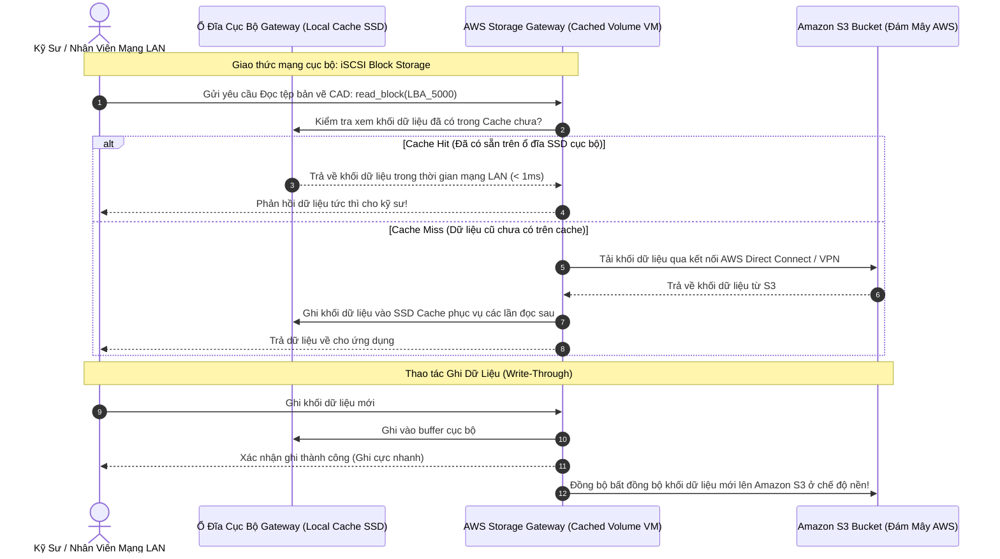

# Tài Liệu Học Tập Chuyên Sâu: Amazon FSx & AWS Storage Gateway (Hệ Thống Lưu Trữ Lai & Tệp Tin Chuyên Biệt Doanh Nghiệp)

> **Tài liệu chuẩn hóa kiến trúc đám mây**: Hướng dẫn toàn diện theo tiêu chuẩn Principal Storage & Hybrid Cloud Solutions Architect (Cập nhật phiên bản kiến trúc mới nhất 2026).  
> **Ngôn ngữ**: Tiếng Việt chuyên ngành (Bảo lưu 100% thuật ngữ chuyên ngành tiếng Anh chuẩn AWS).  
> **Mục tiêu**: Phục vụ thi chứng chỉ cấp độ Professional/Specialty (**SAA-C03, SAP-C02, Storage Specialty**) và thiết kế kiến trúc lưu trữ lai (**Hybrid Cloud Storage**) cấp độ doanh nghiệp lớn.  
> **Các bài giảng liên quan**: Chương 16 (AWS Storage Extras: Snow Family, FSx, Storage Gateway) & Đề thi thực hành Udemy SAA-C03 (PT1, PT2, PT3, PT6).

---

## 1. Tổng Quan Dịch Vụ Lưu Trữ Lai & Chuyên Biệt (Service Overview)

### 1. Phân vai kiến trúc giữa Amazon FSx và AWS Storage Gateway

Khi các doanh nghiệp di chuyển hoặc mở rộng hạ tầng từ On-Premises lên đám mây, họ thường gặp phải 2 thách thức lưu trữ lớn:
1. **Ứng dụng kế thừa đòi hỏi hệ thống tệp tin chuyên biệt (Enterprise Native File Systems)**: Các ứng dụng Windows yêu cầu giao thức **SMB**, phân quyền **NTFS ACLs** và gia nhập miền **Microsoft Active Directory**; hoặc các tác vụ khoa học máy tính đòi hỏi hiệu năng cực cao (**HPC**) chuẩn **POSIX** với băng thông hàng trăm GB/s. $\rightarrow$ **Amazon FSx** giải quyết trọn vẹn bài toán này bằng các cụm lưu trữ được quản lý hoàn toàn (**Fully Managed**).
2. **Cầu nối lưu trữ giữa Data Center tại chỗ và Đám mây (Hybrid Cloud Storage Gateway)**: Máy chủ On-Premises cần mở rộng dung lượng không giới hạn lên Amazon S3, hoặc cần một bộ đệm cục bộ (**Local Cache**) để truy cập dữ liệu đám mây với độ trễ mạng LAN dưới 1 mili-giây. $\rightarrow$ **AWS Storage Gateway** cung cấp cầu nối phần mềm ảo hóa chuẩn công nghiệp (**NFS, SMB, iSCSI, VTL**) kết nối trực tiếp vào AWS.



---

### 2. Bảng Phân Nhóm 4 Dòng Động Cơ Amazon FSx

| Động cơ Amazon FSx | Giao thức hỗ trợ | Hệ điều hành & Tích hợp | Đặc điểm hiệu năng | Kịch bản sử dụng tối ưu trong đề thi |
| :--- | :--- | :--- | :--- | :--- |
| **FSx for Windows File Server** | **SMB (2.0 đến 3.1.1)** | Windows, Linux, macOS.<br>Tích hợp trực tiếp **Microsoft Active Directory**. | Lên tới hàng chục GB/s, hàng trăm nghìn IOPS.<br>Tùy chọn ổ **SSD hoặc HDD**. | **(U-PT1 Q64, U-PT2 Q10, U-PT2 Q61)**: Di chuyển chia sẻ file Windows, ứng dụng ERP/kế toán, Microsoft SQL Server AlwaysOn, chia sẻ DFS Namespaces. |
| **FSx for Lustre** | **POSIX-compliant** Lustre client | Linux (Amazon Linux, Red Hat, CentOS, Ubuntu). | **Hàng trăm GB/s**, **hàng triệu IOPS**, độ trễ **dưới 1 mili-giây** (**Sub-millisecond**). | **(U-PT1 Q40)**: Điện toán hiệu năng cao (**HPC**), EDA, máy học AI/ML, mô phỏng tài chính, xử lý video; **Liên kết trực tiếp 2 chiều với Amazon S3**. |
| **FSx for NetApp ONTAP** | **NFS, SMB, iSCSI** (Đa giao thức) | Mọi hệ điều hành. | Sub-millisecond. Hỗ trợ tính năng nén (**Compression**), khử trùng lặp (**Deduplication**). | **(U-PT3 Q18)**: Doanh nghiệp đang dùng thiết bị phần cứng lưu trữ NetApp On-Premises, muốn giữ nguyên quy trình sao chép **SnapMirror/SnapVault** khi chuyển lên AWS. |
| **FSx for OpenZFS** | **NFS (v3, v4, v4.1, v4.2)** | Linux, Unix. | Lên tới 1 triệu IOPS, độ trễ 100 microsecond (NVMe cache). | Di chuyển các máy chủ tệp ZFS từ On-Premises lên AWS mà không cần sửa đổi ứng dụng. |

---

### 3. Bảng Phân Nhóm Các Loại Cổng AWS Storage Gateway

| Loại Storage Gateway | Giao thức phía On-Premises | Cơ chế lưu trữ phía AWS | Trường hợp sử dụng tối ưu trong đề thi |
| :--- | :--- | :--- | :--- |
| **Amazon S3 File Gateway** | **NFS (v3, v4.1)** & **SMB (2.0, 3.0)** | Lưu trữ trực tiếp dưới dạng **S3 Objects** (1 file = 1 object trong S3 bucket). Có local cache. | **(U-PT1 Q21, U-PT3 Q57)**: Cung cấp giao thức chia sẻ tệp NFS/SMB cho ứng dụng tại chỗ ghi trực tiếp vào S3 Data Lake; tích hợp S3 Lifecycle. |
| **Amazon FSx File Gateway** | **SMB (v2, v3)** | Đóng vai trò là **Bộ đệm tệp cục bộ (Local Cache)** cho **FSx for Windows File Server**. | Chi nhánh văn phòng ở xa cần truy cập hệ thống tệp FSx for Windows trên AWS với độ trễ mạng LAN mà không tốn băng thông đường truyền. |
| **Volume Gateway - Cached Volumes** | **iSCSI Block Storage** | **Dữ liệu chính lưu trên Amazon S3**; chỉ lưu dữ liệu thường xuyên đọc (**Frequently Accessed**) trên ổ đĩa cục bộ. | **(U-PT3 Q60)**: Mở rộng dung lượng lưu trữ cục bộ với chi phí thấp; giải phóng ổ cứng SAN/NAS đắt đỏ tại chỗ. |
| **Volume Gateway - Stored Volumes** | **iSCSI Block Storage** | **Toàn bộ dữ liệu chính lưu trên ổ đĩa cục bộ (On-Prem)**; tự động sao lưu bất đồng bộ định kỳ thành **EBS Snapshots** trên S3. | Yêu cầu toàn bộ dữ liệu phải nằm tại chỗ để đạt độ trễ cực thấp; cần cơ chế sao lưu dự phòng thảm họa (DR) lên AWS với RPO thấp. |
| **Tape Gateway (VTL)** | **iSCSI VTL** (Virtual Tape Library) | Giả lập thư viện băng từ ảo; lưu trữ trên **S3 Glacier Flexible** và **S3 Glacier Deep Archive**. | Thay thế toàn bộ hệ thống băng từ vật lý tốn kém; tích hợp trực tiếp với phần mềm sao lưu doanh nghiệp sẵn có (Veeam, Backup Exec). |

---

## 2. Đi Sâu Kiến Trúc Amazon FSx

### 2.1. Amazon FSx for Windows File Server: Các Tính Năng Doanh Nghiệp

```mermaid
flowchart LR
    subgraph MultiAZ[Amazon FSx for Windows - Multi-AZ Architecture]
        direction LR
        Primary[Active File Server\nAvailability Zone A] <-->|Đồng bộ dữ liệu cấp khối liên tục (Sync Replication)| Standby[Standby File Server\nAvailability Zone B]
        Primary -.->|Lưu trữ| StorageA[(Shared SSD / HDD Storage)]
        Standby -.->|Lưu trữ| StorageB[(Shared SSD / HDD Storage)]
    end

    AD[Microsoft Active Directory\n(AWS Managed AD hoặc On-Premises AD)] -->|Xác thực Kerberos / NTLM| MultiAZ
    Client[Máy chủ Windows / EC2 / On-Prem] -->|Truy cập qua SMB| Primary
    Primary -->|Tự động Failover < 30s khi AZ lỗi| Standby
```

1. **Khả dụng cao Multi-AZ với tính năng tự động chuyển đổi dự phòng (Automatic Failover)**:
   - Triển khai Active-Standby trên 2 Availability Zones khác nhau.
   - Tự động đồng bộ dữ liệu liên tục ở cấp độ khối (**Block-level synchronous replication**).
   - Khi AZ chính gặp sự cố, hệ thống tự động chuyển sang AZ phụ trong vòng dưới 30 giây mà **không làm đứt phiên làm việc của người dùng hay ứng dụng**.
2. **Hệ Thống Tệp Phân Tán (DFS Namespaces & DFS Replication)**:
   - Cho phép gom nhiều hệ thống tệp FSx for Windows khác nhau lại dưới một đường dẫn thư mục chia sẻ duy nhất (ví dụ: `\\corp.company.com\shares`).
   - Hỗ trợ lưu trữ hàng chục Petabytes dữ liệu tệp tin Windows phân tán.
3. **Tùy Chọn Ổ Đĩa SSD vs HDD (Tối Ưu Chi Phí)**:
   - **Ổ SSD**: Dành cho tác vụ nhạy cảm về độ trễ, I/O ngẫu nhiên cao (Cơ sở dữ liệu SQL Server, phân tích dữ liệu, ứng dụng ERP).
   - **Ổ HDD**: Dành cho tác vụ lưu trữ tài liệu văn phòng, thư mục người dùng cá nhân (Home directories), sao lưu dữ liệu với chi phí cực rẻ (tiết kiệm tới 70% so với SSD).
4. **Khử Trùng Lặp Dữ Liệu (Data Deduplication)**:
   - Tự động phát hiện và loại bỏ các phần dữ liệu trùng lặp trên ổ đĩa.
   - Thường giúp tiết kiệm từ **50% đến 60% dung lượng lưu trữ** thực tế đối với các thư mục chia sẻ tài liệu văn phòng hoặc hình ảnh hệ điều hành!

---

### 2.2. Amazon FSx for Lustre: Động Cơ Tốc Độ Cho AI, ML & HPC



* **Hai Chế Độ Triển Khai (Deployment Types)**:
  - **Scratch File System**: Thiết kế cho các tác vụ xử lý tạm thời, ngắn hạn. Dữ liệu không được nhân bản qua máy chủ khác trong cụm (nếu máy chủ vật lý lỗi, dữ liệu tạm thời bị mất). **Chi phí rẻ nhất, hiệu năng cao nhất**.
  - **Persistent File System**: Thiết kế cho các tác vụ tính toán dài hạn. Dữ liệu được nhân bản tự động trong cùng 1 Availability Zone; nếu máy chủ lỗi sẽ tự động thay thế mà không mất dữ liệu.

---

## 3. Kiến Trúc Thực Tế và Luồng Vận Hành (Production Architecture & Workflow)

### Kịch Bản: Mở Rộng Dung Lượng Tệp Cục Bộ Bằng Storage Gateway Cached Volume



---

## 4. Bảng Tích Hợp với Các Dịch Vụ AWS Khác (Integration Table)

| Dịch vụ liên kết | Phương thức tích hợp | Mục đích kỹ thuật & Kịch bản thực tế |
| :--- | :--- | :--- |
| **Amazon S3** | Data Repository Association (FSx for Lustre) | Đọc trực tiếp tập dữ liệu khổng lồ từ S3 vào cụm tính toán HPC và tự động ghi ngược kết quả ra S3. |
| **AWS Directory Service** | Microsoft Active Directory Domain Join | Cho phép FSx for Windows và Storage Gateway xác thực người dùng doanh nghiệp qua Kerberos và quản lý quyền tệp bằng Windows ACLs. |
| **AWS DataSync** | DataSync Task | **(U-PT3 Q62)**: Tự động di chuyển hàng chục Terabytes tệp tin từ hệ thống NAS On-Premises lên FSx hoặc EFS với tốc độ tăng tốc mạng gấp 10 lần. |
| **AWS Backup** | Centralized Backup Plan | Quản lý lịch trình chụp snapshot tự động, thiết lập chính sách lưu giữ và khóa bản sao lưu (**Vault Lock Compliance**) cho toàn bộ hệ thống tệp FSx. |
| **AWS Direct Connect / VPN** | Hybrid Network Link | Cung cấp đường truyền riêng tư, băng thông cao, độ trễ thấp để các máy ảo Storage Gateway tại chỗ giao tiếp với hạ tầng lưu trữ AWS. |

---

## 5. FinOps & Chiến Lược Tối Ưu Chi Phí (Cost Optimization)

### 1. Phép tính so sánh: FSx for Windows Ổ SSD vs Ổ HDD kết hợp Data Deduplication
* **Tình huống thực tế**:
  Một doanh nghiệp cần lưu trữ **50 TB** tài liệu chia sẻ văn phòng và thư mục cá nhân người dùng (Home directories). Tốc độ truy cập trung bình, dữ liệu có mức độ trùng lặp cao (nhiều bản sao tài liệu giống nhau).
* **Phương án 1: Cấp phát ổ SSD không bật tính năng khử trùng lặp**:
  - Đơn giá lưu trữ SSD: $\sim 0.13\$/\text{GB/tháng}$.
  - Chi phí lưu trữ = $50,000 \text{ GB} \times 0.13\$ = \mathbf{6,500.00\$/\text{tháng}}$.
* **Phương án 2: Chuyển sang ổ HDD kết hợp bật Data Deduplication (Tỷ lệ tiết kiệm 50%)**:
  - Dung lượng thực tế sau khử trùng lặp: $50 \text{ TB} \times 50\% = \mathbf{25 \text{ TB}}$.
  - Đơn giá lưu trữ HDD: $\sim 0.025\$/\text{GB/tháng}$.
  - Chi phí lưu trữ HDD = $25,000 \text{ GB} \times 0.025\$ = \mathbf{625.00\$/\text{tháng}}$.
  - Cấp phát thêm một lượng nhỏ bộ đệm SSD Cache để tăng tốc: $\sim 100\$/\text{tháng}$.
  - 👉 **Tổng chi phí mới $\approx 725.00\$/\text{tháng}$ (Tiết kiệm gần 89% ngân sách hàng tháng)!**

---

## 6. Khắc Phục Sự Cố Thực Tế (Troubleshooting Guide)

| Tình huống sự cố | Nguyên nhân cốt lõi | Phương pháp điều tra | Giải pháp xử lý |
| :--- | :--- | :--- | :--- |
| **Storage Gateway File Gateway báo lỗi không thể upload tệp lên S3** | 1. IAM Role của Gateway thiếu quyền `s3:PutObject`.<br>2. S3 Bucket bật mã hóa KMS nhưng Gateway không có quyền `kms:GenerateDataKey`. | Kiểm tra CloudWatch Logs của Storage Gateway và CloudTrail Event `PutObject` tìm lỗi `AccessDenied`. | 1. Cập nhật IAM Role gắn trên Gateway cấp quyền đầy đủ trên Bucket ARN.<br>2. Cấp quyền `kms:Decrypt` và `kms:GenerateDataKey` trên KMS Key Policy. |
| **Người dùng mạng LAN truy cập Storage Gateway bị chậm bất thường** | Dung lượng bộ nhớ đệm cục bộ (**Local Cache Disk**) bị đầy, dẫn đến tỷ lệ **Cache Miss** cao (Gateway phải liên tục tải dữ liệu từ S3 qua mạng Internet). | Kiểm tra metric CloudWatch `CachePercentDirty` và `CachePercentUsed`. | Tăng thêm ổ đĩa cứng SSD vật lý làm Local Cache cho máy ảo Storage Gateway tại chỗ. |
| **Không thể gia nhập (Join) FSx for Windows vào Active Directory** | Cấu hình sai DNS IP trong VPC DHCP Option Sets hoặc Security Group chặn các cổng Kerberos/LDAP (Port 53, 88, 389, 445). | Kiểm tra nhật ký tạo hệ thống tệp trong AWS Console; kiểm tra kết nối mạng từ VPC tới máy chủ Domain Controller (DC). | 1. Mở các cổng cần thiết trên Security Group của FSx và máy chủ Active Directory.<br>2. Đảm bảo VPC Route Table có đường truyền tới Domain Controllers. |

---

## 🏛️ I. Các Kịch Bản Kiến Trúc Chuẩn (Best Practice Scenarios)

#### 1. Di Chuyển Hệ Thống Chia Sẻ Tệp Tin Windows Doanh Nghiệp Không Sửa Ứng Dụng — (U-PT1 Q64, U-PT2 Q10, U-PT2 Q61)
- **Tình huống thi**: Doanh nghiệp vận hành cụm máy chủ chia sẻ tệp Windows Server tại chỗ, phục vụ ứng dụng chỉnh sửa video và phần mềm kế toán ERP. Hệ thống sử dụng giao thức SMB, phân quyền thư mục theo NTFS ACLs, tích hợp Active Directory và dùng kiến trúc **DFS Namespaces**. Doanh nghiệp muốn di chuyển lên AWS với yêu cầu giữ nguyên toàn bộ kiến trúc phân quyền và đường dẫn mạng của người dùng.
- **Giải pháp tối ưu chuẩn AWS**:
  - Triển khai **Amazon FSx for Windows File Server (Multi-AZ Deployment)**.
  - Gia nhập hệ thống tệp FSx trực tiếp vào **Microsoft Active Directory** hiện có của doanh nghiệp (qua AWS Managed AD hoặc AD Connector).
  - Cấu hình **DFS Namespaces** để nhóm các hệ thống tệp FSx lại dưới cùng một đường dẫn chia sẻ mạng quen thuộc.
  - Bật tính năng **Data Deduplication** và **Shadow Copies** để tự phục hồi tệp bị ghi đè.

#### 2. Xử Lý Tác Vụ Tính Toán Hiệu Năng Cao HPC & Máy Học AI Đọc Trực Tiếp Từ S3 — (U-PT1 Q40)
- **Tình huống thi**: Viện nghiên cứu công nghệ sinh học cần xử lý hàng triệu mẫu giải mã gen. Toàn bộ tập dữ liệu thô hàng trăm Terabytes nằm trong Amazon S3. Cụm máy chủ tính toán EC2 GPU chạy hệ điều hành Linux yêu cầu hệ thống tệp tin chuẩn POSIX có khả năng đọc/ghi với độ trễ dưới 1 mili-giây và băng thông hàng trăm GB/s.
- **Giải pháp tối ưu**:
  - Khởi chạy một cụm **Amazon FSx for Lustre (Scratch hoặc Persistent File System)**.
  - Thiết lập liên kết **Data Repository Association** trỏ trực tiếp vào S3 Bucket chứa dữ liệu gen.
  - FSx for Lustre tự động nạp dữ liệu từ S3 vào cụm tính toán khi có yêu cầu (Lazy loading), cho phép cụm GPU đọc dữ liệu với băng thông cực đại.
  - Sau khi xử lý xong, chạy tác vụ xuất dữ liệu kết quả ngược trở lại S3 và tắt cụm Lustre để tiết kiệm chi phí!

#### 3. Cung Cấp Bộ Đệm Cục Bộ Cho Văn Phòng Chi Nhánh Truy Cập Đám Mây — (U-PT1 Q21, U-PT3 Q57, U-PT3 Q60)
- **Tình huống thi**: Công ty có các chi nhánh văn phòng làm việc từ xa. Nhân viên cần lưu trữ các tệp thiết kế dung lượng lớn. Doanh nghiệp muốn toàn bộ dữ liệu chính được lưu an toàn trên Amazon S3 để tận dụng chính sách vòng đời lưu trữ (Lifecycle Rules), nhưng nhân viên tại chi nhánh phải mở tệp với tốc độ mạng LAN nhanh chóng mà không bị ảnh hưởng bởi độ trễ Internet.
- **Giải pháp tối ưu**:
  - Cài đặt một máy ảo **AWS Storage Gateway (S3 File Gateway)** ngay trên hạ tầng VMware/Hyper-V tại văn phòng chi nhánh.
  - Cấp phát ổ đĩa SSD cục bộ cho máy ảo làm **Local Cache**.
  - Chia sẻ thư mục qua giao thức **SMB/NFS** cho máy tính của nhân viên.
  - Tệp thường xuyên sử dụng sẽ được đọc trực tiếp từ Local Cache SSD với độ trễ mili-giây. Dữ liệu mới được tự động đồng bộ bất đồng bộ lên Amazon S3 ở chế độ nền.

---

## 🪤 II. Các Bẫy Thi Tinh Vi & Phân Tích Phương Án Sai (Exam Traps & Distractors)

#### 🪤 Bẫy 1: Chọn Hệ Thống Tệp Cho Ứng Dụng Windows: Amazon EFS vs Amazon FSx for Windows — (U-PT2 Q10, U-PT3 Q04)
- **Tình huống đề thi**: *"Ứng dụng doanh nghiệp chạy trên máy chủ Windows Server yêu cầu hệ thống tệp tin dùng chung qua giao thức SMB, hỗ trợ phân quyền NTFS và tích hợp Microsoft Active Directory."*
- **Phương án bẫy**:
  - ❌ *Chọn Amazon EFS (Elastic File System)*: Sai lầm nghiêm trọng! Amazon EFS là hệ thống tệp **chỉ hỗ trợ giao thức Linux NFS (NFSv4)**; EFS không hỗ trợ giao thức SMB bản địa và không tích hợp được với Active Directory của Windows!
- **Giải pháp ĐÚNG**: Chọn **Amazon FSx for Windows File Server**.

#### 🪤 Bẫy 2: Phân Biệt Giữa Volume Gateway Cached Volumes và Stored Volumes — (U-PT3 Q60)
- **Tình huống đề thi**: *"Doanh nghiệp tại chỗ có dung lượng ổ cứng hạn chế, muốn mở rộng không gian lưu trữ chi phí thấp lên đám mây mà người dùng vẫn truy cập các tệp hay dùng với tốc độ mạng LAN."*
- **Phương án bẫy**:
  - ❌ *Chọn Volume Gateway Stored Volumes*: Sai vì Stored Volumes bắt buộc phải có đủ dung lượng ổ cứng tại chỗ để lưu **100% dữ liệu chính**, không giải quyết được bài toán thiếu ổ cứng tại chỗ!
- **Giải pháp ĐÚNG**: Chọn **Volume Gateway Cached Volumes**.
  - Dữ liệu chính nằm hoàn toàn trên Amazon S3. Ổ đĩa cục bộ chỉ lưu phần dữ liệu thường xuyên truy cập (**Frequently accessed cache**), giúp mở rộng dung lượng không giới hạn mà không cần mua thêm ổ đĩa SAN/NAS đắt đỏ!

#### 🪤 Bẫy 3: Thay Thế Băng Từ Vật Lý: Snowball vs Tape Gateway — (U-PT3 Q57)
- **Tình huống đề thi**: *"Doanh nghiệp muốn bãi bỏ hệ thống sao lưu băng từ vật lý (Physical Tape Library) tốn kém và cồng kềnh, nhưng muốn tiếp tục sử dụng phần mềm sao lưu doanh nghiệp sẵn có (như Veeam) để lưu trữ lâu dài trên S3 Glacier Deep Archive."*
- **Phương án bẫy**:
  - ❌ *Dùng AWS Snowball Edge gửi hàng tháng*: Tốn kém chi phí vận chuyển, quy trình thủ công và không tự động hóa được theo lịch trình của phần mềm sao lưu.
- **Giải pháp ĐÚNG**: Triển khai **AWS Storage Gateway - Tape Gateway (VTL)**.
  - Tape Gateway cung cấp giao diện băng từ ảo iSCSI VTL, tương thích 100% với các phần mềm sao lưu hiện có mà không cần thay đổi quy trình vận hành của kỹ sư.

---

## 📊 III. Ma Trận Quyết Định Công Nghệ Lưu Trữ Nhanh (Exam Decision Matrix)

| Tình huống / Yêu cầu trong đề thi | Giải pháp chuẩn AWS | Giải pháp bị loại & Lý do |
|:---|:---|:---|
| **Chia sẻ tệp cho Windows, giao thức SMB, Microsoft Active Directory** | **Amazon FSx for Windows File Server** | Amazon EFS (chỉ hỗ trợ Linux NFS) |
| **Tính toán HPC, Machine Learning, kết nối S3 hai chiều, sub-millisecond** | **Amazon FSx for Lustre** | Amazon EFS (băng thông và IOPS thấp hơn Lustre) |
| **Di chuyển thiết bị lưu trữ NetApp tại chỗ lên AWS giữ nguyên SnapMirror** | **Amazon FSx for NetApp ONTAP** | FSx for Windows (không hỗ trợ tính năng NetApp ONTAP) |
| **Ứng dụng On-Premises cần ghi dữ liệu trực tiếp vào S3 qua NFS/SMB** | **AWS Storage Gateway - S3 File Gateway** | Volume Gateway (chỉ hỗ trợ giao thức khối iSCSI) |
| **Bộ đệm tệp cục bộ cho FSx for Windows tại chi nhánh văn phòng** | **Amazon FSx File Gateway** | S3 File Gateway (không tối ưu hóa cho FSx Windows) |
| **Mở rộng dung lượng lưu trữ cục bộ giá rẻ, dữ liệu chính nằm trên S3** | **Storage Gateway - Cached Volumes** | Stored Volumes (yêu cầu toàn bộ dữ liệu nằm ở local) |
| **Dữ liệu chính bắt buộc nằm ở local, chỉ backup snapshot định kỳ lên S3** | **Storage Gateway - Stored Volumes** | Cached Volumes (dữ liệu chính nằm trên S3) |
| **Thay thế băng từ vật lý, giữ nguyên phần mềm sao lưu Veeam/Commvault** | **AWS Storage Gateway - Tape Gateway (VTL)** | AWS DataSync (không hỗ trợ giao diện băng từ iSCSI VTL) |
| **Di chuyển nhanh hàng chục TB tệp từ NAS tại chỗ lên AWS EFS/FSx** | **AWS DataSync** | Chạy lệnh rsync thủ công (chậm gấp 10 lần, không tối ưu) |

---

## 7. Tóm Tắt và Danh Mục Kiểm Tra Kiến Thức (Summary & Learning Checklist)

### 7 Nguyên Tắc Kiến Trúc "Sống Còn" Của FSx & Storage Gateway
1. **Windows SMB là đất diễn của FSx for Windows**: Cứ thấy đề bài nhắc đến *Windows*, *SMB*, *Active Directory*, *NTFS*, *DFS* $\rightarrow$ Lập tức chọn FSx for Windows File Server (Không bao giờ chọn EFS!).
2. **Lustre sinh ra cho HPC và S3 Data Lake**: Cứ thấy *HPC*, *Machine Learning*, *Sub-millisecond*, *High Throughput (GB/s)*, *S3 integration* $\rightarrow$ Chọn FSx for Lustre.
3. **NetApp ONTAP cho khách hàng NetApp lâu năm**: Cứ thấy nhắc đến các tính năng đặc thù của NetApp như *SnapMirror*, *SnapVault*, *Multi-protocol (NFS/SMB/iSCSI)* $\rightarrow$ Chọn FSx for NetApp ONTAP.
4. **S3 File Gateway cho tệp, Volume Gateway cho khối đĩa iSCSI**: Nhớ quy tắc: Ứng dụng cần nhìn thấy file trên S3 $\rightarrow$ File Gateway. Ứng dụng cần ổ đĩa iSCSI $\rightarrow$ Volume Gateway.
5. **Cached Volume để tiết kiệm đĩa, Stored Volume để ưu tiên tốc độ local**: Đề bài bảo ổ đĩa On-Premises sắp đầy $\rightarrow$ Chọn Cached Volumes. Đề bài bảo cần lưu toàn bộ tại chỗ với độ trễ siêu thấp $\rightarrow$ Chọn Stored Volumes.
6. **Tape Gateway cứu cánh cho sao lưu lâu dài**: Muốn bãi bỏ kho lưu trữ băng từ vật lý mà không muốn vứt bỏ phần mềm sao lưu cũ $\rightarrow$ Chọn Tape Gateway.
7. **FSx for Windows HDD + Deduplication siêu tiết kiệm**: Với dữ liệu văn phòng chia sẻ ít khi dùng, kết hợp ổ HDD với tính năng Data Deduplication giúp giảm tới gần 90% chi phí lưu trữ!

---

### Liên Kết Nội Bộ và Tài Liệu Tham Khảo (Internal Links)
- 📖 [Tài Liệu Chuyên Sâu: Amazon EBS & Amazon EFS](./EBS_EFS_Storage.md)
- 📖 [Tài Liệu Chuyên Sâu: Amazon S3 & CloudFront](./S3_and_CloudFront_Storage.md)
- 📖 [Tài Liệu Chuyên Sâu: Di Chuyển & Phục Hồi Thảm Họa (DR & Migration)](./Disaster_Recovery_Migration.md)
- 📖 [Cẩm Nang Từ Vựng Giải Mã Đề Thi](../EXAM_VOCABULARY.md)
- 📖 [Bảng Thuật Ngữ Kỹ Thuật Đám Mây](../GLOSSARY.md)

