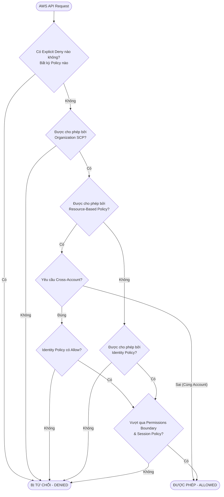
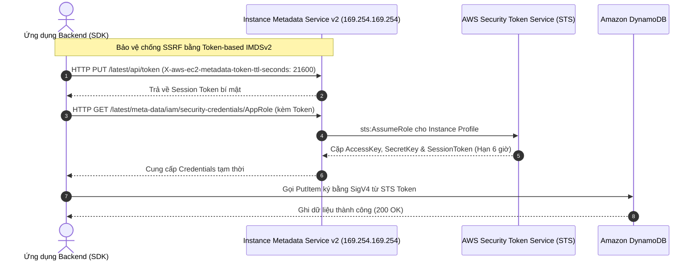
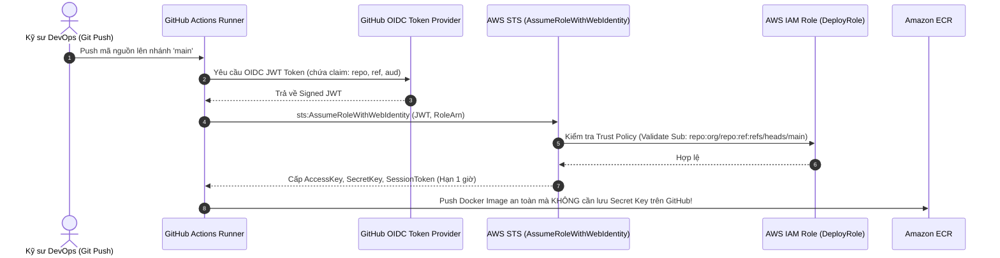

# Tài Liệu Học Tập Chuyên Sâu: AWS Identity and Access Management (IAM) & Quản Trị Định Danh Doanh Nghiệp

> **Tài liệu chuẩn hóa kiến trúc đám mây**: Hướng dẫn toàn diện theo tiêu chuẩn Senior AWS Solutions Architect & Cloud DevOps Engineer (cập nhật mới nhất 2026).  
> **Ngôn ngữ**: Tiếng Việt (Bảo lưu toàn bộ thuật ngữ chuyên ngành tiếng Anh chuẩn AWS).  
> **Các dịch vụ liên quan**: AWS IAM, AWS STS, AWS Organizations, AWS IAM Identity Center (AWS SSO), AWS Directory Service, AWS Control Tower, AWS IAM Access Analyzer.

---

## 6.1. Tổng Quan Dịch Vụ (Service Overview)

### Dịch vụ gì?
**AWS Identity and Access Management (IAM)** là dịch vụ nền tảng cung cấp khả năng kiểm soát truy cập an toàn, chi tiết tới toàn bộ tài nguyên trên đám mây AWS. IAM cho phép bạn quản lý **Ai** (Authentication - Xác thực) có quyền làm **Điều gì** trên **Tài nguyên nào** (Authorization - Phân quyền) và dưới **Điều kiện nào** (Context & Conditions).

### Các vấn đề giải quyết
1. **Loại bỏ thông tin xác thực tĩnh (Eliminate Static Credentials)**: Ngăn chặn nguy cơ rò rỉ Access Keys bằng cơ chế cấp quyền tạm thời tự động xoay vòng qua **AWS Security Token Service (STS)**.
2. **Kiểm soát quyền hạn chi tiết (Fine-grained Least Privilege)**: Cho phép giới hạn quyền theo từng API action cụ thể, gắn chặt với điều kiện thời gian, địa chỉ IP nguồn, yêu cầu MFA và thẻ định danh (Attribute-Based Access Control - ABAC).
3. **Quản trị đa tài khoản tập trung (Multi-account Governance)**: Kết hợp với AWS Organizations, Service Control Policies (SCPs), và AWS IAM Identity Center để kiểm soát hàng trăm tài khoản AWS từ một IdP trung tâm (Okta, Microsoft Entra ID, Google Workspace).
4. **Phân quyền tự động hóa cho Cloud Workloads**: Cấp quyền cho EC2, ECS tasks, EKS pods (EKS Pod Identity / IRSA), Lambda functions mà không bao giờ lưu trữ mật khẩu hay khóa trên ổ cứng.

### Phạm vi và tính chất đặc thù
- **Dịch vụ toàn cầu (Global Service)**: IAM là một dịch vụ mang tính toàn cầu (Endpoint: `iam.amazonaws.com`). Các đối tượng (Users, Roles, Policies) được định nghĩa và tự động đồng bộ hóa trên toàn bộ các Region trên thế giới.
- **Tính nhất quán sau cùng (Eventual Consistency)**: Thay đổi đối với IAM Policy hoặc Role có thể mất vài giây để truyền bá hoàn toàn tới tất cả các Region và điểm cuối API toàn cầu.
- **Miễn phí cốt lõi**: Bản thân dịch vụ IAM, AWS STS và IAM Identity Center không thu phí sử dụng.

---

## 6.2. Các Khái Niệm, Kiến Trúc & Vận Hành Cốt Lõi (Core Concepts, Security & Day-2 Operations)

### 1. Phân loại thực thể định danh (Identities)

```mermaid
classDiagram
    class RootAccount {
        +Email & Password
        +Full Administrative Control
        +Hardware MFA Protected
    }
    class IAMUser {
        +Username
        +Console Password
        +Access Key ID & Secret Access Key
    }
    class IAMGroup {
        +GroupName
        +Collection of Users
    }
    class IAMRole {
        +RoleName
        +TrustPolicy (AssumeRole)
        +Temporary Credentials (STS)
    }
    class IAMPolicy {
        +JSON Document
        +Version 2012-10-17
        +Statement (Effect, Action, Resource, Condition)
    }

    RootAccount --> IAMUser : Khởi tạo ban đầu
    IAMGroup o-- IAMUser : Tập hợp User
    IAMPolicy --o IAMUser : Gán trực tiếp (Không khuyến nghị)
    IAMPolicy --o IAMGroup : Gán theo nhóm chức năng
    IAMPolicy --o IAMRole : Quyền thực thi (Permissions)
    IAMRole <.. IAMUser : sts:AssumeRole
```

- **Root Account (Tài khoản gốc)**: Tài khoản tạo lập khi đăng ký AWS. Sở hữu quyền hạn tối cao không thể bị thu hồi bởi IAM Policy. **Nguyên tắc vàng**: Khóa tài khoản Root bằng Hardware MFA (FIDO2 WebAuthn), xóa toàn bộ Access Keys, không dùng cho công việc thường nhật.
- **IAM User (Người dùng IAM)**: Đại diện cho một con người hoặc dịch vụ ngoại vi cũ. Chứa thông tin đăng nhập dài hạn (Console Password và tối đa 2 bộ Access Keys). *Khuyến nghị 2026: Hạn chế tối đa tạo IAM User cho nhân viên, thay thế bằng IAM Identity Center*.
- **IAM User Group (Nhóm người dùng)**: Tập hợp các IAM User có chung nhiệm vụ (`DevOps`, `SecOps`, `Billing`). Nhóm **không** phải là một Principal (không thể được gán vào Resource-based policy) và không thể lồng (nest) Group trong Group.
- **IAM Role (Vai trò IAM)**: Thực thể không sở hữu mật khẩu hay Access Key dài hạn. Role bao gồm 2 chính sách:
  - **Trust Policy (AssumeRolePolicyDocument)**: Quy định *Ai* được phép đảm nhận Role này (EC2, Lambda, tài khoản ngoài, OIDC provider).
  - **Permissions Policy**: Quy định *Role được làm gì* sau khi đã mượn vai trò.

### 2. Cấu trúc IAM Policy JSON chuẩn

```json
{
  "Version": "2012-10-17",
  "Statement": [
    {
      "Sid": "EnforceTLSAndIPRestriction",
      "Effect": "Deny",
      "Action": "s3:*",
      "Resource": [
        "arn:aws:s3:::production-financial-records",
        "arn:aws:s3:::production-financial-records/*"
      ],
      "Condition": {
        "Bool": {
          "aws:SecureTransport": "false"
        }
      }
    },
    {
      "Sid": "AllowS3ReadWithMFA",
      "Effect": "Allow",
      "Action": [
        "s3:GetObject",
        "s3:ListBucket"
      ],
      "Resource": [
        "arn:aws:s3:::production-financial-records",
        "arn:aws:s3:::production-financial-records/*"
      ],
      "Condition": {
        "Bool": {
          "aws:MultiFactorAuthPresent": "true"
        },
        "IpAddress": {
          "aws:SourceIp": "198.51.100.0/24"
        }
      }
    }
  ]
}
```

*Các phần tử cấu thành*:
- **Version**: Bắt buộc phải là `"2012-10-17"`.
- **Effect**: `"Allow"` hoặc `"Deny"`.
- **Action**: Danh sách API calls (ví dụ: `s3:GetObject`, `ec2:DescribeInstances`).
- **Resource**: ARN cụ thể của đối tượng chịu ảnh hưởng.
- **Condition**: Ràng buộc ngữ cảnh thực thi:
  - `aws:PrincipalTag/Department`: Phân quyền dựa trên thẻ thuộc tính (ABAC).
  - `aws:SecureTransport`: Bắt buộc mã hóa truyền thông qua HTTPS.
  - `aws:SourceIp` / `aws:SourceVpc`: Ràng buộc nguồn IP mạng hoặc ID của VPC.
  - `aws:RequestedRegion`: Giới hạn Region được phép thao tác.

### 3. Logic Đánh Giá Quyết Định Phân Quyền (Policy Evaluation Logic)

AWS áp dụng quy tắc 5 bước nghiêm ngặt theo mô hình "Từ chối ngầm định" (Default Deny):



1. **Default Deny**: Mọi yêu cầu ban đầu đều bị từ chối ngầm định.
2. **Explicit Deny luôn chiến thắng**: Nếu có bất kỳ câu lệnh `"Effect": "Deny"` nào khớp với request, yêu cầu bị từ chối ngay lập tức bất chấp bao nhiêu câu lệnh `"Allow"`.
3. **Service Control Policies (SCPs)**: Trong AWS Organizations, SCP quy định ranh giới tối đa cho tài khoản con. Nếu SCP không cho phép, request bị chặn.
4. **Permissions Boundary & Session Policies**: Hoạt động như bộ lọc giao (Intersection Filter) – request phải đồng thời nằm trong phạm vi cho phép của Identity Policy VÀ Permissions Boundary.
5. **Cross-Account Requirement**: Nếu truy cập tài nguyên xuyên tài khoản (Cross-Account), BẮT BUỘC cả hai bên (Identity Policy ở Account A VÀ Trust/Resource-Policy ở Account B) đều phải có Explicit Allow.

### 4. RBAC vs. ABAC (Role-Based vs Attribute-Based Access Control)
- **RBAC**: Tạo Policy riêng cho từng Role/Nhóm chức năng. Nhược điểm: Bùng nổ số lượng policy (Policy Explosion) khi quy mô nhân sự và phòng ban mở rộng.
- **ABAC**: Sử dụng Tag (`aws:PrincipalTag/CostCenter` = `aws:ResourceTag/CostCenter`). Ưu điểm: Chỉ cần một Policy duy nhất cho toàn công ty; khi nhân viên đổi phòng ban hoặc tạo thêm dự án mới, chỉ cần cập nhật thẻ Tag mà không phải viết lại IAM Policy.

### 5. Phòng Chống Lỗ Hổng Confused Deputy bằng `sts:ExternalId`
Khi bạn cấp quyền cho một dịch vụ SaaS bên thứ 3 quản lý tài nguyên AWS của mình qua IAM Role:
- Kẻ xấu có thể đăng ký dịch vụ đó và lừa dịch vụ này sử dụng Role của bạn để truy cập trái phép dữ liệu của bạn (**Confused Deputy**).
- **Giải pháp**: Bắt buộc cấu hình `sts:ExternalId` trong Trust Policy Condition. Dịch vụ SaaS chỉ có thể AssumeRole thành công khi gửi kèm chuỗi External ID bí mật duy nhất chỉ có bạn và nhà cung cấp SaaS biết.

---

### 🏛️ I. Các Kịch Bản Kiến Trúc Chuẩn (Best Practice Scenarios)

#### 1. Kiểm Soát Quyền Ủy Quyền Bằng Permissions Boundaries (Privilege Escalation Prevention)
- **Tình huống thi**: Doanh nghiệp cho phép các Senior Developers tự tạo IAM Role và IAM Policy cho ứng dụng của họ, nhưng phải đảm bảo các developer này không thể tự cấp cho mình hoặc tài nguyên của mình quyền AdministratorAccess để xóa database hoặc sửa đổi hạ tầng bảo mật.
- **Giải pháp tối ưu chuẩn AWS**:
  - Thiết lập **Permissions Boundary** (Ranh giới quyền hạn) gán cố định cho các IAM Entity do developer tạo ra.
  - **Nguyên lý hoạt động**: Quyền hạn thực tế của một Principal luôn là **giao điểm (Intersection)** giữa Policy được gắn và Permissions Boundary:
    $$\text{Quyền hạn thực tế} = \text{Identity-based Policy} \cap \text{Permissions Boundary}$$
  - Dù developer có cố tình gắn policy `AdministratorAccess` (`*.*`), quyền thực thi tối đa vẫn bị chặn lại ở ranh giới do Permissions Boundary quy định.

#### 2. Phân Quyền Tinh Gọn Cấp Độ Pod Trong Amazon EKS Bằng IRSA
- **Tình huống thi**: Cụm Amazon EKS chạy nhiều microservices trên các EC2 worker nodes. Dịch vụ UI chỉ được đọc DynamoDB, dịch vụ Xử lý dữ liệu chỉ được ghi vào S3. Yêu cầu tuân thủ nguyên tắc đặc quyền tối thiểu (Least Privilege).
- **Giải pháp chuẩn**:
  - Không bao giờ gán quyền DynamoDB và S3 lên EC2 Instance Profile của Node (Anti-pattern vì toàn bộ Pods trên Node sẽ thừa hưởng chung quyền hạn).
  - Sử dụng **IAM Roles for Service Accounts (IRSA)**:
    - Tạo các Kubernetes Service Accounts riêng biệt cho từng Pod service.
    - Cấu hình OIDC Identity Provider giữa cụm EKS và AWS IAM.
    - Gán IAM Role với chính sách tối thiểu trực tiếp cho Service Account tương ứng qua annotation `eks.amazonaws.com/role-arn`.

#### 3. Quản Trị Đa Tài Khoản Doanh Nghiệp Với AWS Control Tower & Account Factory
- **Tình huống thi**: Doanh nghiệp có nhiều nhóm phát triển cần các tài khoản AWS riêng biệt. Nhóm bảo mật yêu cầu tự động áp dụng bộ quy tắc kiểm soát chuẩn mực (baseline guardrails) và kiểm toán tập trung cho mọi tài khoản mới ngay tại thời điểm tạo.
- **Giải pháp chuẩn**:
  - Kích hoạt **AWS Organizations** và thiết lập **AWS Control Tower Landing Zone**.
  - Bật **CloudTrail Organizational Trail** tại Management Account để tự động thu thập log kiểm toán toàn bộ các tài khoản thành viên.
  - Tạo tài khoản mới thông qua **Account Factory**: Tự động áp dụng các Preventive Guardrails (bằng Service Control Policies - SCPs) và Detective Guardrails (bằng AWS Config Managed Rules).

---

### 🪤 II. Các Bẫy Thi Tinh Vi & Phân Tích Phương Án Sai (Exam Traps & Distractors)

#### 🪤 Bẫy 1: Giới Hạn Truy Cập S3 Cho Thành Viên Organization Bằng `aws:PrincipalOrgID` — (CM-PT1 Q09)
- **Tình huống đề thi**: *"Doanh nghiệp có hàng chục tài khoản AWS thuộc cùng một AWS Organization. Họ muốn chia sẻ một S3 bucket trung tâm cho toàn bộ nhân viên nội bộ, nhưng phải ngăn chặn triệt để mọi truy cập từ bên ngoài tổ chức."*
- **Các phương án bẫy**:
  - ❌ *Liệt kê thủ công từng Account ID trong Bucket Policy*: Tốn công vận hành và dễ bỏ sót khi tổ chức tạo thêm tài khoản mới.
  - ❌ *Dùng Service Control Policy (SCP)*: SCP chỉ áp dụng từ trên xuống dưới cho các tài khoản thành viên trong Org; SCP **không thể** kiểm soát hành vi truy cập của người dùng bên ngoài vào bucket của bạn!
- **Giải pháp ĐÚNG**: Sử dụng S3 Bucket Policy kết hợp Condition Key **`aws:PrincipalOrgID`**:
  ```json
  {
    "Sid": "EnforceOrgMembersOnly",
    "Effect": "Deny",
    "Principal": "*",
    "Action": "s3:*",
    "Resource": [
      "arn:aws:s3:::my-corp-bucket",
      "arn:aws:s3:::my-corp-bucket/*"
    ],
    "Condition": {
      "StringNotEquals": {
        "aws:PrincipalOrgID": "o-xxxxxxxxxx"
      }
    }
  }
  ```
  - Mọi request không xuất phát từ thành viên của Organization `o-xxxxxxxxxx` đều bị chặn tức thì (`Explicit Deny`).

#### 🪤 Bẫy 2: Giới Hạn Thao Tác API Theo Vùng Địa Lý Bằng `aws:RequestedRegion` — (U-PT2 Q23)
- **Tình huống đề thi**: *"Chính sách bảo mật công ty yêu cầu lập trình viên chỉ được phép tạo tài nguyên tại Region Singapore (`ap-southeast-1`), cấm hoàn toàn việc khởi tạo tài nguyên ở các Region khác."*
- **Phân biệt Condition Keys cốt lõi**:
  - `aws:RequestedRegion`: Đại diện cho **AWS Region đích** mà lời gọi API đang tác động tới.
  - `aws:SourceIp`: Đại diện cho địa chỉ IP công khai của máy trạm người gọi API.
- **Giải pháp ĐÚNG**:
  - Thiết lập SCP hoặc IAM Policy với `Effect: Deny`, `Condition: StringNotEquals: {"aws:RequestedRegion": ["ap-southeast-1"]}`.
  - Lưu ý loại trừ các Global Services (IAM, CloudFront, Route 53, WAF) khỏi luật Deny này để không làm tê liệt hệ thống quản trị.

#### 🪤 Bẫy 3: Phân Quyền Gọi Lambda Xuyên Tài Khoản Từ Amazon SNS — (CM-PT1 Q61)
- **Tình huống đề thi**: *"Amazon SNS Topic nằm ở Tài khoản A. Hàm AWS Lambda xử lý sự kiện nằm ở Tài khoản B. Cần cấu hình phân quyền như thế nào để tin nhắn gửi tới SNS kích hoạt được hàm Lambda?"*
- **Nguyên lý bắt buộc 2 chiều (Dual-Sided Policy)**:
  1. **Chiều Đăng Ký (Account A - SNS Topic)**: Cấu hình **SNS Topic Access Policy** cho phép Principal của Account B thực hiện action `sns:Subscribe`.
  2. **Chiều Thực Thi (Account B - Lambda Function)**: Cấu hình **Lambda Resource-based Policy** cho phép Principal `sns.amazonaws.com` thực hiện action `lambda:InvokeFunction` với điều kiện `aws:SourceArn` trỏ về ARN của Topic ở Account A.
- **Bẫy thi**: Đề thi thường đưa ra đáp án chỉ cấu hình 1 bên (chỉ cấu hình SNS hoặc chỉ cấu hình Lambda) -> Cả hai đều không đủ điều kiện vận hành.

#### 🪤 Bẫy 4: Quản Trị Danh Tính Đa Tài Khoản Với IAM Identity Center & Permission Sets — (U-PT6 Q43, U-PT1 Q03)
- **Tình huống đề thi**: *"Doanh nghiệp quản lý hàng chục tài khoản AWS và đang sử dụng Microsoft Active Directory tại On-Premises. Cần cung cấp quyền truy cập tập trung theo vai trò (Role-based) cho các lập trình viên với ít công sức quản trị nhất."*
- **Các phương án bẫy**:
  - ❌ *Tạo IAM Role thủ công trong từng tài khoản và yêu cầu user dùng AWS CLI AssumeRole*: Tốn công sức quản trị theo cấp số nhân ($M \text{ users} \times N \text{ accounts}$).
  - ❌ *Triển khai AWS Directory Service for Microsoft AD (AWS Managed AD)*: Tốn chi phí hạ tầng bản quyền hàng tháng không cần thiết khi đã có Active Directory tại On-Premises.
- **Giải pháp ĐÚNG**:
  - Sử dụng **AWS Directory Service AD Connector** làm proxy chuyển tiếp xác thực về On-Premises Active Directory.
  - Tích hợp AD Connector với **AWS IAM Identity Center (tiền thân là AWS SSO)**.
  - Định nghĩa các **Permission Sets** tập trung và gán trực tiếp cho các Nhóm trong Active Directory (AD Groups).

#### 🪤 Bẫy 5: Đánh Giá IAM Policy: Bẫy `aws:SourceIp` Khi Gọi Qua Mạng Đám Mây — (U-PT2 Q25)
- **Bẫy thi tinh vi**: Một policy có điều kiện Deny nếu `aws:SourceIp` không nằm trong dải IP công ty `198.51.100.0/24`. Khi một hàm Lambda hoặc máy chủ EC2 gọi vào S3:
  - Nếu EC2 nằm trong VPC và gọi qua **Gateway VPC Endpoint**, IP nguồn của request là **Private IP** trong VPC, không phải Public IP -> **Request sẽ bị DENY nhầm lẫn**!
  - `aws:SourceIp` chỉ hoạt động chuẩn xác khi người dùng thực hiện API call từ máy trạm On-Premises trực tiếp qua Internet công cộng.

---

### 📊 III. Ma Trận Quyết Định Phân Quyền & Danh Tính Nhanh (Exam Decision Matrix)

| Tình huống / Yêu cầu trong đề thi | Giải pháp chuẩn AWS | Giải pháp bị loại & Lý do |
|:---|:---|:---|
| **Chặn developer tự cấp quyền Admin cho role mới** | **IAM Permissions Boundary** | SCP không phân biệt được role do ai tạo |
| **Chỉ cho phép tài khoản trong Org truy cập S3** | **S3 Policy + `aws:PrincipalOrgID`** | Liệt kê từng Account ID không thể scale |
| **Giới hạn Region được phép tạo tài nguyên** | **SCP / Policy + `aws:RequestedRegion`** | `aws:SourceIp` chỉ kiểm tra IP người gọi |
| **Kích hoạt Lambda xuyên tài khoản từ SNS** | **Dual-Policy: SNS Topic Policy + Lambda Resource Policy** | Cấu hình 1 phía sẽ bị lỗi AccessDenied |
| **Phân quyền Pod EKS đọc S3/DynamoDB độc lập** | **IAM Roles for Service Accounts (IRSA)** | Gán quyền vào Node Instance Profile vi phạm Least Privilege |
| **Đăng nhập một lần đa tài khoản qua On-Prem AD** | **AD Connector + IAM Identity Center + Permission Sets** | Tự quản trị IAM Role thủ công tốn operational overhead |
| **Kiểm toán tự động tài nguyên bị lộ ra ngoài Internet** | **AWS IAM Access Analyzer** | AWS CloudTrail chỉ ghi log, không phân tích quyền tự động |

---

---

---

## 6.3. Kiến Trúc Thực Tế và Luồng Vận Hành (Production Architecture & Workflow)

### 1. Luồng Xác Thực Tạm Thời EC2 Instance Profile qua IMDSv2



### 2. Luồng CI/CD An Toàn: GitHub Actions AssumeRole qua OIDC



---

## 6.4. Bảng Tích Hợp với Các Dịch Vụ AWS Khác (Integration Table)

| Related AWS Service | Purpose (Mục đích tích hợp) | Integration Method (Phương thức tích hợp) | Practical Example (Ví dụ thực tiễn) |
| :--- | :--- | :--- | :--- |
| **Amazon EC2** | Cấp quyền cho ứng dụng chạy trên máy ảo gọi AWS API | IAM Instance Profile gắn với IMDSv2 | Máy ảo tự động tải config từ S3 và gửi metrics về CloudWatch mà không lưu khóa tĩnh. |
| **AWS Lambda** | Cấp quyền thực thi và quyền truy cập tài nguyên serverless | Lambda Execution Role | Lambda chỉ được phép đọc SQS Queue và ghi kết quả vào Amazon Aurora PostgreSQL. |
| **Amazon ECS / EKS** | Phân quyền mức tác vụ độc lập cho từng microservice | ECS Task Role / EKS Pod Identity | Container thanh toán có quyền gọi Stripe API và RDS, container giao diện chỉ có quyền đọc S3. |
| **AWS CloudTrail** | Kiểm toán và truy vết toàn bộ hoạt động API calls | CloudTrail Management Events & Lake | Ghi nhận chi tiết ai đã gọi `iam:CreateAccessKey` hoặc ai đã `AssumeRole` lúc nửa đêm. |
| **AWS KMS** | Kiểm soát quyền mã hóa/giải mã khóa CMK | KMS Key Policy kết hợp IAM Policy | Chỉ cho phép IAM Role của dịch vụ Order Service thực hiện hành động `kms:Decrypt`. |
| **AWS Secrets Manager** | Bảo mật thông tin xác thực cơ sở dữ liệu | IAM Identity Policy & Resource Policy | Cấp quyền cho Lambda tự động xoay vòng mật khẩu RDS Master Credential định kỳ. |

---

## 6.5. Bảng So Sánh Trong Hệ Sinh Thái AWS (Ecosystem Comparison)

### So sánh các giải pháp quản lý định danh và truy cập trong AWS

| Tiêu chí | IAM Users & Groups | IAM Roles (STS / Instance Profiles) | AWS IAM Identity Center (SSO) | Amazon Cognito | AWS Directory Service |
| :--- | :--- | :--- | :--- | :--- | :--- |
| **Bản chất định danh** | Định danh tĩnh dài hạn trong 1 tài khoản AWS cụ thể. | Định danh tạm thời, cấp quyền thông qua AssumeRole. | Cổng Single Sign-On tập trung cho nhân sự doanh nghiệp. | Quản lý định danh cho **khách hàng/người dùng cuối** của ứng dụng. | Dịch vụ Microsoft Active Directory được quản lý trên AWS. |
| **Tuổi thọ Credentials** | Dài hạn (Vô hạn cho đến khi xoay vòng hoặc xóa thủ công). | Ngắn hạn (Từ 15 phút đến tối đa 12 giờ). | Ngắn hạn (Dựa trên phiên SSO, tự động làm mới qua CLI v2). | Ngắn hạn (JWT Tokens: ID Token, Access Token, Refresh Token). | Tùy biến theo chính sách Kerberos / NTLM của Active Directory. |
| **Đối tượng sử dụng** | Các ứng dụng legacy bên ngoài không hỗ trợ AWS STS. | Workloads trên AWS (EC2, ECS, Lambda), CI/CD (GitHub Actions). | Kỹ sư, Lập trình viên, Quản trị viên, Kiểm toán viên nội bộ. | Người dùng ứng dụng di động/web (Mobile & Web App End-users). | Máy ảo Windows Server gia nhập Domain, WorkSpaces, FSx for Windows. |
| **Khả năng mở rộng đa tài khoản** | Kém: Phải tạo user riêng rẽ tại từng tài khoản AWS. | Rất tốt: Hỗ trợ Cross-Account AssumeRole linh hoạt. | Tuyệt vời: Cung cấp quyền truy cập vào hàng trăm tài khoản từ 1 Portal. | Không áp dụng: Dành cho User ứng dụng, không quản trị AWS. | Tốt: Kết nối nhiều VPC và tài khoản thông qua RAM hoặc AD Connector. |
| **Rủi ro rò rỉ bảo mật** | **Cực cao** nếu Access Key bị commit lên GitHub công khai. | **Rất thấp**: Khóa lưu trên RAM, tự hết hạn, không ghi ổ đĩa. | **Cực thấp**: Quản lý tập trung, thu hồi quyền tức thì khi nghỉ việc. | **Thấp**: Chuẩn OIDC/OAuth 2.0 an toàn. | **Thấp**: Bảo vệ bởi giao thức xác thực Active Directory chuẩn doanh nghiệp. |
| **Mô hình tính phí** | **Miễn phí $0.00** | **Miễn phí $0.00** | **Miễn phí $0.00** | Miễn phí 50,000 MAUs đầu; sau đó tính phí theo bậc người dùng hoạt động. | Tính phí theo giờ máy chủ AD ($0.05/h - $0.40/h tùy phiên bản). |

---

## 6.6. Mô Hình Tính Phí & Chiến Lược Tối Ưu Chi Phí (FinOps & Cost Optimization)

### 6.6.1. Bảng Cấu Trúc Định Giá Chi Tiết

| Thành phần Dịch Vụ | Đơn giá AWS niêm yết | Cơ chế đo lường | Ghi chú tối ưu hóa chi phí FinOps |
| :--- | :--- | :--- | :--- |
| **AWS IAM Core** (Users, Roles, Policies, STS) | **$0.00** | Miễn phí không giới hạn số lượng | Tận dụng tối đa để thay thế các phần mềm PAM/IAM thương mại đắt tiền cho hạ tầng AWS. |
| **AWS IAM Identity Center** | **$0.00** | Miễn phí đăng nhập đa tài khoản | Tiết kiệm hàng ngàn USD chi phí bản quyền giải pháp SSO bên thứ 3 khi truy cập AWS. |
| **AWS Organizations & SCPs** | **$0.00** | Miễn phí tạo OUs và áp dụng SCPs | Sử dụng Consolidated Billing để kích hoạt Volume Tier Discount tự động. |
| **AWS IAM Access Analyzer** (External Access) | **$0.00** | Quét tài nguyên chia sẻ ngoài tài khoản | Miễn phí hoàn toàn cho kiểm tra bảo mật cấu hình S3, KMS, IAM Roles. |
| **IAM Access Analyzer** (Unused Access) | **$0.20 / IAM identity / tháng** | Đo lường theo số lượng IAM Role & IAM User được quét | Chỉ bật trên các tài khoản Production trọng yếu hoặc kích hoạt định kỳ 1 tháng trước kỳ kiểm toán. |
| **AWS Directory Service** (AD Connector) | **$0.05 / giờ** (~$36.50/tháng) | 2 proxy instances chạy liên tục | Rẻ hơn 87% so với việc khởi tạo cụm AWS Managed Microsoft AD độc lập. |
| **AWS Directory Service** (Managed Enterprise AD) | **$0.40 / giờ** (~$292/tháng) | Cụm 2 Domain Controllers chuyên dụng | Chỉ sử dụng khi không có sẵn Active Directory on-premises và cần tính năng Domain Trust phức tạp. |

---

### 6.6.2. 5 Kịch Bản Tối Ưu Hóa Chi Phí Thực Tế (FinOps Scenarios)

#### Kịch bản 1: Kích hoạt Consolidated Billing trong AWS Organizations để hưởng Volume Tier Discounts
- **Bối cảnh**: Doanh nghiệp mở rộng quy mô, vận hành 20 tài khoản AWS độc lập với 20 thẻ tín dụng riêng lẻ. Mỗi tài khoản lưu trữ trung bình 40 TB trên Amazon S3 Standard.
- **Tính toán chi phí riêng rẽ**:
  - Đơn giá bậc 1 S3 Standard (0 - 50 TB): $0.023/GB. Do không tài khoản nào vượt 50 TB, toàn bộ 800 TB của công ty đều bị tính ở đơn giá cao nhất:
  $$\text{Cost}_{\text{Separate}} = 20 \times (40{,}000 \times 0.023) = 20 \times \$920 = \$18{,}400/\text{tháng}$$
- **Giải pháp tối ưu**:
  - Gộp 20 tài khoản vào AWS Organizations qua **Consolidated Billing** dưới 1 Payer Account:
  - 50 TB đầu: $50{,}000 \times 0.023 = \$1{,}150$
  - 450 TB tiếp theo: $450{,}000 \times 0.022 = \$9{,}900$
  - 300 TB còn lại: $300{,}000 \times 0.021 = \$6{,}300$
  $$\text{Cost}_{\text{Consolidated}} = 1{,}150 + 9{,}900 + 6{,}300 = \$17{,}350/\text{tháng}$$
- **Hiệu quả kinh tế**:
  $$\text{Tiết kiệm} = \$18{,}400 - \$17{,}350 = \$1{,}050/\text{tháng} \quad (\$12{,}600/\text{năm}) \implies \text{Tiết kiệm } 5.7\% \text{ chi phí lưu trữ}$$

#### Kịch bản 2: Chia sẻ tự động hạn mức Savings Plans & Reserved Instances qua Organizations
- **Bối cảnh**: Tài khoản `Dev-Account` cam kết mua Compute Savings Plans trị giá $20/giờ trong 3 năm. Sau khi chuyển đổi hệ thống sang kiến trúc Serverless, mức tiêu thụ compute của `Dev-Account` giảm xuống còn $4/giờ, lãng phí $16/giờ cam kết. Trong khi đó, tài khoản `Prod-Account` đang chi trả $35/giờ cho các máy chủ EC2 On-Demand.
- **Tính toán chi phí**:
  - Khi chưa liên kết Organizations: `Dev-Account` trả thừa $16 \times 730 = \$11{,}680/\text{tháng}$; `Prod-Account` trả $35 \times 730 = \$25{,}550/\text{tháng}$.
- **Giải pháp tối ưu**:
  - Đưa cả 2 tài khoản vào cùng AWS Organization và bật tính năng **Discount Sharing**.
  - Phần cam kết $16/giờ dư thừa của `Dev-Account` tự động được bù trừ vào các máy chủ EC2 On-Demand của `Prod-Account` (hạ giá từ On-Demand xuống mức chiết khấu Savings Plans ~40%).
- **Hiệu quả kinh tế**:
  $$\text{Tiết kiệm tức thì} = 16 \times 730 = \$11{,}680/\text{tháng} \quad (\$140{,}160/\text{năm})$$

#### Kịch bản 3: Thay thế Managed Microsoft AD Enterprise bằng AD Connector
- **Bối cảnh**: Doanh nghiệp cần xác thực cho 150 người dùng Windows EC2 và WorkSpaces. Công ty đã có sẵn cụm Active Directory on-premises đặt tại văn phòng. Kỹ sư dự định triển khai AWS Managed Microsoft AD Enterprise Edition trên đám mây.
- **Tính toán chi phí**:
  $$\text{Cost}_{\text{Managed AD}} = \$0.40 \times 730 = \$292/\text{tháng} \quad (\$3{,}504/\text{năm})$$
- **Giải pháp tối ưu**:
  - Triển khai **AWS Directory Service AD Connector** kết nối trực tiếp về Domain Controller on-premises qua VPN IPsec hiện có:
  $$\text{Cost}_{\text{AD Connector}} = \$0.05 \times 730 = \$36.50/\text{tháng} \quad (\$438/\text{năm})$$
- **Hiệu quả kinh tế**:
  $$\text{Tiết kiệm} = \$292 - \$36.50 = \$255.50/\text{tháng} \quad (\$3{,}066/\text{năm}) \implies \text{Giảm } 87.5\% \text{ chi phí}$$

#### Kịch bản 4: Triệt tiêu rủi ro tài chính do lộ lọt Access Keys bằng IAM Identity Center & STS
- **Bối cảnh**: Doanh nghiệp cấp phát 120 cặp Access Keys tĩnh cho các lập trình viên lưu trên máy cá nhân. Nếu chỉ 1 Access Key bị lộ lên kho mã nguồn công khai, bot tự động có thể chiếm quyền và khởi tạo 50 máy ảo GPU `g5.12xlarge` ($5.672/giờ) để đào tiền mã hóa.
- **Thiệt hại ước tính chỉ sau 48 giờ**:
  $$\text{Thiệt hại} = 50 \times \$5.672 \times 48 = \$13{,}612.80$$
- **Giải pháp tối ưu**:
  - Thu hồi toàn bộ Access Keys tĩnh của người dùng cá nhân.
  - Chuyển sang **IAM Identity Center** với chi phí **$0.00**. Lập trình viên sử dụng `aws configure sso` để nhận credentials tạm thời có thời hạn tối đa 4 giờ.
- **Hiệu quả kinh tế**:
  $$\text{Chi phí phần mềm} = \$0.00; \quad \text{Rủi ro tài chính bị triệt tiêu } 100\%$$

#### Kịch bản 5: Tối ưu hóa chi phí phân tích quyền thừa với IAM Access Analyzer
- **Bối cảnh**: Đơn vị có 1,500 IAM Roles tạm thời từ hệ thống CI/CD và 100 IAM Users. Nếu bật tính năng phân tích quyền thừa (Unused Access Analyzer) liên tục 24/7 trên toàn bộ 1,600 identities:
  $$\text{Cost}_{\text{Continuous}} = 1{,}600 \times \$0.20 = \$320/\text{tháng} \quad (\$3{,}840/\text{năm})$$
- **Giải pháp tối ưu**:
  - Cấu hình Analyzer có chọn lọc: Chỉ theo dõi 100 IAM Users và 50 IAM Roles quan trọng của môi trường Production.
  - Sử dụng tính năng **IAM Access Advisor** (truy cập miễn phí qua Console và API) để tự động hóa rà soát Least Privilege qua script định kỳ không tốn phí.
  $$\text{Cost}_{\text{Optimized}} = 150 \times \$0.20 = \$30/\text{tháng}$$
- **Hiệu quả kinh tế**:
  $$\text{Tiết kiệm} = \$320 - \$30 = \$290/\text{tháng} \quad (\$3{,}480/\text{năm}) \implies \text{Giảm } 90.6\% \text{ chi phí kiểm toán}$$

---

## 6.7. Khắc Phục Sự Cố Thực Tế (Troubleshooting Guide)

| Tình huống sự cố (Problem) | Nguyên nhân cốt lõi (Root Cause) | Các bước điều tra & Chỉ số giám sát (Metrics & Logs) | Giải pháp khắc phục (Remediation) | Biện pháp phòng ngừa (Prevention) |
| :--- | :--- | :--- | :--- | :--- |
| **Ứng dụng trên EC2 báo lỗi `AccessDenied` khi gọi S3 API** | 1. EC2 chưa được gán Instance Profile.<br>2. Policy của Role thiếu action `s3:GetObject`.<br>3. S3 Bucket Policy có Explicit Deny. | - Chạy `curl http://169.254.169.254/latest/meta-data/iam/info`.<br>- Kiểm tra event `errorCode: AccessDenied` trong **AWS CloudTrail Event History**. | 1. Gán Instance Profile vào EC2 qua AWS CLI/Console.<br>2. Bổ sung quyền vào Role hoặc gỡ Explicit Deny trong Bucket Policy. | Chuẩn hóa quy trình tạo máy ảo qua Terraform IaC, không cấu hình thủ công. |
| **Lỗi `ExpiredToken` đột ngột xuất hiện trên ứng dụng đang chạy** | Token tạm thời của STS hết hạn nhưng ứng dụng giữ cache token cũ trong bộ nhớ RAM mà không refresh. | - Kiểm tra application logs: `The security token included in the request is expired`.<br>- Theo dõi CloudTrail `AssumeRole` duration. | Nâng cấp AWS SDK lên phiên bản mới nhất; khởi tạo AWS Client ở cấp độ phù hợp để SDK tự động làm mới credentials ngầm. | Không bao giờ tự trích xuất access key/secret key từ metadata để lưu vào biến tĩnh toàn cục. |
| **Không thể xóa IAM Role dù đã detach toàn bộ policies** | Role vẫn còn đang được liên kết với một Instance Profile hoặc được dùng làm Service-Linked Role bởi dịch vụ đang hoạt động. | - Chạy lệnh `aws iam list-instance-profiles-for-role --role-name <RoleName>`.<br>- Kiểm tra thông báo lỗi `Cannot delete entity, must detach from instance profile first`. | Chạy `aws iam remove-role-from-instance-profile` sau đó xóa instance profile rồi mới tiến hành xóa Role. | Tự động hóa dọn dẹp hạ tầng thông qua Terraform `terraform destroy`. |
| **Admin tài khoản con không thể tạo tài nguyên tại Region Singapore** | Bị chặn bởi Service Control Policy (SCP) ở cấp độ Root hoặc OU trong AWS Organizations. | - Tra cứu CloudTrail log tìm sự kiện `Client.UnauthorizedOperation` với lỗi `explicit deny in a service control policy`. | Kiểm tra cây thư mục AWS Organizations và cập nhật lại SCP để bổ sung Region `ap-southeast-1` vào danh sách cho phép. | Triển khai SCP kiểm thử trên một Test OU trước khi áp dụng toàn bộ tổ chức. |
| **Lỗi `InvalidClientTokenId` hoặc `SignatureDoesNotMatch` trên CLI** | Cặp Access Key bị thu hồi/vô hiệu hóa, hoặc đồng hồ hệ thống của máy tính bị lệch quá 15 phút so với chuẩn UTC. | - Kiểm tra trạng thái khóa qua `aws iam list-access-keys`.<br>- Kiểm tra chênh lệch thời gian máy chủ: `w32tm /query /status` hoặc `chronyc tracking`. | 1. Kích hoạt lại Access Key hoặc cấp mới.<br>2. Đồng bộ hóa đồng hồ hệ thống với máy chủ NTP chuẩn (`time.aws.com`). | Bật đồng bộ thời gian NTP tự động trên toàn bộ hệ thống máy trạm và máy chủ. |

---

---

## 6.8. Tóm Tắt và Danh Mục Kiểm Tra Kiến Thức (Summary & Learning Checklist)

### 7 Nguyên Tắc Vàng Quản Trị Định Danh AWS (Golden Rules)
1. **Khóa chặt tài khoản Root**: Luôn bảo vệ bằng Hardware MFA (FIDO2) và không tạo Access Key cho Root.
2. **Loại bỏ khóa tĩnh (No Long-Term Credentials)**: Chuyển 100% nhân sự sang **IAM Identity Center** và toàn bộ máy chủ/container sang **IAM Roles**.
3. **Nguyên tắc Đặc quyền Tối thiểu (Principle of Least Privilege)**: Luôn cấp quyền tối thiểu cần thiết; kiểm tra định kỳ và thu hồi quyền thừa qua **IAM Access Advisor**.
4. **Quy tắc Explicit Deny**: Bất kỳ một câu lệnh Deny nào đều ghi đè và hủy bỏ toàn bộ các câu lệnh Allow.
5. **Rào chắn đa tài khoản (Guardrails First)**: Sử dụng **Service Control Policies (SCPs)** trong AWS Organizations để thiết lập ranh giới an toàn tối đa cho mọi tài khoản con.
6. **Bảo vệ chống SSRF**: Bắt buộc cấu hình **IMDSv2** (`HttpTokens=required`, HopLimit=1) cho toàn bộ máy ảo EC2.
7. **Phòng chống Confused Deputy**: Luôn yêu cầu `sts:ExternalId` khi cấp quyền cho bên thứ 3 AssumeRole vào hệ thống của bạn.

---

### Danh Mục Kiểm Tra Năng Lực (Learning Checklist)
- [ ] Tôi hiểu rõ sự khác biệt giữa IAM User, Group, Role, và nguyên lý hoạt động của AWS STS.
- [ ] Tôi có thể viết một IAM Policy JSON chuẩn mực với đầy đủ 5 thành tố (Version, Statement, Effect, Action, Resource, Condition).
- [ ] Tôi giải thích được logic đánh giá phân quyền (Default Deny, Explicit Deny, SCP, Boundary, Resource/Identity Policies).
- [ ] Tôi biết cách cấu hình Instance Profile cho EC2 và Task Role cho ECS để loại bỏ khóa tĩnh.
- [ ] Tôi hiểu rõ cách thức thiết lập OIDC giữa AWS và GitHub Actions để triển khai CI/CD không cần Access Key.
- [ ] Tôi nắm vững các chỉ số CloudTrail và các bước xử lý sự cố khi gặp lỗi `AccessDenied` hoặc `ExpiredToken`.
- [ ] Tôi có thể thiết kế kiến trúc phân quyền đa tài khoản kết hợp giữa AWS Organizations, SCPs và IAM Identity Center.

---

### Liên kết và Tài liệu Liên quan
- 📖 [Ghi Chú Bài Học Chương 04: IAM & AWS CLI](../Lesson_Notes/04_IAM_and_AWS_CLI.md)
- 📖 [Ghi Chú Bài Học Chương 25: Quản Trị Định Danh Doanh Nghiệp Nâng Cao](../Lesson_Notes/25_Identity_and_Access_Management_Advanced.md)
- 📖 [Bảng Thuật Ngữ Kỹ Thuật (GLOSSARY.md)](../GLOSSARY.md)
- ⏭️ Tiếp tục chuyển sang chuyên đề: [AWS Key Management Service (KMS) & Mã Hóa Dữ Liệu](./KMS_Security_Encryption.md).
