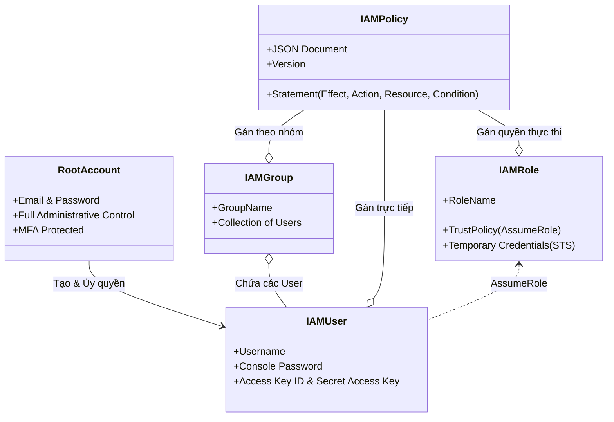
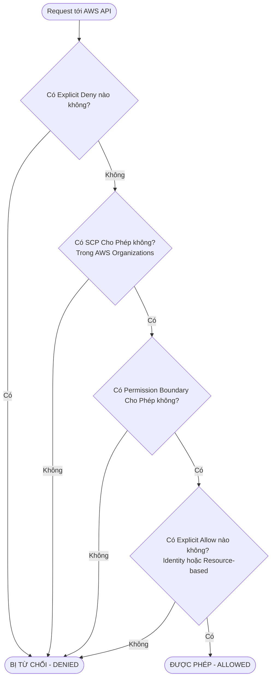
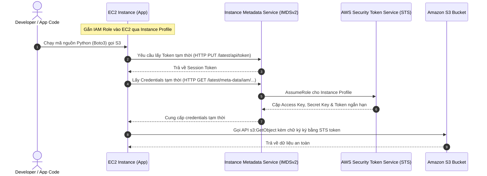

# Tài Liệu Học Tập Chuyên Sâu: AWS Identity and Access Management (IAM) & Quản Trị Định Danh Doanh Nghiệp

> **Tài liệu chuẩn hóa kiến trúc đám mây**: Hướng dẫn toàn diện theo tiêu chuẩn Senior AWS Solutions Architect & Cloud DevOps Engineer.  
> **Ngôn ngữ**: Tiếng Việt (Bảo lưu toàn bộ thuật ngữ chuyên ngành tiếng Anh chuẩn AWS).  
> **Các dịch vụ liên quan**: AWS IAM, AWS STS, AWS Organizations, AWS IAM Identity Center (AWS SSO), AWS Directory Service, AWS Control Tower.

---

## 6.1. Tổng Quan Dịch Vụ (Service Overview)

### Dịch vụ gì?
**AWS Identity and Access Management (IAM)** là dịch vụ nền tảng cung cấp khả năng kiểm soát truy cập an toàn, chi tiết tới toàn bộ tài nguyên trên đám mây AWS. IAM cho phép bạn quản lý **Ai** (Authentication - Xác thực) có quyền làm **Điều gì** trên **Tài nguyên nào** (Authorization - Phân quyền).

### Các vấn đề giải quyết
1. **Loại bỏ việc chia sẻ tài khoản chung**: Ngăn chặn nguy cơ chia sẻ thông tin đăng nhập tài khoản gốc (Root Account).
2. **Kiểm soát quyền hạn chi tiết (Fine-grained access control)**: Cho phép giới hạn quyền theo từng hành động cụ thể (ví dụ: chỉ được đọc S3 bucket mà không được xóa, chỉ được bật/tắt EC2 trong giờ hành chính).
3. **Quản lý quyền tạm thời (Temporary Credentials)**: Cung cấp cơ chế cấp quyền ngắn hạn cho ứng dụng chạy trên máy chủ (EC2, ECS, Lambda) mà không cần lưu khóa tĩnh (Access Keys) trong mã nguồn.
4. **Quản trị đa tài khoản tập trung (Multi-account Governance)**: Kết hợp với AWS Organizations và IAM Identity Center để kiểm soát hàng trăm tài khoản AWS trong doanh nghiệp lớn từ một nơi duy nhất.

### Phạm vi và tính chất đặc thù
- **Dịch vụ toàn cầu (Global Service)**: IAM là một dịch vụ mang tính toàn cầu. Bạn tạo User, Group, Role hoặc Policy ở bất kỳ Region nào thì các đối tượng đó đều có hiệu lực trên toàn thế giới mà không cần chọn Region.
- **Miễn phí hoàn toàn**: AWS không tính bất kỳ chi phí nào cho việc sử dụng IAM.

---

## 6.2. Các Khái Niệm và Thành Phần Cốt Lõi (Core Concepts and Components)



### 1. Phân loại thực thể định danh (Identities)
- **Root Account (Tài khoản gốc)**: Tài khoản tạo ra khi lần đầu đăng ký AWS. Có quyền tối cao không thể bị thu hồi. **Nguyên tắc vàng**: Khóa tài khoản Root, bật MFA vật lý/Authenticator ngay lập tức và tuyệt đối KHÔNG sử dụng Root Account cho các tác vụ hàng ngày.
- **IAM User (Người dùng IAM)**: Đại diện cho một cá nhân (nhân viên) hoặc dịch vụ ngoại vi tương tác với AWS. Mỗi IAM User sở hữu thông tin đăng nhập riêng (Console Password cho giao diện web và tối đa 2 bộ Access Keys cho CLI/SDK).
- **IAM User Group (Nhóm người dùng)**: Tập hợp các IAM User có chung chức năng (ví dụ: nhóm `Developers`, `DevOps_Engineers`, `Auditors`). Quyền hạn gắn vào Group sẽ tự động áp dụng cho tất cả thành viên. *Lưu ý*: Group không thể lồng vào Group khác; Group không phải là một "Principal" (không thể được gán quyền trong Resource-based policy).
- **IAM Role (Vai trò IAM)**: Một thực thể định danh có quyền hạn xác định nhưng **không có mật khẩu hay Access Key dài hạn**. IAM Role được các thực thể khác (EC2 instance, Lambda function, IAM User từ tài khoản khác) mượn quyền tạm thời thông qua dịch vụ **AWS Security Token Service (STS)**.

### 2. Cấu trúc IAM Policy JSON
IAM Policy là một tài liệu JSON chứa một hoặc nhiều câu lệnh (`Statement`):

```json
{
  "Version": "2012-10-17",
  "Statement": [
    {
      "Sid": "AllowS3ReadSpecificBucket",
      "Effect": "Allow",
      "Action": [
        "s3:GetObject",
        "s3:ListBucket"
      ],
      "Resource": [
        "arn:aws:s3:::production-app-data",
        "arn:aws:s3:::production-app-data/*"
      ],
      "Condition": {
        "IpAddress": {
          "aws:SourceIp": "198.51.100.0/24"
        }
      }
    }
  ]
}
```

*Phân tích từng phần tử*:
- **Version**: Bắt buộc phải là `"2012-10-17"` (phiên bản mới nhất hỗ trợ các tính năng nâng cao như Policy Variables).
- **Effect**: Chỉ có 2 giá trị: `"Allow"` hoặc `"Deny"`.
- **Action**: Danh sách các API calls được phép hoặc bị cấm (ví dụ: `ec2:StartInstances`, `s3:PutObject`).
- **Resource**: Danh sách ARN của các tài nguyên AWS chịu tác động của policy.
- **Condition**: Điều kiện ràng buộc để policy có hiệu lực (ví dụ: chỉ cho phép từ dải IP nội bộ `aws:SourceIp`, bắt buộc phải bật MFA `aws:MultiFactorAuthPresent: true`, hoặc trong khoảng thời gian xác định).

### 3. Logic Đánh Giá Quyết Định Phân Quyền (Policy Evaluation Logic)
Khi một request gửi tới AWS API, AWS xử lý theo quy tắc 3 bước nghiêm ngặt:
1. **Mặc định là Từ chối (Default Deny)**: Bắt đầu bằng trạng thái từ chối ngầm định.
2. **Tìm kiếm Cho phép rõ ràng (Explicit Allow)**: Nếu có bất kỳ policy nào cho phép, quyền chuyển sang ALLOW.
3. **Từ chối rõ ràng luôn chiến thắng (Explicit Deny ALWAYS Trumps Allow)**: Nếu có BẤT KỲ câu lệnh `"Effect": "Deny"` nào khớp với request, request sẽ bị **TỪ CHỐI NGAY LẬP TỨC**, bất kể có bao nhiêu câu lệnh `"Allow"` khác.



### 4. Các công cụ quản trị định danh nâng cao (Enterprise Governance)
- **AWS Organizations**: Cho phép quản lý tập trung nhiều tài khoản AWS trong một tổ chức phân cấp theo cây thư mục (Organizational Units - OUs). Cung cấp tính năng **Consolidated Billing** (gộp hóa đơn thanh toán để hưởng chiết khấu dung lượng) và **Service Control Policies (SCPs)** (chính sách rào chắn áp đặt quyền tối đa cho toàn bộ tài khoản).
- **AWS IAM Identity Center (trước đây là AWS SSO)**: Cổng đăng nhập một lần tập trung cho phép nhân viên đăng nhập một lần bằng tài khoản doanh nghiệp (Okta, Azure AD / Microsoft Entra ID, Google Workspace) để truy cập vào hàng chục tài khoản AWS và ứng dụng SaaS.
- **AWS Directory Service**: Cung cấp tích hợp Microsoft Active Directory với AWS (AWS Managed Microsoft AD, AD Connector, Simple AD).
- **AWS Control Tower**: Giải pháp dựng sẵn giúp tự động thiết lập một môi trường đa tài khoản chuẩn mực (Landing Zone) tuân thủ các quy tắc bảo vệ an toàn (Guardrails - Preventive qua SCPs và Detective qua AWS Config).

---

## 6.3. Kiến Trúc và Luồng Vận Hành (Architecture and Workflow)

### Sơ đồ luồng xác thực tạm thời bằng IAM Role trên Amazon EC2 (Instance Profile)



### So sánh Resource-Based Policy và IAM Role cho Cross-Account Access:

| Tiêu chí | IAM Role (AssumeRole) | Resource-Based Policy (e.g. S3 Bucket Policy) |
| :--- | :--- | :--- |
| **Cơ chế hoạt động** | Người dùng tài khoản A phải gọi `sts:AssumeRole` để nhận credentials tạm thời của Role trong tài khoản B. | Người dùng tài khoản A giữ nguyên định danh của mình, gửi request trực tiếp tới tài nguyên của tài khoản B. |
| **Thay đổi quyền hạn** | Khi nhận Role, người dùng **từ bỏ toàn bộ quyền hạn ban đầu** của tài khoản A và chỉ mang quyền hạn của Role ở tài khoản B. | Người dùng **giữ nguyên toàn bộ quyền của mình**; chỉ cần tài khoản A cho phép và tài khoản B cho phép. |
| **Hỗ trợ dịch vụ** | Hỗ trợ 100% tất cả các dịch vụ AWS. | Chỉ hỗ trợ một số dịch vụ (S3 Bucket, SQS Queue, SNS Topic, KMS Key, Secrets Manager). |
| **Trường hợp sử dụng** | Khi cần thực hiện nhiều hành động phức tạp trên nhiều tài nguyên khác nhau ở tài khoản khác. | Khi chỉ cần chia sẻ 1 tài nguyên cụ thể (như đọc 1 S3 bucket) mà không muốn ứng dụng phải đổi credentials. |

---

## 6.4. Bảng Tích Hợp với Các Dịch Vụ AWS Khác (Integration Table)

| Related AWS Service | Purpose (Mục đích tích hợp) | Integration Method (Phương thức tích hợp) | Practical Example (Ví dụ thực tiễn) |
| :--- | :--- | :--- | :--- |
| **Amazon EC2** | Cấp quyền cho ứng dụng chạy trên EC2 gọi AWS API an toàn | IAM Instance Profile | Gán Role có quyền `s3:GetObject` vào máy chủ web để tải ảnh mà không cần lưu khóa tĩnh trên đĩa cứng. |
| **AWS Lambda** | Cấp quyền thực thi và quyền truy cập tài nguyên cho serverless function | Lambda Execution Role | Lambda function nhận Role chứa policy ghi log vào CloudWatch Logs và đọc dữ liệu từ DynamoDB. |
| **Amazon S3** | Kiểm soát quyền truy cập chi tiết tới các đối tượng lưu trữ | S3 Bucket Policy & IAM User Policy | Cấu hình S3 Bucket Policy từ chối mọi request không sử dụng giao thức bảo mật HTTPS (`aws:SecureTransport: false`). |
| **AWS CloudTrail** | Kiểm toán toàn bộ các hành động xác thực và gọi API | CloudTrail Event Logging | Ghi lại sự kiện ai đã xóa một IAM User hoặc ai đã thực hiện lệnh `AssumeRole` vào lúc nửa đêm. |
| **AWS KMS** | Kiểm soát quyền sử dụng khóa mã hóa dữ liệu | KMS Key Policy | Chỉ cho phép IAM Role của dịch vụ thanh toán có quyền giải mã dữ liệu thẻ tín dụng bằng khóa CMK. |

---

## 6.5. Ví Dụ Cấu Hình và Triển Khai Thực Tế (Configuration & CLI Examples)

### 1. Khởi tạo IAM User, Group và Phân quyền qua AWS CLI

```bash
# 1. Tạo một IAM User mới tên là 'developer-anna'
aws iam create-user --user-name developer-anna

# 2. Tạo một IAM Group tên là 'DevelopersGroup'
aws iam create-group --group-name DevelopersGroup

# 3. Thêm User vào Group
aws iam add-user-to-group \
    --user-name developer-anna \
    --group-name DevelopersGroup

# 4. Gán AWS Managed Policy 'AmazonS3ReadOnlyAccess' vào Group
aws iam attach-group-policy \
    --group-name DevelopersGroup \
    --policy-arn arn:aws:iam::aws:policy/AmazonS3ReadOnlyAccess
```

### 2. Khai báo IAM Role và Instance Profile cho EC2 bằng Terraform

```hcl
# Định nghĩa Trust Policy cho phép EC2 mượn Role
data "aws_iam_policy_document" "ec2_trust_policy" {
  statement {
    effect  = "Allow"
    actions = ["sts:AssumeRole"]
    principals {
      type        = "Service"
      identifiers = ["ec2.amazonaws.com"]
    }
  }
}

# Tạo IAM Role
resource "aws_iam_role" "web_app_role" {
  name               = "WebServerAppRole"
  assume_role_policy = data.aws_iam_policy_document.ec2_trust_policy.json
}

# Gán quyền đọc S3 vào Role
resource "aws_iam_role_policy_attachment" "s3_read_attach" {
  role       = aws_iam_role.web_app_role.name
  policy_arn = "arn:aws:iam::aws:policy/AmazonS3ReadOnlyAccess"
}

# Tạo Instance Profile để gắn Role vào EC2
resource "aws_iam_instance_profile" "web_app_profile" {
  name = "WebServerInstanceProfile"
  role = aws_iam_role.web_app_role.name
}
```

---

## 6.6. Bảo Mật và Thực Hành Tốt Nhất (IAM Best Practices)

1. **Khóa chặt tài khoản Root**:
   - Không sử dụng tài khoản Root cho công việc hàng ngày.
   - Bật MFA phần cứng (FIDO U2F security key) hoặc ứng dụng Authenticator ảo.
   - Xóa bỏ toàn bộ Access Key của tài khoản Root nếu có.
2. **Một người - Một định danh riêng biệt (One Identity per Person)**:
   - Không bao giờ chia sẻ tài khoản hoặc thông tin đăng nhập giữa các thành viên.
3. **Phân quyền theo nhóm (Use Groups to assign permissions)**:
   - Không gán policy trực tiếp vào từng User riêng lẻ; hãy gán policy vào Group và thêm User vào Group để dễ quản lý thu hồi quyền khi nhân sự chuyển đổi vị trí.
4. **Bắt buộc kích hoạt MFA (Multi-Factor Authentication)**:
   - Bắt buộc MFA cho tất cả người dùng có quyền truy cập AWS Console.
5. **Tuyệt đối không lưu Access Key trong mã nguồn**:
   - Sử dụng **IAM Roles** cho các tài nguyên AWS (EC2, ECS, Lambda).
   - Nếu bắt buộc dùng Access Key cho hệ thống bên ngoài, sử dụng AWS Secrets Manager và định kỳ luân chuyển (Rotate keys tối thiểu 90 ngày/lần).
6. **Kiểm tra định kỳ bằng công cụ bảo mật IAM**:
   - **IAM Credentials Report**: Xuất file CSV báo cáo toàn bộ trạng thái mật khẩu, tuổi của Access Key và tình trạng MFA của tất cả user trong tài khoản.
   - **IAM Access Advisor**: Cho biết dịch vụ nào được cấp quyền nhưng không hề được sử dụng trong suốt nhiều tháng qua, giúp loại bỏ các quyền thừa để đạt chuẩn đặc quyền tối thiểu.
   - **IAM Access Analyzer**: Quét và cảnh báo các tài nguyên (S3, KMS, IAM Roles) đang được chia sẻ ra bên ngoài tài khoản hoặc công khai trên Internet.

---

## 6.7. Mô Hình Chi Phí Dịch Vụ Định Danh & Tối Ưu Hóa Ngân Sách Doanh Nghiệp (IAM & Identity Governance Cost Breakdown & Optimization)

Một trong những ưu điểm lớn nhất của nền tảng AWS là hầu hết các công cụ quản trị định danh và phân quyền cốt lõi đều được cung cấp **hoàn toàn MIỄN PHÍ**. Tuy nhiên, sự hiểu biết về cách liên kết các dịch vụ định danh này (như AWS Organizations, Consolidated Billing, Directory Service, IAM Identity Center) chính là đòn bẩy tài chính mạnh mẽ nhất giúp các tập đoàn cắt giảm hàng ngàn USD chi phí đám mây mỗi tháng.

### 6.7.1. Bảng Cấu Trúc Định Giá Chi Tiết (Pricing Dimensions Matrix)

| Dịch Vụ Định Danh | Có tính phí hay Miễn phí? | Cơ chế tính phí chi tiết (Pricing Dimensions) | Mức phí tham chiếu điển hình | Lưu ý rủi ro chi phí (Cost Pitfalls) |
| :--- | :--- | :--- | :--- | :--- |
| **AWS IAM** (Users, Roles, Policies, STS) | **MIỄN PHÍ 100%** | Không có bất kỳ khoản phí nào cho việc tạo Users, Groups, Roles, Policies, MFA hay gọi API `sts:AssumeRole`. | **$0.00** | Cấp phát Access Keys dài hạn tĩnh cho lập trình viên rồi vô tình bị lộ lên GitHub công khai dẫn đến tin tặc tạo máy ảo đào coin gây thảm họa hàng chục ngàn USD. |
| **AWS Organizations** | **MIỄN PHÍ 100%** | Tạo bao nhiêu tài khoản con (Member Accounts) và áp dụng bao nhiêu Service Control Policies (SCPs) đều miễn phí. | **$0.00** | Duy trì nhiều tài khoản rời rạc thanh toán riêng lẻ mà không gộp vào Organizations khiến doanh nghiệp bỏ lỡ các mức chiết khấu bậc thang (Volume Tier Discounts) khổng lồ. |
| **AWS IAM Identity Center** (AWS SSO) | **MIỄN PHÍ 100%** | Đăng nhập tập trung một lần cho hàng ngàn người dùng vào hàng trăm tài khoản AWS và ứng dụng đám mây. | **$0.00** | Không sử dụng Identity Center mà đi mua thêm giải pháp SSO thương mại đắt tiền bên ngoài khi nhu cầu chỉ là truy cập vào AWS. |
| **AWS Control Tower** | **MIỄN PHÍ 100%** | Bản thân dịch vụ Control Tower không thu phí. | **$0.00** | Chỉ trả tiền cho các tài nguyên mà Control Tower tự động sinh ra để thiết lập Landing Zone (AWS Config Rules, CloudTrail S3 Storage). |
| **AWS Directory Service** | **CÓ TÍNH PHÍ** | Tính phí theo từng giờ máy chủ cho cụm Active Directory được quản lý. | - **Managed Microsoft AD**: ~$0.12/giờ (Standard, ~$88/tháng) hoặc ~$0.40/giờ (Enterprise, ~$292/tháng).<br>- **AD Connector**: ~$0.05/giờ (~$36.50/tháng). | Dựng cả cụm AWS Managed Microsoft AD riêng đắt đỏ trong khi doanh nghiệp đã có sẵn Domain Controller on-premises và chỉ cần dùng AD Connector gọn nhẹ. |
| **AWS IAM Access Analyzer** | Phân tích cơ bản Miễn Phí | - Quét quyền chia sẻ ngoài (External Access): **$0.00**.<br>- Quét quyền thừa (Unused Access): $0.20/role-user/tháng.<br>- Custom Policy Checks: $0.20/lần kiểm tra. | - External findings: **$0.00**.<br>- Unused Access: $0.20/identity/tháng. | Bật Unused Access Analyzer cho hàng chục ngàn IAM Roles tạm thời mà không chọn lọc phạm vi tài khoản cần thiết. |

---

### 6.7.2. 5 Kịch Bản Tối Ưu Hóa Chi Phí Kiến Trúc Thực Tế (Architectural Cost Optimization Use Cases)

#### Use Case 1: Tận dụng Consolidated Billing trong AWS Organizations để kích hoạt Volume Tier Discounts tự động
- **Bối cảnh**: Doanh nghiệp mở rộng quy mô và sở hữu 25 tài khoản AWS riêng biệt (mỗi phòng ban, dự án một tài khoản) với 25 thẻ tín dụng thanh toán độc lập. Mỗi tài khoản lưu trữ khoảng 30 TB dữ liệu trên Amazon S3 Standard.
- **Rủi ro chi phí**:
  - Biểu giá S3 Standard: 50 TB đầu có giá **$0.023/GB**; 450 TB tiếp theo có giá **$0.022/GB**; trên 500 TB có giá **$0.021/GB**.
  - Do thanh toán riêng lẻ, không có tài khoản nào đạt ngưỡng 50 TB, do đó toàn bộ 750 TB dữ liệu (25 * 30 TB) của cả công ty đều bị tính ở mức giá đắt nhất: 750,000 GB * $0.023 = **$17,250/tháng**.
- **Giải pháp tối ưu**:
  - Tạo một **AWS Organization** và mời tất cả 25 tài khoản con tham gia dưới một **Payer Account** (Management Account) duy nhất qua tính năng **Consolidated Billing**.
  - AWS tự động gộp tổng lượng dữ liệu của tất cả tài khoản con khi tính toán hóa đơn bậc thang:
    - 50 TB đầu: 50,000 GB * $0.023 = $1,150.
    - 450 TB tiếp theo: 450,000 GB * $0.022 = $9,900.
    - 250 TB còn lại: 250,000 GB * $0.021 = $5,250.
    - Tổng chi phí S3 mới: **$16,300/tháng**.
  - Tương tự, cước dữ liệu Internet Data Transfer Out cũng được gộp bậc thang để hạ đơn giá từ $0.09/GB xuống mức rẻ hơn.
- **Hiệu quả kinh tế**:
  - **Tiết kiệm ngay $950/tháng ($11,400/năm)** mà không cần di chuyển bất kỳ một tệp tin hay viết lại dòng mã nào!

#### Use Case 2: Chia sẻ chiết khấu Reserved Instances & Savings Plans qua AWS Organizations
- **Bối cảnh**: Tài khoản `Project-A` mua một gói EC2 Savings Plans trị giá cam kết $15/giờ (thời hạn 3 năm). Sau 1 năm, dự án Project-A chuyển đổi kiến trúc sang Serverless, mức tiêu thụ EC2 giảm xuống chỉ còn $3/giờ. Tài khoản Project-A bị lãng phí **$12/giờ ($8,760/tháng)** tiền cam kết Savings Plans không dùng hết. Cùng lúc đó, tài khoản `Project-B` trong cùng công ty đang chạy các cụm máy ảo EC2 On-Demand tốn $20/giờ.
- **Giải pháp tối ưu**:
  - Gộp cả 2 tài khoản vào chung một AWS Organization.
  - Đảm bảo tính năng **RI and Savings Plans Discount Sharing** được bật trên Management Account (đây là chế độ mặc định).
  - AWS tự động áp dụng phần giá trị cam kết $12/giờ dư thừa từ Project-A sang bù trừ trực tiếp cho các máy chủ EC2 On-Demand của Project-B.
- **Hiệu quả kinh tế**:
  - Triệt tiêu 100% sự lãng phí tài chính của gói cam kết, **tiết kiệm ngay $8,760/tháng ($105,120/năm)** cho ngân sách toàn tập đoàn.

#### Use Case 3: AD Connector vs AWS Managed Microsoft AD - Tiết kiệm 87% chi phí kết nối Active Directory
- **Bối cảnh**: Doanh nghiệp đã có sẵn hệ thống máy chủ xác thực Microsoft Active Directory nội bộ (Domain Controllers) tại trụ sở văn phòng. Khi đưa nhân viên lên làm việc với các máy ảo Windows EC2 và Amazon WorkSpaces trên AWS, kỹ sư dự định khởi tạo một cụm AWS Managed Microsoft AD Enterprise Edition trên AWS.
- **Rủi ro chi phí**:
  - AWS Managed Microsoft AD Enterprise có giá $0.40/giờ = **$292/tháng ($3,504/năm)**. Ngoài ra, việc vận hành 2 Active Directory độc lập đòi hỏi phải cấu hình Trust Relationship phức tạp và tốn công bảo trì đồng bộ tài khoản người dùng.
- **Giải pháp tối ưu**:
  - Thay vì tạo một cụm AD mới trên mây, thiết lập dịch vụ **AWS Directory Service - AD Connector**.
  - AD Connector hoạt động như một cổng proxy chuyển tiếp (Gateway Proxy) các yêu cầu xác thực bảo mật từ AWS về thẳng các Domain Controllers on-premises hiện có qua đường truyền VPN IPsec hoặc AWS Direct Connect.
- **Hiệu quả kinh tế**:
  - Chi phí AD Connector chỉ tốn $0.05/giờ = **$36.50/tháng**.
  - **Tiết kiệm $255.50/tháng (giảm 87.5% chi phí)**, đồng thời nhân viên chỉ cần quản lý mật khẩu tại duy nhất một nơi tập trung.

#### Use Case 4: Chuyển đổi toàn diện từ IAM User Access Keys sang IAM Identity Center (SSO)
- **Bối cảnh**: Doanh nghiệp tạo hơn 150 tài khoản IAM User riêng lẻ cho các lập trình viên và DevOps, mỗi người được cấp 1 cặp Access Key ID / Secret Access Key lưu trong máy tính cá nhân để dùng AWS CLI.
- **Rủi ro chi phí tiềm ẩn**:
  - Một lập trình viên vô tình đẩy file mã nguồn chứa Access Key lên một kho lưu trữ GitHub công khai. Các bot tự động của tin tặc quét được khóa chỉ trong 20-30 giây, lập tức chiếm quyền và khởi tạo hàng chục máy ảo GPU đắt tiền (`p3.16xlarge`, $24/giờ mỗi máy) tại các Region lạ để đào tiền điện tử.
  - Khi đội ngũ kỹ thuật phát hiện vào sáng hôm sau, hóa đơn phát sinh đột biến đã lên tới **$25,000 - $40,000 USD**!
- **Giải pháp tối ưu**:
  - Xóa bỏ hoàn toàn việc cấp phát Access Key dài hạn cho con người.
  - Kích hoạt **AWS IAM Identity Center** (hoàn toàn **MIỄN PHÍ $0.00**), tích hợp với danh bạ doanh nghiệp (Google Workspace, Microsoft Entra ID).
  - Lập trình viên truy cập CLI bằng tiện ích `aws configure sso`. Hệ thống chỉ cấp phát **Credentials tạm thời (Short-lived Session Token)** có thời hạn tối đa vài giờ và tự động hủy bỏ.
- **Hiệu quả kinh tế**:
  - Chi phí triển khai Identity Center là **$0.00**.
  - Triệt tiêu 100% rủi ro tài chính do lộ lọt thông tin xác thực tĩnh, tiết kiệm hàng chục ngàn USD chi phí khắc phục hậu quả an ninh mạng.

#### Use Case 5: Tự động hóa rà soát đặc quyền tối thiểu (Least Privilege) bằng IAM Access Advisor Miễn Phí
- **Bối cảnh**: Để vượt qua kỳ kiểm toán bảo mật tuân thủ hàng năm (SOC2 / ISO 27001), doanh nghiệp thường phải chi trả hàng chục ngàn USD thuê chuyên gia bên ngoài rà soát lại hàng ngàn IAM Roles, Groups và Policies tồn đọng nhiều năm để thu hồi các quyền thừa thãi.
- **Giải pháp tối ưu**:
  - Tận dụng tính năng **IAM Access Advisor** (truy cập trực tiếp trên IAM Console hoặc qua API `generate-service-last-accessed-details`) hoàn toàn **MIỄN PHÍ ($0.00)**.
  - IAM Access Advisor phân tích nhật ký xác thực và liệt kê chi tiết:
    - Những dịch vụ AWS nào được cấp quyền nhưng **không hề được truy cập trong 90 ngày hoặc 1 năm qua**.
    - Cho phép kỹ sư tự tin gỡ bỏ các quyền thừa khỏi policy mà không sợ làm gián đoạn ứng dụng đang chạy.
  - Kết hợp sử dụng **IAM Access Analyzer** (tính năng External Access cơ bản miễn phí) để tự động quét tìm các S3 Buckets hoặc KMS Keys vô tình cấp quyền truy cập ra Internet hoặc cho tài khoản ngoài.
- **Hiệu quả kinh tế**:
  - Tiết kiệm 100% chi phí mua công cụ rà soát quyền bên thứ 3 và hàng trăm giờ công kỹ sư, đạt chuẩn tuân thủ bảo mật nhanh chóng và hoàn toàn tự động.

---

## 6.8. Khắc Phục Sự Cố Thực Tế (Troubleshooting Guide)

| Vấn đề (Problem) | Nguyên nhân khả dĩ (Possible Causes) | Các bước điều tra (Investigation Steps) | Giải pháp (Solution) | Biện pháp phòng ngừa (Prevention) |
| :--- | :--- | :--- | :--- | :--- |
| **Lỗi `AccessDenied` khi chạy lệnh AWS CLI trên máy ảo EC2** | Máy ảo chưa được gắn IAM Role hoặc Role thiếu permission policy phù hợp. | 1. Chạy `curl http://169.254.169.254/latest/meta-data/iam/info` kiểm tra instance profile.<br>2. Kiểm tra Action bị từ chối trong CloudTrail. | Gán đúng IAM Role vào EC2 qua mục Actions -> Security -> Modify IAM Role trên Console. | Sử dụng Terraform chuẩn hóa việc gắn Instance Profile khi khởi tạo máy ảo. |
| **User có quyền `s3:*` nhưng vẫn không đọc được file trong S3 bucket** | 1. Bucket Policy có câu lệnh Explicit Deny.<br>2. Dữ liệu mã hóa bằng KMS nhưng User thiếu quyền `kms:Decrypt`.<br>3. Bị chặn bởi SCP trong AWS Organizations. | 1. Xem tab Permissions của Bucket.<br>2. Kiểm tra KMS Key Policy.<br>3. Kiểm tra SCP áp dụng lên tài khoản con. | Bổ sung quyền KMS hoặc loại bỏ Explicit Deny không mong muốn. | Sử dụng **IAM Policy Simulator** để mô phỏng chính xác nguyên nhân chặn quyền. |
| **Lỗi `InvalidClientTokenId` hoặc `SignatureDoesNotMatch` khi dùng CLI** | Access Key hoặc Secret Key nhập sai, hoặc đồng hồ hệ thống bị lệch thời gian quá 15 phút. | 1. Kiểm tra lại chuỗi khóa trong file `~/.aws/credentials`.<br>2. Kiểm tra đồng hồ máy tính so với NTP server. | Cấu hình lại bằng lệnh `aws configure` và đồng bộ hóa giờ hệ thống bằng NTP. | Tránh copy-paste thủ công; sử dụng AWS CloudShell hoặc IAM Identity Center SSO. |
| **Không thể xóa IAM Role vì đang được sử dụng** | Role đang được liên kết với một Instance Profile hoặc một dịch vụ AWS đang hoạt động. | Kiểm tra mục "Attached entities" trong phần chi tiết của Role trên IAM Console. | Tháo gỡ (Detach) Role khỏi Instance Profile hoặc Service trước khi thực hiện xóa. | Quản lý vòng đời tài nguyên IAM hoàn toàn qua Infrastructure as Code (IaC). |

---

## 6.9. Các Kịch Bản Sử Dụng Trong Thực Tế (Real-World Use Cases)

### Kịch bản 1: Môi trường Công ty Khởi nghiệp (Small Business / Startup)
- **Kiến trúc**: 1 tài khoản AWS duy nhất.
- **Giải pháp**: 
  - Tạo 3 IAM Groups: `Admins`, `Developers`, `Viewers`.
  - Bật chính sách mật khẩu mạnh (tối thiểu 14 ký tự, có ký tự đặc biệt).
  - Viết 1 IAM Policy bắt buộc mọi user phải tự kích hoạt MFA mới được phép thực hiện bất kỳ thao tác nào khác trên AWS.

### Kịch bản 2: Ứng dụng Backend Microservices (Cloud DevOps CI/CD)
- **Kiến trúc**: Ứng dụng container hóa chạy trên Amazon ECS cần đọc ảnh từ S3 và ghi log vào CloudWatch.
- **Giải pháp**:
  - Không nhúng AWS credentials vào Dockerfile hay biến môi trường.
  - Sử dụng **ECS Task Role** riêng biệt cho từng container service: container đọc ảnh chỉ có quyền `s3:GetObject` trên đúng bucket ảnh.
  - Pipeline GitHub Actions sử dụng **OpenID Connect (OIDC)** để AssumeRole vào AWS mà không cần lưu trữ Secret Key dài hạn trên GitHub repository.

### Kịch bản 3: Tập đoàn Đa quốc gia (Enterprise Multi-Account Architecture)
- **Kiến trúc**: Hơn 100 tài khoản AWS phân chia theo môi trường (Production, Staging, Dev, Security, Shared Services, Audit).
- **Giải pháp**:
  - Dùng **AWS Organizations** để cấu trúc các Organizational Units (OUs).
  - Áp dụng **Service Control Policies (SCPs)** để chặn toàn bộ các Region không được phép sử dụng (chỉ cho phép chạy tài nguyên tại `ap-southeast-1`), và chặn quyền tắt CloudTrail của bất kỳ quản trị viên nào ở tài khoản con.
  - Tích hợp **AWS IAM Identity Center** với Azure AD doanh nghiệp: nhân viên IT đăng nhập qua tài khoản email công ty để truy cập tức thời vào đúng các tài khoản AWS được phân quyền.

---

## 6.10. So Sánh và Đưa Ra Quyết Định Kỹ Thuật (Comparisons & Trade-offs)

### Bảng so sánh các phương thức xác thực và quản lý quyền

| Tiêu chí | IAM User với Access Keys | IAM Role (Instance Profile / OIDC) | AWS IAM Identity Center (SSO) |
| :--- | :--- | :--- | :--- |
| **Loại thông tin xác thực** | Dài hạn (Long-term credentials), không tự hết hạn. | Ngắn hạn (Short-lived, tự động xoay vòng sau 1 - 12 giờ). | Đăng nhập tập trung qua trình duyệt, phiên làm việc tạm thời. |
| **Mức độ rủi ro rò rỉ** | **Rất cao**: Dễ bị vô tình commit lên GitHub công khai dẫn đến bị tin tặc tấn công. | **Rất thấp**: Khóa lưu trong bộ nhớ RAM, tự hết hạn, không lưu đĩa. | **Cực thấp**: Quản lý tập trung, thu hồi quyền tức thì khi nhân viên nghỉ việc. |
| **Đối tượng áp dụng** | Ứng dụng cũ on-premises không hỗ trợ AWS STS. | Tài nguyên trên AWS (EC2, ECS, Lambda) và CI/CD hiện đại (GitHub Actions, GitLab). | Con người (Lập trình viên, Kiến trúc sư, DevOps, Kiểm toán viên). |
| **Chi phí quản trị** | Tốn kém: Phải tự xây dựng quy trình xoay vòng khóa định kỳ 90 ngày. | Gần như bằng 0: AWS tự động xử lý toàn bộ việc cấp phát và thu hồi. | Thấp: Đồng bộ hóa tự động từ Active Directory / Okta / Azure AD. |

---

## 6.11. Bộ Câu Hỏi Ôn Tập và Kiểm Tra Kiến Thức (Knowledge Review)

### A. 10 Câu hỏi Cốt lõi (Core Concepts)
1. Dịch vụ AWS IAM là dịch vụ cấp vùng (Regional) hay cấp toàn cầu (Global)?
2. Tại sao AWS khuyến cáo tuyệt đối không sử dụng tài khoản Root cho các công việc quản trị hàng ngày?
3. Trong tài liệu IAM Policy JSON, giá trị của trường `"Version"` chuẩn hiện nay là gì?
4. Nếu một IAM User được gắn một policy cho phép `s3:GetObject` nhưng Bucket Policy của S3 lại chứa câu lệnh từ chối (`Deny`) đối với user đó, kết quả user có tải được file không? Giải thích quy tắc đánh giá?
5. Sự khác biệt cơ bản nhất giữa **IAM User Group** và **IAM Role** là gì?
6. Khi một ứng dụng chạy trên máy chủ ảo EC2 cần tương tác với DynamoDB, phương thức xác thực chuẩn và an toàn nhất là gì?
7. Trong AWS Organizations, chính sách **Service Control Policy (SCP)** có trực tiếp cấp quyền (Grant permissions) cho tài nguyên trong tài khoản con không?
8. Công cụ nào trong IAM giúp bạn phát hiện những quyền hạn được cấp nhưng không hề được sử dụng trong suốt 90 ngày qua?
9. Cơ chế xác thực đa yếu tố (MFA) bảo vệ tài khoản khỏi hình thức tấn công phổ biến nào?
10. Mục đích chính của dịch vụ **AWS Security Token Service (STS)** là gì?

### B. 5 Câu hỏi Xử lý Sự cố (Troubleshooting)
11. Một lập trình viên báo cáo rằng mã nguồn Python của họ chạy trên máy tính cá nhân bị lỗi `AccessDenied` khi cố gắng tải file lên S3, dù họ cam kết đã chạy `aws configure`. Bạn sẽ kiểm tra những yếu tố nào?
12. Máy chủ EC2 đang chạy ứng dụng Java gọi API sang SQS thì đột nhiên bị lỗi `ExpiredToken`. Nguyên nhân có thể do đâu và cách xử lý?
13. Bạn muốn ngăn chặn toàn bộ các tài khoản con trong tổ chức không được phép tạo máy chủ EC2 ngoài khu vực Singapore (`ap-southeast-1`). Bạn sẽ cấu hình chính sách gì và ở đâu?
14. Khi cố gắng xóa một IAM User, bạn nhận được thông báo lỗi. Những ràng buộc nào cần phải dọn dẹp trước khi có thể xóa một User?
15. Một kỹ sư đã bật MFA cho tài khoản IAM của mình nhưng thiết bị điện thoại bị mất. Quy trình xử lý khôi phục quyền truy cập như thế nào?

### C. 3 Câu hỏi Tình huống Kiến trúc (Scenario-based)
16. **Tình huống 1**: Công ty của bạn có 500 lập trình viên. Doanh nghiệp đã có sẵn hệ thống Microsoft Active Directory nội bộ. Ban giám đốc yêu cầu nhân viên phải dùng đúng mật khẩu máy tính công ty để đăng nhập vào AWS Management Console mà không được tạo 500 IAM User thủ công trên AWS. Bạn sẽ đề xuất giải pháp kiến trúc nào?
17. **Tình huống 2**: Một công ty fintech đối tác cần định kỳ đọc dữ liệu báo cáo từ S3 Bucket nằm trong tài khoản AWS của công ty bạn. Bạn phải thiết kế giải pháp cho phép đối tác truy cập mà không cần chia sẻ Access Key hay tạo IAM User trong tài khoản của bạn. Bạn sẽ thiết kế như thế nào?
18. **Tình huống 3**: Đội an ninh mạng muốn đảm bảo rằng các lập trình viên cấp dưới dù có quyền tạo IAM Role cho Lambda function nhưng không bao giờ có thể tự cấp quyền Admin cho chính mình (ngăn chặn leo thang đặc quyền - Privilege Escalation). Tính năng nào của IAM giải quyết triệt để vấn đề này?

### D. 5 Câu hỏi Phỏng vấn AWS Solutions Architect (Interview Questions)
19. *"Hãy giải thích chi tiết logic đánh giá IAM Policy của AWS khi có sự kết hợp giữa Identity-based Policy, Resource-based Policy, Permission Boundary và Service Control Policy (SCP)?"*
20. *"Tại sao việc lưu trữ AWS Access Key ID và Secret Access Key trên máy chủ EC2 hoặc nhúng trong Docker Image lại bị coi là một lỗ hổng an ninh nghiêm trọng, và giải pháp thay thế chuẩn mực là gì?"*
21. *"Permission Boundary trong IAM là gì và nó khác gì so với một IAM Managed Policy thông thường?"*
22. *"Bạn hiểu thế nào về khái niệm 'Confused Deputy Problem' trong AWS và làm thế nào để phòng chống nó bằng External ID trong IAM Trust Policy?"*
23. *"Làm thế nào bạn có thể kiểm toán toàn bộ hoạt động của các IAM User trong doanh nghiệp để chuẩn bị cho kỳ thanh tra chứng chỉ bảo mật PCI-DSS?"*

---

### Đáp án Bộ Câu Hỏi Ôn Tập (Answer Key)

<details>
<summary>👉 Nhấp vào đây để xem toàn bộ đáp án chi tiết</summary>

#### Đáp án A. 10 Câu hỏi Cốt lõi:
1. IAM là dịch vụ **toàn cầu (Global)**.
2. Vì tài khoản Root sở hữu toàn quyền không giới hạn trên toàn bộ tài khoản; nếu bị lộ lọt, kẻ tấn công có thể xóa toàn bộ dữ liệu, hủy hoại hạ tầng và phát sinh chi phí khổng lồ mà không thể bị thu hồi quyền bằng IAM Policy.
3. Phiên bản chuẩn bắt buộc là `"Version": "2012-10-17"`.
4. User **KHÔNG** thể tải được file. Theo quy tắc đánh giá: **Explicit Deny luôn luôn chiến thắng Explicit Allow**.
5. **IAM Group** là tập hợp các IAM User có chung thông tin đăng nhập dài hạn; **IAM Role** không thuộc về một người cụ thể nào, không có mật khẩu/access key dài hạn mà cung cấp quyền hạn tạm thời thông qua STS AssumeRole.
6. Gắn một **IAM Role** vào máy chủ EC2 thông qua **Instance Profile**.
7. **KHÔNG**. SCP chỉ đóng vai trò là một "rào chắn" (Guardrail) quy định quyền hạn tối đa mà tài khoản con có thể có. Để thực sự làm được việc, tài nguyên bên trong tài khoản con vẫn cần một IAM Policy cấp quyền rõ ràng nằm trong giới hạn của SCP đó.
8. **IAM Access Advisor** (truy cập qua tab Access Advisor trên IAM Console).
9. Bảo vệ chống lại tấn công dò quét mật khẩu (Brute-force), đánh cắp mật khẩu qua lừa đảo (Phishing) hoặc rò rỉ dữ liệu đăng nhập.
10. Cung cấp các thông tin xác thực bảo mật tạm thời (Temporary Security Credentials) có thời hạn ngắn cho người dùng hoặc dịch vụ.

#### Đáp án B. 5 Câu hỏi Xử lý Sự cố:
11. Kiểm tra: (1) IAM User có policy cấp quyền `s3:PutObject` chưa; (2) S3 Bucket Policy có chặn không; (3) Tên bucket có gõ đúng không; (4) Khóa trong `~/.aws/credentials` có đúng là của user đó không bằng lệnh `aws sts get-caller-identity`.
12. **Nguyên nhân**: SDK cũ không tự động làm mới (refresh) token tạm thời hoặc đồng hồ hệ thống bị lệch. **Xử lý**: Đảm bảo sử dụng AWS SDK phiên bản mới (tự động xử lý refresh token ngầm) và đồng bộ lại giờ NTP trên máy ảo.
13. Tạo một **Service Control Policy (SCP)** trong **AWS Organizations**, sử dụng điều kiện `StringNotEquals: {"aws:RequestedRegion": ["ap-southeast-1"]}` với Effect: `Deny`, sau đó gắn SCP này vào Root Organization hoặc OU tương ứng.
14. Phải gỡ bỏ User khỏi tất cả các Groups, xóa toàn bộ Access Keys, thu hồi MFA devices, xóa signing certificates và gỡ bỏ các inline/attached policies.
15. Quản trị viên (Admin) của tài khoản phải đăng nhập vào IAM Console, tìm đến User đó, vào tab Security Credentials, chọn mục MFA và nhấp **Deactivate** thiết bị cũ, sau đó thiết lập lại thiết bị mới.

#### Đáp án C. 3 Câu hỏi Tình huống:
16. Sử dụng **AWS IAM Identity Center** kết hợp với **AWS Directory Service** (AD Connector) hoặc SAML 2.0 Identity Provider để liên kết (Federate) hệ thống Active Directory nội bộ với AWS.
17. Tạo một **IAM Role** trong tài khoản của bạn, cấu hình Trust Policy cho phép tài khoản AWS của đối tác `sts:AssumeRole`. Cung cấp ARN của Role cho đối tác và yêu cầu đối tác sử dụng thêm một chuỗi bí mật **External ID** để phòng ngừa rủi ro bảo mật.
18. Sử dụng tính năng **Permissions Boundary**. Quản trị viên tạo một ranh giới quyền hạn tối đa và áp đặt điều kiện: lập trình viên chỉ được phép tạo IAM Role mới nếu Role đó được đính kèm Permissions Boundary này.

#### Đáp án D. 5 Câu hỏi Phỏng vấn:
19. *"Logic đánh giá: Bắt đầu từ Default Deny. Đầu tiên kiểm tra Explicit Deny (nếu có ở bất kỳ tầng nào thì Deny ngay). Tiếp theo, với tài khoản trong Organizations, request phải được cho phép bởi SCP. Sau đó, nếu có Permission Boundary, request phải nằm trong phạm vi của Boundary. Cuối cùng, phải có ít nhất một Explicit Allow từ Identity-based policy hoặc Resource-based policy. Nếu chỉ có một bên cho phép trong kịch bản Same-account thì được phép; nhưng trong kịch bản Cross-account, BẮT BUỘC cả hai tài khoản đều phải có câu lệnh Allow rõ ràng."*
20. *"Lưu trữ khóa tĩnh trên EC2 hoặc Docker image tiềm ẩn nguy cơ cực lớn vì ai có quyền truy cập vào máy ảo, đọc file log, hoặc kéo Docker image về đều có thể giải nén lấy được cặp Access Key/Secret Key và sử dụng vô thời hạn ngoài tầm kiểm soát. Giải pháp thay thế là sử dụng **IAM Roles for EC2 (Instance Profile)** hoặc **IAM Roles for ECS Tasks / EKS Service Accounts (IRSA)**. Cơ chế này mượn quyền tạm thời từ AWS STS, tự động xoay vòng mỗi vài giờ và không bao giờ ghi khóa lên ổ đĩa."*
21. *"Permission Boundary là một tính năng nâng cao sử dụng managed policy để thiết lập ranh giới quyền hạn tối đa mà một Identity (User hoặc Role) có thể nhận được. Điểm mấu chốt: Permission Boundary **KHÔNG TỰ MÌNH CẤP QUYỀN**; nó chỉ giới hạn trần quyền hạn. Một thao tác chỉ thành công khi nó VỪA được cấp bởi Identity Policy, VỪA nằm trong phạm vi cho phép của Permission Boundary."*
22. *"'Confused Deputy Problem' là lỗ hổng an ninh xảy ra khi một thực thể (như dịch vụ bên thứ 3) được bạn cấp quyền truy cập vào tài nguyên AWS của mình, và một kẻ xấu lợi dụng chính dịch vụ bên thứ 3 đó để thao túng truy cập vào tài nguyên của bạn mà không có sự đồng ý. Để phòng chống, khi viết Trust Policy cho bên thứ 3 AssumeRole, chúng ta bắt buộc sử dụng điều kiện `sts:ExternalId` trong mệnh đề Condition. Dịch vụ bên thứ 3 bắt buộc phải gửi đúng chuỗi External ID bí mật do bạn cấp thì mới có thể AssumeRole thành công."*
23. *"Tôi sẽ kết hợp 3 công cụ: (1) **AWS CloudTrail** để thu thập toàn bộ lịch sử các cuộc gọi API trên toàn bộ tài khoản; (2) **AWS CloudTrail Lake** hoặc đẩy log về S3 kết hợp **Amazon Athena** để chạy các câu truy vấn SQL phân tích hành vi bất thường; (3) Xuất **IAM Credentials Report** để kiểm tra tính tuân thủ về độ phức tạp mật khẩu, tình trạng kích hoạt MFA và thời gian luân chuyển Access Key của tất cả nhân sự."*
</details>

---

## 6.12. Tóm Tắt và Danh Mục Kiểm Tra Kiến Thức (Summary & Learning Checklist)

### 5 Khái niệm quan trọng nhất phải nhớ:
1. **Root Account vs IAM Users/Roles**: Khóa Root Account, sử dụng IAM Roles cho máy móc và IAM Identity Center cho con người.
2. **Nguyên tắc Explicit Deny**: Bất kỳ câu lệnh Deny nào đều đè bẹp tất cả các câu lệnh Allow.
3. **IAM Roles & STS**: Cơ chế xác thực an toàn nhất trên AWS dựa trên thông tin xác thực tạm thời, tự động xoay vòng.
4. **AWS Organizations & SCPs**: Rào chắn an toàn tối đa cho môi trường đa tài khoản doanh nghiệp.
5. **Least Privilege**: Luôn bắt đầu từ quyền tối thiểu, rà soát thu hồi quyền thừa qua IAM Access Advisor.

### Bảng kiểm tra năng lực (Learning Checklist):
- [ ] Tôi biết cách viết một IAM Policy JSON chuẩn mực với đầy đủ Effect, Action, Resource, Condition.
- [ ] Tôi có thể giải thích cách thức hoạt động của Instance Profile trên Amazon EC2.
- [ ] Tôi hiểu rõ sự khác biệt giữa Identity-based Policy và Resource-based Policy.
- [ ] Tôi có thể thiết lập cấu trúc OUs và viết Service Control Policy (SCP) cơ bản trong AWS Organizations.
- [ ] Tôi nắm vững các bước khắc phục sự cố khi gặp lỗi `AccessDenied`.

### Liên kết và Chủ đề tiếp theo:
- 📖 [Ghi Chú Bài Học Chương 04: IAM & AWS CLI](file:///n:/AWS_XBrain_Note/Lesson_Notes/04_IAM_and_AWS_CLI.md)
- 📖 [Ghi Chú Bài Học Chương 25: Quản Trị Định Danh Doanh Nghiệp Nâng Cao](file:///n:/AWS_XBrain_Note/Lesson_Notes/25_Identity_and_Access_Management_Advanced.md)
- 📖 [Bảng Thuật Ngữ Kỹ Thuật (GLOSSARY.md)](file:///n:/AWS_XBrain_Note/GLOSSARY.md)
- ⏭️ Tiếp tục chuyển sang chuyên đề: **Amazon EC2 & Điện toán Đám mây (Compute)**.
